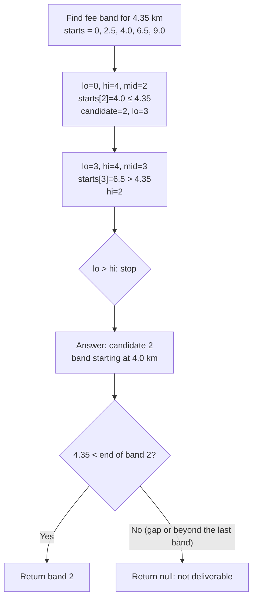
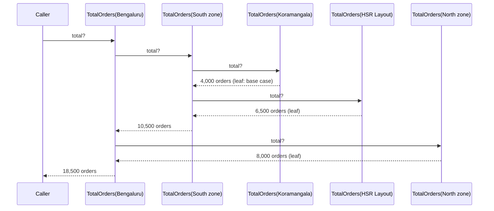
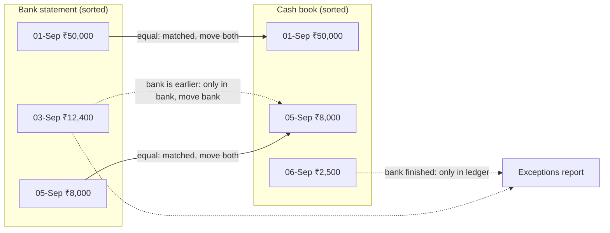

You will rarely be asked to write a sorting algorithm at work. You will, many times a year, need to find which slab, band or price tier a value falls into; sort records by three keys with a deterministic tie-break; decide whether two objects are "the same" for a dictionary; total up a tree of things; or walk two sorted lists together to see what is missing. This lesson covers exactly those algorithms, using a food-delivery platform (think of an app like Swiggy or Zomato) as the running example: delivery fees charged by distance band, a city → zone → restaurant hierarchy whose order numbers must be rolled up, a payouts bank account that must be reconciled against the platform's own books, and a support desk flooded with duplicate complaints.

## Learning objectives

By the end of this lesson you will be able to:

1. Use linear search and binary search, and write a correct "find the range this value falls into" lookup.
2. Sort data with `List.Sort`, LINQ `OrderBy`/`ThenBy` and custom comparers, and explain stability.
3. Explain what a hash function is, the `Equals`/`GetHashCode` contract, and where hashing appears in system design.
4. Write a recursive method with a clear base case, and convert it to a loop with an explicit stack when depth is a risk.
5. Apply the two-pointer technique to merge or reconcile two sorted lists in linear time.
6. Choose between these approaches for a given problem, and say when the built-in library or the database should do the work instead.

## Prerequisites

- [Big O notation, time and space complexity](#/lesson/m01-big-o): you should be able to say why O(log n) beats O(n).
- [Collections, generics and common data structures](#/lesson/m01-collections-generics): `List<T>`, `Dictionary`, `HashSet`, `Stack<T>`.

## Explain it like I'm a beginner

**Searching.** Looking for a name in an unsorted attendance sheet means reading every line (*linear search*). Looking for a word in a printed dictionary is different: you open the middle, see that "kilometre" comes after "jungle", and ignore the first half. A few such halvings and you are there (*binary search*). Binary search only works because the dictionary is **sorted**.

**Sorting.** A teacher arranging 60 answer sheets by roll number before entering marks is sorting. Sorting is rarely the goal; it is the step that makes the next job easy. Once sheets are sorted, finding roll number 47 is quick, and spotting a missing roll number is just walking the pile once.

**Hashing.** At a temple shoe stand, the attendant does not put your shoes "somewhere". They put them in rack 37 and give you token 37. Getting them back means going straight to rack 37. A **hash function** is the rule that turns something (your name, a vehicle number) into a rack number. Two different people can be given the same rack (a *collision*), so the attendant still checks the token inside the rack, but only a few pairs, not all of them.

**Recursion.** The Bengaluru city head asks: "How many orders did we deliver today?" She does not count 4,000 restaurants' orders herself. She asks each zone manager, "What's your total?" Each zone manager asks each of their restaurants. Each restaurant, which has no one below it, just answers with its own number. The answers flow back up and get added. A method that solves a problem by asking *smaller copies of the same question* is **recursive**. The restaurant that "just answers" is the **base case**; without one, the questions would never stop.

**Two pointers.** You have the bank's statement and your own cash book, both sorted by date. Put one finger on the first line of each. If they match, tick both and move both fingers down. If the bank's line is earlier, it is missing from your book; move the bank finger. And so on. Each finger only ever moves forward, so you finish in one pass. That is the **two-pointer** technique.

## First-principles explanation

### Linear search

Check each item until you find a match. O(n) time, no setup, works on any data.

```csharp
static int IndexOfCoupon(IReadOnlyList<string> codes, string wanted)
{
    for (int i = 0; i < codes.Count; i++)
        if (codes[i] == wanted) return i;
    return -1;
}
```

Linear search is the right choice more often than people think: when the data is small, unsorted, searched once, or when you need *every* match rather than one. LINQ's `First`, `Where` and `Any` are linear searches.

### Binary search

When data is sorted, compare the target with the middle item and discard the half that cannot contain it.

```csharp
static int BinarySearch(int[] sorted, int target)
{
    int lo = 0, hi = sorted.Length - 1;
    while (lo <= hi)
    {
        int mid = lo + (hi - lo) / 2;          // avoids int overflow of (lo + hi) on huge arrays
        if (sorted[mid] == target) return mid;
        if (sorted[mid] < target) lo = mid + 1;
        else hi = mid - 1;
    }
    return -1;
}
```

For 10 lakh items this needs about 20 comparisons. You should not normally write it yourself: `Array.BinarySearch`, `List<T>.BinarySearch` and `MemoryExtensions.BinarySearch` (on spans) do it. When the value is not found, they return a **negative** number: the bitwise complement (`~index`) of where it would be inserted. That detail is the key to the most useful variant.

**"Which range does this value fall in?"** This is the question business software actually asks:

- Which delivery-fee band covers a restaurant 4.35 km from the customer?
- Which income-tax slab does ₹14,20,000 fall into?
- Which shipping-charge band applies to a 3.2 kg parcel?

Store the *start* of each range in a sorted array, and find the **last start that is ≤ the value**:

```csharp
decimal[] bandStarts = { 0m, 2.5m, 4.0m, 6.5m, 9.0m };   // km where each delivery-fee band begins

int FindBand(decimal km)
{
    int i = Array.BinarySearch(bandStarts, km);
    if (i >= 0) return i;            // exactly on a boundary: that band starts here
    int insertAt = ~i;               // first start that is greater than km
    return insertAt - 1;             // the one before it (or -1 if km is before the first start)
}

FindBand(4.35m);   // 2 → the band starting at 4.0 km
FindBand(2.5m);    // 1 → boundaries belong to the band that starts there
```

Binary search has three classic bugs: forgetting that the data must be sorted (by the *same* rule you search with), off-by-one errors at boundaries, and the overflow in `(lo + hi) / 2` on very large arrays. Write tests for values below the first start, exactly on each boundary, and beyond the last range.

**Where binary search hides in systems**: database B-tree indexes do a multi-way version of it on every indexed lookup; `git bisect` binary-searches your commit history for the commit that introduced a bug; feature rollouts sometimes binary-search a config value.

### Sorting

.NET gives you two main tools:

| Tool | Algorithm | Stable? | Notes |
|---|---|---|---|
| `List<T>.Sort`, `Array.Sort` | Introsort (quicksort + heapsort + insertion sort) | **No** | Sorts in place, O(n log n), no extra list |
| LINQ `OrderBy` / `ThenBy` | Stable sort | **Yes** | Returns a new sequence; easy multi-key sorting |

**Stable** means items that compare equal keep their original relative order. It matters when you sort in stages or when equal keys should stay in arrival order. Suppose payment requests are already in the order they were received and you sort them by priority: with a stable sort, requests of the same priority stay first-come-first-served. With `List.Sort`, they may be shuffled.

**Multi-key sorting** is clearer in LINQ:

```csharp
var queue = tickets
    .OrderBy(t => t.City)
    .ThenByDescending(t => t.Priority)
    .ThenBy(t => t.CreatedAt)
    .ThenBy(t => t.Id)                   // final tie-break makes the order fully deterministic
    .ToList();
```

**Custom comparers** let you sort by rules that are not just "property A then B":

```csharp
// Sort hierarchy codes like "1.2.10" (city.zone.restaurant) numerically per part, so 1.2.9 comes before 1.2.10
sealed class OutlineCodeComparer : IComparer<string>
{
    public int Compare(string? a, string? b)
    {
        var pa = a!.Split('.'); var pb = b!.Split('.');
        for (int i = 0; i < Math.Min(pa.Length, pb.Length); i++)
        {
            int c = int.Parse(pa[i]).CompareTo(int.Parse(pb[i]));
            if (c != 0) return c;
        }
        return pa.Length.CompareTo(pb.Length);     // "1.2" before "1.2.1"
    }
}
```

A comparer must be **consistent**: if A < B and B < C then A < C, and comparing A with A gives 0. An inconsistent comparer (for example, one that uses `DateTime.Now` or random numbers) can make `List.Sort` produce garbage or throw.

**Text needs care.** `OrderBy(name)` on strings uses culture-sensitive comparison by default, which differs between machines. Use `StringComparer.Ordinal` for codes and IDs, and an explicit culture for names shown to users.

**When you would write a sort yourself:** almost never. Two exceptions worth knowing: **counting sort** when keys are small integers in a known range (exam marks 0–100: count how many of each, then emit; O(n + range)), and **external merge sort** when data does not fit in memory (sort chunks, write them to disk, then merge the sorted chunks with the two-pointer idea below). Databases do the second for big `ORDER BY` queries.

### Hashing

A **hash function** turns a value into a fixed-size number. Good hash functions are fast, always give the same output for the same input, and spread different inputs evenly.

**Hashing in collections.** `Dictionary` and `HashSet` call `GetHashCode()` to pick a bucket, then `Equals()` to compare items inside it. This gives the **contract** you must respect when you define your own equality:

1. If `a.Equals(b)` is true, then `a.GetHashCode() == b.GetHashCode()` **must** be true.
2. Equal hash codes do *not* mean equal objects (collisions are allowed).
3. The hash code must not change while the object is stored in a hash-based collection.

Break rule 1 and dictionary lookups silently fail. Break rule 3 (by changing a field used in the hash) and the item gets "lost" inside the set.

Records and record structs implement `Equals` and `GetHashCode` from their properties for you, which is why they make good keys. For a class with custom rules, implement `IEquatable<T>` and combine fields with `HashCode.Combine`:

```csharp
public sealed class VehicleNumber : IEquatable<VehicleNumber>
{
    public VehicleNumber(string raw) => Value = Normalise(raw);          // "hr 26-dq 5551" -> "HR26DQ5551"
    public string Value { get; }

    public bool Equals(VehicleNumber? other) => other is not null && Value == other.Value;
    public override bool Equals(object? obj) => Equals(obj as VehicleNumber);
    public override int GetHashCode() => Value.GetHashCode();             // same fields as Equals

    private static string Normalise(string raw) =>
        new string(raw.Where(char.IsLetterOrDigit).Select(char.ToUpperInvariant).ToArray());
}
```

**Hashing in system design** goes far beyond dictionaries:

| Use | What is hashed | Why |
|---|---|---|
| Deduplication / idempotency | A request ID or a normalised "fingerprint" of the content | Detect "seen this before" in O(1) |
| Caching | The cache key (URL, query parameters) | Find the cached answer instantly |
| Partitioning / sharding | A customer ID → `hash % N` | Spread data or work across N servers |
| Integrity checks | A file's bytes (SHA-256) | Detect corruption or tampering of uploads and downloads |
| Password storage | Password + salt, with a *slow* algorithm (PBKDF2, bcrypt, Argon2) | Store something that can be checked but not reversed |

Two warnings. **First**, `string.GetHashCode()` in .NET is randomised per process, so never store it or send it to another machine; use a stable algorithm such as SHA-256 when the hash must persist. **Second**, `hash % N` reshuffles almost every key when N changes from 4 servers to 5. That is the problem *consistent hashing* solves, covered in [Sharding and consistent hashing](#/lesson/m13-sharding). And never use a fast hash like SHA-256 alone for passwords; that is covered in the security module.

### Recursion

A recursive method calls itself on a smaller part of the problem. Every recursive method needs:

1. A **base case** that answers directly without recursing.
2. A **recursive case** that moves *towards* the base case.

Trees are the natural fit, because every subtree is itself a tree. The delivery network is a tree: Country → Cities → Zones (Koramangala, HSR Layout, Indiranagar) → Restaurants.

```csharp
static int TotalOrders(ZoneNode node)
{
    int total = node.OwnOrders;                     // base case is implicit: a leaf has no children
    foreach (var child in node.Children)
        total += TotalOrders(child);                // same question, smaller tree
    return total;
}
```

**How it runs.** Each call gets its own **stack frame** holding its local variables (`node`, `total`). Calls pile up on the **call stack** as the method goes deeper and unwind as each one returns. The call stack is a fixed-size area (commonly around 1 MB per thread by default; it depends on the OS and settings). Each frame uses a little of it.

**The failure mode: stack overflow.** If the recursion is very deep, or never stops because there is no base case or the data has a cycle (zone A is a child of B, which is a child of A), the stack fills up and .NET throws `StackOverflowException`. That exception **cannot be caught**; the whole process dies, taking every in-flight web request with it. Protect yourself by:

- Validating that the data is a tree (no cycles) when it is built.
- Adding a depth limit, and throwing a normal exception if it is exceeded.
- Converting deep recursion into a loop with an explicit `Stack<T>` (shown in the implementation below). The explicit stack lives on the heap and can grow to millions of items.

**Recursion that repeats work.** The textbook Fibonacci (`Fib(n) = Fib(n-1) + Fib(n-2)`) recomputes the same values exponentially many times. The fix is **memoisation**: remember answers in a dictionary. In business code the same thing appears as "compute a node's total once and cache it" when many reports ask for it.

**When not to use recursion:** for simple loops over a list (a `foreach` is clearer), and for data whose depth you don't control (user-uploaded JSON, deeply nested folders). For a city → zone → restaurant hierarchy with 4–6 levels, recursion is perfect and the most readable choice.

### Two pointers

When two sequences are **sorted by the same key**, you can process them together in one pass by keeping an index into each and always advancing the one that is "behind".

```csharp
// Merge two sorted lists into one sorted list: O(n + m)
static List<int> Merge(IReadOnlyList<int> a, IReadOnlyList<int> b)
{
    var result = new List<int>(a.Count + b.Count);
    int i = 0, j = 0;
    while (i < a.Count && j < b.Count)
        result.Add(a[i] <= b[j] ? a[i++] : b[j++]);   // <= keeps it stable: a's items first on ties
    while (i < a.Count) result.Add(a[i++]);
    while (j < b.Count) result.Add(b[j++]);
    return result;
}
```

The same skeleton does **reconciliation**: instead of copying, compare the current items. Equal → matched, advance both. Bank item smaller → only in bank, advance bank. Ledger item smaller → only in ledger, advance ledger. Each index only moves forward, so the total work is O(n + m), plus O(n log n + m log m) if you need to sort first.

Two other common shapes:

- **Opposite ends**: one pointer at the start and one at the end of a sorted array, moving inwards. Finds a pair with a given sum, or checks a palindrome.
- **Slow and fast**: one pointer reads, the other writes. Removes duplicates from a sorted array in place, using O(1) extra memory.

The **sliding window** from the [Big O lesson](#/lesson/m01-big-o) is a two-pointer technique too: the left and right edges of the window are the two pointers.

**Compared with hashing:** a dictionary-based reconciliation is O(n + m) without sorting but needs O(n) memory. Two pointers need sorted input but almost no extra memory, and they can stream data that does not fit in memory, which is why databases use a **merge join** for large sorted inputs.

### Choosing an approach

| Problem | First choice | Why |
|---|---|---|
| Find one item by key, many times | `Dictionary` / `HashSet` | O(1) per lookup after O(n) build |
| Find which range a value is in | Binary search on sorted starts | O(log n), no need for a key per value |
| Find all items matching a condition | Linear scan (LINQ `Where`) | You must look at every item anyway |
| Order results for display | LINQ `OrderBy` + `ThenBy` + final ID tie-break | Stable and deterministic |
| Total or search a tree | Recursion (with depth guard) | Mirrors the data's shape |
| Compare or merge two big sorted lists | Two pointers | O(n + m), streams, little memory |
| Data is in PostgreSQL | Let the database do it (indexes, `ORDER BY`, joins) | Avoids moving data to the app |

## Visual explanation

### Binary search for a delivery distance



This flowchart traces the "last start ≤ value" search for a 4.35 km delivery over five band start points. The first middle item (4.0) is not larger than the target, so it becomes the current best answer and the search moves right. The next middle (6.5) is too big, so the search moves left, and the range becomes empty. The best candidate found is band 2. A final check against that band's end handles gaps and the outer limit: a restaurant 14 km away falls after the last band (which ends at 12 km), so the app says "not deliverable" instead of charging a made-up fee. Two comparisons were enough here; for 10,000 bands it would be about 14.

### Recursion on the call stack



This sequence diagram shows the call stack during a recursive order roll-up for one day. Each arrow to the right is a new call that pushes a frame onto the stack; each dashed arrow back is a return that pops one. At the deepest point, the stack holds Bengaluru → South zone → Koramangala: three frames. Leaves answer immediately (the base case), parents add their children's answers, and the final total reaches the caller. The depth of the stack equals the depth of the tree, not the number of nodes, which is why recursion is safe for a 5-level hierarchy with 4,000 restaurants, and dangerous for a "tree" of unknown depth.

### Two-pointer reconciliation



This diagram shows a reconciliation of three bank lines against three cash-book lines, both sorted by date and then amount. The first pair matches, so both pointers move. Next, the bank's 3 September entry is earlier than the ledger's 5 September entry, so it cannot have a partner in the ledger: it goes on the exceptions report as "only in bank" (perhaps bank charges nobody recorded), and only the bank pointer moves. The 5 September entries match. Finally the bank list is exhausted, so the remaining ledger entry (a restaurant payout the bank has not processed yet) is "only in ledger". Six lines were processed in six steps, and it would be the same shape for 60 lakh lines.

## Step-by-step example

The platform team asks for a small service: "Given the distance from restaurant to customer, tell us the delivery-fee band; give us order and on-time totals for any city or zone; reconcile the payouts bank account every night; and stop the support desk from opening five tickets for the same complaint." We build each part with the simplest correct algorithm.

### Step 1: fee-band lookup, linear first

```csharp
DeliveryBand? Find(decimal km) => bands.FirstOrDefault(b => km >= b.FromKm && km < b.ToKm);
```

Correct, readable, and for 5 bands perfectly fine. Later, the pricing team moves to 50-metre steps out to 12 km for fairer fees: 240 bands per city. The lookup runs on every cart refresh, about 40,000 times a minute at dinner peak, so a linear scan does up to 40,000 × 240 ≈ 1 crore comparisons a minute. That is still cheap for a modern CPU (estimate: well under a second of CPU time), so this is not an emergency. But binary search needs about 8 comparisons per lookup instead of up to 240, and once it is wrapped in a class it costs nothing in readability, so we switch.

### Step 2: binary search with validation

Sort the bands by `FromKm` once in the constructor and **validate** them: each must end after it starts, and none may overlap. Binary search is only correct on clean, sorted data; validating once at the start is far cheaper than debugging wrong fees later. Rate cards are edited by people, so overlapping bands ("2–4 km: ₹25" and "3.5–6 km: ₹35") are a real risk.

### Step 3: order roll-up, recursive

Total orders is a straight sum. The on-time rate needs care: it is a **weighted** figure, so a zone with 6,500 orders at 85 % on time matters far more than a new restaurant with 20 orders at 100 %. The correct way is to add up on-time orders and total orders separately, then divide once at the top. Averaging the children's percentages (the "average of averages" mistake) gives a wrong answer whenever children have different sizes.

### Step 4: guard the recursion

The zone hierarchy is maintained by the operations team in a spreadsheet and imported. A wrong parent code can create a cycle. We add a depth limit of 64 levels to the recursive version and also show an iterative version using `Stack<T>` that tracks visited nodes.

### Step 5: reconciliation with two pointers

Sort bank entries and ledger entries by (date, amount), then walk both. Unmatched items on either side go into the exceptions report. Duplicates of the same (date, amount) pair are matched one-to-one in order, which is what accountants expect.

### Step 6: duplicate complaints with hashing

The support desk receives the same complaint ("order 4471 arrived cold, want refund") from the same mobile number several times within an hour, through the app, email and a chat bot. We normalise the text, combine it with the mobile number and the date, and hash it with SHA-256 to a stable fingerprint that can be stored in the database with a unique index.

## Production-style C# implementation

```text
FoodDelivery.Api/
  Program.cs
  Pricing/DeliveryBand.cs        // record + DeliveryFeeTable (binary search)
  Network/ZoneNode.cs            // tree node: country, city, zone or restaurant
  Network/OrderRollup.cs         // recursive + iterative roll-ups with guards
  Finance/StatementReconciler.cs // two-pointer reconciliation
  Support/ComplaintDesk.cs       // stable SHA-256 fingerprint for deduplication
```

```csharp file=Pricing/DeliveryBand.cs
namespace FoodDelivery.Api.Pricing;

/// <summary>A distance band [FromKm, ToKm) with a flat delivery fee in rupees.</summary>
public sealed record DeliveryBand(string Code, decimal FromKm, decimal ToKm, decimal Fee);

/// <summary>Sorted, validated bands with O(log n) lookup by distance.</summary>
public sealed class DeliveryFeeTable
{
    private readonly DeliveryBand[] _bands;

    public DeliveryFeeTable(IEnumerable<DeliveryBand> bands)
    {
        _bands = bands.OrderBy(b => b.FromKm).ToArray();     // O(n log n), once
        for (int i = 0; i < _bands.Length; i++)
        {
            var b = _bands[i];
            if (b.ToKm <= b.FromKm)
                throw new ArgumentException($"{b.Code}: end {b.ToKm} must be after start {b.FromKm}.");
            if (b.Fee < 0m)
                throw new ArgumentException($"{b.Code}: fee cannot be negative.");
            if (i > 0 && b.FromKm < _bands[i - 1].ToKm)
                throw new ArgumentException($"{b.Code} overlaps {_bands[i - 1].Code}.");
        }
    }

    public int Count => _bands.Length;

    /// <summary>Finds the last band whose start is ≤ km, then checks km is before its end (gaps and "too far" return null).</summary>
    public DeliveryBand? Find(decimal km)
    {
        int lo = 0, hi = _bands.Length - 1, candidate = -1;
        while (lo <= hi)
        {
            int mid = lo + (hi - lo) / 2;
            if (_bands[mid].FromKm <= km) { candidate = mid; lo = mid + 1; }
            else hi = mid - 1;
        }
        if (candidate < 0) return null;
        var band = _bands[candidate];
        return km < band.ToKm ? band : null;
    }
}
```

```csharp file=Network/ZoneNode.cs
namespace FoodDelivery.Api.Network;

/// <summary>One node in the delivery network (country, city, zone or restaurant). Leaves carry the day's order counts.</summary>
public sealed class ZoneNode
{
    private readonly List<ZoneNode> _children = new();

    public ZoneNode(string code, string name, int ownOrders = 0, int onTimeOrders = 0)
    {
        ArgumentException.ThrowIfNullOrWhiteSpace(code);
        ArgumentOutOfRangeException.ThrowIfNegative(ownOrders);
        ArgumentOutOfRangeException.ThrowIfNegative(onTimeOrders);
        ArgumentOutOfRangeException.ThrowIfGreaterThan(onTimeOrders, ownOrders);
        Code = code;
        Name = name;
        OwnOrders = ownOrders;
        OnTimeOrders = onTimeOrders;
    }

    public string Code { get; }
    public string Name { get; }
    public int OwnOrders { get; }
    public int OnTimeOrders { get; }
    public IReadOnlyList<ZoneNode> Children => _children;

    public ZoneNode Add(params ZoneNode[] children)
    {
        foreach (var child in children)
        {
            if (ReferenceEquals(child, this)) throw new InvalidOperationException("A node cannot be its own child.");
            _children.Add(child);
        }
        return this;
    }
}
```

```csharp file=Network/OrderRollup.cs
namespace FoodDelivery.Api.Network;

public sealed record ZoneSummary(string Code, long TotalOrders, long OnTimeOrders, decimal OnTimePercent, int NodeCount);

public static class OrderRollup
{
    public const int MaxDepth = 64;

    /// <summary>Recursive: clearest code for a tree. Depth guard turns a cycle into a normal exception.</summary>
    public static long TotalOrders(ZoneNode node) => TotalOrders(node, depth: 0);

    private static long TotalOrders(ZoneNode node, int depth)
    {
        if (depth > MaxDepth)
            throw new InvalidOperationException($"Hierarchy deeper than {MaxDepth} levels at {node.Code}. Is there a cycle?");
        long total = node.OwnOrders;
        foreach (var child in node.Children)
            total += TotalOrders(child, depth + 1);
        return total;
    }

    /// <summary>Iterative with an explicit stack: no call-stack limit, and detects cycles by tracking visited nodes.</summary>
    public static ZoneSummary Summarise(ZoneNode root)
    {
        ArgumentNullException.ThrowIfNull(root);
        var visited = new HashSet<ZoneNode>(ReferenceEqualityComparer.Instance);
        var pending = new Stack<ZoneNode>();
        pending.Push(root);

        long orders = 0, onTime = 0;
        while (pending.TryPop(out var node))
        {
            if (!visited.Add(node))
                throw new InvalidOperationException($"Node {node.Code} is reachable twice (cycle or shared child).");
            orders += node.OwnOrders;
            onTime += node.OnTimeOrders;                 // add counts, divide once at the end
            foreach (var child in node.Children) pending.Push(child);
        }

        var percent = orders == 0 ? 0m : Math.Round((decimal)onTime / orders * 100m, 2);
        return new ZoneSummary(root.Code, orders, onTime, percent, visited.Count);
    }
}
```

```csharp file=Finance/StatementReconciler.cs
namespace FoodDelivery.Api.Finance;

public sealed record BankLine(DateOnly Date, decimal Amount, string Reference);
public sealed record LedgerLine(DateOnly Date, decimal Amount, string Voucher);
public sealed record MatchedLine(BankLine Bank, LedgerLine Ledger);
public sealed record Reconciliation(IReadOnlyList<MatchedLine> Matched, IReadOnlyList<BankLine> OnlyInBank, IReadOnlyList<LedgerLine> OnlyInLedger);

/// <summary>Sort both sides by (date, amount), then walk them together. Time O(n log n + m log m); the walk is O(n + m).</summary>
public sealed class StatementReconciler
{
    public Reconciliation Reconcile(IEnumerable<BankLine> bank, IEnumerable<LedgerLine> ledger)
    {
        var b = bank.OrderBy(x => x.Date).ThenBy(x => x.Amount).ToList();     // stable: keeps input order on ties
        var l = ledger.OrderBy(x => x.Date).ThenBy(x => x.Amount).ToList();

        var matched = new List<MatchedLine>();
        var onlyBank = new List<BankLine>();
        var onlyLedger = new List<LedgerLine>();
        int i = 0, j = 0;

        while (i < b.Count && j < l.Count)
        {
            int cmp = Compare(b[i].Date, b[i].Amount, l[j].Date, l[j].Amount);
            if (cmp == 0) matched.Add(new MatchedLine(b[i++], l[j++]));
            else if (cmp < 0) onlyBank.Add(b[i++]);
            else onlyLedger.Add(l[j++]);
        }
        while (i < b.Count) onlyBank.Add(b[i++]);
        while (j < l.Count) onlyLedger.Add(l[j++]);

        return new Reconciliation(matched, onlyBank, onlyLedger);
    }

    private static int Compare(DateOnly d1, decimal a1, DateOnly d2, decimal a2)
    {
        int byDate = d1.CompareTo(d2);
        return byDate != 0 ? byDate : a1.CompareTo(a2);
    }
}
```

```csharp file=Support/ComplaintDesk.cs
using System.Security.Cryptography;
using System.Text;

namespace FoodDelivery.Api.Support;

public sealed record Complaint(string Fingerprint, string Mobile, string Text, DateTimeOffset FirstReportedAt, int Reports);

/// <summary>
/// Deduplicates complaints with a STABLE hash (SHA-256), not string.GetHashCode(), because the fingerprint
/// is meant to be stored in a database column with a unique index and compared across servers and restarts.
/// The in-memory dictionary stands in for that table; it grows forever, so production code uses PostgreSQL.
/// </summary>
public sealed class ComplaintDesk(TimeProvider clock)
{
    private readonly Lock _gate = new();
    private readonly Dictionary<string, Complaint> _byFingerprint = new(StringComparer.Ordinal);

    public (Complaint Complaint, bool IsDuplicate) Submit(string mobile, string text)
    {
        ArgumentException.ThrowIfNullOrWhiteSpace(mobile);
        ArgumentException.ThrowIfNullOrWhiteSpace(text);
        var now = clock.GetUtcNow();
        var fingerprint = Fingerprint(mobile, text, DateOnly.FromDateTime(now.UtcDateTime));

        lock (_gate)
        {
            if (_byFingerprint.TryGetValue(fingerprint, out var existing))
            {
                var updated = existing with { Reports = existing.Reports + 1 };
                _byFingerprint[fingerprint] = updated;
                return (updated, true);
            }
            var created = new Complaint(fingerprint, mobile.Trim(), text.Trim(), now, 1);
            _byFingerprint[fingerprint] = created;
            return (created, false);
        }
    }

    /// <summary>Normalise (case, spaces, punctuation), then hash. Same complaint, same day, same caller = same fingerprint.</summary>
    public static string Fingerprint(string mobile, string text, DateOnly day)
    {
        var words = text.ToLowerInvariant()
            .Split((char[]?)null, StringSplitOptions.RemoveEmptyEntries)
            .Select(w => new string(w.Where(char.IsLetterOrDigit).ToArray()))
            .Where(w => w.Length > 0);
        var canonical = $"{mobile.Trim()}|{day:yyyy-MM-dd}|{string.Join(' ', words)}";
        return Convert.ToHexString(SHA256.HashData(Encoding.UTF8.GetBytes(canonical)));
    }
}
```

```csharp file=Program.cs
using FoodDelivery.Api.Finance;
using FoodDelivery.Api.Network;
using FoodDelivery.Api.Pricing;
using FoodDelivery.Api.Support;

var builder = WebApplication.CreateBuilder(args);

// Illustrative data. A real system would load this from PostgreSQL at startup and refresh it on change.
builder.Services.AddSingleton(new DeliveryFeeTable(
[
    new DeliveryBand("B1", 0m, 2.5m, 15m),
    new DeliveryBand("B2", 2.5m, 4.0m, 25m),
    new DeliveryBand("B3", 4.0m, 6.5m, 35m),
    new DeliveryBand("B4", 6.5m, 9.0m, 49m),
    new DeliveryBand("B5", 9.0m, 12.0m, 69m),
]));
builder.Services.AddSingleton(new ZoneNode("1", "Bengaluru").Add(
    new ZoneNode("1.1", "South zone").Add(
        new ZoneNode("1.1.1", "Koramangala", ownOrders: 4_000, onTimeOrders: 3_600),
        new ZoneNode("1.1.2", "HSR Layout", ownOrders: 6_500, onTimeOrders: 5_525)),
    new ZoneNode("1.2", "North zone", ownOrders: 8_000, onTimeOrders: 7_440)));
builder.Services.AddSingleton<StatementReconciler>();
builder.Services.AddSingleton(TimeProvider.System);
builder.Services.AddSingleton<ComplaintDesk>();

var app = builder.Build();

app.MapGet("/delivery-fee/{km:decimal}", (decimal km, DeliveryFeeTable table) =>
    table.Find(km) is { } band ? Results.Ok(band) : Results.NotFound(new { error = $"No delivery band covers {km} km." }));

app.MapGet("/network/summary", (ZoneNode root) => Results.Ok(OrderRollup.Summarise(root)));

app.MapPost("/reconcile", (ReconcileRequest req, StatementReconciler reconciler) =>
    Results.Ok(reconciler.Reconcile(req.Bank, req.Ledger)));

app.MapPost("/complaints", (ComplaintRequest req, ComplaintDesk desk) =>
{
    var (complaint, duplicate) = desk.Submit(req.Mobile, req.Text);
    return duplicate ? Results.Ok(complaint) : Results.Created($"/complaints/{complaint.Fingerprint}", complaint);
});

app.Run();

public sealed record ReconcileRequest(IReadOnlyList<BankLine> Bank, IReadOnlyList<LedgerLine> Ledger);
public sealed record ComplaintRequest(string Mobile, string Text);
```

With the sample data, `/network/summary` returns 18,500 orders, 16,565 on time, 89.54 %. Averaging the three leaf percentages (90 %, 85 %, 93 %) would give 89.33 %, which is wrong because HSR Layout and North zone handle more orders than Koramangala.

What to notice:

- **Validate once, search many times.** `DeliveryFeeTable` sorts and checks the bands in its constructor. Every later lookup can trust the data.
- **Two versions of the tree walk.** The recursive `TotalOrders` is the clearest; the iterative `Summarise` handles any depth and detects cycles and shared children. In real code, pick one, based on how much you trust the data.
- **Sum counts, divide once.** The on-time percentage is computed from summed counts, never by averaging child percentages.
- **`ReferenceEqualityComparer`** makes the `visited` set compare nodes by identity, not by any `Equals` override, which is what "have I been at this exact node?" means.
- **Stable sort matters in the reconciler.** Two bank lines with the same date and amount are matched to ledger lines in their original order, which makes the report repeatable.
- **Stable hash for stored fingerprints.** `string.GetHashCode()` would change on every restart. SHA-256 gives the same 64-character hex string on every machine, so the database can enforce uniqueness.
- **What this design leaves out.** Real reconciliation also matches on references (UTR numbers), tolerates small differences and handles one bank credit settling many orders. Real distances come from a maps/routing service, not straight lines, and the fee table is cached and refreshed when pricing changes. The algorithms stay the same; the rules grow.

## Bad design vs good design

**Bad:** reconciling by nested search, with ad-hoc deletion.

```csharp
var unmatchedLedger = ledger.ToList();
var onlyInBank = new List<BankLine>();
foreach (var b in bank)
{
    var match = unmatchedLedger.FirstOrDefault(l => l.Date == b.Date && l.Amount == b.Amount);  // O(m) scan
    if (match is null) onlyInBank.Add(b);
    else unmatchedLedger.Remove(match);                                                     // another O(m)
}
```

It is correct, and for a month of a small restaurant's transactions (a few hundred lines) it is fine. For a payouts account with 3 lakh lines a month on each side, it does up to 3 lakh × 3 lakh = 9 × 10¹⁰ comparisons, on the order of minutes by the ~1 ns-per-step estimate, plus a `Remove` that shifts the list each time. It also hides a fragile assumption: `Remove(match)` uses `Equals`. With records that means "the first value-equal line", which happens to be fine; if someone later turns `LedgerLine` into a class that overrides `Equals` differently (say, by voucher number only), `Remove` can delete a different line from the one that was matched, and the report quietly goes wrong.

**Good:** the `StatementReconciler` above: sort both sides once, walk once. O(n log n + m log m), predictable, and easy to extend with tolerance rules.

**Also good, sometimes better:** a dictionary from (date, amount) to a queue of ledger lines. No sorting, O(n + m), but more memory and the output order follows the bank file. And if both tables are already in PostgreSQL, a `FULL OUTER JOIN` on `(date, amount, row_number() over (partition by date, amount))` lets the database do it with its own merge or hash join.

**Is the improvement always worth it?** For a few hundred lines, the nested version is readable and fast enough. Switch when data grows, or when the job runs often enough that minutes matter. The two-pointer version is not much harder to read, so it is a cheap upgrade.

:::callout type=mistake title="Overriding Equals but not GetHashCode"
If you override `Equals` so that two `VehicleNumber` objects with the same normalised value are equal, but leave `GetHashCode` as the default (based on object identity), a `HashSet<VehicleNumber>` will treat them as different: they land in different buckets and `Equals` is never even called. The compiler warns you (CS0659). Always override both, using the same fields.
:::

:::callout type=tradeoff title="Recursion or explicit stack?"
Recursion is shorter and mirrors the tree, so reviewers understand it quickly. An explicit `Stack<T>` survives any depth and makes cycle detection natural, but the code is longer and the visiting order can surprise people. Use recursion for data you control with known shallow depth; use the explicit stack for user-supplied or unbounded data.
:::

## Practical playground

:::playground type=csharp title="Search, recurse and walk with two pointers"
```csharp file=Program.cs
using System;
using System.Collections.Generic;
using System.Linq;

public sealed record Node(string Name, int Orders, List<Node> Children);

public static class Program
{
    public static void Main()
    {
        // 1. Binary search for "last start ≤ value"
        decimal[] slabStarts = { 0m, 4_00_000m, 8_00_000m, 12_00_000m, 16_00_000m, 20_00_000m, 24_00_000m };
        foreach (var income in new[] { 3_50_000m, 8_00_000m, 14_20_000m, 30_00_000m })
        {
            int i = Array.BinarySearch(slabStarts, income);
            int slab = i >= 0 ? i : ~i - 1;
            Console.WriteLine($"Income {income:N0} falls in slab {slab} (starts at {slabStarts[slab]:N0})");
        }

        // 2. Recursion over a tree
        var city = new Node("Bengaluru", 0, new()
        {
            new("South zone", 0, new() { new("Koramangala", 4_000, new()), new("HSR Layout", 6_500, new()) }),
            new("North zone", 8_000, new()),
        });
        Print(city, 0);
        Console.WriteLine($"Total orders today: {Total(city):N0}");

        // 3. Two pointers: what is in one sorted list but not the other?
        int[] bank = { 100, 250, 250, 400, 900 };
        int[] books = { 100, 250, 400, 600 };
        int a = 0, b = 0;
        while (a < bank.Length || b < books.Length)
        {
            if (b == books.Length || (a < bank.Length && bank[a] < books[b])) Console.WriteLine($"only in bank:  {bank[a++]}");
            else if (a == bank.Length || books[b] < bank[a]) Console.WriteLine($"only in books: {books[b++]}");
            else { Console.WriteLine($"matched:       {bank[a]}"); a++; b++; }
        }

        // 4. Sorting: stable LINQ vs multi-key
        var tickets = new[] { ("Late order", 2), ("Refund", 1), ("Wrong item", 2), ("Payment failed", 1) };
        Console.WriteLine(string.Join(", ", tickets.OrderBy(t => t.Item2).Select(t => t.Item1)));  // ties keep input order

        // Experiments:
        // 1. Add a restaurant under "HSR Layout" and check the total updates without changing Total().
        // 2. Remove the 'if (n.Children.Count == 0)' shortcut in Total. Does it still work? Why?
        // 3. Make the bank array unsorted. What goes wrong with the two-pointer walk?
        // 4. Try an income below 0 in step 1. What does ~i - 1 give, and how would you guard it?
    }

    static int Total(Node n)
    {
        if (n.Children.Count == 0) return n.Orders;           // base case
        return n.Orders + n.Children.Sum(Total);               // recursive case
    }

    static void Print(Node n, int depth)
    {
        Console.WriteLine($"{new string(' ', depth * 2)}- {n.Name} ({n.Orders:N0})");
        foreach (var c in n.Children) Print(c, depth + 1);
    }
}
```
:::

## Exercises

:::exercise id=m01-algorithms-ex1 difficulty=beginner kind=code title="Which fee band covers this distance?"
Given the sorted start distances (in km) of delivery-fee bands, return the index of the band that contains a delivery distance, using binary search.
::requirements
- `FeeBandSearch.FindBand(starts, km)` returns the index of the **last** start that is ≤ `km`.
- If `km` is before the first start, return `-1`.
- A distance exactly on a boundary belongs to the band that starts there.
- Must be O(log n). A stress test uses 10 lakh starts (far more than any real rate card) to make a linear scan visibly slow.
::acceptance
- Starts `[0, 2.5, 4.0, 6.5, 9.0]`: 4.35 → 2; 2.5 → 1; 2.49 → 0; 0 → 0; 13 → 4 (the caller then checks the band's end).
- `km = -1` returns `-1`.
- An empty array returns `-1`.
- 10 lakh starts and 1 lakh lookups complete well under the time limit.
::hint
Linear search would work but is O(n). The array is sorted; what does that let you do?
::hint
Keep `lo`, `hi` and a `candidate` (best answer so far, starting at -1). If `starts[mid] <= km`, `mid` is a possible answer, but there may be a later one: record it and search right.
::hint
Otherwise `starts[mid]` is too big: search left with `hi = mid - 1`. Stop when `lo > hi`.
::hint
```csharp
int lo = 0, hi = starts.Length - 1, candidate = -1;
while (lo <= hi)
{
    int mid = lo + (hi - lo) / 2;
    if (starts[mid] <= km) { candidate = mid; lo = mid + 1; }
    else hi = mid - 1;
}
return candidate;
```
::starter
```csharp file=FeeBandSearch.cs
using System;

public static class FeeBandSearch
{
    public static int FindBand(decimal[] starts, decimal km) => throw new NotImplementedException();
}
```
::tests
```csharp file=FeeBandSearchTests.cs
using System;
using System.Diagnostics;
using System.Linq;
using Xunit;

public class FeeBandSearchTests
{
    private static readonly decimal[] Starts = { 0m, 2.5m, 4.0m, 6.5m, 9.0m };

    [Theory]
    [InlineData(4.35, 2)]
    [InlineData(2.5, 1)]
    [InlineData(0, 0)]
    [InlineData(13, 4)]
    [InlineData(-1, -1)]
    [InlineData(2.49, 0)]
    public void Finds_band(double km, int expected) =>
        Assert.Equal(expected, FeeBandSearch.FindBand(Starts, (decimal)km));

    [Fact]
    public void Empty_array() => Assert.Equal(-1, FeeBandSearch.FindBand(Array.Empty<decimal>(), 5m));

    [Fact]
    public void Large_input_is_logarithmic()
    {
        var starts = Enumerable.Range(0, 1_000_000).Select(i => i * 0.05m).ToArray();
        var sw = Stopwatch.StartNew();
        long checksum = 0;
        for (int i = 0; i < 100_000; i++) checksum += FeeBandSearch.FindBand(starts, i * 0.37m);
        sw.Stop();
        Assert.Equal(7, FeeBandSearch.FindBand(starts, 0.37m));
        Assert.True(checksum > 0);
        Assert.True(sw.Elapsed < TimeSpan.FromSeconds(3), $"Took {sw.Elapsed.TotalMilliseconds} ms");
    }
}
```
::solution
```csharp file=FeeBandSearch.cs
using System;

public static class FeeBandSearch
{
    /// <summary>Index of the last start ≤ km, or -1. O(log n). Requires starts sorted ascending.</summary>
    public static int FindBand(decimal[] starts, decimal km)
    {
        ArgumentNullException.ThrowIfNull(starts);
        int lo = 0, hi = starts.Length - 1, candidate = -1;
        while (lo <= hi)
        {
            int mid = lo + (hi - lo) / 2;
            if (starts[mid] <= km)
            {
                candidate = mid;     // possible answer; a later start might also qualify
                lo = mid + 1;
            }
            else
            {
                hi = mid - 1;
            }
        }
        return candidate;
    }
}
```

Each loop halves the range, so 10 lakh starts need about 20 iterations. The `candidate` variable avoids special cases: it is only updated when a start qualifies, so a value before the first start leaves it at -1.
::alternatives
`Array.BinarySearch(starts, km)` returns the index for an exact match, or the complement of the insertion point: `int i = Array.BinarySearch(starts, km); return i >= 0 ? i : ~i - 1;`. That is shorter and well tested; writing it by hand here is for understanding.
::mistakes
- Returning as soon as `starts[mid] == km` is not wrong here, but searching for "last ≤" without the candidate variable often returns the *first* qualifying index instead of the last.
- `int mid = (lo + hi) / 2` can overflow for arrays with more than about a billion items; `lo + (hi - lo) / 2` cannot.
- Forgetting that the array must be sorted. Unsorted input gives wrong answers silently.
::extensions
Accept `DeliveryBand` records with an end distance and return `null` for a distance in a gap or beyond the last band (not deliverable).
:::

:::exercise id=m01-algorithms-ex2 difficulty=beginner kind=code title="Recursive document folder sizes"
The platform keeps restaurant menus, licences and photos in nested folders on its shared drive. Implement recursive methods on `DocFolder` that work at any depth.
::requirements
- `TotalBytes()` returns the size of all files in this folder and every subfolder.
- `FileCount()` returns the number of files in this folder and every subfolder.
- `Depth()` returns 1 for a folder with no subfolders, otherwise 1 + the deepest subfolder's depth.
- `FindPath(fileName)` returns the path of the first file with that name (searching this folder's files first, then subfolders in order), such as `"Partners/Menus/Bengaluru/menu-1042.pdf"`, or `null`.
::acceptance
- An empty folder has 0 bytes, 0 files and depth 1.
- A folder with 2 files (100 and 250 bytes) and a subfolder with 1 file (50 bytes) has 400 bytes and 3 files.
- A chain of three nested folders has depth 3.
- `FindPath("menu-1042.pdf")` returns the full path joined with `/`.
::hint
For each method, ask two questions: what is the answer for a folder with no subfolders (base case)? How do I combine the subfolders' answers (recursive case)?
::hint
`TotalBytes` = sum of my files' sizes + sum of `child.TotalBytes()` for each child. `Depth` = 1 + the maximum of children's depths (or 1 if there are none).
::hint
For `FindPath`, check this folder's files first and return `$"{Name}/{file}"`. Otherwise ask each child; if a child returns a path, prefix it with `Name + "/"`.
::hint
```csharp
public int Depth() => 1 + (_subfolders.Count == 0 ? 0 : _subfolders.Max(f => f.Depth()));
```
::starter
```csharp file=DocFolder.cs
using System;
using System.Collections.Generic;
using System.Linq;

public sealed class DocFolder
{
    private readonly List<(string Name, long Bytes)> _files = new();
    private readonly List<DocFolder> _subfolders = new();

    public DocFolder(string name) => Name = name;

    public string Name { get; }

    public DocFolder AddFile(string name, long bytes) { _files.Add((name, bytes)); return this; }
    public DocFolder AddFolder(DocFolder folder) { _subfolders.Add(folder); return this; }

    public long TotalBytes() => throw new NotImplementedException();
    public int FileCount() => throw new NotImplementedException();
    public int Depth() => throw new NotImplementedException();
    public string? FindPath(string fileName) => throw new NotImplementedException();
}
```
::tests
```csharp file=DocFolderTests.cs
using Xunit;

public class DocFolderTests
{
    [Fact]
    public void Empty_folder()
    {
        var f = new DocFolder("Empty");
        Assert.Equal(0L, f.TotalBytes());
        Assert.Equal(0, f.FileCount());
        Assert.Equal(1, f.Depth());
    }

    [Fact]
    public void Sums_across_levels()
    {
        var root = new DocFolder("Partners").AddFile("a.pdf", 100).AddFile("b.pdf", 250)
            .AddFolder(new DocFolder("Sub").AddFile("c.pdf", 50));
        Assert.Equal(400L, root.TotalBytes());
        Assert.Equal(3, root.FileCount());
        Assert.Equal(2, root.Depth());
    }

    [Fact]
    public void Depth_of_chain()
    {
        var root = new DocFolder("A").AddFolder(new DocFolder("B").AddFolder(new DocFolder("C")));
        Assert.Equal(3, root.Depth());
    }

    [Fact]
    public void Finds_path()
    {
        var root = new DocFolder("Partners")
            .AddFolder(new DocFolder("Reports").AddFile("payouts-sep.pdf", 10))
            .AddFolder(new DocFolder("Menus").AddFolder(new DocFolder("Bengaluru").AddFile("menu-1042.pdf", 900)));
        Assert.Equal("Partners/Menus/Bengaluru/menu-1042.pdf", root.FindPath("menu-1042.pdf"));
        Assert.Null(root.FindPath("missing.dwg"));
    }
}
```
::solution
```csharp file=DocFolder.cs
using System;
using System.Collections.Generic;
using System.Linq;

public sealed class DocFolder
{
    private readonly List<(string Name, long Bytes)> _files = new();
    private readonly List<DocFolder> _subfolders = new();

    public DocFolder(string name) => Name = name;

    public string Name { get; }

    public DocFolder AddFile(string name, long bytes) { _files.Add((name, bytes)); return this; }
    public DocFolder AddFolder(DocFolder folder) { _subfolders.Add(folder); return this; }

    public long TotalBytes() => _files.Sum(f => f.Bytes) + _subfolders.Sum(s => s.TotalBytes());

    public int FileCount() => _files.Count + _subfolders.Sum(s => s.FileCount());

    public int Depth() => 1 + (_subfolders.Count == 0 ? 0 : _subfolders.Max(s => s.Depth()));

    public string? FindPath(string fileName)
    {
        foreach (var file in _files)
            if (file.Name == fileName) return $"{Name}/{file.Name}";

        foreach (var sub in _subfolders)
            if (sub.FindPath(fileName) is { } path) return $"{Name}/{path}";

        return null;
    }
}
```

Each method handles one folder and trusts the same method to handle each subfolder. The base case is built in: with no subfolders, the `Sum` over children is 0 and `Max` is skipped. `FindPath` stops at the first match, so it does not visit the rest of the tree.
::mistakes
- Calling `_subfolders.Max(...)` on an empty list, which throws `InvalidOperationException`.
- Building the path from the leaf upwards without the parent names, giving just `"menu-1042.pdf"`.
- Using `int` for bytes. A folder of restaurant photos can easily exceed 2 GB (`int.MaxValue` is about 2.1 billion).
::extensions
Add a depth guard (throw beyond 100 levels). Rewrite `TotalBytes` without recursion using a `Stack<DocFolder>`.
:::

:::exercise id=m01-algorithms-ex3 difficulty=intermediate kind=code title="Reconcile two sorted amount lists"
Write the core of a reconciliation job: given two lists of amounts, each already sorted ascending, report how many matched and which are missing from either side. Duplicates match one-to-one.
::requirements
- `Reconciler.Reconcile(bank, books)` returns a `ReconcileResult(int Matched, IReadOnlyList<decimal> OnlyInBank, IReadOnlyList<decimal> OnlyInBooks)`.
- Both inputs must be sorted ascending; if either is not, throw `ArgumentException`.
- Time O(n + m), extra space only for the output lists.
::acceptance
- Bank `[100, 250, 250, 400, 900]` and books `[100, 250, 400, 600]` → matched 3, only in bank `[250, 900]`, only in books `[600]`.
- Two empty lists → 0 matched, two empty lists.
- An unsorted input throws `ArgumentException`.
- 10 lakh items on each side complete well under the time limit.
::hint
Keep an index into each list. Compare the two current items. There are only three cases: equal, bank smaller, books smaller.
::hint
Equal: count a match and advance both. Bank smaller: that bank amount cannot appear later in books (books only get bigger), so it is only in bank; advance bank. The mirror case advances books.
::hint
After the main loop, one list may still have items. They are all unmatched.
::hint
Check sortedness first in one pass each: `for (int k = 1; k < list.Count; k++) if (list[k] < list[k - 1]) throw ...`.
::starter
```csharp file=Reconciler.cs
using System;
using System.Collections.Generic;

public sealed record ReconcileResult(int Matched, IReadOnlyList<decimal> OnlyInBank, IReadOnlyList<decimal> OnlyInBooks);

public static class Reconciler
{
    public static ReconcileResult Reconcile(IReadOnlyList<decimal> bank, IReadOnlyList<decimal> books) =>
        throw new NotImplementedException();
}
```
::tests
```csharp file=ReconcilerTests.cs
using System;
using System.Diagnostics;
using System.Linq;
using Xunit;

public class ReconcilerTests
{
    [Fact]
    public void Matches_and_reports_differences()
    {
        var r = Reconciler.Reconcile(new[] { 100m, 250m, 250m, 400m, 900m }, new[] { 100m, 250m, 400m, 600m });
        Assert.Equal(3, r.Matched);
        Assert.Equal(new[] { 250m, 900m }, r.OnlyInBank.ToArray());
        Assert.Equal(new[] { 600m }, r.OnlyInBooks.ToArray());
    }

    [Fact]
    public void Empty_lists()
    {
        var r = Reconciler.Reconcile(Array.Empty<decimal>(), Array.Empty<decimal>());
        Assert.Equal(0, r.Matched);
        Assert.Empty(r.OnlyInBank);
        Assert.Empty(r.OnlyInBooks);
    }

    [Fact]
    public void One_side_empty()
    {
        var r = Reconciler.Reconcile(new[] { 5m, 7m }, Array.Empty<decimal>());
        Assert.Equal(new[] { 5m, 7m }, r.OnlyInBank.ToArray());
    }

    [Fact]
    public void Unsorted_input_throws() =>
        Assert.Throws<ArgumentException>(() => Reconciler.Reconcile(new[] { 3m, 1m }, new[] { 1m }));

    [Fact]
    public void Large_input_is_linear()
    {
        var bank = Enumerable.Range(0, 1_000_000).Select(i => (decimal)(i * 2)).ToArray();
        var books = Enumerable.Range(0, 1_000_000).Select(i => (decimal)(i * 3)).ToArray();
        var sw = Stopwatch.StartNew();
        var r = Reconciler.Reconcile(bank, books);
        sw.Stop();
        Assert.Equal(333_334, r.Matched);   // multiples of 6 below 2,000,000
        Assert.True(sw.Elapsed < TimeSpan.FromSeconds(3));
    }
}
```
::solution
```csharp file=Reconciler.cs
using System;
using System.Collections.Generic;

public sealed record ReconcileResult(int Matched, IReadOnlyList<decimal> OnlyInBank, IReadOnlyList<decimal> OnlyInBooks);

public static class Reconciler
{
    /// <summary>Two-pointer walk over two ascending lists. O(n + m).</summary>
    public static ReconcileResult Reconcile(IReadOnlyList<decimal> bank, IReadOnlyList<decimal> books)
    {
        EnsureSorted(bank, nameof(bank));
        EnsureSorted(books, nameof(books));

        var onlyBank = new List<decimal>();
        var onlyBooks = new List<decimal>();
        int i = 0, j = 0, matched = 0;

        while (i < bank.Count && j < books.Count)
        {
            if (bank[i] == books[j]) { matched++; i++; j++; }
            else if (bank[i] < books[j]) onlyBank.Add(bank[i++]);
            else onlyBooks.Add(books[j++]);
        }
        while (i < bank.Count) onlyBank.Add(bank[i++]);
        while (j < books.Count) onlyBooks.Add(books[j++]);

        return new ReconcileResult(matched, onlyBank, onlyBooks);
    }

    private static void EnsureSorted(IReadOnlyList<decimal> list, string name)
    {
        ArgumentNullException.ThrowIfNull(list, name);
        for (int k = 1; k < list.Count; k++)
            if (list[k] < list[k - 1])
                throw new ArgumentException($"{name} must be sorted ascending (position {k}).", name);
    }
}
```

The key insight is that when `bank[i] < books[j]`, every remaining book amount is at least `books[j]`, so `bank[i]` can never be matched. That is what makes it safe to move on and why sortedness is a hard requirement, checked up front.
::alternatives
A `Dictionary<decimal, int>` counting book amounts works on unsorted input in O(n + m) but uses O(m) memory. If the data comes from PostgreSQL, ask for it `ORDER BY amount` and stream both result sets through this same walk, so the app never holds everything in memory.
::mistakes
- Using a `HashSet<decimal>`, which loses duplicates: two ₹250 entries in the bank and one in books would wrongly count as fully matched.
- Advancing the wrong pointer in the "smaller" branches, which skips items silently.
- Skipping the sortedness check; unsorted input produces a plausible-looking but wrong report.
::extensions
Work on records `(DateOnly Date, decimal Amount)` sorted by date then amount. Allow a match when amounts differ by at most ₹1.
:::

:::exercise id=m01-algorithms-ex4 difficulty=intermediate kind=code title="Vehicle numbers as hash keys"
A cloud kitchen counts distinct delivery-partner bikes that pick up orders each day. Plates arrive from the gate camera, the rider app and manual entry by the guard in different formats: `"HR 26 DQ 5551"`, `"hr26dq5551"`, `"HR-26-DQ-5551"`. Make `VehicleNumber` a correct hash key.
::requirements
- The constructor normalises the input: keep only letters and digits, convert to upper case. Empty after normalising throws `ArgumentException`.
- Two `VehicleNumber`s are equal when their normalised values are equal. Implement `IEquatable<VehicleNumber>`, override `Equals(object)` and `GetHashCode`, and add `==` and `!=` operators.
- `ToString()` returns the normalised value.
- `GateLog.DistinctVehicles(IEnumerable<string> rawPlates)` returns the number of distinct vehicles.
::acceptance
- The three formats above are all equal and have the same hash code.
- A `HashSet<VehicleNumber>` of those three has `Count == 1`.
- A `Dictionary<VehicleNumber, int>` lookup with a differently formatted plate finds the entry.
- `" - "` throws `ArgumentException`.
- `==` with `null` on either side does not throw.
::hint
Do the normalisation once in the constructor and store it. Then equality and hashing only need to look at that one string.
::hint
The contract: equal objects must have equal hash codes. If `Equals` compares `Value`, `GetHashCode` must be based on `Value` too.
::hint
`Equals(object? obj) => Equals(obj as VehicleNumber)`. For operators, `public static bool operator ==(VehicleNumber? a, VehicleNumber? b) => a is null ? b is null : a.Equals(b);`.
::hint
A `sealed record VehicleNumber` with a single `Value` property set from a normalising constructor gets correct `Equals`, `GetHashCode` and `==` for free. Writing it by hand once is how you learn what records do for you.
::starter
```csharp file=VehicleNumber.cs
using System;
using System.Collections.Generic;
using System.Linq;

public sealed class VehicleNumber : IEquatable<VehicleNumber>
{
    public VehicleNumber(string raw) => throw new NotImplementedException();

    public string Value => throw new NotImplementedException();

    public bool Equals(VehicleNumber? other) => throw new NotImplementedException();
    public override bool Equals(object? obj) => throw new NotImplementedException();
    public override int GetHashCode() => throw new NotImplementedException();
    public override string ToString() => throw new NotImplementedException();

    public static bool operator ==(VehicleNumber? a, VehicleNumber? b) => throw new NotImplementedException();
    public static bool operator !=(VehicleNumber? a, VehicleNumber? b) => throw new NotImplementedException();
}

public static class GateLog
{
    public static int DistinctVehicles(IEnumerable<string> rawPlates) => throw new NotImplementedException();
}
```
::tests
```csharp file=VehicleNumberTests.cs
using System;
using System.Collections.Generic;
using Xunit;

public class VehicleNumberTests
{
    [Fact]
    public void Formats_are_equal_with_same_hash()
    {
        var a = new VehicleNumber("HR 26 DQ 5551");
        var b = new VehicleNumber("hr26dq5551");
        var c = new VehicleNumber("HR-26-DQ-5551");
        Assert.True(a.Equals(b));
        Assert.True(a == c);
        Assert.Equal(a.GetHashCode(), c.GetHashCode());
        Assert.Equal("HR26DQ5551", b.ToString());
    }

    [Fact]
    public void Works_in_hash_set_and_dictionary()
    {
        var set = new HashSet<VehicleNumber> { new("HR 26 DQ 5551"), new("hr26dq5551"), new("MH12AB1234") };
        Assert.Equal(2, set.Count);

        var pickups = new Dictionary<VehicleNumber, int> { [new VehicleNumber("DL 3C AB 0001")] = 4 };
        Assert.Equal(4, pickups[new VehicleNumber("dl3cab0001")]);
    }

    [Fact]
    public void Null_comparisons_do_not_throw()
    {
        VehicleNumber? none = null;
        var some = new VehicleNumber("KA01MX2020");
        Assert.False(some == none);
        Assert.False(none == some);
        Assert.True(none == null);
        Assert.True(some != none);
        Assert.False(some.Equals(null));
    }

    [Fact]
    public void Empty_after_normalising_throws() =>
        Assert.Throws<ArgumentException>(() => new VehicleNumber(" - "));

    [Fact]
    public void Counts_distinct_vehicles() =>
        Assert.Equal(2, GateLog.DistinctVehicles(new[] { "HR 26 DQ 5551", "HR-26-DQ-5551", "UP16 Z 9999" }));
}
```
::solution
```csharp file=VehicleNumber.cs
using System;
using System.Collections.Generic;
using System.Linq;

public sealed class VehicleNumber : IEquatable<VehicleNumber>
{
    public VehicleNumber(string raw)
    {
        ArgumentNullException.ThrowIfNull(raw);
        var normalised = new string(raw.Where(char.IsLetterOrDigit).Select(char.ToUpperInvariant).ToArray());
        if (normalised.Length == 0) throw new ArgumentException("Vehicle number has no letters or digits.", nameof(raw));
        Value = normalised;
    }

    public string Value { get; }

    public bool Equals(VehicleNumber? other) => other is not null && string.Equals(Value, other.Value, StringComparison.Ordinal);
    public override bool Equals(object? obj) => Equals(obj as VehicleNumber);
    public override int GetHashCode() => StringComparer.Ordinal.GetHashCode(Value);
    public override string ToString() => Value;

    public static bool operator ==(VehicleNumber? a, VehicleNumber? b) => a is null ? b is null : a.Equals(b);
    public static bool operator !=(VehicleNumber? a, VehicleNumber? b) => !(a == b);
}

public static class GateLog
{
    public static int DistinctVehicles(IEnumerable<string> rawPlates) =>
        rawPlates.Select(p => new VehicleNumber(p)).ToHashSet().Count;
}
```

Because the value is normalised once and is read-only, the hash code can never change while the object sits in a set, which satisfies the third rule of the contract. `Equals` and `GetHashCode` use exactly the same data, which satisfies the first. `ToHashSet` then does the de-duplication in O(n).
::alternatives
`public sealed record VehicleNumber { public VehicleNumber(string raw) { Value = ...; } public string Value { get; } }` gives the same behaviour with far less code. Use the hand-written version only when you need custom rules a record cannot express, such as treating `"0"` and `"O"` as equal for camera misreads (that would be done in normalisation, not in `Equals`).
::mistakes
- Normalising inside `Equals` but hashing the raw string, so equal plates land in different buckets.
- Making `Value` settable. Changing it after insertion "loses" the item in the set.
- Writing `operator ==` as `a.Equals(b)`, which throws `NullReferenceException` when `a` is null.
- Using `ToUpper()` (culture-sensitive) instead of `ToUpperInvariant()`; on a Turkish-locale server, `"i"` becomes `"İ"`.
::extensions
Store a daily count per vehicle with `Dictionary<VehicleNumber, int>` and report bikes seen more than 40 times in a day (possibly one plate shared by several riders, which breaks rider verification).
:::

:::exercise id=m01-algorithms-ex5 difficulty=intermediate kind=written title="Pick the algorithm"
For each scenario, name the algorithm or technique you would use, give its time complexity, and name one failure mode or edge case to test.

1. An API returns the GST rate for a product's HSN code; there are about 12,000 codes, read on every invoice line.
2. A screen lists 300 support tickets sorted by severity (high first), and issues of the same severity must stay in the order they were reported.
3. A nightly job finds employees present in the HR system's export but missing from the payroll export; both files have 80,000 rows and are sorted by employee ID.
4. A function computes the total price of a combo meal on a restaurant's menu, where combos can contain other combos and items to any depth, and the menu data is uploaded by restaurant partners.
5. A pricing engine finds the discount band for an order value, with bands starting at ₹0, ₹10,000, ₹50,000, ₹2,00,000 and ₹10,00,000.
6. An upload service must detect if a 2 GB restaurant promo video is byte-for-byte the same as one already stored.
::acceptance
- Each answer names a technique and its Big O.
- Answer 2 mentions stability.
- Answer 4 addresses untrusted depth or cycles.
- Answer 6 uses a stable hash and says what happens on a hash match.
::hint
Ask what question is being asked each time: lookup by exact key, ordering, comparing two sorted lists, totalling a tree, finding a range, or "same content?".
::hint
Two of these are about ranges or ordering, one is a tree, one is two sorted lists, two are about hashing in different senses.
::hint
For the file, think about what you can store and compare cheaply instead of 2 GB of bytes, and about the (tiny) chance that two different files produce the same hash.
::solution
1. **Hash lookup** with a `Dictionary<string, decimal>` (or `FrozenDictionary`) loaded at startup: O(1) per line after O(n) build. Test: unknown HSN code (use `TryGetValue`) and refreshing rates without restarting.
2. **Stable sort**: LINQ `OrderByDescending(i => i.Severity)` keeps report order for equal severities. O(n log n). `List.Sort` is not stable, so equal-severity issues could be reordered. For a fully deterministic result add `.ThenBy(i => i.ReportedAt).ThenBy(i => i.Id)`. Test: ties.
3. **Two pointers** over both sorted files: O(n + m) with almost no memory. Test: verify both files really are sorted by the same rule (string vs numeric IDs: `"E100"` sorts before `"E20"` as text) and handle duplicate IDs.
4. **Tree traversal** with an explicit `Stack<T>` and a visited set (or recursion with a depth limit), O(n). Partner-uploaded menus may contain cycles (combo A contains combo B contains A) or absurd depth; recursion without a guard could crash the process with an uncatchable `StackOverflowException`. Test: a cycle and a 10,000-level chain.
5. **Binary search** for the last band start ≤ value: O(log n). With five bands a linear scan is equally good and simpler; binary search pays off with hundreds of bands. Test: exactly on a boundary, and ₹0.
6. **Stable cryptographic hash** (SHA-256) computed while streaming the upload: O(n) in file size, constant memory. Store the hash with a unique index; on a match, treat as duplicate (optionally compare sizes, or bytes if absolute certainty is required). Do not use `GetHashCode()`, which is randomised per process. Test: two different files with the same name, and the same file with different names.
::mistakes
- Suggesting binary search for exact-key lookups that a dictionary answers in O(1).
- Assuming `List.Sort` is stable.
- Forgetting that text IDs sort differently from numeric IDs, breaking the two-pointer walk.
:::

:::exercise id=m01-algorithms-ex6 difficulty=advanced kind=code title="Merge oven bookings and find free slots"
A cloud kitchen hosts several restaurant brands that share one large pizza oven. Each brand books the oven for time ranges during the day, and bookings can overlap or touch. Build a small scheduler that merges bookings and lists free slots.
::requirements
- `OvenSchedule.Merge(bookings)` returns non-overlapping slots sorted by start. Overlapping **or touching** bookings (one ends at 10:00, the next starts at 10:00) merge into one.
- A booking with `End <= Start` throws `ArgumentException`.
- `OvenSchedule.FreeSlots(bookings, dayStart, dayEnd)` returns the gaps within `[dayStart, dayEnd)` when the oven is free, sorted. Bookings partly outside the day are clipped.
- Time O(n log n).
::acceptance
- 09:00–10:30, 10:00–11:00, 13:00–14:00, 11:00–11:30 merge into 09:00–11:30 and 13:00–14:00.
- Free slots for 08:00–18:00 with the bookings above: 08:00–09:00, 11:30–13:00, 14:00–18:00.
- No bookings: the whole day is free.
- A booking from 06:00 to 08:30 with day 08:00–18:00 leaves 08:30–18:00 free.
- `End <= Start` throws `ArgumentException`.
::hint
Overlap checking between every pair is O(n²). If bookings are sorted by start time, which booking can a new one possibly overlap?
::hint
After sorting by start, walk once. Keep a "current" merged slot. If the next booking starts at or before the current end, extend the end to the later of the two ends. Otherwise, close the current slot and start a new one.
::hint
Free slots are the gaps between merged slots. Keep a cursor starting at `dayStart`; for each merged slot (clipped to the day), if it starts after the cursor, the gap `[cursor, slot.Start)` is free; then move the cursor to `max(cursor, slot.End)`.
::hint
```csharp
var sorted = bookings.OrderBy(b => b.Start).ToList();
var merged = new List<Slot> { sorted[0] };
foreach (var b in sorted.Skip(1))
{
    var last = merged[^1];
    if (b.Start <= last.End) merged[^1] = last with { End = b.End > last.End ? b.End : last.End };
    else merged.Add(b);
}
```
::starter
```csharp file=OvenSchedule.cs
using System;
using System.Collections.Generic;
using System.Linq;

public sealed record Slot(TimeOnly Start, TimeOnly End);

public static class OvenSchedule
{
    public static IReadOnlyList<Slot> Merge(IEnumerable<Slot> bookings) => throw new NotImplementedException();

    public static IReadOnlyList<Slot> FreeSlots(IEnumerable<Slot> bookings, TimeOnly dayStart, TimeOnly dayEnd) =>
        throw new NotImplementedException();
}
```
::tests
```csharp file=OvenScheduleTests.cs
using System;
using System.Linq;
using Xunit;

public class OvenScheduleTests
{
    private static TimeOnly T(int h, int m = 0) => new(h, m);
    private static Slot S(int h1, int m1, int h2, int m2) => new(T(h1, m1), T(h2, m2));

    private static readonly Slot[] Bookings = { S(9, 0, 10, 30), S(10, 0, 11, 0), S(13, 0, 14, 0), S(11, 0, 11, 30) };

    [Fact]
    public void Merges_overlapping_and_touching() =>
        Assert.Equal(new[] { S(9, 0, 11, 30), S(13, 0, 14, 0) }, OvenSchedule.Merge(Bookings).ToArray());

    [Fact]
    public void Free_slots_in_day() =>
        Assert.Equal(new[] { S(8, 0, 9, 0), S(11, 30, 13, 0), S(14, 0, 18, 0) },
            OvenSchedule.FreeSlots(Bookings, T(8), T(18)).ToArray());

    [Fact]
    public void No_bookings_whole_day_free() =>
        Assert.Equal(new[] { S(8, 0, 18, 0) }, OvenSchedule.FreeSlots(Array.Empty<Slot>(), T(8), T(18)).ToArray());

    [Fact]
    public void Clips_bookings_outside_day() =>
        Assert.Equal(new[] { S(8, 30, 18, 0) }, OvenSchedule.FreeSlots(new[] { S(6, 0, 8, 30) }, T(8), T(18)).ToArray());

    [Fact]
    public void Merge_of_nothing_is_empty() => Assert.Empty(OvenSchedule.Merge(Array.Empty<Slot>()));

    [Fact]
    public void Invalid_booking_throws() =>
        Assert.Throws<ArgumentException>(() => OvenSchedule.Merge(new[] { S(10, 0, 9, 0) }));
}
```
::solution
```csharp file=OvenSchedule.cs
using System;
using System.Collections.Generic;
using System.Linq;

public sealed record Slot(TimeOnly Start, TimeOnly End);

public static class OvenSchedule
{
    /// <summary>Sort by start (O(n log n)), then one pass merging overlaps (O(n)).</summary>
    public static IReadOnlyList<Slot> Merge(IEnumerable<Slot> bookings)
    {
        ArgumentNullException.ThrowIfNull(bookings);
        var sorted = bookings.OrderBy(b => b.Start).ToList();
        foreach (var b in sorted)
            if (b.End <= b.Start) throw new ArgumentException($"Booking {b.Start}-{b.End} ends before it starts.", nameof(bookings));

        var merged = new List<Slot>();
        foreach (var b in sorted)
        {
            if (merged.Count > 0 && b.Start <= merged[^1].End)        // overlaps or touches the last slot
            {
                var last = merged[^1];
                merged[^1] = last with { End = b.End > last.End ? b.End : last.End };
            }
            else
            {
                merged.Add(b);
            }
        }
        return merged;
    }

    public static IReadOnlyList<Slot> FreeSlots(IEnumerable<Slot> bookings, TimeOnly dayStart, TimeOnly dayEnd)
    {
        if (dayEnd <= dayStart) throw new ArgumentException("Day must end after it starts.");
        var free = new List<Slot>();
        var cursor = dayStart;

        foreach (var slot in Merge(bookings))
        {
            var start = slot.Start < dayStart ? dayStart : slot.Start;   // clip to the day
            var end = slot.End > dayEnd ? dayEnd : slot.End;
            if (end <= start) continue;                                  // entirely outside the day

            if (start > cursor) free.Add(new Slot(cursor, start));
            if (end > cursor) cursor = end;
        }
        if (cursor < dayEnd) free.Add(new Slot(cursor, dayEnd));
        return free;
    }
}
```

Sorting first means a booking can only overlap the *most recent* merged slot, so one pass suffices. This "sort, then sweep" shape solves many scheduling problems: meeting rooms, equipment bookings, overlapping leave requests, and delivery-slot capacity.
::alternatives
If bookings arrive one at a time and you must reject overlaps immediately, keep them in a `SortedList<TimeOnly, Slot>` and binary-search for the neighbours of the new booking: O(log n) per check plus O(n) to insert. In PostgreSQL, a `tstzrange` column with an exclusion constraint (`EXCLUDE USING gist (oven_id WITH =, period WITH &&)`) makes the database reject overlapping bookings itself, which is the robust choice when many users book at once.
::mistakes
- Comparing each booking with every other booking (O(n²)) and merging pairwise, which misses chains like A overlaps B overlaps C.
- Setting the merged end to the new booking's end without taking the maximum, so a short booking inside a long one shortens it.
- Treating touching bookings as separate, leaving zero-length "free slots".
- Forgetting the final gap between the last booking and the end of the day.
::extensions
Support bookings that cross midnight (use `DateTime` instead of `TimeOnly`). Return which teams' bookings were merged into each slot.
:::

## Automated testing

Algorithm bugs hide at the edges. For each technique there is a short list of inputs that catch most of them.

| Technique | Inputs to test |
|---|---|
| Binary search | Empty array; one item; value below the first, above the last, exactly on each boundary; duplicates if allowed |
| Sorting | Ties (is the order deterministic?); mixed case text; numbers stored as text (`"10"` vs `"9"`); already sorted and reverse sorted |
| Hashing / equality | Equal objects have equal hash codes; works as a `Dictionary` key with a differently formatted but equal value; `null` on both sides of `==` |
| Recursion | Leaf only; deep chain; very wide node; cycle or excessive depth (expect a normal exception, not a crash) |
| Two pointers | Both empty; one empty; all equal; no overlap at all; duplicates on both sides; unsorted input rejected |

**Compare with a slow, obviously correct version.** Keep a simple implementation (nested loops, linear search) in the test project and run both on a few hundred random inputs. When they disagree, print the input. This catches off-by-one errors far better than hand-picked examples:

```csharp
[Fact]
public void Binary_search_agrees_with_linear_search()
{
    var random = new Random(12345);                                   // fixed seed: reproducible
    for (int run = 0; run < 500; run++)
    {
        var starts = Enumerable.Range(0, random.Next(0, 50)).Select(_ => (decimal)random.Next(0, 1000)).Distinct().Order().ToArray();
        var km = (decimal)random.Next(-10, 1010);
        int expected = Array.FindLastIndex(starts, s => s <= km);     // slow and obviously right
        Assert.Equal(expected, FeeBandSearch.FindBand(starts, km));
    }
}
```

**Test the contract, not the implementation.** For `VehicleNumber`, test "equal plates behave as one key", not "GetHashCode returns 1234". For the order roll-up, test totals and the cycle error, not the order in which nodes were visited.

**Use fixed seeds** for any randomness in tests, so a failure can be reproduced exactly.

## Real-world application

- **Database engines** use every technique here: B-tree indexes (multi-way binary search), sort-merge joins (two pointers), hash joins and hash indexes (hashing), and recursive CTEs (`WITH RECURSIVE`) for hierarchies like a city → zone → restaurant tree or an org chart.
- **Tax, tariff and pricing engines** look up slabs and bands with "last start ≤ value" searches.
- **Bank and payment reconciliation** (UPI settlements, card networks, restaurant payouts) is two-pointer or hash matching at scale, run as nightly batch jobs.
- **Idempotency and deduplication** (payment APIs, complaint portals, message consumers) rely on stable hashes or unique keys. See [Idempotency keys](#/lesson/m10-idempotency).
- **Scheduling** (kitchen equipment, meeting rooms, operating theatres, train paths) is "sort, then sweep" over intervals.
- **Tree-shaped business data** is everywhere: delivery zones, product categories, combo menus, folder structures, org charts, comment threads. The [Composite pattern](#/lesson/m06-composite) gives these trees a clean object model.
- **Load balancers and sharded databases** route requests by hashing keys, and use consistent hashing to avoid reshuffling everything when servers are added.

## Interview questions

:::interview
::q beginner
When can you use binary search, and what is its time complexity?
::a
Only when the data is sorted by the same rule you search with. Each step compares the target with the middle item and discards half the range, so it takes O(log n) steps: about 20 for 10 lakh items. In .NET, use `Array.BinarySearch` or `List<T>.BinarySearch`; a negative result is the bitwise complement of the insertion point, which lets you answer "which range does this value fall into?" by taking the index before the insertion point. If the data is unsorted and searched once, linear search is cheaper than sorting first.
::q beginner
What makes a recursive method correct, and what can go wrong?
::a
It needs a base case that answers without recursing, and a recursive case that moves towards the base case (a smaller subtree, a shorter list). Things that go wrong: a missing or unreachable base case, or data with a cycle, causing infinite recursion; very deep data exhausting the call stack, which throws `StackOverflowException` and kills the process because it cannot be caught; and repeated work (naive Fibonacci) that needs memoisation. Guard with depth limits or convert to an explicit `Stack<T>` loop for untrusted data.
::q intermediate
What is the contract between `Equals` and `GetHashCode`, and what breaks if you violate it?
::a
If two objects are equal, they must return the same hash code; equal hash codes do not imply equality; and the hash code must not change while the object is in a hash-based collection. If equal objects have different hash codes, `Dictionary` and `HashSet` look in different buckets, so `Contains` returns false and duplicates get added. If a field used in the hash changes after insertion, the item becomes unreachable. Use immutable data for keys, base both methods on the same fields, and prefer records, which generate both correctly.
::q intermediate
What does it mean for a sort to be stable, and when does it matter in .NET?
::a
A stable sort keeps items that compare equal in their original relative order. LINQ `OrderBy`/`ThenBy` are stable; `List<T>.Sort` and `Array.Sort` are not. It matters when the input order carries meaning (arrival order, an earlier sort by another key) and the new sort key has ties, such as sorting tickets by priority while keeping first-come-first-served within each priority. If order must be fully deterministic, add a final tie-break on a unique key such as `Id`, whichever sort you use.
::q advanced
You must reconcile 5 crore bank transactions against 5 crore ledger entries nightly. Compare a hash-based approach and a two-pointer approach.
::a
Hash-based: load one side into a dictionary keyed by (date, amount, reference) with a count or queue per key, then stream the other side and look each up. O(n + m) time with no sorting, but O(n) memory, roughly 5–10 GB for 5 crore entries at 100–200 bytes each (estimate), which may not fit, and it is hard to resume after failure. Two pointers: sort both sides by the same key (ideally the database or an external merge sort does this, streaming from disk), then walk both in one pass with O(1) extra memory. Sorting costs O(n log n) but can be pushed to PostgreSQL with indexes so rows arrive pre-sorted. I would partition by date so each partition is small, run partitions in parallel, make each idempotent so a failed one can be re-run, and use the two-pointer walk per partition. Matching rules (tolerances, one-to-many) are applied inside the walk.
::q advanced
Why is `hash(key) % N` a poor way to assign keys to N cache servers, and what is the alternative?
::a
When N changes (adding a fifth server to four), `hash % N` changes for most keys: roughly 80 % of keys move from 4 to 5 servers, so almost the whole cache misses at once and the database gets hit by a stampede. Consistent hashing places servers and keys on a ring of hash values, and each key goes to the next server clockwise. Adding or removing a server only moves the keys in that server's segment, about 1/N of them. Virtual nodes (many points per server) spread load evenly. A stable hash (not `string.GetHashCode`, which is randomised per process) must be used so every client computes the same placement.
:::

## Summary and revision

**Key takeaways**

- **Linear search** is O(n) and right for small, unsorted or one-off searches. **Binary search** is O(log n) but needs sorted data; its most useful form finds the last start ≤ a value.
- Use the **built-in sorts**. `OrderBy` is stable, `List.Sort` is not. Add a final unique tie-break for deterministic output, and use ordinal comparison for codes.
- **Hashing** turns values into bucket numbers. Equal objects must have equal hash codes, and keys must not change. Use stable hashes (SHA-256) for anything stored or shared; never `GetHashCode()`.
- **Recursion** needs a base case and shrinking input. It suits trees of known depth; for untrusted depth, use a depth guard or an explicit `Stack<T>`, because stack overflow kills the process.
- **Two pointers** process two sorted sequences in one O(n + m) pass with little memory: merging, reconciliation, and gap finding.
- **Sort, then sweep** solves interval problems like bookings and overlaps in O(n log n).
- If the data lives in a database, the database usually has a better implementation of the same algorithm.

**Terminology**: linear search, binary search, insertion point, stable sort, comparer, introsort, counting sort, external merge sort, hash function, collision, `Equals`/`GetHashCode` contract, stable hash, SHA-256, recursion, base case, call stack, stack overflow, memoisation, two pointers, merge, reconciliation, sliding window, interval merging.

:::flashcards
Q: What must be true before you can use binary search?
A: The data must be sorted by the same rule you search with.
Q: What does a negative result from `Array.BinarySearch` mean?
A: Not found; `~result` is the index where the value would be inserted. `~result - 1` is the last item smaller than it.
Q: Is `List<T>.Sort` stable?
A: No. LINQ `OrderBy`/`ThenBy` is stable. Add a unique tie-break for deterministic order.
Q: The Equals/GetHashCode rule in one line?
A: Equal objects must return equal hash codes, and the hash must not change while the object is in a set or dictionary key.
Q: Why not store `string.GetHashCode()` in a database?
A: It is randomised per process in .NET, so it changes on restart and differs across servers. Use SHA-256 for stable fingerprints.
Q: Two parts every recursive method needs?
A: A base case that answers directly, and a recursive case that moves towards it.
Q: Why is StackOverflowException especially dangerous in a web server?
A: It cannot be caught; the whole process terminates, failing all in-flight requests.
Q: What is the two-pointer technique?
A: Walking two sorted sequences (or two ends of one) with an index each, always advancing the one that is behind, in O(n + m).
Q: How do you merge overlapping bookings efficiently?
A: Sort by start, then sweep once, extending the current slot while the next starts before it ends: O(n log n).
:::

## Knowledge check

:::quiz pass=70
::q single
Income-tax slabs start at ₹0, ₹4 lakh, ₹8 lakh, ₹12 lakh and ₹16 lakh. Which search finds the slab for ₹10,50,000 most directly?
- [ ] Exact-match lookup in a dictionary of slab starts
- [x] Binary search for the last slab start that is ≤ ₹10,50,000
- [ ] Sorting the slabs and taking the first one
- [ ] A hash of the income amount
> The income is not a key in the table; it falls *between* starts. "Last start ≤ value" is the right question. With five slabs, a linear scan works equally well.
::q single
Issues must be sorted by severity, keeping report order within each severity. Which call is safest?
- [ ] `issues.Sort((a, b) => b.Severity.CompareTo(a.Severity))`
- [x] `issues.OrderByDescending(i => i.Severity).ToList()`
- [ ] `issues.OrderBy(i => Guid.NewGuid())`
- [ ] `issues.Reverse()`
> LINQ ordering is stable, so equal severities keep their input order. `List.Sort` is not stable.
::q single
A class overrides `Equals` to compare `Email` (ignoring case) but does not override `GetHashCode`. What happens in a `HashSet`?
- [ ] It works, because `Equals` is used.
- [x] Two objects with the same email can both be added, because they land in different buckets.
- [ ] A compile error.
- [ ] `HashSet` throws `InvalidOperationException`.
> The default hash code is identity-based. The set never calls `Equals` on items in other buckets. Override `GetHashCode` with a case-insensitive hash of `Email`.
::q single
A recursive combo-menu price total crashes the web server process with no error logged. What is the most likely cause?
- [ ] A `NullReferenceException` in a leaf.
- [x] A cycle in the uploaded data causing a `StackOverflowException`, which cannot be caught.
- [ ] Integer overflow in the total.
- [ ] The method is not `async`.
> Infinite or very deep recursion exhausts the call stack and terminates the process. Validate for cycles, add a depth guard, or use an explicit stack.
::q single
Two lists of 10 lakh sorted employee IDs must be compared to find IDs present in one but not the other, with minimal memory. Which approach fits?
- [ ] Nested loops
- [ ] `list1.Except(list2)` on both sides
- [x] Two pointers walking both sorted lists once
- [ ] Binary search each ID of list 1 in list 2, then vice versa
> Two pointers are O(n + m) and need only the output. `Except` builds a hash set (O(n) memory); binary search per item is O(n log m).
::q multi
Which are good uses of a stable cryptographic hash such as SHA-256? (Select all that apply.)
- [x] Detecting that an uploaded file is identical to one already stored
- [x] A fingerprint for deduplicating complaints, stored with a unique index
- [ ] Storing user passwords directly as SHA-256(password)
- [x] Verifying that a downloaded installer was not corrupted
> SHA-256 is great for integrity and fingerprints. Passwords need a slow, salted algorithm (PBKDF2, bcrypt, Argon2) because fast hashes can be brute-forced.
::q single
Oven bookings are 09:00–10:00, 09:30–09:45 and 10:00–11:00. After merging overlapping or touching bookings, what remains?
- [ ] 09:00–10:00 and 10:00–11:00
- [ ] 09:00–09:45 and 10:00–11:00
- [x] 09:00–11:00
- [ ] 09:30–11:00
> 09:30–09:45 is inside 09:00–10:00, and 10:00–11:00 touches it, so all three merge. The merged end must be the *maximum* end so the short booking doesn't shorten the slot.
::q single
Your reconciliation job walks two sorted files with two pointers, but reports thousands of false "missing" entries. IDs look like `E9`, `E10`, `E100`. What is the likely cause?
- [ ] Two pointers cannot handle duplicates.
- [x] One file is sorted as text and the other numerically, so they are not sorted by the same rule.
- [ ] The files are too large.
- [ ] The hash function collided.
> As text, `"E10" < "E100" < "E9"`; numerically, `9 < 10 < 100`. Two pointers require both sides sorted by exactly the same comparison.
:::

## Completion criteria

You have finished this lesson when you can:

- [ ] Score at least 70 % on the knowledge check.
- [ ] Complete exercises 1 and 2 with all tests passing.
- [ ] Complete at least two of exercises 3–6, including one code exercise.
- [ ] Write "last start ≤ value" binary search from memory and list its boundary test cases.
- [ ] Explain the `Equals`/`GetHashCode` contract and show a bug caused by breaking it.
- [ ] Explain why recursion over user-supplied data needs a guard, and show the explicit-stack alternative.
- [ ] Describe how you would reconcile two large sorted files in one pass.
