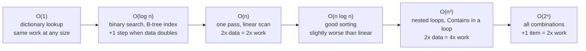
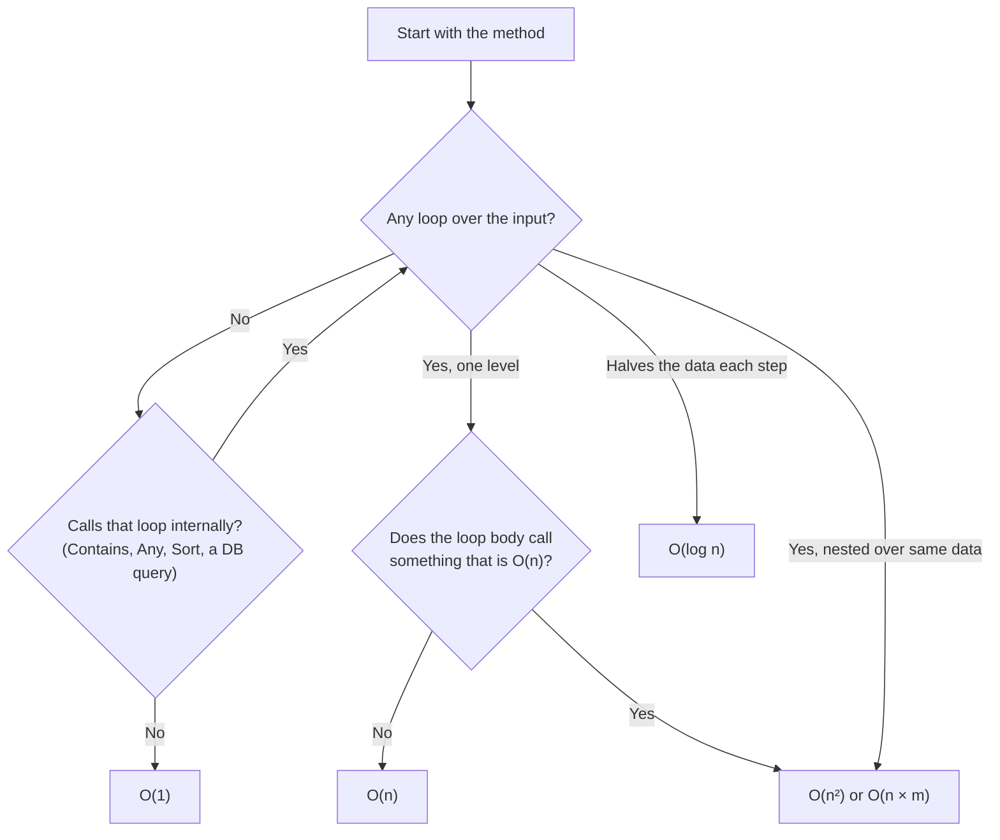
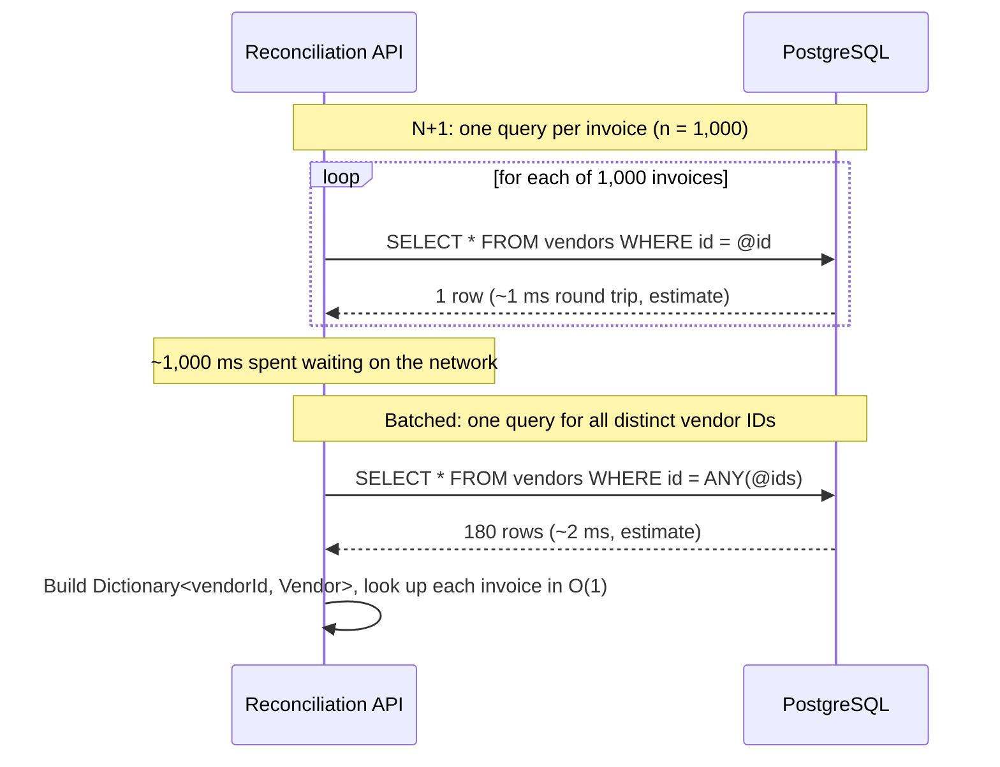

A feature works perfectly on your laptop with 50 test rows. Three months later, with 8 lakh rows in production, the same screen takes 40 seconds and the database server sits at 100 % CPU. Nothing "broke"; the code simply does an amount of work that grows much faster than the data. Big O notation is the vocabulary for predicting this before it happens. This lesson uses a GST invoice reconciliation service as its running example.

## Learning objectives

By the end of this lesson you will be able to:

1. Explain in plain English what Big O measures, and what it deliberately ignores.
2. Recognise O(1), O(log n), O(n), O(n log n), O(n²) and O(2ⁿ) in C# code.
3. Turn a Big O class into a rough time estimate for a given data size, and label it honestly as an estimate.
4. Describe space complexity and the common trade of memory for speed.
5. Find hidden costs: `Contains` inside a loop, string building in a loop, and one database call per item (N+1).
6. Rewrite a quadratic algorithm into a linear one using a dictionary or set.
7. Decide when Big O does not matter and simple code is the better choice.

## Prerequisites

- [Collections, generics and common data structures](#/lesson/m01-collections-generics): you should know what `List<T>`, `Dictionary` and `HashSet` are.
- [Variables, types, conditions, loops and functions in C#](#/lesson/m01-csharp-basics): nested loops in particular.

No maths beyond multiplication is needed. Where logarithms appear, we explain them with halving.

## Explain it like I'm a beginner

### Four ways to find something

**The light switch.** You walk into a room and flip the switch. It takes the same time whether the building has 5 rooms or 500. That is **constant time**, written **O(1)**.

**The unsorted pile.** Someone hands you a pile of 1,000 unsorted delivery slips and asks for slip number 48213. You check them one by one. On average you look at half of them; in the worst case, all 1,000. Double the pile and you double the work. That is **linear time**, **O(n)**, where *n* is the size of the pile.

**The sorted register.** Now the slips are filed in number order in a thick register. You open it in the middle: is 48213 before or after this page? You throw away the wrong half and repeat. 1,000 slips take at most about 10 halvings. 10 lakh slips take about 20. Doubling the register adds just *one* more step. That is **logarithmic time**, **O(log n)**.

**The handshake party.** At a party, everyone shakes hands with everyone else. 10 people make 45 handshakes. 100 people make 4,950. 1,000 people make about 5 lakh. Ten times the guests means roughly a hundred times the handshakes. That is **quadratic time**, **O(n²)**, and it is the shape of most "it was fine in testing" disasters.

### What Big O is, and is not

Big O does **not** tell you how many milliseconds something takes. It tells you **how the work grows when the input grows**. It answers: "If I have 10 times more data next year, will this take 10 times longer, 100 times longer, or about the same?"

It is like a fuel-efficiency label on a car. It won't tell you exactly when you'll reach Jaipur, but it tells you which car runs out of fuel first on a long trip.

## First-principles explanation

### Counting steps

Take a simple method:

```csharp
static decimal Total(IReadOnlyList<decimal> amounts)
{
    decimal sum = 0;                 // 1 step
    foreach (var a in amounts)       // runs n times
        sum += a;                    //   1 step each time
    return sum;                      // 1 step
}
```

That is about `n + 2` steps. For 10 invoices, 12 steps; for 10 lakh, 1,000,002. The "+ 2" stops mattering almost immediately, so we say the method is **O(n)**.

Big O keeps only the part that dominates as *n* gets large, using two rules:

1. **Drop constants.** `3n` and `n` are both O(n). A loop that does three things per item still grows in a straight line.
2. **Keep only the biggest term.** `n² + 50n + 1000` is O(n²). At n = 1,00,000, the n² term is 10 billion and the 50n term is just 50 lakh.

### Recognising the common classes in code

**O(1), constant.** No loop over the input. Index access, dictionary lookup, pushing on a stack.

```csharp
var rate = gstRates["HSN-9954"];       // dictionary lookup
var first = invoices[0];               // index access
```

**O(log n), logarithmic.** The problem halves each step: binary search, lookups in a balanced tree, a B-tree index in PostgreSQL. How many times can you halve 10 lakh before you reach 1? About 20 (because 2²⁰ ≈ 10.5 lakh). That number is log₂ n.

```csharp
int index = sortedInvoiceNumbers.BinarySearch("INV-2025-48213");   // List<string> that is already sorted
```

**O(n), linear.** One pass over the data.

```csharp
bool any = invoices.Any(i => i.Amount > 1_00_000m);   // may look at every invoice
var gurugram = invoices.Where(i => i.City == "Gurugram").ToList();
```

**O(n log n), linearithmic.** Good general-purpose sorting. `List<T>.Sort`, `Array.Sort` and LINQ `OrderBy` are O(n log n) on average. Grouping by sorting first, then scanning, is also n log n.

```csharp
invoices.Sort((a, b) => a.Amount.CompareTo(b.Amount));
```

**O(n²), quadratic.** A loop over the data inside another loop over the same data. Sometimes the inner loop is hidden inside a method call.

```csharp
foreach (var a in invoices)
    foreach (var b in invoices)
        if (a != b && a.Number == b.Number) { /* duplicate */ }

// Hidden: List.Contains is itself a loop
foreach (var inv in incoming)
    if (existingNumbers.Contains(inv.Number)) { ... }   // O(n × m) if existingNumbers is a List
```

**O(2ⁿ), exponential.** Trying every combination: "which subset of these 40 invoices adds up exactly to this payment?" has 2⁴⁰ ≈ 1.1 lakh crore subsets. Each extra item doubles the work. Exponential algorithms are usable only for very small *n* or with clever pruning.

### What the classes mean in seconds (estimates)

To feel the difference, assume one "simple step" (a comparison, an addition) takes about **1 nanosecond**. That is a rough, order-of-magnitude **estimate** for simple in-memory work on a modern CPU, not a benchmark; real code can be several times faster or slower depending on memory access, the work per step, and the runtime.

| n | O(log n) | O(n) | O(n log n) | O(n²) |
|---|---|---|---|---|
| 1,000 | 10 steps ≈ 10 ns | 1,000 ≈ 1 µs | 10,000 ≈ 10 µs | 10 lakh ≈ 1 ms |
| 1,00,000 (1 lakh) | 17 ≈ 17 ns | 1 lakh ≈ 0.1 ms | 17 lakh ≈ 1.7 ms | 1,000 crore (10¹⁰) ≈ 10 s |
| 10,00,000 (10 lakh) | 20 ≈ 20 ns | 10 lakh ≈ 1 ms | 2 crore ≈ 20 ms | 10¹² ≈ 17 minutes |
| 1,00,00,000 (1 crore) | 23 ≈ 23 ns | 1 crore ≈ 10 ms | 23 crore ≈ 0.23 s | 10¹⁴ ≈ 28 hours |

Read the last column slowly. A quadratic duplicate check that takes 1 ms in testing with 1,000 invoices takes around 17 minutes with 10 lakh. The same job written in O(n) takes around a millisecond. No faster server fixes a 17-minute request: a machine twice as fast still needs 8 minutes.

Now the other side: **for small n, Big O hardly matters.** At n = 50, O(n²) is 2,500 steps, a couple of microseconds. If your list will always be the 28 states and 8 union territories of India, write the clearest code.

### Best, worst and average case

Many algorithms behave differently depending on the input.

- Linear search finds the item in step 1 if it is first (best case) and in step *n* if it is last or missing (worst case).
- A `Dictionary` lookup is O(1) **on average**. If many keys land in the same bucket (a terrible hash function, or a deliberate attack), it degrades towards O(n). .NET's string hashing is randomised per process to make such attacks hard.

When engineers say "this is O(n)", they normally mean the **worst case** or the typical case, and they say which if it matters.

### Amortised cost

`List<T>.Add` is usually instant, but when the internal array is full, the list allocates a bigger one (about double) and copies everything: an O(n) step. Because the size doubles each time, these copies are rare. Spread across all the adds, each one costs O(1) on average. This "average over a long sequence of operations" is called **amortised** O(1).

If you know the final size, `new List<Invoice>(capacity: 200_000)` avoids the copies altogether.

### Space complexity

**Space complexity** measures how much **extra memory** an algorithm needs as the input grows. It uses the same notation.

- Summing amounts: O(1) extra space (one `decimal`).
- Building a `HashSet` of every invoice number: O(n) extra space.
- A 2D table of n × n distances between delivery points: O(n²) space. For 10,000 points that is 10 crore cells; at 8 bytes each, about 800 MB.

Rough memory (an **estimate** for 64-bit .NET): a short string like `"INV-2025-048213"` costs around 50–60 bytes as an object, and a `HashSet<string>` entry adds roughly 20 more. So a set of 10 lakh invoice numbers needs on the order of **70–80 MB**. That is fine for a background job; it is not fine to build per request in an API serving 200 requests a second.

### The time–space trade

The most common speed-up in everyday code is trading memory for time: **build a dictionary or set once (O(n) time and space), then answer each question in O(1)**.

```csharp
// O(n × m) time, O(1) extra space
foreach (var inv in incoming)                                   // m items
    if (existing.Any(e => e.Number == inv.Number)) Reject(inv); // n items each time

// O(n + m) time, O(n) extra space
var seen = existing.Select(e => e.Number).ToHashSet();          // n
foreach (var inv in incoming)                                   // m
    if (seen.Contains(inv.Number)) Reject(inv);                 // O(1)
```

With 10 lakh existing invoices and a 5,000-row upload, the first version does up to 500 crore comparisons (≈ 5 seconds by our estimate); the second does about 10 lakh + 5,000 steps (≈ a few milliseconds), using perhaps 70–80 MB while it runs. Whether the memory is acceptable is a design decision, not a given.

### Hidden costs to watch for

| Looks innocent | Actual cost | Better |
|---|---|---|
| `list.Contains(x)` inside a loop | O(n) per call → O(n × m) | Build a `HashSet` first |
| `list.Remove(x)` / `Insert(0, x)` in a loop | O(n) per call → O(n²) | `Queue<T>`, `LinkedList<T>`, or build a new list |
| `s += part` in a loop | Copies the whole string each time → O(n²) characters | `StringBuilder` or `string.Join` |
| `query.Count()` called in a loop condition | Re-runs the whole query each time | Materialise once with `ToList()` |
| `items.OrderBy(...).Take(10)` or `.First()` | Reads the whole input; `Take(10)` buffers all of it to partially sort (O(n) memory). Modern .NET special-cases `OrderBy(...).First()` to a single scan, but the intent is hidden | `MinBy` / `MaxBy` for one item (O(n), O(1) memory); a size-k heap for top k |
| One database query per item (N+1) | n network round trips | One query with `WHERE id = ANY(@ids)` or a join |

The last row deserves emphasis. A database round trip inside the same data centre typically costs **in the order of 0.5–2 ms** (estimate; it varies widely). That is the time of roughly a million in-memory steps. So 1,000 queries in a loop cost about one to two seconds, even though the "Big O" is only O(n). When input/output (disk, network, database) is involved, **count round trips first**; they usually dominate. The [N+1 lesson](#/lesson/m09-n-plus-one) covers this for EF Core.

### Big O of common .NET operations

| Operation | Typical cost |
|---|---|
| `array[i]`, `list[i]` | O(1) |
| `list.Add(x)` | O(1) amortised |
| `list.Insert(0, x)`, `list.RemoveAt(0)` | O(n) |
| `list.Contains(x)`, `IndexOf`, `Remove(x)` | O(n) |
| `list.BinarySearch(x)` on a sorted list | O(log n) |
| `dict[key]`, `TryGetValue`, `ContainsKey`, `set.Contains` | O(1) average |
| `queue.Enqueue/Dequeue`, `stack.Push/Pop` | O(1) (amortised for growth) |
| `priorityQueue.Enqueue/Dequeue` | O(log n) |
| `SortedDictionary` / `SortedSet` add, remove, lookup | O(log n) |
| `list.Sort()`, LINQ `OrderBy` | O(n log n) |
| LINQ `Where`, `Select`, `Sum`, `Any`, `Count()` | O(n) (`Count()` is O(1) on collections that already know their count) |
| PostgreSQL B-tree index lookup | O(log n) |
| PostgreSQL sequential scan | O(n) |

### When not to worry

- **Small, bounded n.** Lists of states, a cart with at most 50 items, the 12 months. Prefer readable code.
- **One-off scripts.** A migration that runs once in 30 seconds doesn't need tuning.
- **I/O-dominated code.** If a request makes one 50 ms call to a payment gateway, shaving 0.1 ms off a loop is invisible.
- **Measure before optimising hot spots.** Big O tells you where to *look*; a profiler or a benchmark (`BenchmarkDotNet` in a real project) tells you what is actually slow. Constants do matter in practice: an O(n) scan over a small array can beat an O(1) dictionary lookup because the array is in the CPU cache.

## Visual explanation

### The growth ladder



Read this ladder from left to right as "gets worse quickly". Each box names the class, a typical example from everyday C#, and what happens when the data doubles. The jump that matters most in business software is between O(n) and O(n²): both look fine with test data, but only the left one survives production volumes. Exponential algorithms appear in optimisation problems such as "pick the best combination", where you need limits on input size or a smarter approach.

### How to find the Big O of a method



This flowchart is the habit to build when you review code. First, look for loops over the input. Then, look *inside* the loop for method calls that are secretly loops themselves: `List.Contains`, LINQ `Any`/`First`, sorting, or a database call. A single visible loop with a hidden loop inside is O(n²) just as surely as two visible nested loops. If each step throws away half the remaining data, it is O(log n). The diagram simplifies (for example, a loop that runs a fixed 12 times is O(1)), but it catches the bugs that matter.

### N+1 calls versus one batched call



This sequence diagram contrasts two ways to fetch vendor details for 1,000 invoices. In the top half, the API asks the database once per invoice. Each trip is quick, but 1,000 of them add up to about a second of waiting. In the bottom half, the API collects the distinct vendor IDs (say 180), asks once, and builds a dictionary in memory. Both are "O(n)" in total work, but the first is O(n) **round trips** while the second is O(1) round trips. In real systems, counting round trips is often more useful than counting CPU steps.

## Step-by-step example

The finance team uploads a month of purchase invoices (about 2 lakh rows) and wants to know which invoice numbers appear more than once, because duplicates can mean a supplier was paid twice.

### Step 1: the obvious version, O(n²)

```csharp
static List<string> FindDuplicatesNaive(IReadOnlyList<string> numbers)
{
    var result = new List<string>();
    for (int i = 0; i < numbers.Count; i++)
        for (int j = i + 1; j < numbers.Count; j++)
            if (numbers[i] == numbers[j] && !result.Contains(numbers[i]))
                result.Add(numbers[i]);
    return result;
}
```

The double loop compares every pair: n × (n − 1) / 2 comparisons. For 2 lakh invoices that is about 2,000 crore (2 × 10¹⁰) comparisons, roughly 20 seconds by our 1 ns estimate, and likely much more since string comparisons cost more than one step. (`result.Contains` adds even more work when there are many duplicates.)

### Step 2: sort first, O(n log n)

```csharp
static List<string> FindDuplicatesSorted(IReadOnlyList<string> numbers)
{
    var sorted = numbers.Order(StringComparer.Ordinal).ToList();   // O(n log n)
    var result = new List<string>();
    for (int i = 1; i < sorted.Count; i++)                          // O(n)
        if (sorted[i] == sorted[i - 1] && (result.Count == 0 || result[^1] != sorted[i]))
            result.Add(sorted[i]);
    return result;
}
```

After sorting, equal numbers sit next to each other, so one pass finds them. 2 lakh × log₂(2 lakh) ≈ 2 lakh × 18 ≈ 36 lakh steps: a few milliseconds by estimate. Extra space: O(n) for the sorted copy.

### Step 3: use a set, O(n)

```csharp
static List<string> FindDuplicatesHashed(IEnumerable<string> numbers)
{
    var seen = new HashSet<string>(StringComparer.OrdinalIgnoreCase);
    var reported = new HashSet<string>(StringComparer.OrdinalIgnoreCase);
    var result = new List<string>();
    foreach (var n in numbers)
        if (!seen.Add(n) && reported.Add(n))   // Add returns false if already present
            result.Add(n);
    return result;
}
```

One pass, O(1) work per invoice: about 2 lakh steps. Extra space is O(n) for `seen`. It also keeps the order in which duplicates were first noticed, which finance may like.

### Step 4: decide

| Version | Time | Extra space | Notes |
|---|---|---|---|
| Naive | O(n²) | O(d) for duplicates found | Fine for 500 rows, unusable for 2 lakh |
| Sort | O(n log n) | O(n) | Useful when you also need sorted output |
| Hash set | O(n) | O(n) | Usually the best default |

If the invoices are already in PostgreSQL, none of these is ideal. Let the database do it:

```sql
SELECT invoice_number, COUNT(*) AS copies
FROM purchase_invoices
WHERE invoice_month = DATE '2026-09-01'
GROUP BY invoice_number
HAVING COUNT(*) > 1;
```

And better still, prevent duplicates with a `UNIQUE` constraint on `(supplier_gstin, invoice_number)`, which uses an index (O(log n) per insert) to reject them at the door. See [Indexes](#/lesson/m09-indexes).

## Production-style C# implementation

A small reconciliation API. It shows three things you will do for real: replace a quadratic check with a hash set, match payments to invoices in linear time with a dictionary, and replace N+1 lookups with one batched call. The vendor store is an in-memory fake behind an interface so the example compiles anywhere; in production it would be a PostgreSQL repository.

```text
Reconciliation.Api/
  Program.cs
  Invoices/
    Models.cs                    // Invoice, Payment, Vendor, result records
    DuplicateInvoiceFinder.cs    // O(n) with HashSet
    PaymentMatcher.cs            // O(n + m) with Dictionary<decimal, Queue<Invoice>>
    IVendorDirectory.cs          // batched lookup to avoid N+1
    InMemoryVendorDirectory.cs   // fake store; counts round trips for illustration
    ReconciliationService.cs     // ties the pieces together
```

```csharp file=Invoices/Models.cs
namespace Reconciliation.Api.Invoices;

public sealed record Invoice(string Number, string VendorGstin, decimal Amount);

public sealed record Payment(string Reference, decimal Amount);

public sealed record Vendor(string Gstin, string Name, string State);

public sealed record Match(string PaymentReference, string InvoiceNumber, decimal Amount);

public sealed record ReconciliationReport(
    IReadOnlyList<string> DuplicateInvoiceNumbers,
    IReadOnlyList<Match> Matches,
    IReadOnlyList<Payment> UnmatchedPayments,
    IReadOnlyList<string> UnknownVendorGstins,
    int VendorRoundTrips);
```

```csharp file=Invoices/DuplicateInvoiceFinder.cs
namespace Reconciliation.Api.Invoices;

/// <summary>Time O(n), extra space O(n). Invoice numbers are compared ignoring case and surrounding spaces.</summary>
public sealed class DuplicateInvoiceFinder
{
    public IReadOnlyList<string> Find(IEnumerable<Invoice> invoices)
    {
        ArgumentNullException.ThrowIfNull(invoices);
        var seen = new HashSet<string>(StringComparer.OrdinalIgnoreCase);
        var reported = new HashSet<string>(StringComparer.OrdinalIgnoreCase);
        var duplicates = new List<string>();

        foreach (var invoice in invoices)
        {
            var number = invoice.Number.Trim();
            if (!seen.Add(number) && reported.Add(number))
                duplicates.Add(number);
        }
        return duplicates;
    }
}
```

```csharp file=Invoices/PaymentMatcher.cs
namespace Reconciliation.Api.Invoices;

/// <summary>
/// Matches each payment to an unpaid invoice of exactly the same amount, oldest invoice first.
/// Naive version: for each payment, scan all invoices -> O(n × m).
/// This version: bucket invoices by amount once (O(n)), then each payment is an O(1) lookup -> O(n + m).
/// </summary>
public sealed class PaymentMatcher
{
    public (IReadOnlyList<Match> Matches, IReadOnlyList<Payment> Unmatched) Match(
        IEnumerable<Invoice> invoicesOldestFirst, IEnumerable<Payment> payments)
    {
        var byAmount = new Dictionary<decimal, Queue<Invoice>>();
        foreach (var invoice in invoicesOldestFirst)
        {
            if (!byAmount.TryGetValue(invoice.Amount, out var bucket))
                byAmount[invoice.Amount] = bucket = new Queue<Invoice>();
            bucket.Enqueue(invoice);
        }

        var matches = new List<Match>();
        var unmatched = new List<Payment>();
        foreach (var payment in payments)
        {
            if (byAmount.TryGetValue(payment.Amount, out var bucket) && bucket.TryDequeue(out var invoice))
                matches.Add(new Match(payment.Reference, invoice.Number, payment.Amount));
            else
                unmatched.Add(payment);
        }
        return (matches, unmatched);
    }
}
```

```csharp file=Invoices/IVendorDirectory.cs
namespace Reconciliation.Api.Invoices;

public interface IVendorDirectory
{
    /// <summary>One round trip for many GSTINs. A PostgreSQL version would run
    /// SELECT ... FROM vendors WHERE gstin = ANY(@gstins).</summary>
    Task<IReadOnlyDictionary<string, Vendor>> GetManyAsync(IReadOnlyCollection<string> gstins, CancellationToken ct);

    /// <summary>Number of calls made so far. Exists only so the demo can show the difference.</summary>
    int RoundTrips { get; }
}
```

```csharp file=Invoices/InMemoryVendorDirectory.cs
namespace Reconciliation.Api.Invoices;

public sealed class InMemoryVendorDirectory : IVendorDirectory
{
    private readonly Dictionary<string, Vendor> _vendors;
    private int _roundTrips;

    public InMemoryVendorDirectory(IEnumerable<Vendor> vendors) =>
        _vendors = vendors.ToDictionary(v => v.Gstin, StringComparer.OrdinalIgnoreCase);

    public int RoundTrips => Volatile.Read(ref _roundTrips);

    public Task<IReadOnlyDictionary<string, Vendor>> GetManyAsync(IReadOnlyCollection<string> gstins, CancellationToken ct)
    {
        ct.ThrowIfCancellationRequested();
        Interlocked.Increment(ref _roundTrips);
        IReadOnlyDictionary<string, Vendor> found = gstins
            .Where(_vendors.ContainsKey)
            .Distinct(StringComparer.OrdinalIgnoreCase)
            .ToDictionary(g => g, g => _vendors[g], StringComparer.OrdinalIgnoreCase);
        return Task.FromResult(found);
    }
}
```

```csharp file=Invoices/ReconciliationService.cs
namespace Reconciliation.Api.Invoices;

public sealed class ReconciliationService(
    DuplicateInvoiceFinder duplicates,
    PaymentMatcher matcher,
    IVendorDirectory vendors)
{
    /// <summary>Overall: O(n + m) CPU work and exactly ONE vendor round trip, whatever the number of invoices.</summary>
    public async Task<ReconciliationReport> RunAsync(
        IReadOnlyList<Invoice> invoices, IReadOnlyList<Payment> payments, CancellationToken ct)
    {
        var dupes = duplicates.Find(invoices);
        var (matches, unmatched) = matcher.Match(invoices, payments);

        // Avoid N+1: collect distinct GSTINs (O(n)), fetch them in one call, then check in O(1) each.
        var gstins = invoices.Select(i => i.VendorGstin).ToHashSet(StringComparer.OrdinalIgnoreCase);
        var before = vendors.RoundTrips;
        var known = await vendors.GetManyAsync(gstins, ct);
        var unknown = gstins.Where(g => !known.ContainsKey(g)).Order(StringComparer.Ordinal).ToList();

        return new ReconciliationReport(dupes, matches, unmatched, unknown, vendors.RoundTrips - before);
    }
}
```

```csharp file=Program.cs
using Reconciliation.Api.Invoices;

var builder = WebApplication.CreateBuilder(args);

builder.Services.AddSingleton<DuplicateInvoiceFinder>();
builder.Services.AddSingleton<PaymentMatcher>();
builder.Services.AddSingleton<IVendorDirectory>(_ => new InMemoryVendorDirectory(
[
    new Vendor("06AABCU9603R1ZX", "Aravalli Office Supplies", "Haryana"),
    new Vendor("27AAECS1234F1Z5", "Sahyadri Packaging", "Maharashtra"),
]));
builder.Services.AddSingleton<ReconciliationService>();

var app = builder.Build();

app.MapPost("/reconcile", async (ReconcileRequest req, ReconciliationService svc, CancellationToken ct) =>
{
    // Guard the input size: even O(n) work has a cost, and an unbounded upload is a denial-of-service risk.
    if (req.Invoices.Count > 500_000 || req.Payments.Count > 500_000)
        return Results.Problem("Upload at most 5 lakh rows per call.", statusCode: 413);

    return Results.Ok(await svc.RunAsync(req.Invoices, req.Payments, ct));
});

app.Run();

public sealed record ReconcileRequest(IReadOnlyList<Invoice> Invoices, IReadOnlyList<Payment> Payments);
```

What to notice:

- **Every method states its complexity in a comment.** That is a cheap habit that makes reviews faster.
- **`PaymentMatcher` trades memory for time.** The dictionary of queues uses O(n) extra memory to turn an O(n × m) search into O(n + m). For 2 lakh invoices and 1.5 lakh payments that is the difference between roughly 3,000 crore comparisons and about 3.5 lakh steps.
- **One round trip, not n.** `ReconciliationService` collects distinct GSTINs into a set and fetches them in one call. `VendorRoundTrips` in the report will always be 1.
- **The input size is capped.** Linear work on a 50-lakh-row upload still takes memory and time. Putting a limit on input is part of designing for complexity.
- **What this design does not solve.** Exact-amount matching is deliberately simple; real reconciliation also handles partial payments, TDS deductions and rounding, which change the algorithm. And for very large data the right home for this work is often PostgreSQL itself (`GROUP BY`, joins with indexes) or a background job, not an API request.

## Bad design vs good design

**Bad:** a "works on my machine" import that hides two quadratic loops and an N+1.

```csharp
public async Task<List<string>> ImportAsync(List<Invoice> upload)
{
    var errors = new List<string>();
    var existing = await _db.GetAllInvoiceNumbersAsync();        // List<string>, 10 lakh items
    foreach (var inv in upload)                                   // 5,000 rows
    {
        if (existing.Contains(inv.Number))                        // O(n) scan per row
            errors.Add($"{inv.Number} already exists");
        var vendor = await _db.GetVendorAsync(inv.VendorGstin);   // 1 round trip per row
        if (vendor is null) errors.Add($"Unknown vendor {inv.VendorGstin}");
        errors = errors.Distinct().ToList();                      // rebuilds the list every row
    }
    return errors;
}
```

Estimated cost for a 5,000-row upload: 5,000 × 10 lakh = 500 crore string comparisons (several seconds or more), plus 5,000 database round trips (5–10 seconds at ~1–2 ms each, estimate), plus a growing `Distinct` on every row. On test data with 20 rows, it all looks instant.

**Good:**

```csharp
var existing = (await _db.GetInvoiceNumbersAsync(upload.Select(u => u.Number))).ToHashSet(StringComparer.OrdinalIgnoreCase);
var vendors  = await _vendors.GetManyAsync(upload.Select(u => u.VendorGstin).ToHashSet(), ct);
var errors   = new HashSet<string>();
foreach (var inv in upload)
{
    if (existing.Contains(inv.Number)) errors.Add($"{inv.Number} already exists");
    if (!vendors.ContainsKey(inv.VendorGstin)) errors.Add($"Unknown vendor {inv.VendorGstin}");
}
```

Two round trips in total, each fetching only what the upload mentions, and O(1) checks per row. Errors are collected in a set so duplicates disappear without rebuilding anything.

**Is the improvement always worth it?** If the upload is always under 50 rows and the table has 2,000 invoices, the bad version takes milliseconds and nobody will notice. Even then, the N+1 is worth fixing because round trips hurt at any size, and the fix is no harder to read. The `HashSet` change is also free in readability. Optimisations that make code *harder* to read (hand-written binary searches, custom hash tables) need a measured reason.

:::callout type=mistake title="Big O is not the whole story"
O(1) does not mean "fast"; it means "doesn't grow". A method that always makes one 300 ms HTTP call is O(1) and slow. When reviewing performance, check three things in order: round trips to other systems, the Big O of the in-memory work, and only then the constant factors.
:::

## Practical playground

This program measures real timings on whatever machine runs it, so your numbers will differ from anyone else's. Look at the **ratios** as n grows, not the absolute values.

:::playground type=csharp title="Feel the difference between O(n) and O(n²)"
```csharp file=Program.cs
using System;
using System.Collections.Generic;
using System.Diagnostics;
using System.Linq;

public static class Program
{
    public static void Main()
    {
        foreach (var n in new[] { 2_000, 4_000, 8_000 })
        {
            var numbers = Enumerable.Range(0, n).Select(i => $"INV-{i % (n - 10):D6}").ToList(); // a few duplicates

            var sw = Stopwatch.StartNew();
            var slow = CountDuplicatesNaive(numbers);
            var naiveMs = sw.Elapsed.TotalMilliseconds;

            sw.Restart();
            var fast = CountDuplicatesHashed(numbers);
            var hashMs = sw.Elapsed.TotalMilliseconds;

            Console.WriteLine($"n={n,6}: naive O(n^2) {naiveMs,8:F2} ms | hashed O(n) {hashMs,6:F2} ms | duplicates {slow}/{fast}");
        }

        // List.Contains vs HashSet.Contains inside a loop
        var existing = Enumerable.Range(0, 100_000).Select(i => $"INV-{i:D6}").ToList();
        var lookups = Enumerable.Range(0, 2_000).Select(i => $"INV-{i * 37:D6}").ToList();

        var timer = Stopwatch.StartNew();
        int hitsList = lookups.Count(existing.Contains);
        var listMs = timer.Elapsed.TotalMilliseconds;

        timer.Restart();
        var set = existing.ToHashSet();
        int hitsSet = lookups.Count(set.Contains);
        var setMs = timer.Elapsed.TotalMilliseconds;

        Console.WriteLine($"2,000 lookups in 1 lakh items: List {listMs:F1} ms vs HashSet (including build) {setMs:F1} ms; hits {hitsList}/{hitsSet}");

        // Experiments:
        // 1. When n doubles, roughly how much does the naive time grow? And the hashed time?
        // 2. Change lookups to 20 instead of 2,000. Is building the HashSet still worth it?
        // 3. Replace the string concatenation below with a StringBuilder and compare.
        var s = "";
        timer.Restart();
        for (int i = 0; i < 5_000; i++) s += "x";
        Console.WriteLine($"5,000 string += took {timer.Elapsed.TotalMilliseconds:F2} ms (length {s.Length})");
    }

    static int CountDuplicatesNaive(List<string> items)
    {
        int count = 0;
        for (int i = 0; i < items.Count; i++)
            for (int j = i + 1; j < items.Count; j++)
                if (items[i] == items[j]) { count++; break; }
        return count;
    }

    static int CountDuplicatesHashed(List<string> items)
    {
        var seen = new HashSet<string>();
        int count = 0;
        foreach (var x in items) if (!seen.Add(x)) count++;
        return count;
    }
}
```
:::

## Exercises

:::exercise id=m01-big-o-ex1 difficulty=beginner kind=written title="Name the complexity"
For each snippet, give the **time** and **extra space** complexity in Big O, and one sentence of reasoning. `n` is `items.Count`; `m` is `other.Count`.

```csharp
// A
var first = items[0];

// B
decimal total = 0; foreach (var x in items) total += x.Amount;

// C
foreach (var a in items) foreach (var b in other) if (a.Id == b.Id) Console.WriteLine(a.Id);

// D
var sorted = items.OrderBy(x => x.Amount).ToList();

// E
var lookup = other.ToDictionary(o => o.Id);
foreach (var a in items) if (lookup.ContainsKey(a.Id)) Console.WriteLine(a.Id);

// F
int lo = 0, hi = sortedIds.Length - 1;
while (lo <= hi) { int mid = (lo + hi) / 2; if (sortedIds[mid] == target) break; if (sortedIds[mid] < target) lo = mid + 1; else hi = mid - 1; }

// G
var report = ""; foreach (var x in items) report += x.Name + "\n";
```
::acceptance
- All seven snippets have a time and a space answer.
- C and E are given in terms of both `n` and `m`.
- G's hidden cost is identified.
- At least one answer mentions "average" or "amortised" where it applies.
::hint
Start by counting loops. Then ask, for each loop body, whether it calls something that is itself a loop.
::hint
For space, only count memory that grows with the input and that the snippet creates. A single `decimal` is O(1).
::hint
Snippet F throws away half of the remaining range each time round the loop. How many halvings does it take to get from n to 1?
::hint
Snippet G: strings in .NET are immutable. What does `report += ...` have to do with all the characters already in `report`?
::solution
- **A**: time O(1), space O(1). Index access jumps straight to the slot.
- **B**: time O(n), space O(1). One pass; one running total.
- **C**: time O(n × m), space O(1). Every pair is compared. If both are the same size, that is O(n²).
- **D**: time O(n log n), space O(n). Sorting; `ToList` stores a new list of n items (LINQ's sort also buffers internally).
- **E**: time O(n + m) on average, space O(m). Building the dictionary costs m; each of the n lookups is O(1) on average.
- **F**: time O(log n), space O(1). Binary search halves the range each step; for 10 lakh IDs that is about 20 steps.
- **G**: time O(n × L) where L is the final length, which behaves like O(n²) characters copied for similar-length names; space O(L) for the final string, plus lots of short-lived garbage. Each `+=` creates a new string and copies everything so far. Use `StringBuilder` or `string.Join("\n", items.Select(x => x.Name))` for O(L).
::mistakes
- Calling C "O(n²)" without noting that it is really O(n × m) when the two lists differ in size.
- Forgetting the space cost of `ToDictionary` and `ToList`.
- Calling G O(n) because there is only one visible loop.
:::

:::exercise id=m01-big-o-ex2 difficulty=beginner kind=code title="Find duplicate invoice numbers in linear time"
Write `DuplicateFinder.Find(numbers)` that returns each invoice number that appears more than once. It must handle 2 lakh numbers quickly; the tests include a large input.
::requirements
- Compare numbers ignoring case and leading/trailing spaces (`" inv-1 "` equals `"INV-1"`).
- Return each duplicate once, in the order in which its *second* occurrence appears, using the trimmed spelling of its first occurrence.
- Time O(n), extra space O(n).
::acceptance
- `["INV-1", "INV-2", "inv-1 ", "INV-3", "INV-2", "INV-1"]` returns `["INV-1", "INV-2"]`.
- No duplicates returns an empty list.
- 2 lakh numbers with 3 duplicates complete in well under a second.
::hint
The quadratic version compares every pair. What collection can tell you "have I seen this before?" in O(1)?
::hint
`HashSet<string>.Add` returns `false` when the value is already present. That single call is both the check and the insert.
::hint
You need a second piece of memory so that a number seen three times is reported only once. To return the *first* spelling, use a `Dictionary<string, string>` from normalised key to first spelling.
::hint
```csharp
var firstSpelling = new Dictionary<string, string>(StringComparer.OrdinalIgnoreCase);
var reported = new HashSet<string>(StringComparer.OrdinalIgnoreCase);
foreach (var raw in numbers)
{
    var n = raw.Trim();
    if (!firstSpelling.TryAdd(n, n) && reported.Add(n)) result.Add(firstSpelling[n]);
}
```
::starter
```csharp file=DuplicateFinder.cs
using System;
using System.Collections.Generic;

public static class DuplicateFinder
{
    public static IReadOnlyList<string> Find(IEnumerable<string> numbers) => throw new NotImplementedException();
}
```
::tests
```csharp file=DuplicateFinderTests.cs
using System;
using System.Diagnostics;
using System.Linq;
using Xunit;

public class DuplicateFinderTests
{
    [Fact]
    public void Finds_duplicates_in_order_ignoring_case_and_spaces()
    {
        var result = DuplicateFinder.Find(new[] { "INV-1", "INV-2", "inv-1 ", "INV-3", "INV-2", "INV-1" });
        Assert.Equal(new[] { "INV-1", "INV-2" }, result.ToArray());
    }

    [Fact]
    public void No_duplicates() => Assert.Empty(DuplicateFinder.Find(new[] { "A", "B", "C" }));

    [Fact]
    public void Large_input_is_fast()
    {
        var data = Enumerable.Range(0, 200_000).Select(i => $"INV-{i:D7}").ToList();
        data.Add("INV-0000007"); data.Add("inv-0150000"); data.Add("INV-0199999");
        var sw = Stopwatch.StartNew();
        var result = DuplicateFinder.Find(data);
        sw.Stop();
        Assert.Equal(3, result.Count);
        Assert.True(sw.Elapsed < TimeSpan.FromSeconds(2), $"Took {sw.Elapsed.TotalMilliseconds} ms; is it O(n²)?");
    }
}
```
::solution
```csharp file=DuplicateFinder.cs
using System;
using System.Collections.Generic;

public static class DuplicateFinder
{
    /// <summary>Time O(n) average, extra space O(n).</summary>
    public static IReadOnlyList<string> Find(IEnumerable<string> numbers)
    {
        ArgumentNullException.ThrowIfNull(numbers);
        var firstSpelling = new Dictionary<string, string>(StringComparer.OrdinalIgnoreCase);
        var reported = new HashSet<string>(StringComparer.OrdinalIgnoreCase);
        var result = new List<string>();

        foreach (var raw in numbers)
        {
            var number = raw.Trim();
            if (!firstSpelling.TryAdd(number, number) && reported.Add(number))
                result.Add(firstSpelling[number]);
        }
        return result;
    }
}
```

Each number costs one `Trim`, one dictionary operation and at most one set operation, all O(1) on average, so the total is O(n). The quadratic version on 2 lakh numbers would do about 2 × 10¹⁰ comparisons; this does about 2 lakh. The time limit in the test is generous (2 s) because shared build machines are slow, but an O(n²) solution would take far longer.
::mistakes
- Using `result.Contains(number)` to avoid repeats. With many duplicates that is O(n) per check again.
- Forgetting to trim, or comparing case-sensitively, so `"inv-1 "` is not detected.
- Writing a performance test with a tight threshold like 10 ms, which fails randomly on a busy machine. Thresholds should separate "linear" from "quadratic", not measure speed precisely.
::extensions
Return how many times each duplicate appears. Accept an `IAsyncEnumerable<string>` so the input can stream from a file without loading it all.
:::

:::exercise id=m01-big-o-ex3 difficulty=intermediate kind=code title="Match a payment to two invoices"
A client sometimes pays two invoices with one bank transfer. Given a list of open invoice amounts and one payment amount, find two *different* invoices whose amounts add up exactly to the payment. Do it in O(n) time.
::requirements
- `PairFinder.FindPair(amounts, payment)` returns the indices `(First, Second)` with `First < Second`, or `null` if no pair exists.
- If several pairs exist, return the one whose `Second` index is smallest; for that `Second`, the smallest `First`.
- The same invoice cannot be used twice.
::acceptance
- `[12_000, 45_500, 8_250, 33_500]` with payment `79_000` returns `(1, 3)`.
- `[5_000, 5_000]` with payment `10_000` returns `(0, 1)`.
- `[5_000]` with payment `10_000` returns `null`.
- 2 lakh amounts with a matching pair only at the end completes in well under a second.
::hint
For each amount `a`, the partner you need is `payment - a`. The question "have I already seen that partner?" is a lookup.
::hint
Walk left to right. Before storing the current amount, check whether its partner is already stored. That naturally gives the smallest `Second`.
::hint
Store `amount → first index where it appeared` in a `Dictionary<decimal, int>`. Use `TryAdd` so a repeated amount keeps its earliest index.
::hint
```csharp
for (int i = 0; i < amounts.Count; i++)
{
    if (firstIndex.TryGetValue(payment - amounts[i], out var j)) return (j, i);
    firstIndex.TryAdd(amounts[i], i);
}
return null;
```
::starter
```csharp file=PairFinder.cs
using System;
using System.Collections.Generic;

public static class PairFinder
{
    public static (int First, int Second)? FindPair(IReadOnlyList<decimal> amounts, decimal payment) =>
        throw new NotImplementedException();
}
```
::tests
```csharp file=PairFinderTests.cs
using System;
using System.Diagnostics;
using System.Linq;
using Xunit;

public class PairFinderTests
{
    [Fact]
    public void Finds_pair() =>
        Assert.Equal((1, 3), PairFinder.FindPair(new[] { 12_000m, 45_500m, 8_250m, 33_500m }, 79_000m));

    [Fact]
    public void Same_amount_twice() =>
        Assert.Equal((0, 1), PairFinder.FindPair(new[] { 5_000m, 5_000m }, 10_000m));

    [Fact]
    public void Cannot_use_same_invoice_twice() =>
        Assert.Null(PairFinder.FindPair(new[] { 5_000m }, 10_000m));

    [Fact]
    public void Picks_smallest_second_index()
    {
        // pairs (0,3) and (1,2) both sum to 100; (1,2) has the smaller second index
        Assert.Equal((1, 2), PairFinder.FindPair(new[] { 10m, 40m, 60m, 90m }, 100m));
    }

    [Fact]
    public void Large_input_is_fast()
    {
        var amounts = Enumerable.Range(1, 200_000).Select(i => (decimal)i * 2).ToList();   // all even
        amounts.Add(1m);                                                                     // odd pair at the end
        var sw = Stopwatch.StartNew();
        var result = PairFinder.FindPair(amounts, 3m);                                       // 2 + 1
        sw.Stop();
        Assert.Equal((0, 200_000), result);
        Assert.True(sw.Elapsed < TimeSpan.FromSeconds(2), $"Took {sw.Elapsed.TotalMilliseconds} ms");
    }
}
```
::solution
```csharp file=PairFinder.cs
using System;
using System.Collections.Generic;

public static class PairFinder
{
    /// <summary>Time O(n) average, extra space O(n).</summary>
    public static (int First, int Second)? FindPair(IReadOnlyList<decimal> amounts, decimal payment)
    {
        ArgumentNullException.ThrowIfNull(amounts);
        var firstIndex = new Dictionary<decimal, int>();

        for (int i = 0; i < amounts.Count; i++)
        {
            if (firstIndex.TryGetValue(payment - amounts[i], out var j))
                return (j, i);
            firstIndex.TryAdd(amounts[i], i);
        }
        return null;
    }
}
```

Checking *before* storing the current amount guarantees the two indices differ and that the first pair found has the smallest possible `Second`. `TryAdd` keeps the earliest index for repeated amounts, so `First` is the smallest for that `Second`. The naive double loop is O(n²): about 2 × 10¹⁰ checks for 2 lakh invoices.
::alternatives
Sort the amounts (keeping original indices) and use two pointers from both ends: O(n log n) time and O(n) space for the index copy, useful when the data is already sorted. For three or more invoices per payment the problem becomes "subset sum", which is exponential in general; real reconciliation tools limit the number of invoices per match or use date and reference heuristics.
::mistakes
- Storing first and checking second, so an amount of exactly half the payment matches itself.
- Using `double` for money, so `0.1 + 0.2` does not exactly equal `0.3` and pairs are missed.
- Returning the first pair by `First` index instead of following the stated tie rule.
::extensions
Return all pairs. Allow a tolerance of ±₹1 for bank rounding (hint: round amounts to the nearest rupee before using them as keys, and check the key on either side).
:::

:::exercise id=m01-big-o-ex4 difficulty=intermediate kind=code title="Busiest week of pharmacy deliveries"
An online pharmacy logs how many orders it delivered each day. The operations planner wants the busiest run of `k` consecutive days, to plan how many delivery riders to hire for festival weeks. Compute it in O(n) time and O(1) extra space with a sliding window.
::requirements
- `BusiestWindow.Find(dailyCounts, k)` returns `(Start, Total)`: the index of the first day of the window and the window's total.
- On a tie, return the earliest window.
- `k` must be between 1 and the number of days; otherwise throw `ArgumentOutOfRangeException`.
::acceptance
- `[3, 8, 2, 7, 9, 1, 4]` with `k = 3` returns `(2, 18)` (2 + 7 + 9).
- `[5, 5, 5]` with `k = 2` returns `(0, 10)`.
- `k = 0` or `k` larger than the array throws `ArgumentOutOfRangeException`.
- 10 lakh days with `k = 30` finishes in well under a second.
::hint
The obvious approach adds up `k` numbers for each starting day: O(n × k). For `k = 30` and 10 lakh days that is 3 crore additions. Can you reuse the previous window's sum?
::hint
When the window slides right by one day, exactly one day leaves (on the left) and one day joins (on the right).
::hint
Compute the first window's sum once. Then for each next day `i`: `sum += counts[i] - counts[i - k]`.
::hint
```csharp
long sum = 0;
for (int i = 0; i < k; i++) sum += counts[i];
long best = sum; int bestStart = 0;
for (int i = k; i < counts.Count; i++)
{
    sum += counts[i] - counts[i - k];
    if (sum > best) { best = sum; bestStart = i - k + 1; }
}
```
::starter
```csharp file=BusiestWindow.cs
using System;
using System.Collections.Generic;

public static class BusiestWindow
{
    public static (int Start, long Total) Find(IReadOnlyList<int> dailyCounts, int k) =>
        throw new NotImplementedException();
}
```
::tests
```csharp file=BusiestWindowTests.cs
using System;
using System.Diagnostics;
using System.Linq;
using Xunit;

public class BusiestWindowTests
{
    [Fact]
    public void Finds_busiest_three_days() =>
        Assert.Equal((2, 18L), BusiestWindow.Find(new[] { 3, 8, 2, 7, 9, 1, 4 }, 3));

    [Fact]
    public void Tie_returns_earliest() =>
        Assert.Equal((0, 10L), BusiestWindow.Find(new[] { 5, 5, 5 }, 2));

    [Fact]
    public void Whole_array_window() =>
        Assert.Equal((0, 6L), BusiestWindow.Find(new[] { 1, 2, 3 }, 3));

    [Fact]
    public void Invalid_k_throws()
    {
        Assert.Throws<ArgumentOutOfRangeException>(() => BusiestWindow.Find(new[] { 1, 2 }, 0));
        Assert.Throws<ArgumentOutOfRangeException>(() => BusiestWindow.Find(new[] { 1, 2 }, 3));
    }

    [Fact]
    public void Large_input_is_fast()
    {
        var days = Enumerable.Range(0, 1_000_000).Select(i => i % 17).ToArray();
        days[500_000] = 10_000;
        var sw = Stopwatch.StartNew();
        var (start, total) = BusiestWindow.Find(days, 30);
        sw.Stop();
        Assert.True(start <= 500_000 && start + 30 > 500_000);
        Assert.True(total >= 10_000);
        Assert.True(sw.Elapsed < TimeSpan.FromSeconds(2));
    }
}
```
::solution
```csharp file=BusiestWindow.cs
using System;
using System.Collections.Generic;

public static class BusiestWindow
{
    /// <summary>Time O(n), extra space O(1). Uses long so large counts cannot overflow.</summary>
    public static (int Start, long Total) Find(IReadOnlyList<int> dailyCounts, int k)
    {
        ArgumentNullException.ThrowIfNull(dailyCounts);
        if (k < 1 || k > dailyCounts.Count) throw new ArgumentOutOfRangeException(nameof(k));

        long sum = 0;
        for (int i = 0; i < k; i++) sum += dailyCounts[i];

        long best = sum;
        int bestStart = 0;
        for (int i = k; i < dailyCounts.Count; i++)
        {
            sum += dailyCounts[i] - dailyCounts[i - k];   // one day joins, one day leaves
            if (sum > best)                               // strictly greater keeps the earliest on ties
            {
                best = sum;
                bestStart = i - k + 1;
            }
        }
        return (bestStart, best);
    }
}
```

Each day is added once and removed once, so the work is O(n) regardless of `k`. The naive version is O(n × k), which only looks harmless because `k` is "small": with `k = 365` on 10 years of data it is 365 times slower than necessary.
::alternatives
Prefix sums: build `prefix[i] = sum of the first i days` once (O(n) time and space), and then any window total is `prefix[end] - prefix[start]` in O(1). This is better when you must answer many different window questions over the same data.
::mistakes
- Using `>=` in the comparison, which returns the latest window on a tie instead of the earliest.
- Using `int` for the sum, which can overflow on large counts.
- Recomputing each window from scratch with `Skip(i).Take(k).Sum()`, which is O(n × k) and also allocates on each call.
::extensions
Return the busiest window for every `k` from 1 to 7 in one pass each. Handle missing days (no log entry) by treating them as zero.
:::

:::exercise id=m01-big-o-ex5 difficulty=advanced kind=code title="Top-k largest invoices from a stream"
An audit job reads crores of invoices from a file, one at a time, and must report the `k` largest by amount. Loading and sorting everything costs O(n log n) time and O(n) memory. Do it in O(n log k) time and O(k) memory with a priority queue.
::requirements
- `TopK.Largest(invoices, k)` returns the `k` largest invoices, largest first. If there are fewer than `k`, return all of them, largest first.
- On equal amounts, the invoice with the alphabetically smaller `Number` ranks higher.
- Must not store more than `k` invoices at any time (the tests count this indirectly by streaming 10 lakh items).
- `k <= 0` throws `ArgumentOutOfRangeException`.
::acceptance
- Amounts 500, 9,000, 1,200, 75,000, 3,300 with `k = 3` give 75,000, 9,000, 3,300.
- Two invoices with equal amount are ordered by `Number`.
- `k = 10` on 3 invoices returns all 3, sorted.
- 10 lakh streamed invoices with `k = 5` complete well under the time limit.
::hint
You only ever need to remember the best `k` seen so far. Which of those `k` is the first to be thrown out when a bigger one arrives?
::hint
Keep the current top `k` in a **min**-priority queue: the smallest of the top `k` is at the front, so it can be compared and removed in O(log k).
::hint
`PriorityQueue<Invoice, Invoice>` with a custom `IComparer<Invoice>` that puts the "worst" invoice (smallest amount; on a tie, larger number) first. For each new invoice: if the queue has fewer than `k`, enqueue; otherwise, if the new one beats the front, use `EnqueueDequeue`.
::hint
At the end, dequeue everything (worst first) and reverse to get largest first.
::hint
```csharp
private sealed class WorstFirst : IComparer<Invoice>
{
    public int Compare(Invoice? a, Invoice? b)
    {
        int byAmount = a!.Amount.CompareTo(b!.Amount);           // smaller amount = worse
        return byAmount != 0 ? byAmount : string.CompareOrdinal(b.Number, a.Number);
    }
}
```
::starter
```csharp file=TopK.cs
using System;
using System.Collections.Generic;

public sealed record Invoice(string Number, decimal Amount);

public static class TopK
{
    public static IReadOnlyList<Invoice> Largest(IEnumerable<Invoice> invoices, int k) =>
        throw new NotImplementedException();
}
```
::tests
```csharp file=TopKTests.cs
using System;
using System.Collections.Generic;
using System.Diagnostics;
using System.Linq;
using Xunit;

public class TopKTests
{
    [Fact]
    public void Returns_k_largest_descending()
    {
        var input = new[] { new Invoice("A", 500m), new Invoice("B", 9_000m), new Invoice("C", 1_200m), new Invoice("D", 75_000m), new Invoice("E", 3_300m) };
        var amounts = TopK.Largest(input, 3).Select(i => i.Amount).ToArray();
        Assert.Equal(new[] { 75_000m, 9_000m, 3_300m }, amounts);
    }

    [Fact]
    public void Ties_break_by_number()
    {
        var input = new[] { new Invoice("INV-9", 100m), new Invoice("INV-2", 100m), new Invoice("INV-5", 50m) };
        var numbers = TopK.Largest(input, 2).Select(i => i.Number).ToArray();
        Assert.Equal(new[] { "INV-2", "INV-9" }, numbers);
    }

    [Fact]
    public void Fewer_than_k()
    {
        var input = new[] { new Invoice("A", 1m), new Invoice("B", 3m), new Invoice("C", 2m) };
        Assert.Equal(new[] { "B", "C", "A" }, TopK.Largest(input, 10).Select(i => i.Number).ToArray());
    }

    [Fact]
    public void Invalid_k_throws() =>
        Assert.Throws<ArgumentOutOfRangeException>(() => TopK.Largest(Array.Empty<Invoice>(), 0));

    [Fact]
    public void Streams_large_input()
    {
        static IEnumerable<Invoice> Stream()
        {
            for (int i = 0; i < 1_000_000; i++) yield return new Invoice($"INV-{i:D7}", (i * 7919L) % 1_000_003);
        }
        var sw = Stopwatch.StartNew();
        var top = TopK.Largest(Stream(), 5);
        sw.Stop();
        Assert.Equal(5, top.Count);
        Assert.True(top[0].Amount >= top[4].Amount);
        Assert.True(sw.Elapsed < TimeSpan.FromSeconds(5));
    }
}
```
::solution
```csharp file=TopK.cs
using System;
using System.Collections.Generic;

public sealed record Invoice(string Number, decimal Amount);

public static class TopK
{
    /// <summary>Time O(n log k), extra space O(k). Reads the input exactly once, so it works on streams.</summary>
    public static IReadOnlyList<Invoice> Largest(IEnumerable<Invoice> invoices, int k)
    {
        ArgumentNullException.ThrowIfNull(invoices);
        ArgumentOutOfRangeException.ThrowIfNegativeOrZero(k);

        var comparer = new WorstFirst();
        var heap = new PriorityQueue<Invoice, Invoice>(comparer);   // front = worst of the current top k

        foreach (var invoice in invoices)
        {
            if (heap.Count < k)
                heap.Enqueue(invoice, invoice);
            else if (comparer.Compare(invoice, heap.Peek()) > 0)    // new one is better than the worst kept
                heap.EnqueueDequeue(invoice, invoice);
        }

        var result = new Invoice[heap.Count];
        for (int i = result.Length - 1; i >= 0; i--)                // worst comes out first, so fill from the end
            result[i] = heap.Dequeue();
        return result;
    }

    /// <summary>Orders invoices from worst to best: smaller amount first; on a tie, larger Number first.</summary>
    private sealed class WorstFirst : IComparer<Invoice>
    {
        public int Compare(Invoice? a, Invoice? b)
        {
            int byAmount = a!.Amount.CompareTo(b!.Amount);
            return byAmount != 0 ? byAmount : string.CompareOrdinal(b.Number, a.Number);
        }
    }
}
```

The heap never holds more than `k` items, so each insert or replace is O(log k), and the total is O(n log k). For n = 1 crore and k = 10, that is roughly 1 crore × 3.3 ≈ 3.3 crore steps and a few hundred bytes of memory, versus sorting 1 crore invoices (around 23 crore steps, estimate) with all of them held in memory (likely over a gigabyte).
::alternatives
If the data is in PostgreSQL, `ORDER BY amount DESC, number LIMIT 5` does the same job; with an index on `(amount DESC, number)` the database reads only 5 rows. If `k` is close to `n`, simply sorting is simpler and similarly fast. LINQ's `OrderByDescending(...).Take(k)` is correct and readable but buffers the whole input.
::mistakes
- Using a max-heap of everything and taking the top `k`: O(n log n) time and O(n) memory, which defeats the purpose.
- Getting the comparer backwards, so the queue throws away the *largest* invoices.
- Calling `ToList()` on the input "to be safe", which loads the whole stream into memory.
::extensions
Make it generic: `Largest<T>(IEnumerable<T> items, int k, IComparer<T> comparer)`. Run it over an `IAsyncEnumerable<Invoice>` that reads a CSV file line by line.
:::

## Automated testing

Big O itself is not something unit tests can prove. But you can write tests that **catch accidental quadratic behaviour** and tests that **check the algorithm is correct at the edges**, which is where faster algorithms most often go wrong.

**Guard tests with large inputs.** Run the method on an input large enough that O(n²) would take minutes and O(n) takes milliseconds, and assert a generous limit:

```csharp
[Fact]
public void Duplicate_check_scales_linearly_enough()
{
    var invoices = Enumerable.Range(0, 200_000).Select(i => new Invoice($"INV-{i}", "06AABCU9603R1ZX", i)).ToList();
    var sw = Stopwatch.StartNew();
    new DuplicateInvoiceFinder().Find(invoices);
    Assert.True(sw.Elapsed < TimeSpan.FromSeconds(2));   // O(n^2) here would be ~2 × 10^10 comparisons
}
```

Choose thresholds that separate complexity classes by a wide margin (a factor of 100 or more). Tight thresholds make tests flaky on busy CI machines.

**Count operations instead of time.** Time is noisy; counts are exact. The `InMemoryVendorDirectory` above counts round trips, so a test can say "reconciling 1,000 invoices makes exactly one vendor call", which catches an N+1 regression instantly:

```csharp
[Fact]
public async Task Reconciliation_makes_one_vendor_round_trip()
{
    var vendors = new InMemoryVendorDirectory([new Vendor("06AABCU9603R1ZX", "Aravalli Office Supplies", "Haryana")]);
    var svc = new ReconciliationService(new DuplicateInvoiceFinder(), new PaymentMatcher(), vendors);
    var invoices = Enumerable.Range(0, 1_000).Select(i => new Invoice($"INV-{i}", "06AABCU9603R1ZX", 100m)).ToList();

    var report = await svc.RunAsync(invoices, [], CancellationToken.None);

    Assert.Equal(1, report.VendorRoundTrips);
}
```

**Compare against a simple reference.** For a clever algorithm, keep the slow, obvious version in the test project and check that both give the same answer on many random inputs. This is a simple form of property-based testing and catches off-by-one errors in sliding windows and two-pointer code.

**Edge cases.** Empty input, one item, all items equal, `k` equal to `n`, the answer at the very first or very last position, and ties. Every exercise above includes several of these.

**For real performance work, benchmark.** Unit tests are the wrong tool for measuring nanoseconds. In a real project use BenchmarkDotNet, which handles warm-up, JIT and statistics, and profile production-like workloads.

## Real-world application

- **Database indexes** are the most important Big O decision in most systems. Without an index, `WHERE pan = 'ABCDE1234F'` scans every row (O(n)); with a B-tree index it takes O(log n) page reads. `EXPLAIN` in PostgreSQL shows which one you are getting. See [Indexes](#/lesson/m09-indexes).
- **Pagination.** `OFFSET 100000 LIMIT 20` makes the database walk past 1 lakh rows to return 20; keyset pagination (`WHERE id > @lastId LIMIT 20`) uses the index to jump straight there. See [Offset versus keyset pagination](#/lesson/m09-pagination).
- **Caching** turns repeated expensive work into an O(1) lookup, at the cost of memory and staleness.
- **Batch APIs** (`GET /vendors?ids=...`) exist to turn N round trips into one.
- **Rate limits and input caps** protect services from inputs large enough to make even linear algorithms expensive.
- **Search engines** use inverted indexes so a search does not scan every document.
- **Interviews** almost always ask "what is the complexity of your solution, and can you do better?". The usual answer is a hash map or sorting.

## Interview questions

:::interview
::q beginner
What does Big O notation describe, and what does it ignore?
::a
It describes how the amount of work (or memory) an algorithm needs grows as the input size grows, usually in the worst or typical case. It ignores constant factors and smaller terms: 3n + 20 and n are both O(n). It does not give actual time; an O(n) algorithm with a large constant can be slower than an O(n²) one for small inputs. It is a tool for predicting how code behaves when data grows by 10× or 100×.
::q beginner
What is the time complexity of looking up a key in a `Dictionary` versus finding an item in a `List` with `Contains`?
::a
Dictionary lookup is O(1) on average: the key's hash code picks a bucket, and only the few keys in that bucket are compared. `List<T>.Contains` is O(n): it compares items one by one until it finds a match or reaches the end. Inside a loop over m items this becomes O(n × m) for the list versus O(m) for the dictionary, plus O(n) once to build the dictionary. The dictionary uses more memory.
::q intermediate
Your endpoint takes 50 ms with 1,000 records and 5 seconds with 10,000. What is your hypothesis and how do you confirm it?
::a
10× more data giving 100× more time suggests O(n²) behaviour. Typical culprits: a `List.Contains`, `Any` or `FirstOrDefault` inside a loop; string concatenation in a loop; `Remove` or `Insert(0, ...)` in a loop; or a database query per item (which can look quadratic if each query also grows). Confirm with a profiler or by timing the endpoint at 1k, 2k and 4k records to see whether time grows 4× per doubling. Then fix with a `HashSet`/`Dictionary`, a `StringBuilder`, or a batched query, and add a guard test with a large input.
::q intermediate
Explain the time–space trade-off with an example.
::a
You often spend memory to save time. Checking 5,000 uploaded invoice numbers against 10 lakh existing ones with a list is O(n × m) time and O(1) extra space. Building a `HashSet` of existing numbers is O(n) time and O(n) space once, then each check is O(1). The total is O(n + m) time but roughly 70–80 MB of memory for 10 lakh short strings (estimate). If memory is tight, you can sort both lists (O(n log n)) and walk them together with two pointers, or push the work into the database with an indexed join. The right choice depends on data size, memory limits and how often it runs.
::q advanced
Why can an O(n) algorithm be slower in practice than an O(n log n) one, or an O(1) operation slower than O(n)?
::a
Big O hides constant factors and the cost of each step. An O(1) dictionary lookup involves hashing the key and a random memory access that may miss the CPU cache; a linear scan over a small, contiguous array of 16 ints can be faster. A "linear" algorithm that makes a network call per item is dominated by round-trip latency. Memory allocation and garbage collection add hidden costs. Big O tells you how things scale for large n; for small n or when I/O is involved, measure. That is why runtime libraries often switch algorithms by size (for example, `Array.Sort` uses insertion sort for very small ranges inside its introsort).
::q advanced
A nightly job reconciles 2 crore bank transactions against 2 crore ledger entries and must finish in 30 minutes on one machine. How do you reason about the design?
::a
Start with arithmetic. An O(n²) approach is 4 × 10¹⁴ comparisons, hopeless. A hash join is O(n + m), around 4 crore operations, seconds of CPU, but holding 2 crore entries in a dictionary may need several GB of memory (estimate around 100+ bytes per entry). Alternatives: sort both by (date, amount, reference) and merge with two pointers: O(n log n) time with streaming I/O and modest memory, or push it into PostgreSQL with an indexed join or `COPY` into staging tables. Partition by date so each partition fits in memory and failures can resume per partition. Then the real bottleneck is likely I/O (reading 4 crore rows), so batch reads, avoid per-row round trips, and measure throughput on a sample before committing.
:::

## Summary and revision

**Key takeaways**

- Big O describes **how work grows with input size**, not how long something takes. Drop constants and smaller terms.
- Know the ladder: O(1) < O(log n) < O(n) < O(n log n) < O(n²) < O(2ⁿ). The O(n) → O(n²) jump is where most production slowdowns come from.
- Turn complexity into rough seconds with an **estimate** of ~1 ns per simple step: 10 lakh items squared is about 17 minutes.
- **Hidden loops** count: `List.Contains`, LINQ `Any`/`First`, `string +=`, and database calls inside loops.
- **Space complexity** matters too. Hash sets and dictionaries trade O(n) memory for O(1) lookups.
- **Round trips usually dominate.** One database call costs about as much as a million in-memory steps (estimate). Batch them.
- For small, bounded inputs, **prefer clear code**. Measure before optimising.

**Terminology**: Big O, time complexity, space complexity, constant, logarithmic, linear, linearithmic, quadratic, exponential, best/worst/average case, amortised, time–space trade-off, N+1, sliding window, heap (priority queue), round trip.

:::flashcards
Q: What does O(n) mean in plain English?
A: The work grows in step with the input: double the data, double the work.
Q: Roughly how many steps does binary search need for 10 lakh sorted items?
A: About 20, because 2²⁰ ≈ 10.5 lakh. That is O(log n).
Q: Why is `list.Contains(x)` inside a `foreach` a red flag?
A: `Contains` is itself a loop, so the whole thing is O(n × m). Build a HashSet first.
Q: Estimate: an O(n²) algorithm on 10 lakh items at ~1 ns per step?
A: 10¹² steps ≈ 1,000 seconds ≈ 17 minutes (an order-of-magnitude estimate).
Q: What is amortised O(1)?
A: An operation that is occasionally expensive (like List growth) but cheap on average across many calls.
Q: What is space complexity?
A: How much extra memory an algorithm needs as the input grows, e.g. O(n) for building a HashSet of all items.
Q: What is the N+1 problem?
A: Making one query for a list, then one more query per item. Fix it with a single batched query or a join.
Q: Why is `s += x` in a loop slow?
A: Strings are immutable; each += copies everything so far, giving O(n²) character copies. Use StringBuilder.
Q: How do you find the k largest of n items without sorting everything?
A: Keep a min-heap of size k: O(n log k) time, O(k) memory.
:::

## Knowledge check

:::quiz pass=70
::q single
A report runs in 2 seconds with 1 lakh rows. Its algorithm is O(n²). Roughly how long will it take with 2 lakh rows?
- [ ] 2 seconds
- [ ] 4 seconds
- [x] 8 seconds
- [ ] 16 seconds
> Doubling n in an O(n²) algorithm multiplies the work by 2² = 4: about 8 seconds. An O(n) algorithm would take about 4 seconds.
::q single
Which change turns this from O(n × m) into O(n + m)? `foreach (var u in uploads) if (existing.Contains(u.Id)) ...` where `existing` is a `List<int>`.
- [ ] Sort `uploads` first.
- [x] Build `var set = existing.ToHashSet();` once and call `set.Contains`.
- [ ] Use `existing.Any(e => e == u.Id)` instead.
- [ ] Replace `foreach` with `for`.
> `Any` is still a linear scan. A HashSet costs O(n) once and makes each check O(1).
::q single
An endpoint loads 500 orders and then calls `GetCustomerAsync(order.CustomerId)` for each one. What is the main problem?
- [ ] The algorithm is O(n²) in CPU.
- [x] It makes 500 database round trips; network latency dominates (N+1).
- [ ] `async` methods are O(log n).
- [ ] It uses too much memory.
> Each round trip costs around a millisecond (estimate), so 500 of them cost about half a second. Fetch the distinct customer IDs in one query.
::q single
What is the time complexity of finding a value with `BinarySearch` in a sorted list of n items?
- [ ] O(1)
- [x] O(log n)
- [ ] O(n)
- [ ] O(n log n)
> Each step halves the range. For 10 lakh items, about 20 steps. The list must already be sorted, and sorting it costs O(n log n).
::q multi
Which of these are typically O(n) or worse, even though they look like a single call? (Select all that apply.)
- [x] `list.Contains(x)`
- [x] `items.OrderBy(i => i.Amount).First()`
- [ ] `dictionary.TryGetValue(key, out var v)`
> `Contains` scans; `OrderBy(...).First()` must read every item (a full sort would be O(n log n); modern .NET optimises this exact pair to one O(n) scan, but `MinBy` says what you mean); and `Insert(0, ...)` shifts every element. Dictionary lookup is O(1) on average.
> `Contains` scans, `OrderBy` sorts (O(n log n)) just to find one item, and `Insert(0, ...)` shifts every element. Dictionary lookup is O(1) on average.
::q single
You need to check membership against 10 lakh product codes in an API that serves 300 requests a second. Building a `HashSet` takes ~80 MB (estimate). What is the sensible design?
- [ ] Build the HashSet inside each request.
- [x] Build it once at startup (or on refresh) in a singleton and share it read-only.
- [ ] Use `List.Contains` to save memory.
- [ ] Sort the list on every request and binary search it.
> Building per request would cost O(n) time and 80 MB per request. Build once and share; since nobody writes to it after loading, concurrent reads are safe (a `FrozenSet` makes that explicit).
::q single
Which statement about Big O is correct?
- [ ] O(1) operations are always fast.
- [ ] An O(n) algorithm is always faster than an O(n²) one.
- [x] For small inputs, an algorithm with worse Big O can be faster because constants dominate.
- [ ] Big O includes the time taken by network calls.
> Big O describes growth for large n. For small n, constant factors, caching and I/O usually matter more. O(1) can be slow if the one step is a 300 ms HTTP call.
::q single
Which approach finds the 10 largest values in a stream of 1 crore numbers with the least memory?
- [ ] Load all into a list and sort descending.
- [ ] Use LINQ `OrderByDescending(x => x).Take(10)`.
- [x] Keep a min-heap of size 10, replacing its smallest element when a bigger value arrives.
- [ ] Put every value in a HashSet.
> The heap holds only 10 items: O(n log k) time and O(k) memory. Sorting or LINQ ordering buffers all 1 crore values.
:::

## Completion criteria

You have finished this lesson when you can:

- [ ] Score at least 70 % on the knowledge check.
- [ ] Complete exercises 1 and 2, with all tests passing for exercise 2.
- [ ] Complete at least one of exercises 3–5 and explain its time and space complexity.
- [ ] Look at a method with nested loops or hidden loops and state its Big O with reasons.
- [ ] Estimate, with arithmetic, how long an O(n²) algorithm would take on 10 lakh items, and say clearly that it is an estimate.
- [ ] Find one N+1 pattern or `Contains`-in-a-loop in real code and describe the fix.
