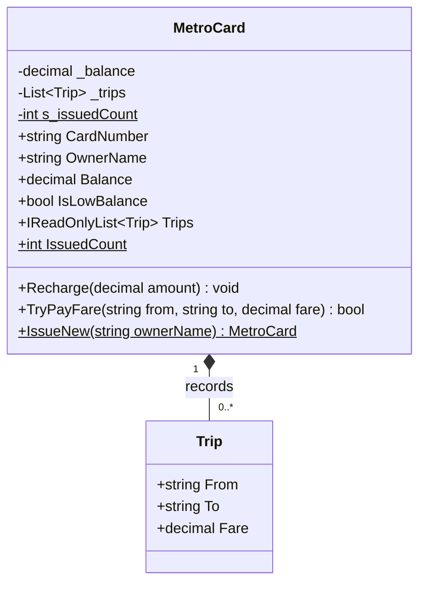
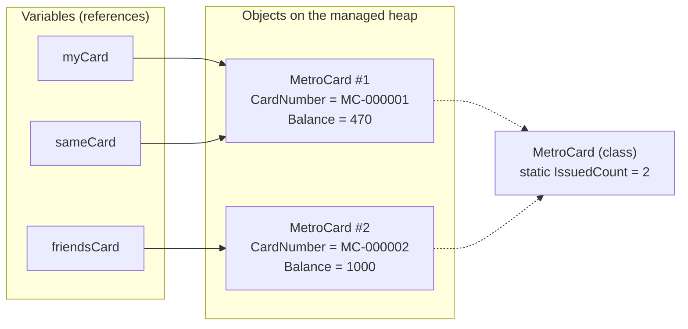
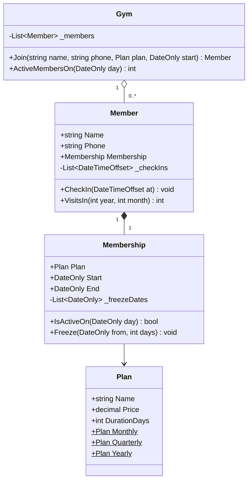

Almost every line of C# you will write lives inside a class. Before design patterns, before architecture, before databases, you need a calm, solid understanding of five words: **class**, **object**, **field**, **property** and **method**. This lesson builds that understanding slowly, with one running example: a metro smart card.

## Learning objectives

By the end of this lesson you will be able to:

1. Explain the difference between a class and an object using an everyday analogy.
2. Write a C# class with private fields, public properties and methods.
3. Create several objects from one class and show that each keeps its own data.
4. Choose between a field, an auto-property, a computed property and a property with validation.
5. Explain what `static` means, and when shared (static) data is dangerous in a web server.
6. Protect an object from invalid data so it can never be in a broken state.
7. Read a small ASP.NET Core API and point out which parts are classes, objects, properties and methods.

## Prerequisites

- [Variables, types, conditions, loops and functions in C#](#/lesson/m01-csharp-basics): you should know what `int`, `decimal`, `string`, `if` and a method look like.

That is all. If you can write a method that adds two numbers, you are ready.

## Explain it like I'm a beginner

### The blueprint and the house

An architect draws one **blueprint** for a type of flat: two bedrooms, one kitchen, a balcony facing east. The blueprint is not a flat. You can't live in it. But a builder can use that one blueprint to build 200 real flats in a housing society.

Every flat built from the blueprint has the same *shape*: the same rooms, the same switches, the same doors. But each flat has its **own** contents. Flat 101 has blue curtains and a family of four. Flat 702 has white curtains and one student. Painting a wall in 101 does not change 702.

In C#:

- The blueprint is a **class**.
- Each real flat is an **object** (also called an *instance* of the class).
- The things each flat *has* (curtain colour, number of residents) are its data: **fields** and **properties**.
- The things you can *do* with a flat (switch on a light, lock the door) are its **methods**.

### The metro card

Now a closer example. Think of the smart card you tap at a metro gate in Delhi, Mumbai or Bengaluru.

The metro company designed *one kind* of card: every card has a number, an owner, a balance, and a list of past trips. You can recharge it and you can pay a fare with it. That design is the class `MetroCard`.

Your card, your friend's card and the 50 lakh other cards in people's wallets are objects. Each has its own number and its own balance. When you pay ₹30 for a trip, *your* balance drops. Your friend's card is untouched.

There is also some information that belongs to *the design itself*, not to any one card. For example, "how many cards have we issued in total?" No single card knows that. That kind of shared information is called **static** in C#.

### Why the balance is guarded

Could you walk up to your card and write "₹10,00,000" on it with a pen? No. The balance can only change through two approved doors: **recharge** at a counter, and **pay** at a gate. Each door checks rules: a recharge must be at least ₹100, and you can't pay more than you have.

In C#, this "approved door with rules" is a **property** or a **method**. The raw number hidden inside is a **private field**. Hiding the raw data and only allowing approved changes is called **encapsulation**. You will meet it again in [the four OOP pillars](#/lesson/m01-oop-pillars).

## First-principles explanation

### What a class is

A class is a **type you define yourself**. C# already gives you types like `int` (whole numbers) and `string` (text). A class lets you say "my program also has a type called `MetroCard`, and here is what every `MetroCard` contains and can do".

```csharp
public class MetroCard
{
    // data and behaviour go here
}
```

That code creates nothing at runtime. It only describes. Just like a blueprint, it takes up no "flat space" until you build something from it.

### What an object is

An object is created with the `new` keyword:

```csharp
MetroCard myCard = new MetroCard();
MetroCard friendsCard = new MetroCard();
```

Each `new` asks the .NET runtime for a fresh block of memory big enough to hold one card's data. That memory lives in an area called the *heap* (the managed heap). The variable `myCard` does not hold the card itself. It holds an **address** pointing to it, a reference. You can think of the variable as a **token at a cloakroom**: the token is small; the coat is somewhere else.

This explains a classic beginner surprise:

```csharp
MetroCard a = new MetroCard();
MetroCard b = a;          // copies the token, not the card
b.Recharge(500m);
Console.WriteLine(a.Balance); // 500 — a and b point to the same card
```

Two tokens, one coat. The [value and reference types lesson](#/lesson/m01-value-reference-memory) explores this in depth.

### Fields: where data is stored

A **field** is a variable that belongs to an object. Every object gets its own copy.

```csharp
public class MetroCard
{
    private decimal _balance;   // each card has its own _balance
}
```

The word `private` means "only code inside `MetroCard` can touch this". By convention, private fields start with an underscore and use camelCase (`_balance`). This makes them easy to spot.

Fields have default values when an object is created: `0` for numbers, `false` for `bool`, `null` for references such as `string`. So a brand-new card has a balance of ₹0.

### Properties: guarded doors to the data

Outside code usually needs to *read* the balance (the gate shows it on screen). But it must not be able to *set* it to anything it likes. A **property** looks like a field from the outside but runs code when read (`get`) or written (`set`).

```csharp
public class MetroCard
{
    private decimal _balance;
    public decimal Balance
    {
        get { return _balance; }
    }
}
```

Now `card.Balance` works for reading, and `card.Balance = 1_000_000m;` does not compile. There is no `set`.

Writing a private field plus a property by hand is common, so C# has shortcuts:

| You write | Meaning |
|---|---|
| `public string OwnerName { get; set; }` | **Auto-property.** C# creates a hidden field for you. Anyone can read and write. |
| `public decimal Balance { get; private set; }` | Anyone can read. Only code inside the class can write. |
| `public string CardNumber { get; }` | Read-only after the object is created. It can be set only in the constructor. |
| `public string CardNumber { get; init; }` | Can be set while creating the object, then never again. |
| `public bool IsLow => Balance < 50m;` | **Computed property.** No storage at all; it is calculated every time you read it. |

**C# 14 adds the `field` keyword.** Before C# 14, if you wanted a property with validation, you had to declare the private field yourself. Now you can refer to the compiler-generated hidden field with `field`:

```csharp
public string OwnerName
{
    get;
    set => field = string.IsNullOrWhiteSpace(value)
        ? throw new ArgumentException("Owner name is required.")
        : value.Trim();
}
```

The compiler creates a hidden storage field. `field` is how you talk to it. You get validation without the boilerplate.

### Methods: what an object can do

A **method** is a named block of code that belongs to a class. Instance methods work on one object's data.

```csharp
public void Recharge(decimal amount)
{
    if (amount < 100m) throw new ArgumentOutOfRangeException(nameof(amount), "Minimum recharge is ₹100.");
    _balance += amount;
}
```

When you call `myCard.Recharge(200m)`, the method runs *for `myCard`*. Inside the method, `_balance` means "my card's `_balance`". C# passes the object in silently as `this`. You could write `this._balance += amount;` and it would mean the same thing.

A helpful habit is to split methods into two kinds:

- **Commands** change the object: `Recharge`, `PayFare`. They usually return `void` or a success flag.
- **Queries** answer a question without changing anything: `Balance`, `CanAfford(30m)`.

Mixing the two ("a method that checks the balance and secretly deducts ₹1") surprises the people who call it.

### Static members: belonging to the class, not the object

Mark a member `static` and it belongs to the class itself. There is exactly **one copy**, shared by everyone.

```csharp
public class MetroCard
{
    private static int s_issuedCount;           // one number for the whole program
    public static int IssuedCount => s_issuedCount;
    public const decimal MinimumRecharge = 100m; // a constant is implicitly static
}

Console.WriteLine(MetroCard.IssuedCount); // called on the class name, not on a card
```

Good uses of static:

- Constants and fixed rules: `MinimumRecharge`.
- Pure helper methods that need no object data: `Math.Round`, `decimal.Parse`.
- Factory methods that create objects: `MetroCard.IssueNew(...)`.

**The danger: mutable static data in a web server.** An ASP.NET Core app serves many users at the same time, on many threads, from one process. A `static List<Order>` is shared by *every* request from *every* user. Two requests adding to it at the same moment can corrupt it, because `List<T>` is not thread-safe. Data from user A can also leak to user B. Static counters and caches need careful thread-safe code (`Interlocked`, `lock`, `ConcurrentDictionary`). Usually they are better replaced by a service registered in [dependency injection](#/lesson/m03-dependency-injection).

### Invariants: rules that must always be true

An **invariant** is a rule about an object that must be true at every moment someone can look at it. For our card:

1. The balance is never negative.
2. The balance never exceeds ₹3,000 (our illustrative card limit).
3. The card number never changes.

The whole point of private fields plus guarded properties and methods is that **the class itself enforces its invariants**. No caller can break them, however careless. If the balance could be set from outside, you would need to re-check those rules in 40 different places, and someone would forget one.

### When a class is unnecessary

Not everything needs a class with behaviour:

- A small bundle of data that just travels around (an API request body, a row from a report) can be a **record**, which is covered in [the constructors lesson](#/lesson/m01-constructors).
- A single calculation with no data of its own can be a **static method**.
- Wrapping every single value in its own class "just in case" makes code harder to read. Create a class when there is data *and* rules that belong together.

## Visual explanation

### The class and its members



This is a **class diagram**. It describes the blueprint, not any particular card. The box has three parts: the name, the data, and the methods. A `-` sign means private (hidden). A `+` sign means public (anyone can use it). Underlined members (shown with `$` in the source) are static: `s_issuedCount`, `IssuedCount` and `IssueNew` belong to the class, not to a card. The line to `Trip` says each card holds zero or more trips. You will learn to read and draw these properly in [Class diagrams](#/lesson/m05-class-diagrams).

### Objects and references at runtime



This picture shows the program *while it runs*. There are three variables but only two objects: `myCard` and `sameCard` hold references to the same card #1. Each object stores its own `CardNumber` and `Balance`. The static `IssuedCount` exists exactly once, attached to the class, and both cards share it. If you understand this diagram, you understand most beginner bugs about "why did my other variable change too?".

## Step-by-step example

We will grow the metro card in five small steps. Every step compiles.

### Step 1 — the emptiest class

```csharp
public class MetroCard
{
}

var card = new MetroCard();   // an object, but it knows nothing
```

### Step 2 — public fields (the naive version)

```csharp
public class MetroCard
{
    public string CardNumber = "";
    public decimal Balance;
}

var card = new MetroCard();
card.CardNumber = "MC-000001";
card.Balance = 500m;
card.Balance = -2000m;        // nothing stops this!
card.CardNumber = "HACKED";   // or this
```

It works, and for a 20-line script this might even be acceptable. But every invariant is broken by the last two lines.

### Step 3 — hide the data, add guarded doors

```csharp
public class MetroCard
{
    private decimal _balance;

    public string CardNumber { get; }
    public decimal Balance => _balance;

    public MetroCard(string cardNumber)   // a constructor: runs once, when the object is created
    {
        CardNumber = cardNumber;
    }

    public void Recharge(decimal amount)
    {
        if (amount < 100m) throw new ArgumentOutOfRangeException(nameof(amount), "Minimum recharge is ₹100.");
        if (_balance + amount > 3000m) throw new ArgumentOutOfRangeException(nameof(amount), "Card limit is ₹3,000.");
        _balance += amount;
    }
}
```

The `MetroCard(string cardNumber)` method with no return type is a **constructor**. It is explained fully in the [next lesson](#/lesson/m01-constructors). For now: it runs once when you write `new MetroCard("MC-000001")`.

Now `card.Balance = -2000m;` and `card.CardNumber = "HACKED";` are compile errors. Bad data cannot get in.

### Step 4 — a method that may fail politely

Paying a fare can fail for an ordinary reason: not enough money. That is not a programming mistake, so we return `false` instead of throwing an exception:

```csharp
public bool TryPayFare(decimal fare)
{
    if (fare <= 0) throw new ArgumentOutOfRangeException(nameof(fare)); // a bug in the caller
    if (fare > _balance) return false;                                  // a normal business outcome
    _balance -= fare;
    return true;
}
```

The `Try...` prefix with a `bool` result is a .NET naming habit (`int.TryParse` follows it). It tells callers "check the result".

### Step 5 — computed property, trip history and static count

```csharp
private readonly List<Trip> _trips = new();
public IReadOnlyList<Trip> Trips => _trips;
public bool IsLowBalance => _balance < 50m;

private static int s_issuedCount;
public static int IssuedCount => s_issuedCount;
```

Two details matter:

- `_trips` is `readonly`. That means the field always points to the same list. The list's *contents* can still change, but only through the card's own methods.
- `Trips` is exposed as `IReadOnlyList<Trip>`. Outside code can loop over trips and count them, but it gets no `Add` or `Clear` method. If we exposed `List<Trip>` instead, anyone could call `card.Trips.Clear()` and erase history.

The full, final version is in the next section, inside a small web API.

## Production-style C# implementation

A tiny but complete ASP.NET Core API for metro cards. It is deliberately small. Don't worry if `interface` and `AddSingleton` are new; they are explained in later lessons. Focus on the classes: what data each holds and what each one does.

```text
Metro.Api/
  Program.cs                         // starts the web app and maps URLs to code
  MetroCards/
    Trip.cs                          // one journey (small data type)
    MetroCard.cs                     // the main class: data + rules
    FareChart.cs                     // turns "stations travelled" into a fare
    ICardRepository.cs               // where cards are stored (an interface)
    InMemoryCardRepository.cs        // a simple in-memory store
    Requests.cs                      // shapes of incoming JSON
```

```csharp file=MetroCards/Trip.cs
namespace Metro.Api.MetroCards;

/// <summary>One completed journey. A record is a compact class for data that never changes.</summary>
public sealed record Trip(string From, string To, decimal Fare, DateTimeOffset At);
```

```csharp file=MetroCards/MetroCard.cs
namespace Metro.Api.MetroCards;

/// <summary>A stored-value metro card. All balance changes go through Recharge and TryPayFare,
/// so the invariants (0 &lt;= balance &lt;= MaximumBalance) can never be broken from outside.</summary>
public sealed class MetroCard
{
    public const decimal MinimumRecharge = 100m;      // illustrative business rules, not a real operator's
    public const decimal MaximumBalance = 3000m;
    public const decimal LowBalanceThreshold = 50m;

    private static int s_issuedCount;                 // shared by all cards: one copy for the whole app

    private readonly Lock _gate = new();              // protects this card if two requests touch it at once
    private readonly List<Trip> _trips = new();
    private decimal _balance;

    private MetroCard(string cardNumber, string ownerName)
    {
        CardNumber = cardNumber;
        OwnerName = ownerName;                         // goes through the validating setter below
    }

    public string CardNumber { get; }

    /// <summary>C# 14 'field' keyword: validation without declaring a backing field by hand.</summary>
    public string OwnerName
    {
        get;
        set => field = string.IsNullOrWhiteSpace(value)
            ? throw new ArgumentException("Owner name is required.", nameof(value))
            : value.Trim();
    }

    public decimal Balance { get { lock (_gate) return _balance; } }
    public bool IsLowBalance => Balance < LowBalanceThreshold;
    public IReadOnlyList<Trip> Trips { get { lock (_gate) return _trips.ToArray(); } }

    public static int IssuedCount => Volatile.Read(ref s_issuedCount);

    /// <summary>Static factory: creates a card with the next unique number.</summary>
    public static MetroCard IssueNew(string ownerName)
    {
        var next = Interlocked.Increment(ref s_issuedCount);   // thread-safe ++ on shared data
        return new MetroCard($"MC-{next:D6}", ownerName);
    }

    public void Recharge(decimal amount)
    {
        if (amount < MinimumRecharge)
            throw new ArgumentOutOfRangeException(nameof(amount), $"Minimum recharge is ₹{MinimumRecharge}.");
        lock (_gate)
        {
            if (_balance + amount > MaximumBalance)
                throw new ArgumentOutOfRangeException(nameof(amount), $"Card limit is ₹{MaximumBalance}.");
            _balance += amount;
        }
    }

    /// <summary>Returns false (and changes nothing) when the balance is too low.</summary>
    public bool TryPayFare(string from, string to, decimal fare, DateTimeOffset at)
    {
        ArgumentOutOfRangeException.ThrowIfNegativeOrZero(fare);
        lock (_gate)
        {
            if (fare > _balance) return false;
            _balance -= fare;
            _trips.Add(new Trip(from, to, fare, at));
            return true;
        }
    }
}
```

```csharp file=MetroCards/FareChart.cs
namespace Metro.Api.MetroCards;

/// <summary>Illustrative distance-based fares. A class with no mutable state is safe to share.</summary>
public sealed class FareChart
{
    public decimal FareFor(int stationsTravelled)
    {
        ArgumentOutOfRangeException.ThrowIfNegativeOrZero(stationsTravelled);
        return stationsTravelled switch
        {
            <= 2 => 10m,
            <= 5 => 20m,
            <= 12 => 30m,
            _ => 40m,
        };
    }
}
```

```csharp file=MetroCards/ICardRepository.cs
namespace Metro.Api.MetroCards;

public interface ICardRepository
{
    void Add(MetroCard card);
    MetroCard? Find(string cardNumber);
}
```

```csharp file=MetroCards/InMemoryCardRepository.cs
using System.Collections.Concurrent;

namespace Metro.Api.MetroCards;

/// <summary>Good enough for a demo or tests. Data is lost when the app restarts;
/// a real system would store cards in PostgreSQL.</summary>
public sealed class InMemoryCardRepository : ICardRepository
{
    private readonly ConcurrentDictionary<string, MetroCard> _cards = new(StringComparer.OrdinalIgnoreCase);

    public void Add(MetroCard card)
    {
        if (!_cards.TryAdd(card.CardNumber, card))
            throw new InvalidOperationException($"Card {card.CardNumber} already exists.");
    }

    public MetroCard? Find(string cardNumber) => _cards.GetValueOrDefault(cardNumber);
}
```

```csharp file=MetroCards/Requests.cs
namespace Metro.Api.MetroCards;

public sealed record IssueCardRequest(string OwnerName);
public sealed record RechargeRequest(decimal Amount);
public sealed record TripRequest(string From, string To, int StationsTravelled);
public sealed record CardView(string CardNumber, string OwnerName, decimal Balance, bool IsLowBalance, int TripCount)
{
    public static CardView From(MetroCard c) => new(c.CardNumber, c.OwnerName, c.Balance, c.IsLowBalance, c.Trips.Count);
}
```

```csharp file=Program.cs
using Metro.Api.MetroCards;

var builder = WebApplication.CreateBuilder(args);

// One shared store and one shared fare chart for the whole app.
builder.Services.AddSingleton<ICardRepository, InMemoryCardRepository>();
builder.Services.AddSingleton<FareChart>();
builder.Services.AddSingleton(TimeProvider.System);

var app = builder.Build();

app.MapPost("/cards", (IssueCardRequest req, ICardRepository repo) =>
{
    try
    {
        var card = MetroCard.IssueNew(req.OwnerName);
        repo.Add(card);
        return Results.Created($"/cards/{card.CardNumber}", CardView.From(card));
    }
    catch (ArgumentException ex) { return Results.Problem(ex.Message, statusCode: 400); }
});

app.MapGet("/cards/{number}", (string number, ICardRepository repo) =>
    repo.Find(number) is { } card ? Results.Ok(CardView.From(card)) : Results.NotFound());

app.MapPost("/cards/{number}/recharge", (string number, RechargeRequest req, ICardRepository repo) =>
{
    if (repo.Find(number) is not { } card) return Results.NotFound();
    try { card.Recharge(req.Amount); return Results.Ok(CardView.From(card)); }
    catch (ArgumentOutOfRangeException ex) { return Results.Problem(ex.Message, statusCode: 400); }
});

app.MapPost("/cards/{number}/trips", (string number, TripRequest req, ICardRepository repo, FareChart fares, TimeProvider clock) =>
{
    if (repo.Find(number) is not { } card) return Results.NotFound();
    if (req.StationsTravelled <= 0) return Results.Problem("StationsTravelled must be positive.", statusCode: 400);
    var fare = fares.FareFor(req.StationsTravelled);
    return card.TryPayFare(req.From, req.To, fare, clock.GetUtcNow())
        ? Results.Ok(CardView.From(card))
        : Results.Problem($"Insufficient balance for fare ₹{fare}.", statusCode: 402);
});

app.MapGet("/stats", () => Results.Ok(new { issued = MetroCard.IssuedCount }));

app.Run();
```

What to notice:

- **`MetroCard` owns its rules.** The endpoints never do `balance - fare` themselves. They ask the card to do it. If the rule changes (say, a ₹5 penalty below zero), only one class changes.
- **The constructor is private.** The only way to make a card is `MetroCard.IssueNew`, which guarantees a unique number. This is a static factory method.
- **`FareChart` is a separate class** because "how much does a trip cost?" is a different responsibility from "how much money is on this card?".
- **`CardView` is what the API returns**, not the `MetroCard` itself. That way, adding a private field to the card never accidentally changes the JSON your mobile app receives.
- **Thread safety.** Two gates could process the same card at nearly the same moment. The private `Lock` (a .NET 9+ type) makes each balance change happen one at a time. For a single-user console app you would not need it. In a web server you do.
- **The static counter restarts at zero when the app restarts.** That is fine for a demo and wrong for a real system. Real card numbers would come from a database sequence. This is a good example of why static state is rarely the right home for important data.

## Bad design vs good design

**Bad**: a class used as a bag of public fields, with the rules scattered across callers.

```csharp
public class Card
{
    public string Number;
    public decimal Balance;
    public List<Trip> Trips = new();
}

// In the gate controller:
if (card.Balance >= fare) { card.Balance -= fare; card.Trips.Add(trip); }
// In the recharge controller:
card.Balance += amount;          // forgot the ₹3,000 limit here
// In an admin script:
card.Trips.Clear();              // history gone
```

Problems:

- The ₹3,000 limit is checked in one place and forgotten in another. The bug appears only for some users.
- Anyone can wipe the trip history or change the card number.
- Every new screen (mobile app, kiosk, admin panel) must copy the rules again.

**Good**: the `MetroCard` above. Data is private. Each change goes through one method that checks the rules. Callers *ask* the object to do things instead of reaching inside it. This idea is sometimes summarised as **"Tell, don't ask"**.

**Is the improvement always worth it?** Not for every type. A data-transfer type such as `RechargeRequest` has no rules of its own; it just carries JSON into the app. Making it a record with public properties is correct. Encapsulate when there are **rules to protect**. Don't add getters, setters and methods to a type that just carries data.

:::callout type=mistake title="Getters and setters for everything is not encapsulation"
`public decimal Balance { get; set; }` is a property, but it protects nothing: anyone can still set any value. Encapsulation means the class decides what changes are allowed. Start with `{ get; private set; }` or a get-only property, and add public methods for the real operations.
:::

## Practical playground

Run the program, then try the experiments in the comments. Predict the output *before* you run each one.

:::playground type=csharp title="Metro card objects"
```csharp file=Program.cs
using System;
using System.Collections.Generic;

public sealed class MetroCard
{
    private static int s_issuedCount;
    private decimal _balance;
    private readonly List<string> _trips = new();

    public MetroCard(string ownerName)
    {
        s_issuedCount++;
        CardNumber = $"MC-{s_issuedCount:D6}";
        OwnerName = ownerName;
    }

    public string CardNumber { get; }
    public string OwnerName { get; }
    public decimal Balance => _balance;
    public bool IsLowBalance => _balance < 50m;
    public IReadOnlyList<string> Trips => _trips;
    public static int IssuedCount => s_issuedCount;

    public void Recharge(decimal amount)
    {
        if (amount < 100m) throw new ArgumentOutOfRangeException(nameof(amount), "Minimum recharge is 100.");
        _balance += amount;
    }

    public bool TryPayFare(string trip, decimal fare)
    {
        if (fare > _balance) return false;
        _balance -= fare;
        _trips.Add(trip);
        return true;
    }
}

public static class Program
{
    public static void Main()
    {
        var asha = new MetroCard("Asha");
        var ravi = new MetroCard("Ravi");
        asha.Recharge(200m);

        Console.WriteLine($"{asha.CardNumber} {asha.OwnerName}: {asha.Balance}");   // 200
        Console.WriteLine($"{ravi.CardNumber} {ravi.OwnerName}: {ravi.Balance}");   // 0

        Console.WriteLine(asha.TryPayFare("Rajiv Chowk -> Huda City Centre", 40m)); // True
        Console.WriteLine(ravi.TryPayFare("Rajiv Chowk -> Kashmere Gate", 20m));    // False
        Console.WriteLine($"Asha now has {asha.Balance}, low? {asha.IsLowBalance}");

        var sameAsAsha = asha;          // copies the reference, not the card
        sameAsAsha.Recharge(100m);
        Console.WriteLine($"Asha's balance: {asha.Balance}");                        // 260
        Console.WriteLine($"Cards issued: {MetroCard.IssuedCount}");                  // 2

        // Experiments:
        // 1. Uncomment: asha.Balance = 5000m;      -> why does it not compile?
        // 2. Uncomment: asha.Recharge(50m);        -> what happens, and why is that good?
        // 3. Make Asha's balance low (below 50) and print IsLowBalance.
        // 4. Create a third card. What is IssuedCount now? Which object "owns" that number?
    }
}
```
:::

## Exercises

:::exercise id=m01-classes-objects-ex1 difficulty=beginner kind=code title="A step counter"
Build a `StepCounter` class for a fitness app. Each counter tracks its own steps.
::requirements
- `Steps` can be read from outside but not set from outside.
- `AddSteps(int count)` adds steps. A negative count throws `ArgumentOutOfRangeException`. Zero is allowed and changes nothing.
- `Kilometres` is a computed property: `Steps / 1250.0` (an estimate of about 0.8 m per step).
- `Reset()` sets steps back to 0.
::acceptance
- A new counter has 0 steps.
- Adding 500 twice gives 1,000 steps.
- 2,500 steps gives 2.0 km.
- Two counters do not affect each other.
- `AddSteps(-5)` throws `ArgumentOutOfRangeException`.
::hint
Every counter needs somewhere to remember its own number of steps. Which kind of member stores data per object?
::hint
Add a private field such as `private int _steps;`. Make `Steps` return it.
::hint
`Kilometres` needs no storage of its own. Use an expression-bodied property: `=> _steps / (double)StepsPerKilometre`.
::hint
Guard the input first, then change state:
```csharp
public void AddSteps(int count)
{
    ArgumentOutOfRangeException.ThrowIfNegative(count);
    _steps += count;
}
```
::starter
```csharp file=StepCounter.cs
using System;

public sealed class StepCounter
{
    public const int StepsPerKilometre = 1250;

    public int Steps => throw new NotImplementedException();
    public double Kilometres => throw new NotImplementedException();

    public void AddSteps(int count) => throw new NotImplementedException();
    public void Reset() => throw new NotImplementedException();
}
```
::tests
```csharp file=StepCounterTests.cs
using System;
using Xunit;

public class StepCounterTests
{
    [Fact] public void New_counter_is_zero() => Assert.Equal(0, new StepCounter().Steps);

    [Fact]
    public void Adds_up()
    {
        var c = new StepCounter();
        c.AddSteps(500); c.AddSteps(500);
        Assert.Equal(1000, c.Steps);
    }

    [Fact]
    public void Converts_to_kilometres()
    {
        var c = new StepCounter();
        c.AddSteps(2500);
        Assert.Equal(2.0, c.Kilometres, 3);
    }

    [Fact]
    public void Counters_are_independent()
    {
        var a = new StepCounter(); var b = new StepCounter();
        a.AddSteps(100);
        Assert.Equal(0, b.Steps);
    }

    [Fact]
    public void Reset_sets_zero()
    {
        var c = new StepCounter();
        c.AddSteps(300); c.Reset();
        Assert.Equal(0, c.Steps);
    }

    [Fact] public void Negative_throws() => Assert.Throws<ArgumentOutOfRangeException>(() => new StepCounter().AddSteps(-5));
}
```
::solution
A private field stores the data per object. The properties only expose it.

```csharp file=StepCounter.cs
using System;

public sealed class StepCounter
{
    public const int StepsPerKilometre = 1250;

    private int _steps;

    public int Steps => _steps;
    public double Kilometres => _steps / (double)StepsPerKilometre;

    public void AddSteps(int count)
    {
        ArgumentOutOfRangeException.ThrowIfNegative(count);
        _steps += count;
    }

    public void Reset() => _steps = 0;
}
```

Why `(double)`? `2500 / 1250` with two `int`s is integer division and works here, but `1000 / 1250` would give `0` instead of `0.8`. Converting one side to `double` keeps the fraction.
::mistakes
- Making `_steps` `static`. Then every counter in the app shares one number, and the "independent" test fails.
- Writing `public int Steps { get; set; }`, which lets anyone set a negative number.
- Integer division in `Kilometres`, giving 0 km for 1,000 steps.
::extensions
Add `DailyGoal` (default 10,000) and a computed `GoalReached` property. Add a `Steps { get; private set; }` version and compare it with the private-field version. Which do you find clearer?
:::

:::exercise id=m01-classes-objects-ex2 difficulty=beginner kind=code title="Recharge and pay with a metro card"
Complete a simplified `MetroCard` so it can never hold an invalid balance.
::requirements
- `Recharge(amount)`: amount below ₹100 throws `ArgumentOutOfRangeException`. If the new balance would exceed ₹3,000, throw `ArgumentOutOfRangeException` and leave the balance unchanged.
- `TryPayFare(fare)`: a fare of zero or less throws `ArgumentOutOfRangeException`. If the balance is too low, return `false` and change nothing. Otherwise deduct and return `true`.
- `TripCount` counts successful payments only.
::acceptance
- Recharge ₹500, pay ₹30: balance is ₹470, `TripCount` is 1.
- Paying ₹40 with a balance of ₹30 returns `false`, and the balance stays ₹30.
- Recharging ₹2,900 on a card holding ₹200 throws, and the balance stays ₹200.
- Recharging ₹99 throws.
::hint
List the invariants first: "balance ≥ 0" and "balance ≤ 3,000". Every method must keep both true.
::hint
Check all the rules *before* changing any field. If you deduct first and check afterwards, a failure leaves the card in a broken state.
::hint
A failed payment is a normal event (return `false`). A zero fare is a bug in the caller (throw).
::hint
```csharp
if (amount < MinimumRecharge) throw new ArgumentOutOfRangeException(nameof(amount));
if (_balance + amount > MaximumBalance) throw new ArgumentOutOfRangeException(nameof(amount));
_balance += amount;
```
::starter
```csharp file=MetroCard.cs
using System;

public sealed class MetroCard
{
    public const decimal MinimumRecharge = 100m;
    public const decimal MaximumBalance = 3000m;

    public decimal Balance => throw new NotImplementedException();
    public int TripCount => throw new NotImplementedException();

    public void Recharge(decimal amount) => throw new NotImplementedException();
    public bool TryPayFare(decimal fare) => throw new NotImplementedException();
}
```
::tests
```csharp file=MetroCardTests.cs
using System;
using Xunit;

public class MetroCardTests
{
    [Fact]
    public void Recharge_then_pay()
    {
        var c = new MetroCard();
        c.Recharge(500m);
        Assert.True(c.TryPayFare(30m));
        Assert.Equal(470m, c.Balance);
        Assert.Equal(1, c.TripCount);
    }

    [Fact]
    public void Insufficient_balance_changes_nothing()
    {
        var c = new MetroCard();
        c.Recharge(100m);
        Assert.True(c.TryPayFare(70m));
        Assert.False(c.TryPayFare(40m));
        Assert.Equal(30m, c.Balance);
        Assert.Equal(1, c.TripCount);
    }

    [Fact]
    public void Over_limit_throws_and_keeps_balance()
    {
        var c = new MetroCard();
        c.Recharge(200m);
        Assert.Throws<ArgumentOutOfRangeException>(() => c.Recharge(2900m));
        Assert.Equal(200m, c.Balance);
    }

    [Fact] public void Small_recharge_throws() => Assert.Throws<ArgumentOutOfRangeException>(() => new MetroCard().Recharge(99m));

    [Fact] public void Zero_fare_throws() => Assert.Throws<ArgumentOutOfRangeException>(() => new MetroCard().TryPayFare(0m));

    [Fact]
    public void Exactly_at_limit_is_allowed()
    {
        var c = new MetroCard();
        c.Recharge(3000m);
        Assert.Equal(3000m, c.Balance);
    }
}
```
::solution
```csharp file=MetroCard.cs
using System;

public sealed class MetroCard
{
    public const decimal MinimumRecharge = 100m;
    public const decimal MaximumBalance = 3000m;

    private decimal _balance;
    private int _tripCount;

    public decimal Balance => _balance;
    public int TripCount => _tripCount;

    public void Recharge(decimal amount)
    {
        if (amount < MinimumRecharge)
            throw new ArgumentOutOfRangeException(nameof(amount), $"Minimum recharge is {MinimumRecharge}.");
        if (_balance + amount > MaximumBalance)
            throw new ArgumentOutOfRangeException(nameof(amount), $"Balance cannot exceed {MaximumBalance}.");
        _balance += amount;
    }

    public bool TryPayFare(decimal fare)
    {
        if (fare <= 0) throw new ArgumentOutOfRangeException(nameof(fare), "Fare must be positive.");
        if (fare > _balance) return false;
        _balance -= fare;
        _tripCount++;
        return true;
    }
}
```

Every check happens before any field changes, so a failed call leaves the card exactly as it was. Notice that "exactly ₹3,000" is allowed: the rule is "greater than" the limit, not "greater than or equal". Edge cases like this are where tests earn their keep.
::mistakes
- Adding first and then throwing when over the limit, which leaves the invalid balance in place.
- Throwing an exception for insufficient balance. It is an expected outcome; a `bool` result is easier for callers.
- Using `double` for money. `0.1 + 0.2` is not exactly `0.3` in `double`; use `decimal`.
::extensions
Store each trip as a `(string From, string To, decimal Fare)` tuple in a private list and expose it as `IReadOnlyList`.
:::

:::exercise id=m01-classes-objects-ex3 difficulty=intermediate kind=code title="A shopping cart that protects its lines"
Build a `Cart` for a grocery app. It holds lines (SKU, unit price, quantity) and must keep them valid.
::requirements
- `Add(sku, unitPrice, quantity)`: quantity must be at least 1 and the price at least 0, otherwise throw `ArgumentOutOfRangeException`. Adding an SKU that is already in the cart increases its quantity (SKU comparison ignores case). If the price differs from the existing line, throw `InvalidOperationException`.
- `Remove(sku)` removes the line and returns `true`, or returns `false` if it was not there.
- `Total` is the sum of price × quantity. `ItemCount` is the total number of units.
- `Lines` lets callers read the lines but not change the cart through it.
::acceptance
- Adding "MILK" ₹30 × 2, then "milk" ₹30 × 1, gives one line with quantity 3.
- Milk ₹30 × 3 plus bread ₹45 × 1 gives a total of ₹135 and an item count of 4.
- Removing an absent SKU returns `false`.
- Quantity 0 throws `ArgumentOutOfRangeException`.
- `Lines` is not a `List<CartLine>` that callers could cast and modify.
::hint
Which class should own the rule "same SKU means merge"? The cart, because it is the only one that sees all lines.
::hint
A `Dictionary<string, CartLine>` with `StringComparer.OrdinalIgnoreCase` makes the lookup easy.
::hint
`CartLine` can be an immutable record. To "increase the quantity", replace the old line with a new one: `existing with { Quantity = existing.Quantity + quantity }`.
::hint
For `Lines`, return a copy such as `_lines.Values.ToArray()` typed as `IReadOnlyList<CartLine>`. An array is not a `List<T>`, and changing the copy cannot change the cart.
::hint
```csharp
if (_lines.TryGetValue(sku, out var existing))
{
    if (existing.UnitPrice != unitPrice) throw new InvalidOperationException("Price mismatch.");
    _lines[sku] = existing with { Quantity = existing.Quantity + quantity };
}
else _lines[sku] = new CartLine(sku, unitPrice, quantity);
```
::starter
```csharp file=Cart.cs
using System;
using System.Collections.Generic;
using System.Linq;

public sealed record CartLine(string Sku, decimal UnitPrice, int Quantity)
{
    public decimal LineTotal => UnitPrice * Quantity;
}

public sealed class Cart
{
    public IReadOnlyList<CartLine> Lines => throw new NotImplementedException();
    public decimal Total => throw new NotImplementedException();
    public int ItemCount => throw new NotImplementedException();

    public void Add(string sku, decimal unitPrice, int quantity) => throw new NotImplementedException();
    public bool Remove(string sku) => throw new NotImplementedException();
}
```
::tests
```csharp file=CartTests.cs
using System;
using System.Collections.Generic;
using Xunit;

public class CartTests
{
    [Fact]
    public void Same_sku_merges_ignoring_case()
    {
        var cart = new Cart();
        cart.Add("MILK", 30m, 2);
        cart.Add("milk", 30m, 1);
        var line = Assert.Single(cart.Lines);
        Assert.Equal(3, line.Quantity);
    }

    [Fact]
    public void Total_and_count()
    {
        var cart = new Cart();
        cart.Add("MILK", 30m, 3);
        cart.Add("BREAD", 45m, 1);
        Assert.Equal(135m, cart.Total);
        Assert.Equal(4, cart.ItemCount);
    }

    [Fact]
    public void Remove_reports_result()
    {
        var cart = new Cart();
        cart.Add("EGGS", 7m, 6);
        Assert.True(cart.Remove("eggs"));
        Assert.False(cart.Remove("eggs"));
        Assert.Empty(cart.Lines);
    }

    [Fact] public void Zero_quantity_throws() => Assert.Throws<ArgumentOutOfRangeException>(() => new Cart().Add("X", 10m, 0));

    [Fact] public void Negative_price_throws() => Assert.Throws<ArgumentOutOfRangeException>(() => new Cart().Add("X", -1m, 1));

    [Fact]
    public void Price_mismatch_throws()
    {
        var cart = new Cart();
        cart.Add("RICE", 60m, 1);
        Assert.Throws<InvalidOperationException>(() => cart.Add("RICE", 65m, 1));
    }

    [Fact]
    public void Lines_cannot_be_used_to_modify_cart()
    {
        var cart = new Cart();
        cart.Add("TEA", 120m, 1);
        Assert.False(cart.Lines is List<CartLine>);
        Assert.Equal(1, cart.ItemCount);
    }
}
```
::solution
```csharp file=Cart.cs
using System;
using System.Collections.Generic;
using System.Linq;

public sealed record CartLine(string Sku, decimal UnitPrice, int Quantity)
{
    public decimal LineTotal => UnitPrice * Quantity;
}

public sealed class Cart
{
    private readonly Dictionary<string, CartLine> _lines = new(StringComparer.OrdinalIgnoreCase);

    public IReadOnlyList<CartLine> Lines => _lines.Values.ToArray();
    public decimal Total => _lines.Values.Sum(l => l.LineTotal);
    public int ItemCount => _lines.Values.Sum(l => l.Quantity);

    public void Add(string sku, decimal unitPrice, int quantity)
    {
        ArgumentException.ThrowIfNullOrWhiteSpace(sku);
        ArgumentOutOfRangeException.ThrowIfNegative(unitPrice);
        ArgumentOutOfRangeException.ThrowIfLessThan(quantity, 1);

        if (_lines.TryGetValue(sku, out var existing))
        {
            if (existing.UnitPrice != unitPrice)
                throw new InvalidOperationException($"{sku} is already in the cart at {existing.UnitPrice}.");
            _lines[sku] = existing with { Quantity = existing.Quantity + quantity };
        }
        else
        {
            _lines[sku] = new CartLine(sku, unitPrice, quantity);
        }
    }

    public bool Remove(string sku) => _lines.Remove(sku);
}
```

The cart is the only place that knows about all lines, so it owns the merge rule and the totals. Returning an array copy means a caller who does `((CartLine[])cart.Lines)[0] = ...` changes only their copy.
::alternatives
You could return `_lines.Values.ToList().AsReadOnly()`, which gives a `ReadOnlyCollection<CartLine>`. Or keep a `List<CartLine>` internally and return `list.AsReadOnly()` with no copy. The second is cheaper for big lists but is a *live view*, so a caller looping over it while the cart changes will get an exception.
::mistakes
- Exposing `public List<CartLine> Lines { get; }`. Anyone can then call `cart.Lines.Clear()` or add a line with quantity −5.
- Comparing SKUs with `==`, so "MILK" and "milk" become two lines.
- Storing a `Total` field and forgetting to update it in `Remove`. A computed property can never go stale.
::extensions
Add `ChangeQuantity(sku, newQuantity)` where 0 removes the line. Add a maximum of 20 units per SKU.
:::

:::exercise id=m01-classes-objects-ex4 difficulty=intermediate kind=design title="Find the classes in a gym membership system"
Read this description from a gym owner in Pune:

> "Members join on a plan: Monthly (₹1,500), Quarterly (₹4,000) or Yearly (₹14,000). Each member has a name, phone number and a membership that starts on a date and ends after the plan's duration. Members check in at the front desk; we keep every check-in time. A member can freeze their membership once a year for up to 15 days, which pushes the end date. We want to see how many members are active today, and each member's visits this month."

Identify the classes. For each class, list its fields or properties, its methods, and anything that should be static. Say which data must be protected and by which rule.
::acceptance
- At least three classes, with a clear reason for each.
- Each class lists properties and methods, with visibility (public or private).
- At least two invariants written as rules ("end date is always after start date").
- One thing you deliberately made static, or deliberately did not, with the reason.
::hint
Underline the nouns (member, plan, membership, check-in) and circle the verbs (join, check in, freeze, count). Nouns often become classes or properties; verbs often become methods.
::hint
Is "plan" data that belongs to one member, or a fixed list shared by everyone? That affects whether it is an object per member.
::hint
"Freeze once a year for up to 15 days" is a rule. Which object knows enough to enforce it? The one that holds the start and end dates.
::hint
A shape to aim for: `Plan` (name, price, duration), `Membership` (plan, start, end, freezes, `Freeze(days)`, `IsActiveOn(date)`), `Member` (name, phone, membership, check-ins, `CheckIn(time)`, `VisitsIn(month)`), and something that holds all members (`Gym`) to answer "how many are active today".
::solution


- **`Plan`** is shared reference data. The three plans are static read-only instances (`Plan.Monthly`), because every member on "Monthly" means the *same* plan. If prices change often or differ per branch, load plans from the database instead of making them static.
- **`Membership`** owns the date rules. Invariants: `End > Start`; at most one freeze per 365 days; a freeze is 1–15 days; a freeze extends `End` by the same number of days. `End` has a private setter so only `Freeze` can change it.
- **`Member`** owns check-ins. Rule: check-in is refused if the membership is not active on that day. The list is private and exposed read-only.
- **`Gym`** answers questions about *all* members. "Active today" doesn't belong to any one member.

Not static: the member list. A static `List<Member>` would be shared by every request in a web app and is not thread-safe. It belongs in a `Gym` object (later, a repository backed by PostgreSQL).
::alternatives
Merging `Membership` into `Member` is fine for a first version. Separate them when a member can renew (several memberships over time) or when the date logic grows.
::mistakes
- Making `CheckIn` a class with no behaviour while `Member` holds all the logic. A check-in is just a timestamp until it needs rules of its own.
- Putting `ActiveMembersOn` on `Member` as a static method that reads a static list.
- Storing `IsActive` as a `bool` field that someone must remember to update every midnight. Compute it from dates instead.
:::

:::exercise id=m01-classes-objects-ex5 difficulty=advanced kind=code title="Electricity meter with slab billing"
A housing society bills flats from meter readings using slabs (illustrative tariff, not any real board's): units 1–100 at ₹3, units 101–300 at ₹5, everything above 300 at ₹7. Build an `ElectricityMeter` that protects its readings and produces bills.
::requirements
- `RecordReading(int meterValue)`: a meter only counts up. A value lower than the latest reading throws `InvalidOperationException`. A negative value throws `ArgumentOutOfRangeException`. The first reading on a new meter starts at 0 (a new meter shows 0).
- `UnbilledUnits` = latest reading minus the reading at the last bill.
- `GenerateBill()` returns a `Bill(int Units, decimal Amount)` for the unbilled units, then marks them billed. A second call with no new reading returns a bill of 0 units and ₹0.
- `static decimal CalculateAmount(int units)` applies the slabs. It is static because it needs no meter data.
- `ReadingCount` exposes how many readings were recorded.
::acceptance
- 250 units costs ₹1,050 (100 × 3 + 150 × 5).
- 400 units costs ₹2,000 (300 + 1,000 + 700).
- Readings 120 then 250 then a bill gives 250 units. Then reading 300 and another bill gives 50 units, ₹150.
- A reading of 200 after 250 throws `InvalidOperationException`, and the meter keeps 250.
::hint
Which data must each meter remember? At least the latest reading and the reading at the last bill.
::hint
Separate the *pure calculation* (units → rupees) from the *state* (readings). The first is a static method you can test with no meter at all.
::hint
For slabs, take as many units as fit in each slab, then move on: `Math.Min(units, 100)` for the first slab, `Math.Clamp(units - 100, 0, 200)` for the second, `Math.Max(units - 300, 0)` for the rest.
::hint
`GenerateBill` should calculate first, then update `_lastBilledReading`. If the calculation threw halfway, you would not want the units marked as billed.
::hint
```csharp
public Bill GenerateBill()
{
    var units = UnbilledUnits;
    var bill = new Bill(units, CalculateAmount(units));
    _lastBilledReading = _latestReading;
    return bill;
}
```
::starter
```csharp file=ElectricityMeter.cs
using System;

public sealed record Bill(int Units, decimal Amount);

public sealed class ElectricityMeter
{
    public int LatestReading => throw new NotImplementedException();
    public int UnbilledUnits => throw new NotImplementedException();
    public int ReadingCount => throw new NotImplementedException();

    public void RecordReading(int meterValue) => throw new NotImplementedException();
    public Bill GenerateBill() => throw new NotImplementedException();

    public static decimal CalculateAmount(int units) => throw new NotImplementedException();
}
```
::tests
```csharp file=ElectricityMeterTests.cs
using System;
using Xunit;

public class ElectricityMeterTests
{
    [Theory]
    [InlineData(0, 0)]
    [InlineData(80, 240)]
    [InlineData(100, 300)]
    [InlineData(250, 1050)]
    [InlineData(300, 1300)]
    [InlineData(400, 2000)]
    public void Slabs(int units, int expected) => Assert.Equal((decimal)expected, ElectricityMeter.CalculateAmount(units));

    [Fact]
    public void Bills_only_new_units()
    {
        var m = new ElectricityMeter();
        m.RecordReading(120); m.RecordReading(250);
        Assert.Equal(new Bill(250, 1050m), m.GenerateBill());
        m.RecordReading(300);
        Assert.Equal(new Bill(50, 150m), m.GenerateBill());
        Assert.Equal(new Bill(0, 0m), m.GenerateBill());
    }

    [Fact]
    public void Going_backwards_throws_and_keeps_state()
    {
        var m = new ElectricityMeter();
        m.RecordReading(250);
        Assert.Throws<InvalidOperationException>(() => m.RecordReading(200));
        Assert.Equal(250, m.LatestReading);
        Assert.Equal(1, m.ReadingCount);
    }

    [Fact] public void Negative_throws() => Assert.Throws<ArgumentOutOfRangeException>(() => new ElectricityMeter().RecordReading(-1));

    [Fact]
    public void Meters_are_independent()
    {
        var a = new ElectricityMeter(); var b = new ElectricityMeter();
        a.RecordReading(500);
        Assert.Equal(0, b.UnbilledUnits);
    }
}
```
::solution
```csharp file=ElectricityMeter.cs
using System;

public sealed record Bill(int Units, decimal Amount);

public sealed class ElectricityMeter
{
    private const int Slab1Limit = 100, Slab2Limit = 300;
    private const decimal Slab1Rate = 3m, Slab2Rate = 5m, Slab3Rate = 7m;

    private int _latestReading;
    private int _lastBilledReading;
    private int _readingCount;

    public int LatestReading => _latestReading;
    public int UnbilledUnits => _latestReading - _lastBilledReading;
    public int ReadingCount => _readingCount;

    public void RecordReading(int meterValue)
    {
        ArgumentOutOfRangeException.ThrowIfNegative(meterValue);
        if (meterValue < _latestReading)
            throw new InvalidOperationException($"Reading {meterValue} is lower than the latest reading {_latestReading}.");
        _latestReading = meterValue;
        _readingCount++;
    }

    public Bill GenerateBill()
    {
        var units = UnbilledUnits;
        var bill = new Bill(units, CalculateAmount(units));
        _lastBilledReading = _latestReading;
        return bill;
    }

    public static decimal CalculateAmount(int units)
    {
        ArgumentOutOfRangeException.ThrowIfNegative(units);
        var slab1 = Math.Min(units, Slab1Limit);
        var slab2 = Math.Clamp(units - Slab1Limit, 0, Slab2Limit - Slab1Limit);
        var slab3 = Math.Max(units - Slab2Limit, 0);
        return slab1 * Slab1Rate + slab2 * Slab2Rate + slab3 * Slab3Rate;
    }
}
```

The static method is a pure function: same input, same output, no hidden state. That makes it trivial to test with a `[Theory]`. The instance members hold the per-flat state and protect the "meter only counts up" invariant.
::alternatives
If tariffs change by year or by state, a static method is too rigid. Move the slabs into a `Tariff` class with a `CalculateAmount(units)` instance method, and pass the tariff into `GenerateBill(tariff)`. That is the first step towards the [Strategy pattern](#/lesson/m06-strategy).
::mistakes
- Storing every reading in a list just to compute the difference. You only need the latest and the last-billed values (keep a list only if you need history).
- Marking units billed before computing the amount.
- Using one static `_latestReading` for all meters.
::extensions
Add a fixed monthly charge of ₹50 and GST-free rounding to the nearest rupee. Add a `Tariff` class so two societies can use different slabs.
:::

## Automated testing

Classes with private data and public methods are easy to test: you call the public methods and check the public results. You never need to peek at private fields. If a test *wants* to read a private field, that is a hint the class is missing a useful public property, or that the test is checking implementation details that may change.

A typical test follows **Arrange, Act, Assert**:

```csharp
public class MetroCardRulesTests
{
    [Fact]
    public void Failed_payment_leaves_card_unchanged()
    {
        // Arrange: a card with ₹100
        var card = MetroCard.IssueNew("Asha");
        card.Recharge(100m);

        // Act: try to pay more than the balance
        var paid = card.TryPayFare("A", "B", 150m, DateTimeOffset.UnixEpoch);

        // Assert: nothing changed
        Assert.False(paid);
        Assert.Equal(100m, card.Balance);
        Assert.Empty(card.Trips);
    }
}
```

What to test for a class like `MetroCard`:

- **Each invariant at its boundary.** ₹99 rejected, ₹100 accepted; ₹3,000 accepted, ₹3,001 rejected.
- **Failure leaves state unchanged.** This catches "changed the field, then threw" bugs.
- **Objects are independent.** Two cards do not share balance. This catches accidental `static`.
- **Computed properties** after each kind of change (`IsLowBalance` after a payment).

Static mutable state makes tests flaky. `MetroCard.IssuedCount` keeps counting across tests in the same run, so a test that asserts `IssuedCount == 1` passes alone and fails when run with others. Prefer asserting *relative* changes ("increased by 1"), or better, move counters into an injectable service. The [unit testing lesson](#/lesson/m01-testing-debugging) goes deeper.

## Real-world application

- **ASP.NET Core** is built from classes. `HttpContext` is an object per request, with properties such as `Request`, `Response` and `User`. `WebApplication` is the object that represents your running app. Your controllers and minimal-API handlers are classes or methods that the framework creates and calls.
- **Domain models** in business systems are classes that protect rules: an `Invoice` that cannot be edited after it is issued, a `LeaveRequest` that cannot be approved twice, a `RunningBill` on an infrastructure project whose certified amount can never exceed the contract value.
- **Banking and wallets** (UPI apps, prepaid cards) depend on exactly the invariant you practised: a balance changes only through validated operations, never by direct assignment.
- **The .NET libraries themselves**: `List<T>` keeps a private array and a count, and its public `Add` method grows the array when needed. You use the public members and never see the array. That is encapsulation at work in code you call every day.

## Interview questions

:::interview
::q beginner
What is the difference between a class and an object?
::a
A class is a definition: it describes the data (fields and properties) and behaviour (methods) that a kind of thing has. An object is one instance created from that class at runtime with `new`, with its own copy of the instance data. One `MetroCard` class can produce millions of card objects, each with its own balance. In C#, class variables hold references to objects, so two variables can point to the same object.
::q beginner
What is the difference between a field and a property?
::a
A field is a variable that stores data inside an object, usually `private`. A property is a member that looks like a field to callers, but runs `get` and `set` accessors, so the class can validate, compute or restrict access. Public data should normally be exposed as properties, not fields. That way you can add validation later without changing callers, and you can make the setter private or `init`-only. Auto-properties generate the backing field for you, and in C# 14 the `field` keyword lets you add logic to an auto-property's accessor.
::q intermediate
When would you make a member static, and what can go wrong?
::a
Static members belong to the type, not to an instance: constants, pure helper methods (`CalculateAmount(units)`), factory methods (`IssueNew`) and truly app-wide read-only data. The risk is *mutable* static state. In a web server, all requests share it across threads, so a static `List<T>` or `Dictionary` can be corrupted by concurrent writes and can leak data between users. It also makes unit tests depend on each other and is hard to replace in tests. Prefer a singleton service from DI with explicit thread-safety, or keep the state per request.
::q intermediate
A colleague exposes `public List<Order> Orders { get; set; }` on a `Customer` class. What would you change and why?
::a
Two problems. The public setter lets anyone replace the list (even with `null`). Exposing `List<T>` lets anyone `Add`, `Remove` or `Clear` orders without any business rules running. I would make the field `private readonly List<Order> _orders`, expose `IReadOnlyList<Order> Orders`, and add methods like `PlaceOrder(...)` that check rules (credit limit, blocked customer) before adding. That keeps the invariants in one place. If `Customer` is just a data-transfer type with no rules, a simple property may be fine, but then it shouldn't be the domain model.
::q advanced
How do you decide which class a piece of behaviour belongs to?
::a
Put behaviour with the data it needs and the rules it protects (the "information expert" idea). If a method mostly reads another object's fields (`if (card.Balance >= fare) card.Balance -= fare`), it probably belongs on that other object (`card.TryPayFare(fare)`). Keep each class focused on one responsibility. `MetroCard` manages balance and trips; `FareChart` knows prices. Rules that span many objects ("how many members are active?") belong to an object that owns the collection, or to a service. Warning signs of misplaced behaviour: a class with only getters and setters while services hold all its rules (an anaemic model), and one class that knows everything (a god object).
::q advanced
Your `MetroCard` object is shared across concurrent web requests. What can go wrong, and how do you fix it?
::a
`_balance -= fare` is a read-modify-write. Two requests can both read ₹40, both decide the ₹30 fare is affordable, and both write ₹10. The card has then paid twice from one balance (a lost update). In memory, fix it by making each check-and-update atomic with a `lock` (or `System.Threading.Lock` in .NET 9+) inside the class. In a real system, the card lives in a database and several app servers may run at once, so an in-memory lock is not enough. Use an atomic SQL update (`UPDATE cards SET balance = balance - @fare WHERE id = @id AND balance >= @fare`), or optimistic concurrency with a version column. The class still enforces its rules; the database enforces them across servers.
:::

## Summary and revision

**Key takeaways**

- A **class** is a blueprint; an **object** is one thing built from it with `new`. Each object has its own instance data.
- Class variables hold **references**. Copying the variable copies the reference, not the object.
- **Fields** store data and should usually be private. **Properties** expose data in a controlled way: get-only, private set, `init`, computed, or validated (C# 14 `field`).
- **Methods** are behaviour. Separate commands (change state) from queries (answer questions).
- **Static** members belong to the class. Constants and pure helpers are great static members; mutable static state is risky in web apps and tests.
- A class should protect its **invariants**. Check every rule before changing any field, so failures leave the object unchanged.

**Terminology**: class, object, instance, reference, field, property, auto-property, computed property, accessor, `field` keyword, method, `this`, static member, constant, invariant, encapsulation.

:::flashcards
Q: Class vs object in one sentence?
A: A class is the blueprint; an object is one instance created from it at runtime with `new`, with its own data.
Q: What does `var b = a;` copy when `a` is a class instance?
A: The reference only. Both variables now point to the same object.
Q: Field vs property?
A: A field stores data; a property is a controlled accessor (get/set) that can validate, compute, or restrict who can write.
Q: What does `public decimal Balance { get; private set; }` allow?
A: Anyone can read Balance; only code inside the class can change it.
Q: What is a computed property?
A: A property with no storage that calculates its value each time, e.g. `public bool IsLow => Balance < 50m;`.
Q: What does the C# 14 `field` keyword do?
A: Inside a property accessor, it refers to the compiler-generated backing field, so you can add validation without declaring the field yourself.
Q: What does static mean?
A: The member belongs to the class, not to any object; there is one shared copy.
Q: Why is a mutable static List dangerous in ASP.NET Core?
A: All requests on all threads share it; List is not thread-safe and data can leak between users.
Q: What is an invariant?
A: A rule about an object that must always hold, e.g. "balance is never negative". The class should enforce it.
:::

## Knowledge check

:::quiz pass=70
::q single
You create two `MetroCard` objects, `a` and `b`, with `new`, then recharge `a` with ₹500. What is `b.Balance`?
- [ ] ₹500, because both come from the same class.
- [x] ₹0, because each object has its own instance fields.
- [ ] It depends on the order the objects were created.
- [ ] A compile error.
> The class is shared; the data is not. Each `new` creates a separate object with its own `_balance`.
::q single
`var x = new MetroCard(); var y = x; y.Recharge(200m);` What is `x.Balance`?
- [ ] ₹0
- [x] ₹200
- [ ] It throws an exception.
- [ ] Undefined
> `y = x` copies the reference. There is only one card, reachable from two variables.
::q single
A teammate writes `public decimal Balance;` on a wallet class. What is the main design risk?
- [ ] It is slower than a property.
- [x] Any code can set it to any value, including a negative one, bypassing the wallet's rules.
- [ ] Fields cannot hold `decimal` values.
- [ ] It will not appear in JSON.
> A public field has no place to put validation. The class can no longer protect its invariant.
::q single
Your app needs to count how many invoices were created since start-up, across all users. Someone adds `public static int Count;` and does `Count++` in each request. What is wrong?
- [ ] Nothing; static is designed for this.
- [x] `Count++` from concurrent requests is not atomic, so increments can be lost; the value also resets on restart.
- [ ] Static fields cannot be integers.
- [ ] Each request gets its own copy of `Count`.
> Use `Interlocked.Increment` for an in-memory counter, and a database sequence or metrics system if the number matters.
::q single
Which is the best home for "a payment of more than the balance must be refused"?
- [ ] Every controller that takes payments.
- [x] A method on the card or wallet class, such as `TryPayFare`.
- [ ] A static helper in a `Utils` class.
- [ ] The front-end form validation.
> The rule protects the card's own data, so the card should enforce it. Then every caller gets the rule for free.
::q multi
Which are good uses of `static`? (Select all that apply.)
- [x] `public const decimal MinimumRecharge = 100m;`
- [x] A pure method `CalculateAmount(int units)` that uses no instance data.
- [ ] `public static List<Order> AllOrders` shared by every web request.
- [x] A factory method `MetroCard.IssueNew(name)` that creates instances.
> Constants, pure functions and factories have no per-object state to share unsafely. A static mutable collection in a web app is shared by every thread and user.
::q single
A `Cart` exposes `public List<CartLine> Lines { get; }`. A caller does `cart.Lines.Clear()`. What happened?
- [ ] Nothing; the property has no setter, so it is read-only.
- [x] The cart's lines were deleted, because the caller got the real list and the list itself has a `Clear` method.
- [ ] A compile error, because `get`-only properties are immutable.
- [ ] Only a copy was cleared.
> "No setter" stops replacing the list, not changing its contents. Expose `IReadOnlyList<CartLine>` or a copy.
::q single
Paying a fare fails because the balance is too low. Which response is most appropriate?
- [ ] Throw `NullReferenceException`.
- [x] Return `false` from `TryPayFare` and leave the balance unchanged.
- [ ] Set the balance to zero and return `true`.
- [ ] Deduct anyway and let the balance go negative.
> Insufficient balance is a normal business outcome, not a programming bug. The `Try` pattern lets callers handle it without exceptions.
:::

## Completion criteria

You have finished this lesson when you can:

- [ ] Score at least 70 % on the knowledge check.
- [ ] Complete exercises 1 and 2, with all tests passing in your downloaded project.
- [ ] Complete at least one of exercises 3–5 and compare your answer with the solution.
- [ ] Explain to a friend, with the blueprint analogy, why changing one object does not change another, and why `var b = a;` is the exception.
- [ ] Point to a class in your own code where a public field or setter should become a method with a rule.
