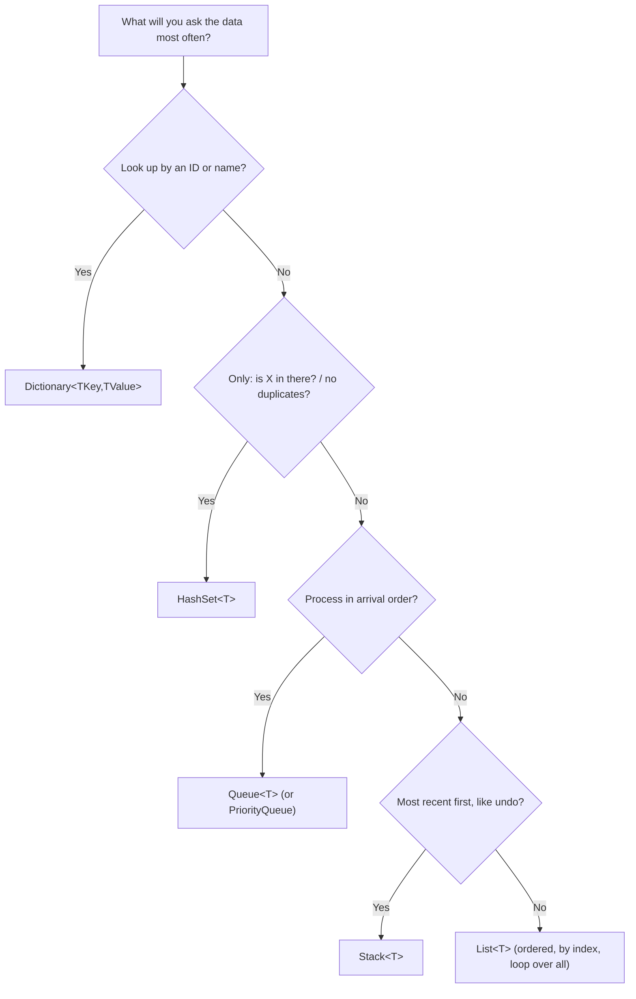
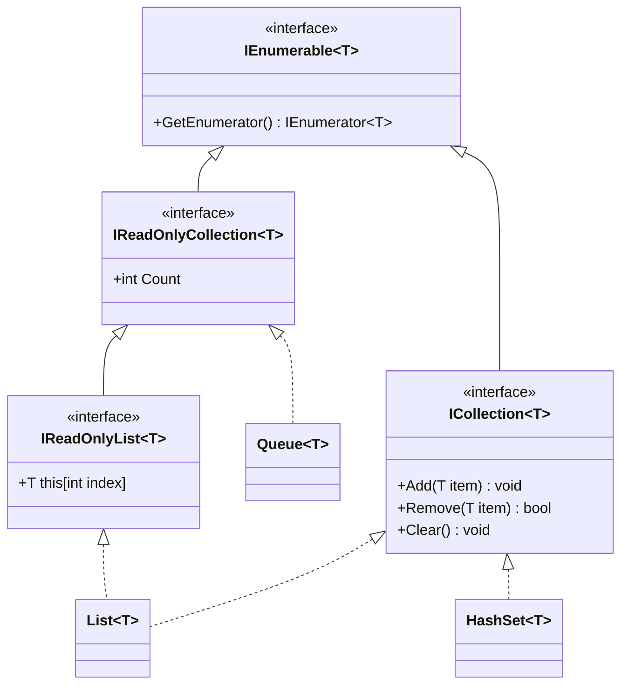
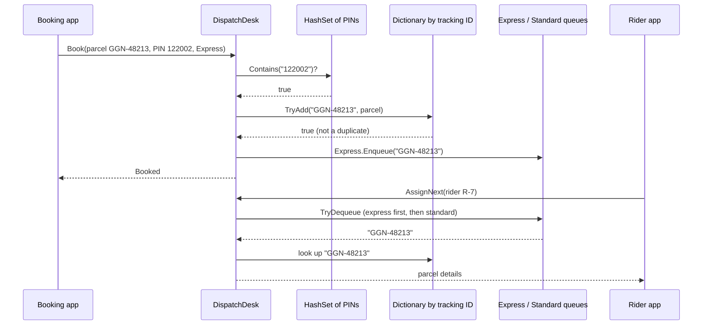

Real programs rarely deal with one thing. They deal with 4,000 employees, 1.2 lakh parcels, 300 bus stops, or the last 50 actions a user took. Choosing the right container for "many things" is one of the earliest design decisions you make, and one of the easiest to get wrong. This lesson follows a parcel hub in Gurugram that books, queues and dispatches parcels, and uses it to show which container fits which job.

## Learning objectives

By the end of this lesson you will be able to:

1. Explain what `List<T>`, `Dictionary<TKey,TValue>`, `HashSet<T>`, `Queue<T>` and `Stack<T>` are each good at, using an everyday analogy for each.
2. Pick the right collection for a requirement by asking "what question will I ask this data most often?".
3. Explain what generics are, why `List<Employee>` is safer than a list of `object`, and write a small generic class and method of your own.
4. Use the common LINQ operators (`Where`, `Select`, `OrderBy`, `GroupBy`, `Any`, `First`, `Sum`, `ToDictionary`) and explain deferred execution.
5. Expose collections from a class safely, without letting callers change the class's data behind its back.
6. Recognise when a collection is not thread-safe and what to use in an ASP.NET Core app instead.

## Prerequisites

- [Classes, objects, fields, properties and methods](#/lesson/m01-classes-objects): you should be comfortable with classes, private fields and read-only properties.
- [Variables, types, conditions, loops and functions in C#](#/lesson/m01-csharp-basics): loops (`for`, `foreach`) and methods.

If you have ever written a `foreach` loop over an array, you are ready.

## Explain it like I'm a beginner

### Five containers in a parcel hub

Walk into a parcel hub and you will see five different ways of keeping many things. Each one is shaped for a particular job.

1. **The register book.** Every parcel that arrives is written on the next line, in order. You can say "show me line 57" or "read the whole book from top to bottom". Finding one particular parcel means running your finger down the lines until you find it. This is a **list** (`List<T>`).
2. **The pigeon-hole cabinet.** Each slot is labelled with a tracking number. To find parcel `GGN-48213`, you go straight to its slot. You never scan the others. This is a **dictionary** (`Dictionary<TKey,TValue>`): a label (the *key*) leads directly to a thing (the *value*).
3. **The "areas we deliver to" sheet.** A list of PIN codes the hub serves: 122001, 122002, 110001... Nobody cares about order and nobody writes a PIN twice. The only question anyone asks is "is this PIN on the sheet?". This is a **set** (`HashSet<T>`).
4. **The loading line.** Parcels wait in a line for a rider. The first parcel that joined the line is the first to leave. No pushing in. This is a **queue** (`Queue<T>`), also called *first in, first out* (FIFO).
5. **The pile of returned parcels.** When a rider brings a parcel back, it goes on top of the pile. The next parcel to go out again is the one on top: the *last* one that came back. This is a **stack** (`Stack<T>`), also called *last in, first out* (LIFO). The "undo" button in your text editor works the same way.

All five hold "many things". What differs is **which question each one answers quickly**. The register answers "what is at position 57?" instantly but "where is GGN-48213?" slowly. The pigeon-hole cabinet is the opposite.

### Generics: a container with a label on the box

Imagine a box labelled "Parcels only". If someone tries to drop a cricket bat in, the warehouse rule stops them at the door. When you take something out, you *know* it is a parcel; you do not need to check.

In C#, `List<Parcel>` is that labelled box. The `<Parcel>` part is a **type parameter**, and a class that takes one is called **generic**. The same `List<T>` design works for `List<int>`, `List<string>` or `List<Employee>`; you choose the label when you create it. The compiler then refuses anything that does not match the label.

### LINQ: asking questions instead of writing loops

Suppose the hub manager asks: "How many express parcels are waiting for Gurugram PIN codes, heaviest first?" You could write a loop with an `if`, a counter and a sort. Or you could write one sentence that reads almost like the question:

```csharp
var heavyExpress = parcels
    .Where(p => p.Priority == ParcelPriority.Express && p.PinCode.StartsWith("122"))
    .OrderByDescending(p => p.WeightKg)
    .ToList();
```

That sentence style is **LINQ** (Language Integrated Query). It works on any collection, and it is one of the most-used features of C#.

## First-principles explanation

### Arrays: the starting point

An array (`int[]`, `Parcel[]`) is a fixed-size row of slots in memory, side by side. Because the slots are evenly spaced, the computer can jump straight to slot 57 with one calculation. That is why reading `items[57]` is fast whatever the size.

The limitation is the fixed size. `new Parcel[100]` always has exactly 100 slots. If parcel 101 arrives, you must create a bigger array and copy everything across. Every collection below is, underneath, a clever answer to that limitation.

### `List<T>`: a growable array

A `List<T>` keeps a private array plus a count. When the array fills up, it allocates a new one roughly twice as big and copies the items over. You never see this happen.

```csharp
var register = new List<string>();     // empty, small internal array
register.Add("GGN-48213");             // goes to the end
register.Add("GGN-48214");
Console.WriteLine(register[0]);        // "GGN-48213": jump by index, fast
Console.WriteLine(register.Count);     // 2
bool found = register.Contains("GGN-99999");   // checks items one by one
register.RemoveAt(0);                  // shifts every later item left by one
```

| Operation | Cost (plain English) |
|---|---|
| `list[i]` read or write | Instant, whatever the size |
| `Add` at the end | Usually instant; occasionally copies everything when it grows |
| `Contains`, `IndexOf`, `Remove(item)` | Looks at items one by one: slower as the list grows |
| `Insert(0, x)` or `RemoveAt(0)` | Shifts every other item: slow on big lists |

**Use a list when** order matters and you mostly add at the end and loop over everything: lines on an invoice, rows to show on a screen, the results of a query.

**Rough numbers (estimates, not benchmarks):** checking one item costs on the order of a nanosecond on a modern CPU. `Contains` on a list of 1,000 items is therefore around a microsecond, which is nothing. On a list of 10 lakh (1,000,000) items it is around a millisecond. That still sounds tiny, but if an API does it for each of 5,000 incoming rows, it becomes about 5 seconds. The [Big O lesson](#/lesson/m01-big-o) shows how to reason about this properly.

### `Dictionary<TKey,TValue>`: jump straight to the slot

A dictionary stores **key → value** pairs. You give it a key; it gives you the value without looking at the other entries.

How can it skip the others? It turns the key into a number called a **hash code** (via `GetHashCode()`), uses that number to choose a bucket, and only compares keys inside that one bucket. Think of the hub sorting parcels into 26 bins by the first letter of the receiver's name: to find "Meera", you only search bin M. A good hash spreads keys evenly, so each bucket holds only a handful of items.

```csharp
var byTrackingId = new Dictionary<string, Parcel>(StringComparer.OrdinalIgnoreCase);
byTrackingId.Add("GGN-48213", parcel);          // throws if the key already exists
byTrackingId["GGN-48214"] = other;              // adds or overwrites, never throws

if (byTrackingId.TryGetValue("ggn-48213", out var p))   // safe lookup, no exception
    Console.WriteLine(p.PinCode);

Parcel missing = byTrackingId["NOPE"];          // throws KeyNotFoundException
```

Three habits save a lot of bugs:

- Use **`TryGetValue`** when a key might be missing. The indexer `dict[key]` throws if it is absent.
- Use **`TryAdd`** or check first if duplicates are possible. `Add` throws on a duplicate key; the indexer silently overwrites. Silent overwrites are often worse than an exception.
- Pass a **comparer** when keys are text typed by humans. `StringComparer.OrdinalIgnoreCase` makes `"ggn-48213"` and `"GGN-48213"` the same key.

**The key must not change** while it is inside the dictionary. If you use a mutable object as a key and change a field that its hash code depends on, the dictionary looks in the wrong bucket and "loses" the item. Strings, numbers, `Guid`s and records with read-only properties make safe keys.

**Use a dictionary when** you look things up by an identifier: employee by ID, product by SKU, setting by name, a count per category.

### `HashSet<T>`: "is it in there?"

A `HashSet<T>` is a dictionary with keys only. It stores each value at most once and answers `Contains` as quickly as a dictionary lookup.

```csharp
var serviceablePins = new HashSet<string> { "122001", "122002", "110001" };
serviceablePins.Add("122001");          // returns false: already there, nothing changes
bool ok = serviceablePins.Contains("560001");   // false, and found out quickly
```

It also does set arithmetic, which is handy in reports:

```csharp
var mondayPins  = new HashSet<string> { "122001", "122002", "110001" };
var tuesdayPins = new HashSet<string> { "122002", "411001" };
mondayPins.IntersectWith(tuesdayPins);   // now only { "122002" }: PINs delivered on both days
```

**Use a set when** you need uniqueness or fast membership tests: "already processed this message ID?", "is this user an admin?", "which distinct cities appear?". A set has no index and no guaranteed order. If you need both uniqueness and order, keep a list *and* a set, or use `SortedSet<T>`.

### `Queue<T>`: first in, first out

```csharp
var loadingLine = new Queue<string>();
loadingLine.Enqueue("GGN-1");        // joins the back
loadingLine.Enqueue("GGN-2");
string next = loadingLine.Dequeue(); // "GGN-1": leaves from the front
bool any = loadingLine.TryDequeue(out var n2);  // safe version: false when empty
```

Both ends are fast because the queue uses its array as a **ring**: it remembers where the front and back are and wraps around, instead of shifting items like `List.RemoveAt(0)` would.

**Use a queue when** work must be handled in arrival order: print jobs, support tickets, parcels waiting for riders, messages to send. A related type, `PriorityQueue<TElement,TPriority>`, always hands out the item with the smallest priority value first, which is useful when "express jumps the line".

### `Stack<T>`: last in, first out

```csharp
var undo = new Stack<string>();
undo.Push("typed 'Hello'");
undo.Push("made it bold");
string last = undo.Pop();     // "made it bold": the most recent action
string peek = undo.Peek();    // "typed 'Hello'", without removing it
```

**Use a stack when** the most recent item must be handled first: undo history, a browser's back button, checking that brackets match, or walking a tree without recursion (see [Basic algorithms](#/lesson/m01-algorithms)).

### Generics, properly

Before generics arrived in C# 2.0, the general-purpose list was `ArrayList`, which stored everything as `object`:

```csharp
var old = new System.Collections.ArrayList();
old.Add(42);
old.Add("forty-two");                 // compiles: anything goes
int x = (int)old[1]!;                 // compiles, then crashes at runtime: InvalidCastException
```

Two problems: mistakes show up only when the program runs, and every `int` had to be wrapped in an object (called *boxing*), which costs memory and time. Generics fix both. `List<int>` stores real `int`s, and `list.Add("forty-two")` does not compile.

You can write generic types yourself. Here is a tiny box that remembers the last `N` items of anything:

```csharp
public sealed class RecentItems<T>
{
    private readonly Queue<T> _items = new();
    private readonly int _capacity;

    public RecentItems(int capacity) => _capacity = capacity;

    public void Add(T item)
    {
        if (_items.Count == _capacity) _items.Dequeue();   // drop the oldest
        _items.Enqueue(item);
    }

    public IReadOnlyCollection<T> Items => _items.ToArray();
}

var recentSearches = new RecentItems<string>(5);
var recentParcels  = new RecentItems<Parcel>(50);
```

`T` is a placeholder. The compiler fills it in for each use, so `recentSearches.Add(42)` is a compile error.

**Generic methods** work the same way:

```csharp
public static T Largest<T>(IEnumerable<T> items) where T : IComparable<T>
{
    using var e = items.GetEnumerator();
    if (!e.MoveNext()) throw new InvalidOperationException("Empty sequence.");
    var best = e.Current;
    while (e.MoveNext())
        if (e.Current.CompareTo(best) > 0) best = e.Current;
    return best;
}
```

The `where T : IComparable<T>` part is a **constraint**. It says "you may only use this method with types that know how to compare themselves", which is what lets us call `CompareTo` inside. Common constraints:

| Constraint | Meaning |
|---|---|
| `where T : class` | `T` must be a reference type |
| `where T : struct` | `T` must be a value type |
| `where T : notnull` | `T` must not be a nullable type (dictionary keys use this) |
| `where T : new()` | `T` must have a parameterless constructor |
| `where T : IComparable<T>` | `T` must implement that interface |

Generics are not only for collections. `Task<T>`, `ILogger<T>`, `IOptions<T>` and `Func<T, TResult>` are all generic, and you will meet them in every ASP.NET Core app.

### The interfaces behind collections

Collections implement a ladder of interfaces. Each rung adds abilities:

- `IEnumerable<T>`: "you can loop over me with `foreach`". Nothing more.
- `IReadOnlyCollection<T>`: plus a `Count`.
- `IReadOnlyList<T>`: plus read by index, `items[3]`.
- `ICollection<T>` / `IList<T>`: plus `Add`, `Remove`, `Clear`.

This matters for design. When a method only needs to loop, accept `IEnumerable<T>`; then callers can pass a list, an array, a set or a LINQ query. When a class *returns* its data, return the narrowest read-only interface that callers need, so they cannot change your data.

### LINQ basics

LINQ is a set of methods that work on any `IEnumerable<T>`. Each method takes a small function, usually written as a **lambda** (`p => p.WeightKg > 5`, read as "p goes to p's weight is more than 5").

```csharp
// Filter, transform, sort
var names = employees.Where(e => e.City == "Pune").Select(e => e.Name).OrderBy(n => n).ToList();

// Single answers
bool anyInPune   = employees.Any(e => e.City == "Pune");
int  puneCount   = employees.Count(e => e.City == "Pune");
decimal payroll  = employees.Sum(e => e.MonthlySalary);
var firstOrNull  = employees.FirstOrDefault(e => e.Id == 1001);   // null if none

// Grouping
var headcount = employees
    .GroupBy(e => e.Department)
    .Select(g => new { Department = g.Key, Count = g.Count() })
    .OrderByDescending(x => x.Count);

// Turning a list into a lookup table
var byId = employees.ToDictionary(e => e.Id);
```

| Operator | Question it answers |
|---|---|
| `Where` | Which items match? |
| `Select` | Turn each item into something else |
| `OrderBy` / `ThenBy` | Sort (stable: equal items keep their order) |
| `GroupBy` | Bucket items by a key |
| `Any` / `All` | Does at least one / every item match? |
| `First` / `FirstOrDefault` / `Single` | Get one item (throws / default / throws unless exactly one) |
| `Count` / `Sum` / `Average` / `Min` / `Max` | Aggregate numbers |
| `Distinct` / `DistinctBy` | Remove duplicates |
| `ToList` / `ToArray` / `ToDictionary` / `ToHashSet` | Run the query now and store the result |

**Deferred execution: the one LINQ idea that surprises everyone.** A query like `employees.Where(...)` does *not* run when you write it. It is a recipe. It runs each time you loop over it, or when you call `ToList()`, `Count()`, `Sum()` and similar.

```csharp
var pune = employees.Where(e => e.City == "Pune");   // nothing has run yet
employees.Add(new Employee(9, "Kavya", "IT", 90_000m, "Pune"));
Console.WriteLine(pune.Count());   // includes Kavya: the filter ran just now
Console.WriteLine(pune.Count());   // runs the filter AGAIN over the whole list
```

Two consequences. First, if the source changes, the result changes. Second, looping over the same query twice does the work twice. If you need a stable snapshot, or will use the result more than once, call `ToList()` once and keep the list.

### Thread safety

`List<T>`, `Dictionary<TKey,TValue>`, `HashSet<T>`, `Queue<T>` and `Stack<T>` are **not safe for writing from several threads at once**. An ASP.NET Core app handles many requests in parallel, so a collection stored in a singleton service is shared across threads. Two simultaneous `Add` calls can corrupt the internal array or lose an item. Your options:

- Keep collections **local to one request** (most code does this naturally).
- Protect shared collections with a **`lock`** around every read and write, as the implementation below does.
- Use the **concurrent collections** in `System.Collections.Concurrent`: `ConcurrentDictionary`, `ConcurrentQueue`, `ConcurrentBag`.
- For anything that must survive a restart or be shared by several servers, use a **database or cache**, not memory.

### When a simpler choice is better

- For 10 or 20 items, a `List<T>` with `Contains` is perfectly fine and easier to read than a dictionary plus a list kept in sync.
- An array is fine for fixed data that never changes size, such as the 12 months.
- Don't build your own linked list, tree or hash table for business code. The built-in ones are well tested and fast.

## Visual explanation

### Which collection should I use?



This decision tree starts from the most important design question: **what question will you ask this data most often?** If the answer is "find the thing with this ID", go to a dictionary. If it is only "have I seen this before?", a set is enough and uses less memory. If items must be handled in arrival order, use a queue; if the newest must be handled first, use a stack. Everything else, especially "keep these in order and loop over them", is a list. Real classes often combine two: the hub below keeps a dictionary *and* queues of the same parcels, each answering a different question.

### The collection interfaces



This class diagram shows the ladder of abilities. At the top, `IEnumerable<T>` only promises "you can loop over me". `IReadOnlyCollection<T>` adds `Count`; `IReadOnlyList<T>` adds reading by index. Separately, `ICollection<T>` adds the ability to change the contents. `List<T>` implements both branches, which is why you can hand a list to someone *as* an `IReadOnlyList<T>`, even though they could cast it back. `Queue<T>` only implements the read-only `Count` branch, because "add anywhere" makes no sense for a queue. When you design a method, pick the highest (least powerful) rung that does the job.

### A parcel's journey through the hub



This sequence diagram follows one parcel. On booking, the desk asks the **set** "do we deliver to 122002?", then asks the **dictionary** to store the parcel and reject duplicates, then puts only the tracking ID in the right **queue**. When a rider asks for work, the desk takes the first ID from the express queue (or the standard queue if express is empty), then uses the dictionary to fetch the full parcel. Every step is a fast operation because each question goes to the collection designed for it. If the desk had kept a single `List<Parcel>` instead, every step would scan the whole list.

## Step-by-step example

We build the parcel desk in five small steps.

### Step 1: one list for everything (the naive version)

```csharp
var parcels = new List<Parcel>();

void Book(Parcel p)
{
    if (parcels.Any(x => x.TrackingId == p.TrackingId)) throw new InvalidOperationException("Duplicate");
    parcels.Add(p);
}

Parcel? Find(string id) => parcels.FirstOrDefault(x => x.TrackingId == id);
```

It works. With 200 parcels a day, it is fine. With 1.2 lakh parcels in the system, every booking scans up to 1.2 lakh items to check for duplicates, and so does every lookup.

### Step 2: a dictionary for lookup by ID

```csharp
var byId = new Dictionary<string, Parcel>(StringComparer.OrdinalIgnoreCase);

bool Book(Parcel p) => byId.TryAdd(p.TrackingId, p);   // false if duplicate
Parcel? Find(string id) => byId.GetValueOrDefault(id);
```

Booking and lookup no longer depend on how many parcels exist. `TryAdd` both checks and adds, so there is no window between "check" and "add".

### Step 3: a set for "do we deliver there?"

```csharp
var serviceable = new HashSet<string> { "122001", "122002", "110001", "411001" };

if (!serviceable.Contains(p.PinCode)) return BookingResult.NotServiceable;
```

The set holds only PIN codes; no values are needed.

### Step 4: queues for waiting work

```csharp
var express = new Queue<string>();
var standard = new Queue<string>();

(p.Priority == ParcelPriority.Express ? express : standard).Enqueue(p.TrackingId);

string? NextForRider()
{
    if (express.TryDequeue(out var id)) return id;
    if (standard.TryDequeue(out id)) return id;
    return null;
}
```

Notice we queue the **tracking ID**, not the whole parcel. The dictionary remains the single source of the parcel's data, and the queue only remembers order.

### Step 5: a stack for undo, and LINQ for reports

```csharp
var history = new Stack<Assignment>();
history.Push(new Assignment("GGN-48213", "R-7", now));

if (history.TryPop(out var last)) { /* put last.TrackingId back so it goes out next */ }

var waitingByPin = express.Concat(standard)
    .Select(id => byId[id])
    .GroupBy(p => p.PinCode)
    .ToDictionary(g => g.Key, g => g.Count());
```

The undo stack hands back the most recent assignment first, which is exactly what "undo" means. The report is one LINQ expression: take all waiting IDs, look up each parcel, group by PIN, count each group.

The full version, wrapped in a class with thread safety and a small web API, follows.

## Production-style C# implementation

```text
CourierHub.Api/
  Program.cs                      // web app, DI registration, endpoints
  Parcels/
    Parcel.cs                     // Parcel record, priority enum, booking result
    RecentItems.cs                // a small generic class: last N items of anything
    DispatchDesk.cs               // HashSet + Dictionary + Queues + Stack, behind one lock
    Requests.cs                   // incoming JSON shapes
```

```csharp file=Parcels/Parcel.cs
namespace CourierHub.Api.Parcels;

public enum ParcelPriority { Standard, Express }

public enum BookingResult { Booked, Duplicate, NotServiceable }

/// <summary>Immutable parcel data. Records with read-only properties make safe dictionary values and keys.</summary>
public sealed record Parcel(string TrackingId, string PinCode, decimal WeightKg, ParcelPriority Priority, DateTimeOffset BookedAt);

public sealed record Assignment(string TrackingId, string RiderId, DateTimeOffset At);

public sealed record DeskSnapshot(int ExpressWaiting, int StandardWaiting, int Returned, int TotalBooked);
```

```csharp file=Parcels/RecentItems.cs
namespace CourierHub.Api.Parcels;

/// <summary>Keeps the last <c>capacity</c> items of any type. Generic: RecentItems&lt;string&gt;, RecentItems&lt;Assignment&gt;...</summary>
/// <remarks>Not thread-safe on its own; DispatchDesk only touches it inside its lock.</remarks>
public sealed class RecentItems<T>
{
    private readonly Queue<T> _items = new();
    private readonly int _capacity;

    public RecentItems(int capacity)
    {
        ArgumentOutOfRangeException.ThrowIfNegativeOrZero(capacity);
        _capacity = capacity;
    }

    public void Add(T item)
    {
        if (_items.Count == _capacity) _items.Dequeue();   // oldest leaves first
        _items.Enqueue(item);
    }

    /// <summary>A copy, oldest first. Callers cannot change our queue through it.</summary>
    public IReadOnlyList<T> Snapshot() => _items.ToArray();
}
```

```csharp file=Parcels/DispatchDesk.cs
namespace CourierHub.Api.Parcels;

/// <summary>
/// Books parcels and hands them to riders. Each collection answers one question quickly:
///   HashSet    -> do we deliver to this PIN?
///   Dictionary -> what is parcel X? (and rejects duplicates)
///   Queues     -> what goes out next, in arrival order (express before standard)?
///   Stack      -> what was the most recent assignment (for undo)?
/// Registered as a singleton, so every request shares it: all access goes through one lock.
/// </summary>
public sealed class DispatchDesk
{
    private readonly Lock _gate = new();
    private readonly TimeProvider _clock;

    private readonly HashSet<string> _serviceablePins;
    private readonly Dictionary<string, Parcel> _parcels = new(StringComparer.OrdinalIgnoreCase);
    private readonly Queue<string> _express = new();
    private readonly Queue<string> _standard = new();
    private readonly Stack<string> _returned = new();          // undone parcels go out first
    private readonly Stack<Assignment> _history = new();
    private readonly RecentItems<Assignment> _recent = new(50);

    public DispatchDesk(IEnumerable<string> serviceablePins, TimeProvider clock)
    {
        _serviceablePins = new HashSet<string>(serviceablePins);
        _clock = clock;
    }

    public BookingResult Book(Parcel parcel)
    {
        ArgumentNullException.ThrowIfNull(parcel);
        lock (_gate)
        {
            if (!_serviceablePins.Contains(parcel.PinCode)) return BookingResult.NotServiceable;
            if (!_parcels.TryAdd(parcel.TrackingId, parcel)) return BookingResult.Duplicate;

            var line = parcel.Priority == ParcelPriority.Express ? _express : _standard;
            line.Enqueue(parcel.TrackingId);
            return BookingResult.Booked;
        }
    }

    public Parcel? Find(string trackingId)
    {
        lock (_gate) return _parcels.GetValueOrDefault(trackingId);
    }

    /// <summary>Returned parcels first, then express, then standard. Null when nothing is waiting.</summary>
    public Parcel? AssignNext(string riderId)
    {
        ArgumentException.ThrowIfNullOrWhiteSpace(riderId);
        lock (_gate)
        {
            if (!TryTakeNext(out var trackingId)) return null;

            var assignment = new Assignment(trackingId, riderId, _clock.GetUtcNow());
            _history.Push(assignment);
            _recent.Add(assignment);
            return _parcels[trackingId];
        }
    }

    /// <summary>Undoes the most recent assignment (LIFO). The parcel becomes the next to go out.</summary>
    public Assignment? UndoLastAssignment()
    {
        lock (_gate)
        {
            if (!_history.TryPop(out var last)) return null;
            _returned.Push(last.TrackingId);
            return last;
        }
    }

    public DeskSnapshot Snapshot()
    {
        lock (_gate) return new DeskSnapshot(_express.Count, _standard.Count, _returned.Count, _parcels.Count);
    }

    public IReadOnlyList<Assignment> RecentAssignments()
    {
        lock (_gate) return _recent.Snapshot();
    }

    /// <summary>LINQ report. ToDictionary runs the query inside the lock, so callers get a finished snapshot.</summary>
    public IReadOnlyDictionary<string, int> WaitingByPin()
    {
        lock (_gate)
        {
            return _returned.Concat(_express).Concat(_standard)
                .Select(id => _parcels[id])
                .GroupBy(p => p.PinCode)
                .OrderByDescending(g => g.Count())
                .ThenBy(g => g.Key)
                .ToDictionary(g => g.Key, g => g.Count());
        }
    }

    private bool TryTakeNext(out string trackingId)
    {
        if (_returned.TryPop(out var id) || _express.TryDequeue(out id) || _standard.TryDequeue(out id))
        {
            trackingId = id;
            return true;
        }
        trackingId = "";
        return false;
    }
}
```

```csharp file=Parcels/Requests.cs
namespace CourierHub.Api.Parcels;

public sealed record BookParcelRequest(string TrackingId, string PinCode, decimal WeightKg, bool Express);
```

```csharp file=Program.cs
using CourierHub.Api.Parcels;

var builder = WebApplication.CreateBuilder(args);

builder.Services.AddSingleton(TimeProvider.System);
// Illustrative PIN codes. In a real system these would come from configuration or a database table.
builder.Services.AddSingleton(sp => new DispatchDesk(
    ["122001", "122002", "122018", "110001", "411001"],
    sp.GetRequiredService<TimeProvider>()));

var app = builder.Build();

app.MapPost("/parcels", (BookParcelRequest req, DispatchDesk desk, TimeProvider clock) =>
{
    if (string.IsNullOrWhiteSpace(req.TrackingId) || req.WeightKg <= 0)
        return Results.Problem("TrackingId and a positive WeightKg are required.", statusCode: 400);

    var parcel = new Parcel(req.TrackingId.Trim(), req.PinCode.Trim(), req.WeightKg,
        req.Express ? ParcelPriority.Express : ParcelPriority.Standard, clock.GetUtcNow());

    return desk.Book(parcel) switch
    {
        BookingResult.Booked => Results.Created($"/parcels/{parcel.TrackingId}", parcel),
        BookingResult.Duplicate => Results.Conflict(new { error = $"{parcel.TrackingId} is already booked." }),
        _ => Results.Problem($"We do not deliver to PIN {parcel.PinCode}.", statusCode: 422),
    };
});

app.MapGet("/parcels/{trackingId}", (string trackingId, DispatchDesk desk) =>
    desk.Find(trackingId) is { } p ? Results.Ok(p) : Results.NotFound());

app.MapPost("/riders/{riderId}/next", (string riderId, DispatchDesk desk) =>
    desk.AssignNext(riderId) is { } p ? Results.Ok(p) : Results.NoContent());

app.MapPost("/assignments/undo", (DispatchDesk desk) =>
    desk.UndoLastAssignment() is { } a ? Results.Ok(a) : Results.NoContent());

app.MapGet("/desk", (DispatchDesk desk) => Results.Ok(desk.Snapshot()));
app.MapGet("/reports/waiting-by-pin", (DispatchDesk desk) => Results.Ok(desk.WaitingByPin()));
app.MapGet("/assignments/recent", (DispatchDesk desk) => Results.Ok(desk.RecentAssignments()));

app.Run();
```

What to notice:

- **One owner per piece of data.** The dictionary holds parcels; queues and stacks hold only tracking IDs. If a parcel's data lived in three collections, sooner or later the copies would disagree.
- **Every collection is private.** Outside code calls `Book`, `AssignNext` and `UndoLastAssignment`. It cannot `Clear()` a queue or skip the duplicate check.
- **One lock guards everything.** `DispatchDesk` is a singleton, so 50 riders asking for work at once hit the same queues from different threads. Without the lock, two riders could dequeue the same slot or corrupt the queue. One lock around several collections also keeps them consistent with each other (a parcel is never in the dictionary but missing from every queue mid-operation).
- **Reports are materialised inside the lock.** `ToDictionary` runs the LINQ query immediately. Returning the bare query (deferred) would run it later, outside the lock, while other threads change the queues.
- **`RecentItems<T>` is generic**, so the same class could keep the last 50 searches (`RecentItems<string>`) elsewhere.
- **Limits of this design.** Everything is in memory, so a restart loses all bookings, and two server instances would each have their own desk. A real hub stores parcels in PostgreSQL and uses a durable queue (covered in later modules). The collection choices you made here carry over directly: a primary-key index plays the dictionary's role, and a message queue plays the queue's.

## Bad design vs good design

**Bad:** one public list, searched everywhere, with rules copied into each caller.

```csharp
public class Hub
{
    public List<Parcel> Parcels = new();
}

// Booking endpoint
if (!hub.Parcels.Any(p => p.TrackingId == req.TrackingId)) hub.Parcels.Add(parcel);
// Rider endpoint: "next express, else oldest"
var next = hub.Parcels.Where(p => !assigned.Contains(p.TrackingId))
                      .OrderByDescending(p => p.Priority).ThenBy(p => p.BookedAt).FirstOrDefault();
// Report endpoint
var pins = hub.Parcels.Select(p => p.PinCode).Distinct().ToList();
```

What goes wrong:

- **Speed falls as data grows.** Every booking scans all parcels for duplicates. Every rider request filters *and sorts* all parcels. With 1.2 lakh parcels and 200 riders polling, the server spends its time sorting the same list again and again.
- **Race conditions.** Two booking requests for the same ID can both see "not there" and both add it. `List<T>` itself can be corrupted by concurrent `Add`.
- **No owner for the rules.** "Express goes first" is written in the rider endpoint. When a new "returned goes first" rule arrives, someone must find every place that picks the next parcel.

**Good:** the `DispatchDesk` above. Each question has a collection shaped for it, all collections are private, and one class owns the rules and the lock.

**Is the good version always worth it?** No. A college canteen app with 30 orders a day can keep a `List<Order>` and use LINQ for everything; the extra collections would be clutter. Reach for dictionaries and queues when the data grows, when lookups happen in hot paths (every request), or when order rules matter.

:::callout type=mistake title="Exposing List<T> through a get-only property"
`public List<Parcel> Parcels { get; }` stops callers replacing the list, but they can still `Add`, `Remove` and `Clear` it. Return `IReadOnlyList<T>` (or a copy) and offer methods for the changes you allow.
:::

:::callout type=tradeoff title="Copy or live view?"
Returning `_items.ToArray()` costs a copy each call but is safe across threads and later changes. Returning `_list.AsReadOnly()` costs nothing but is a live window: if the class changes the list while a caller loops over it, the caller gets an `InvalidOperationException`. For small collections or shared objects, copy. For huge single-threaded data, a live view can be the right call.
:::

## Practical playground

Run the program and predict each line before you look at the output. Then try the experiments at the bottom.

:::playground type=csharp title="Collections and LINQ with employees"
```csharp file=Program.cs
using System;
using System.Collections.Generic;
using System.Linq;

public sealed record Employee(int Id, string Name, string Department, decimal MonthlySalary, string City);

public static class Program
{
    public static void Main()
    {
        var staff = new List<Employee>
        {
            new(101, "Asha",   "Engineering", 120_000m, "Gurugram"),
            new(102, "Ravi",   "Engineering",  95_000m, "Pune"),
            new(103, "Meera",  "Finance",      80_000m, "Gurugram"),
            new(104, "Arjun",  "Sales",        60_000m, "Mumbai"),
            new(105, "Fatima", "Engineering", 110_000m, "Pune"),
            new(106, "John",   "Finance",      85_000m, "Mumbai"),
        };

        // Dictionary: lookup by ID without scanning
        var byId = staff.ToDictionary(e => e.Id);
        Console.WriteLine($"Employee 103 is {byId[103].Name}");
        Console.WriteLine($"Is there an employee 999? {byId.ContainsKey(999)}");

        // HashSet: distinct values, fast membership
        var cities = staff.Select(e => e.City).ToHashSet();
        Console.WriteLine($"Cities: {string.Join(", ", cities)} (added Pune again? {cities.Add("Pune")})");

        // LINQ: filter, sort, project
        var pune = staff.Where(e => e.City == "Pune").OrderByDescending(e => e.MonthlySalary).Select(e => e.Name);
        Console.WriteLine($"Pune, highest paid first: {string.Join(", ", pune)}");

        // LINQ: group and aggregate
        foreach (var g in staff.GroupBy(e => e.Department).OrderBy(g => g.Key))
            Console.WriteLine($"{g.Key,-12} headcount={g.Count()} payroll={g.Sum(e => e.MonthlySalary):N0}");

        // Queue: first in, first out
        var onboarding = new Queue<string>(new[] { "Kavya", "Liam", "Neha" });
        Console.WriteLine($"Onboard first: {onboarding.Dequeue()}, still waiting: {onboarding.Count}");

        // Stack: last in, first out
        var undo = new Stack<string>();
        undo.Push("raise Ravi's salary");
        undo.Push("move Arjun to Pune");
        Console.WriteLine($"Undo: {undo.Pop()}");

        // Deferred execution
        var mumbai = staff.Where(e => e.City == "Mumbai");
        Console.WriteLine($"Mumbai before: {mumbai.Count()}");
        staff.Add(new Employee(107, "Sara", "Sales", 70_000m, "Mumbai"));
        Console.WriteLine($"Mumbai after adding Sara: {mumbai.Count()}  <- the query ran again");

        // Experiments:
        // 1. Change byId[103] to byId[999]. What exception do you get? Rewrite it with TryGetValue.
        // 2. Add a second employee with Id 101 BEFORE ToDictionary. What happens and why?
        // 3. Call .ToList() on the 'mumbai' query before adding Sara. Does the count still change?
        // 4. Print the employee with the highest salary in each department (hint: MaxBy).
    }
}
```
:::

## Exercises

:::exercise id=m01-collections-generics-ex1 difficulty=beginner kind=code title="Employee directory"
Build the core of a simple employee management app: an `EmployeeDirectory` that stores employees and answers the questions HR asks every day.
::requirements
- `Add(employee)` stores an employee. Adding a second employee with the same `Id` throws `InvalidOperationException` and leaves the directory unchanged.
- `FindById(id)` returns the employee or `null`, and must not scan every employee.
- `Remove(id)` returns `true` if an employee was removed, `false` if there was none.
- `InDepartment(name)` returns the employees in that department, matching the department name ignoring case, ordered by `Name`.
- `Departments` returns the distinct department names (case-insensitive: "Finance" and "finance" count once).
- `Count` is the number of employees.
::acceptance
- Adding Asha (101) and Ravi (102) gives `Count == 2`, and `FindById(102)` returns Ravi.
- Adding another employee with Id 101 throws `InvalidOperationException` and `Count` stays 2.
- `InDepartment("engineering")` returns employees from "Engineering", sorted by name.
- Departments "Finance", "finance" and "Sales" give 2 distinct departments.
- `FindById(999)` returns `null`; `Remove(999)` returns `false`.
::hint
Which question is asked most: "find employee by ID". Which collection answers "find by key" without scanning?
::hint
Use a private `Dictionary<int, Employee>`. `TryAdd` returns `false` for a duplicate key, which you can turn into an exception.
::hint
`InDepartment` and `Departments` can be LINQ queries over `_byId.Values`. For case-insensitive comparison use `string.Equals(a, b, StringComparison.OrdinalIgnoreCase)`, and for distinct names build a `HashSet<string>` with `StringComparer.OrdinalIgnoreCase`.
::hint
Return copies (`ToList()`, `ToArray()` or a new `HashSet`) so callers cannot change your dictionary:
```csharp
public IReadOnlyList<Employee> InDepartment(string department) =>
    _byId.Values
        .Where(e => string.Equals(e.Department, department, StringComparison.OrdinalIgnoreCase))
        .OrderBy(e => e.Name)
        .ToList();
```
::starter
```csharp file=EmployeeDirectory.cs
using System;
using System.Collections.Generic;
using System.Linq;

public sealed record Employee(int Id, string Name, string Department, decimal MonthlySalary);

public sealed class EmployeeDirectory
{
    public int Count => throw new NotImplementedException();

    public IReadOnlySet<string> Departments => throw new NotImplementedException();

    public void Add(Employee employee) => throw new NotImplementedException();

    public Employee? FindById(int id) => throw new NotImplementedException();

    public bool Remove(int id) => throw new NotImplementedException();

    public IReadOnlyList<Employee> InDepartment(string department) => throw new NotImplementedException();
}
```
::tests
```csharp file=EmployeeDirectoryTests.cs
using System;
using System.Linq;
using Xunit;

public class EmployeeDirectoryTests
{
    private static EmployeeDirectory Sample()
    {
        var d = new EmployeeDirectory();
        d.Add(new Employee(101, "Asha", "Engineering", 120_000m));
        d.Add(new Employee(102, "Ravi", "Engineering", 95_000m));
        return d;
    }

    [Fact]
    public void Add_and_find()
    {
        var d = Sample();
        Assert.Equal(2, d.Count);
        Assert.Equal("Ravi", d.FindById(102)!.Name);
    }

    [Fact]
    public void Duplicate_id_throws_and_keeps_count()
    {
        var d = Sample();
        Assert.Throws<InvalidOperationException>(() => d.Add(new Employee(101, "Other", "Sales", 1m)));
        Assert.Equal(2, d.Count);
        Assert.Equal("Asha", d.FindById(101)!.Name);
    }

    [Fact]
    public void Missing_id()
    {
        var d = Sample();
        Assert.Null(d.FindById(999));
        Assert.False(d.Remove(999));
    }

    [Fact]
    public void Remove_existing()
    {
        var d = Sample();
        Assert.True(d.Remove(101));
        Assert.Equal(1, d.Count);
        Assert.Null(d.FindById(101));
    }

    [Fact]
    public void Department_filter_ignores_case_and_sorts_by_name()
    {
        var d = new EmployeeDirectory();
        d.Add(new Employee(1, "Zoya", "Engineering", 1m));
        d.Add(new Employee(2, "Amit", "engineering", 1m));
        d.Add(new Employee(3, "Meera", "Finance", 1m));
        var names = d.InDepartment("ENGINEERING").Select(e => e.Name).ToArray();
        Assert.Equal(new[] { "Amit", "Zoya" }, names);
    }

    [Fact]
    public void Distinct_departments_ignore_case()
    {
        var d = new EmployeeDirectory();
        d.Add(new Employee(1, "A", "Finance", 1m));
        d.Add(new Employee(2, "B", "finance", 1m));
        d.Add(new Employee(3, "C", "Sales", 1m));
        Assert.Equal(2, d.Departments.Count);
        Assert.True(d.Departments.Contains("FINANCE"));
    }
}
```
::solution
A dictionary keyed by `Id` answers the most common question (find by ID) without scanning. The reports are LINQ queries that return copies.

```csharp file=EmployeeDirectory.cs
using System;
using System.Collections.Generic;
using System.Linq;

public sealed record Employee(int Id, string Name, string Department, decimal MonthlySalary);

public sealed class EmployeeDirectory
{
    private readonly Dictionary<int, Employee> _byId = new();

    public int Count => _byId.Count;

    public IReadOnlySet<string> Departments =>
        new HashSet<string>(_byId.Values.Select(e => e.Department), StringComparer.OrdinalIgnoreCase);

    public void Add(Employee employee)
    {
        ArgumentNullException.ThrowIfNull(employee);
        if (!_byId.TryAdd(employee.Id, employee))
            throw new InvalidOperationException($"An employee with Id {employee.Id} already exists.");
    }

    public Employee? FindById(int id) => _byId.GetValueOrDefault(id);

    public bool Remove(int id) => _byId.Remove(id);

    public IReadOnlyList<Employee> InDepartment(string department) =>
        _byId.Values
            .Where(e => string.Equals(e.Department, department, StringComparison.OrdinalIgnoreCase))
            .OrderBy(e => e.Name, StringComparer.Ordinal)
            .ToList();
}
```

`TryAdd` checks and inserts in one step, so a duplicate never overwrites the original. `Departments` builds a new set each time, which is fine for an HR directory of a few thousand people; if it were called thousands of times a second you would maintain the set as employees are added and removed.
::alternatives
If HR mostly asks "who is in department X?", keep a second dictionary `Dictionary<string, List<Employee>>` keyed by department (case-insensitive). Lookups become instant, but `Add` and `Remove` must update both dictionaries, which is more code to get right. Start simple and add the index when measurements show it is needed.
::mistakes
- Using `List<Employee>` and `FirstOrDefault(e => e.Id == id)`. It works but scans every employee on every lookup.
- Using `_byId[employee.Id] = employee` in `Add`, which silently overwrites an existing employee instead of rejecting the duplicate.
- Returning `_byId.Values` directly as a list type that callers can cast and modify, or returning a deferred LINQ query that re-runs every time it is read.
- Comparing departments with `==`, so "finance" and "Finance" become two departments.
::extensions
Add `RaiseSalary(int id, decimal percent)`. Because `Employee` is a record, use `with` to create the updated copy and replace it in the dictionary. Add `TopEarners(int n)`.
:::

:::exercise id=m01-collections-generics-ex2 difficulty=beginner kind=code title="Bracket checker with a stack"
A form builder lets admins write formulas like `(basic + hra) * [rate]` and `{ (a + b) * c }`. Before saving, it must check that brackets are balanced. Write `BracketChecker.IsBalanced(string text)`.
::requirements
- Supported pairs: `()`, `[]`, `{}`. All other characters are ignored.
- Every closing bracket must match the most recent unmatched opening bracket.
- An empty string is balanced.
::acceptance
- `"(basic + hra) * [rate]"` is balanced.
- `"{ (a + b) * [c] }"` is balanced.
- `"(]"` is not balanced (wrong type).
- `"(("` is not balanced (never closed).
- `"())"` is not balanced (closes something that was never opened).
- `"([)]"` is not balanced (closed in the wrong order).
::hint
"Most recent unmatched opening bracket" is the clue. Which collection always gives you the most recent item first?
::hint
Push every opening bracket onto a `Stack<char>`. On a closing bracket, pop and check that the popped one is its partner.
::hint
Two ways to fail: closing when the stack is empty, and a mismatched pair. One more check at the end: the stack must be empty.
::hint
```csharp
foreach (var ch in text)
{
    if (ch is '(' or '[' or '{') stack.Push(ch);
    else if (ch is ')' or ']' or '}')
    {
        if (!stack.TryPop(out var open) || open != PartnerOf(ch)) return false;
    }
}
return stack.Count == 0;
```
::starter
```csharp file=BracketChecker.cs
using System;
using System.Collections.Generic;

public static class BracketChecker
{
    public static bool IsBalanced(string text) => throw new NotImplementedException();
}
```
::tests
```csharp file=BracketCheckerTests.cs
using Xunit;

public class BracketCheckerTests
{
    [Theory]
    [InlineData("")]
    [InlineData("(basic + hra) * [rate]")]
    [InlineData("{ (a + b) * [c] }")]
    [InlineData("no brackets at all")]
    public void Balanced(string text) => Assert.True(BracketChecker.IsBalanced(text));

    [Theory]
    [InlineData("(]")]
    [InlineData("((")]
    [InlineData("())")]
    [InlineData("([)]")]
    [InlineData("}")]
    public void Not_balanced(string text) => Assert.False(BracketChecker.IsBalanced(text));
}
```
::solution
```csharp file=BracketChecker.cs
using System;
using System.Collections.Generic;

public static class BracketChecker
{
    public static bool IsBalanced(string text)
    {
        ArgumentNullException.ThrowIfNull(text);
        var open = new Stack<char>();

        foreach (var ch in text)
        {
            switch (ch)
            {
                case '(' or '[' or '{':
                    open.Push(ch);
                    break;
                case ')' or ']' or '}':
                    if (!open.TryPop(out var last) || last != PartnerOf(ch)) return false;
                    break;
            }
        }
        return open.Count == 0;
    }

    private static char PartnerOf(char closing) => closing switch
    {
        ')' => '(',
        ']' => '[',
        _ => '{',
    };
}
```

The stack remembers opening brackets in the order they were seen, and `Pop` always returns the newest one, which is exactly the one the next closing bracket must match. The work grows in step with the length of the text: each character is pushed and popped at most once.
::mistakes
- Counting brackets with an `int` per type. `"([)]"` has balanced counts but is wrong; only a stack catches the order.
- Calling `Pop()` on an empty stack, which throws `InvalidOperationException` for input like `")"`. Use `TryPop` or check `Count` first.
- Forgetting the final `Count == 0` check, so `"(("` is reported as balanced.
::extensions
Return the position of the first problem instead of a `bool`, so the form can highlight it. Ignore brackets inside quoted text such as `"label (optional)"`.
:::

:::exercise id=m01-collections-generics-ex3 difficulty=intermediate kind=code title="Payroll report with LINQ"
Finance wants a monthly summary for the employee management app. Write `PayrollReport.ByDepartment(employees)` and `PayrollReport.CitiesWithAtLeast(employees, n)` using LINQ.
::requirements
- `ByDepartment` returns one `DepartmentSummary` per department: `Department`, `Headcount`, `TotalMonthly`, `AverageMonthly` (rounded to 2 decimal places) and `TopEarner` (name of the highest-paid person; if two earn the same, the one whose name comes first alphabetically).
- Order the summaries by `TotalMonthly` descending, then by department name ascending.
- `CitiesWithAtLeast(employees, n)` returns the cities that have at least `n` employees, sorted alphabetically.
- An empty input returns an empty list from both methods.
::acceptance
- For the sample data, Engineering comes first with headcount 3 and total ₹3,25,000.
- Engineering's average is ₹1,08,333.33 and its top earner is Asha.
- Two Finance employees earning ₹85,000 each: the top earner is the one whose name is alphabetically first.
- `CitiesWithAtLeast(sample, 2)` returns `["Gurugram", "Pune"]`.
- Both methods return empty results for no employees.
::hint
"One summary per department" is a grouping. Start with `employees.GroupBy(e => e.Department)`.
::hint
Inside each group, `g.Count()`, `g.Sum(e => e.MonthlySalary)` and `g.Average(...)` give the numbers. For the top earner, sort the group and take the first.
::hint
Sort the group with `OrderByDescending(e => e.MonthlySalary).ThenBy(e => e.Name)` and take `.First().Name`. This handles ties deterministically.
::hint
The city query is a group, a filter on the group's count, a projection to the key, and a sort:
```csharp
employees.GroupBy(e => e.City)
         .Where(g => g.Count() >= n)
         .Select(g => g.Key)
         .OrderBy(c => c)
         .ToList();
```
::starter
```csharp file=PayrollReport.cs
using System;
using System.Collections.Generic;
using System.Linq;

public sealed record Employee(int Id, string Name, string Department, decimal MonthlySalary, string City);

public sealed record DepartmentSummary(string Department, int Headcount, decimal TotalMonthly, decimal AverageMonthly, string TopEarner);

public static class PayrollReport
{
    public static IReadOnlyList<DepartmentSummary> ByDepartment(IEnumerable<Employee> employees) =>
        throw new NotImplementedException();

    public static IReadOnlyList<string> CitiesWithAtLeast(IEnumerable<Employee> employees, int n) =>
        throw new NotImplementedException();
}
```
::tests
```csharp file=PayrollReportTests.cs
using System;
using System.Linq;
using Xunit;

public class PayrollReportTests
{
    private static readonly Employee[] Sample =
    {
        new(1, "Asha",   "Engineering", 120_000m, "Gurugram"),
        new(2, "Ravi",   "Engineering",  95_000m, "Pune"),
        new(3, "Fatima", "Engineering", 110_000m, "Pune"),
        new(4, "Meera",  "Finance",      85_000m, "Gurugram"),
        new(5, "John",   "Finance",      85_000m, "Mumbai"),
        new(6, "Arjun",  "Sales",        60_000m, "Chennai"),
    };

    [Fact]
    public void Engineering_first_with_totals()
    {
        var first = PayrollReport.ByDepartment(Sample)[0];
        Assert.Equal("Engineering", first.Department);
        Assert.Equal(3, first.Headcount);
        Assert.Equal(325_000m, first.TotalMonthly);
        Assert.Equal(108_333.33m, first.AverageMonthly);
        Assert.Equal("Asha", first.TopEarner);
    }

    [Fact]
    public void Order_is_total_descending()
    {
        var names = PayrollReport.ByDepartment(Sample).Select(s => s.Department).ToArray();
        Assert.Equal(new[] { "Engineering", "Finance", "Sales" }, names);
    }

    [Fact]
    public void Tie_on_salary_picks_alphabetical_name()
    {
        var finance = PayrollReport.ByDepartment(Sample).Single(s => s.Department == "Finance");
        Assert.Equal("John", finance.TopEarner);
    }

    [Fact]
    public void Cities_with_at_least_two()
    {
        Assert.Equal(new[] { "Gurugram", "Pune" }, PayrollReport.CitiesWithAtLeast(Sample, 2).ToArray());
    }

    [Fact]
    public void Empty_input()
    {
        Assert.Empty(PayrollReport.ByDepartment(Array.Empty<Employee>()));
        Assert.Empty(PayrollReport.CitiesWithAtLeast(Array.Empty<Employee>(), 1));
    }
}
```
::solution
```csharp file=PayrollReport.cs
using System;
using System.Collections.Generic;
using System.Linq;

public sealed record Employee(int Id, string Name, string Department, decimal MonthlySalary, string City);

public sealed record DepartmentSummary(string Department, int Headcount, decimal TotalMonthly, decimal AverageMonthly, string TopEarner);

public static class PayrollReport
{
    public static IReadOnlyList<DepartmentSummary> ByDepartment(IEnumerable<Employee> employees)
    {
        ArgumentNullException.ThrowIfNull(employees);
        return employees
            .GroupBy(e => e.Department)
            .Select(g => new DepartmentSummary(
                Department: g.Key,
                Headcount: g.Count(),
                TotalMonthly: g.Sum(e => e.MonthlySalary),
                AverageMonthly: Math.Round(g.Average(e => e.MonthlySalary), 2, MidpointRounding.AwayFromZero),
                TopEarner: g.OrderByDescending(e => e.MonthlySalary).ThenBy(e => e.Name, StringComparer.Ordinal).First().Name))
            .OrderByDescending(s => s.TotalMonthly)
            .ThenBy(s => s.Department, StringComparer.Ordinal)
            .ToList();
    }

    public static IReadOnlyList<string> CitiesWithAtLeast(IEnumerable<Employee> employees, int n)
    {
        ArgumentNullException.ThrowIfNull(employees);
        return employees
            .GroupBy(e => e.City)
            .Where(g => g.Count() >= n)
            .Select(g => g.Key)
            .OrderBy(c => c, StringComparer.Ordinal)
            .ToList();
    }
}
```

`GroupBy` buckets the employees, and each bucket is itself a sequence you can count, sum and sort. `ToList()` at the end runs the query once and returns a finished result, so callers do not re-run it every time they read it. `MidpointRounding.AwayFromZero` matches how most people round money by hand; the default (`ToEven`) rounds 0.125 to 0.12.
::alternatives
.NET 6+ has `MaxBy`, so `g.MaxBy(e => e.MonthlySalary)!.Name` is shorter for the top earner, but on a tie it returns whichever came first in the input, which makes the result depend on input order. The explicit `OrderByDescending().ThenBy()` is deterministic. The same report could also be one SQL `GROUP BY` query in PostgreSQL, which is the better choice when the data lives in a database and has millions of rows.
::mistakes
- Forgetting `ToList()` and returning the deferred query, so every read of the report recomputes everything.
- Using `First()` without a tie-breaker, so the top earner changes when the input order changes.
- Using `double` for salaries and averages, which produces values like 108333.33333333333 and rounding surprises.
- Calling `CitiesWithAtLeast` with `Count()` on the whole input inside the `Where`, instead of `g.Count()` on the group.
::extensions
Add a `PercentOfPayroll` column. Add `ByDepartmentAndCity` that returns a nested summary.
:::

:::exercise id=m01-collections-generics-ex4 difficulty=intermediate kind=written title="Pick the right collection"
For each requirement, choose a collection type, say why in one or two sentences, and name the operation you will call most often.

1. A bus-ticket app shows the 20 stops on a route, in order, and the user taps one.
2. A UPI-style payment service must reject a payment request whose request ID it has already processed in the last hour.
3. A hospital outpatient desk issues tokens and calls patients in the order they arrived; emergency patients go first.
4. A spreadsheet app's undo button.
5. A product catalogue API looks up 50,000 products by SKU on every request.
6. A report needs "for each city, the list of employees in that city".
::acceptance
- Each answer names a specific .NET type (not just "a list").
- Each answer names the main operation and says why it is fast or appropriate.
- Answer 3 handles the emergency rule.
- Answer 2 mentions what happens to old IDs and what happens with several servers.
::hint
For each one, write down the question asked most often: "what is at position i?", "have I seen this?", "who is next?", "what was the last thing?", "what is the item for this key?".
::hint
Two of these are "have I seen it / find by key" problems. One is a "most recent first" problem. One is "arrival order, but with priorities".
::hint
For number 6, the value in a dictionary can itself be a collection. LINQ has a ready-made operator that builds this.
::hint
For number 3, consider `PriorityQueue<TElement, TPriority>`, with a priority that combines "is emergency" and arrival sequence number.
::solution
1. **`List<Stop>` or an array.** The data is small, ordered and read by position (`stops[i]`). Nothing faster is needed for 20 items.
2. **`HashSet<string>`** of request IDs (or a `Dictionary<string, DateTimeOffset>` to remember when each was seen, so entries older than an hour can be removed). Main call: `Add`, whose `false` result means "duplicate". In a real deployment with several servers, an in-memory set is per server, so a shared store (a database unique key or Redis) is needed; the in-memory set is only a first line of defence.
3. **`PriorityQueue<Patient, (int Emergency, long Sequence)>`** with `Emergency = 0` for emergency and `1` otherwise, and `Sequence` an increasing token number. Tuples compare item by item, so emergencies come first and arrival order breaks ties. Main calls: `Enqueue` and `Dequeue`. Two plain `Queue<T>`s (emergency, normal) checked in order also work and are easier to read.
4. **`Stack<EditAction>`.** Undo always reverses the most recent action first: `Push` on each edit, `Pop` on undo. A second stack holds actions for redo.
5. **`Dictionary<string, Product>`** with `StringComparer.OrdinalIgnoreCase` if SKUs may arrive in mixed case. Main call: `TryGetValue`. Loaded once and read by many threads; since nobody writes after loading, use a `FrozenDictionary` (.NET 8+) or wrap it so it is never modified.
6. **`ILookup<string, Employee>`** from `employees.ToLookup(e => e.City)`, or `Dictionary<string, List<Employee>>`. A lookup returns an empty sequence for an unknown city instead of throwing.
::mistakes
- Choosing `List<T>` for request IDs or SKUs and using `Contains` or `FirstOrDefault`, which scans on every request.
- Forgetting that in-memory collections are per process, so duplicate detection fails once you run two servers.
- Using a `Queue<T>` for undo, which would undo the *oldest* action first.
:::

:::exercise id=m01-collections-generics-ex5 difficulty=advanced kind=code title="A generic LRU cache"
A pricing API calls a slow tax-rate service. Build a generic `LruCache<TKey, TValue>` that keeps at most `capacity` entries and, when full, evicts the **least recently used** entry. Both reading and writing should take roughly constant time, however many entries there are.
::requirements
- `new LruCache<TKey, TValue>(capacity)`: capacity of 0 or less throws `ArgumentOutOfRangeException`.
- `Put(key, value)` adds or replaces. Replacing counts as a use. If adding a new key would exceed capacity, remove the least recently used entry first.
- `TryGet(key, out value)` returns `true` and the value if present, and marks the key as most recently used.
- `Count` is the number of entries. `Keys` returns keys from most to least recently used.
- `TKey` must be non-nullable (`where TKey : notnull`).
::acceptance
- Capacity 2: put A, put B, get A, put C → B is evicted, A and C remain.
- Putting an existing key updates its value without changing `Count`.
- `Keys` after put A, put B, get A is `[A, B]`.
- Capacity 0 throws `ArgumentOutOfRangeException`.
::hint
You need two abilities: "find the entry for this key fast" and "know which entry is oldest, and move any entry to the front fast". No single collection does both.
::hint
A `Dictionary` gives fast lookup. A `LinkedList<T>` lets you remove any node and add it at the front quickly *if you already have the node*.
::hint
Store `LinkedListNode<(TKey Key, TValue Value)>` as the dictionary value. The list's first node is the most recently used; the last node is the eviction candidate.
::hint
On `TryGet`: find the node in the dictionary, `_list.Remove(node)`, `_list.AddFirst(node)`. On `Put` for a new key when full: take `_list.Last`, remove it from both the list and the dictionary (that is why the node stores the key too), then add the new node.
::hint
```csharp
private void Touch(LinkedListNode<(TKey Key, TValue Value)> node)
{
    _order.Remove(node);
    _order.AddFirst(node);
}
```
::starter
```csharp file=LruCache.cs
using System;
using System.Collections.Generic;
using System.Diagnostics.CodeAnalysis;

public sealed class LruCache<TKey, TValue> where TKey : notnull
{
    public LruCache(int capacity) => throw new NotImplementedException();

    public int Count => throw new NotImplementedException();

    public IReadOnlyList<TKey> Keys => throw new NotImplementedException();

    public void Put(TKey key, TValue value) => throw new NotImplementedException();

    public bool TryGet(TKey key, [MaybeNullWhen(false)] out TValue value) => throw new NotImplementedException();
}
```
::tests
```csharp file=LruCacheTests.cs
using System;
using System.Linq;
using Xunit;

public class LruCacheTests
{
    [Fact]
    public void Evicts_least_recently_used()
    {
        var c = new LruCache<string, decimal>(2);
        c.Put("A", 1m);
        c.Put("B", 2m);
        Assert.True(c.TryGet("A", out _));
        c.Put("C", 3m);
        Assert.False(c.TryGet("B", out _));
        Assert.True(c.TryGet("A", out var a));
        Assert.Equal(1m, a);
        Assert.True(c.TryGet("C", out _));
        Assert.Equal(2, c.Count);
    }

    [Fact]
    public void Update_existing_key()
    {
        var c = new LruCache<string, int>(2);
        c.Put("GST-18", 18);
        c.Put("GST-18", 19);
        Assert.Equal(1, c.Count);
        Assert.True(c.TryGet("GST-18", out var v));
        Assert.Equal(19, v);
    }

    [Fact]
    public void Keys_most_recent_first()
    {
        var c = new LruCache<string, int>(3);
        c.Put("A", 1);
        c.Put("B", 2);
        c.TryGet("A", out _);
        Assert.Equal(new[] { "A", "B" }, c.Keys.ToArray());
    }

    [Fact]
    public void Update_counts_as_use()
    {
        var c = new LruCache<int, string>(2);
        c.Put(1, "one");
        c.Put(2, "two");
        c.Put(1, "uno");
        c.Put(3, "three");
        Assert.False(c.TryGet(2, out _));
        Assert.True(c.TryGet(1, out _));
    }

    [Fact]
    public void Zero_capacity_throws() => Assert.Throws<ArgumentOutOfRangeException>(() => new LruCache<int, int>(0));

    [Fact]
    public void Missing_key_returns_false()
    {
        var c = new LruCache<int, int>(1);
        Assert.False(c.TryGet(42, out _));
    }
}
```
::solution
The dictionary answers "where is this key?"; the linked list remembers usage order. Each node stores its key, so when we evict the last node we can also remove it from the dictionary.

```csharp file=LruCache.cs
using System;
using System.Collections.Generic;
using System.Diagnostics.CodeAnalysis;
using System.Linq;

public sealed class LruCache<TKey, TValue> where TKey : notnull
{
    private readonly int _capacity;
    private readonly Dictionary<TKey, LinkedListNode<(TKey Key, TValue Value)>> _map;
    private readonly LinkedList<(TKey Key, TValue Value)> _order = new();   // first = most recently used

    public LruCache(int capacity)
    {
        ArgumentOutOfRangeException.ThrowIfNegativeOrZero(capacity);
        _capacity = capacity;
        _map = new Dictionary<TKey, LinkedListNode<(TKey Key, TValue Value)>>(capacity);
    }

    public int Count => _map.Count;

    public IReadOnlyList<TKey> Keys => _order.Select(e => e.Key).ToArray();

    public void Put(TKey key, TValue value)
    {
        if (_map.TryGetValue(key, out var existing))
        {
            existing.Value = (key, value);
            Touch(existing);
            return;
        }

        if (_map.Count == _capacity)
        {
            var oldest = _order.Last!;
            _order.RemoveLast();
            _map.Remove(oldest.Value.Key);
        }

        _map[key] = _order.AddFirst((key, value));
    }

    public bool TryGet(TKey key, [MaybeNullWhen(false)] out TValue value)
    {
        if (_map.TryGetValue(key, out var node))
        {
            Touch(node);
            value = node.Value.Value;
            return true;
        }
        value = default;
        return false;
    }

    private void Touch(LinkedListNode<(TKey Key, TValue Value)> node)
    {
        _order.Remove(node);      // fast: we already hold the node
        _order.AddFirst(node);
    }
}
```

Every operation does a dictionary lookup plus a few pointer changes in the linked list, so the cost does not grow with the number of entries. `Keys` is the only operation that walks the whole list, and it is meant for debugging and tests.
::alternatives
In ASP.NET Core you would normally not write this yourself: `IMemoryCache` (with `SizeLimit` and per-entry `Size`) and `HybridCache` handle expiry, size limits and thread safety. Write your own only for a very specific eviction rule. This class is also not thread-safe; for shared use, wrap every method in a `lock`. See [Caching](#/lesson/m03-caching).
::mistakes
- Using a `List<TKey>` for usage order and calling `Remove(key)`, which scans the list and makes every operation slower as the cache grows.
- Storing only the value in the linked list, so on eviction you cannot find which dictionary key to remove.
- Forgetting that `Put` on an existing key is a "use" and must move it to the front.
- Sharing the cache across web requests without a lock.
::extensions
Add a time-to-live: entries older than a given `TimeSpan` (read from an injected `TimeProvider`) count as missing. Add `hits` and `misses` counters and a `HitRatio` property.
:::

## Automated testing

Collections bring a few predictable kinds of bugs, and each one has a test pattern.

**Boundary sizes.** Test with zero items, one item, and "exactly at capacity". Most collection bugs live at these edges: `First()` on an empty list, an off-by-one in eviction, a queue that forgets to wrap.

```csharp
[Fact]
public void Assign_next_with_nothing_waiting_returns_null()
{
    var desk = new DispatchDesk(["122001"], TimeProvider.System);
    Assert.Null(desk.AssignNext("R-1"));
}
```

**Order.** When order is part of the rule ("express before standard", "LIFO undo"), assert the whole sequence, not just the count.

```csharp
[Fact]
public void Express_goes_before_standard_and_undo_goes_first()
{
    var desk = new DispatchDesk(["122001"], TimeProvider.System);
    desk.Book(new Parcel("S1", "122001", 1m, ParcelPriority.Standard, DateTimeOffset.UnixEpoch));
    desk.Book(new Parcel("E1", "122001", 1m, ParcelPriority.Express, DateTimeOffset.UnixEpoch));

    Assert.Equal("E1", desk.AssignNext("R-1")!.TrackingId);
    desk.UndoLastAssignment();
    Assert.Equal("E1", desk.AssignNext("R-2")!.TrackingId);   // returned parcel goes out first
    Assert.Equal("S1", desk.AssignNext("R-2")!.TrackingId);
}
```

**Duplicates and case.** If keys come from humans, test `"ggn-1"` against `"GGN-1"`. If duplicates must be rejected, test that the *original* survives, not just that an error happened.

**Encapsulation.** Test that a returned collection cannot be used to change the object: modify the returned array or list and assert the object is unchanged.

**Deferred execution.** If a method returns a LINQ query, a test that adds an item after calling the method will reveal whether callers see a snapshot or a live recipe. Decide which you want and test it.

**Tie-breaking.** For sorted reports, include equal values in test data. Without a `ThenBy`, a test can pass today and fail when the input order changes.

Thread-safety bugs are hard to catch with unit tests because they depend on timing. Prefer designs that make them impossible (private collections, one lock, immutable snapshots) and review them carefully. The [unit testing lesson](#/lesson/m01-testing-debugging) covers test structure in depth.

## Real-world application

- **ASP.NET Core itself** uses these structures everywhere: route tables are lookups by path, request headers are a dictionary-like collection keyed case-insensitively, and middleware runs as an ordered pipeline (a list).
- **Idempotency** in payment systems: before processing a UPI-style request, a service checks "have I seen this request ID?", which is a set lookup. In production that set is a database table with a unique index, but the idea is identical.
- **Caching** is a dictionary with an eviction rule, like the LRU exercise. `IMemoryCache` is the built-in version.
- **Background work** is a queue: emails to send, PDFs to generate, product photos to resize. In-process you might use `System.Threading.Channels`; across servers, a message broker.
- **Reports and dashboards** for a courier company (parcels by PIN code, cash-on-delivery collected per rider, delays by city) are mostly `GroupBy` + `Sum`. On large data, the same shapes are written as SQL `GROUP BY` queries so the database does the work.
- **Interview coding rounds** frequently reduce to "pick the right collection": a dictionary turns many slow problems into fast ones.

## Interview questions

:::interview
::q beginner
When would you use a `Dictionary<TKey,TValue>` instead of a `List<T>`?
::a
When the main question is "find the item with this key". A dictionary hashes the key and goes straight to a small bucket, so lookup time stays roughly constant as the data grows, while `List<T>.Find` or `Contains` checks items one by one. Use a list when order matters and you mostly add to the end and loop over everything, or when the collection is small enough that scanning is trivially cheap. A dictionary has no meaningful order and uses more memory per item.
::q beginner
What is the difference between a `Queue<T>` and a `Stack<T>`? Give an example of each.
::a
A queue is first in, first out: `Enqueue` adds at the back and `Dequeue` removes from the front, like a ticket line, a print queue or parcels waiting for riders. A stack is last in, first out: `Push` adds on top and `Pop` removes from the top, like undo history, a browser's back button, or checking that brackets are nested correctly. Both offer `Peek` to look without removing and `TryDequeue`/`TryPop` to avoid exceptions on empty collections.
::q intermediate
What are generics, and what problems do they solve compared with `ArrayList`?
::a
Generics let a type or method take a type parameter (`List<T>`, `Task<T>`, `T Largest<T>(...)`), so one implementation works for many types while staying type-safe. `ArrayList` stores `object`, so the compiler cannot stop you adding a string to a list of numbers; errors appear at runtime as `InvalidCastException`. Value types are also boxed when stored, which costs allocations. With generics, `List<int>` stores real ints and wrong types fail at compile time. Constraints such as `where T : IComparable<T>` or `where TKey : notnull` let generic code use the members it needs.
::q intermediate
Explain deferred execution in LINQ and a bug it can cause.
::a
Most LINQ operators build a query description instead of running immediately; the query runs when it is enumerated (`foreach`, `ToList`, `Count`, `First`). Bugs: (1) the source changes between creating the query and reading it, so the result is not what you expected; (2) enumerating the same query several times repeats the work, which is expensive if it hits a database or a large list; (3) returning a query from a method that holds a lock means it runs later, outside the lock, against data other threads are changing. The fix is to materialise with `ToList()`/`ToArray()` when you need a stable snapshot or will read it more than once.
::q advanced
A `Dictionary<Customer, decimal>` sometimes "loses" entries: `ContainsKey` returns false for a customer you just added. What could cause this?
::a
The key's hash code or equality changed after insertion, or equality is not defined consistently. If `Customer` is a mutable class that overrides `GetHashCode` using fields such as `Email`, and someone changes the email after adding it, the dictionary looks in a different bucket. If `Equals` and `GetHashCode` disagree (equal objects with different hash codes), lookups fail. If `Customer` does not override them at all, only the exact same instance matches, so a newly loaded copy with the same ID is "missing". Fixes: key by an immutable identifier (`CustomerId` as `int` or `Guid`), use records with read-only properties, or supply an `IEqualityComparer<Customer>`. Also check for concurrent writes from several threads, which can corrupt a non-thread-safe dictionary.
::q advanced
A singleton service in ASP.NET Core holds a `List<Order>` that requests add to and read from. What goes wrong and how would you fix it?
::a
`List<T>` is not safe for concurrent writes: two simultaneous `Add` calls can overwrite each other or corrupt the internal array, and a reader enumerating while a writer adds gets `InvalidOperationException` ("collection was modified"). Data also disappears on restart and is not shared between server instances. Fixes, in order of preference: don't keep this state in memory at all (store orders in the database); if it is a genuine in-memory cache, protect every access with a lock and return copies, or use concurrent or immutable collections (`ConcurrentDictionary`, `ImmutableList` swapped atomically); and keep the collection private so callers cannot bypass the protection.
:::

## Summary and revision

**Key takeaways**

- Pick a collection by **the question you ask most**: by position (`List<T>`), by key (`Dictionary`), "is it there?" (`HashSet`), arrival order (`Queue`), most recent first (`Stack`).
- `List<T>` is a growable array: fast by index and at the end, slow for `Contains` and inserting at the front on large lists.
- Dictionaries and sets use **hash codes**. Keys must not change while stored, and need sensible equality; use a comparer for case-insensitive text.
- **Generics** give type safety and avoid boxing. Constraints (`where T : ...`) let generic code call members it needs.
- **LINQ** reads like the question. Most operators are **deferred**; call `ToList()` when you need a snapshot or will reuse the result.
- Keep collections **private**; expose `IReadOnlyList<T>` or copies, and methods for allowed changes.
- Standard collections are **not thread-safe**. In shared services, use a lock, concurrent collections or (better) a database.

**Terminology**: collection, array, `List<T>`, dictionary, key, value, hash code, bucket, set, queue (FIFO), stack (LIFO), priority queue, linked list, generic type, type parameter, constraint, boxing, `IEnumerable<T>`, `IReadOnlyList<T>`, LINQ, lambda, deferred execution, materialise.

:::flashcards
Q: Which collection answers "find the item with this ID" without scanning?
A: `Dictionary<TKey,TValue>`. It hashes the key and checks only one small bucket.
Q: FIFO or LIFO: which is a Queue and which is a Stack?
A: Queue is first in, first out (a ticket line). Stack is last in, first out (an undo button).
Q: What does `HashSet<T>.Add` return for a value that is already present?
A: `false`, and the set is unchanged. That makes it a quick duplicate detector.
Q: Why is `List<T>.RemoveAt(0)` slow on a big list?
A: Every later item must shift one place left. A `Queue<T>` removes from the front without shifting.
Q: What does `where T : IComparable<T>` do?
A: It is a generic constraint: only types that can compare themselves may be used, which lets the code call `CompareTo`.
Q: What is deferred execution in LINQ?
A: A query is a recipe that runs when enumerated, not when written. It re-runs on every enumeration until you call `ToList()`/`ToArray()`.
Q: `dict[key]` vs `dict.TryGetValue(key, out v)` for a missing key?
A: The indexer throws `KeyNotFoundException`; `TryGetValue` returns `false`.
Q: How do you expose a private list without letting callers change it?
A: Return `IReadOnlyList<T>` (ideally a copy such as `ToArray()`), and offer methods for the changes you allow.
Q: Are `List<T>` and `Dictionary<TKey,TValue>` safe to write from several threads?
A: No. Use a lock, `System.Collections.Concurrent` types, or keep the state per request.
:::

## Knowledge check

:::quiz pass=70
::q single
An API receives 5,000 order rows per upload and must reject rows whose order number already exists among 10 lakh stored orders held in memory. Which structure should hold the existing order numbers?
- [ ] `List<string>`, using `Contains`
- [x] `HashSet<string>`, using `Contains` or `Add`
- [ ] `Stack<string>`, using `Peek`
- [ ] `Queue<string>`, using `Dequeue`
> The only question is "have we seen this number?". A hash set answers it without scanning; a list would scan up to 10 lakh items for each of the 5,000 rows.
::q single
A support desk must answer tickets in the order they were raised. Which collection fits best?
- [x] `Queue<Ticket>`
- [ ] `Stack<Ticket>`
- [ ] `HashSet<Ticket>`
- [ ] `Dictionary<int, Ticket>` with no other structure
> Arrival order means first in, first out. A stack would answer the newest ticket first and starve old ones.
::q single
What does this print?
```csharp
var nums = new List<int> { 1, 2, 3 };
var big = nums.Where(n => n > 1);
nums.Add(10);
Console.WriteLine(big.Count());
```
- [ ] 2
- [x] 3
- [ ] 4
- [ ] It does not compile
> `Where` is deferred. It runs when `Count()` is called, after 10 was added, so it counts 2, 3 and 10.
::q single
A teammate uses `dict[key] = value` to "add" new customers. What is the risk?
- [ ] It throws when the key already exists.
- [x] It silently overwrites an existing customer with the same key.
- [ ] It is slower than `Add`.
- [ ] It does not compile for string keys.
> The indexer adds or replaces. When duplicates should be rejected, use `TryAdd` (returns `false`) or `Add` (throws).
::q multi
Which are good reasons to use generics? (Select all that apply.)
- [x] Type errors are caught at compile time instead of at runtime.
- [x] Value types like `int` are stored without boxing.
- [x] One implementation works for many types.
- [ ] Generic code is automatically thread-safe.
> Generics give type safety, avoid boxing and enable reuse. They say nothing about thread safety.
::q single
A class exposes `public List<Order> Orders { get; } = new();`. Which statement is true?
- [ ] Callers cannot change the orders because there is no setter.
- [x] Callers can call `Orders.Clear()` and bypass the class's rules.
- [ ] The list is copied every time it is read.
- [ ] It is thread-safe because it is read-only.
> A get-only property stops replacing the list, not changing its contents. Return `IReadOnlyList<Order>` or a copy and add methods for allowed changes.
::q single
A singleton ASP.NET Core service holds a `Dictionary<string, int>` of view counts that every request increments. Occasionally the app throws strange exceptions or loses counts. What is the best first fix?
- [ ] Change it to a `List<KeyValuePair<string, int>>`.
- [ ] Make the dictionary `static`.
- [x] Protect access with a lock or use `ConcurrentDictionary` (and consider whether the counts belong in a database).
- [ ] Call `ToList()` before every increment.
> `Dictionary` is not safe for concurrent writes. A lock or a concurrent collection fixes the corruption; a database or cache is needed if counts must survive restarts or be shared across servers.
::q single
You need "the employee with the highest salary in each department". Which LINQ shape fits?
- [ ] `employees.OrderBy(e => e.MonthlySalary).First()`
- [x] `employees.GroupBy(e => e.Department).Select(g => g.MaxBy(e => e.MonthlySalary))`
- [ ] `employees.Distinct().Max(e => e.MonthlySalary)`
- [ ] `employees.Where(e => e.Department != null).Sum(e => e.MonthlySalary)`
> "In each department" means grouping first; then pick the maximum within each group. The first option finds only the single lowest earner overall.
:::

## Completion criteria

You have finished this lesson when you can:

- [ ] Score at least 70 % on the knowledge check.
- [ ] Complete exercises 1 and 2 with all tests passing.
- [ ] Complete at least one of exercises 3–5 and compare your answer with the solution.
- [ ] Explain, using the parcel hub analogy, which collection answers which question quickly.
- [ ] Explain deferred execution to a friend with a three-line example.
- [ ] Find a place in your own code where a `List<T>` lookup in a loop should become a dictionary or set.
