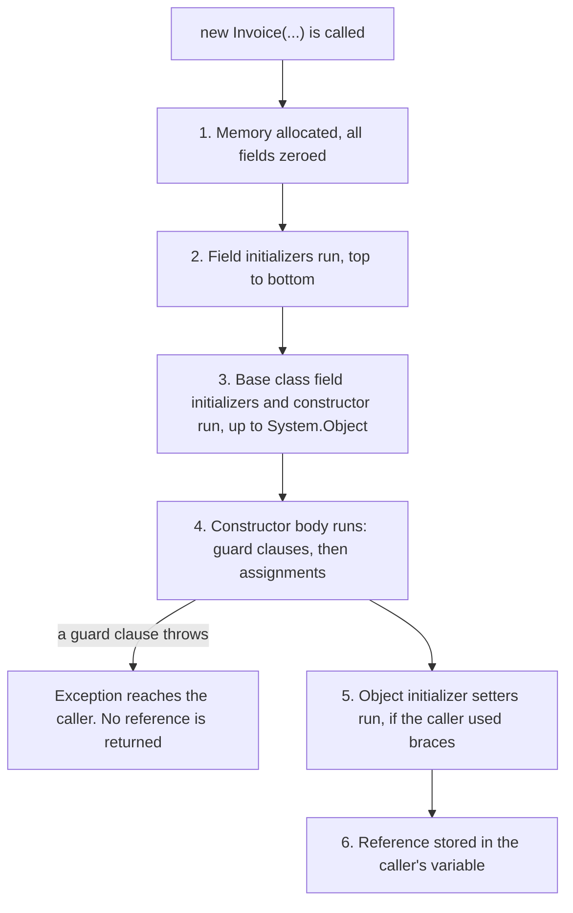
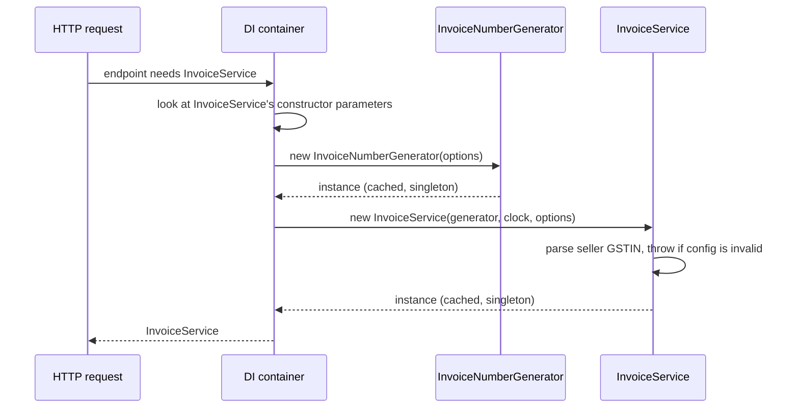

In the [previous lesson](#/lesson/m01-classes-objects) you made a metro card that protected its balance. But nothing stopped someone creating a card with an empty card number. This lesson is about the very first moment of an object's life, its construction, and how to use that moment to make invalid objects impossible.

## Learning objectives

By the end of this lesson you will be able to:

1. Explain what a constructor is and what happens, step by step, when you write `new`.
2. Write constructors that validate their inputs, so an object is valid from the moment it exists.
3. Overload constructors and chain them with `this(...)` to avoid duplicated rules.
4. Use object initializers, `init` and `required` members, and know what they can and cannot guarantee.
5. Use C# 12+ primary constructors for services, and understand that their parameters are captured, not fields.
6. Create small immutable data types with records and `with`, and spot the trap where `with` skips validation.
7. Choose between a constructor, a static factory method and an async factory.

## Prerequisites

- [Classes, objects, fields, properties and methods](#/lesson/m01-classes-objects): you should be comfortable writing a class with private fields, properties and methods.

## Explain it like I'm a beginner

### Opening a bank account

When you open a savings account in an Indian bank, the bank asks for your name, your PAN, your address proof and a first deposit. **Until those are given and checked, there is no account.** The bank does not create an empty account first and "fill in the PAN later". An account without KYC (identity checks) is not allowed to exist.

A **constructor** is that account-opening desk for an object. It is a special method that runs exactly once, at the moment the object is created. It receives the information the object needs, checks it, and stores it. If anything is wrong, it refuses, by throwing an exception, and no object is created at all.

### Why "valid from birth" matters

Imagine instead that objects could be half-built:

```csharp
var invoice = new Invoice();      // no number, no buyer, no lines
invoice.Number = "INV/2026-27/000041";
// ... 200 lines of other code ...
// someone forgets to set the buyer
SendToCustomer(invoice);          // crashes, or worse, sends a blank invoice
```

Every piece of code that receives an `Invoice` now has to wonder: "is this one complete?". With a constructor that demands everything up front, the answer is always yes. That saves checks everywhere else.

### Different desks for different customers

A bank has a desk for adults and a simplified one for a child's account opened by a parent. Both create an account, with slightly different inputs. In C#, a class can have **several constructors** with different parameter lists. This is called *overloading*. One constructor can pass its work to another, so the shared rules live in one place (*chaining*).

### Filling in a form

Sometimes an object has many optional details, like a delivery address with an optional "landmark" line. Instead of a constructor with ten parameters, C# lets you fill in properties by name while creating the object:

```csharp
var address = new DeliveryAddress { Line1 = "12 MG Road", City = "Gurugram", Pincode = "122002" };
```

That curly-brace form is an **object initializer**. It reads like a form with labelled boxes. You can mark certain boxes as **required** so the compiler refuses to build your code if you forget them.

## First-principles explanation

### What a constructor is

A constructor is a method with the **same name as the class** and **no return type**, not even `void`:

```csharp
public sealed class TrainTicket
{
    public TrainTicket(string pnr, string passengerName)
    {
        Pnr = pnr;
        PassengerName = passengerName;
    }

    public string Pnr { get; }
    public string PassengerName { get; }
}

var ticket = new TrainTicket("4521367890", "Meera Iyer");
```

Get-only properties such as `Pnr { get; }` can be assigned *only* inside a constructor (or an initializer on the same line). After construction they never change. This is the simplest way to make data read-only.

### If you write no constructor

C# gives you a hidden **parameterless constructor** that does nothing except leave fields at their defaults (`0`, `false`, `null`). The moment you write *any* constructor yourself, that free one disappears. So once `TrainTicket` has a constructor with two parameters, `new TrainTicket()` no longer compiles. That is usually what you want: it forces callers to supply the data.

### What happens when you write `new`

For a class `Invoice`, `new Invoice(...)` does these steps, in this order:

1. **Allocate.** The runtime reserves memory on the managed heap for the object and fills it with zeros. Every field starts at its default.
2. **Field initializers run.** Lines like `private readonly List<InvoiceLine> _lines = new();` execute, top to bottom.
3. **The base class is initialised.** Every class has a parent (at least `object`). The parent's field initializers and constructor run before the child's constructor body. You will see this properly in [the OOP pillars lesson](#/lesson/m01-oop-pillars).
4. **The constructor body runs.** Your validation and assignments happen here.
5. **Object initializer assignments run** (if the caller used `{ ... }`). These are ordinary property setters called *after* the constructor.
6. **The reference is returned** to the caller's variable.

If any step throws, the caller gets the exception and never receives a reference. The half-made object is simply garbage, collected later. **That is the guarantee you build on: if you hold a reference, construction finished.**

### Validating in the constructor (guard clauses)

Check every input at the top of the constructor, before storing anything. .NET has ready-made helpers that throw the right exception with the parameter name:

```csharp
public TrainTicket(string pnr, string passengerName, int seat)
{
    if (pnr is not { Length: 10 } || !pnr.All(char.IsAsciiDigit))
        throw new ArgumentException("PNR must be exactly 10 digits.", nameof(pnr));
    ArgumentException.ThrowIfNullOrWhiteSpace(passengerName);
    ArgumentOutOfRangeException.ThrowIfLessThan(seat, 1);
    ArgumentOutOfRangeException.ThrowIfGreaterThan(seat, 72);

    Pnr = pnr;
    PassengerName = passengerName.Trim();
    Seat = seat;
}
```

These early "stop here if the input is bad" lines are called **guard clauses**.

### Overloading and chaining

Two constructors, one set of rules:

```csharp
public TrainTicket(string pnr, string passengerName, int seat) { /* all the checks above */ }

// A waitlisted ticket has no seat yet. Reuse the main constructor's checks:
public TrainTicket(string pnr, string passengerName) : this(pnr, passengerName, seat: null) { }
```

The `: this(...)` part calls another constructor of the same class *before* this one's body runs. Without chaining you would copy the PNR check into both constructors. The day someone changes the PNR rule, they would update one and forget the other.

### Object initializers, `init` and `required`

An object initializer sets properties by name after the constructor:

```csharp
public sealed class DeliveryAddress
{
    public required string Line1 { get; init; }
    public string? Landmark { get; init; }
    public required string City { get; init; }
    public required string Pincode { get; init; }
    public string Country { get; init; } = "India";
}
```

- **`init`** means "can be set during creation (constructor or initializer), then never again". It gives you initializer syntax *and* immutability.
- **`required`** (C# 11+) means "the caller must set this in the initializer". Forgetting `City` is a **compile error** (CS9035), not a runtime surprise.
- **Default values** (`= "India"`) apply when the caller doesn't set the property.

Know the limits. `required` checks that a value was *assigned*, not that it is *sensible*. `City = ""` compiles happily. For real rules you still validate, for example in the `init` accessor with the C# 14 `field` keyword:

```csharp
public required string Pincode
{
    get;
    init => field = value is { Length: 6 } && value.All(char.IsAsciiDigit)
        ? value
        : throw new ArgumentException("Pincode must be 6 digits.", nameof(Pincode));
}
```

Also, `required` is a compiler feature. Code that creates objects by reflection can skip it. System.Text.Json does honour `required` when reading JSON (since .NET 7) and throws if the property is missing.

If a constructor sets all required members itself, mark it with `[SetsRequiredMembers]` (from `System.Diagnostics.CodeAnalysis`) so callers using that constructor are not forced to repeat them.

### Constructor parameters vs object initializers: which one?

| Use a constructor when… | Use an initializer (`required`/`init`) when… |
|---|---|
| Values must be checked *together* (end date after start date) | Each property is independent |
| There are a few essential inputs (2–4) | There are many optional settings |
| You want to hide how the object is built | The type is mainly data (DTOs, options, view models) |
| The object has behaviour and invariants (domain model) | Readability of named values matters more than strict rules |

Rules involving **several** properties at once can't be checked in individual `init` accessors, because you don't know the order they will be set in. That is a strong reason to use a constructor for domain objects.

### Primary constructors (C# 12+)

You can put parameters straight on the class name:

```csharp
public sealed class InvoiceService(InvoiceNumberGenerator numbers, TimeProvider clock)
{
    public string NextNumber() => numbers.Next(DateOnly.FromDateTime(clock.GetUtcNow().UtcDateTime));
}
```

The parameters `numbers` and `clock` are available everywhere in the class body. This removes the "declare field, assign field" boilerplate that dependency-injected services are full of.

Three facts that trip people up:

1. Primary constructor parameters are **not readonly fields**. The compiler captures them, and code inside the class can reassign them. If you need `readonly`, assign to a field: `private readonly TimeProvider _clock = clock;`.
2. They are **not public properties** on a normal class (records are different, see below).
3. Any other constructor you add must chain to the primary one with `: this(...)`.

Primary constructors suit **services** that just store their dependencies. For domain objects that validate their input, a regular constructor is often clearer, because validation needs a body.

### Records: small, immutable, compared by value

A **record** is a class designed to carry data. One line gives you a constructor, get-only (`init`) properties, value equality, a readable `ToString()` and deconstruction:

```csharp
public sealed record Money(decimal Amount, string Currency);

var a = new Money(500m, "INR");
var b = new Money(500m, "INR");
Console.WriteLine(a == b);      // True: records compare by value, classes by reference
var c = a with { Amount = 750m }; // a copy with one property changed; a is untouched
```

Use records for values that are defined by their data: amounts, addresses, request bodies, events. `record struct` gives the same features as a value type, useful for tiny values such as coordinates.

:::callout type=warning title="`with` skips your constructor"
`with` copies the object and then calls `init` setters. It does **not** run your constructor. If a positional record validates in its constructor, `line with { Quantity = -5 }` sneaks past the check. To protect a record, either validate in the `init` accessors, or make the properties get-only (`{ get; }`) so `with` cannot set them at all.
:::

### Static factory methods

Sometimes a constructor is the wrong tool:

- **Names help.** `TrainTicket.Waitlisted(pnr, name)` says more than an overload whose only difference is a missing parameter.
- **Failure without exceptions.** Parsing user input often fails. `Gstin.TryParse(text, out var gstin)` returns `false` instead of throwing.
- **Async work.** Constructors cannot be `async`. If creation needs I/O (loading data, calling an API), use `static async Task<T> CreateAsync(...)` and keep the constructor private.
- **Caching or choosing a subtype.** A factory can return an existing instance or a subclass. A constructor always makes a brand-new object of exactly its class.

Make the constructor `private` so the factory is the only way in.

### Static constructors

A **static constructor** (`static Invoice() { ... }`) runs once per type, automatically, before the type is first used. You never call it. Use it rarely, for preparing static read-only data. If it throws, the type becomes unusable for the rest of the process (`TypeInitializationException` on every use), so keep it trivial.

### What not to do in a constructor

- **No slow or risky I/O.** Database calls, HTTP calls and file reads in a constructor make object creation slow, hard to test and impossible to `await`. Inject the dependency and call it in a method, or use an async factory.
- **No calls to `virtual` methods.** A subclass's override would run before the subclass's own constructor has set its fields.
- **Don't leak `this`.** Registering `this` in a static list or event before construction finishes lets others see a half-built object.
- **Not too many parameters.** Seven or more parameters is a hint that the class does too much, or that a group of them belongs together in its own type (`Address`, `DateRange`). A [Builder](#/lesson/m06-builder) is another option.

## Visual explanation

### Order of initialization



Read it top to bottom. The important branch is at step 4: if validation fails, the caller never receives the object, so nobody can use a half-built invoice. Step 5 explains why `required` and `init` values are not yet set while the constructor body runs. Don't read them inside the constructor. Step 3 matters once you use inheritance: the parent part of an object is always ready before the child's constructor body runs.

### Who constructs a service in ASP.NET Core



In a web app, *you* rarely write `new InvoiceService(...)`. The dependency injection container reads the constructor's parameter list, creates each dependency first, then calls the constructor. That is **constructor injection**. The constructor's parameter list becomes an honest list of "what this class needs". Because these services are singletons, each constructor runs once, on first use, and the container reuses the instance afterwards. If the configured GSTIN is invalid, the constructor throws, and you see the error at the first request. The production code below also validates options at start-up, so the error appears before any request is served. The [dependency injection lesson](#/lesson/m03-dependency-injection) covers this in depth.

## Step-by-step example

We'll build an invoice line for a building-materials supplier in four steps.

### Step 1 — no constructor (the naive version)

```csharp
public class InvoiceLine
{
    public string Description { get; set; } = "";
    public decimal Quantity { get; set; }
    public decimal UnitPrice { get; set; }
}

var line = new InvoiceLine { Description = "OPC cement 50 kg bag", Quantity = 40 };
// forgot UnitPrice: the line is worth ₹0 and nothing complains
```

### Step 2 — a constructor that demands the essentials

```csharp
public class InvoiceLine
{
    public InvoiceLine(string description, decimal quantity, decimal unitPrice)
    {
        ArgumentException.ThrowIfNullOrWhiteSpace(description);
        ArgumentOutOfRangeException.ThrowIfNegativeOrZero(quantity);
        ArgumentOutOfRangeException.ThrowIfNegative(unitPrice);
        Description = description.Trim();
        Quantity = quantity;
        UnitPrice = unitPrice;
    }

    public string Description { get; }
    public decimal Quantity { get; }
    public decimal UnitPrice { get; }
    public decimal Amount => Quantity * UnitPrice;
}
```

Forgetting the price is now a compile error. A negative quantity is a runtime error at the exact line that caused it, not a mysterious wrong total three screens later.

### Step 3 — add GST with an overload

Most lines on this supplier's invoices are 18 % GST, but some items carry a different rate:

```csharp
public const decimal StandardGstRate = 18m;

public InvoiceLine(string description, decimal quantity, decimal unitPrice)
    : this(description, quantity, unitPrice, StandardGstRate) { }

public InvoiceLine(string description, decimal quantity, decimal unitPrice, decimal gstRatePercent)
{
    // all checks here, once
}
```

Here 18 % is just this supplier's common case for the example. GST rates depend on the item and change by government notification, so real systems load them from configuration or a tax master table.

### Step 4 — make it a value

Two lines with the same description, quantity, price and rate are the same thing. That's a record. We keep the get-only properties, so `with` cannot bypass our checks. The finished version is in the next section.

## Production-style C# implementation

A small invoicing API. It uses every construction technique from this lesson, each where it fits best.

```text
Billing.Api/
  Program.cs
  Billing/
    Gstin.cs                     // value object: private constructor + TryParse/Parse factories
    InvoiceLine.cs               // record with a validating constructor and get-only properties
    Invoice.cs                   // domain object: overloaded, chained constructors
    BillingOptions.cs            // options class: parameterless constructor for config binding
    CreateInvoiceRequest.cs      // request body: required + init members
    InvoiceNumberGenerator.cs    // service: primary constructor
    InvoiceService.cs            // service: primary constructor + fail-fast field initializer
```

```csharp file=Billing/Gstin.cs
using System.Diagnostics.CodeAnalysis;
using System.Text.RegularExpressions;

namespace Billing.Api.Billing;

/// <summary>A GST identification number. Only the 15-character format is checked here,
/// not the check digit or whether the number is registered.</summary>
public sealed partial record Gstin
{
    [GeneratedRegex("^[0-9]{2}[A-Z]{5}[0-9]{4}[A-Z][1-9A-Z]Z[0-9A-Z]$")]
    private static partial Regex Format();

    private Gstin(string value) => Value = value;   // only the factories below can create one

    public string Value { get; }
    public string StateCode => Value[..2];

    public static bool TryParse(string? input, [NotNullWhen(true)] out Gstin? gstin)
    {
        var normalised = input?.Trim().ToUpperInvariant();
        gstin = normalised is not null && Format().IsMatch(normalised) ? new Gstin(normalised) : null;
        return gstin is not null;
    }

    public static Gstin Parse(string input) =>
        TryParse(input, out var g) ? g : throw new FormatException($"'{input}' is not a valid GSTIN.");

    public override string ToString() => Value;
}
```

```csharp file=Billing/InvoiceLine.cs
namespace Billing.Api.Billing;

/// <summary>Get-only properties: a 'with' expression cannot change them, so the constructor's
/// checks can never be bypassed. Value equality still comes from 'record'.</summary>
public sealed record InvoiceLine
{
    public const decimal StandardGstRate = 18m;

    public InvoiceLine(string description, decimal quantity, decimal unitPrice)
        : this(description, quantity, unitPrice, StandardGstRate) { }

    public InvoiceLine(string description, decimal quantity, decimal unitPrice, decimal gstRatePercent)
    {
        ArgumentException.ThrowIfNullOrWhiteSpace(description);
        ArgumentOutOfRangeException.ThrowIfNegativeOrZero(quantity);
        ArgumentOutOfRangeException.ThrowIfNegative(unitPrice);
        ArgumentOutOfRangeException.ThrowIfNegative(gstRatePercent);
        ArgumentOutOfRangeException.ThrowIfGreaterThan(gstRatePercent, 100m);

        Description = description.Trim();
        Quantity = quantity;
        UnitPrice = unitPrice;
        GstRatePercent = gstRatePercent;
    }

    public string Description { get; }
    public decimal Quantity { get; }
    public decimal UnitPrice { get; }
    public decimal GstRatePercent { get; }

    public decimal TaxableValue => Math.Round(Quantity * UnitPrice, 2);
    public decimal GstAmount => Math.Round(TaxableValue * GstRatePercent / 100m, 2);
    public decimal Total => TaxableValue + GstAmount;
}
```

```csharp file=Billing/Invoice.cs
namespace Billing.Api.Billing;

public sealed class Invoice
{
    private readonly InvoiceLine[] _lines;   // copied, so the caller's list can't change us later

    /// <summary>Business-to-consumer invoice: the buyer has no GSTIN.</summary>
    public Invoice(string number, DateOnly issuedOn, Gstin seller, string buyerName, IEnumerable<InvoiceLine> lines)
        : this(number, issuedOn, seller, buyerName, buyerGstin: null, lines) { }

    /// <summary>Business-to-business invoice. All checks live here, once.</summary>
    public Invoice(string number, DateOnly issuedOn, Gstin seller, string buyerName, Gstin? buyerGstin, IEnumerable<InvoiceLine> lines)
    {
        ArgumentException.ThrowIfNullOrWhiteSpace(number);
        ArgumentNullException.ThrowIfNull(seller);
        ArgumentException.ThrowIfNullOrWhiteSpace(buyerName);
        ArgumentNullException.ThrowIfNull(lines);

        _lines = lines.ToArray();
        if (_lines.Length == 0) throw new ArgumentException("An invoice needs at least one line.", nameof(lines));
        if (buyerGstin is not null && buyerGstin == seller)
            throw new ArgumentException("Seller and buyer cannot have the same GSTIN.", nameof(buyerGstin));

        Number = number;
        IssuedOn = issuedOn;
        Seller = seller;
        BuyerName = buyerName.Trim();
        BuyerGstin = buyerGstin;
    }

    public string Number { get; }
    public DateOnly IssuedOn { get; }
    public Gstin Seller { get; }
    public string BuyerName { get; }
    public Gstin? BuyerGstin { get; }
    public IReadOnlyList<InvoiceLine> Lines => _lines;
    public bool IsBusinessToBusiness => BuyerGstin is not null;

    public decimal TaxableValue => _lines.Sum(l => l.TaxableValue);
    public decimal GstAmount => _lines.Sum(l => l.GstAmount);
    public decimal GrandTotal => TaxableValue + GstAmount;
}
```

```csharp file=Billing/BillingOptions.cs
namespace Billing.Api.Billing;

/// <summary>Bound from configuration. The binder needs a public parameterless constructor and
/// settable properties, so this is a plain class with defaults rather than a validating one.</summary>
public sealed class BillingOptions
{
    public const string SectionName = "Billing";
    public string SellerGstin { get; set; } = "";
    public string NumberPrefix { get; set; } = "INV";
}
```

```csharp file=Billing/CreateInvoiceRequest.cs
namespace Billing.Api.Billing;

/// <summary>JSON request body. System.Text.Json honours 'required': a missing property is a 400, not a null.</summary>
public sealed class CreateInvoiceRequest
{
    public required string BuyerName { get; init; }
    public string? BuyerGstin { get; init; }
    public required IReadOnlyList<CreateInvoiceLineRequest> Lines { get; init; }
}

public sealed record CreateInvoiceLineRequest(string Description, decimal Quantity, decimal UnitPrice, decimal? GstRatePercent);

public sealed record InvoiceView(string Number, DateOnly IssuedOn, string Seller, string BuyerName, string? BuyerGstin,
    decimal TaxableValue, decimal GstAmount, decimal GrandTotal)
{
    public static InvoiceView From(Invoice i) => new(i.Number, i.IssuedOn, i.Seller.Value, i.BuyerName,
        i.BuyerGstin?.Value, i.TaxableValue, i.GstAmount, i.GrandTotal);
}
```

```csharp file=Billing/InvoiceNumberGenerator.cs
using Microsoft.Extensions.Options;

namespace Billing.Api.Billing;

/// <summary>Primary constructor: the parameter is captured and used by the method below.
/// The counter is in memory for this demo; production code would use a PostgreSQL sequence
/// per financial year so numbers survive restarts and stay unique across servers.</summary>
public sealed class InvoiceNumberGenerator(IOptions<BillingOptions> options)
{
    private readonly string _prefix = options.Value.NumberPrefix;
    private int _sequence;

    /// <summary>Indian financial year runs April to March: 15 May 2026 is FY 2026-27.</summary>
    public static string FinancialYear(DateOnly day)
    {
        var startYear = day.Month >= 4 ? day.Year : day.Year - 1;
        return $"{startYear}-{(startYear + 1) % 100:D2}";
    }

    public string Next(DateOnly issuedOn) =>
        $"{_prefix}/{FinancialYear(issuedOn)}/{Interlocked.Increment(ref _sequence):D6}";
}
```

```csharp file=Billing/InvoiceService.cs
using Microsoft.Extensions.Options;

namespace Billing.Api.Billing;

public sealed class InvoiceService(InvoiceNumberGenerator numbers, TimeProvider clock, IOptions<BillingOptions> options)
{
    private static readonly TimeSpan IndiaOffset = TimeSpan.FromHours(5.5);   // IST has no daylight saving

    // Field initializer using a primary-constructor parameter: runs once, when the service is built.
    // Bad configuration fails here, loudly, instead of on every invoice.
    private readonly Gstin _seller = Gstin.Parse(options.Value.SellerGstin);

    public Invoice Create(CreateInvoiceRequest request)
    {
        ArgumentNullException.ThrowIfNull(request);

        Gstin? buyerGstin = null;
        if (!string.IsNullOrWhiteSpace(request.BuyerGstin) && !Gstin.TryParse(request.BuyerGstin, out buyerGstin))
            throw new ArgumentException($"Buyer GSTIN '{request.BuyerGstin}' is not valid.", nameof(request));

        var lines = request.Lines.Select(l => l.GstRatePercent is { } rate
            ? new InvoiceLine(l.Description, l.Quantity, l.UnitPrice, rate)
            : new InvoiceLine(l.Description, l.Quantity, l.UnitPrice)).ToList();

        var today = DateOnly.FromDateTime(clock.GetUtcNow().ToOffset(IndiaOffset).DateTime);
        return new Invoice(numbers.Next(today), today, _seller, request.BuyerName, buyerGstin, lines);
    }
}
```

```csharp file=Program.cs
using Billing.Api.Billing;

var builder = WebApplication.CreateBuilder(args);

builder.Services.AddOptions<BillingOptions>()
    .Bind(builder.Configuration.GetSection(BillingOptions.SectionName))
    .Validate(o => Gstin.TryParse(o.SellerGstin, out _), "Billing:SellerGstin must be a valid GSTIN.")
    .ValidateOnStart();                                   // fail at start-up, not at the first invoice

builder.Services.AddSingleton(TimeProvider.System);
builder.Services.AddSingleton<InvoiceNumberGenerator>();
builder.Services.AddSingleton<InvoiceService>();

var app = builder.Build();

app.MapPost("/invoices", (CreateInvoiceRequest request, InvoiceService invoices) =>
{
    try
    {
        var invoice = invoices.Create(request);
        return Results.Created($"/invoices/{Uri.EscapeDataString(invoice.Number)}", InvoiceView.From(invoice));
    }
    catch (ArgumentException ex) { return Results.Problem(ex.Message, statusCode: StatusCodes.Status400BadRequest); }
});

app.Run();
```

How each technique was chosen:

| Type | Technique | Why |
|---|---|---|
| `Gstin` | Private constructor + `TryParse`/`Parse` | Parsing user input fails often; callers choose "bool" or "exception" |
| `InvoiceLine` | Overloaded, chained constructors; get-only record | Rules live once; `with` cannot bypass them; value equality for free |
| `Invoice` | Constructor with cross-field checks | "Seller ≠ buyer" involves two values together |
| `BillingOptions` | Parameterless, settable | The configuration binder creates it with no arguments, then sets properties |
| `CreateInvoiceRequest` | `required` + `init` | Many named fields from JSON; missing ones rejected by the serializer |
| `InvoiceNumberGenerator`, `InvoiceService` | Primary constructors | Services that mainly store dependencies; DI calls the constructor |

The request and the domain object are deliberately separate. `CreateInvoiceRequest` has to accept whatever JSON arrives, so it is loose. `Invoice` must never be invalid, so it is strict. The service translates one into the other, and the constructors are the checkpoint.

## Bad design vs good design

**Bad**: settable everything, validated "somewhere later".

```csharp
public class Invoice
{
    public string Number { get; set; } = "";
    public string BuyerName { get; set; } = "";
    public List<InvoiceLine> Lines { get; set; } = new();
    public bool IsValid() => Number != "" && BuyerName != "" && Lines.Count > 0;
}
```

Problems:

- Every caller must remember to call `IsValid()`. Some won't.
- An invoice can be valid when checked and invalid a moment later (`invoice.Lines.Clear()`).
- Tests must build objects property by property, and the "minimum valid invoice" is written differently in every test.

**Good**: the `Invoice` above. Its constructor demands the essentials and checks them together. Properties are get-only. Lines are copied in and exposed read-only. An `Invoice` reference is always a valid invoice.

**Another bad example: the positional record that looks safe.**

```csharp
public sealed record Quantity(decimal Value)
{
    public decimal Value { get; init; } = Value > 0 ? Value : throw new ArgumentOutOfRangeException(nameof(Value));
}

var q = new Quantity(5);           // checked
var broken = q with { Value = -3 }; // NOT checked: 'with' calls the init setter, not the constructor
```

Fix it by validating in the `init` accessor (with `field`), or by making the property get-only as `InvoiceLine` does.

**Is strict construction always worth it?** No. For a DTO that only carries JSON, or an options class bound from configuration, strict constructors fight the frameworks that create those objects. Keep those simple, and validate them at the boundary (model validation, `ValidateOnStart`). Be strict where the business rules live.

:::callout type=tradeoff title="Constructor parameters vs many properties"
A constructor with 3–4 parameters is clear. With 8, callers mix up the order (`new Invoice(buyer, seller, ...)` compiles but is wrong). Group related values into types (`Gstin`, `Address`, `DateRange`), use named arguments at the call site, or use `required` init properties if the values are independent.
:::

## Practical playground

Run it and read the output order carefully. Then try the experiments.

:::playground type=csharp title="Watch construction happen"
```csharp file=Program.cs
using System;

public class Base
{
    protected readonly string Log = Trace("Base field initializer");
    public Base() => Trace("Base constructor body");
    protected static string Trace(string step) { Console.WriteLine(step); return step; }
}

public sealed class TrainTicket : Base
{
    private readonly string _derivedLog = Trace("Derived field initializer");

    public TrainTicket(string pnr, string passengerName, int? seat)
    {
        Trace("Derived constructor body (3 parameters)");
        if (pnr.Length != 10) throw new ArgumentException("PNR must be 10 digits.", nameof(pnr));
        Pnr = pnr;
        PassengerName = passengerName;
        Seat = seat;
    }

    public TrainTicket(string pnr, string passengerName) : this(pnr, passengerName, null)
    {
        Trace("Derived constructor body (2 parameters, after chaining)");
    }

    public string Pnr { get; }
    public string PassengerName { get; }
    public int? Seat { get; }
    public string? Coach { get; init; }
    public bool IsWaitlisted => Seat is null;
}

public sealed record Fare(decimal Base, decimal Reservation)
{
    public decimal Total => Base + Reservation;
}

public static class Program
{
    public static void Main()
    {
        Console.WriteLine("--- confirmed ticket ---");
        var t1 = new TrainTicket("4521367890", "Meera", 23) { Coach = "B2" };
        Console.WriteLine($"{t1.PassengerName} seat {t1.Seat} coach {t1.Coach}");

        Console.WriteLine("--- waitlisted ticket ---");
        var t2 = new TrainTicket("4521367891", "Arjun");
        Console.WriteLine($"{t2.PassengerName} waitlisted? {t2.IsWaitlisted}");

        Console.WriteLine("--- records ---");
        var f1 = new Fare(745m, 40m);
        var f2 = f1 with { Reservation = 60m };
        Console.WriteLine($"{f1} total {f1.Total}; {f2} total {f2.Total}; equal? {f1 == new Fare(745m, 40m)}");

        Console.WriteLine("--- invalid ticket ---");
        try { new TrainTicket("123", "Bad"); }
        catch (ArgumentException ex) { Console.WriteLine($"Refused: {ex.Message}"); }

        // Experiments:
        // 1. Try `t1.Coach = "B3";` after creation. Why does it fail to compile?
        // 2. Add `required` to Coach. Which line in Main stops compiling?
        // 3. Move the PNR check below the assignments. Does anything change for the caller? Why is the order still good practice?
    }
}
```
:::

## Exercises

:::exercise id=m01-constructors-ex1 difficulty=beginner kind=code title="Train ticket constructors with chaining"
Write two constructors for `TrainTicket`. The two-parameter version creates a waitlisted ticket and must reuse the three-parameter version's checks.
::requirements
- `TrainTicket(string pnr, string passengerName, int? seat)`: the PNR must be exactly 10 digits, otherwise throw `ArgumentException`. The name must not be blank (throw `ArgumentException`) and is stored trimmed. A seat, when given, must be 1–72, otherwise throw `ArgumentOutOfRangeException`.
- `TrainTicket(string pnr, string passengerName)` creates a waitlisted ticket (`Seat` is `null`) by chaining with `: this(...)`.
- All properties are get-only.
::acceptance
- `new TrainTicket("4521367890", "  Meera ", 23)` has the name "Meera" and seat 23.
- `new TrainTicket("4521367890", "Arjun")` is waitlisted.
- A 9-digit PNR or a PNR with letters throws `ArgumentException`, in both constructors.
- Seat 0 or 73 throws `ArgumentOutOfRangeException`.
::hint
Write all the checks once, in the constructor with the most parameters.
::hint
The shorter constructor's body can be empty. Its job is to call the longer one with `null` for the seat.
::hint
`char.IsAsciiDigit` checks a single character. `pnr.All(char.IsAsciiDigit)` checks the whole string.
::hint
`ArgumentException.ThrowIfNullOrWhiteSpace(passengerName)` throws `ArgumentNullException` for `null`, which is a subclass. For a blank string it throws `ArgumentException` itself.
::hint
```csharp
public TrainTicket(string pnr, string passengerName) : this(pnr, passengerName, null) { }
```
::starter
```csharp file=TrainTicket.cs
using System;
using System.Linq;

public sealed class TrainTicket
{
    public TrainTicket(string pnr, string passengerName, int? seat)
    {
        throw new NotImplementedException();
    }

    public TrainTicket(string pnr, string passengerName)
    {
        throw new NotImplementedException();
    }

    public string Pnr { get; }
    public string PassengerName { get; }
    public int? Seat { get; }
    public bool IsWaitlisted => Seat is null;
}
```
::tests
```csharp file=TrainTicketTests.cs
using System;
using Xunit;

public class TrainTicketTests
{
    [Fact]
    public void Confirmed_ticket()
    {
        var t = new TrainTicket("4521367890", "  Meera ", 23);
        Assert.Equal("Meera", t.PassengerName);
        Assert.Equal(23, t.Seat);
        Assert.False(t.IsWaitlisted);
    }

    [Fact] public void Waitlisted_ticket() => Assert.True(new TrainTicket("4521367890", "Arjun").IsWaitlisted);

    [Theory]
    [InlineData("452136789")]
    [InlineData("45213678AB")]
    public void Bad_pnr_throws_in_both_constructors(string pnr)
    {
        Assert.Throws<ArgumentException>(() => new TrainTicket(pnr, "X", 1));
        Assert.Throws<ArgumentException>(() => new TrainTicket(pnr, "X"));
    }

    [Fact] public void Blank_name_throws() => Assert.Throws<ArgumentException>(() => new TrainTicket("4521367890", "   "));

    [Theory]
    [InlineData(0)]
    [InlineData(73)]
    public void Bad_seat_throws(int seat) => Assert.Throws<ArgumentOutOfRangeException>(() => new TrainTicket("4521367890", "X", seat));
}
```
::solution
```csharp file=TrainTicket.cs
using System;
using System.Linq;

public sealed class TrainTicket
{
    public TrainTicket(string pnr, string passengerName, int? seat)
    {
        if (pnr is not { Length: 10 } || !pnr.All(char.IsAsciiDigit))
            throw new ArgumentException("PNR must be exactly 10 digits.", nameof(pnr));
        ArgumentException.ThrowIfNullOrWhiteSpace(passengerName);
        if (seat is < 1 or > 72)
            throw new ArgumentOutOfRangeException(nameof(seat), seat, "Seat must be between 1 and 72.");

        Pnr = pnr;
        PassengerName = passengerName.Trim();
        Seat = seat;
    }

    public TrainTicket(string pnr, string passengerName) : this(pnr, passengerName, null) { }

    public string Pnr { get; }
    public string PassengerName { get; }
    public int? Seat { get; }
    public bool IsWaitlisted => Seat is null;
}
```

`seat is < 1 or > 72` is a pattern that is `false` for `null`, so a waitlisted ticket passes. Because the short constructor chains, there is exactly one copy of each rule.
::mistakes
- Copying the PNR check into both constructors. It works today and drifts apart tomorrow.
- Assigning properties before checking. The caller never sees the object anyway, but checks-first is clearer and avoids surprises with side effects.
- Using `int.TryParse(pnr, ...)` to check digits. It accepts " 123" and "-12345678", and a 10-digit number can overflow `int`.
::extensions
Add a static factory `TrainTicket.Waitlisted(pnr, name)` and make the two-parameter constructor private. Which do you find clearer at the call site?
:::

:::exercise id=m01-constructors-ex2 difficulty=beginner kind=code title="A delivery address with required and init members"
Complete `DeliveryAddress` so it can be created with an object initializer, cannot be changed afterwards, and rejects a bad pincode.
::requirements
- `Line1`, `City` and `Pincode` are `required` and `init`-only. `Landmark` is optional. `Country` defaults to "India".
- `City` is stored trimmed.
- `Pincode` must be exactly 6 digits, otherwise throw `ArgumentException`. Use the C# 14 `field` keyword in the `init` accessor.
- `ToString()` returns `"Line1, City - Pincode"`, or `"Line1, near Landmark, City - Pincode"` when a landmark is set.
::acceptance
- `new DeliveryAddress { Line1 = "12 MG Road", City = " Gurugram ", Pincode = "122002" }` has City "Gurugram" and Country "India".
- A pincode of "12200" or "12200A" throws `ArgumentException`.
- The landmark appears in `ToString()` only when set.
::hint
The starter already declares the properties. You need to add logic to two `init` accessors and implement `ToString`.
::hint
Inside an accessor, `value` is what the caller assigned and `field` is the hidden storage.
::hint
For the pincode: `value is { Length: 6 } && value.All(char.IsAsciiDigit)`.
::hint
```csharp
public required string City { get; init => field = value.Trim(); }
```
::starter
```csharp file=DeliveryAddress.cs
using System;
using System.Linq;

public sealed class DeliveryAddress
{
    public required string Line1 { get; init; }
    public string? Landmark { get; init; }
    public required string City { get; init; }
    public required string Pincode { get; init; }
    public string Country { get; init; } = "India";

    public override string ToString() => throw new NotImplementedException();
}
```
::tests
```csharp file=DeliveryAddressTests.cs
using System;
using Xunit;

public class DeliveryAddressTests
{
    [Fact]
    public void Initializer_sets_values_and_defaults()
    {
        var a = new DeliveryAddress { Line1 = "12 MG Road", City = " Gurugram ", Pincode = "122002" };
        Assert.Equal("Gurugram", a.City);
        Assert.Equal("India", a.Country);
        Assert.Equal("12 MG Road, Gurugram - 122002", a.ToString());
    }

    [Fact]
    public void Landmark_appears_when_set()
    {
        var a = new DeliveryAddress { Line1 = "Flat 4B, Lake View", Landmark = "Ulsoor Lake", City = "Bengaluru", Pincode = "560008" };
        Assert.Equal("Flat 4B, Lake View, near Ulsoor Lake, Bengaluru - 560008", a.ToString());
    }

    [Theory]
    [InlineData("12200")]
    [InlineData("12200A")]
    [InlineData("1220021")]
    public void Bad_pincode_throws(string pin) =>
        Assert.Throws<ArgumentException>(() => new DeliveryAddress { Line1 = "x", City = "y", Pincode = pin });
}
```
::solution
```csharp file=DeliveryAddress.cs
using System;
using System.Linq;

public sealed class DeliveryAddress
{
    public required string Line1 { get; init; }
    public string? Landmark { get; init; }
    public required string City { get; init => field = value.Trim(); }

    public required string Pincode
    {
        get;
        init => field = value is { Length: 6 } && value.All(char.IsAsciiDigit)
            ? value
            : throw new ArgumentException("Pincode must be exactly 6 digits.", nameof(Pincode));
    }

    public string Country { get; init; } = "India";

    public override string ToString() =>
        Landmark is null
            ? $"{Line1}, {City} - {Pincode}"
            : $"{Line1}, near {Landmark}, {City} - {Pincode}";
}
```

`required` makes the compiler insist on `Line1`, `City` and `Pincode`. The `init` accessors make sure the values are sensible. Neither feature alone is enough.
::mistakes
- Thinking `required` validates content. `City = ""` still compiles.
- Using `set` instead of `init`, which lets anyone change the address after an order has been dispatched.
- Validating `Pincode` inside `ToString()`. By then the bad object already exists and may be saved.
::extensions
Some addresses outside India have no 6-digit pincode. How would you design `Country`-specific validation without a giant `switch`? (Hint: it's a constructor-time decision.)
:::

:::exercise id=m01-constructors-ex3 difficulty=intermediate kind=code title="A GSTIN value object with factories"
Create `Gstin`, a value object that can only be created through `TryParse` or `Parse`.
::requirements
- The constructor is `private`.
- `TryParse(string? input, out Gstin? gstin)` trims and upper-cases the input and checks the format: 2 digits, 5 letters, 4 digits, 1 letter, 1 character from 1–9 or A–Z, the letter `Z`, then 1 digit or letter (15 characters in total). It returns `false` for `null`, blank or badly formatted input.
- `Parse(string input)` returns the value or throws `FormatException`.
- `StateCode` returns the first two characters.
- Two `Gstin` objects with the same value are equal (`==`).
::acceptance
- `"29abcde1234f1z5"` parses to `"29ABCDE1234F1Z5"`, with state code `"29"`.
- `"29ABCDE1234F1X5"` (no `Z` in position 14) fails.
- `Parse("bad")` throws `FormatException`.
- Two parses of the same text are equal.
::hint
Which C# type gives you value equality with almost no code?
::hint
A `sealed record` with a private constructor and a single `Value` property.
::hint
A regular expression is the shortest way to check the pattern: `^[0-9]{2}[A-Z]{5}[0-9]{4}[A-Z][1-9A-Z]Z[0-9A-Z]$`.
::hint
`TryParse` builds the object only when the check passes. `Parse` calls `TryParse` and throws on `false`, so the rule exists in one place.
::hint
```csharp
var normalised = input?.Trim().ToUpperInvariant();
gstin = normalised is not null && Pattern.IsMatch(normalised) ? new Gstin(normalised) : null;
return gstin is not null;
```
::starter
```csharp file=Gstin.cs
using System;
using System.Diagnostics.CodeAnalysis;
using System.Text.RegularExpressions;

public sealed record Gstin
{
    private Gstin(string value) => Value = value;

    public string Value { get; }
    public string StateCode => throw new NotImplementedException();

    public static bool TryParse(string? input, [NotNullWhen(true)] out Gstin? gstin) => throw new NotImplementedException();
    public static Gstin Parse(string input) => throw new NotImplementedException();
}
```
::tests
```csharp file=GstinTests.cs
using System;
using Xunit;

public class GstinTests
{
    [Fact]
    public void Parses_and_normalises()
    {
        Assert.True(Gstin.TryParse(" 29abcde1234f1z5 ", out var g));
        Assert.Equal("29ABCDE1234F1Z5", g!.Value);
        Assert.Equal("29", g.StateCode);
    }

    [Fact] public void Rejects_null() => Assert.False(Gstin.TryParse(null, out _));

    [Theory]
    [InlineData("")]
    [InlineData("29ABCDE1234F1X5")]
    [InlineData("29ABCDE1234F0Z5")]
    [InlineData("2AABCDE1234F1Z5")]
    [InlineData("29ABCDE1234F1Z")]
    public void Rejects_bad_input(string? input) => Assert.False(Gstin.TryParse(input, out _));

    [Fact] public void Parse_throws_format_exception() => Assert.Throws<FormatException>(() => Gstin.Parse("bad"));

    [Fact] public void Value_equality() => Assert.True(Gstin.Parse("07ABCDE9876K1Z2") == Gstin.Parse("07abcde9876k1z2"));
}
```
::solution
```csharp file=Gstin.cs
using System;
using System.Diagnostics.CodeAnalysis;
using System.Text.RegularExpressions;

public sealed record Gstin
{
    private static readonly Regex Pattern = new("^[0-9]{2}[A-Z]{5}[0-9]{4}[A-Z][1-9A-Z]Z[0-9A-Z]$", RegexOptions.CultureInvariant);

    private Gstin(string value) => Value = value;

    public string Value { get; }
    public string StateCode => Value[..2];

    public static bool TryParse(string? input, [NotNullWhen(true)] out Gstin? gstin)
    {
        var normalised = input?.Trim().ToUpperInvariant();
        gstin = normalised is not null && Pattern.IsMatch(normalised) ? new Gstin(normalised) : null;
        return gstin is not null;
    }

    public static Gstin Parse(string input) =>
        TryParse(input, out var g) ? g : throw new FormatException($"'{input}' is not a valid GSTIN.");

    public override string ToString() => Value;
}
```

The private constructor plus the factories mean a `Gstin` object is always well-formed. Code that receives a `Gstin` never needs to check the format again. Compare that with passing a raw `string` around, where every method has to wonder.
::alternatives
In a real project, use `[GeneratedRegex]` on a `partial` record (as in the production code) to get a source-generated regex. Also add the check-digit calculation and keep it in the same type. The format rule shown here is only the shape check.
::mistakes
- Making the constructor public "for convenience". Anyone can then create `new Gstin("hello")`.
- Forgetting to normalise before comparing, so "29abc..." and "29ABC..." are different.
- Throwing from `TryParse`. The whole point is that it reports failure with `false`.
::extensions
Add `IsSameState(Gstin other)`. Use it to decide between "CGST + SGST" (same state) and "IGST" (different states) on an invoice.
:::

:::exercise id=m01-constructors-ex4 difficulty=intermediate kind=written title="Pick the right construction style"
For each type below, choose a construction style (regular constructor, static factory, `required`/`init` initializer, primary constructor or positional record) and justify it in 2–3 sentences. Mention what would go wrong with the most obvious alternative.

1. `LeaveRequest` for an HR system: employee id, from date, to date, reason. "To" must not be before "from".
2. `SmtpOptions` bound from `appsettings.json`: host, port, user name, sender address.
3. `PaymentReceivedEvent` published to a message queue: payment id, amount, currency, time.
4. `ReportExporter` service that needs an `ILogger`, a `TimeProvider` and an `IFileStore`.
5. `ExchangeRateTable` that must download today's rates from an API before it can be used.
::acceptance
- A choice and a reason for all five types.
- At least one answer explains why a cross-field rule needs a constructor.
- At least one answer explains why async creation can't be a constructor.
- At least one answer names a framework constraint (config binder, serializer or DI).
::hint
For each type, ask: is it mostly data, or does it have rules? Who creates it: my code, the configuration binder, a serializer or the DI container?
::hint
A rule that compares two properties can't live safely in individual `init` accessors, because the order they are set in isn't known.
::hint
Constructors can't be `async`. What can you use instead that still keeps the constructor private?
::hint
A shape for the answer: "Type → style → because … → if instead we used …, then …".
::solution
1. **`LeaveRequest` → regular constructor.** "To ≥ from" involves two values at once, so the check needs both of them together, and that only happens in a constructor. With `required init` properties, the object could be created with `To` before `From` and no single accessor could reject it.
2. **`SmtpOptions` → plain class with settable properties and defaults.** The options binder creates the object with a parameterless constructor and then sets properties. A validating constructor would break binding. Validate with `.Validate(...)` or data annotations plus `ValidateOnStart()`.
3. **`PaymentReceivedEvent` → positional record.** An event is an immutable fact defined by its data. Value equality helps tests and deduplication, and serializers handle records well. A mutable class would let a consumer "edit history".
4. **`ReportExporter` → primary constructor.** It only stores injected dependencies, and the DI container calls the constructor. A hand-written constructor plus three fields adds boilerplate and nothing else. Keep it a regular constructor if you want `readonly` fields or argument checks.
5. **`ExchangeRateTable` → private constructor plus `static async Task<ExchangeRateTable> LoadAsync(IRateSource, CancellationToken)`.** Constructors can't `await`. Calling `.Result` inside a constructor blocks a thread and can deadlock. The factory awaits the download, validates the data, then calls the private constructor with complete data.
::mistakes
- Choosing `required` for everything because it is newest. It does not handle cross-field rules.
- Putting HTTP calls inside a constructor with `.GetAwaiter().GetResult()`.
- Giving `SmtpOptions` a constructor with parameters, which the configuration binder cannot call.
:::

:::exercise id=m01-constructors-ex5 difficulty=advanced kind=code title="Async factory for an exchange-rate table"
`ExchangeRateTable` converts between currencies using rates relative to INR. The rates come from an `IRateSource` that must be awaited. Implement an async factory and keep the object immutable and always valid.
::requirements
- The constructor is `private`. The only way to create a table is `static Task<ExchangeRateTable> LoadAsync(IRateSource source, CancellationToken ct)`.
- The source returns `IReadOnlyDictionary<string, decimal>` meaning "1 unit of currency = X INR". The table must contain INR with rate 1. Add it if it is missing, and throw `InvalidOperationException` if it is present with any other rate.
- Every rate must be greater than 0, otherwise throw `InvalidOperationException`. Currency codes are case-insensitive.
- `Convert(decimal amount, string from, string to)` returns `amount × rate(from) / rate(to)`, rounded to 2 decimals. An unknown currency throws `KeyNotFoundException`.
- Later changes to the dictionary the source returned must not affect the table.
::acceptance
- With USD = 83.50, `Convert(10, "USD", "INR")` is 835.00.
- With USD = 83.50 and EUR = 90.00, `Convert(100, "eur", "usd")` is 107.78.
- A zero or negative rate throws `InvalidOperationException` from `LoadAsync`.
- Changing the source dictionary after loading does not change conversions.
::hint
Constructors can't `await`. Do the awaiting in a static method, then call the private constructor with finished data.
::hint
Copy the source data into your own dictionary with `StringComparer.OrdinalIgnoreCase`. That gives you case-insensitivity and protection from later changes in one step.
::hint
Validate in the factory (or in the private constructor), before the object is handed out. Never hand out a table and validate "on first use".
::hint
```csharp
public static async Task<ExchangeRateTable> LoadAsync(IRateSource source, CancellationToken ct)
{
    var raw = await source.GetRatesToInrAsync(ct);
    var rates = new Dictionary<string, decimal>(raw, StringComparer.OrdinalIgnoreCase);
    // validate, add INR, then:
    return new ExchangeRateTable(rates);
}
```
::starter
```csharp file=ExchangeRateTable.cs
using System;
using System.Collections.Generic;
using System.Threading;
using System.Threading.Tasks;

public interface IRateSource
{
    Task<IReadOnlyDictionary<string, decimal>> GetRatesToInrAsync(CancellationToken ct);
}

public sealed class ExchangeRateTable
{
    private ExchangeRateTable() { }

    public static Task<ExchangeRateTable> LoadAsync(IRateSource source, CancellationToken ct) => throw new NotImplementedException();

    public decimal Convert(decimal amount, string from, string to) => throw new NotImplementedException();
}
```
::tests
```csharp file=ExchangeRateTableTests.cs
using System;
using System.Collections.Generic;
using System.Threading;
using System.Threading.Tasks;
using Xunit;

public class ExchangeRateTableTests
{
    private sealed class FakeSource(Dictionary<string, decimal> rates) : IRateSource
    {
        public async Task<IReadOnlyDictionary<string, decimal>> GetRatesToInrAsync(CancellationToken ct)
        {
            await Task.Yield();
            return rates;
        }
    }

    [Fact]
    public async Task Usd_to_inr()
    {
        var t = await ExchangeRateTable.LoadAsync(new FakeSource(new() { ["USD"] = 83.50m }), CancellationToken.None);
        Assert.Equal(835.00m, t.Convert(10m, "USD", "INR"));
    }

    [Fact]
    public async Task Cross_rate_is_case_insensitive()
    {
        var t = await ExchangeRateTable.LoadAsync(new FakeSource(new() { ["USD"] = 83.50m, ["EUR"] = 90.00m }), CancellationToken.None);
        Assert.Equal(107.78m, t.Convert(100m, "eur", "usd"));
    }

    [Fact]
    public async Task Non_positive_rate_rejected() =>
        await Assert.ThrowsAsync<InvalidOperationException>(() =>
            ExchangeRateTable.LoadAsync(new FakeSource(new() { ["USD"] = 0m }), CancellationToken.None));

    [Fact]
    public async Task Wrong_inr_rate_rejected() =>
        await Assert.ThrowsAsync<InvalidOperationException>(() =>
            ExchangeRateTable.LoadAsync(new FakeSource(new() { ["INR"] = 2m }), CancellationToken.None));

    [Fact]
    public async Task Source_changes_do_not_leak_in()
    {
        var data = new Dictionary<string, decimal> { ["USD"] = 83.50m };
        var t = await ExchangeRateTable.LoadAsync(new FakeSource(data), CancellationToken.None);
        data["USD"] = 1m;
        Assert.Equal(835.00m, t.Convert(10m, "USD", "INR"));
    }

    [Fact]
    public async Task Unknown_currency_throws()
    {
        var t = await ExchangeRateTable.LoadAsync(new FakeSource(new() { ["USD"] = 83.50m }), CancellationToken.None);
        Assert.Throws<KeyNotFoundException>(() => t.Convert(1m, "JPY", "INR"));
    }
}
```
::solution
```csharp file=ExchangeRateTable.cs
using System;
using System.Collections.Generic;
using System.Threading;
using System.Threading.Tasks;

public interface IRateSource
{
    Task<IReadOnlyDictionary<string, decimal>> GetRatesToInrAsync(CancellationToken ct);
}

public sealed class ExchangeRateTable
{
    private const string BaseCurrency = "INR";
    private readonly Dictionary<string, decimal> _ratesToInr;

    private ExchangeRateTable(Dictionary<string, decimal> ratesToInr) => _ratesToInr = ratesToInr;

    public static async Task<ExchangeRateTable> LoadAsync(IRateSource source, CancellationToken ct)
    {
        ArgumentNullException.ThrowIfNull(source);
        var raw = await source.GetRatesToInrAsync(ct).ConfigureAwait(false);

        // Our own copy: case-insensitive, and immune to later changes by the source.
        var rates = new Dictionary<string, decimal>(raw, StringComparer.OrdinalIgnoreCase);

        foreach (var (code, rate) in rates)
            if (rate <= 0) throw new InvalidOperationException($"Rate for {code} must be positive, got {rate}.");

        if (rates.TryGetValue(BaseCurrency, out var inr) && inr != 1m)
            throw new InvalidOperationException($"{BaseCurrency} must have rate 1, got {inr}.");
        rates[BaseCurrency] = 1m;

        return new ExchangeRateTable(rates);
    }

    public decimal Convert(decimal amount, string from, string to)
    {
        var fromRate = Rate(from);
        var toRate = Rate(to);
        return Math.Round(amount * fromRate / toRate, 2, MidpointRounding.ToEven);
    }

    private decimal Rate(string code) =>
        _ratesToInr.TryGetValue(code, out var r) ? r : throw new KeyNotFoundException($"No rate for currency '{code}'.");
}
```

The private constructor receives only finished, validated data. The async factory is the single door in, so no caller can ever hold a table that is empty or half-loaded.
::alternatives
In ASP.NET Core you might load the table in a hosted service at start-up and register it as a singleton, refreshing it periodically. The async-factory idea stays the same: build the complete replacement, then swap the reference in one step.
::mistakes
- `source.GetRatesToInrAsync(ct).Result` inside a constructor. It blocks a thread-pool thread and can deadlock in some contexts.
- Storing the source's dictionary directly, so the source can change rates under you.
- Validating inside `Convert`, so a bad table is created and only fails later, far from the cause.
::extensions
Expose `AsOf` (the time the rates were fetched) from a `TimeProvider`, and refuse conversions when the rates are older than 24 hours.
:::

## Automated testing

Constructors are the easiest code in the world to test, and the most often skipped.

**1. Every guard clause gets a test.** One test per rule, with the boundary values:

```csharp
public class InvoiceLineTests
{
    [Theory]
    [InlineData(0)]
    [InlineData(-1)]
    public void Quantity_must_be_positive(int qty) =>
        Assert.Throws<ArgumentOutOfRangeException>(() => new InvoiceLine("Cement", qty, 380m));

    [Fact]
    public void Short_constructor_uses_standard_rate() =>
        Assert.Equal(InvoiceLine.StandardGstRate, new InvoiceLine("Cement", 40m, 380m).GstRatePercent);

    [Fact]
    public void Totals_are_rounded_per_line()
    {
        var line = new InvoiceLine("TMT bar 12 mm (kg)", 1250m, 61.35m, 18m);
        Assert.Equal(76687.50m, line.TaxableValue);
        Assert.Equal(13803.75m, line.GstAmount);
    }
}
```

**2. Chained constructors get one test each**, to prove the short one really chains (for example, "a bad PNR also fails in the waitlist constructor").

**3. Test helpers for valid objects.** When constructors are strict, tests need valid inputs. Write one small helper (an *object mother* or *test data builder*) such as `TestInvoices.Valid(lines: ...)`. Then each test only states what it cares about, and a new rule means one helper to update, not 40 tests.

**4. Services built by DI: test the wiring once.** Build a real `ServiceCollection` with test configuration and resolve `InvoiceService`. This catches a missing registration or bad options before production does. Unit tests of the service itself should just call `new InvoiceService(...)` with fakes. That is one of the quiet benefits of constructor injection: you don't need a container in unit tests.

## Real-world application

- **ASP.NET Core dependency injection** is built on constructors. Controllers, minimal-API handlers' services, middleware and hosted services all declare what they need in their constructor parameters.
- **Value objects** in business systems use private constructors and factories: `Email`, `PhoneNumber`, `Pan`, `Gstin`, `Money`. Code that receives one can trust it.
- **Configuration** classes (`IOptions<T>`) use parameterless constructors and settable properties, because the binder creates them. Validation happens separately at start-up.
- **Records** are the default for API requests and responses, messages and events. Immutability makes them safe to pass between threads and services.
- **Infrastructure and contract systems** often have objects such as a `MeasurementBookEntry` or `RunningBill` where cross-field rules (quantity executed ≤ quantity sanctioned, bill date within contract period) belong in the constructor, so an invalid entry can never reach the database.

## Interview questions

:::interview
::q beginner
What is a constructor, and what happens if you don't write one?
::a
A constructor is a special method with the class's name and no return type that runs once when an object is created with `new`. It initialises the object and should ensure it starts valid. If you write none, C# provides a public parameterless constructor that leaves fields at default values. As soon as you declare any constructor, that implicit one is no longer generated.
::q beginner
What is constructor chaining, and why use it?
::a
One constructor calls another of the same class with `: this(...)` (or the parent's with `: base(...)`) before its own body runs. It keeps validation and initialisation in one place: overloads supply defaults and forward to the "full" constructor. Without it, rules get copied into each overload and drift apart over time.
::q intermediate
What is the difference between `required`, `init` and a constructor parameter?
::a
`init` lets a property be set only during creation (constructor or object initializer), then it is read-only. `required` makes the compiler insist that callers set a member in the object initializer (or through a constructor marked `[SetsRequiredMembers]`). It checks presence, not validity. A constructor parameter is passed positionally (or by name) and can be validated together with other parameters in the constructor body. Use constructor parameters for domain objects with cross-field rules, and `required init` for data types with many independent named fields.
::q intermediate
What are primary constructors in C# 12, and what should you watch out for?
::a
Parameters declared on the type, `class InvoiceService(IClock clock)`, available throughout the class body. They remove boilerplate for DI-style services. Caveats: on classes, the parameters are captured, not `readonly` fields, so they can be reassigned inside the class. They aren't exposed as properties (unlike positional records). Other constructors must chain to the primary one. If you both assign a parameter to a property and use it directly, it can be stored twice (the compiler warns). For validation-heavy domain types, a regular constructor body is often clearer.
::q advanced
How would you create an object that needs asynchronous I/O to initialise, and why not do it in the constructor?
::a
Constructors cannot be `async`, and blocking (`.Result`, `.Wait()`) inside them ties up a thread, risks deadlocks and makes `new` slow and surprising. Use a private constructor plus a static async factory, `static async Task<T> CreateAsync(..., CancellationToken)`, which awaits the I/O, validates, then constructs with complete data. In ASP.NET Core you might also load at start-up (a hosted service), register the result as a singleton, or inject a lazily initialised provider. Never let callers see a half-initialised object that needs `InitAsync()` to be called first, because someone will forget.
::q advanced
A record validates its inputs in its positional constructor. A colleague says it is now always valid. Are they right?
::a
No. A `with` expression clones the record via its copy constructor and then calls the `init` accessors of the properties being changed. Your primary constructor is not called, so `item with { Quantity = -1 }` bypasses its validation. Fixes: put validation in the `init` accessors (for example with the C# 14 `field` keyword), or declare get-only properties so `with` can't set them, or use a class with a private constructor and explicit `WithQuantity(...)` methods that validate. Also remember that deserializers may use the constructor or the setters depending on configuration, so test the JSON path too.
:::

## Summary and revision

**Key takeaways**

- A constructor runs once, when `new` is called. Use it to make invalid objects impossible: **guard clauses first, then assignments**.
- Writing any constructor removes the free parameterless one.
- **Overload** for convenience, **chain** with `this(...)` so each rule exists once.
- **Object initializers** set properties after the constructor. `init` makes them write-once; `required` makes the compiler demand them. Neither validates content.
- **Primary constructors** suit services. Their parameters are captured, not readonly fields.
- **Records** give immutable data with value equality. `with` skips the constructor, so protect records with `init` validation or get-only properties.
- Use **static factories** for names, `TryParse`-style failure, caching and **async** creation. Keep slow I/O and virtual calls out of constructors.

**Terminology**: constructor, parameterless constructor, overloading, constructor chaining, guard clause, field initializer, object initializer, `init`, `required`, `[SetsRequiredMembers]`, primary constructor, record, `with` expression, static factory, static constructor, constructor injection.

:::flashcards
Q: What is a constructor?
A: A method with the class's name and no return type that runs once when `new` creates the object; it should leave the object valid.
Q: What happens to the default parameterless constructor when you add your own constructor?
A: It is no longer generated; `new T()` stops compiling unless you declare one.
Q: What does `: this(...)` do on a constructor?
A: Calls another constructor of the same class first, so shared rules live in one place.
Q: In what order do field initializers, base constructor, constructor body and object initializer run?
A: Field initializers (derived), base constructor, derived constructor body, then object initializer setters.
Q: `required` vs `init`?
A: `init` = can only be set during creation. `required` = the compiler forces callers to set it. Neither validates the value.
Q: Are primary constructor parameters readonly fields?
A: No. They are captured parameters that can be reassigned inside the class. Copy into a readonly field if needed.
Q: Does a `with` expression run the record's constructor?
A: No. It copies the object and calls the init accessors, so constructor validation is bypassed.
Q: Why can't you load data from an API in a constructor?
A: Constructors can't be async; blocking risks deadlocks and slow, untestable creation. Use a static async factory.
Q: When should you prefer a static factory over a constructor?
A: When you need a descriptive name, failure without exceptions (TryParse), async work, caching, or returning a subtype.
:::

## Knowledge check

:::quiz pass=70
::q single
`Invoice` has one constructor: `Invoice(string number, string buyer)`. A teammate writes `var i = new Invoice();`. What happens?
- [ ] It compiles; fields get default values.
- [x] Compile error: declaring a constructor removed the implicit parameterless one.
- [ ] Runtime `NullReferenceException`.
- [ ] It calls the two-parameter constructor with nulls.
> C# only generates a parameterless constructor when you declare none. That is useful: it forces callers to provide the essentials.
::q single
A `LeaveRequest` must have `To >= From`. Where is the most reliable place to check it?
- [ ] In the `init` accessor of `To`.
- [x] In a constructor that receives both dates.
- [ ] In the controller, before saving.
- [ ] In a database trigger only.
> The rule compares two values. Individual `init` accessors run in an unknown order, and controller checks can be skipped by other callers. A constructor sees both values together, every time.
::q single
`public required string City { get; init; }`. Which statement is true?
- [ ] `City = ""` will not compile.
- [x] Omitting `City` in the object initializer will not compile, but `City = ""` will.
- [ ] `City` can be changed later with a normal assignment.
- [ ] `required` also validates that `City` is a known city.
> `required` checks presence at compile time. `init` blocks later changes. Content validation is still your job.
::q single
A record line item validates `Quantity > 0` in its positional constructor. What does `var bad = line with { Quantity = -3 };` do?
- [ ] Throws, because the constructor runs again.
- [x] Creates a copy with Quantity −3, because `with` uses the copy constructor and init setter, not your constructor.
- [ ] Does not compile.
- [ ] Changes the original `line` too.
> Protect records by validating in `init` accessors or by making properties get-only.
::q single
A service needs today's holiday list from a remote API before it can work. Which design is best?
- [ ] Call the API in the constructor with `.Result`.
- [ ] Add a public `Init()` method that callers must remember to call.
- [x] A private constructor and a `static async Task<HolidayCalendar> LoadAsync(...)` factory (or load at start-up and register the result).
- [ ] Make every method check whether the list has been loaded yet.
> Constructors can't await. An async factory awaits, validates, then constructs a complete object, so no caller sees a half-ready one.
::q multi
Which are true about C# 12 primary constructors on a class? (Select all that apply.)
- [x] Their parameters can be used anywhere in the class body.
- [ ] They automatically create public properties.
- [x] Other constructors must chain to the primary constructor.
- [x] The parameters are not readonly; assign them to a readonly field if you need that.
> Public properties from positional parameters are a record feature, not a class feature.
::q single
`AppOptions` is bound from `appsettings.json`. A developer gives it a single constructor `AppOptions(string host, int port)` that validates both. What is the most likely problem?
- [ ] None; the binder calls the constructor with matching names.
- [x] The usual configuration binder pattern expects a parameterless constructor and settable properties, so binding breaks or behaves unexpectedly. Validate with `Validate`/`ValidateOnStart` instead.
- [ ] Options classes must be static.
- [ ] Options classes must be records.
> Keep framework-created types framework-friendly, and validate them at start-up.
:::

## Completion criteria

You have finished this lesson when you can:

- [ ] Score at least 70 % on the knowledge check.
- [ ] Complete exercises 1 and 2, with all tests passing in your downloaded project.
- [ ] Complete at least one of exercises 3–5 and compare your answer with the solution.
- [ ] Explain, using the bank-account analogy, why an object should be valid from the moment it exists.
- [ ] Look at one class in your own code and decide whether it should use a constructor, `required init` members, a primary constructor or a record, and say why.
