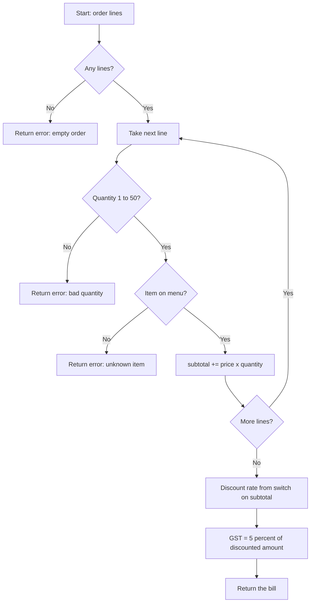
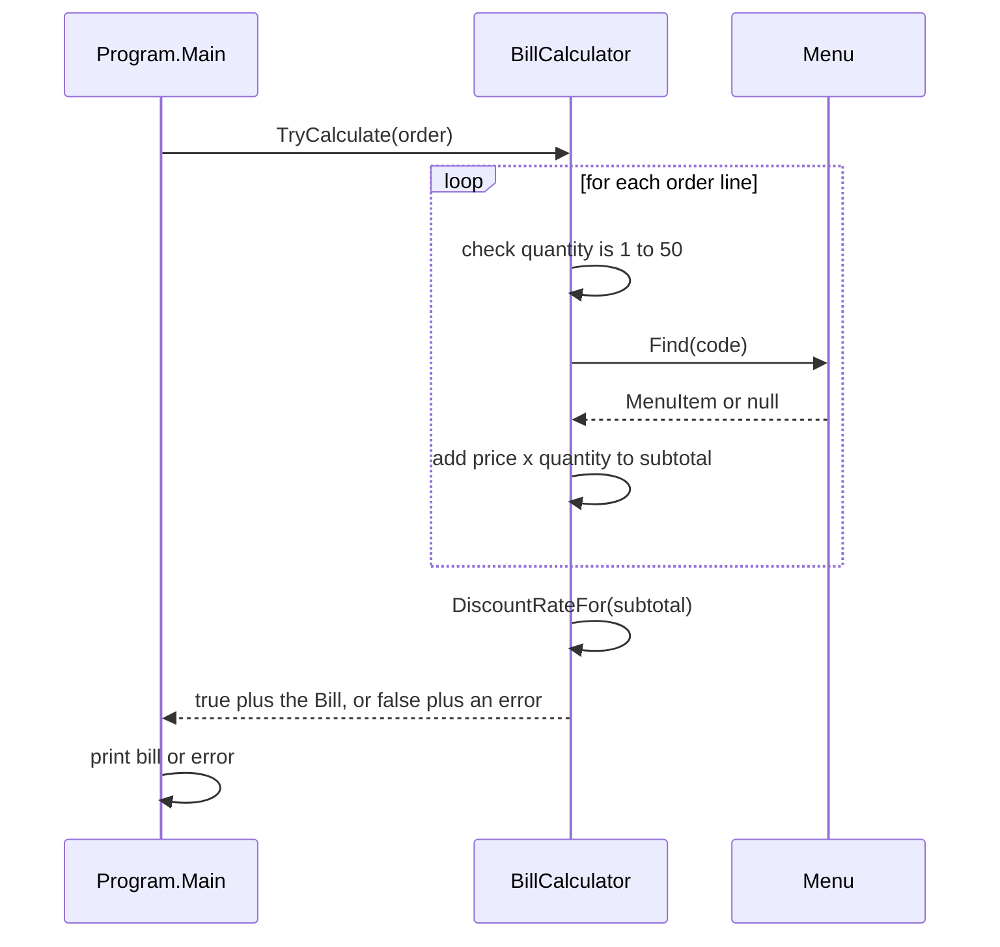

Every program you will ever read, from a 20-line script to a payment system that handles crores of rupees a day, is made of the same five building blocks: **variables** that hold data, **types** that say what kind of data it is, **conditions** that choose between paths, **loops** that repeat work, and **methods** that give a name to a group of steps. This lesson teaches each one slowly, with one running example: the billing counter at a tea stall. At the end you will build a calculator.

## Learning objectives

By the end of this lesson you will be able to:

1. Declare variables with the right type (`int`, `long`, `decimal`, `double`, `bool`, `char`, `string`) and explain why money uses `decimal`.
2. Predict the result of integer division, overflow and type conversion before running the code.
3. Write decisions with `if`/`else`, the `switch` statement and the `switch` expression with patterns.
4. Choose the right loop (`for`, `foreach`, `while`, `do`/`while`) and use `break` and `continue` correctly.
5. Write methods with parameters, return values, overloads, optional parameters and `out` parameters, and follow the `Try...` naming habit.
6. Turn a long block of code into small, named, testable methods.
7. Build a working calculator that rejects bad input politely instead of crashing.

## Prerequisites

- [How a computer executes a program](#/lesson/m01-how-programs-run) is helpful but not required. It explains what happens when you press Run.
- The .NET 10 SDK installed (or use the playground in this lesson, which needs nothing).

You do not need any previous programming experience. If you have used a calculator and followed a recipe, you have the right mental tools.

## Explain it like I'm a beginner

### The tea stall counter

Picture Ramesh, who runs a busy tea stall outside a metro station in Pune. Every order goes through the same routine:

1. He **remembers** things: "this customer wants 2 chai and 1 samosa". Those are pieces of data he keeps in his head for a moment.
2. Each piece of data has a **kind**. "2" is a count of cups (a whole number). "₹15" is money (an exact amount with paise). "Masala chai" is a name (text). "Paid?" is yes or no.
3. He makes **decisions**: "if the bill is over ₹500, give 5 % off". "If it's a coffee, use the other flask."
4. He **repeats** work: for each item in the order, look up the price and add it to the total.
5. He has **routines with names**: "make chai" is the same set of steps every time. Nobody explains it again; they just say "make chai, two cups".

A C# program does exactly these five things:

| Tea stall | C# | Technical term |
|---|---|---|
| Remembering "2 cups" | `int cups = 2;` | variable |
| "This is money, this is a count" | `decimal`, `int`, `string`, `bool` | type |
| "If the bill is over ₹500..." | `if (total > 500m) { ... }` | condition (selection statement) |
| "For each item in the order..." | `foreach (var item in order) { ... }` | loop (iteration statement) |
| "Make chai, two cups" | `MakeChai(2);` | method (function) call |

### Labelled jars

A good picture for a variable is a **labelled jar** on a shelf. The label is the name (`cups`). The jar's shape decides what fits inside: a narrow jar for whole numbers, a jar with a measuring scale for exact money, a jar for text. You can't pour text into the number jar. C# checks this *before* the program runs, which is why it is called a **statically typed** language. Many bugs that would crash a program at 2 a.m. are caught while you type.

### Recipes with blanks

A method is like a recipe card with blanks: "Make ___ cups of chai with ___ sugar". The blanks are **parameters**. When you use the recipe you fill in the blanks (`MakeChai(cups: 2, sugar: "less")`). Some recipes hand something back: "Calculate the bill" gives you a number. That is the **return value**.

## First-principles explanation

### Where a C# program starts

The smallest C# program in .NET 10 is one line in a file:

```csharp
Console.WriteLine("Namaste, world!");
```

This style is called **top-level statements**. The compiler wraps your lines inside a hidden `Main` method for you. In .NET 10 you can even run a single file directly with `dotnet run hello.cs`, without creating a project. In bigger programs (and in this course's exercises) you will see the classic form, which makes the starting point explicit:

```csharp
public static class Program
{
    public static void Main()
    {
        Console.WriteLine("Namaste, world!");
    }
}
```

Both do the same thing. `Main` is the **entry point**: the first method the runtime calls. Every statement ends with a semicolon `;`, and curly braces `{ }` group statements into a **block**.

### Variables: names for data

A variable has a **type**, a **name** and (usually) a **value**:

```csharp
int cups = 2;                 // a whole number
decimal pricePerCup = 15m;    // money: the m suffix means "decimal literal"
string item = "Masala chai";  // text
bool isPaid = false;          // true or false
char size = 'L';              // a single character, in single quotes
```

You can let the compiler work out the type from the value with `var`:

```csharp
var cups = 2;            // the compiler decides: int
var price = 15m;         // decimal
var name = "Poha";       // string
```

`var` is **not** "any type". The variable still has one fixed type; you just didn't write it. `var cups = 2; cups = "two";` does not compile. Use `var` when the type is obvious from the right-hand side, and write the type when it helps the reader.

Two more keywords you will use constantly:

- `const` makes a value fixed at compile time: `const decimal GstRate = 0.05m;`. Use it for numbers that are rules, so they have a name instead of appearing as a mystery `0.05` in ten places.
- **Scope**: a variable exists only inside the block `{ }` where it is declared. A variable declared inside a loop is gone when the loop ends. This is a feature: fewer names to keep in your head.

**Naming conventions** in C#: local variables and parameters use `camelCase` (`pricePerCup`), methods, types and constants use `PascalCase` (`CalculateTotal`, `GstRate`). Choose names that explain meaning: `totalInRupees` beats `t`, and `customerCount` beats `x`.

### The built-in types you need first

| Type | Holds | Example | Size (bytes) | Use it for |
|---|---|---|---|---|
| `int` | whole numbers from about −2.1 billion to +2.1 billion | `42` | 4 | counts, quantities, indexes |
| `long` | whole numbers up to about 9.2 × 10¹⁸ | `9_000_000_000L` | 8 | big counts, file sizes, IDs |
| `decimal` | exact decimal numbers (28–29 significant digits) | `149.99m` | 16 | **money**, anything that must add up exactly |
| `double` | approximate decimal numbers, huge range | `3.14159` | 8 | science, measurements, geometry |
| `bool` | `true` or `false` | `true` | 1 | yes/no facts |
| `char` | one character | `'A'` | 2 | single letters or symbols |
| `string` | text of any length | `"Chai"` | varies | names, messages |

`DateOnly`, `TimeOnly`, `DateTime` and `DateTimeOffset` handle dates and times. You will use them later.

**Why money must be `decimal`.** A `double` stores numbers in base 2, and most decimal fractions (like 0.1) cannot be stored exactly in base 2, just as 1/3 cannot be written exactly in base 10 (0.3333...). So:

```csharp
Console.WriteLine(0.1 + 0.2 == 0.3);     // False: double gives 0.30000000000000004
Console.WriteLine(0.1m + 0.2m == 0.3m);  // True: decimal stores base-10 digits exactly
```

A 4-paise error per bill sounds tiny. Over 10 lakh bills a month it becomes ₹40,000 of money that nobody can explain to an auditor. `decimal` is slower than `double`, but for billing that does not matter.

### Operators and the two classic traps

The usual arithmetic operators are `+ - * /` and `%` (remainder: `17 % 5` is `2`). Comparison operators are `== != < > <= >=`, and logical operators are `&&` (and), `||` (or) and `!` (not).

**Trap 1: integer division.** When both sides of `/` are integers, C# throws away the fraction:

```csharp
int a = 7 / 2;          // 3, not 3.5
double b = 7 / 2;       // still 3! The division happens in int first, then 3 is stored as 3.0
double c = 7 / 2.0;     // 3.5: one side is a double, so the division is done in double
decimal d = 7m / 2;     // 3.5
```

**Trap 2: overflow.** An `int` has a maximum value (2,147,483,647). By default, going past it silently **wraps around** to a large negative number:

```csharp
int big = int.MaxValue;
big = big + 1;          // -2147483648, no error!
```

If you want an error instead, use a `checked` block: `checked { big = big + 1; }` throws an `OverflowException`. Use `long` when numbers can grow large (total paise collected in a year, bytes in a file).

### Converting between types

Converting a smaller type to a bigger one is automatic (an **implicit conversion**), because no information can be lost: `int` → `long`, `int` → `decimal`. Going the other way needs an explicit **cast**, because something might be lost:

```csharp
long population = 1_400_000_000L;
int small = (int)population;   // you take responsibility: this one fits
double rating = 4.7;
int stars = (int)rating;       // 4: a cast to int cuts off the fraction, it does not round
```

Text typed by a user is always a `string`. To turn it into a number, **parse** it. `int.Parse("12")` throws an exception for bad text like `"12a"`. `int.TryParse` does not throw; it tells you whether it worked:

```csharp
if (int.TryParse("12a", out int qty))
    Console.WriteLine($"Quantity is {qty}");
else
    Console.WriteLine("That is not a whole number.");
```

User input is often wrong, so prefer `TryParse` for it. For numbers that use a decimal point, pass `CultureInfo.InvariantCulture`; otherwise a computer set to a European culture may expect `12,5` instead of `12.5`.

### Strings

Strings are text in double quotes. The most useful tool is **string interpolation**: put `$` before the string and expressions inside `{ }`:

```csharp
var cups = 2;
var price = 15m;
Console.WriteLine($"{cups} chai = ₹{cups * price}");      // 2 chai = ₹30
Console.WriteLine($"Total: {1234.5m:N2}");               // Total: 1,234.50
```

Strings are **immutable**: methods like `ToUpper()` or `Trim()` return a *new* string and leave the original alone. `name.Trim();` on its own line does nothing useful. Write `name = name.Trim();`.

Since C# 8, the compiler can warn you about missing values (`null`). `string name` means "always has text"; `string? name` means "might be `null`". Treat those warnings seriously; they prevent the most common crash in .NET, the `NullReferenceException`.

### Conditions: choosing a path

The `if` statement runs a block only when a condition is `true`:

```csharp
decimal subtotal = 620m;
decimal discount;
if (subtotal >= 1000m)
{
    discount = subtotal * 0.10m;
}
else if (subtotal >= 500m)
{
    discount = subtotal * 0.05m;
}
else
{
    discount = 0m;
}
```

Order matters: C# checks from top to bottom and takes the first branch that matches. If you put `>= 500m` first, a ₹1,200 bill would only get 5 %.

When you choose a **value** based on one input, the **switch expression** is shorter and harder to get wrong:

```csharp
decimal rate = subtotal switch
{
    >= 1000m => 0.10m,
    >= 500m  => 0.05m,
    _        => 0m,       // _ means "anything else"
};
```

The `>= 1000m` parts are **relational patterns**. You can also match exact values (`"CHAI" => 15m`), combine patterns with `and`/`or` (`>= 0 and < 40 => "F"`), and the compiler warns you if you forgot a case. The older **switch statement** is still useful when each case *does* something rather than producing a value:

```csharp
switch (command)
{
    case "add":
        AddItem();
        break;
    case "bill":
        PrintBill();
        break;
    default:
        Console.WriteLine("Unknown command");
        break;
}
```

A **guard clause** is an `if` at the top of a method that leaves early when the input is wrong. It keeps the main logic un-indented and easy to read:

```csharp
static decimal LineTotal(decimal price, int quantity)
{
    if (quantity <= 0) return 0m;       // guard clause
    return price * quantity;            // the "happy path"
}
```

### Loops: repeating work

C# has four loops. Pick by asking "what do I know before I start?"

| Loop | Use when | Example |
|---|---|---|
| `for` | you know how many times, or need the index | print table rows 1 to 10 |
| `foreach` | you want every item of a collection | add up each order line |
| `while` | you repeat *until* something changes, and might run zero times | read lines until the user types "exit" |
| `do`/`while` | like `while`, but the body runs at least once | show a menu, then ask again |

```csharp
// for: index from 1 to 10
for (int i = 1; i <= 10; i++)
    Console.WriteLine($"15 x {i} = {15 * i}");

// foreach: every element
decimal[] prices = [15m, 25m, 20m];
decimal total = 0m;
foreach (decimal p in prices)
    total += p;                       // total = total + p

// while: unknown number of repeats
int balance = 100;
int days = 0;
while (balance > 0)
{
    balance -= 15;                    // one chai a day
    days++;
}
```

Two keywords control loops: `break` leaves the loop immediately; `continue` skips to the next round. Use them sparingly; a loop with three `break`s is hard to follow.

The most common loop bug is the **off-by-one error**. An array of 5 items has indexes 0 to 4. `for (int i = 0; i <= prices.Length; i++)` runs 6 times and crashes on `prices[5]`. Prefer `foreach` when you don't need the index; it cannot go out of range.

The second most common bug is the **infinite loop**: a `while` whose condition never becomes false, because you forgot to change the variable inside. If your program "hangs", look for this first.

### Methods: naming a group of steps

A method has a **return type**, a **name**, **parameters** in brackets and a **body**:

```csharp
static decimal ApplyGst(decimal amount, decimal rate)
{
    return amount + amount * rate;
}

decimal withTax = ApplyGst(200m, 0.05m);   // 210
```

`void` means "returns nothing". A one-line method can use an **expression body** with `=>`:

```csharp
static decimal ApplyGst(decimal amount, decimal rate) => amount + amount * rate;
```

Useful method features, from most to least common:

- **Optional parameters** have a default: `ApplyGst(decimal amount, decimal rate = 0.05m)`. Callers may leave `rate` out.
- **Named arguments** make calls readable: `ApplyGst(amount: 200m, rate: 0.18m)`.
- **Overloads** are methods with the same name but different parameters: `Add(int, int)` and `Add(decimal, decimal)`. The compiler picks the one that matches.
- **`out` parameters** let a method hand back an extra value. The `Try...` pattern uses one: `bool TryParse(string text, out int value)` returns `true` or `false` *and* gives you the value.
- **`static`** methods don't need an object. Until the [classes lesson](#/lesson/m01-classes-objects), all your methods will be `static`.

C# passes arguments **by value**: the method receives a copy of each number. Changing the parameter inside the method does not change the caller's variable. (For objects, the copy is of a *reference*. That subtlety is the subject of [value and reference types](#/lesson/m01-value-reference-memory).)

**What makes a good method?**

1. It does **one thing**, and its name says what: `CalculateDiscount`, not `DoStuff` or `Process2`.
2. It is **short enough to read in one go**, roughly 5–30 lines.
3. It gets what it needs through parameters and gives its answer through the return value, rather than reading and changing shared variables. Such a method is called **pure** when it has no side effects. Pure methods are the easiest code in the world to test.
4. It **validates its inputs** at the top (guard clauses) and decides clearly what to do with bad input: return `false`, return a safe default, or throw an exception (see [Exceptions](#/lesson/m01-exceptions)).

### When simpler is better

Beginners sometimes reach for clever tricks too early. A plain `if`/`else` with two branches is clearer than a switch expression with two arms. A `for` loop that a reader understands in 5 seconds beats a one-line LINQ query they must decode. And a 15-line script that runs once does not need ten methods. Split code into methods when it is repeated, when it has a name in the business ("discount", "GST"), or when you want to test it on its own.

## Visual explanation

### How control flows through a bill



This **flowchart** shows the three building blocks working together. Diamonds are **conditions**: each asks a yes/no question, and the program follows exactly one arrow out. The arrow from "More lines?" back to "Take next line" is the **loop**: it repeats once per order line, then exits. The three red-flag exits on the left are **guard clauses**: they stop early with a clear message as soon as something is wrong, so the bottom of the chart only ever sees valid data. The discount step is one switch expression, and GST is a single calculation. When your code gets confusing, drawing it like this is often the fastest way to find the bug.

### Who calls whom



This **sequence diagram** reads top to bottom, like time passing. Each vertical line is a piece of code. A solid arrow is a **method call**; a dashed arrow is the **return value** coming back. `Main` only makes one call; it doesn't know how the bill is calculated. `BillCalculator` loops over the lines and asks `Menu.Find` for each price. The final arrow carries back two things, a `bool` and a bill or error, which is exactly what the `Try...` pattern with `out` parameters does. Small methods that each do one job make this picture simple, and a simple picture means simple code.

## Step-by-step example

We will build the tea stall bill in five steps. Each step is a complete, runnable program.

### Step 1: one long block (it works)

```csharp
int chaiCups = 2;
int samosas = 3;
decimal total = chaiCups * 15m + samosas * 20m;
if (total >= 500m) total = total - total * 0.05m;
total = total + total * 0.05m;
Console.WriteLine($"Pay ₹{total}");
```

It prints `Pay ₹94.50` (the bill is ₹90, under ₹500, so no discount; 5 % GST adds ₹4.50). Fine for a one-off. But the prices ₹15 and ₹20, the 5 % discount and the 5 % GST are **magic numbers**: numbers with no name. Change the GST rate and you must hunt for the right `0.05m` among two identical ones.

### Step 2: name the rules

```csharp
const decimal ChaiPrice = 15m;
const decimal SamosaPrice = 20m;
const decimal GstRate = 0.05m;          // illustrative rate

int chaiCups = 2;
int samosas = 3;
decimal subtotal = chaiCups * ChaiPrice + samosas * SamosaPrice;
decimal gst = subtotal * GstRate;
Console.WriteLine($"Subtotal ₹{subtotal}, GST ₹{gst}, Pay ₹{subtotal + gst}");
```

Now the code says what it means. Also notice we stopped modifying `total` in place: separate variables `subtotal` and `gst` are easier to print and check.

### Step 3: a loop over any number of items

Real orders have any number of lines. We store them in arrays and loop:

```csharp
string[] names = ["Masala chai", "Samosa", "Poha"];
decimal[] prices = [15m, 20m, 40m];
int[] quantities = [2, 3, 1];

decimal subtotal = 0m;
for (int i = 0; i < names.Length; i++)
{
    decimal lineTotal = prices[i] * quantities[i];
    Console.WriteLine($"{names[i],-12} {quantities[i],3} x {prices[i],6:N2} = {lineTotal,8:N2}");
    subtotal += lineTotal;
}
```

`{names[i],-12}` pads text to 12 characters, left-aligned, so the bill lines up in columns. We need the index `i` to look into three arrays at once, which is why this is a `for` and not a `foreach`. (Three parallel arrays are fragile; the next lessons replace them with a `record` type. For now they keep things simple.)

### Step 4: a switch expression for the discount

```csharp
decimal discountRate = subtotal switch
{
    >= 1000m => 0.10m,
    >= 500m  => 0.05m,
    _        => 0m,
};
decimal discount = Math.Round(subtotal * discountRate, 2);
```

Adding a new tier ("₹2,000 and above gets 12 %") is now one new line at the top. Note `Math.Round(..., 2)`: money is rounded to paise once, at a clear point, not at random places.

### Step 5: extract methods

Finally, give each idea its own name:

```csharp
static decimal DiscountRateFor(decimal subtotal) => subtotal switch
{
    >= 1000m => 0.10m,
    >= 500m  => 0.05m,
    _        => 0m,
};

static decimal RoundMoney(decimal amount) =>
    Math.Round(amount, 2, MidpointRounding.AwayFromZero);

static decimal GstOn(decimal amount) => RoundMoney(amount * GstRate);
```

`MidpointRounding.AwayFromZero` rounds ₹2.125 up to ₹2.13, the way people expect on a bill. (The default in .NET is "banker's rounding", which rounds a 5 to the nearest *even* digit, giving ₹2.12. Both are legitimate; choose one on purpose.) Each method is now a single idea you can test in one line: `Assert.Equal(0.05m, DiscountRateFor(620m))`.

## Production-style C# implementation

Here is the same billing logic inside a small ASP.NET Core web API, the kind of service a point-of-sale tablet would call. Don't worry about `WebApplication` or `MapPost` yet; later lessons explain them. Focus on the variables, conditions, loops and methods inside `BillCalculator`.

```text
TeaStall.Api/
  Program.cs                 // starts the web app, maps URLs to methods
  Billing/
    MenuItem.cs              // what one menu item looks like
    Menu.cs                  // the list of items and a Find method
    BillCalculator.cs        // the rules: loop, validate, discount, GST
    Requests.cs              // shape of the incoming JSON
```

```csharp file=Billing/MenuItem.cs
namespace TeaStall.Api.Billing;

/// <summary>A small fixed set of choices is an enum: the compiler stops typos like "Snak".</summary>
public enum Category { Drink, Snack, Meal }

/// <summary>A record is a compact type for data. Covered properly in the classes and constructors lessons.</summary>
public sealed record MenuItem(string Code, string Name, Category Category, decimal Price);
```

```csharp file=Billing/Menu.cs
namespace TeaStall.Api.Billing;

/// <summary>Illustrative prices. A real stall would load these from a database.</summary>
public static class Menu
{
    private static readonly MenuItem[] s_items =
    [
        new MenuItem("CHAI", "Masala chai", Category.Drink, 15m),
        new MenuItem("COFFEE", "Filter coffee", Category.Drink, 25m),
        new MenuItem("SAMOSA", "Samosa", Category.Snack, 20m),
        new MenuItem("VADAPAV", "Vada pav", Category.Snack, 25m),
        new MenuItem("POHA", "Poha", Category.Meal, 40m),
    ];

    public static IReadOnlyList<MenuItem> Items => s_items;

    /// <summary>A plain foreach search. With 5 items this is instant; see the Big O lesson for 5 lakh.</summary>
    public static MenuItem? Find(string? code)
    {
        if (string.IsNullOrWhiteSpace(code)) return null;
        foreach (var item in s_items)
        {
            if (string.Equals(item.Code, code.Trim(), StringComparison.OrdinalIgnoreCase))
                return item;
        }
        return null;
    }
}
```

```csharp file=Billing/BillCalculator.cs
namespace TeaStall.Api.Billing;

public sealed record BillLine(string Name, int Quantity, decimal UnitPrice, decimal LineTotal);

public sealed record Bill(
    IReadOnlyList<BillLine> Lines,
    decimal Subtotal,
    decimal DiscountRate,
    decimal Discount,
    decimal Gst,
    decimal Total);

/// <summary>Pure calculation: no database, no clock, no console. Same input, same output.</summary>
public static class BillCalculator
{
    public const decimal GstRate = 0.05m;        // illustrative; check current GST rules for real billing
    public const int MaxQuantityPerLine = 50;

    /// <summary>Returns false with a readable error instead of throwing, because bad orders are normal.</summary>
    public static bool TryCalculate(IReadOnlyList<OrderLine>? order, out Bill? bill, out string? error)
    {
        bill = null;

        if (order is null || order.Count == 0)
        {
            error = "The order is empty.";
            return false;
        }

        var lines = new List<BillLine>();
        decimal subtotal = 0m;

        for (int i = 0; i < order.Count; i++)
        {
            OrderLine line = order[i];

            if (line.Quantity is < 1 or > MaxQuantityPerLine)
            {
                error = $"Line {i + 1}: quantity must be between 1 and {MaxQuantityPerLine}.";
                return false;
            }

            MenuItem? item = Menu.Find(line.Code);
            if (item is null)
            {
                error = $"Line {i + 1}: '{line.Code}' is not on the menu.";
                return false;
            }

            decimal lineTotal = item.Price * line.Quantity;
            lines.Add(new BillLine(item.Name, line.Quantity, item.Price, lineTotal));
            subtotal += lineTotal;
        }

        decimal rate = DiscountRateFor(subtotal);
        decimal discount = RoundMoney(subtotal * rate);
        decimal gst = RoundMoney((subtotal - discount) * GstRate);

        bill = new Bill(lines, subtotal, rate, discount, gst, subtotal - discount + gst);
        error = null;
        return true;
    }

    public static decimal DiscountRateFor(decimal subtotal) => subtotal switch
    {
        < 0m => throw new ArgumentOutOfRangeException(nameof(subtotal)),
        >= 1000m => 0.10m,
        >= 500m => 0.05m,
        _ => 0m,
    };

    public static decimal RoundMoney(decimal amount) =>
        Math.Round(amount, 2, MidpointRounding.AwayFromZero);
}
```

```csharp file=Billing/Requests.cs
namespace TeaStall.Api.Billing;

public sealed record OrderLine(string Code, int Quantity);
public sealed record OrderRequest(IReadOnlyList<OrderLine>? Lines);
```

```csharp file=Program.cs
using TeaStall.Api.Billing;

var builder = WebApplication.CreateBuilder(args);
var app = builder.Build();

app.MapGet("/menu", () => Results.Ok(Menu.Items));

app.MapPost("/bills", (OrderRequest request) =>
    BillCalculator.TryCalculate(request.Lines, out var bill, out var error)
        ? Results.Ok(bill)
        : Results.Problem(error, statusCode: 400));

app.Run();
```

What to notice:

- **Every rule has a name.** `GstRate`, `MaxQuantityPerLine` and `DiscountRateFor` are the only places those rules live. Change the GST rate and one line changes.
- **Guard clauses come first.** Empty order, bad quantity and unknown item all leave early with a message that tells the cashier *which line* is wrong. `line.Quantity is < 1 or > MaxQuantityPerLine` is a pattern that reads almost like English.
- **The calculator is pure.** It does not print, read files or check the time. That makes it trivial to test, and safe to call from many web requests at once.
- **Errors are returned, not thrown.** A typo in an item code is an everyday event, so `TryCalculate` returns `false`. A *negative* subtotal can only come from a bug, so `DiscountRateFor` throws. The [exceptions lesson](#/lesson/m01-exceptions) explains this split in detail.
- **Rounding happens in one helper.** If the accountant asks for banker's rounding, you change `RoundMoney` and nothing else.
- **Limits.** The menu is a hard-coded static array, so changing a price means redeploying. That is a fine trade-off for a first version and a bad one for a chain of 300 stalls, where prices belong in a database.

## Bad design vs good design

**Bad**: one giant block, deep nesting, magic numbers, `double` for money and silent failure.

```csharp
static double Bill(string[] c, int[] q)
{
    double t = 0;
    for (int i = 0; i <= c.Length - 1; i++)
    {
        if (c[i] == "CHAI") { t = t + 15 * q[i]; }
        else
        {
            if (c[i] == "SAMOSA") { t = t + 20 * q[i]; }
            else
            {
                if (c[i] == "POHA") { t = t + 40 * q[i]; }
            }
        }
    }
    if (t > 500) { t = t - t * 0.05; }
    t = t + t * 0.05;
    return t;
}
```

Problems, in order of how much they will hurt:

1. **Unknown items are silently ignored.** Order "chai" in lower case, or "COFEE" with a typo, and the customer gets it free. No error, no log.
2. **Negative quantities subtract money.** `q[i] = -10` gives a refund at the counter.
3. **`double` for money.** Totals will drift by fractions of a paisa and fail to match the accounting system.
4. **Magic numbers.** Two different `0.05`s mean two different things (discount and GST). Which one do you change when GST changes?
5. **The arrow shape.** Each new menu item adds another level of nesting. Ten items means ten levels.
6. **Names like `t`, `c`, `q`.** A reader must decode them every time.
7. **`> 500` vs `>= 500`.** Is a bill of exactly ₹500 discounted? The code says no; the sign at the counter may say yes. Edge cases need a decision written down, ideally as a test.

**Good**: the `BillCalculator` above. Lookup happens in one method that returns `null` for unknown items, every line is validated, money is `decimal`, rules have names, the discount is a flat switch expression, and errors say exactly what went wrong.

**Is the improvement always worth it?** For a 10-line script you run once to add up last week's sales, the "bad" style is acceptable, apart from using `double` for money, which is never acceptable. The good design pays off as soon as the code is run by other people, changed more than once, or handles real money.

:::callout type=mistake title="Deep nesting is a smell, not a style"
If your code drifts to the right like an arrow, flip conditions into guard clauses (`if (bad) return ...;`), replace if-else chains on one value with a switch, and move inner blocks into named methods. Each of these keeps the "happy path" at the left margin.
:::

## Practical playground

Run the program, then try the experiments at the bottom. Predict each output *before* you run it. Being wrong in the playground is cheap; being wrong in production is not.

:::playground type=csharp title="Types, decisions, loops and methods"
```csharp file=Program.cs
using System;
using System.Globalization;

public static class Program
{
    const decimal GstRate = 0.05m;

    public static void Main()
    {
        // 1. Types and the two classic traps
        Console.WriteLine($"7 / 2       = {7 / 2}");
        Console.WriteLine($"7 / 2.0     = {7 / 2.0}");
        Console.WriteLine($"0.1 + 0.2 == 0.3 (double)?  {0.1 + 0.2 == 0.3}");
        Console.WriteLine($"0.1 + 0.2 == 0.3 (decimal)? {0.1m + 0.2m == 0.3m}");
        int big = int.MaxValue;
        big++;
        Console.WriteLine($"int.MaxValue + 1 = {big}");

        // 2. Parsing user input safely
        string[] inputs = ["12", "12a", " 7 ", "-3"];
        foreach (string text in inputs)
        {
            if (int.TryParse(text, NumberStyles.Integer, CultureInfo.InvariantCulture, out int qty) && qty > 0)
                Console.WriteLine($"'{text}' -> quantity {qty}");
            else
                Console.WriteLine($"'{text}' -> rejected");
        }

        // 3. A loop, a switch expression and small methods
        string[] names = ["Masala chai", "Samosa", "Poha"];
        decimal[] prices = [15m, 20m, 40m];
        int[] quantities = [10, 12, 4];

        decimal subtotal = 0m;
        for (int i = 0; i < names.Length; i++)
        {
            decimal line = prices[i] * quantities[i];
            Console.WriteLine($"{names[i],-12} {quantities[i],3} x {prices[i],6:N2} = {line,8:N2}");
            subtotal += line;
        }

        decimal rate = DiscountRateFor(subtotal);
        decimal discount = RoundMoney(subtotal * rate);
        decimal gst = RoundMoney((subtotal - discount) * GstRate);
        Console.WriteLine($"Subtotal {subtotal:N2}, discount {rate:P0} = {discount:N2}, GST {gst:N2}");
        Console.WriteLine($"Total to pay: {subtotal - discount + gst:N2}");

        // 4. A while loop: how many days does a 500 rupee wallet last at 2 chai a day?
        decimal wallet = 500m;
        int days = 0;
        while (wallet >= 2 * prices[0])
        {
            wallet -= 2 * prices[0];
            days++;
        }
        Console.WriteLine($"Wallet lasts {days} days, {wallet} left over");

        // Experiments:
        // 1. Change quantities so the subtotal is exactly 500. Is the discount applied? Should it be?
        // 2. Change "i < names.Length" to "i <= names.Length". What happens, and why?
        // 3. Wrap "big++" in checked { ... }. What changes?
        // 4. Add a 2000 and above tier with 12 percent to DiscountRateFor. Where must it go, and why?
        // 5. Change MidpointRounding.AwayFromZero to ToEven and round 2.125m. What do you get?
    }

    static decimal DiscountRateFor(decimal subtotal) => subtotal switch
    {
        >= 1000m => 0.10m,
        >= 500m => 0.05m,
        _ => 0m,
    };

    static decimal RoundMoney(decimal amount) => Math.Round(amount, 2, MidpointRounding.AwayFromZero);
}
```
:::

## Exercises

:::exercise id=m01-csharp-basics-ex1 difficulty=beginner kind=code title="Marks to grades"
A coaching centre in Kota wants a tiny helper to grade test results. Write three static methods on `GradeBook`.
::requirements
- `GradeFor(int marks)` returns `"A"` for 90–100, `"B"` for 75–89, `"C"` for 60–74, `"D"` for 40–59 and `"F"` for 0–39. Marks below 0 or above 100 throw `ArgumentOutOfRangeException`.
- `CountPassed(int[] marks)` returns how many marks are 40 or more.
- `Average(int[] marks)` returns the average as a `double`. An empty array returns 0.
::acceptance
- `GradeFor(90)` is "A", `GradeFor(89)` is "B", `GradeFor(40)` is "D", `GradeFor(39)` is "F".
- `GradeFor(101)` and `GradeFor(-1)` throw `ArgumentOutOfRangeException`.
- `CountPassed([35, 40, 72, 99])` is 3.
- `Average([70, 75])` is 72.5, not 72.
- `Average([])` is 0.
::hint
Each method needs a different building block. Which one needs a decision? Which ones need a loop?
::hint
For `GradeFor`, a switch expression with relational patterns reads like the grade table itself. Check the "out of range" cases first.
::hint
For `Average`, watch out for integer division: `sum / marks.Length` with two `int`s throws away the .5.
::hint
```csharp
public static string GradeFor(int marks) => marks switch
{
    < 0 or > 100 => throw new ArgumentOutOfRangeException(nameof(marks)),
    >= 90 => "A",
    // ... the other bands, highest first
    _ => "F",
};
```
::starter
```csharp file=GradeBook.cs
using System;

public static class GradeBook
{
    public const int PassMark = 40;

    public static string GradeFor(int marks) => throw new NotImplementedException();

    public static int CountPassed(int[] marks) => throw new NotImplementedException();

    public static double Average(int[] marks) => throw new NotImplementedException();
}
```
::tests
```csharp file=GradeBookTests.cs
using System;
using Xunit;

public class GradeBookTests
{
    [Theory]
    [InlineData(100, "A")]
    [InlineData(90, "A")]
    [InlineData(89, "B")]
    [InlineData(75, "B")]
    [InlineData(74, "C")]
    [InlineData(60, "C")]
    [InlineData(59, "D")]
    [InlineData(40, "D")]
    [InlineData(39, "F")]
    [InlineData(0, "F")]
    public void Grade_bands(int marks, string expected) => Assert.Equal(expected, GradeBook.GradeFor(marks));

    [Theory]
    [InlineData(-1)]
    [InlineData(101)]
    public void Out_of_range_throws(int marks) =>
        Assert.Throws<ArgumentOutOfRangeException>(() => GradeBook.GradeFor(marks));

    [Fact]
    public void Counts_passes() => Assert.Equal(3, GradeBook.CountPassed(new[] { 35, 40, 72, 99 }));

    [Fact]
    public void Average_keeps_fraction() => Assert.Equal(72.5, GradeBook.Average(new[] { 70, 75 }), 3);

    [Fact]
    public void Average_of_empty_is_zero() => Assert.Equal(0.0, GradeBook.Average(Array.Empty<int>()), 3);
}
```
::solution
Each method uses one building block: a switch expression for the decision, and a `foreach` loop for counting and summing.

```csharp file=GradeBook.cs
using System;

public static class GradeBook
{
    public const int PassMark = 40;

    public static string GradeFor(int marks) => marks switch
    {
        < 0 or > 100 => throw new ArgumentOutOfRangeException(nameof(marks), "Marks must be between 0 and 100."),
        >= 90 => "A",
        >= 75 => "B",
        >= 60 => "C",
        >= PassMark => "D",
        _ => "F",
    };

    public static int CountPassed(int[] marks)
    {
        int count = 0;
        foreach (int m in marks)
        {
            if (m >= PassMark) count++;
        }
        return count;
    }

    public static double Average(int[] marks)
    {
        if (marks.Length == 0) return 0;     // guard clause: avoids dividing by zero
        long sum = 0;                         // long: thousands of marks cannot overflow
        foreach (int m in marks) sum += m;
        return (double)sum / marks.Length;
    }
}
```

The switch arms are checked top to bottom, so the out-of-range arm must come first, and each band only needs its lower limit. `(double)sum` converts *before* dividing, which keeps the fraction.
::alternatives
LINQ can do the loops in one line: `marks.Count(m => m >= PassMark)` and `marks.Average()`. Note that `Average()` on an empty array throws `InvalidOperationException`, so you would still need the guard. Learn the loop first; it is what LINQ does underneath.
::mistakes
- Putting `>= 40` before `>= 90` in the switch, so every passing mark becomes "D".
- `return sum / marks.Length;` with an `int` sum: 145 / 2 gives 72, not 72.5.
- Forgetting the empty-array case, which throws `DivideByZeroException` for integers or returns `NaN` for doubles.
- Using `> 40` instead of `>= 40`, so a student with exactly 40 fails.
::extensions
Add `Highest(int[] marks)` and `Lowest(int[] marks)` in a single loop. Add a "distinction" flag for marks of 75 or more in every subject.
:::

:::exercise id=m01-csharp-basics-ex2 difficulty=beginner kind=code title="A four-function calculator"
Build the core of a calculator: one method that takes two numbers and an operator symbol and returns the answer.
::requirements
- `Calculator.Calculate(decimal left, char op, decimal right)` supports `+`, `-`, `*`, `/` and `%` (remainder).
- Dividing (or taking the remainder) by zero throws `DivideByZeroException` with a friendly message.
- Any other operator throws `ArgumentException`.
- `Calculator.IsSupported(char op)` returns `true` for the five operators and `false` otherwise.
::acceptance
- `Calculate(12m, '+', 3m)` is 15, `Calculate(12m, '-', 30m)` is −18, `Calculate(2.5m, '*', 4m)` is 10.
- `Calculate(10m, '/', 4m)` is 2.5 (not 2).
- `Calculate(17m, '%', 5m)` is 2.
- `Calculate(1m, '/', 0m)` throws `DivideByZeroException`.
- `Calculate(2m, '^', 3m)` throws `ArgumentException`.
::hint
The method chooses one of five calculations based on a single `char`. Which building block is designed for "one value, many cases"?
::hint
A switch expression on `op` with one arm per operator, and `_ => throw new ArgumentException(...)` for anything else.
::hint
Check for zero before dividing so you control the message. `decimal` division by zero would throw anyway, but with a less helpful text.
::hint
```csharp
return op switch
{
    '+' => left + right,
    '/' => right == 0m ? throw new DivideByZeroException("Cannot divide by zero.") : left / right,
    // ...
    _ => throw new ArgumentException($"Unsupported operator '{op}'.", nameof(op)),
};
```
::starter
```csharp file=Calculator.cs
using System;

public static class Calculator
{
    public static decimal Calculate(decimal left, char op, decimal right) => throw new NotImplementedException();

    public static bool IsSupported(char op) => throw new NotImplementedException();
}
```
::tests
```csharp file=CalculatorTests.cs
using System;
using Xunit;

public class CalculatorTests
{
    [Fact] public void Adds() => Assert.Equal(15m, Calculator.Calculate(12m, '+', 3m));
    [Fact] public void Subtracts_into_negative() => Assert.Equal(-18m, Calculator.Calculate(12m, '-', 30m));
    [Fact] public void Multiplies_decimals() => Assert.Equal(10m, Calculator.Calculate(2.5m, '*', 4m));
    [Fact] public void Divides_keeping_fraction() => Assert.Equal(2.5m, Calculator.Calculate(10m, '/', 4m));
    [Fact] public void Remainder() => Assert.Equal(2m, Calculator.Calculate(17m, '%', 5m));

    [Fact]
    public void Divide_by_zero_throws() =>
        Assert.Throws<DivideByZeroException>(() => Calculator.Calculate(1m, '/', 0m));

    [Fact]
    public void Remainder_by_zero_throws() =>
        Assert.Throws<DivideByZeroException>(() => Calculator.Calculate(1m, '%', 0m));

    [Fact]
    public void Unknown_operator_throws() =>
        Assert.Throws<ArgumentException>(() => Calculator.Calculate(2m, '^', 3m));

    [Theory]
    [InlineData('+', true)]
    [InlineData('%', true)]
    [InlineData('^', false)]
    [InlineData('x', false)]
    public void Supported_operators(char op, bool expected) => Assert.Equal(expected, Calculator.IsSupported(op));
}
```
::solution
```csharp file=Calculator.cs
using System;

public static class Calculator
{
    public static decimal Calculate(decimal left, char op, decimal right) => op switch
    {
        '+' => left + right,
        '-' => left - right,
        '*' => left * right,
        '/' => right == 0m ? throw new DivideByZeroException("Cannot divide by zero.") : left / right,
        '%' => right == 0m ? throw new DivideByZeroException("Cannot take a remainder by zero.") : left % right,
        _ => throw new ArgumentException($"Unsupported operator '{op}'. Use + - * / or %.", nameof(op)),
    };

    public static bool IsSupported(char op) => op is '+' or '-' or '*' or '/' or '%';
}
```

`decimal` is used so that `0.1 + 0.2` shows `0.3` on screen, exactly as a person expects from a calculator. The switch expression makes each operator one line, and the compiler forces a default arm, so an unknown operator can never fall through silently.
::alternatives
A `switch` statement with `case '+': return left + right;` works the same. A `Dictionary<char, Func<decimal, decimal, decimal>>` lets you add operators without touching the method. That idea grows into the [Strategy pattern](#/lesson/m06-strategy), but is overkill for five operators.
::mistakes
- Using `int` or `double`. `int` loses fractions (`10 / 4 = 2`); `double` shows `0.30000000000000004`.
- Returning 0 for division by zero. A wrong answer that looks right is worse than a clear error.
- Forgetting `%` by zero, which is also a division.
- Comparing with `"+"` (a string) instead of `'+'` (a char): the code will not compile, which is the compiler helping you.
::extensions
Add `^` for powers using a loop (whole-number exponents only) and `s` for square root. Decide what to do with the square root of a negative number.
:::

:::exercise id=m01-csharp-basics-ex3 difficulty=intermediate kind=code title="A calculator that reads a typed line"
Users don't call methods; they type text like `12.5 * 4`. Write `LineCalculator.TryEvaluate` that reads such a line and never crashes on bad input.
::requirements
- Input has the form `number operator number`, with one or more spaces between the parts and possibly spaces at the ends.
- Numbers use a `.` as the decimal point, whatever the computer's culture, and may be negative (`-3`).
- Supported operators: `+ - * / %`.
- On success: return `true`, put the answer in `result` and set `error` to an empty string.
- On failure: return `false`, set `result` to 0 and put a helpful message in `error`. Failures: null or blank input, wrong number of parts, a part that is not a number (message contains "number"), an unknown operator (message contains "operator"), division or remainder by zero (message contains "zero").
::acceptance
- `"12.5 * 4"` gives `true` and 50.
- `"  7   -  10 "` gives `true` and −3.
- `"-3 + 5"` gives 2.
- `""`, `"5 +"` and `"1 + 2 + 3"` give `false`.
- `"abc + 1"` gives `false` and an error containing "number".
- `"3 ^ 2"` gives `false` and an error containing "operator".
- `"8 / 0"` gives `false` and an error containing "zero". No exception escapes.
::hint
Break the problem into steps: check for blank input, split into parts, check the count, parse the two numbers, check the operator, check for zero, then calculate. Each step is a guard clause that can return `false`.
::hint
`input.Split(' ', StringSplitOptions.RemoveEmptyEntries)` turns `"  7   -  10 "` into `["7", "-", "10"]`.
::hint
Use `decimal.TryParse(text, NumberStyles.Number, CultureInfo.InvariantCulture, out var value)` so that `12.5` parses the same on every machine.
::hint
An `out` parameter must be assigned on *every* path before the method returns. Assigning `result = 0m;` on the first line saves you from repeating it in each failure branch.
::hint
```csharp
var parts = input.Split(' ', StringSplitOptions.RemoveEmptyEntries);
if (parts.Length != 3) return Fail("Use the form: number operator number, e.g. 12 + 3.", out error);
if (!decimal.TryParse(parts[0], NumberStyles.Number, CultureInfo.InvariantCulture, out var left))
    return Fail($"'{parts[0]}' is not a number.", out error);
```
::starter
```csharp file=LineCalculator.cs
using System;
using System.Globalization;

public static class LineCalculator
{
    public static bool TryEvaluate(string? input, out decimal result, out string error) =>
        throw new NotImplementedException();
}
```
::tests
```csharp file=LineCalculatorTests.cs
using System;
using Xunit;

public class LineCalculatorTests
{
    [Fact]
    public void Multiplies_decimal()
    {
        Assert.True(LineCalculator.TryEvaluate("12.5 * 4", out var r, out var e));
        Assert.Equal(50m, r);
        Assert.Equal("", e);
    }

    [Fact]
    public void Tolerates_extra_spaces()
    {
        Assert.True(LineCalculator.TryEvaluate("  7   -  10 ", out var r, out _));
        Assert.Equal(-3m, r);
    }

    [Fact]
    public void Negative_numbers()
    {
        Assert.True(LineCalculator.TryEvaluate("-3 + 5", out var r, out _));
        Assert.Equal(2m, r);
    }

    [Theory]
    [InlineData("")]
    [InlineData("   ")]
    [InlineData("5 +")]
    [InlineData("1 + 2 + 3")]
    public void Wrong_shape_fails(string input)
    {
        Assert.False(LineCalculator.TryEvaluate(input, out var r, out var e));
        Assert.Equal(0m, r);
        Assert.NotEqual("", e);
    }

    [Fact]
    public void Null_fails() => Assert.False(LineCalculator.TryEvaluate(null, out _, out _));

    [Fact]
    public void Bad_number_fails()
    {
        Assert.False(LineCalculator.TryEvaluate("abc + 1", out _, out var e));
        Assert.Contains("number", e);
    }

    [Fact]
    public void Bad_operator_fails()
    {
        Assert.False(LineCalculator.TryEvaluate("3 ^ 2", out _, out var e));
        Assert.Contains("operator", e);
    }

    [Theory]
    [InlineData("8 / 0")]
    [InlineData("8 % 0")]
    public void Division_by_zero_fails(string input)
    {
        Assert.False(LineCalculator.TryEvaluate(input, out _, out var e));
        Assert.Contains("zero", e);
    }
}
```
::solution
The method is a list of guard clauses followed by one calculation. A small helper, `Fail`, keeps each failure to one line.

```csharp file=LineCalculator.cs
using System;
using System.Globalization;

public static class LineCalculator
{
    public static bool TryEvaluate(string? input, out decimal result, out string error)
    {
        result = 0m;

        if (string.IsNullOrWhiteSpace(input))
            return Fail("Please type a sum such as 12 + 3.", out error);

        string[] parts = input.Split(' ', StringSplitOptions.RemoveEmptyEntries);
        if (parts.Length != 3)
            return Fail("Use the form: number operator number, e.g. 12 + 3.", out error);

        if (!TryReadNumber(parts[0], out decimal left))
            return Fail($"'{parts[0]}' is not a number.", out error);
        if (!TryReadNumber(parts[2], out decimal right))
            return Fail($"'{parts[2]}' is not a number.", out error);

        if (parts[1].Length != 1 || !IsSupported(parts[1][0]))
            return Fail($"Unknown operator '{parts[1]}'. Use + - * / or %.", out error);

        char op = parts[1][0];
        if ((op == '/' || op == '%') && right == 0m)
            return Fail("Cannot divide by zero.", out error);

        result = op switch
        {
            '+' => left + right,
            '-' => left - right,
            '*' => left * right,
            '/' => left / right,
            _ => left % right,
        };
        error = "";
        return true;
    }

    private static bool TryReadNumber(string text, out decimal value) =>
        decimal.TryParse(text, NumberStyles.Number, CultureInfo.InvariantCulture, out value);

    private static bool IsSupported(char op) => op is '+' or '-' or '*' or '/' or '%';

    private static bool Fail(string message, out string error)
    {
        error = message;
        return false;
    }
}
```

The order of checks matters: shape first, then numbers, then operator, then zero. Each message tells the user what to fix. No path can throw: `Split` and `TryParse` never throw on ordinary text, and division happens only after the zero check.
::alternatives
Returning a small record such as `CalcResult(bool Ok, decimal Value, string Error)` avoids `out` parameters and is easier to extend. The [Result pattern](#/lesson/m06-options-result) lesson develops that idea. Throwing `FormatException` would also work, but typing mistakes are normal, so a `bool` result is friendlier.
::mistakes
- Splitting on a single space without `RemoveEmptyEntries`, so `"7   - 10"` yields empty parts and fails.
- Using `decimal.Parse`, which throws on `"abc"` and crashes the app.
- Leaving `result` unassigned on a failure path: the compiler rejects it, which is the point of `out`.
- Parsing with the current culture, so the code works on your laptop and fails on a server set to German.
::extensions
Accept input without spaces (`12*4`) by scanning characters instead of splitting. Keep a running "memory" so `+ 5` adds to the last answer.
:::

:::exercise id=m01-csharp-basics-ex4 difficulty=intermediate kind=written title="Predict the output"
Without running it, write down what each line prints, and explain *why* in one sentence each. Then run it in the playground and compare.

```csharp
int a = 7 / 2;
double b = 7 / 2;
double c = 7 / 2.0;
int big = int.MaxValue;
big = big + 1;
Console.WriteLine($"{a} {b} {c} {big}");

Console.WriteLine(0.1 + 0.2 == 0.3);
Console.WriteLine(0.1m + 0.2m == 0.3m);

for (int i = 0; i <= 3; i++) Console.Write(i);
Console.WriteLine();

Console.WriteLine("5" + 3);
Console.WriteLine("5".Length + 3);
Console.WriteLine((int)4.99);

string name = "  Asha ";
name.Trim();
Console.WriteLine($"[{name}]");
```
::acceptance
- An output and a one-sentence reason for each of the 9 printed lines.
- The reasons name the concept: integer division, implicit conversion, overflow, binary floating point, loop bounds, string concatenation, truncating cast, string immutability.
- After running, a note on any line you got wrong and what you now understand.
::hint
For each line, first ask "what *type* is each part?" The type decides the operation.
::hint
`7 / 2` is computed before it is stored. Storing an `int` result in a `double` cannot bring back a fraction that was already thrown away.
::hint
`+` between a string and a number means "join as text". `.Length` is an `int`, so `"5".Length + 3` is arithmetic.
::hint
Strings never change in place. A method like `Trim()` hands you a new string; if you ignore the return value, nothing happens.
::solution
| Line | Output | Why |
|---|---|---|
| 1 | `3 3 3.5 -2147483648` | `7 / 2` is integer division (3). For `b` the int 3 is converted to 3.0 after dividing. `7 / 2.0` is double division. `int.MaxValue + 1` wraps around because arithmetic is unchecked by default. |
| 2 | `False` | `double` is base 2, so 0.1 and 0.2 are approximations whose sum is 0.30000000000000004. |
| 3 | `True` | `decimal` stores base-10 digits exactly. |
| 4 | `0123` | `<= 3` includes 3, so the loop runs 4 times, not 3. |
| 5 | `53` | `string + int` converts 3 to text and joins. |
| 6 | `4` | `"5".Length` is the int 1, plus 3. |
| 7 | `4` | Casting a double to int truncates (cuts off) the fraction, it does not round. Use `Math.Round` to round. |
| 8 | `[  Asha ]` | `Trim()` returns a new string, which was discarded. Write `name = name.Trim();`. |

The pattern behind most of these: **the type of the operands decides the operation**, and the compiler does exactly what the types say, not what you meant.
::mistakes
- Answering `3.5` for `b`. The division already happened in `int`.
- Expecting an exception on overflow. Only `checked` code throws.
- Counting the loop as 3 iterations.
- Expecting `(int)4.99` to be 5.
:::

:::exercise id=m01-csharp-basics-ex5 difficulty=advanced kind=code title="A calculator with precedence and brackets"
A real calculator knows that `2 + 3 * 4` is 14, not 20, and that brackets come first. Build `ExpressionCalculator.Evaluate(string expression)` that handles whole expressions.
::requirements
- Supports `+ - * /`, brackets `( )`, decimal numbers with `.`, unary minus (`-3`, `-(2 + 1)`) and any spaces.
- Normal precedence: `*` and `/` before `+` and `-`. Operators of the same level work left to right: `8 - 3 - 2` is 3.
- Invalid input (empty text, a missing number, a missing `)`, leftover characters such as `2 3`, a malformed number like `1.2.3`) throws `FormatException`.
- Division by zero throws `DivideByZeroException`.
::acceptance
- `"2 + 3 * 4"` is 14 and `"(2 + 3) * 4"` is 20.
- `"10 / 4"` is 2.5, `"8 - 3 - 2"` is 3, `"100 / 8 / 5"` is 2.5.
- `"-3 + 5"` is 2 and `"2 * (3 + (4 - 1))"` is 12.
- `""`, `"2 +"`, `"(1 + 2"`, `"2 3"` and `"1.2.3 + 1"` throw `FormatException`.
- `"1 / (2 - 2)"` throws `DivideByZeroException`.
::hint
Think in layers. An *expression* is terms joined by `+` or `-`. A *term* is factors joined by `*` or `/`. A *factor* is a number, a bracketed expression, or a minus sign followed by a factor.
::hint
Write one method per layer: `ParseExpression`, `ParseTerm`, `ParseFactor`. Each one calls the layer below it. Because `ParseExpression` only sees `+` and `-` *after* `ParseTerm` has already consumed `*` and `/`, precedence falls out automatically. This technique is called **recursive descent**.
::hint
Keep the text and a position index (`_pos`) in a small private class. Each method reads characters at `_pos` and moves it forward. A helper `SkipSpaces()` steps over whitespace.
::hint
Pseudocode for the middle layer:
```text
ParseTerm:
  value = ParseFactor()
  loop:
    skip spaces
    if next char is not * or / : return value
    consume operator
    right = ParseFactor()
    if operator is / and right is 0 : throw DivideByZeroException
    value = value op right
```
::hint
`ParseFactor`:
```csharp
if (c == '-') { _pos++; return -ParseFactor(); }
if (c == '(')
{
    _pos++;
    decimal inner = ParseExpression();
    SkipSpaces();
    if (AtEnd || _text[_pos] != ')') throw new FormatException("Missing closing bracket.");
    _pos++;
    return inner;
}
// otherwise read digits and dots, then decimal.TryParse with InvariantCulture
```
After the top-level `ParseExpression`, skip spaces and throw if any characters are left.
::starter
```csharp file=ExpressionCalculator.cs
using System;
using System.Globalization;

public static class ExpressionCalculator
{
    public static decimal Evaluate(string expression) => throw new NotImplementedException();
}
```
::tests
```csharp file=ExpressionCalculatorTests.cs
using System;
using Xunit;

public class ExpressionCalculatorTests
{
    [Theory]
    [InlineData("2 + 3 * 4", 14.0)]
    [InlineData("(2 + 3) * 4", 20.0)]
    [InlineData("10 / 4", 2.5)]
    [InlineData("8 - 3 - 2", 3.0)]
    [InlineData("100 / 8 / 5", 2.5)]
    [InlineData("-3 + 5", 2.0)]
    [InlineData("2 * (3 + (4 - 1))", 12.0)]
    [InlineData("  1.5*2  ", 3.0)]
    [InlineData("-(2 + 1) * 2", -6.0)]
    [InlineData("42", 42.0)]
    public void Evaluates(string expression, double expected) =>
        Assert.Equal((decimal)expected, ExpressionCalculator.Evaluate(expression));

    [Theory]
    [InlineData("")]
    [InlineData("2 +")]
    [InlineData("(1 + 2")]
    [InlineData("2 3")]
    [InlineData("1.2.3 + 1")]
    [InlineData("* 4")]
    public void Invalid_input_throws_format(string expression) =>
        Assert.Throws<FormatException>(() => ExpressionCalculator.Evaluate(expression));

    [Fact]
    public void Division_by_zero_throws() =>
        Assert.Throws<DivideByZeroException>(() => ExpressionCalculator.Evaluate("1 / (2 - 2)"));
}
```
::solution
A private `Parser` class holds the text and the current position. Three methods mirror the three layers of the grammar.

```csharp file=ExpressionCalculator.cs
using System;
using System.Globalization;

public static class ExpressionCalculator
{
    public static decimal Evaluate(string expression)
    {
        ArgumentNullException.ThrowIfNull(expression);
        var parser = new Parser(expression);
        decimal value = parser.ParseExpression();
        parser.SkipSpaces();
        if (!parser.AtEnd)
            throw new FormatException($"Unexpected '{parser.Current}' at position {parser.Position}.");
        return value;
    }

    private sealed class Parser
    {
        private readonly string _text;
        private int _pos;

        public Parser(string text) => _text = text;

        public bool AtEnd => _pos >= _text.Length;
        public char Current => _text[_pos];
        public int Position => _pos;

        public void SkipSpaces()
        {
            while (!AtEnd && char.IsWhiteSpace(_text[_pos])) _pos++;
        }

        // expression = term { (+ | -) term }
        public decimal ParseExpression()
        {
            decimal value = ParseTerm();
            while (true)
            {
                SkipSpaces();
                if (AtEnd || (Current != '+' && Current != '-')) return value;
                char op = Current;
                _pos++;
                decimal right = ParseTerm();
                value = op == '+' ? value + right : value - right;
            }
        }

        // term = factor { (* | /) factor }
        private decimal ParseTerm()
        {
            decimal value = ParseFactor();
            while (true)
            {
                SkipSpaces();
                if (AtEnd || (Current != '*' && Current != '/')) return value;
                char op = Current;
                _pos++;
                decimal right = ParseFactor();
                if (op == '/' && right == 0m) throw new DivideByZeroException("Cannot divide by zero.");
                value = op == '*' ? value * right : value / right;
            }
        }

        // factor = number | ( expression ) | - factor
        private decimal ParseFactor()
        {
            SkipSpaces();
            if (AtEnd) throw new FormatException("The expression ended where a number was expected.");

            if (Current == '-')
            {
                _pos++;
                return -ParseFactor();
            }

            if (Current == '(')
            {
                _pos++;
                decimal inner = ParseExpression();
                SkipSpaces();
                if (AtEnd || Current != ')') throw new FormatException("Missing closing bracket.");
                _pos++;
                return inner;
            }

            int start = _pos;
            while (!AtEnd && (char.IsDigit(Current) || Current == '.')) _pos++;
            if (start == _pos) throw new FormatException($"Expected a number at position {start}.");

            string token = _text[start.._pos];
            if (!decimal.TryParse(token, NumberStyles.AllowDecimalPoint, CultureInfo.InvariantCulture, out decimal number))
                throw new FormatException($"'{token}' is not a valid number.");
            return number;
        }
    }
}
```

Why it works: `ParseExpression` can only see a `+` after `ParseTerm` has swallowed every `*` and `/` to its left, so multiplication always binds tighter. The `while` loops (not recursion) for same-level operators make them left-to-right: `8 - 3 - 2` is `(8 - 3) - 2`. Brackets simply restart the whole process one level deeper.

Here we *throw* rather than return `false` because the method's contract is "evaluate a valid expression". A UI layer would wrap it in a `try`/`catch` (or offer a `TryEvaluate`) and show the message.
::alternatives
The **shunting-yard algorithm** (by Edsger Dijkstra) converts the expression to postfix order with an operator stack, then evaluates it. It avoids recursion, which matters for extremely deep nesting such as 10,000 brackets, where recursive descent could overflow the call stack. For a calculator, recursive descent is shorter and easier to extend (for example with `^` as a new layer between term and factor).
::mistakes
- Evaluating strictly left to right, so `2 + 3 * 4` gives 20.
- Using recursion for same-level operators (`value - ParseExpression()`), which makes `8 - 3 - 2` equal 7 (right to left).
- Forgetting to check for leftover characters, so `2 3` silently returns 2.
- Parsing numbers with the current culture.
::extensions
Add `^` (power, right-associative: `2 ^ 3 ^ 2` is 512). Add variables (`x = 5` then `x * 2`) using a `Dictionary<string, decimal>`.
:::

## Automated testing

Small, pure methods are the easiest code to test. You call them with an input and check the output. No database, no web server, no clicking.

A **unit test** in xUnit is a method marked `[Fact]`. A `[Theory]` runs the same test with several inputs, each given by an `[InlineData]` row. That suits rules like "discount tiers", where the edges matter most:

```csharp
public class BillCalculatorTests
{
    [Theory]
    [InlineData(0, 0)]
    [InlineData(499.99, 0)]
    [InlineData(500, 0.05)]       // the edge: exactly 500 gets the discount
    [InlineData(999.99, 0.05)]
    [InlineData(1000, 0.10)]
    public void Discount_tiers(double subtotal, double expectedRate) =>
        Assert.Equal((decimal)expectedRate, BillCalculator.DiscountRateFor((decimal)subtotal));

    [Fact]
    public void Unknown_item_is_rejected_with_line_number()
    {
        // Arrange
        var order = new[] { new OrderLine("CHAI", 2), new OrderLine("COFEE", 1) };

        // Act
        var ok = BillCalculator.TryCalculate(order, out var bill, out var error);

        // Assert
        Assert.False(ok);
        Assert.Null(bill);
        Assert.Contains("Line 2", error);
    }
}
```

(Attributes cannot hold `decimal` values, so the theory passes `double`s and converts. That is safe for short literals like these.)

What to test in code like this:

- **Boundaries.** For every `>=` or `<`, test the value just below, exactly on, and just above. Most bugs live on edges.
- **Each guard clause.** Empty input, zero, negative, unknown values.
- **Type traps.** A test like `Average([70, 75]) == 72.5` catches integer division forever.
- **The happy path once**, with realistic numbers you have checked by hand.

The [unit testing lesson](#/lesson/m01-testing-debugging) covers test structure, test doubles and debugging in depth.

## Real-world application

- **Every ASP.NET Core endpoint** is a method. The `MapPost("/bills", ...)` handler above takes parameters (the parsed JSON) and returns a value (the HTTP result). Request validation is a set of guard clauses.
- **Billing and GST**: invoicing systems are mostly loops over line items, conditions for tax slabs and exemptions, and careful `decimal` rounding at defined points. An off-by-one paisa in rounding is a real support ticket.
- **Configuration and feature flags**: `if (options.EnableUpi) { ... }` is a condition driven by a `bool` loaded from settings.
- **Background jobs**: a worker that processes a queue is a `while` loop that runs until the app shuts down (`while (!stoppingToken.IsCancellationRequested)`).
- **Food delivery and ride-hailing apps**: the weekly earnings statement for a delivery partner is a `foreach` over completed orders with a running sum of fees and tips, and the "is this partner below the minimum guarantee?" flag is a condition comparing that sum with a threshold.
- **Parsing**: expression evaluators like the one in exercise 5 appear inside spreadsheets, rule engines and pricing tools that let business users type formulas.

## Interview questions

:::interview
::q beginner
Why should you use `decimal` instead of `double` for money in C#?
::a
`double` is a binary floating-point type. Most decimal fractions such as 0.1 cannot be represented exactly in base 2, so sums drift (`0.1 + 0.2` is `0.30000000000000004`). `decimal` stores a base-10 number with 28–29 significant digits, so values like ₹149.99 are exact and sums match what accountants calculate by hand. `decimal` is slower and uses 16 bytes instead of 8, but for financial values correctness matters far more than speed. You still need to decide on a rounding rule (for example `MidpointRounding.AwayFromZero` to 2 places) and apply it at clear points.
::q beginner
What is the difference between `int.Parse` and `int.TryParse`, and when would you use each?
::a
`int.Parse` returns the number or throws `FormatException` (or `OverflowException`) if the text is invalid. `int.TryParse` never throws: it returns `true` or `false` and gives the number through an `out` parameter. Use `TryParse` for input you don't control, such as user typing, query strings or CSV files, where bad values are expected. Use `Parse` when invalid text would mean a bug or corrupt configuration and failing loudly is correct. For numbers with decimal points, pass `CultureInfo.InvariantCulture` so behaviour doesn't change with the server's regional settings.
::q intermediate
What does `double avg = sum / count;` produce when `sum` and `count` are `int`s, and how do you fix it?
::a
It performs integer division first, discarding the fraction, and only then converts the result to `double`. So 145 / 2 gives 72.0, not 72.5. Fix it by converting one operand before dividing: `(double)sum / count`, or `sum / (double)count`. Also guard against `count == 0`: integer division by zero throws `DivideByZeroException`, while double division gives infinity or `NaN`. It is a classic bug because it compiles, runs and gives a plausible number.
::q intermediate
When would you choose a switch expression over an if/else chain?
::a
Use a switch expression when you are choosing a *value* based on one input: a rate from a subtotal tier, a label from an enum, a fare from a distance band. It is shorter, every arm must produce a value, patterns (`>= 500m`, `< 0 or > 100`) read like the business table, and the compiler warns about unhandled cases for enums. Use `if`/`else` when conditions involve different variables, when branches perform several statements with side effects, or when there are only one or two branches. In both forms, order matters: put the most specific or highest tier first.
::q advanced
Your billing method is 300 lines long with nested conditions. How would you refactor it safely?
::a
First, add tests that pin down current behaviour, including edge cases (exact tier boundaries, empty orders, unknown items). Without tests, refactoring is guessing. Then refactor in small steps, running tests after each: replace magic numbers with named constants; turn nested `if`s into guard clauses that return early; extract well-named methods for each concept (`DiscountRateFor`, `GstOn`, `RoundMoney`); replace if-chains on one value with a switch expression; and separate pure calculation from input/output so the calculation can be tested on its own. Keep behaviour identical during the refactor, even suspicious behaviour, and fix bugs in separate, visible commits. Finally review naming. The goal is that each method fits on a screen and says what it does in its name.
::q advanced
A colleague's loop that totals 50 lakh payment amounts in paise uses `int`. What can go wrong and how do you prevent it?
::a
The total can exceed `int.MaxValue` (about 2.1 billion paise, which is only ₹2.1 crore). In C#, arithmetic is unchecked by default, so the sum silently wraps around to a negative number, which is far worse than a crash because it looks like data. Prevent it by choosing a type sized for the realistic maximum: `long` for paise totals (up to about 9.2 × 10¹⁸) or `decimal` for rupee amounts. Where overflow must never pass silently, use a `checked` block or enable `<CheckForOverflowUnderflow>` in the project for the relevant code, and add a test with large values. In SQL, use `bigint` or `numeric` for the matching column.
:::

## Summary and revision

**Key takeaways**

- A **variable** is a named, typed box for data. `var` still means one fixed type, inferred by the compiler.
- Pick types on purpose: `int`/`long` for counts, **`decimal` for money**, `double` for measurements, `bool` for yes/no, `string` for text.
- Know the traps: **integer division** throws away fractions, `int` **overflow** silently wraps, a cast to `int` **truncates**, and `string` methods return **new** strings.
- **Conditions**: `if`/`else` for general decisions, the **switch expression** with patterns for choosing a value, **guard clauses** to exit early on bad input.
- **Loops**: `for` when you need the index, `foreach` for every item, `while` for "until", `do`/`while` for "at least once". Watch for off-by-one and infinite loops.
- **Methods** name a group of steps. Keep them small, single-purpose and, where possible, pure. Use the `Try...` + `out` pattern when failure is normal.

**Terminology**: variable, type, statically typed, literal, `var`, `const`, scope, implicit conversion, cast, parse, string interpolation, immutable, condition, switch expression, pattern, guard clause, loop, iteration, off-by-one, method, parameter, argument, return value, overload, optional parameter, `out` parameter, pure function, entry point, top-level statements.

:::flashcards
Q: Which C# type should you use for money, and why?
A: `decimal`, because it stores base-10 digits exactly; `double` cannot represent values like 0.1 exactly.
Q: What is `7 / 2` in C#, and how do you get 3.5?
A: 3 (integer division). Make one side non-integer: `7 / 2.0` or `7m / 2`.
Q: What happens when an `int` goes past `int.MaxValue` by default?
A: It silently wraps around to a negative number. Use `checked` to get an `OverflowException`, or use `long`.
Q: Does `var` make a variable dynamically typed?
A: No. The compiler infers one fixed type from the value; it cannot change later.
Q: When should you use `TryParse` instead of `Parse`?
A: For input you don't control (users, files). It returns false instead of throwing on bad text.
Q: What is a guard clause?
A: An early `if (...) return/throw` at the top of a method that rejects bad input, keeping the main logic un-nested.
Q: `for` or `foreach`?
A: `foreach` when you want every item (cannot go out of range). `for` when you need the index or a custom step.
Q: Why does `name.Trim();` on its own line do nothing?
A: Strings are immutable. `Trim()` returns a new string; you must assign it: `name = name.Trim();`.
Q: What makes a method "pure"?
A: It depends only on its parameters and has no side effects. Same input, same output, easy to test.
:::

## Knowledge check

:::quiz pass=70
::q single
A cashier app stores prices as `double`. After a day, the total of 2,000 bills is ₹3,41,250.0000000002 instead of ₹3,41,250. What is the best fix?
- [ ] Round the total to 2 places when displaying it.
- [x] Store and calculate money as `decimal`, rounding to paise at defined points.
- [ ] Use `float` to save memory.
- [ ] Multiply everything by 100 and keep using `double`.
> `double` cannot represent most decimal fractions exactly, so errors accumulate. `decimal` is exact for base-10 values. Rounding only the display hides the error but the stored totals still won't reconcile.
::q single
`int correct = 37; int total = 40; double pct = correct / total * 100;` What is `pct`?
- [ ] 92.5
- [x] 0
- [ ] 92
- [ ] It does not compile.
> `37 / 40` is integer division, giving 0, and `0 * 100` is 0. Write `(double)correct / total * 100` to get 92.5.
::q single
Which discount code gives a ₹1,200 bill the 10 % tier?
- [ ] `subtotal switch { >= 500m => 0.05m, >= 1000m => 0.10m, _ => 0m }`
- [x] `subtotal switch { >= 1000m => 0.10m, >= 500m => 0.05m, _ => 0m }`
- [ ] Both, because the compiler sorts the arms.
- [ ] Neither, because switch expressions can't compare decimals.
> Arms are checked top to bottom and the first match wins. With `>= 500m` first, ₹1,200 matches it and gets 5 %. In fact the compiler rejects the first version with an error, because the `>= 1000m` arm can never be reached.
::q single
A loop `for (int i = 0; i <= items.Length; i++) Console.WriteLine(items[i]);` crashes. Why?
- [ ] `for` loops cannot index arrays.
- [x] It runs one time too many and reads `items[items.Length]`, which is outside the array.
- [ ] `i++` should be `++i`.
- [ ] `Console.WriteLine` cannot print array items.
> Indexes run from 0 to `Length - 1`. Use `<`, or better, `foreach (var item in items)`, which cannot go out of range.
::q single
A form sends quantity as text. Users sometimes type "2 cups" or leave it blank. Which approach is best?
- [ ] `int.Parse(text)` inside the business logic and let the app crash on bad input.
- [x] `int.TryParse(text, out var qty)` and show "Please enter a whole number" when it returns false.
- [ ] Convert with `(int)text`.
- [ ] Treat any invalid text as quantity 1.
> Bad user input is normal, so it should produce a helpful message, not an exception or a silent guess. A cast from string to int doesn't compile.
::q multi
Which are good reasons to extract a block of code into its own method? (Select all that apply.)
- [x] The same steps appear in three places.
- [x] The steps have a business name, such as "calculate GST".
- [x] You want to unit-test that logic on its own.
- [ ] Every line of code should be its own method.
> Methods remove duplication, give concepts a name and make logic testable. Splitting too finely just scatters a simple idea across many places.
::q single
`static void AddBonus(int marks) { marks = marks + 5; }` is called as `int m = 60; AddBonus(m);`. What is `m` afterwards?
- [x] 60
- [ ] 65
- [ ] 5
- [ ] It does not compile.
> C# passes arguments by value: the method changes its own copy. Return the new value instead: `static int WithBonus(int marks) => marks + 5;`.
::q single
Your method validates an order. An unknown item code is common (typos at the counter). A negative subtotal can only happen if there is a bug. How should each be handled?
- [ ] Throw exceptions for both.
- [ ] Return false for both.
- [x] Return false with a message for the unknown item, throw for the negative subtotal.
- [ ] Ignore both and continue.
> Expected problems are part of normal flow, so a `Try...` result is friendlier. Impossible states mean a bug, and an exception makes the bug loud and visible.
:::

## Completion criteria

You have finished this lesson when you can:

- [ ] Score at least 70 % on the knowledge check.
- [ ] Complete exercises 1 and 2 with all tests passing.
- [ ] Complete exercise 3 or 5 (the calculators) and compare your solution with the reference.
- [ ] Explain to a friend, using numbers, why `7 / 2` is 3 and why money uses `decimal`.
- [ ] Take one long block of your own code and split it into at least three well-named methods, with guard clauses at the top.
