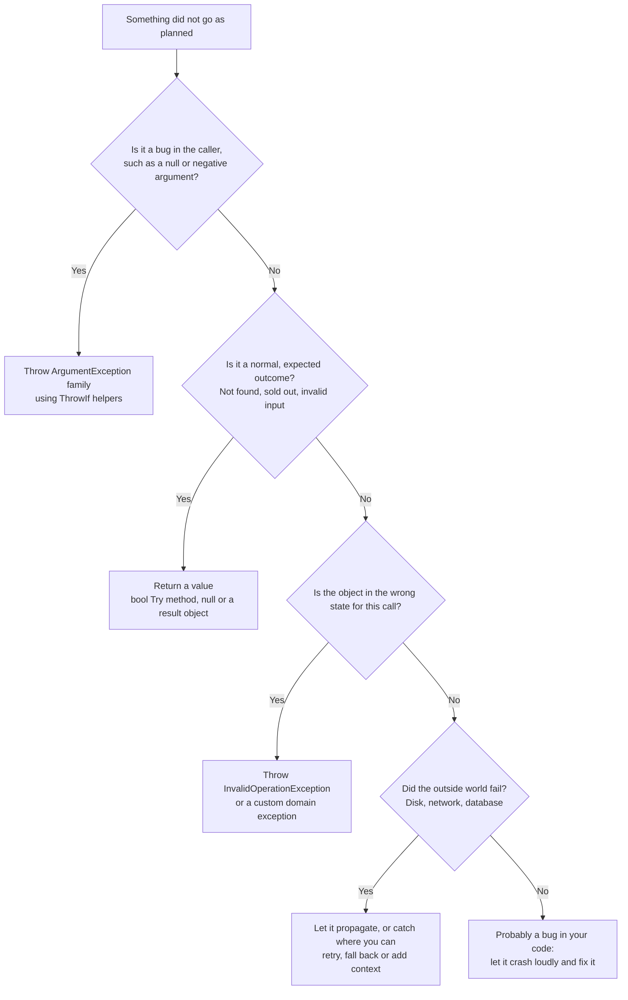
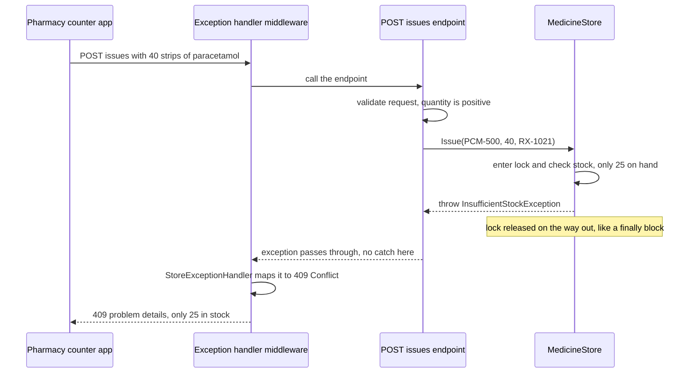

Programs fail. Files go missing, users type "abc" where a number belongs, a supplier's server times out, and sometimes your own code has a bug. How a program *reports* and *handles* those failures decides whether users see a helpful message or a blank screen, and whether you find the bug in five minutes or five days. This lesson teaches C#'s main tool for failures, the **exception**, and the equally important skill of knowing when *not* to use it. The running example is a hospital pharmacy, which issues medicines (paracetamol strips, antibiotic capsules, ORS sachets) against doctors' prescriptions.

## Learning objectives

By the end of this lesson you will be able to:

1. Explain what happens, step by step, when an exception is thrown and caught.
2. Write `try`/`catch`/`finally` blocks that catch only what they can handle and always clean up.
3. Choose the right built-in exception (`ArgumentException`, `ArgumentNullException`, `ArgumentOutOfRangeException`, `InvalidOperationException` and others) and use the modern throw helpers.
4. Rethrow correctly with `throw;`, wrap with an inner exception, and use exception filters (`when`).
5. Decide when a custom exception is worth creating, and write one properly.
6. Decide when not to throw: use `Try...` methods, `bool` results or `null` for expected outcomes.
7. Handle exceptions once, at the edge of an ASP.NET Core app, and turn them into proper HTTP error responses.

## Prerequisites

- [Variables, types, conditions, loops and functions in C#](#/lesson/m01-csharp-basics), especially guard clauses and the `TryParse` pattern.
- [Classes, objects, fields, properties and methods](#/lesson/m01-classes-objects): invariants and methods that protect them.

## Explain it like I'm a beginner

### A fire alarm and a "sold out" sign

At a railway station canteen, two very different things can stop a sale:

- **The samosas are sold out.** This happens every evening. The cashier says "sorry, sold out, would you like a vada pav?" and life continues. Nobody panics.
- **The kitchen catches fire.** The cashier can't continue the sale no matter what. An alarm rings, everyone stops what they are doing, and a trained person (not the cashier) deals with it.

In C#:

| Canteen | C# | Technical term |
|---|---|---|
| "Sold out" | `return false;` or return `null`, an expected outcome the caller checks | return value, `Try...` pattern |
| Fire alarm | `throw new InvalidOperationException(...)` | exception |
| The trained person who responds | a `catch` block, often far away from where the fire started | exception handler |
| Locking the cash drawer before leaving, whatever happened | a `finally` block | guaranteed cleanup |

The most common beginner mistake is ringing the fire alarm for "sold out": throwing an exception for something that happens every day. The second most common is the opposite: hearing the alarm and pressing "silence" without doing anything (catching an exception and ignoring it).

### A promise the method can't keep

A useful way to think about it: every method makes a **promise**, written in its name. `IssueMedicine(code, 10)` promises "I will issue 10 units". If, for any reason, it can't keep that promise, it must not quietly do half the job or pretend it worked. It **throws**: it stops immediately and hands a description of the problem back up to whoever called it.

If failing is a normal, expected part of the job, then make it part of the promise: `TryIssueMedicine(code, 10)` promises "I will *try*, and tell you if it worked". Now returning `false` *keeps* the promise, and no exception is needed.

## First-principles explanation

### What an exception is

An exception is an **object** that describes an error. Every exception class derives from `System.Exception`, which carries:

- `Message`: a human-readable description.
- `StackTrace`: the chain of method calls that led to the error, with line numbers when debug symbols are available.
- `InnerException`: another exception that caused this one (or `null`).
- The type itself, such as `ArgumentOutOfRangeException`, which tells code *what kind* of failure it was.

You create one with `new` and **throw** it:

```csharp
if (quantity <= 0)
    throw new ArgumentOutOfRangeException(nameof(quantity), quantity, "Quantity must be positive.");
```

### What happens when you throw

1. The current method **stops** at the `throw`. No further lines in it run (except `finally` blocks, below).
2. The runtime looks for a matching `catch` in the current method. If there is none, it leaves the method and looks in the **caller**, then the caller's caller, and so on. This is called **unwinding the stack**.
3. On the way out, every `finally` block in the methods being left is run.
4. The first `catch` whose type matches (and whose filter, if any, is true) handles it. Execution continues after that `try`/`catch`.
5. If nothing catches it, the exception is **unhandled**. In a console app the process crashes and prints the stack trace. In ASP.NET Core, the framework catches it at the top and returns a 500 error for that request, while the server keeps running.

### try, catch, finally

```csharp
try
{
    // code that might fail
    var qty = store.Issue("PCM-500", 40, "RX-1021");
    Console.WriteLine($"Issued. {qty} strips left.");
}
catch (InsufficientStockException ex)          // most specific first
{
    Console.WriteLine($"Only {ex.Available} strips in stock.");
}
catch (IOException ex)                          // a different, unrelated failure
{
    Console.WriteLine($"Could not write the dispensing slip: {ex.Message}");
}
finally
{
    Console.WriteLine("Store counter closed.");   // runs whether it worked, failed or was caught
}
```

Rules worth memorising:

- **Order catch blocks from specific to general.** C# checks them top to bottom. `catch (Exception)` first would swallow everything, and the compiler reports an error if a later block can never be reached.
- **`finally` always runs** when control leaves the `try`: after success, after a caught exception, after an uncaught one, even after a `return` inside the `try`. The exceptions to "always" are catastrophic: the process being killed, `Environment.FailFast`, or a `StackOverflowException`.
- **`try`/`finally` without `catch`** is common and useful: "I can't fix this error, but I must clean up before it travels on."
- **`using` is a `try`/`finally` in disguise.** `using var file = File.OpenRead(path);` guarantees `file.Dispose()` runs at the end of the scope, error or not. Prefer `using` for anything `IDisposable`.

### Catch only what you can handle

A `catch` block should exist only if it does something *useful* with the error:

- **Recover**: retry, use a fallback, or ask the user again.
- **Translate**: turn a low-level error into one that makes sense at this level, keeping the original as the inner exception.
- **Add context and rethrow**: log "while importing delivery file X" and let it continue upwards.
- **Report at the boundary**: the top of a web request, a background job loop, or `Main`, where you log it and show a friendly message.

If a `catch` can do none of these, delete it. An exception that travels up to a proper handler is far better than one that is caught and hidden.

### Rethrowing: `throw;` not `throw ex;`

```csharp
catch (IOException ex)
{
    logger.LogWarning(ex, "Slip printer failed for {Prescription}", prescriptionNo);
    throw;          // rethrows the SAME exception with its ORIGINAL stack trace
}
```

`throw ex;` would also rethrow, but it **resets the stack trace** to this line, so you lose the information about where the error really happened. Always use `throw;` inside a `catch` to rethrow.

To **translate**, throw a new exception and pass the original as the inner exception:

```csharp
catch (FormatException ex)
{
    throw new InvalidDataException($"Line {lineNumber} of the delivery file is not valid.", ex);
}
```

The new message is meaningful to the caller; the inner exception keeps the technical detail for whoever debugs it.

### Exception filters

A `when` clause catches an exception only if a condition is true. If it's false, the exception continues as if this `catch` didn't exist, and the stack is left untouched for the debugger:

```csharp
catch (HttpRequestException ex) when (ex.StatusCode == HttpStatusCode.ServiceUnavailable)
{
    // the supplier's API is temporarily down: retry later
}
```

### The built-in exceptions you should throw

You rarely need new exception types. Use these first:

| Exception | Throw it when | Example |
|---|---|---|
| `ArgumentNullException` | a parameter is `null` but must not be | `ArgumentNullException.ThrowIfNull(order);` |
| `ArgumentOutOfRangeException` | a parameter is outside the allowed range | `ArgumentOutOfRangeException.ThrowIfNegativeOrZero(quantity);` |
| `ArgumentException` | a parameter is invalid for another reason | `ArgumentException.ThrowIfNullOrWhiteSpace(name);` |
| `InvalidOperationException` | the arguments are fine, but the object's current *state* doesn't allow the call | issuing from a store that is closed for stock-taking |
| `NotSupportedException` | the operation is never supported by this type | writing to a read-only stream |
| `ObjectDisposedException` | the object was already disposed | `ObjectDisposedException.ThrowIf(_disposed, this);` |
| `FormatException` | text is not in the expected format | parsing a malformed date |
| `KeyNotFoundException` | a key must exist and doesn't | dictionary indexer |
| `TimeoutException` | an operation took too long | waiting for a scale to respond |
| `OperationCanceledException` | work was cancelled through a `CancellationToken` | `token.ThrowIfCancellationRequested();` |

Never throw these yourself: `Exception` (too vague to catch specifically), `SystemException`, `NullReferenceException`, `IndexOutOfRangeException` (the runtime throws those for bugs) or `ApplicationException` (an old guideline that Microsoft no longer recommends).

The **throw helpers** (`ThrowIfNull`, `ThrowIfNullOrWhiteSpace`, `ThrowIfNegative`, `ThrowIfNegativeOrZero`, `ThrowIfGreaterThan`, `ThrowIfLessThan` and others) are one-liners that also fill in the parameter name automatically using `[CallerArgumentExpression]`. Use them for guard clauses.

### Argument errors are bugs; state errors may not be

A useful split:

- **Usage errors** (bad arguments): the *caller* has a bug. They should never happen in correct code, so a crash with a clear message is right. You don't write `catch (ArgumentException)` in normal code; you fix the caller.
- **Program errors**: your own bug, such as a `NullReferenceException`. Also fixed, not caught.
- **System or environmental failures**: the disk is full, the network is down, the database timed out. Your code is correct but the world isn't cooperating. These are what `catch` blocks exist for: retry, fallback, or report.
- **Expected business outcomes**: "not enough stock", "user not found", "password wrong". These are *not* failures of the program at all. They usually deserve a return value, not an exception.

### Custom exceptions: when and how

Create your own exception type when **callers need to tell it apart** from other errors and react differently, or when it needs to **carry data** (how much stock was available, which account was frozen). If no caller would ever `catch` it specifically, a built-in type with a good message is enough.

```csharp
public sealed class InsufficientStockException : Exception
{
    public InsufficientStockException(string code, int requested, int available)
        : base($"Cannot issue {requested} of {code}: only {available} in stock.")
    {
        Code = code;
        Requested = requested;
        Available = available;
    }

    public string Code { get; }
    public int Requested { get; }
    public int Available { get; }
}
```

Guidelines:

- The name ends in `Exception`.
- Derive from `Exception` (or from your own base type such as `StoreException`, so a caller can catch the whole family). Don't derive from `ApplicationException`.
- Give it a clear message built from its data, and properties for that data, so handlers don't have to parse message text.
- Offer a constructor that accepts an inner exception if it may wrap one.
- Make it `sealed` unless you plan a hierarchy. Keep hierarchies shallow.

### When not to throw

Throwing is the right tool for "this method can't keep its promise". It's the wrong tool for:

1. **Expected outcomes.** Invalid user input, a search with no results, insufficient balance at an ATM. Use `bool TryX(..., out result)`, return `null`, or return a result object. The caller is *meant* to handle these, and an `if` makes that obvious.
2. **Control flow.** Using `throw` to jump out of nested loops, or `try { int.Parse(s) } catch { ... }` to test whether text is a number. Use `break`, `return` and `TryParse`.
3. **Hot paths.** Throwing and catching is far more expensive than returning a value: the runtime must capture a stack trace and unwind frames. Newer .NET versions made it considerably cheaper, but it is still orders of magnitude slower than a `return` (measure it in the playground). An API that throws on every invalid request will fall over under a flood of bad input.
4. **Hiding problems.** "Throw and immediately catch in the same method" is usually a confusing `if`.

The flip side matters just as much: **don't return error codes for real failures.** A method `int Save()` that returns `-1` on failure is easy to ignore, and ignored failures corrupt data. If the database is unreachable, throw.

The [Result pattern](#/lesson/m06-options-result) lesson shows a richer alternative to `bool` + `out` for expected failures.

### Exceptions and `async`

When an `async` method throws, the exception is stored in its `Task` and rethrown when you `await` it, so `try`/`catch` around `await` works naturally. Two traps: `async void` methods can't be awaited, so their exceptions crash the process (only use `async void` for UI event handlers), and a `Task` that is never awaited hides its exception completely.

### Handling exceptions in ASP.NET Core

In a web app, you don't wrap every endpoint in `try`/`catch`. You register **one** handler at the edge:

- `builder.Services.AddProblemDetails()` and `app.UseExceptionHandler()` turn unhandled exceptions into a standard JSON error response (RFC 9457 "problem details") with status 500, without leaking the stack trace to users.
- An `IExceptionHandler` implementation (available since .NET 8) can map *your* exception types to proper status codes: `InsufficientStockException` → 409 Conflict, `UnknownMedicineException` → 404 Not Found.

Endpoints still validate their input and return 400 for bad requests directly; that's an expected outcome. The global handler is the safety net for everything else. The [filters, middleware and exception handling](#/lesson/m03-filters-exceptions) lesson goes deeper.

## Visual explanation

### Should this be an exception?



Walk through this chart whenever you are about to write `throw` or `catch`. The first question separates **usage errors**, which deserve an immediate, clear exception so the bug is fixed. The second question is the important one for design: expected outcomes go to the **return value** branch, which keeps exceptions rare and meaningful. State errors and outside-world failures are genuine exceptions, and the last box reminds you that a mystery failure is usually a bug that should be fixed, not hidden behind a `catch`.

### How an exception travels through a web request



This sequence diagram shows one request where the store can't keep its promise. The endpoint validates the request first and would return a 400 itself for a negative quantity, because that's an expected input problem. The store, inside its lock, finds only 25 strips and **throws**. Notice what does *not* happen: the endpoint has no `try`/`catch`. The exception unwinds through it, the `lock` is released automatically on the way out (a `lock` statement is a `try`/`finally` underneath), and the middleware at the edge catches it. Our `StoreExceptionHandler` recognises the type and turns it into a `409 Conflict` with a readable message. One handler, written once, serves every endpoint.

## Step-by-step example

We'll evolve the store's `Issue` method through four versions.

### Version 1: error codes (easy to ignore)

```csharp
// returns remaining stock, or -1 if unknown medicine, or -2 if not enough
public int Issue(string code, int quantity)
{
    if (!_onHand.TryGetValue(code, out var available)) return -1;
    if (available < quantity) return -2;
    _onHand[code] = available - quantity;
    return available - quantity;
}

var left = store.Issue("PCM-500", 40);
Console.WriteLine($"{left} strips left");     // prints "-2 strips left": nobody checked
```

Problems: callers must remember magic numbers; forgetting to check is silent; a negative `quantity` *adds* stock. And where does the message for the user come from?

### Version 2: exceptions for everything

```csharp
public int Issue(string code, int quantity)
{
    if (quantity <= 0) throw new ArgumentOutOfRangeException(nameof(quantity));
    if (!_onHand.TryGetValue(code, out var available)) throw new UnknownMedicineException(code);
    if (available < quantity) throw new InsufficientStockException(code, quantity, available);
    _onHand[code] = available - quantity;
    return available - quantity;
}
```

Better: failures can't be ignored, and each carries data. But if the store screen calls this to *check* whether 40 strips can be issued, it must catch an exception for an everyday situation.

### Version 3: add a Try method for the expected case

```csharp
public bool TryGetOnHand(string code, out int quantity) => _onHand.TryGetValue(code, out quantity);

// Store screen:
if (!store.TryGetOnHand(code, out var available))
    ShowError($"{code} is not stocked here.");
else if (available < requested)
    ShowError($"Only {available} in stock.");
else
    store.Issue(code, requested, prescriptionNo);
```

The screen checks the normal cases with ordinary `if`s. `Issue` still throws if it is called wrongly. Why keep the exception at all? Because between the check and the issue, another pharmacist on another tablet might issue the last 30 strips. The exception is the **safety net** for that race; it should be rare.

### Version 4: catch at the right level, clean up always

The delivery importer reads a file of incoming stock. A bad line is expected (typos happen), so it is reported, not thrown. A missing file is an environmental failure, so it propagates. The reader is always closed:

```csharp
public ImportReport ImportFile(string path)
{
    using var reader = new StreamReader(path);   // FileNotFoundException propagates; Dispose always runs
    return Import(reader);                        // per-line problems are collected, not thrown
}
```

That's the whole philosophy in two lines: **expected problems become data, real failures become exceptions, and cleanup is guaranteed.**

## Production-style C# implementation

The hospital pharmacy store as an ASP.NET Core API, with a single exception handler at the edge.

```text
Pharmacy.Api/
  Program.cs
  Store/
    Medicine.cs                // what a medicine is
    StoreExceptions.cs         // custom exceptions with data
    MedicineStore.cs           // the rules, thread-safe
    DeliveryImporter.cs        // bad lines become a report, not exceptions
    StoreExceptionHandler.cs   // maps domain exceptions to HTTP status codes
    Contracts.cs
```

```csharp file=Store/Medicine.cs
namespace Pharmacy.Api.Store;

public sealed record Medicine(string Code, string Name, string Unit);
```

```csharp file=Store/StoreExceptions.cs
namespace Pharmacy.Api.Store;

/// <summary>Base type for store rule violations, so callers can catch the whole family if they need to.</summary>
public abstract class StoreException : Exception
{
    protected StoreException(string message) : base(message) { }
    protected StoreException(string message, Exception innerException) : base(message, innerException) { }
}

public sealed class UnknownMedicineException : StoreException
{
    public UnknownMedicineException(string code)
        : base($"Medicine '{code}' is not stocked at this pharmacy.") => Code = code;

    public string Code { get; }
}

public sealed class InsufficientStockException : StoreException
{
    public InsufficientStockException(string code, int requested, int available)
        : base($"Cannot issue {requested} of {code}: only {available} in stock.")
    {
        Code = code;
        Requested = requested;
        Available = available;
    }

    public string Code { get; }
    public int Requested { get; }
    public int Available { get; }
}
```

```csharp file=Store/MedicineStore.cs
namespace Pharmacy.Api.Store;

public sealed record IssueRecord(string Code, int Quantity, string PrescriptionNo, int RemainingAfter);

public sealed class MedicineStore
{
    private readonly Lock _gate = new();
    private readonly Dictionary<string, Medicine> _catalogue = new(StringComparer.OrdinalIgnoreCase);
    private readonly Dictionary<string, int> _onHand = new(StringComparer.OrdinalIgnoreCase);
    private readonly List<IssueRecord> _issues = new();

    public MedicineStore(IEnumerable<Medicine> catalogue)
    {
        ArgumentNullException.ThrowIfNull(catalogue);
        foreach (var m in catalogue)
        {
            if (!_catalogue.TryAdd(m.Code, m))
                throw new ArgumentException($"Duplicate medicine code '{m.Code}'.", nameof(catalogue));
            _onHand[m.Code] = 0;
        }
    }

    /// <summary>Expected question, expected "no": a Try method, not an exception.</summary>
    public bool TryGetOnHand(string code, out int quantity)
    {
        lock (_gate) return _onHand.TryGetValue(code, out quantity);
    }

    public bool IsStocked(string code) => _catalogue.ContainsKey(code);

    public void Receive(string code, int quantity)
    {
        ArgumentException.ThrowIfNullOrWhiteSpace(code);
        ArgumentOutOfRangeException.ThrowIfNegativeOrZero(quantity);
        lock (_gate)
        {
            if (!_onHand.TryGetValue(code, out var current)) throw new UnknownMedicineException(code);
            _onHand[code] = checked(current + quantity);        // overflow is a real failure: throw, don't wrap
        }
    }

    /// <summary>Callers should check stock first. The exception is the safety net for races between pharmacists.</summary>
    public int Issue(string code, int quantity, string prescriptionNo)
    {
        ArgumentException.ThrowIfNullOrWhiteSpace(code);
        ArgumentOutOfRangeException.ThrowIfNegativeOrZero(quantity);
        ArgumentException.ThrowIfNullOrWhiteSpace(prescriptionNo);

        lock (_gate)
        {
            if (!_onHand.TryGetValue(code, out var available)) throw new UnknownMedicineException(code);
            if (available < quantity) throw new InsufficientStockException(code, quantity, available);

            // All checks passed: now change state. Nothing below can fail halfway.
            var remaining = available - quantity;
            _onHand[code] = remaining;
            _issues.Add(new IssueRecord(code, quantity, prescriptionNo, remaining));
            return remaining;
        }
    }

    public IReadOnlyList<IssueRecord> Issues { get { lock (_gate) return _issues.ToArray(); } }
}
```

```csharp file=Store/DeliveryImporter.cs
namespace Pharmacy.Api.Store;

public sealed record ImportReport(int Accepted, IReadOnlyList<string> Errors);

/// <summary>Reads "code,quantity" lines. Bad lines are expected (typos), so they become report entries.
/// I/O failures are not expected, so they propagate to the caller.</summary>
public sealed class DeliveryImporter(MedicineStore store)
{
    public const int MaxErrors = 100;

    public ImportReport Import(TextReader reader)
    {
        ArgumentNullException.ThrowIfNull(reader);
        var errors = new List<string>();
        int accepted = 0, lineNo = 0;
        string? line;

        while ((line = reader.ReadLine()) is not null)
        {
            lineNo++;
            if (string.IsNullOrWhiteSpace(line) || line.StartsWith('#')) continue;

            var parts = line.Split(',', StringSplitOptions.TrimEntries);
            if (parts.Length != 2)
                errors.Add($"Line {lineNo}: expected 'code,quantity'.");
            else if (!int.TryParse(parts[1], out var qty) || qty <= 0)
                errors.Add($"Line {lineNo}: '{parts[1]}' is not a positive whole number.");
            else if (!store.IsStocked(parts[0]))
                errors.Add($"Line {lineNo}: unknown medicine '{parts[0]}'.");
            else
            {
                store.Receive(parts[0], qty);      // already validated: if this throws, it is a real bug
                accepted++;
            }

            if (errors.Count >= MaxErrors)
            {
                errors.Add("Too many errors: import stopped. Check the file format.");
                break;
            }
        }
        return new ImportReport(accepted, errors);
    }
}
```

```csharp file=Store/StoreExceptionHandler.cs
using Microsoft.AspNetCore.Diagnostics;

namespace Pharmacy.Api.Store;

/// <summary>One place that turns domain exceptions into HTTP responses. Anything it does not
/// recognise returns false, so the default handler logs it and returns a generic 500.</summary>
public sealed class StoreExceptionHandler(ILogger<StoreExceptionHandler> logger) : IExceptionHandler
{
    public async ValueTask<bool> TryHandleAsync(HttpContext httpContext, Exception exception, CancellationToken cancellationToken)
    {
        var (status, title) = exception switch
        {
            UnknownMedicineException => (StatusCodes.Status404NotFound, "Unknown medicine"),
            InsufficientStockException => (StatusCodes.Status409Conflict, "Not enough stock"),
            _ => (0, ""),
        };
        if (status == 0) return false;

        logger.LogInformation("Store rule violated on {Path}: {Message}", httpContext.Request.Path, exception.Message);
        await Results.Problem(detail: exception.Message, statusCode: status, title: title).ExecuteAsync(httpContext);
        return true;
    }
}
```

```csharp file=Store/Contracts.cs
namespace Pharmacy.Api.Store;

public sealed record IssueRequest(string Code, int Quantity, string PrescriptionNo);
```

```csharp file=Program.cs
using Pharmacy.Api.Store;

var builder = WebApplication.CreateBuilder(args);

builder.Services.AddProblemDetails();
builder.Services.AddExceptionHandler<StoreExceptionHandler>();
builder.Services.AddSingleton(new MedicineStore(new[]
{
    new Medicine("PCM-500", "Paracetamol 500 mg tablets, strip of 10", "strip"),
    new Medicine("AMX-250", "Amoxicillin 250 mg capsules, strip of 10", "strip"),
    new Medicine("ORS-200", "Oral rehydration salts, 21 g sachet", "sachet"),
}));
builder.Services.AddSingleton<DeliveryImporter>();

var app = builder.Build();
app.UseExceptionHandler();          // the safety net: must be early in the pipeline

app.MapGet("/stock/{code}", (string code, MedicineStore store) =>
    store.TryGetOnHand(code, out var qty)
        ? Results.Ok(new { code, onHand = qty })
        : Results.NotFound());

app.MapPost("/issues", (IssueRequest req, MedicineStore store) =>
{
    // Expected input problems: answer directly with 400, no exceptions involved.
    if (string.IsNullOrWhiteSpace(req.Code) || string.IsNullOrWhiteSpace(req.PrescriptionNo))
        return Results.Problem("Code and prescription number are required.", statusCode: 400);
    if (req.Quantity <= 0)
        return Results.Problem("Quantity must be a positive number.", statusCode: 400);

    // Rule violations (unknown code, race on stock) throw and are mapped by StoreExceptionHandler.
    var remaining = store.Issue(req.Code, req.Quantity, req.PrescriptionNo);
    return Results.Ok(new { req.Code, issued = req.Quantity, remaining });
});

app.MapPost("/deliveries", async (HttpRequest request, DeliveryImporter importer, CancellationToken ct) =>
{
    using var reader = new StreamReader(request.Body);       // disposed even if Import throws
    var text = await reader.ReadToEndAsync(ct);
    var report = importer.Import(new StringReader(text));
    return report.Errors.Count == 0 ? Results.Ok(report) : Results.UnprocessableEntity(report);
});

app.Run();
```

What to notice:

- **Validation at the edge, rules in the model, safety net at the top.** The endpoint returns 400 for bad input without exceptions. `MedicineStore` throws if its rules are broken anyway. `StoreExceptionHandler` turns those into 404 or 409. Anything else becomes a 500 with no stack trace leaked to the client.
- **Check everything, then change state.** `Issue` performs every check before touching `_onHand`, so a thrown exception leaves the store exactly as it was. This property, sometimes called the **strong exception guarantee**, is what makes exceptions safe to use.
- **The lock is a `try`/`finally`.** When `Issue` throws inside `lock (_gate)`, the lock is released automatically. Without that guarantee, one exception would freeze the store for every other request.
- **`checked` arithmetic in `Receive`.** Silently wrapping a stock count to a negative number is far worse than an `OverflowException`.
- **The importer collects errors.** A 500-line delivery file with three typos gives a report of three problems, not one exception at the first typo. It also stops after 100 errors, because a file in a completely wrong format shouldn't produce 50,000 messages.
- **Limits.** Stock lives in memory, so a restart loses it. A real store would keep stock in PostgreSQL and enforce "no negative stock" with a transaction or a `CHECK` constraint, which then becomes another exception source (a database error) to map at the edge.

## Bad design vs good design

**Bad**: swallowing, catch-all, losing the stack trace, and exceptions as control flow.

```csharp
public int? GetQuantity(string text)
{
    try { return int.Parse(text); }
    catch { return null; }                 // 1. exceptions as an if-statement
}

public void IssueAll(List<IssueRequest> requests)
{
    foreach (var r in requests)
    {
        try { _store.Issue(r.Code, r.Quantity, r.PrescriptionNo); }
        catch (Exception) { }              // 2. swallowed: issues silently skipped
    }
}

public void Import(string path)
{
    try { /* ... */ }
    catch (Exception ex)
    {
        Log(ex.Message);
        throw ex;                          // 3. stack trace reset to this line
    }
}
```

Problems:

1. `int.Parse` inside `try`/`catch` is slow for bad input and hides *which* error occurred. `int.TryParse` says what you mean.
2. The empty `catch (Exception)` hides everything: a typo in a medicine code, an insufficient-stock race, and a genuine bug such as a `NullReferenceException` all look like success. The pharmacist believes 12 prescriptions were filled; only 9 were. This is the most damaging pattern in this lesson.
3. `throw ex;` destroys the original stack trace, so the log shows the error "happening" in `Import`, not where it really occurred.

**Good**:

```csharp
public int? GetQuantity(string text) => int.TryParse(text, out var q) ? q : null;

public IssueSummary IssueAll(IReadOnlyList<IssueRequest> requests)
{
    var failed = new List<string>();
    foreach (var r in requests)
    {
        try { _store.Issue(r.Code, r.Quantity, r.PrescriptionNo); }
        catch (StoreException ex)          // only the failures we expect and can report
        {
            failed.Add($"{r.PrescriptionNo}: {ex.Message}");
        }
    }
    return new IssueSummary(requests.Count - failed.Count, failed);   // bugs still propagate
}

catch (IOException ex)
{
    _logger.LogError(ex, "Import of {Path} failed", path);   // log the exception object, not just Message
    throw;
}
```

**Is the improvement always worth it?** Yes for swallowing and `throw ex;`: they are never right. For "catch at the boundary", a small command-line tool you run yourself can let exceptions crash with a stack trace, and that's fine. A service used by others needs one deliberate top-level handler.

:::callout type=mistake title="An empty catch block is a lie"
`catch { }` tells every future reader "nothing can go wrong here", which is never true. If you really must ignore a specific, harmless failure, catch that exact type, and write a comment explaining why ignoring it is safe.
:::

## Practical playground

Run it and read the output top to bottom. Then try the experiments. Timings are machine-dependent; compare the two numbers, not the absolute values.

:::playground type=csharp title="Throw, catch, finally"
```csharp file=Program.cs
using System;
using System.Diagnostics;

public sealed class InsufficientStockException : Exception
{
    public InsufficientStockException(int requested, int available)
        : base($"Requested {requested}, only {available} in stock.")
    {
        Requested = requested;
        Available = available;
    }
    public int Requested { get; }
    public int Available { get; }
}

public static class Program
{
    static int s_stock = 25;

    public static void Main()
    {
        // 1. The order of try, catch and finally
        foreach (int qty in new[] { 10, 40, -1 })
        {
            try
            {
                Console.WriteLine($"Issuing {qty}...");
                Issue(qty);
                Console.WriteLine($"  done, stock now {s_stock}");
            }
            catch (InsufficientStockException ex)
            {
                Console.WriteLine($"  business rule: {ex.Message} (available {ex.Available})");
            }
            catch (ArgumentOutOfRangeException ex)
            {
                Console.WriteLine($"  caller bug: {ex.ParamName} was {ex.ActualValue}");
            }
            finally
            {
                Console.WriteLine("  finally: counter closed");
            }
        }

        // 2. throw; keeps the stack trace, throw ex; resets it
        try { RethrowCorrectly(); }
        catch (Exception ex) { Console.WriteLine($"throw;    -> top frame: {TopFrame(ex)}"); }
        try { RethrowBadly(); }
        catch (Exception ex) { Console.WriteLine($"throw ex; -> top frame: {TopFrame(ex)}"); }

        // 3. Wrapping keeps the original as InnerException
        try { ParseLine("PCM-500,abc", 7); }
        catch (InvalidOperationException ex)
        {
            Console.WriteLine($"{ex.Message} | inner: {ex.InnerException?.GetType().Name}");
        }

        // 4. Exception filters
        foreach (int code in new[] { 503, 404 })
        {
            try
            {
                try { throw new SupplierException(code); }
                catch (SupplierException ex) when (ex.StatusCode == 503) { Console.WriteLine($"{code}: will retry later"); }
            }
            catch (SupplierException ex) { Console.WriteLine($"{ex.StatusCode}: not retryable, passed upwards"); }
        }

        // 5. The cost of exceptions versus TryParse (measure on your machine)
        const int N = 10_000;
        var sw = Stopwatch.StartNew();
        int bad = 0;
        for (int i = 0; i < N; i++) { try { int.Parse("abc"); } catch (FormatException) { bad++; } }
        var withExceptions = sw.Elapsed;
        sw.Restart();
        for (int i = 0; i < N; i++) { if (!int.TryParse("abc", out _)) bad++; }
        var withTry = sw.Elapsed;
        Console.WriteLine($"{N:N0} bad inputs: Parse+catch {withExceptions.TotalMilliseconds:N1} ms, TryParse {withTry.TotalMilliseconds:N3} ms");

        // Experiments:
        // 1. Move the ArgumentOutOfRangeException catch above InsufficientStockException. Any change? Why?
        // 2. Add "catch (Exception)" as the FIRST catch block. What does the compiler say?
        // 3. Put "return;" inside the try of section 1. Does finally still run?
        // 4. In Issue, deduct the stock BEFORE the check. What state is left after a failed issue?
    }

    static void Issue(int quantity)
    {
        ArgumentOutOfRangeException.ThrowIfNegativeOrZero(quantity);
        if (quantity > s_stock) throw new InsufficientStockException(quantity, s_stock);
        s_stock -= quantity;
    }

    static void Inner() => throw new InvalidOperationException("boom");
    static void RethrowCorrectly() { try { Inner(); } catch (InvalidOperationException) { throw; } }
    static void RethrowBadly() { try { Inner(); } catch (InvalidOperationException ex) { throw ex; } }
    static string TopFrame(Exception ex) => ex.StackTrace?.Split('\n')[0].Trim() ?? "(none)";

    static void ParseLine(string line, int lineNo)
    {
        try { int.Parse(line.Split(',')[1]); }
        catch (FormatException ex) { throw new InvalidOperationException($"Line {lineNo} is not valid.", ex); }
    }
}

public sealed class SupplierException(int statusCode) : Exception($"Supplier returned {statusCode}")
{
    public int StatusCode { get; } = statusCode;
}
```
:::

## Exercises

:::exercise id=m01-exceptions-ex1 difficulty=beginner kind=code title="Guard clauses with the right exception types"
A bus ticket booking method must reject bad arguments with the correct exception type, so the bug is obvious to whoever called it.
::requirements
- `TicketDesk.Book(string? passengerName, int age, int seats)` returns a `Booking(string Name, int Age, int Seats)` with the name trimmed.
- `null` name: `ArgumentNullException`. Empty or whitespace name: `ArgumentException`.
- `age` outside 0–120: `ArgumentOutOfRangeException`.
- `seats` outside 1–6: `ArgumentOutOfRangeException`.
- Each exception's `ParamName` must be the parameter's name.
::acceptance
- `Book("  Asha ", 29, 2)` returns `Booking("Asha", 29, 2)`.
- `Book(null, 29, 2)` throws `ArgumentNullException` with `ParamName` "passengerName".
- `Book("   ", 29, 2)` throws `ArgumentException` (exactly, not a subclass).
- `Book("Asha", 121, 2)` and `Book("Asha", -1, 2)` throw `ArgumentOutOfRangeException` with `ParamName` "age".
- `Book("Asha", 29, 0)` and `Book("Asha", 29, 7)` throw with `ParamName` "seats".
::hint
These are **usage errors**: a correct caller never passes them. That points to the `Argument...Exception` family.
::hint
.NET has throw helpers that pick the right type and fill in `ParamName` for you. Look at the static methods on `ArgumentException` and `ArgumentOutOfRangeException`.
::hint
`ArgumentException.ThrowIfNullOrWhiteSpace(passengerName)` throws `ArgumentNullException` for `null` and `ArgumentException` for blank text, both with the right parameter name.
::hint
```csharp
ArgumentException.ThrowIfNullOrWhiteSpace(passengerName);
ArgumentOutOfRangeException.ThrowIfNegative(age);
ArgumentOutOfRangeException.ThrowIfGreaterThan(age, MaxAge);
// seats: ThrowIfLessThan and ThrowIfGreaterThan
```
::starter
```csharp file=TicketDesk.cs
using System;

public sealed record Booking(string Name, int Age, int Seats);

public static class TicketDesk
{
    public const int MaxAge = 120;
    public const int MaxSeats = 6;

    public static Booking Book(string? passengerName, int age, int seats) => throw new NotImplementedException();
}
```
::tests
```csharp file=TicketDeskTests.cs
using System;
using Xunit;

public class TicketDeskTests
{
    [Fact]
    public void Valid_booking_trims_name() => Assert.Equal(new Booking("Asha", 29, 2), TicketDesk.Book("  Asha ", 29, 2));

    [Fact]
    public void Null_name()
    {
        var ex = Assert.Throws<ArgumentNullException>(() => TicketDesk.Book(null, 29, 2));
        Assert.Equal("passengerName", ex.ParamName);
    }

    [Fact]
    public void Blank_name()
    {
        var ex = Assert.Throws<ArgumentException>(() => TicketDesk.Book("   ", 29, 2));
        Assert.Equal("passengerName", ex.ParamName);
    }

    [Theory]
    [InlineData(-1)]
    [InlineData(121)]
    public void Bad_age(int age)
    {
        var ex = Assert.Throws<ArgumentOutOfRangeException>(() => TicketDesk.Book("Asha", age, 2));
        Assert.Equal("age", ex.ParamName);
    }

    [Theory]
    [InlineData(0)]
    [InlineData(7)]
    public void Bad_seats(int seats)
    {
        var ex = Assert.Throws<ArgumentOutOfRangeException>(() => TicketDesk.Book("Asha", 29, seats));
        Assert.Equal("seats", ex.ParamName);
    }

    [Theory]
    [InlineData(0, 1)]
    [InlineData(120, 6)]
    public void Boundaries_are_allowed(int age, int seats) => Assert.Equal(seats, TicketDesk.Book("Ravi", age, seats).Seats);
}
```
::solution
```csharp file=TicketDesk.cs
using System;

public sealed record Booking(string Name, int Age, int Seats);

public static class TicketDesk
{
    public const int MaxAge = 120;
    public const int MaxSeats = 6;

    public static Booking Book(string? passengerName, int age, int seats)
    {
        ArgumentException.ThrowIfNullOrWhiteSpace(passengerName);
        ArgumentOutOfRangeException.ThrowIfNegative(age);
        ArgumentOutOfRangeException.ThrowIfGreaterThan(age, MaxAge);
        ArgumentOutOfRangeException.ThrowIfLessThan(seats, 1);
        ArgumentOutOfRangeException.ThrowIfGreaterThan(seats, MaxSeats);

        return new Booking(passengerName.Trim(), age, seats);
    }
}
```

The helpers use `[CallerArgumentExpression]`, so `ThrowIfNegative(age)` sets `ParamName` to "age" without you typing it. After `ThrowIfNullOrWhiteSpace`, the compiler knows `passengerName` is not null, so `Trim()` gives no warning.
::alternatives
Writing `if (age < 0 || age > MaxAge) throw new ArgumentOutOfRangeException(nameof(age), age, "Age must be 0 to 120.");` by hand is equally correct and lets you write a custom message. Use whichever reads better; just always pass `nameof(parameter)`.
::mistakes
- Throwing `Exception` or `ArgumentException` for everything, so callers can't tell what was wrong.
- Writing the parameter name as a string literal ("Age"), which goes stale when the parameter is renamed. Use `nameof`.
- Returning `null` for bad arguments. A caller bug should be loud.
::extensions
Add a rule that children under 5 travel free and don't take a seat. Is a 4-year-old with `seats = 1` a usage error or a business outcome? Defend your choice.
:::

:::exercise id=m01-exceptions-ex2 difficulty=beginner kind=code title="Always release the printer"
The pharmacy counter has one shared label printer for dispensing slips. Code must always release the printer after using it, or nobody else can print.
::requirements
- `PrintJobRunner.Run(IPrinter printer, Func<string> render)`: first call `render()` to produce the document, *then* `Acquire()` the printer, `Print(document)`, and `Release()`. Release must happen even if `Print` throws. Exceptions propagate to the caller unchanged.
- If `render()` throws, the printer must never be acquired.
- If `Acquire()` throws, don't call `Release()` (you never got the printer).
- `TryRun(...)`: like `Run`, but if a `PrinterJamException` happens, return `false` and set `error` to its message. Any other exception still propagates. On success return `true` with `error` set to `null`.
::acceptance
- Success: calls are `Acquire, Print, Release` in that order.
- `Print` throws `PrinterJamException` in `Run`: the exception reaches the caller and `Release` was still called.
- `render` throws: `Acquire` is never called.
- `Acquire` throws: `Release` is not called.
- `TryRun` with a jam returns `false` and the jam's message. `TryRun` with an `InvalidOperationException` from `render` lets it propagate.
::hint
Which block runs whether or not an exception happens? Put `Release` there.
::hint
Where does the `try` start? Only *after* `Acquire` succeeded. If `Acquire` is inside the `try`, a failed acquire would still run `Release`.
::hint
Rendering first means a slow or failing render never holds the printer. Hold shared resources for as short a time as possible.
::hint
```csharp
string document = render();
printer.Acquire();
try
{
    printer.Print(document);
}
finally
{
    printer.Release();
}
```
For `TryRun`, wrap a call to `Run` in `try`/`catch (PrinterJamException ex)`.
::starter
```csharp file=PrintJobRunner.cs
using System;

public interface IPrinter
{
    void Acquire();
    void Print(string document);
    void Release();
}

public sealed class PrinterJamException : Exception
{
    public PrinterJamException(string message) : base(message) { }
}

public static class PrintJobRunner
{
    public static void Run(IPrinter printer, Func<string> render) => throw new NotImplementedException();

    public static bool TryRun(IPrinter printer, Func<string> render, out string? error) => throw new NotImplementedException();
}
```
::tests
```csharp file=PrintJobRunnerTests.cs
using System;
using System.Collections.Generic;
using Xunit;

public class PrintJobRunnerTests
{
    private sealed class FakePrinter : IPrinter
    {
        public List<string> Calls { get; } = new();
        public bool JamOnPrint { get; init; }
        public bool FailAcquire { get; init; }

        public void Acquire()
        {
            Calls.Add("Acquire");
            if (FailAcquire) throw new TimeoutException("Printer busy");
        }
        public void Print(string document)
        {
            Calls.Add("Print");
            if (JamOnPrint) throw new PrinterJamException("Paper jam in tray 2");
        }
        public void Release() => Calls.Add("Release");
    }

    [Fact]
    public void Success_order()
    {
        var p = new FakePrinter();
        PrintJobRunner.Run(p, () => "Slip RX-1021");
        Assert.Equal(new[] { "Acquire", "Print", "Release" }, p.Calls);
    }

    [Fact]
    public void Release_happens_even_when_print_fails()
    {
        var p = new FakePrinter { JamOnPrint = true };
        Assert.Throws<PrinterJamException>(() => PrintJobRunner.Run(p, () => "Slip"));
        Assert.Equal("Release", p.Calls[^1]);
    }

    [Fact]
    public void Render_failure_never_acquires()
    {
        var p = new FakePrinter();
        Assert.Throws<InvalidOperationException>(() => PrintJobRunner.Run(p, () => throw new InvalidOperationException("No data")));
        Assert.Empty(p.Calls);
    }

    [Fact]
    public void Failed_acquire_does_not_release()
    {
        var p = new FakePrinter { FailAcquire = true };
        Assert.Throws<TimeoutException>(() => PrintJobRunner.Run(p, () => "Slip"));
        Assert.DoesNotContain("Release", p.Calls);
    }

    [Fact]
    public void TryRun_reports_jam()
    {
        var p = new FakePrinter { JamOnPrint = true };
        Assert.False(PrintJobRunner.TryRun(p, () => "Slip", out var error));
        Assert.Equal("Paper jam in tray 2", error);
        Assert.Equal("Release", p.Calls[^1]);
    }

    [Fact]
    public void TryRun_success()
    {
        var p = new FakePrinter();
        Assert.True(PrintJobRunner.TryRun(p, () => "Slip", out var error));
        Assert.Null(error);
    }

    [Fact]
    public void TryRun_does_not_swallow_other_errors()
    {
        var p = new FakePrinter();
        Assert.Throws<InvalidOperationException>(() =>
            PrintJobRunner.TryRun(p, () => throw new InvalidOperationException("Bug"), out _));
    }
}
```
::solution
```csharp file=PrintJobRunner.cs
using System;

public interface IPrinter
{
    void Acquire();
    void Print(string document);
    void Release();
}

public sealed class PrinterJamException : Exception
{
    public PrinterJamException(string message) : base(message) { }
}

public static class PrintJobRunner
{
    public static void Run(IPrinter printer, Func<string> render)
    {
        ArgumentNullException.ThrowIfNull(printer);
        ArgumentNullException.ThrowIfNull(render);

        string document = render();        // outside the try: no printer held yet
        printer.Acquire();                 // if this throws, there is nothing to release
        try
        {
            printer.Print(document);
        }
        finally
        {
            printer.Release();             // runs on success AND on failure
        }
    }

    public static bool TryRun(IPrinter printer, Func<string> render, out string? error)
    {
        try
        {
            Run(printer, render);
            error = null;
            return true;
        }
        catch (PrinterJamException ex)     // the one failure we expect and can report
        {
            error = ex.Message;
            return false;
        }
    }
}
```

The `try` starts *after* the resource is acquired. That's the shape of every safe resource pattern, and exactly what `using` generates for you when the resource is `IDisposable`. `TryRun` catches only `PrinterJamException`: an `InvalidOperationException` from `render` is a bug and should stay visible.
::alternatives
If acquiring returned an `IDisposable` lease (`using var lease = printer.Acquire();`), the compiler would write the `try`/`finally` for you. That is the design to prefer when you control the printer API.
::mistakes
- Putting `Acquire()` inside the `try`, so a failed acquire still calls `Release()`, which may release someone else's job.
- `catch (Exception)` in `TryRun`, which turns bugs into "the printer jammed".
- Calling `Release()` at the end of the `try` instead of in `finally`, so it is skipped on failure.
::extensions
Add a retry: if `Acquire` throws `TimeoutException`, wait and try up to 3 times. Make the wait injectable so tests don't sleep.
:::

:::exercise id=m01-exceptions-ex3 difficulty=intermediate kind=code title="A bank account with validation"
Build a savings account that can never get into an invalid state, using built-in exceptions for caller bugs, custom exceptions for rule violations, and a `Try` method for the everyday "not enough money" case.
::requirements
- `new BankAccount(accountNumber, holder)`: the account number must be 9 to 18 digits, the holder must not be blank. `null` gives `ArgumentNullException`, other invalid values give `ArgumentException`.
- `Deposit(amount)`: amount must be positive and at most ₹2,00,000 per deposit (an illustrative limit), with at most 2 decimal places. Otherwise `ArgumentOutOfRangeException` (for range) or `ArgumentException` (for more than 2 decimals). A frozen account throws `AccountFrozenException`.
- `Withdraw(amount)`: same amount checks (no upper limit). Frozen: `AccountFrozenException`. More than the balance: `InsufficientFundsException` with `Requested` and `Available` set. The balance must not change when any exception is thrown.
- `TryWithdraw(amount)`: returns `false` (changing nothing) if funds are insufficient or the account is frozen. An invalid amount still throws.
- `Freeze()` and `Unfreeze()`.
- Check in this order: argument validity, then account state, then balance.
::acceptance
- Deposit ₹5,000, withdraw ₹1,200.50: balance ₹3,799.50.
- Withdrawing ₹10,000 from ₹3,799.50 throws `InsufficientFundsException` with `Available` 3,799.50, and the balance is unchanged.
- `Deposit(0)`, `Deposit(-5)` and `Deposit(200_000.01m)` throw `ArgumentOutOfRangeException`. `Deposit(10.555m)` throws `ArgumentException`.
- Depositing into a frozen account throws `AccountFrozenException`; `TryWithdraw` on it returns `false`.
- Account number "12AB5678" or "12345678" (8 digits) throws `ArgumentException`.
- Withdrawing −1 from a frozen account throws `ArgumentOutOfRangeException` (argument checks come first).
::hint
List the invariants first: balance is never negative; balance only changes through `Deposit` and `Withdraw`; a frozen account's balance never changes.
::hint
The custom exceptions are already written for you in the starter. Your job is choosing *when* to throw each one.
::hint
Write one private helper `ValidateAmount(decimal amount)` used by all three money methods. "At most 2 decimal places" can be checked with `decimal.Round(amount, 2) != amount`.
::hint
`TryWithdraw` should not catch exceptions from `Withdraw`. Check the two expected conditions first with plain `if`s, then call the real logic. Catching your own exceptions is slower and hides intent.
::hint
```csharp
public void Withdraw(decimal amount)
{
    ValidateAmount(amount);
    if (IsFrozen) throw new AccountFrozenException(AccountNumber);
    if (amount > Balance) throw new InsufficientFundsException(amount, Balance);
    Balance -= amount;
}
```
::starter
```csharp file=BankAccount.cs
using System;

public class BankingException : Exception
{
    public BankingException(string message) : base(message) { }
}

public sealed class InsufficientFundsException : BankingException
{
    public InsufficientFundsException(decimal requested, decimal available)
        : base($"Requested {requested:N2}, but only {available:N2} is available.")
    {
        Requested = requested;
        Available = available;
    }
    public decimal Requested { get; }
    public decimal Available { get; }
}

public sealed class AccountFrozenException : BankingException
{
    public AccountFrozenException(string accountNumber)
        : base($"Account {accountNumber} is frozen.") => AccountNumber = accountNumber;
    public string AccountNumber { get; }
}

public sealed class BankAccount
{
    public const decimal MaxSingleDeposit = 200_000m;

    public BankAccount(string accountNumber, string holder) => throw new NotImplementedException();

    public string AccountNumber => throw new NotImplementedException();
    public string Holder => throw new NotImplementedException();
    public decimal Balance => throw new NotImplementedException();
    public bool IsFrozen => throw new NotImplementedException();

    public void Deposit(decimal amount) => throw new NotImplementedException();
    public void Withdraw(decimal amount) => throw new NotImplementedException();
    public bool TryWithdraw(decimal amount) => throw new NotImplementedException();
    public void Freeze() => throw new NotImplementedException();
    public void Unfreeze() => throw new NotImplementedException();
}
```
::tests
```csharp file=BankAccountTests.cs
using System;
using Xunit;

public class BankAccountTests
{
    private static BankAccount NewAccount() => new BankAccount("123456789012", "Meera Iyer");

    [Fact]
    public void Deposit_and_withdraw()
    {
        var a = NewAccount();
        a.Deposit(5000m);
        a.Withdraw(1200.50m);
        Assert.Equal(3799.50m, a.Balance);
    }

    [Fact]
    public void Insufficient_funds_carries_data_and_changes_nothing()
    {
        var a = NewAccount();
        a.Deposit(3799.50m);
        var ex = Assert.Throws<InsufficientFundsException>(() => a.Withdraw(10_000m));
        Assert.Equal(10_000m, ex.Requested);
        Assert.Equal(3799.50m, ex.Available);
        Assert.Equal(3799.50m, a.Balance);
    }

    [Theory]
    [InlineData("0")]
    [InlineData("-5")]
    [InlineData("200000.01")]
    public void Deposit_out_of_range(string amount) =>
        Assert.Throws<ArgumentOutOfRangeException>(() => NewAccount().Deposit(decimal.Parse(amount, System.Globalization.CultureInfo.InvariantCulture)));

    [Fact]
    public void Deposit_at_limit_is_allowed()
    {
        var a = NewAccount();
        a.Deposit(BankAccount.MaxSingleDeposit);
        Assert.Equal(200_000m, a.Balance);
    }

    [Fact]
    public void More_than_two_decimals_rejected() => Assert.Throws<ArgumentException>(() => NewAccount().Deposit(10.555m));

    [Fact]
    public void Frozen_account_rejects_deposit_and_try_withdraw()
    {
        var a = NewAccount();
        a.Deposit(1000m);
        a.Freeze();
        var ex = Assert.Throws<AccountFrozenException>(() => a.Deposit(100m));
        Assert.Equal("123456789012", ex.AccountNumber);
        Assert.False(a.TryWithdraw(10m));
        Assert.Equal(1000m, a.Balance);
        a.Unfreeze();
        Assert.True(a.TryWithdraw(10m));
        Assert.Equal(990m, a.Balance);
    }

    [Fact]
    public void TryWithdraw_insufficient_returns_false()
    {
        var a = NewAccount();
        a.Deposit(100m);
        Assert.False(a.TryWithdraw(100.01m));
        Assert.Equal(100m, a.Balance);
    }

    [Fact]
    public void TryWithdraw_still_throws_for_bad_amount() =>
        Assert.Throws<ArgumentOutOfRangeException>(() => NewAccount().TryWithdraw(0m));

    [Fact]
    public void Argument_checks_come_before_state_checks()
    {
        var a = NewAccount();
        a.Freeze();
        Assert.Throws<ArgumentOutOfRangeException>(() => a.Withdraw(-1m));
    }

    [Theory]
    [InlineData("12AB5678901")]
    [InlineData("12345678")]
    [InlineData("1234567890123456789")]
    public void Invalid_account_number(string number) =>
        Assert.Throws<ArgumentException>(() => new BankAccount(number, "Meera"));

    [Fact]
    public void Null_account_number() => Assert.Throws<ArgumentNullException>(() => new BankAccount(null!, "Meera"));

    [Fact]
    public void Blank_holder() => Assert.Throws<ArgumentException>(() => new BankAccount("123456789", "  "));
}
```
::solution
```csharp file=BankAccount.cs
using System;

public class BankingException : Exception
{
    public BankingException(string message) : base(message) { }
}

public sealed class InsufficientFundsException : BankingException
{
    public InsufficientFundsException(decimal requested, decimal available)
        : base($"Requested {requested:N2}, but only {available:N2} is available.")
    {
        Requested = requested;
        Available = available;
    }
    public decimal Requested { get; }
    public decimal Available { get; }
}

public sealed class AccountFrozenException : BankingException
{
    public AccountFrozenException(string accountNumber)
        : base($"Account {accountNumber} is frozen.") => AccountNumber = accountNumber;
    public string AccountNumber { get; }
}

public sealed class BankAccount
{
    public const decimal MaxSingleDeposit = 200_000m;

    public BankAccount(string accountNumber, string holder)
    {
        ArgumentNullException.ThrowIfNull(accountNumber);
        if (accountNumber.Length is < 9 or > 18 || !IsAllDigits(accountNumber))
            throw new ArgumentException("Account number must be 9 to 18 digits.", nameof(accountNumber));
        ArgumentException.ThrowIfNullOrWhiteSpace(holder);

        AccountNumber = accountNumber;
        Holder = holder.Trim();
    }

    public string AccountNumber { get; }
    public string Holder { get; }
    public decimal Balance { get; private set; }
    public bool IsFrozen { get; private set; }

    public void Deposit(decimal amount)
    {
        ValidateAmount(amount);
        ArgumentOutOfRangeException.ThrowIfGreaterThan(amount, MaxSingleDeposit);
        if (IsFrozen) throw new AccountFrozenException(AccountNumber);
        Balance += amount;
    }

    public void Withdraw(decimal amount)
    {
        ValidateAmount(amount);                                              // 1. arguments
        if (IsFrozen) throw new AccountFrozenException(AccountNumber);       // 2. state
        if (amount > Balance) throw new InsufficientFundsException(amount, Balance);  // 3. balance
        Balance -= amount;                                                   // only now change state
    }

    public bool TryWithdraw(decimal amount)
    {
        ValidateAmount(amount);                  // a bad amount is still a caller bug
        if (IsFrozen || amount > Balance) return false;
        Balance -= amount;
        return true;
    }

    public void Freeze() => IsFrozen = true;
    public void Unfreeze() => IsFrozen = false;

    private static void ValidateAmount(decimal amount)
    {
        ArgumentOutOfRangeException.ThrowIfNegativeOrZero(amount);
        if (decimal.Round(amount, 2) != amount)
            throw new ArgumentException("Amount cannot have more than 2 decimal places.", nameof(amount));
    }

    private static bool IsAllDigits(string text)
    {
        foreach (char c in text)
            if (c is < '0' or > '9') return false;
        return true;
    }
}
```

Each operation follows "validate arguments, check state, check balance, then change". Because every check runs before `Balance` changes, every exception leaves the account untouched. `TryWithdraw` checks the expected conditions with `if`s instead of catching `Withdraw`'s exceptions, which is cheaper and says plainly that these outcomes are normal. Note `IsAllDigits` checks `'0'` to `'9'` explicitly: `char.IsDigit` also accepts digits from other scripts, such as Devanagari `४`.
::alternatives
`TryWithdraw` could return a `WithdrawResult` enum (`Ok`, `InsufficientFunds`, `Frozen`) so the ATM can show the right message. That's often better than a bare `bool`, and leads to the [Result pattern](#/lesson/m06-options-result). In a real bank, the balance check would happen in a database transaction, because two ATMs can withdraw at the same moment.
::mistakes
- Subtracting first and throwing afterwards, leaving a negative balance behind.
- `TryWithdraw` implemented as `try { Withdraw(a); return true; } catch { return false; }`, which also hides bad-amount bugs.
- Checking frozen before the amount, so a caller bug (negative amount) is reported as "account frozen".
- Using `char.IsDigit`, which accepts non-ASCII digits.
::extensions
Add a daily withdrawal limit of ₹50,000 that resets each calendar day. Pass the date in (`Withdraw(amount, DateOnly today)`) so tests can control time. Should exceeding it be an exception or a `false`?
:::

:::exercise id=m01-exceptions-ex4 difficulty=intermediate kind=written title="Throw, return or let it crash?"
For each situation, say what the code should do: **throw** (which exception type?), **return** a value (`false`, `null`, a result), **catch** (where, and what does the catch do?), or **let it propagate**. Give a one-line reason for each.

1. `GetUserById(id)` in a repository finds no user with that id.
2. A method receives `null` for a required `Order` parameter.
3. A user types "12/31/2026" into a date field that expects dd/MM/yyyy.
4. The database connection times out while saving an invoice.
5. `Approve()` is called on a leave request that is already approved.
6. A background job that sends 5,000 SMS reminders gets an error for message number 1,204.
7. A JSON configuration file the app needs at startup is missing.
8. A stock-price feed occasionally returns HTTP 503 for a few seconds.
::acceptance
- An action and a reason for all 8 situations.
- Every "throw" names a specific exception type.
- Every "catch" says *where* the catch lives and what it does (retry, report, translate, log).
- At least one answer explains a trade-off or "it depends".
::hint
Use the flowchart from the Visual explanation: caller bug, expected outcome, wrong state, outside-world failure, or your own bug?
::hint
"Not found" can be expected or exceptional depending on the method's promise. Compare `FindUser` and `GetUser`.
::hint
For the background job, think about what should happen to the other 3,796 messages.
::solution
| # | Action | Reason |
|---|---|---|
| 1 | **Return `null`** (method named `FindUserById`), or throw `KeyNotFoundException` if the method is `GetUserById` and callers only pass ids they know exist. | "Not found" is often expected; name the method to match the promise. |
| 2 | **Throw `ArgumentNullException`** (`ArgumentNullException.ThrowIfNull(order)`). | A caller bug: fail fast and loudly. |
| 3 | **Return** a validation error (`DateOnly.TryParseExact`), shown next to the field. | Typos are expected user input, not exceptions. |
| 4 | **Let it propagate** from the repository. A retry policy may catch transient timeouts; otherwise the global handler returns 500 (or 503) and logs it. | An outside-world failure that this layer can't fix. |
| 5 | **Throw `InvalidOperationException`** (or a domain exception such as `LeaveAlreadyApprovedException`). If double-clicks are common, the API could treat it as success (idempotent) instead. | Wrong state for the call. The trade-off: strictness versus idempotency. |
| 6 | **Catch per message** inside the loop, log it with the message id, record it for retry, and continue. Only catch the send-related exceptions; let bugs stop the job. | One failure shouldn't block 3,796 other reminders. |
| 7 | **Let it crash at startup** with a clear message (`FileNotFoundException` or an options validation error). | Failing fast at startup is far better than running half-configured. |
| 8 | **Catch with a filter** (`when (ex.StatusCode == HttpStatusCode.ServiceUnavailable)`) in the feed client, and retry with back-off a limited number of times; after that, let it propagate or serve the last known price. | A transient failure: retry is the "useful thing" the catch can do. |
::mistakes
- Throwing for invalid user input (situation 3).
- Catching the database timeout in the repository and returning `null`, which callers then read as "invoice not found".
- Catching `Exception` around the whole SMS job, so one bad number stops everything and the error is hidden.
- Retrying forever on 503, which can make an outage worse.
:::

:::exercise id=m01-exceptions-ex5 difficulty=advanced kind=code title="An all-or-nothing transfer and an error mapper"
Transferring money is two steps: take from one account, put into another. If step 2 fails, step 1 must be undone (a **compensating action**). If even the undo fails, the error must say so clearly, without losing either exception. Then write the mapper that turns exceptions into HTTP status codes.
::requirements
- `TransferService.Transfer(IAccount from, IAccount to, decimal amount)`:
  - `null` accounts throw `ArgumentNullException`. `amount <= 0` throws `ArgumentOutOfRangeException`. The same account id on both sides throws `ArgumentException`.
  - Withdraw from `from`. If that throws, let the exception propagate (nothing has changed yet).
  - Deposit into `to`. If that throws, deposit the money back into `from`, then rethrow the **original** exception unchanged (same object, same stack trace).
  - If the money can't be put back either, throw `TransferFailedException` whose `InnerException` is the deposit error and whose `CompensationError` is the undo error.
- `ErrorMapper.ToHttpStatus(Exception ex)`: `ArgumentException` and its subclasses → 400, `AccountNotFoundException` → 404, `AccountFrozenException` → 409, `InsufficientFundsException` → 422, anything else (including `TransferFailedException`) → 500.
::acceptance
- ₹1,000 → transfer ₹300: source ₹700, target ₹300.
- Insufficient funds: `InsufficientFundsException` propagates and both balances are unchanged.
- Target frozen: `AccountFrozenException` propagates (the same type, not wrapped) and the source balance is restored.
- Target frozen and the undo also fails: `TransferFailedException` with `InnerException` of type `AccountFrozenException` and `CompensationError` of type `IOException`.
- The mapper returns 400 for `ArgumentNullException`, 404, 409, 422 as listed, and 500 for `TransferFailedException` and `NullReferenceException`.
::hint
Draw the timeline: validate, withdraw (safe to fail), deposit (risky), undo (risky). Which steps need a `try`?
::hint
Only the deposit needs a `try`. Inside its `catch`, you do the undo, then `throw;`. Don't catch the withdrawal: if it fails, there is nothing to undo.
::hint
The undo itself can fail, so it needs its own `try`/`catch` nested inside the first `catch`. If it fails, you now have two exceptions: build a `TransferFailedException` with the original as `InnerException` and the undo error as `CompensationError`.
::hint
For the mapper, a switch expression with type patterns works well. Put more specific types before general ones; `ArgumentException` covers `ArgumentNullException` and `ArgumentOutOfRangeException`.
::hint
```csharp
from.Withdraw(amount);
try
{
    to.Deposit(amount);
}
catch (Exception depositError)
{
    try { from.Deposit(amount); }
    catch (Exception undoError)
    {
        throw new TransferFailedException("...", depositError, undoError);
    }
    throw;      // rethrows depositError with its original stack trace
}
```
::starter
```csharp file=Transfers.cs
using System;

public interface IAccount
{
    string Id { get; }
    decimal Balance { get; }
    void Withdraw(decimal amount);
    void Deposit(decimal amount);
}

public sealed class AccountNotFoundException(string id) : Exception($"Account {id} was not found.")
{
    public string AccountId { get; } = id;
}

public sealed class AccountFrozenException(string id) : Exception($"Account {id} is frozen.")
{
    public string AccountId { get; } = id;
}

public sealed class InsufficientFundsException(decimal requested, decimal available)
    : Exception($"Requested {requested:N2}, available {available:N2}.")
{
    public decimal Requested { get; } = requested;
    public decimal Available { get; } = available;
}

public sealed class TransferFailedException : Exception
{
    public TransferFailedException(string message, Exception innerException, Exception compensationError)
        : base(message, innerException) => CompensationError = compensationError;

    public Exception CompensationError { get; }
}

public sealed class Account : IAccount
{
    public Account(string id, decimal openingBalance = 0m)
    {
        Id = id;
        Balance = openingBalance;
    }

    public string Id { get; }
    public decimal Balance { get; private set; }
    public bool IsFrozen { get; set; }

    public void Withdraw(decimal amount)
    {
        ArgumentOutOfRangeException.ThrowIfNegativeOrZero(amount);
        if (IsFrozen) throw new AccountFrozenException(Id);
        if (amount > Balance) throw new InsufficientFundsException(amount, Balance);
        Balance -= amount;
    }

    public void Deposit(decimal amount)
    {
        ArgumentOutOfRangeException.ThrowIfNegativeOrZero(amount);
        if (IsFrozen) throw new AccountFrozenException(Id);
        Balance += amount;
    }
}

public static class TransferService
{
    public static void Transfer(IAccount from, IAccount to, decimal amount) => throw new NotImplementedException();
}

public static class ErrorMapper
{
    public static int ToHttpStatus(Exception ex) => throw new NotImplementedException();
}
```
::tests
```csharp file=TransferTests.cs
using System;
using System.IO;
using Xunit;

public class TransferTests
{
    /// <summary>A test double: withdrawals work, but putting money back fails.</summary>
    private sealed class BrokenRefundAccount : IAccount
    {
        public string Id => "SRC-BROKEN";
        public decimal Balance { get; private set; } = 1000m;
        public void Withdraw(decimal amount) => Balance -= amount;
        public void Deposit(decimal amount) => throw new IOException("Ledger unavailable");
    }

    [Fact]
    public void Moves_money()
    {
        var from = new Account("A", 1000m);
        var to = new Account("B");
        TransferService.Transfer(from, to, 300m);
        Assert.Equal(700m, from.Balance);
        Assert.Equal(300m, to.Balance);
    }

    [Fact]
    public void Insufficient_funds_changes_nothing()
    {
        var from = new Account("A", 100m);
        var to = new Account("B", 50m);
        Assert.Throws<InsufficientFundsException>(() => TransferService.Transfer(from, to, 300m));
        Assert.Equal(100m, from.Balance);
        Assert.Equal(50m, to.Balance);
    }

    [Fact]
    public void Failed_deposit_is_compensated_and_original_rethrown()
    {
        var from = new Account("A", 1000m);
        var to = new Account("B") { IsFrozen = true };
        var ex = Assert.Throws<AccountFrozenException>(() => TransferService.Transfer(from, to, 300m));
        Assert.Equal("B", ex.AccountId);
        Assert.Equal(1000m, from.Balance);
    }

    [Fact]
    public void Failed_compensation_reports_both_errors()
    {
        var from = new BrokenRefundAccount();
        var to = new Account("B") { IsFrozen = true };
        var ex = Assert.Throws<TransferFailedException>(() => TransferService.Transfer(from, to, 300m));
        Assert.IsType<AccountFrozenException>(ex.InnerException);
        Assert.IsType<IOException>(ex.CompensationError);
    }

    [Fact]
    public void Same_account_rejected()
    {
        var a = new Account("A", 1000m);
        Assert.Throws<ArgumentException>(() => TransferService.Transfer(a, new Account("A"), 10m));
    }

    [Fact]
    public void Bad_arguments()
    {
        Assert.Throws<ArgumentNullException>(() => TransferService.Transfer(null!, new Account("B"), 10m));
        Assert.Throws<ArgumentOutOfRangeException>(() => TransferService.Transfer(new Account("A", 5m), new Account("B"), 0m));
    }

    [Fact]
    public void Maps_exceptions_to_status_codes()
    {
        Assert.Equal(400, ErrorMapper.ToHttpStatus(new ArgumentNullException("x")));
        Assert.Equal(400, ErrorMapper.ToHttpStatus(new ArgumentOutOfRangeException("x")));
        Assert.Equal(404, ErrorMapper.ToHttpStatus(new AccountNotFoundException("A")));
        Assert.Equal(409, ErrorMapper.ToHttpStatus(new AccountFrozenException("A")));
        Assert.Equal(422, ErrorMapper.ToHttpStatus(new InsufficientFundsException(10m, 5m)));
        Assert.Equal(500, ErrorMapper.ToHttpStatus(new TransferFailedException("x", new IOException(), new IOException())));
        Assert.Equal(500, ErrorMapper.ToHttpStatus(new NullReferenceException()));
    }
}
```
::solution
```csharp file=Transfers.cs
using System;

public interface IAccount
{
    string Id { get; }
    decimal Balance { get; }
    void Withdraw(decimal amount);
    void Deposit(decimal amount);
}

public sealed class AccountNotFoundException(string id) : Exception($"Account {id} was not found.")
{
    public string AccountId { get; } = id;
}

public sealed class AccountFrozenException(string id) : Exception($"Account {id} is frozen.")
{
    public string AccountId { get; } = id;
}

public sealed class InsufficientFundsException(decimal requested, decimal available)
    : Exception($"Requested {requested:N2}, available {available:N2}.")
{
    public decimal Requested { get; } = requested;
    public decimal Available { get; } = available;
}

public sealed class TransferFailedException : Exception
{
    public TransferFailedException(string message, Exception innerException, Exception compensationError)
        : base(message, innerException) => CompensationError = compensationError;

    public Exception CompensationError { get; }
}

public sealed class Account : IAccount
{
    public Account(string id, decimal openingBalance = 0m)
    {
        Id = id;
        Balance = openingBalance;
    }

    public string Id { get; }
    public decimal Balance { get; private set; }
    public bool IsFrozen { get; set; }

    public void Withdraw(decimal amount)
    {
        ArgumentOutOfRangeException.ThrowIfNegativeOrZero(amount);
        if (IsFrozen) throw new AccountFrozenException(Id);
        if (amount > Balance) throw new InsufficientFundsException(amount, Balance);
        Balance -= amount;
    }

    public void Deposit(decimal amount)
    {
        ArgumentOutOfRangeException.ThrowIfNegativeOrZero(amount);
        if (IsFrozen) throw new AccountFrozenException(Id);
        Balance += amount;
    }
}

public static class TransferService
{
    public static void Transfer(IAccount from, IAccount to, decimal amount)
    {
        ArgumentNullException.ThrowIfNull(from);
        ArgumentNullException.ThrowIfNull(to);
        ArgumentOutOfRangeException.ThrowIfNegativeOrZero(amount);
        if (string.Equals(from.Id, to.Id, StringComparison.Ordinal))
            throw new ArgumentException("Cannot transfer to the same account.", nameof(to));

        from.Withdraw(amount);              // if this fails, nothing has changed: let it propagate

        try
        {
            to.Deposit(amount);
        }
        catch (Exception depositError)
        {
            try
            {
                from.Deposit(amount);       // compensating action: put the money back
            }
            catch (Exception undoError)
            {
                throw new TransferFailedException(
                    $"Transfer of {amount:N2} from {from.Id} to {to.Id} failed and could not be reversed. Manual reconciliation needed.",
                    depositError, undoError);
            }
            throw;                          // the original deposit error, original stack trace
        }
    }
}

public static class ErrorMapper
{
    public static int ToHttpStatus(Exception ex) => ex switch
    {
        ArgumentException => 400,           // covers ArgumentNullException and ArgumentOutOfRangeException
        AccountNotFoundException => 404,
        AccountFrozenException => 409,
        InsufficientFundsException => 422,
        _ => 500,
    };
}
```

The structure is "do, then undo on failure". Only the risky second step is inside a `try`. The bare `throw;` rethrows the original `AccountFrozenException`, so callers and the mapper see the real reason (409), not a generic wrapper. When the undo also fails, money is in limbo: that is a genuine emergency, so we throw a distinct exception that keeps *both* errors and maps to 500, and an operator will need to reconcile by hand. Catching `Exception` is acceptable here because we always rethrow; we only intercept to run the compensation.
::alternatives
In a real system, both accounts live in one database, and a **transaction** makes the two updates atomic, so no manual compensation is needed (see [Transactions and ACID](#/lesson/m09-transactions-acid)). Compensation like this is the right tool when the two steps live in different systems, such as your ledger and a partner bank; at larger scale this becomes the **saga** pattern. The mapper could also live in an `IExceptionHandler`, as in the production code above.
::mistakes
- Wrapping the whole method in one `try`, so a failed *withdrawal* also triggers a "refund" that creates money.
- `throw depositError;` instead of `throw;`, losing the original stack trace.
- Swallowing the undo error and rethrowing only the deposit error: the books are now wrong and nobody knows.
- Putting `_ => 500` first in the switch. Every later arm becomes unreachable, which the compiler reports as an error. Keep the catch-all last.
::extensions
Add an idempotency key so the same transfer request processed twice moves money only once. Log the `TransferFailedException` with both accounts and the amount as structured data.
:::

## Automated testing

Error paths deserve tests as much as the happy path, because they run rarely and break silently. xUnit's `Assert.Throws<T>` checks that the **exact** type is thrown (not a subclass) and returns the exception so you can check its data:

```csharp
public class MedicineStoreTests
{
    private static MedicineStore NewStore()
    {
        var store = new MedicineStore(new[] { new Medicine("PCM-500", "Paracetamol 500 mg", "strip") });
        store.Receive("PCM-500", 25);
        return store;
    }

    [Fact]
    public void Issuing_more_than_stock_throws_with_details_and_changes_nothing()
    {
        var store = NewStore();

        var ex = Assert.Throws<InsufficientStockException>(() => store.Issue("PCM-500", 40, "RX-1021"));

        Assert.Equal(25, ex.Available);
        Assert.True(store.TryGetOnHand("PCM-500", out var left));
        Assert.Equal(25, left);                   // strong exception guarantee
        Assert.Empty(store.Issues);
    }

    [Fact]
    public void Importer_reports_bad_lines_instead_of_throwing()
    {
        var importer = new DeliveryImporter(NewStore());
        var report = importer.Import(new StringReader("PCM-500,10\nPCM-500,abc\nXYZ,5"));

        Assert.Equal(1, report.Accepted);
        Assert.Equal(2, report.Errors.Count);
        Assert.Contains("Line 2", report.Errors[0]);
    }
}
```

What to test about errors:

- **The type and the data**: `Available`, `ParamName`, `AccountId`. Avoid asserting on full message text, which changes with wording; check key fragments at most.
- **State after failure**: the object must be unchanged. This catches "changed first, checked later" bugs.
- **Cleanup**: use a fake (like the printer in exercise 2) that records calls, and check that release or dispose happened on the failure path.
- **That expected outcomes don't throw**: a `Try` method returning `false` is part of the contract, so test it.
- **The edge mapping**: in ASP.NET Core, an integration test with `WebApplicationFactory` can post an over-sized issue and assert a 409 with problem details. That test proves the handler is registered.

The [unit testing and debugging lesson](#/lesson/m01-testing-debugging) covers the debugger's "break when an exception is thrown" setting, which stops at the `throw` line itself.

## Real-world application

- **ASP.NET Core** catches every unhandled exception per request, so one bad request never kills the server. `UseExceptionHandler` + `IExceptionHandler` + `AddProblemDetails` is the standard way to shape the response.
- **Entity Framework Core and Npgsql** throw `DbUpdateConcurrencyException` and `PostgresException` (with SQL state codes such as `23505` for a unique violation). Good apps translate the expected ones, like "this email is already registered", into domain errors at the repository boundary.
- **`HttpClient`** throws `HttpRequestException` for network failures and `TaskCanceledException` for timeouts. `Microsoft.Extensions.Http.Resilience` (`AddStandardResilienceHandler()`) decides which of these are transient and retries them with backoff, and stops calling a failing dependency for a while, which is the [circuit breaker](#/lesson/m10-circuit-breaker) idea in practice. Only retry operations that are safe to repeat (idempotent).
- **Payment and banking systems** use compensation exactly like exercise 5 when money moves between systems that can't share a transaction, and keep a reconciliation report for the rare "undo failed" case.
- **Hospital and pharmacy software** (billing, stock, prescriptions) is full of business rules where "out of stock" or "dose exceeds the prescribed quantity" are expected outcomes shown to the pharmacist, while a failed connection to the central inventory or insurance system is a real exception that is retried or queued.

## Interview questions

:::interview
::q beginner
What is the difference between `throw;` and `throw ex;` inside a catch block?
::a
Both rethrow the caught exception, but `throw;` preserves the original stack trace, so logs still show where the error actually happened. `throw ex;` resets the stack trace to the current line, losing that information. Always use `throw;` to rethrow. If you want to add context, throw a new exception and pass the caught one as the `innerException` argument, which keeps the original intact inside it.
::q beginner
When does a `finally` block run?
::a
Whenever control leaves the `try` block: after normal completion, after an exception is caught by a `catch` in the same statement, after an exception that isn't caught there and continues up the stack, and even after a `return`, `break` or `continue` inside the `try`. It's used for cleanup such as releasing locks or closing files; `using` and `lock` generate `try`/`finally` for you. It doesn't run if the process is terminated abruptly, for example by `Environment.FailFast`, a `StackOverflowException` or the process being killed.
::q intermediate
When should a method throw an exception, and when should it return a failure value instead?
::a
Throw when the method can't do what its name promises and the caller can't reasonably be expected to check beforehand: invalid arguments (a caller bug), an object in the wrong state, or an environmental failure like a lost database connection. Return a value when failure is a normal, expected outcome the caller should always handle: parsing user input, looking something up that may not exist, an ATM withdrawal that exceeds the balance. The .NET convention is a `TryX` method that returns `bool` with an `out` result, alongside an `X` method that throws. Exceptions should be rare; using them for normal flow makes code slower and harder to read, while error codes for real failures are too easy to ignore.
::q intermediate
When is it worth creating a custom exception type, and how do you design one?
::a
When callers need to distinguish this failure from others and handle it differently (map `InsufficientStockException` to 409, retry only `SupplierUnavailableException`), or when the failure must carry structured data, such as the available quantity. If nobody would catch it specifically, use a built-in type with a clear message. Design: name it with the `Exception` suffix, derive from `Exception` or a small domain base class (not `ApplicationException`), build a meaningful message from the data, expose that data as read-only properties, provide a constructor taking an inner exception if it wraps other errors, and seal it unless a hierarchy is genuinely needed.
::q advanced
How would you design error handling across an ASP.NET Core API with a domain layer and a database?
::a
Use three layers of responsibility. At the edge, endpoints validate request shape and return 400 with problem details for expected input errors, without exceptions. In the domain, methods enforce invariants: guard clauses throw `Argument...Exception` for programmer errors, and domain exceptions (with data) are thrown for rule violations that slipped past validation, such as races; expected outcomes use `Try` methods or result types. In infrastructure, catch only specific, translatable errors, such as a PostgreSQL unique-violation becoming `DuplicateEmailException`, and let transient errors be retried by a resilience policy. Finally, one global `IExceptionHandler` maps known domain exceptions to 404, 409 or 422, and everything else to a generic 500 with a correlation id, logging the full exception server-side without leaking stack traces to clients. Tests cover the mapping with integration tests.
::q advanced
A colleague wraps every method body in `try { ... } catch (Exception ex) { _logger.LogError(ex, "error"); }`. What are the problems, and what would you suggest?
::a
It swallows every exception, so callers believe operations succeeded when they didn't, and data can become inconsistent. It also logs the same failure many times as it bubbles through layers, without useful context, and it catches bugs like `NullReferenceException` that should be fixed, not hidden. It makes the code longer and hides the real flow. Instead: remove the blanket catches; let exceptions propagate to one top-level handler per entry point (the ASP.NET Core exception handler, the background service loop, `Main`), which logs once with full context; add targeted catches only where code can recover, retry, translate or add context and rethrow with `throw;`; and use structured logging with correlation ids so one failure is easy to trace across services.
:::

## Summary and revision

**Key takeaways**

- An **exception** is an object that reports "this method couldn't keep its promise". Throwing stops the method and **unwinds the stack** until a matching `catch` is found, running `finally` blocks on the way.
- **`finally`** (and `using`, and `lock`) guarantees cleanup. Start the `try` only after the resource is acquired.
- **Catch only what you can handle**: recover, translate, add context, or report at the boundary. Never swallow. Rethrow with **`throw;`**, wrap with an **inner exception**, filter with **`when`**.
- Throw the **right built-in type** with the `ThrowIf...` helpers. Create a **custom exception** only when callers need to tell it apart or it carries data.
- **Don't throw for expected outcomes**: use `Try` methods, `null` or result objects. Don't return error codes for real failures.
- Check everything **before** changing state, so exceptions leave objects unchanged.
- In ASP.NET Core, validate at the edge, enforce rules in the domain, and handle exceptions **once** with `UseExceptionHandler` and `IExceptionHandler`.

**Terminology**: exception, throw, catch, finally, unwinding, stack trace, inner exception, rethrow, exception filter, usage error, transient failure, custom exception, throw helper, `Try` pattern, strong exception guarantee, compensating action, problem details, `IExceptionHandler`.

:::flashcards
Q: What happens when an exception is thrown and the current method has no matching catch?
A: The method exits and the runtime searches the caller, then its caller, running finally blocks on the way (stack unwinding).
Q: Why use `throw;` instead of `throw ex;`?
A: `throw;` keeps the original stack trace; `throw ex;` resets it to the current line.
Q: When does `finally` not run?
A: Only in catastrophic cases: process killed, `Environment.FailFast`, stack overflow.
Q: Which exception for a null argument, an out-of-range argument, and a wrong object state?
A: `ArgumentNullException`, `ArgumentOutOfRangeException`, `InvalidOperationException`.
Q: When is a custom exception worth it?
A: When callers need to catch it specifically or it must carry data (e.g. available stock).
Q: Should "user not found" throw?
A: Usually not: return null or use a Try method. Throw only if the method's promise is that the item exists (GetX vs FindX).
Q: What is an exception filter?
A: `catch (X ex) when (condition)`: catches only if the condition is true; otherwise the exception continues untouched.
Q: What is the strong exception guarantee?
A: If an operation throws, the object's state is unchanged, achieved by checking everything before modifying anything.
Q: How should an ASP.NET Core app handle exceptions?
A: Validate input in endpoints, throw domain exceptions for rule violations, and map them once in a global `IExceptionHandler` with problem details.
:::

## Knowledge check

:::quiz pass=70
::q single
A login form checks a password. The user types it wrong, which happens hundreds of times a day. What should `CheckPassword` do?
- [ ] Throw `UnauthorizedAccessException`.
- [x] Return `false` (or a result object) so the caller shows "wrong password".
- [ ] Return `null` and log an error.
- [ ] Crash so the user tries again.
> A wrong password is an expected outcome, not an exceptional failure. Throwing for it is slower and makes normal flow look like an error.
::q single
What does this print? `try { Console.Write("A"); return; } finally { Console.Write("B"); }`
- [ ] A
- [x] AB
- [ ] B
- [ ] Nothing: return skips everything.
> `finally` runs whenever control leaves the `try`, including through `return`.
::q single
Which catch block order compiles and works as intended?
- [ ] `catch (Exception)` then `catch (IOException)`
- [x] `catch (FileNotFoundException)` then `catch (IOException)` then `catch (Exception)`
- [ ] `catch (IOException)` then `catch (FileNotFoundException)`
- [ ] Order doesn't matter; C# picks the best match.
> Catch blocks are checked top to bottom. A general type before a more specific one makes the specific one unreachable, which the compiler reports as an error.
::q single
Inside a catch block, a developer logs the error and writes `throw ex;`. What is lost?
- [ ] The exception message.
- [x] The original stack trace, which now starts at the rethrow line.
- [ ] The exception type.
- [ ] Nothing; it's the same as `throw;`.
> Use `throw;` to keep the original stack trace.
::q single
A method deducts stock and *then* checks whether the result is negative, throwing if it is. What's the problem?
- [ ] Exceptions can't be thrown after an assignment.
- [x] After the exception, the stock stays at the invalid negative value, because the change was made before the check.
- [ ] Nothing, as long as the caller catches the exception.
- [ ] It throws the wrong exception type.
> Check all rules first, then change state. That way an exception leaves the object unchanged.
::q multi
Which are good reasons to write a `catch` block? (Select all that apply.)
- [x] Retrying a transient network failure a few times.
- [x] Translating a low-level error into a domain error, keeping the original as inner exception.
- [x] Logging and returning a friendly error at the top of a background job.
- [ ] Making sure no exception ever reaches the user by catching `Exception` in every method.
> Catch when you can recover, translate, add context, or report at a boundary. Blanket catching hides bugs and corrupts data.
::q single
In an ASP.NET Core API, where is the best place to turn `InsufficientStockException` into a 409 response?
- [ ] In a `try`/`catch` inside every endpoint.
- [ ] Inside `MedicineStore`, by returning HTTP results from the domain class.
- [x] In one `IExceptionHandler` registered with `AddExceptionHandler` and `UseExceptionHandler`.
- [ ] In the client app, by parsing the 500 error text.
> One handler at the edge keeps endpoints clean and HTTP concerns out of the domain model.
::q single
You call `ArgumentOutOfRangeException.ThrowIfNegativeOrZero(quantity);` with `quantity = 0`. What is `ParamName` on the exception?
- [ ] null
- [x] "quantity"
- [ ] "value"
- [ ] "ThrowIfNegativeOrZero"
> The throw helpers use `[CallerArgumentExpression]` to capture the expression you passed, so the parameter name is filled in automatically.
:::

## Completion criteria

You have finished this lesson when you can:

- [ ] Score at least 70 % on the knowledge check.
- [ ] Complete exercises 1 and 2 with all tests passing.
- [ ] Complete exercise 3 (the bank account) with all tests passing.
- [ ] Explain, using the fire alarm and "sold out" analogy, when to throw and when to return a value.
- [ ] Find one `catch` block in your own code and decide whether it recovers, translates, adds context, reports at a boundary, or should be deleted.
