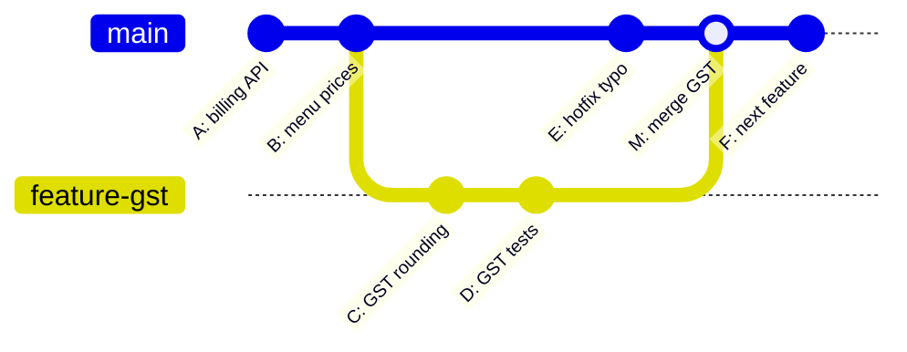
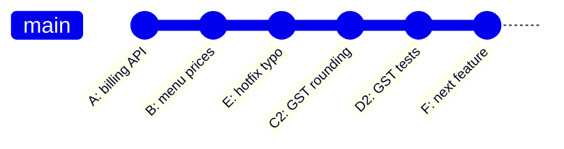
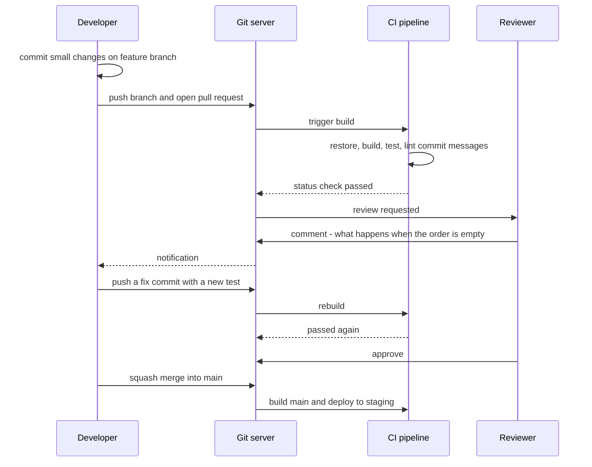

Software is never written once. It is changed hundreds of times by several people, often at the same time, and sometimes a change has to be undone at 11 p.m. because it broke billing. **Git** is the tool almost every team uses to keep track of those changes: who changed what, when, and why, with the ability to go back to any earlier version. On top of Git, teams use **pull requests** and **code reviews** so that no change reaches the main code without a second pair of eyes. This lesson explains how Git works underneath, so its commands stop feeling like magic spells, then covers the team habits around it. The C# part is a small tool that checks commit messages.

## Learning objectives

By the end of this lesson you will be able to:

1. Explain the working directory, staging area, commits, branches, `HEAD` and remotes, and draw how they relate.
2. Make small, focused commits with clear messages, and keep secrets and build output out of the repository.
3. Create branches, merge them, and resolve a merge conflict calmly.
4. Explain the difference between merge and rebase, and follow the golden rule of rebasing.
5. Undo mistakes safely with `restore`, `revert`, `reset` and `reflog`, knowing which are safe on shared branches.
6. Open a pull request that is easy to review, and give and receive review comments professionally.
7. Build and test a commit-message linter in C# that a Git hook or CI pipeline can run.

## Prerequisites

- [What is software engineering?](#/lesson/m01-software-engineering): why teams, maintenance and change matter.
- [Variables, types, conditions, loops and functions in C#](#/lesson/m01-csharp-basics), for the C# tool in this lesson.
- Git installed (`git --version` should print 2.40 or newer) and a terminal. A GitHub, GitLab or Azure DevOps account helps for the pull request parts.

## Explain it like I'm a beginner

### The drawing register

On an infrastructure project, every drawing goes through revisions. The bridge general arrangement drawing is issued as Revision A, then B after the client's comments, then C "Issued for Construction". The **drawing register** records each revision: what changed, who changed it, who checked it, and when. Nobody overwrites Revision B with C and throws B away; if C turns out to be wrong, the team can go back and see exactly what B said.

Git is a drawing register for code:

| Drawing office | Git | Technical term |
|---|---|---|
| The drawing on your desk that you are editing | the files in your project folder | working directory |
| The sheets you have marked "ready to issue" | changes you have selected for the next save | staging area (index) |
| An issued revision with its description, date and author | a saved snapshot with a message | commit |
| A designer working on "Option 2 with a longer span" without touching the issued set | a separate line of work | branch |
| Combining Option 2 into the main set after approval | joining branches | merge |
| The checker who reviews before issue | a colleague reviewing your change | code review |
| "Please check and approve Revision C" | a request to merge your branch | pull request |

### Save points in a game

A second picture: a video game with save points. Before the difficult boss fight you save. If it goes badly you reload and try again. Git commits are save points for your project, except that you can label each one ("Add GST rounding"), keep all of them, compare any two, and share them with your team.

## First-principles explanation

### What Git stores

A Git **repository** is your project folder plus a hidden `.git` folder that holds the entire history. Git is **distributed**: every clone has the full history, so you can commit, look at history and create branches with no network connection.

A **commit** is a snapshot of *all* tracked files at one moment (Git stores unchanged files efficiently, so this is cheap), plus:

- the author and date,
- a message explaining the change,
- a pointer to its **parent** commit (or two parents, for a merge).

Each commit is identified by a **hash**, a 40-character fingerprint of its content such as `3f9a1c2...` (usually shortened to 7 characters). Change anything in a commit, even one letter of its message, and the hash changes. That is why history can be trusted: you can't quietly edit an old commit without every later hash changing too.

Because each commit points to its parent, history is a chain (more precisely, a graph) of snapshots.

### The three areas

Your changes move through three places:

1. **Working directory**: the files you edit.
2. **Staging area**: the set of changes you've chosen for the next commit. It lets you commit only *part* of what you changed.
3. **Repository**: the committed history.

```text
git status                       # what changed, and what is staged
git add src/Billing/Gst.cs        # stage one file
git add -p                        # stage selected parts of files, hunk by hunk
git commit -m "Round GST to paise using away-from-zero"
git log --oneline --graph         # see the history as a graph
git diff                          # unstaged changes
git diff --staged                 # staged changes, i.e. what will be committed
```

### Branches are just labels

A **branch** is a movable label that points to one commit. `main` is a label. When you commit on `main`, the label moves forward to the new commit. Creating a branch creates a new label; it costs almost nothing.

**`HEAD`** means "where I am now": usually it points to a branch, which points to a commit.

```text
git switch -c feature/gst-rounding    # create a branch and move to it
git switch main                       # go back to main
git branch                            # list local branches
git branch -d feature/gst-rounding    # delete a branch that has been merged
```

(`git switch` and `git restore` are the modern commands. Older tutorials use `git checkout` for both jobs; it still works.)

### Remotes: sharing with the team

A **remote** is another copy of the repository, usually on a server such as GitHub, GitLab or Azure DevOps, named `origin` by default.

```text
git clone https://github.com/example/site-billing.git   # copy a repository, with full history
git fetch                      # download new commits from origin, change nothing locally
git pull                       # fetch, then integrate into your current branch
git push -u origin feature/gst-rounding    # upload your branch the first time
git push                       # later pushes
```

`git pull` is `fetch` followed by a merge (or a rebase, if you set `git config --global pull.rebase true`). When in doubt, `fetch` first and look at what arrived.

### What makes a good commit

- **One logical change.** "Add GST rounding and its tests" is one change. "Add GST rounding, rename 40 files and upgrade a package" is three. Small commits are easy to review, easy to revert, and easy to understand in a year.
- **It builds and its tests pass.** Every commit on `main` should be a working save point. This also makes `git bisect` (below) useful.
- **A message that explains why.** The diff shows *what* changed; the message must say *why*.

The widely used message format:

```text
Round GST to paise using away-from-zero

Banker's rounding (the .NET default) produced invoices one paisa lower
than the supplier's system for amounts ending in exactly half a paisa.
Finance confirmed the contract requires away-from-zero rounding.

Refs: #482
```

- A **subject line** of about 50 characters, at most 72, in the **imperative mood** ("Round GST", not "Rounded GST" or "Rounding GST"). A good test: "If applied, this commit will *round GST to paise*."
- No full stop at the end of the subject.
- A **blank line**, then a **body** wrapped at about 72 characters explaining the reason, any trade-offs, and links to the issue.

Many teams also use **Conventional Commits**: a short type prefix such as `feat:`, `fix:`, `docs:`, `refactor:`, `test:` or `chore:`, with an optional scope (`fix(billing): ...`) and `!` or a `BREAKING CHANGE:` footer for incompatible changes. Tools can then generate changelogs and work out the next version number automatically, which is exercise 5.

### What not to commit

- **Build output**: `bin/` and `obj/` folders. They are regenerated by `dotnet build`, and committing them causes constant conflicts.
- **Personal editor files**: `.vs/`, `.idea/`, `*.user`.
- **Secrets**: passwords, connection strings with passwords, API keys, private certificates. Use user secrets (`dotnet user-secrets`) in development and a vault (such as Azure Key Vault) in production.

A `.gitignore` file lists patterns Git should ignore. `dotnet new gitignore` creates a good one for .NET projects.

If a secret *is* committed and pushed, assume it is compromised: **rotate it immediately** (change the password or revoke the key). Deleting the file in a new commit doesn't help, because the secret is still in history, and rewriting shared history is disruptive and often too late anyway.

### Merging

When your feature branch is ready, you integrate it into `main`. Two situations:

- **Fast-forward**: `main` hasn't moved since you branched. Git simply moves the `main` label forward to your last commit. No new commit is created.
- **Three-way merge**: both branches have new commits. Git finds their common ancestor (the **merge base**), compares both sides to it, and creates a **merge commit** with two parents.

```text
git switch main
git pull                          # get the latest main
git merge feature/gst-rounding    # fast-forward or merge commit
```

### Merge conflicts

A **conflict** happens when both branches changed the *same lines* of the same file differently. Git can't guess which is right, so it stops and marks the spot:

```text
<<<<<<< HEAD
    public const decimal GstRate = 0.18m;
=======
    public const decimal GstRate = 0.12m;
>>>>>>> feature/gst-rounding
```

Everything between `<<<<<<<` and `=======` is the current branch's version; between `=======` and `>>>>>>>` is the incoming one. To resolve:

1. Talk to the person who made the other change if the right answer isn't obvious. Conflicts are a *communication* problem first.
2. Edit the file to the correct final content and delete the three marker lines.
3. Build and run the tests.
4. `git add` the file, then `git commit` (or `git merge --continue`).

`git merge --abort` returns you to the state before the merge if you want to start again. Conflicts are normal and not dangerous; what causes them is long-lived branches that drift far from `main`.

### Rebasing

**Rebase** is the other way to bring branches together. Instead of a merge commit, it **replays** your commits one by one on top of the latest `main`, as if you had started your work from there:

```text
git switch feature/gst-rounding
git fetch
git rebase origin/main            # replay my commits on top of the latest main
# resolve any conflicts commit by commit, then:
git rebase --continue
```

The result is a **linear history** that reads like a straight story. The price: your rebased commits are **new commits** with new hashes (their parents changed), and the old ones are abandoned.

That leads to the **golden rule of rebasing**: *never rebase commits that other people have already based work on*, such as `main` or a branch a colleague is also using. Their copies still contain the old commits, and the histories diverge painfully. Rebasing your own unshared feature branch is fine, and so is the force-push it requires (`git push --force-with-lease`, which refuses to overwrite commits you haven't seen).

**Interactive rebase** (`git rebase -i origin/main`) lets you tidy your own branch before review: squash "fix typo" commits into the commit they fix, reorder, or reword messages.

| | Merge | Rebase |
|---|---|---|
| History | true record, with merge commits | linear, rewritten |
| Safe on shared branches | yes | no (golden rule) |
| Conflicts | resolved once | possibly once per replayed commit |
| Good for | integrating into `main`, shared branches | updating your own feature branch, tidying before review |

Many teams use a mix: rebase your own branch on `main` while working, and let the pull request **squash-merge** (combine the branch into one commit on `main`) or merge at the end. Pick one convention as a team and write it down.

### Branching strategies

- **Trunk-based development**: everyone integrates small changes into `main` (the trunk) at least daily, through short-lived branches of a day or two. Unfinished features hide behind feature flags. This keeps conflicts small and is common in teams with good automated tests and [CI/CD](#/lesson/m15-ci-cd).
- **GitFlow**: long-lived `develop` and `main` branches plus release and hotfix branches. More ceremony; suited to products with scheduled releases and several versions in support. Many teams that adopted it have moved to simpler models.

Whatever the model, the main lesson is the same: **short-lived branches and small pull requests** cause fewer conflicts and better reviews.

### Undoing things

| Situation | Command | Safe on pushed commits? |
|---|---|---|
| Discard unstaged edits to a file | `git restore Gst.cs` | (local only; the edits are lost) |
| Unstage a file but keep the edits | `git restore --staged Gst.cs` | yes |
| Fix the last commit's message or add a forgotten file | `git commit --amend` | no: rewrites the commit |
| Undo a commit that's already on `main` | `git revert <hash>` | **yes**: adds a new commit that reverses it |
| Move your branch back, discarding local commits | `git reset --hard <hash>` | no: rewrites history, loses work |
| Put work aside to switch tasks | `git stash`, later `git stash pop` | (local only) |
| "I lost a commit after a bad reset or rebase" | `git reflog` shows where `HEAD` has been; `git switch -c rescue <hash>` | (local safety net) |

The rule of thumb: **on shared branches, add new commits (`revert`); never rewrite (`reset`, `amend`, `rebase`)**.

### Finding the commit that broke things

`git bisect` performs a binary search over history. You mark one commit "good" and one "bad", Git checks out the commit halfway between, you test it and say `git bisect good` or `git bisect bad`, and repeat. With 1,000 commits between good and bad, about 10 steps find the culprit (2¹⁰ = 1,024). You can even automate it: `git bisect run dotnet test`. This only works well if every commit builds, which is one more reason for small, working commits.

### Pull requests

A **pull request** (GitHub, Bitbucket; GitLab calls it a merge request) asks the team to merge your branch. It brings together the diff, an automated **CI** build that runs the tests, and the review conversation. Branch protection rules on `main` typically require a passing build and at least one approval before merging.

A pull request that is easy to review:

- **Is small.** As a widely quoted guideline from industry studies of code review, reviewers find defects much less effectively once a review goes beyond roughly 200 to 400 changed lines. Split big work into a series of small PRs (first the refactor, then the feature, then the clean-up).
- **Has a description that answers**: what changed, why, how it was tested, anything risky, and screenshots for UI changes. Link the issue.
- **Has been reviewed by its author first.** Read your own diff in the PR view before asking anyone else. You will catch leftover debug code and stray files.
- **Passes CI** before you request review.

### Code review etiquette

Code review is about the **code**, never the person. Its goals are catching defects, sharing knowledge across the team, and keeping the codebase consistent.

For **reviewers**:

- Review promptly, ideally within one working day; a PR waiting a week blocks a colleague.
- **Ask, don't command**: "What happens here if `lines` is empty?" invites thinking; "This is wrong" invites defensiveness.
- **Explain why**, and link to the guideline or doc when there is one.
- **Label your comments**: blocking issue, suggestion, question, or "nit" (a minor point the author may ignore).
- **Praise good work** specifically: "Nice use of `TimeProvider` here, the tests read really clearly."
- Don't argue about formatting: let tools (`dotnet format`, an `.editorconfig`, analysers) enforce style automatically.
- Look at the important things first: correctness, security, tests, design and naming, then style.

For **authors**:

- Assume good intent. A comment on your code isn't a comment on your ability.
- Respond to every comment: fix it, or explain why not. "Done" is a fine answer.
- If a thread goes back and forth more than twice, talk in person or on a call; then summarise the decision in the PR.
- Don't take an approval as a guarantee: you still own the change in production.

The [design review lesson](#/lesson/m19-design-review) applies the same etiquette to architecture discussions.

## Visual explanation

### Merge: the branches join



This **commit graph** reads left to right as time. `main` had commits A and B when the feature branch was created. The branch got two commits (C and D) while, meanwhile, someone pushed a hotfix E to `main`. Because both sides moved, Git creates a **merge commit M** with two parents, E and D. Nothing is rewritten: the graph is a true record that two lines of work happened in parallel. If E and C had changed the same lines, the merge would have stopped with a conflict for a human to resolve.

### Rebase: the same work, replayed



The same work after `git rebase main` on the feature branch, then a fast-forward merge. Commits C and D were **replayed** on top of E, becoming new commits **C2** and **D2** with new hashes, because their parent changed. History is now a straight line and easier to read, but it no longer shows that the work happened in parallel. That trade-off, a cleaner story versus a true record, is the whole merge-versus-rebase debate. It also shows why rebasing a *shared* branch hurts: anyone holding the old C and D now has commits that no longer exist in your history.

### The life of a pull request



This sequence diagram follows one change from a laptop to the staging server. The developer **pushes** a branch and opens a pull request. The Git server immediately asks the **CI pipeline** to build, run the tests and run checks such as the commit-message linter from this lesson; a red result blocks the merge. A **reviewer** is notified and asks a question rather than issuing an order. The developer answers with code (a fix plus a test), which triggers CI again. Only with a green build *and* an approval can the branch be **merged**, here as a squash merge, and merging to `main` triggers the next pipeline that deploys to staging. Every arrow is automated except the two human ones: writing the code and reviewing it.

## Step-by-step example

Asha and Ravi work on a site-billing service. Follow along in a scratch folder; every command is real.

### Step 1: create the repository and the first commit

```text
mkdir site-billing && cd site-billing
git init -b main
dotnet new console -n Billing
dotnet new gitignore
git add .
git status                        # bin/ and obj/ are not listed: .gitignore works
git commit -m "Create billing console app"
```

### Step 2: a feature branch with two small commits

```text
git switch -c feature/gst-rounding
# edit Billing/Program.cs: add the GST calculation
git add Billing/Program.cs
git commit -m "Add GST calculation with away-from-zero rounding"
# add a test project and tests
git add .
git commit -m "Add tests for GST rounding at half-paisa amounts"
git log --oneline --graph --all
```

### Step 3: meanwhile, main moves

Ravi fixes the same line on `main` (simulate it yourself):

```text
git switch main
# edit the GST rate line in Billing/Program.cs differently
git commit -am "Read GST rate from configuration"
```

### Step 4: merge and meet a conflict

```text
git merge feature/gst-rounding
# Auto-merging Billing/Program.cs
# CONFLICT (content): Merge conflict in Billing/Program.cs
# Automatic merge failed; fix conflicts and then commit the result.
git status                        # shows "both modified: Billing/Program.cs"
```

Open the file, decide with Ravi what the correct line is (configuration-based rate *and* away-from-zero rounding), remove the markers, then:

```text
dotnet build && dotnet test
git add Billing/Program.cs
git commit                        # Git proposes a merge message; keep or improve it
git log --oneline --graph
```

### Step 5: the same with rebase

Reset your practice repository to before the merge (`git reset --hard HEAD~1` on `main`, which is fine here because nothing is shared), then:

```text
git switch feature/gst-rounding
git rebase main
# conflict in the first replayed commit: resolve as before, then
git add Billing/Program.cs
git rebase --continue
git switch main
git merge feature/gst-rounding    # now a fast-forward: no merge commit
git log --oneline --graph
```

Compare the two graphs. Same final code, different history.

### Step 6: undo a bad change on a shared branch

A commit on `main` turns out to break invoices:

```text
git log --oneline -5
git revert 3f9a1c2                # creates a new commit that undoes 3f9a1c2
git push
```

Nobody's history is rewritten; the fix is just another commit.

## Production-style C# implementation

A commit-message linter: a small console tool that a Git `commit-msg` hook, or a CI step, runs on each message. Each rule is a small class, so rules are easy to test and to add.

```text
tools/CommitLint/
  Program.cs                 // reads the message file, prints issues, sets the exit code
  CommitLint/
    LintIssue.cs             // one problem found
    CommitMessage.cs         // parses raw text into subject and body
    ICommitRule.cs           // the contract every rule follows
    Rules.cs                 // the individual rules
    CommitLinter.cs          // runs all rules
```

```csharp file=CommitLint/LintIssue.cs
namespace CommitLint;

public enum Severity { Warning, Error }

public sealed record LintIssue(string RuleId, Severity Severity, string Message)
{
    public override string ToString() => $"{(Severity == Severity.Error ? "error" : "warning")} [{RuleId}] {Message}";
}
```

```csharp file=CommitLint/CommitMessage.cs
namespace CommitLint;

/// <summary>A commit message split into subject and body. Comment lines (starting with '#'),
/// which Git adds to the editor template, are removed, as Git itself does by default.</summary>
public sealed class CommitMessage
{
    private CommitMessage(string subject, IReadOnlyList<string> lines)
    {
        Subject = subject;
        Lines = lines;
    }

    public string Subject { get; }

    /// <summary>All lines, including the subject at index 0.</summary>
    public IReadOnlyList<string> Lines { get; }

    public bool HasBody => Lines.Count > 1;
    public bool HasBlankLineAfterSubject => Lines.Count < 2 || Lines[1].Length == 0;
    public IEnumerable<string> BodyLines => Lines.Skip(2);

    public static CommitMessage Parse(string? raw)
    {
        var lines = (raw ?? "")
            .Replace("\r\n", "\n")
            .Split('\n')
            .Where(l => !l.StartsWith('#'))
            .Select(l => l.TrimEnd())
            .ToList();

        while (lines.Count > 0 && lines[^1].Length == 0) lines.RemoveAt(lines.Count - 1);   // trailing blank lines
        while (lines.Count > 0 && lines[0].Length == 0) lines.RemoveAt(0);                  // leading blank lines

        return new CommitMessage(lines.Count > 0 ? lines[0] : "", lines);
    }
}
```

```csharp file=CommitLint/ICommitRule.cs
namespace CommitLint;

public interface ICommitRule
{
    string Id { get; }
    IEnumerable<LintIssue> Check(CommitMessage message);
}
```

```csharp file=CommitLint/Rules.cs
using System.Text.RegularExpressions;

namespace CommitLint;

public sealed class SubjectRequiredRule : ICommitRule
{
    public string Id => "subject-required";
    public IEnumerable<LintIssue> Check(CommitMessage m)
    {
        if (m.Subject.Length == 0) yield return new LintIssue(Id, Severity.Error, "The commit message is empty.");
    }
}

public sealed class SubjectLengthRule(int warnAt = 50, int maxLength = 72) : ICommitRule
{
    public string Id => "subject-length";
    public IEnumerable<LintIssue> Check(CommitMessage m)
    {
        if (m.Subject.Length > maxLength)
            yield return new LintIssue(Id, Severity.Error, $"Subject is {m.Subject.Length} characters; keep it to {maxLength} or fewer.");
        else if (m.Subject.Length > warnAt)
            yield return new LintIssue(Id, Severity.Warning, $"Subject is {m.Subject.Length} characters; about {warnAt} reads best.");
    }
}

public sealed class SubjectNoTrailingPeriodRule : ICommitRule
{
    public string Id => "subject-no-period";
    public IEnumerable<LintIssue> Check(CommitMessage m)
    {
        if (m.Subject.EndsWith('.')) yield return new LintIssue(Id, Severity.Error, "Do not end the subject with a full stop.");
    }
}

public sealed class BlankLineAfterSubjectRule : ICommitRule
{
    public string Id => "blank-line";
    public IEnumerable<LintIssue> Check(CommitMessage m)
    {
        if (!m.HasBlankLineAfterSubject)
            yield return new LintIssue(Id, Severity.Error, "Leave one blank line between the subject and the body.");
    }
}

public sealed class NoWorkInProgressRule : ICommitRule
{
    private static readonly string[] s_markers = ["wip", "fixup!", "squash!", "tmp", "do not merge"];
    public string Id => "no-wip";
    public IEnumerable<LintIssue> Check(CommitMessage m)
    {
        var subject = m.Subject.TrimStart();
        foreach (var marker in s_markers)
        {
            if (subject.StartsWith(marker, StringComparison.OrdinalIgnoreCase))
            {
                yield return new LintIssue(Id, Severity.Error, $"'{marker}' commits must be squashed before merging.");
                yield break;
            }
        }
    }
}

/// <summary>A heuristic, not grammar checking: flags common past-tense and -ing forms as the first word.</summary>
public sealed class ImperativeMoodRule : ICommitRule
{
    private static readonly HashSet<string> s_nonImperative = new(StringComparer.OrdinalIgnoreCase)
    {
        "added", "adding", "adds", "fixed", "fixing", "fixes", "updated", "updating", "updates",
        "removed", "removing", "removes", "changed", "changing", "changes", "created", "creating", "creates",
        "refactored", "refactoring", "implemented", "implementing", "improved", "improving",
    };

    public string Id => "imperative-mood";
    public IEnumerable<LintIssue> Check(CommitMessage m)
    {
        var description = ConventionalHeader.StripPrefix(m.Subject);
        var firstWord = description.Split(' ', 2, StringSplitOptions.RemoveEmptyEntries).FirstOrDefault() ?? "";
        if (s_nonImperative.Contains(firstWord))
            yield return new LintIssue(Id, Severity.Warning,
                $"Start with an imperative verb (\"Add\", \"Fix\"), not \"{firstWord}\". Test: \"If applied, this commit will ...\"");
    }
}

public sealed class BodyLineLengthRule(int maxLength = 100) : ICommitRule
{
    public string Id => "body-line-length";
    public IEnumerable<LintIssue> Check(CommitMessage m)
    {
        int lineNo = 2;
        foreach (var line in m.BodyLines)
        {
            lineNo++;
            if (line.Length > maxLength && !line.Contains("://"))      // long URLs are allowed
                yield return new LintIssue(Id, Severity.Warning, $"Body line {lineNo} is {line.Length} characters; wrap at about 72.");
        }
    }
}

/// <summary>Optional rule for teams that use Conventional Commits, e.g. "fix(billing): round GST".</summary>
public sealed class ConventionalHeaderRule : ICommitRule
{
    public string Id => "conventional-header";
    public IEnumerable<LintIssue> Check(CommitMessage m)
    {
        if (!ConventionalHeader.IsValid(m.Subject))
            yield return new LintIssue(Id, Severity.Error,
                $"Use '<type>(<scope>): <description>' with type one of: {string.Join(", ", ConventionalHeader.Types)}.");
    }
}

public static class ConventionalHeader
{
    public static readonly string[] Types = ["feat", "fix", "docs", "style", "refactor", "perf", "test", "build", "ci", "chore", "revert"];

    private static readonly Regex s_header = new(
        @"^(?<type>[a-z]+)(\((?<scope>[a-z0-9\-]+)\))?!?: (?<desc>\S.*)$", RegexOptions.CultureInvariant);

    public static bool IsValid(string subject)
    {
        var match = s_header.Match(subject);
        return match.Success && Types.Contains(match.Groups["type"].Value);
    }

    public static string StripPrefix(string subject)
    {
        var match = s_header.Match(subject);
        return match.Success ? match.Groups["desc"].Value : subject;
    }
}
```

```csharp file=CommitLint/CommitLinter.cs
namespace CommitLint;

public sealed record LintReport(IReadOnlyList<LintIssue> Issues)
{
    public bool HasErrors => Issues.Any(i => i.Severity == Severity.Error);
}

public sealed class CommitLinter(IEnumerable<ICommitRule> rules)
{
    private readonly ICommitRule[] _rules = rules.ToArray();

    public static CommitLinter CreateDefault(bool requireConventional = false)
    {
        var rules = new List<ICommitRule>
        {
            new SubjectRequiredRule(),
            new SubjectLengthRule(),
            new SubjectNoTrailingPeriodRule(),
            new BlankLineAfterSubjectRule(),
            new NoWorkInProgressRule(),
            new ImperativeMoodRule(),
            new BodyLineLengthRule(),
        };
        if (requireConventional) rules.Add(new ConventionalHeaderRule());
        return new CommitLinter(rules);
    }

    public LintReport Lint(string? rawMessage)
    {
        var message = CommitMessage.Parse(rawMessage);
        if (message.Subject.Length == 0)                         // nothing else is meaningful
            return new LintReport(new SubjectRequiredRule().Check(message).ToArray());

        return new LintReport(_rules.SelectMany(r => r.Check(message)).ToArray());
    }
}
```

```csharp file=Program.cs
using CommitLint;

// Usage: CommitLint <path-to-message-file> [--conventional]
// Git's commit-msg hook passes the path of the file holding the message being committed.
if (args.Length == 0)
{
    Console.Error.WriteLine("usage: CommitLint <message-file> [--conventional]");
    return 2;
}

string text;
try
{
    text = File.ReadAllText(args[0]);
}
catch (IOException ex)
{
    Console.Error.WriteLine($"Cannot read {args[0]}: {ex.Message}");
    return 2;
}

var linter = CommitLinter.CreateDefault(requireConventional: args.Contains("--conventional"));
var report = linter.Lint(text);

foreach (var issue in report.Issues) Console.Error.WriteLine(issue);
if (report.HasErrors) Console.Error.WriteLine("Commit rejected. Fix the message, or see CONTRIBUTING.md.");

return report.HasErrors ? 1 : 0;     // a non-zero exit code makes Git abort the commit
```

To use it as a hook, save a script as `.git/hooks/commit-msg` (and make it executable on Linux and macOS):

```text
#!/bin/sh
dotnet run --project tools/CommitLint -- "$1" || exit 1
```

Hooks in `.git/hooks` are not shared through the repository. To share them, commit them to a folder such as `.githooks/` and have each developer run `git config core.hooksPath .githooks` once, or use a tool such as Husky.Net. Because hooks can be skipped (`git commit --no-verify`), run the same linter in CI as the real gate.

What to notice:

- **One class per rule.** Each rule has an `Id`, can be tested alone, and can be switched on or off. Adding a rule never touches the others (an early taste of the [Open/Closed Principle](#/lesson/m04-ocp)).
- **Errors versus warnings.** An empty subject blocks the commit; a 55-character subject only warns. Being too strict makes people bypass the tool.
- **`ImperativeMoodRule` is a heuristic**, honestly labelled. It catches the common "Added", "Fixed" and "Updating" cases without pretending to understand English grammar.
- **The exit code is the API.** Git and CI systems only look at whether a program exits with 0. `return 1` aborts the commit.
- **Comment lines are removed**, like Git does, so the template text in the editor doesn't trigger rules.
- **Limits.** `dotnet run` takes a second or two per commit, which some developers will find slow. Publishing the tool once (`dotnet publish`) or installing it as a .NET tool makes the hook faster.

## Bad design vs good design

**Bad**: a history and a pull request that nobody can review or trust.

```text
* 9c1e2aa  final changes
* 77ab310  fix
* 41d0c9f  wip
* e83f210  changes asked by sir
* 1a2b3c4  update
```

The matching pull request: "Billing changes", 3,400 changed lines across 61 files, including a reformatted solution, a package upgrade, a new feature and two bug fixes, with `bin/` folders and an `appsettings.Development.json` containing a database password. A reviewer either spends a day on it or, more realistically, writes "LGTM" ("looks good to me") after five minutes.

Review comments on it:

```text
"This is wrong."
"Why would you do it like this??"
"We don't write code like this here."
```

Problems: commit messages say nothing, so `git log` and `git blame` can't explain any line a year from now; `git bisect` lands on "fix"; the PR is too large to review properly, so defects pass; the leaked password must now be rotated; and the review comments give the author no information and plenty of resentment.

**Good**:

```text
* 5d4e3f2  Add GST summary to the invoice PDF
* 4c3b2a1  Round GST to paise using away-from-zero
* 3b2a190  Extract GstCalculator from InvoiceService
```

Three PRs instead of one: the refactor (behaviour unchanged, characterisation tests green), the rounding fix (with its tests), and the PDF feature. Each is under 300 lines with a description of what, why and how it was tested. Secrets live in user secrets, and `.gitignore` excludes build output.

Review comments rewritten:

```text
"Blocking: if lines is empty, Sum() returns 0 and we issue a zero-value invoice.
Could we reject empty invoices here, or is that intended?"
"Suggestion: extracting this loop into GstCalculator would let us test the
rounding on its own. Happy to pair on it."
"Nit: 'calc' could be 'gstCalculator' for consistency with InvoiceService."
"Nice: the half-paisa test cases make the rounding rule really clear."
```

**Is the improvement always worth it?** For a personal experiment, "wip" commits are fine, as long as you squash them before sharing. Ceremony should scale with the number of people and the cost of mistakes. A one-line typo fix doesn't need a three-paragraph PR description; a change to payment logic does.

:::callout type=warning title="Force-pushing to main"
`git push --force` to a shared branch rewrites everyone's history, can silently delete colleagues' commits and confuses CI. Protect `main` on the server so that nobody can force-push to it, and use `--force-with-lease` only on your own branches.
:::

## Practical playground

The playground runs C#, not Git, so it runs a compact version of the linter on sample messages. Predict which messages pass before you run it, then add your own last five commit messages from a real project.

:::playground type=csharp title="Lint some commit messages"
```csharp file=Program.cs
using System;
using System.Collections.Generic;
using System.Linq;

public static class MiniLinter
{
    static readonly HashSet<string> NonImperative = new(StringComparer.OrdinalIgnoreCase)
        { "added", "adding", "fixed", "fixing", "updated", "updating", "changed", "removed" };

    public static List<string> Lint(string raw)
    {
        var problems = new List<string>();
        var lines = raw.Replace("\r\n", "\n").Split('\n').Select(l => l.TrimEnd()).ToList();
        string subject = lines[0];

        if (subject.Length == 0) { problems.Add("error: empty subject"); return problems; }
        if (subject.Length > 72) problems.Add($"error: subject is {subject.Length} chars (max 72)");
        else if (subject.Length > 50) problems.Add($"warning: subject is {subject.Length} chars (50 reads best)");
        if (subject.EndsWith('.')) problems.Add("error: subject ends with a full stop");
        if (lines.Count > 1 && lines[1].Length > 0) problems.Add("error: no blank line after the subject");
        if (subject.StartsWith("wip", StringComparison.OrdinalIgnoreCase)) problems.Add("error: work-in-progress commit");

        string firstWord = subject.Split(' ')[0].TrimEnd(':');
        if (subject.Contains(": ")) firstWord = subject[(subject.IndexOf(": ") + 2)..].Split(' ')[0];
        if (NonImperative.Contains(firstWord)) problems.Add($"warning: '{firstWord}' is not imperative, try 'Add' or 'Fix'");

        return problems;
    }
}

public static class Program
{
    public static void Main()
    {
        string[] messages =
        [
            "Round GST to paise using away-from-zero",
            "fixed bug.",
            "wip",
            "Added retry for the SMS gateway when it returns 503 Service Unavailable errors",
            "fix(billing): handle empty invoices\nThey caused a divide by zero.",
            "feat(reports): add chainage-wise progress export\n\nSite engineers asked for an Excel export per 1 km section.",
            "",
        ];

        foreach (var message in messages)
        {
            var subject = message.Split('\n')[0];
            var problems = MiniLinter.Lint(message);
            Console.WriteLine($"\"{subject}\"");
            Console.WriteLine(problems.Count == 0 ? "  OK" : "  " + string.Join("\n  ", problems));
        }

        // Experiments:
        // 1. Rewrite "fixed bug." into a message a teammate would understand in a year.
        // 2. Add a rule: the subject must not contain the word "misc". Where does it go?
        // 3. Paste the subjects of your last five real commits into the array. How do they score?
        // 4. Should "Merge branch 'main' into feature/x" pass? Git writes it, not you.
    }
}
```
:::

## Exercises

:::exercise id=m01-git-ex1 difficulty=beginner kind=code title="Check a commit subject line"
Write a small checker that a team could run on commit messages. It returns the ids of the rules a message breaks.
::requirements
- `SubjectChecker.Check(string? message)` returns an `IReadOnlyList<string>` of rule ids, in this order when several apply: `"too-long"`, `"trailing-period"`, `"wip"`, `"missing-blank-line"`.
- The subject is the first line, with trailing spaces removed. Treat `\r\n` like `\n`.
- `null`, empty or whitespace-only subject: return only `"empty"`.
- `"too-long"`: subject longer than 72 characters. Exactly 72 is fine.
- `"trailing-period"`: subject ends with `.`.
- `"wip"`: subject starts with "wip" in any letter case.
- `"missing-blank-line"`: there is a second line and it is not empty.
- A good message returns an empty list.
::acceptance
- `"Add GST rounding"` gives no problems.
- `"Fix login bug."` gives `["trailing-period"]`.
- `"WIP: half done"` gives `["wip"]`.
- A 73-character subject gives `["too-long"]`; 72 characters gives none.
- `"Fix tax\nBecause it was wrong"` gives `["missing-blank-line"]`, and `"Fix tax\r\n\r\nBecause..."` gives none.
- `"   "` and `null` give `["empty"]`.
::hint
Start by splitting the message into lines. Normalise `\r\n` to `\n` first with `Replace`.
::hint
Return early for the empty case, so the other rules can assume there is a subject.
::hint
Add problems to a `List<string>` in the required order: one `if` per rule. `StartsWith("wip", StringComparison.OrdinalIgnoreCase)` handles any case.
::hint
```csharp
var lines = (message ?? "").Replace("\r\n", "\n").Split('\n');
var subject = lines[0].TrimEnd();
if (subject.Trim().Length == 0) return new[] { "empty" };
var problems = new List<string>();
if (subject.Length > MaxLength) problems.Add("too-long");
// ...
```
::starter
```csharp file=SubjectChecker.cs
using System;
using System.Collections.Generic;

public static class SubjectChecker
{
    public const int MaxLength = 72;

    public static IReadOnlyList<string> Check(string? message) => throw new NotImplementedException();
}
```
::tests
```csharp file=SubjectCheckerTests.cs
using System;
using Xunit;

public class SubjectCheckerTests
{
    [Fact] public void Good_message_has_no_problems() => Assert.Empty(SubjectChecker.Check("Add GST rounding"));

    [Fact] public void Trailing_period() => Assert.Equal(new[] { "trailing-period" }, SubjectChecker.Check("Fix login bug."));

    [Fact] public void Wip_any_case() => Assert.Equal(new[] { "wip" }, SubjectChecker.Check("WIP: half done"));

    [Fact]
    public void Length_boundary()
    {
        Assert.Empty(SubjectChecker.Check(new string('a', 72)));
        Assert.Equal(new[] { "too-long" }, SubjectChecker.Check(new string('a', 73)));
    }

    [Fact]
    public void Missing_blank_line() =>
        Assert.Equal(new[] { "missing-blank-line" }, SubjectChecker.Check("Fix tax\nBecause it was wrong"));

    [Fact] public void Windows_line_endings_are_fine() => Assert.Empty(SubjectChecker.Check("Fix tax\r\n\r\nBecause it was wrong"));

    [Fact] public void Trailing_spaces_are_ignored() => Assert.Empty(SubjectChecker.Check("Fix tax   \n\nBody"));

    [Theory]
    [InlineData("")]
    [InlineData("   ")]
    [InlineData(null)]
    public void Empty(string? message) => Assert.Equal(new[] { "empty" }, SubjectChecker.Check(message));

    [Fact]
    public void Several_problems_in_order() =>
        Assert.Equal(new[] { "trailing-period", "wip", "missing-blank-line" }, SubjectChecker.Check("wip.\nmore"));
}
```
::solution
```csharp file=SubjectChecker.cs
using System;
using System.Collections.Generic;

public static class SubjectChecker
{
    public const int MaxLength = 72;

    public static IReadOnlyList<string> Check(string? message)
    {
        string[] lines = (message ?? "").Replace("\r\n", "\n").Split('\n');
        string subject = lines[0].TrimEnd();

        if (subject.Trim().Length == 0) return new[] { "empty" };

        var problems = new List<string>();
        if (subject.Length > MaxLength) problems.Add("too-long");
        if (subject.EndsWith('.')) problems.Add("trailing-period");
        if (subject.StartsWith("wip", StringComparison.OrdinalIgnoreCase)) problems.Add("wip");
        if (lines.Length > 1 && lines[1].TrimEnd().Length > 0) problems.Add("missing-blank-line");
        return problems;
    }
}
```

The empty case returns early, so every later rule can rely on a real subject. Normalising line endings first means one code path handles messages written on Windows, Linux and macOS.
::alternatives
The production linter above uses one class per rule behind an `ICommitRule` interface. For four rules, one method is simpler and perfectly readable; move to separate rule classes when rules need configuration, severities or independent tests.
::mistakes
- Splitting on `Environment.NewLine`, which is `\r\n` on Windows and `\n` elsewhere, so the same message behaves differently on different machines.
- Using `>= 72` for "too long", rejecting a valid 72-character subject.
- Checking `lines[1]` without first checking that a second line exists (`IndexOutOfRangeException`).
::extensions
Add `"lowercase-start"` for subjects that start with a lowercase letter, except when they use a Conventional Commits prefix like `fix:`.
:::

:::exercise id=m01-git-ex2 difficulty=beginner kind=written title="Write the Git commands"
You are on `main`, up to date with the server. Write the exact Git commands, in order, for this story, with a one-line comment for each:

1. Start work on a fix for issue #512 (invoices show the wrong date format) on a new branch.
2. You change `InvoicePdf.cs` and `InvoicePdfTests.cs`, and also, by accident, `appsettings.Development.json`. Commit only the first two files, with a good message.
3. Throw away the accidental change to `appsettings.Development.json`.
4. Push the branch to the server for the first time.
5. A colleague merges another PR into `main`. Bring your branch up to date with the latest `main` using rebase. There is a conflict in `InvoicePdf.cs`: say how you resolve it and finish the rebase.
6. Update the pushed branch safely after the rebase.
7. After your PR is merged, someone finds that one of the commits on `main` (hash `a1b2c3d`, from another developer) breaks the build. Undo it safely.
::acceptance
- A command for every step, in a working order.
- Step 2 stages files individually rather than with `git add .`.
- Step 5 includes `git fetch` (or equivalent) and `git rebase --continue` after resolving.
- Step 6 uses `--force-with-lease`, not plain `--force`, and explains why a force push is needed at all.
- Step 7 uses `git revert`, not `git reset`, and explains why.
- The commit message follows the subject-line rules from this lesson.
::hint
Remember the three areas: working directory, staging area, repository. Which command moves a file from the first to the second?
::hint
After a rebase, your branch's commits have new hashes, so the server copy and your copy have diverged. That is why a normal push is rejected.
::hint
`main` is shared. Which undo command adds a new commit instead of rewriting history?
::solution
```text
# 1. New branch from up-to-date main
git switch -c fix/512-invoice-date-format

# 2. Stage only the two intended files, then commit
git add src/Billing/InvoicePdf.cs tests/Billing.Tests/InvoicePdfTests.cs
git status                                   # confirm appsettings is NOT staged
git commit -m "Format invoice dates as dd-MM-yyyy" -m "Fixes #512. The PDF used the server culture, which is en-US on the build agent."

# 3. Discard the accidental edit
git restore appsettings.Development.json

# 4. First push, setting the upstream branch
git push -u origin fix/512-invoice-date-format

# 5. Rebase on the latest main
git fetch origin
git rebase origin/main
#    CONFLICT in InvoicePdf.cs: open the file, keep both intended changes, delete the markers
dotnet build && dotnet test
git add src/Billing/InvoicePdf.cs
git rebase --continue

# 6. Update the remote branch: history was rewritten, so a force push is required
git push --force-with-lease

# 7. Undo a bad commit on shared main
git switch main
git pull
git revert a1b2c3d                           # new commit that reverses a1b2c3d
git push
```

Why `--force-with-lease`: the rebase replaced your commits with new ones, so the server's branch is no longer an ancestor of yours and a normal push is refused. `--force-with-lease` overwrites it only if nobody else has pushed to it since you last fetched; plain `--force` would silently delete their work.

Why `revert`: `main` is shared. `git reset` would rewrite history that everyone already has, while `revert` adds a new commit that everyone can simply pull. In many teams, step 7 would itself go through a PR.
::mistakes
- `git add .` in step 2, committing the development settings (possibly with secrets).
- `git push --force` in step 6.
- `git reset --hard a1b2c3d~1` followed by a force push to `main` in step 7.
- Forgetting to build and test after resolving the conflict, so the rebased commit is broken.
:::

:::exercise id=m01-git-ex3 difficulty=intermediate kind=code title="A three-way merge, line by line"
Build a simplified version of what `git merge` does for one file. You get three versions of the file as lists of lines: the common ancestor (**base**), **ours** and **theirs**. To keep it simple, the three lists always have the same number of lines (lines are only changed, never inserted or deleted).
::requirements
- `ThreeWayMerge.Merge(base, ours, theirs)` returns a `MergeResult(IReadOnlyList<string> Lines, int Conflicts)`.
- For each line: if ours and theirs are equal, take it. Else if ours equals base, take theirs (only they changed it). Else if theirs equals base, take ours. Otherwise it is a **conflict**.
- Conflicting lines are written as a block: `<<<<<<< ours`, the ours lines, `=======`, the theirs lines, `>>>>>>> theirs`. **Consecutive** conflicting lines go into **one** block. `Conflicts` counts blocks, not lines.
- Lists of different lengths throw `ArgumentException`. A `null` list throws `ArgumentNullException`.
::acceptance
- No changes on either side: the result equals the base and `Conflicts` is 0.
- Only theirs changed line 2: the result has their line 2.
- Both changed line 2 the same way: no conflict.
- Both changed line 2 differently: one block, 5 lines for that position (markers plus two lines), `Conflicts` = 1.
- Both changed lines 2 and 3 differently: one block containing both ours lines then both theirs lines.
- Conflicts on lines 1 and 3 with line 2 unchanged: two blocks.
::hint
Process the lines with an index `i` from 0 to `Count - 1`, deciding each line with the four-way rule.
::hint
For grouping, keep two "pending" lists: `pendingOurs` and `pendingTheirs`. When a line conflicts, add to both. When a line does *not* conflict, first **flush** any pending block to the output, then add the resolved line.
::hint
Don't forget to flush after the loop ends: the file might end with a conflict.
::hint
```csharp
void Flush()
{
    if (pendingOurs.Count == 0) return;
    output.Add(OursMarker);
    output.AddRange(pendingOurs);
    output.Add(Separator);
    output.AddRange(pendingTheirs);
    output.Add(TheirsMarker);
    conflicts++;
    pendingOurs.Clear();
    pendingTheirs.Clear();
}
```
::starter
```csharp file=ThreeWayMerge.cs
using System;
using System.Collections.Generic;

public sealed record MergeResult(IReadOnlyList<string> Lines, int Conflicts);

public static class ThreeWayMerge
{
    public const string OursMarker = "<<<<<<< ours";
    public const string Separator = "=======";
    public const string TheirsMarker = ">>>>>>> theirs";

    public static MergeResult Merge(IReadOnlyList<string> baseLines, IReadOnlyList<string> ours, IReadOnlyList<string> theirs) =>
        throw new NotImplementedException();
}
```
::tests
```csharp file=ThreeWayMergeTests.cs
using System;
using Xunit;

public class ThreeWayMergeTests
{
    private static readonly string[] Base = { "rate = 0.18", "round = ToEven", "currency = INR", "footer = none" };

    [Fact]
    public void No_changes()
    {
        var r = ThreeWayMerge.Merge(Base, Base, Base);
        Assert.Equal(Base, r.Lines);
        Assert.Equal(0, r.Conflicts);
    }

    [Fact]
    public void Only_theirs_changed()
    {
        var theirs = new[] { "rate = 0.18", "round = AwayFromZero", "currency = INR", "footer = none" };
        Assert.Equal(theirs, ThreeWayMerge.Merge(Base, Base, theirs).Lines);
    }

    [Fact]
    public void Each_side_changed_a_different_line()
    {
        var ours = new[] { "rate = 0.12", "round = ToEven", "currency = INR", "footer = none" };
        var theirs = new[] { "rate = 0.18", "round = ToEven", "currency = INR", "footer = GSTIN" };
        var r = ThreeWayMerge.Merge(Base, ours, theirs);
        Assert.Equal(new[] { "rate = 0.12", "round = ToEven", "currency = INR", "footer = GSTIN" }, r.Lines);
        Assert.Equal(0, r.Conflicts);
    }

    [Fact]
    public void Same_change_on_both_sides_is_not_a_conflict()
    {
        var both = new[] { "rate = 0.18", "round = AwayFromZero", "currency = INR", "footer = none" };
        Assert.Equal(0, ThreeWayMerge.Merge(Base, both, both).Conflicts);
    }

    [Fact]
    public void Different_changes_to_one_line_conflict()
    {
        var ours = new[] { "rate = 0.18", "round = AwayFromZero", "currency = INR", "footer = none" };
        var theirs = new[] { "rate = 0.18", "round = Truncate", "currency = INR", "footer = none" };
        var r = ThreeWayMerge.Merge(Base, ours, theirs);
        Assert.Equal(1, r.Conflicts);
        Assert.Equal(new[]
        {
            "rate = 0.18",
            "<<<<<<< ours", "round = AwayFromZero", "=======", "round = Truncate", ">>>>>>> theirs",
            "currency = INR", "footer = none",
        }, r.Lines);
    }

    [Fact]
    public void Adjacent_conflicts_form_one_block()
    {
        var ours = new[] { "rate = 0.18", "round = A", "currency = USD", "footer = none" };
        var theirs = new[] { "rate = 0.18", "round = B", "currency = EUR", "footer = none" };
        var r = ThreeWayMerge.Merge(Base, ours, theirs);
        Assert.Equal(1, r.Conflicts);
        Assert.Equal(new[]
        {
            "rate = 0.18",
            "<<<<<<< ours", "round = A", "currency = USD", "=======", "round = B", "currency = EUR", ">>>>>>> theirs",
            "footer = none",
        }, r.Lines);
    }

    [Fact]
    public void Separated_conflicts_form_two_blocks_including_one_at_the_end()
    {
        var ours = new[] { "rate = 1", "round = ToEven", "currency = INR", "footer = X" };
        var theirs = new[] { "rate = 2", "round = ToEven", "currency = INR", "footer = Y" };
        var r = ThreeWayMerge.Merge(Base, ours, theirs);
        Assert.Equal(2, r.Conflicts);
        Assert.Equal(">>>>>>> theirs", r.Lines[^1]);
    }

    [Fact]
    public void Different_lengths_throw() =>
        Assert.Throws<ArgumentException>(() => ThreeWayMerge.Merge(Base, Base, new[] { "only one" }));

    [Fact]
    public void Null_throws() => Assert.Throws<ArgumentNullException>(() => ThreeWayMerge.Merge(Base, null!, Base));
}
```
::solution
```csharp file=ThreeWayMerge.cs
using System;
using System.Collections.Generic;

public sealed record MergeResult(IReadOnlyList<string> Lines, int Conflicts);

public static class ThreeWayMerge
{
    public const string OursMarker = "<<<<<<< ours";
    public const string Separator = "=======";
    public const string TheirsMarker = ">>>>>>> theirs";

    public static MergeResult Merge(IReadOnlyList<string> baseLines, IReadOnlyList<string> ours, IReadOnlyList<string> theirs)
    {
        ArgumentNullException.ThrowIfNull(baseLines);
        ArgumentNullException.ThrowIfNull(ours);
        ArgumentNullException.ThrowIfNull(theirs);
        if (ours.Count != baseLines.Count || theirs.Count != baseLines.Count)
            throw new ArgumentException("This simplified merge needs three versions with the same number of lines.");

        var output = new List<string>(baseLines.Count);
        var pendingOurs = new List<string>();
        var pendingTheirs = new List<string>();
        int conflicts = 0;

        void Flush()
        {
            if (pendingOurs.Count == 0) return;
            output.Add(OursMarker);
            output.AddRange(pendingOurs);
            output.Add(Separator);
            output.AddRange(pendingTheirs);
            output.Add(TheirsMarker);
            conflicts++;
            pendingOurs.Clear();
            pendingTheirs.Clear();
        }

        for (int i = 0; i < baseLines.Count; i++)
        {
            string b = baseLines[i], o = ours[i], t = theirs[i];

            string? resolved =
                o == t ? o :            // same on both sides (changed or not)
                o == b ? t :            // only theirs changed
                t == b ? o :            // only ours changed
                null;                   // both changed, differently

            if (resolved is null)
            {
                pendingOurs.Add(o);
                pendingTheirs.Add(t);
            }
            else
            {
                Flush();
                output.Add(resolved);
            }
        }
        Flush();                        // the file may end inside a conflict

        return new MergeResult(output, conflicts);
    }
}
```

The four-way rule is the heart of every three-way merge: comparing each side with the **base** is what lets Git tell "they changed it" from "we changed it". Without the base, any difference between ours and theirs would look like a conflict. The pending lists implement grouping, and the final `Flush()` handles a conflict on the last line. The local function `Flush` keeps the flushing logic in one place.
::alternatives
Real Git first computes a **diff** (an alignment of matching lines, typically with the Myers algorithm) between base and each side, so it handles inserted and deleted lines too. That alignment step is the hard part; once lines are aligned into matching regions, the decision for each region is exactly the rule you implemented. Git also offers a `diff3` conflict style (`git config merge.conflictStyle diff3`) that shows the base version inside the conflict block, which often makes conflicts much easier to resolve.
::mistakes
- Treating "ours differs from theirs" as a conflict without consulting the base.
- Forgetting the final flush, so a conflict on the last line vanishes from the output.
- Counting conflicting *lines* instead of blocks.
::extensions
Add a `diff3` style option that includes `||||||| base` and the base lines inside each block. Then add a "prefer ours" strategy that resolves every conflict automatically, and discuss when that is dangerous.
:::

:::exercise id=m01-git-ex4 difficulty=intermediate kind=written title="Review the reviewer"
Here are six comments from a real-looking code review of a PR that adds a measurement-book export for a highway project. Rewrite each one so that it is kind, specific and actionable, and label it **blocking**, **suggestion**, **question** or **nit**. Then write a short PR description the author *should* have written.

1. "Wrong."
2. "Why didn't you use LINQ? Everyone knows loops are old-fashioned."
3. "This will crash."
4. "We don't name things like this."
5. "Did you even test this?"
6. "I would have done this completely differently." (on a 400-line file, with no further detail)

PR facts: exports chainage-wise quantities (earthwork, GSB, WMM layers) per 1 km section to Excel; 280 lines changed; adds 9 unit tests; tested manually with the NH-48 sample data; does not yet handle sections with no measurements; the ticket is #731.
::acceptance
- All six comments rewritten, each with a label and a reason the author can act on.
- At least one rewritten comment asks a question instead of stating a conclusion.
- At least one comment includes specific praise or acknowledges a good decision.
- The PR description states what, why, how tested, known limitations, and links the ticket.
::hint
A useful pattern: observation, impact, suggestion. "When X, Y happens, which means Z. Could we ...?"
::hint
"This will crash": under what input? Name it. The author can then write a test for exactly that case.
::hint
For comment 6, ask yourself whether a large redesign belongs in a PR comment at all, or in a conversation before the next piece of work.
::solution
1. **Blocking.** "The section total adds `WmmQuantity` twice (lines 84 and 91), so the 1 km totals come out about 20 % high on the sample data. I think line 91 should be `GsbQuantity`?"
2. **Nit (or no comment).** "Optional: `sections.Sum(s => s.Earthwork)` would make this a one-liner. The loop is perfectly fine and arguably clearer here, so feel free to keep it." Often the best version is not to post a preference as if it were a rule.
3. **Blocking.** "If a 1 km section has no measurements, `measurements.Max()` throws `InvalidOperationException`, and the whole export fails. That happens for sections not yet started. Could we export an empty row for those sections, and add a test with an empty section?"
4. **Nit.** "Small one: our convention is PascalCase for methods (`ExportSection`, not `export_section`); see CONTRIBUTING.md. Running `dotnet format` will fix it automatically."
5. **Question.** "I couldn't see a test for a section that spans the start of the project (chainage 0+000). Did the NH-48 sample include one? If not, would you add one? The nine tests for layer totals read really clearly, by the way."
6. **Suggestion, moved out of the PR.** "This works and is well tested, so I'm approving. I have some ideas about separating the Excel formatting from the quantity calculation for when we add PDF export. Shall we talk for 15 minutes before that ticket starts?"

PR description:

```text
Add chainage-wise measurement export to Excel (#731)

What: Exports earthwork, GSB and WMM quantities per 1 km section of the
selected project to an .xlsx file from the Measurement Book screen.

Why: Site engineers currently copy these totals by hand for the monthly
progress report.

How tested: 9 new unit tests for section grouping and layer totals.
Exported the NH-48 sample project and compared 5 sections by hand
with the existing PDF report.

Known limitations: sections with no measurements are not handled yet
(follow-up #745). Large projects over 200 km not performance-tested.
```
::mistakes
- Softening a blocking issue so much that the author doesn't realise it must be fixed.
- Labelling personal preferences as blocking.
- Rewriting "Did you even test this?" as a polite version of the same accusation instead of naming the missing case.
:::

:::exercise id=m01-git-ex5 difficulty=advanced kind=code title="Next release version from Conventional Commits"
Release tools read Conventional Commit messages since the last release and decide the next **semantic version** (`MAJOR.MINOR.PATCH`): a breaking change bumps MAJOR, a new feature bumps MINOR, a fix bumps PATCH. Build the parser and the calculator.
::requirements
- `ReleaseCalculator.TryParse(string? message, out ConventionalCommit? commit)` parses the first line as `type(scope)!: description`:
  - `type` is one or more lowercase letters a–z; `scope` (optional, in brackets) is lowercase letters, digits or `-`; `!` (optional) marks a breaking change; then `: ` (colon and space) and a non-empty description.
  - The commit is also breaking if any later line starts with `BREAKING CHANGE: ` or `BREAKING-CHANGE: `.
  - Anything else returns `false` with `commit` set to `null`.
- `SemVersion.Parse(string text)` accepts `1.4.2` or `v1.4.2`; anything else throws `FormatException`. `ToString()` gives `1.4.2`.
- `ReleaseCalculator.NextVersion(SemVersion current, IEnumerable<string> messages)`:
  - Find the biggest bump among the messages: breaking → major, `feat` → minor, `fix` or `perf` → patch. Other types and non-conventional messages cause no bump.
  - Major: `(M+1).0.0`. Minor: `M.(m+1).0`. Patch: `M.m.(p+1)`. No bump: return `current`.
  - A common convention for versions below 1.0.0: a breaking change bumps MINOR instead of MAJOR (`0.9.3` → `0.10.0`).
::acceptance
- `"feat(billing): add GST rounding option"` parses as type `feat`, scope `billing`, not breaking.
- `"fix!: drop the v1 invoice endpoint"` is breaking; so is `"refactor: rename fields\n\nBREAKING CHANGE: JSON property names changed"`.
- `"Added stuff"`, `"feat: "`, `"Feat: x"` and `"feat(Billing): x"` don't parse.
- From 1.4.2: `[fix]` → 1.4.3, `[fix, feat]` → 1.5.0, `[feat, fix!]` → 2.0.0, `[docs, chore]` → 1.4.2, `["random message"]` → 1.4.2.
- From 0.9.3, a breaking change → 0.10.0.
- `SemVersion.Parse("v2.0.1")` works; `SemVersion.Parse("2.0")` throws `FormatException`.
::hint
Split the job: (1) parse one message, (2) turn a commit into a bump level, (3) take the maximum level, (4) apply it to the version.
::hint
A regular expression keeps the header rules in one place: `^(?<type>[a-z]+)(\((?<scope>[a-z0-9-]+)\))?(?<bang>!)?: (?<desc>\S.*)$`. `\S` makes sure the description isn't empty or only spaces.
::hint
Represent bump levels as an `enum Bump { None, Patch, Minor, Major }`. Enums compare by their underlying number, so the maximum of a list of bumps is just the biggest one.
::hint
```csharp
var bump = Bump.None;
foreach (var message in messages)
{
    if (!TryParse(message, out var c)) continue;
    var b = c!.IsBreaking ? Bump.Major : c.Type switch { "feat" => Bump.Minor, "fix" or "perf" => Bump.Patch, _ => Bump.None };
    if (b > bump) bump = b;
}
if (bump == Bump.Major && current.Major == 0) bump = Bump.Minor;   // the 0.x convention
```
::starter
```csharp file=ReleaseCalculator.cs
using System;
using System.Collections.Generic;
using System.Globalization;
using System.Text.RegularExpressions;

public sealed record ConventionalCommit(string Type, string? Scope, bool IsBreaking, string Description);

public readonly record struct SemVersion(int Major, int Minor, int Patch)
{
    public static SemVersion Parse(string text) => throw new NotImplementedException();
    public override string ToString() => $"{Major}.{Minor}.{Patch}";
}

public static class ReleaseCalculator
{
    public static bool TryParse(string? message, out ConventionalCommit? commit) => throw new NotImplementedException();

    public static SemVersion NextVersion(SemVersion current, IEnumerable<string> messages) => throw new NotImplementedException();
}
```
::tests
```csharp file=ReleaseCalculatorTests.cs
using System;
using Xunit;

public class ReleaseCalculatorTests
{
    [Fact]
    public void Parses_type_scope_and_description()
    {
        Assert.True(ReleaseCalculator.TryParse("feat(billing): add GST rounding option", out var c));
        Assert.Equal(new ConventionalCommit("feat", "billing", false, "add GST rounding option"), c);
    }

    [Fact]
    public void Bang_marks_breaking()
    {
        Assert.True(ReleaseCalculator.TryParse("fix!: drop the v1 invoice endpoint", out var c));
        Assert.True(c!.IsBreaking);
        Assert.Null(c.Scope);
    }

    [Fact]
    public void Footer_marks_breaking()
    {
        Assert.True(ReleaseCalculator.TryParse("refactor: rename fields\n\nBREAKING CHANGE: JSON property names changed", out var c));
        Assert.True(c!.IsBreaking);
    }

    [Theory]
    [InlineData("Added stuff")]
    [InlineData("feat: ")]
    [InlineData("Feat: x")]
    [InlineData("feat(Billing): x")]
    [InlineData("feat:missing space")]
    [InlineData("")]
    public void Rejects_non_conventional(string message)
    {
        Assert.False(ReleaseCalculator.TryParse(message, out var c));
        Assert.Null(c);
    }

    [Theory]
    [InlineData("1.4.2", "fix: a", "", "1.4.3")]
    [InlineData("1.4.2", "fix: a", "feat: b", "1.5.0")]
    [InlineData("1.4.2", "feat: a", "fix!: b", "2.0.0")]
    [InlineData("1.4.2", "docs: a", "chore: b", "1.4.2")]
    [InlineData("1.4.2", "random message", "", "1.4.2")]
    [InlineData("1.4.2", "perf(pdf): faster export", "", "1.4.3")]
    [InlineData("0.9.3", "feat!: new API", "", "0.10.0")]
    public void Next_version(string current, string first, string second, string expected)
    {
        var messages = second.Length == 0 ? new[] { first } : new[] { first, second };
        Assert.Equal(expected, ReleaseCalculator.NextVersion(SemVersion.Parse(current), messages).ToString());
    }

    [Fact] public void Parses_v_prefix() => Assert.Equal(new SemVersion(2, 0, 1), SemVersion.Parse("v2.0.1"));

    [Theory]
    [InlineData("2.0")]
    [InlineData("a.b.c")]
    [InlineData("1.2.3.4")]
    [InlineData("-1.0.0")]
    public void Bad_version_throws(string text) => Assert.Throws<FormatException>(() => SemVersion.Parse(text));
}
```
::solution
```csharp file=ReleaseCalculator.cs
using System;
using System.Collections.Generic;
using System.Globalization;
using System.Text.RegularExpressions;

public sealed record ConventionalCommit(string Type, string? Scope, bool IsBreaking, string Description);

public readonly record struct SemVersion(int Major, int Minor, int Patch)
{
    public static SemVersion Parse(string text)
    {
        ArgumentNullException.ThrowIfNull(text);
        var core = text.StartsWith('v') ? text[1..] : text;
        var parts = core.Split('.');
        if (parts.Length != 3) throw new FormatException($"'{text}' is not MAJOR.MINOR.PATCH.");

        var numbers = new int[3];
        for (int i = 0; i < 3; i++)
        {
            if (!int.TryParse(parts[i], NumberStyles.None, CultureInfo.InvariantCulture, out numbers[i]))
                throw new FormatException($"'{parts[i]}' in '{text}' is not a non-negative whole number.");
        }
        return new SemVersion(numbers[0], numbers[1], numbers[2]);
    }

    public override string ToString() => $"{Major}.{Minor}.{Patch}";
}

public static class ReleaseCalculator
{
    private enum Bump { None, Patch, Minor, Major }

    private static readonly Regex s_header = new(
        @"^(?<type>[a-z]+)(\((?<scope>[a-z0-9-]+)\))?(?<bang>!)?: (?<desc>\S.*)$",
        RegexOptions.CultureInvariant);

    public static bool TryParse(string? message, out ConventionalCommit? commit)
    {
        commit = null;
        if (string.IsNullOrEmpty(message)) return false;

        var lines = message.Replace("\r\n", "\n").Split('\n');
        var match = s_header.Match(lines[0].TrimEnd());
        if (!match.Success) return false;

        bool breaking = match.Groups["bang"].Success;
        for (int i = 1; i < lines.Length && !breaking; i++)
        {
            breaking = lines[i].StartsWith("BREAKING CHANGE: ", StringComparison.Ordinal)
                    || lines[i].StartsWith("BREAKING-CHANGE: ", StringComparison.Ordinal);
        }

        var scope = match.Groups["scope"].Success ? match.Groups["scope"].Value : null;
        commit = new ConventionalCommit(match.Groups["type"].Value, scope, breaking, match.Groups["desc"].Value.TrimEnd());
        return true;
    }

    public static SemVersion NextVersion(SemVersion current, IEnumerable<string> messages)
    {
        ArgumentNullException.ThrowIfNull(messages);

        var bump = Bump.None;
        foreach (var message in messages)
        {
            if (!TryParse(message, out var commit)) continue;      // non-conventional messages don't release
            var b = commit!.IsBreaking ? Bump.Major : commit.Type switch
            {
                "feat" => Bump.Minor,
                "fix" or "perf" => Bump.Patch,
                _ => Bump.None,
            };
            if (b > bump) bump = b;
        }

        if (bump == Bump.Major && current.Major == 0) bump = Bump.Minor;   // 0.x: breaking changes bump minor

        return bump switch
        {
            Bump.Major => new SemVersion(current.Major + 1, 0, 0),
            Bump.Minor => new SemVersion(current.Major, current.Minor + 1, 0),
            Bump.Patch => current with { Patch = current.Patch + 1 },
            _ => current,
        };
    }
}
```

The design separates parsing (text to `ConventionalCommit`) from policy (commits to a version). `NumberStyles.None` rejects signs, spaces and thousands separators, so `-1.0.0` fails as required. The enum makes "biggest bump wins" a simple comparison. The 0.x rule is isolated in one line, because it is a convention rather than part of the SemVer specification itself, and some teams choose differently.
::alternatives
Real tools (semantic-release, release-please, GitVersion for .NET) also read the previous version from the latest Git tag (`git describe --tags`), generate a changelog grouped by type, and support pre-release versions like `2.0.0-rc.1`. Instead of a regular expression, a small hand-written parser gives better error messages ("missing space after colon"), which helps if you also use it as a linter.
::mistakes
- Letting the *last* commit decide the bump instead of the biggest one.
- Forgetting to reset lower numbers: 1.4.2 with a feature is 1.5.0, not 1.5.2.
- Accepting `"feat: "` because the regex used `.*` instead of `\S.*`.
- Parsing versions with `int.Parse` and default styles, which accepts `" 1"` and `"+1"`.
::extensions
Generate a Markdown changelog: group descriptions under "Breaking changes", "Features" and "Fixes", and include the scope in bold.
:::

## Automated testing

The linter is ordinary C#, so it is tested like any other code. Because each rule is a separate class, each can be tested alone, and the linter as a whole gets a few end-to-end cases:

```csharp
public class CommitLinterTests
{
    private readonly CommitLinter _linter = CommitLinter.CreateDefault();

    [Fact]
    public void Good_message_passes()
    {
        var report = _linter.Lint("Round GST to paise using away-from-zero\n\nFinance confirmed the rule.");
        Assert.Empty(report.Issues);
    }

    [Fact]
    public void Git_comment_lines_are_ignored()
    {
        var report = _linter.Lint("Fix invoice date format\n# Please enter the commit message for your changes.");
        Assert.False(report.HasErrors);
    }

    [Theory]
    [InlineData("Added retry", "imperative-mood")]
    [InlineData("fix(sms): fixing retry", "imperative-mood")]
    [InlineData("Fix retry.", "subject-no-period")]
    [InlineData("wip", "no-wip")]
    public void Rule_fires(string message, string ruleId) =>
        Assert.Contains(_linter.Lint(message).Issues, i => i.RuleId == ruleId);

    [Fact]
    public void Conventional_rule_is_opt_in()
    {
        var strict = CommitLinter.CreateDefault(requireConventional: true);
        Assert.True(strict.Lint("Fix invoice date format").HasErrors);
        Assert.False(strict.Lint("fix(pdf): format invoice dates as dd-MM-yyyy").HasErrors);
    }
}
```

Testing and Git meet in three more places:

- **CI runs the tests on every push and pull request.** A typical pipeline step is just `dotnet restore`, `dotnet build --no-restore` and `dotnet test --no-build`. Branch protection makes a green run mandatory before merge ([CI/CD with GitHub Actions and Azure DevOps](#/lesson/m15-ci-cd)).
- **Hooks give fast local feedback**, but can be skipped, so CI must repeat any check that matters.
- **`git bisect run dotnet test`** turns your test suite into an automatic bug-finder across history, which only works if each commit builds and tests reliably.

## Real-world application

- **Almost every software team** uses Git with a hosted service: GitHub, GitLab, Bitbucket or Azure DevOps Repos. Pull requests with required CI checks and approvals are the normal way to change `main`.
- **Open-source .NET** (the runtime, ASP.NET Core, EF Core on GitHub) is developed entirely through public pull requests. Reading a few merged PRs and their review threads is one of the best ways to learn professional review culture.
- **Regulated and government projects** often require traceability: every change linked to an approved ticket, reviewed by someone other than the author. Git history plus PR approvals provides that audit trail without extra paperwork.
- **Release automation** uses commit conventions to version libraries and generate changelogs, as in exercise 5.
- **Infrastructure-as-code and configuration** (deployment pipelines, database migration scripts, even architecture decision records) live in Git too, so the same review habits protect servers and databases, not only application code. See [Architecture Decision Records](#/lesson/m02-adr).

## Interview questions

:::interview
::q beginner
What is the difference between `git fetch` and `git pull`?
::a
`git fetch` downloads new commits and branches from the remote and updates your remote-tracking branches (such as `origin/main`), but doesn't change your local branches or working files. `git pull` does a fetch and then integrates the fetched changes into your current branch, by merging by default or by rebasing if configured. Fetch is always safe and lets you inspect what changed (`git log main..origin/main`) before integrating; pull is the convenient combination.
::q beginner
What makes a good commit and a good commit message?
::a
A good commit contains one logical change, builds and passes the tests, and is small enough to review and revert on its own. A good message has a short subject (about 50 characters, at most 72) in the imperative mood, such as "Fix invoice date format", with no trailing full stop; then a blank line and a body explaining why the change was made, any trade-offs, and a link to the issue. The diff already shows what changed; the message must explain why, because that is what someone reading `git log` or `git blame` a year later needs.
::q intermediate
Explain merge versus rebase. When would you use each?
::a
Both integrate changes from one branch into another. Merge creates a merge commit with two parents, preserving the true history of parallel work, and never rewrites existing commits, so it is safe on shared branches. Rebase replays your commits on top of another branch, producing new commits with new hashes and a linear history. Because it rewrites commits, you must not rebase commits others have already based work on. A common approach: rebase your own feature branch onto the latest `main` to stay current and tidy commits with interactive rebase before review, then integrate into `main` via the pull request with a merge or squash merge, according to the team's convention.
::q intermediate
A commit that broke production was pushed to `main` an hour ago and others have pulled since. How do you undo it?
::a
Use `git revert <hash>`, which creates a new commit that applies the inverse of the bad one, and push it through the normal process, possibly an expedited PR. Revert doesn't rewrite history, so colleagues just pull the new commit. Don't use `git reset` and force-push on `main`: that rewrites shared history, breaks everyone's local copies and can lose others' commits. If the bad commit was a merge, use `git revert -m 1 <merge-hash>` to keep the mainline parent. Afterwards, find out why tests or review didn't catch it and add the missing test.
::q advanced
Your team's pull requests average 1,500 lines and take a week to merge. What would you change?
::a
Large PRs get superficial reviews and cause long-lived branches with painful conflicts, so the goal is smaller, faster PRs. Agree on a guideline, for example under 400 changed lines, and split work into reviewable steps: preparatory refactors first, then the feature in slices, using feature flags so incomplete features can merge safely. Separate mechanical changes such as formatting or renames into their own PRs. Automate style checks with formatters and analysers so reviews focus on design and correctness. Set a team expectation for review turnaround, such as within one working day, and make reviewing a visible part of everyone's work. Use PR templates for what, why and how tested. Track lead time from PR open to merge to see whether it improves. This usually moves the team towards trunk-based development with short-lived branches.
::q advanced
A developer accidentally committed a production database password and pushed it to a shared repository. What do you do?
::a
Treat the secret as compromised immediately, regardless of how quickly it is removed: rotate the password, check database logs for unexpected access, and update the application's configuration through the proper secret store. Then remove it from the code going forward, moving it to user secrets for development and a vault such as Azure Key Vault for production. Optionally rewrite history with a tool such as `git filter-repo` and force-push, coordinating with everyone because all clones and forks must be updated, but understand that this doesn't make the old secret safe, since copies may already exist. Finally, prevent recurrence with secret scanning in CI and on the Git host, push protection where available, a `.gitignore` for local settings files, and a review checklist.
:::

## Summary and revision

**Key takeaways**

- A **commit** is a snapshot of the project with a message, author and parent pointer, identified by a hash. History is a graph of commits.
- Changes move from the **working directory** to the **staging area** (`git add`) to the **repository** (`git commit`). Stage deliberately; commit one logical change at a time.
- A **branch** is a movable label on a commit; `HEAD` is where you are. Branches are cheap: use short-lived ones.
- **Merge** joins histories with a merge commit (safe on shared branches). **Rebase** replays commits for a linear history (only on your own unshared commits). Conflicts are resolved by editing, testing and staging.
- Undo on shared branches with **`git revert`**; `reset`, `amend` and rebase rewrite history. `git reflog` is your safety net.
- Keep **secrets and build output** out of Git; rotate any secret that leaks.
- **Pull requests** should be small, described, self-reviewed and green in CI. **Code reviews** are about the code: ask, explain, label, praise, and respond promptly.

**Terminology**: repository, working directory, staging area (index), commit, hash, parent, `HEAD`, branch, remote, `origin`, clone, fetch, pull, push, fast-forward, three-way merge, merge base, merge commit, conflict, rebase, interactive rebase, squash merge, force-with-lease, revert, reset, reflog, stash, bisect, `.gitignore`, hook, pull request, code review, nit, Conventional Commits, semantic versioning, trunk-based development, GitFlow.

:::flashcards
Q: What three things does a commit record besides the file snapshot?
A: Author and date, a message, and a pointer to its parent commit(s). Its hash identifies all of this.
Q: What is a branch in Git?
A: A movable label pointing to a commit. Committing moves the current branch's label forward.
Q: What is the staging area for?
A: Choosing exactly which changes go into the next commit (`git add`, `git add -p`).
Q: Fast-forward vs merge commit?
A: Fast-forward just moves the label when the target hasn't diverged; a merge commit with two parents is created when both sides have new commits.
Q: The golden rule of rebasing?
A: Never rebase commits that others have already based work on (shared branches like main).
Q: How do you undo a bad commit that's already on main?
A: `git revert <hash>`: it adds a new commit that reverses the change, without rewriting history.
Q: Why `--force-with-lease` instead of `--force`?
A: It refuses to overwrite the remote branch if someone else pushed commits you haven't fetched.
Q: What should a commit subject look like?
A: About 50 characters (max 72), imperative mood ("Fix invoice date"), no trailing full stop, then a blank line before the body.
Q: Name three habits of a good code reviewer.
A: Review promptly, ask questions and explain why, label comments (blocking/suggestion/nit), and praise good work.
:::

## Knowledge check

:::quiz pass=70
::q single
You edited three files but only two belong to the fix you're committing. What should you do?
- [ ] `git add .` then `git commit`, and fix it in the next commit.
- [x] `git add` the two files (or `git add -p`), check `git status`, then commit.
- [ ] Commit all three; reviewers will ignore the extra file.
- [ ] Delete the third file first.
> The staging area exists so that a commit contains exactly one logical change. Unrelated edits make history and reviews confusing.
::q single
Your feature branch and `main` both have new commits. You run `git merge feature` on `main`. What happens if there are no conflicts?
- [ ] Git refuses: branches must be identical first.
- [ ] Git fast-forwards main.
- [x] Git creates a merge commit with two parents.
- [ ] Git rebases the feature branch automatically.
> A fast-forward is only possible when main hasn't moved. With new commits on both sides, Git performs a three-way merge and records a merge commit.
::q single
A colleague is also working on your feature branch. You rebase it onto main and force-push. What is the likely result?
- [ ] Nothing changes for your colleague.
- [x] Your colleague's local branch now contains commits that no longer exist on the server, causing confusing divergence and possibly lost work.
- [ ] Git prevents the rebase automatically.
- [ ] The colleague's commits are merged in automatically.
> Rebasing rewrites commit hashes. Anyone who based work on the old commits must untangle their history, which is why you don't rebase shared branches.
::q single
Which command safely undoes a commit that has already been pushed to `main` and pulled by others?
- [ ] `git reset --hard HEAD~1` then `git push --force`
- [ ] `git commit --amend`
- [x] `git revert <hash>`
- [ ] Delete the repository and clone again.
> Revert adds a new commit and leaves history intact, so everyone can simply pull.
::q single
During a merge you see `<<<<<<< HEAD ... ======= ... >>>>>>> feature`. What does it mean?
- [ ] The repository is corrupted.
- [x] Both branches changed the same lines; you must edit the file to the correct content, remove the markers, test, and stage it.
- [ ] Git chose the feature version and left a note.
- [ ] You must abort; conflicts can't be resolved.
> Conflict markers show both versions. A person decides the correct result, often after talking to the other author.
::q single
Which commit subject best follows the conventions in this lesson?
- [ ] `fixed the bug where dates were wrong on invoices.`
- [ ] `Changes`
- [x] `Format invoice dates as dd-MM-yyyy`
- [ ] `WIP invoice stuff`
> Imperative mood, specific, short, no trailing full stop. The body can explain why.
::q multi
Which are good code review practices? (Select all that apply.)
- [x] Labelling minor style points as "nit" so the author knows they're optional.
- [x] Asking "what happens if this list is empty?" instead of "this is wrong".
- [ ] Reviewing a 3,000-line PR in five minutes and approving.
- [x] Letting a formatter enforce style so reviews focus on correctness and design.
> Effective reviews are specific, kind and focused on what matters. Huge PRs can't be reviewed properly; split them.
::q single
A developer pushed an API key to a shared repository 10 minutes ago and immediately pushed a second commit deleting it. What is the most important next step?
- [ ] Nothing: the key is gone from the latest version.
- [ ] Squash the two commits.
- [x] Revoke and rotate the key, because it remains in history and may already have been copied.
- [ ] Make the repository private for a day.
> History keeps every version, and clones or automated scanners may already have it. Rotation is the only real fix; history clean-up is secondary.
:::

## Completion criteria

You have finished this lesson when you can:

- [ ] Score at least 70 % on the knowledge check.
- [ ] Complete exercise 1 with all tests passing, and exercise 2 with commands you have actually run in a practice repository.
- [ ] Complete exercise 3 or 5 with all tests passing.
- [ ] Create a branch, make two commits, produce and resolve a merge conflict, and do the same integration once with rebase, explaining the difference in the resulting graph.
- [ ] Open a pull request (on any Git host) with a description covering what, why, how tested and limitations, and leave one constructive review comment on someone else's PR.
