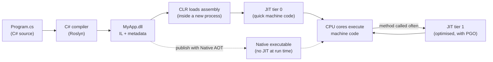
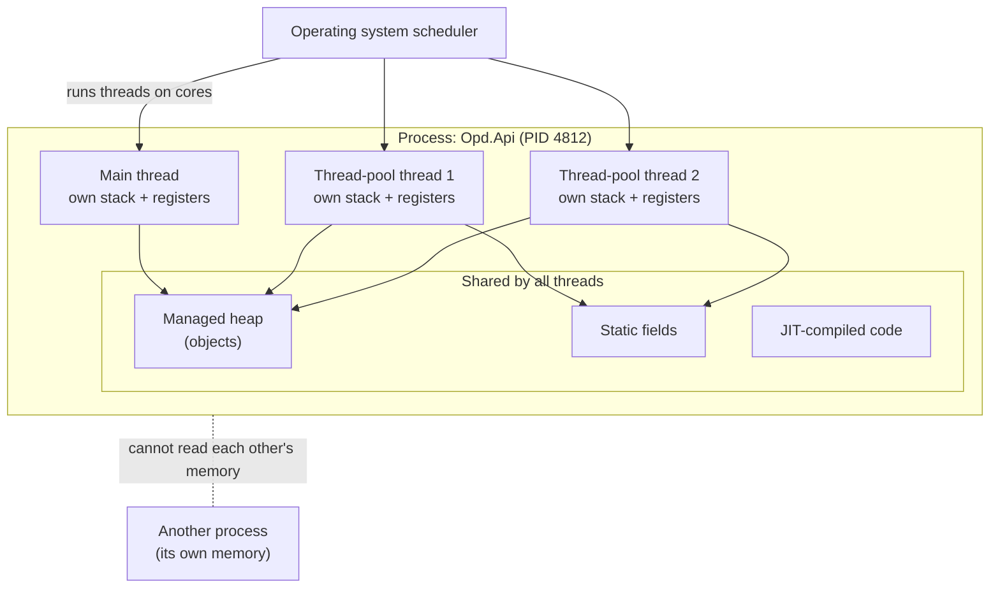

You type `Console.WriteLine("Namaste");`, press Run, and a word appears. Between those two moments, your text is translated twice, loaded into memory, handed to the operating system, scheduled on a CPU core and executed as billions of tiny electrical steps. This lesson walks through that journey once, slowly, so that later topics such as performance, memory, async code and scaling feel natural instead of magical.

## Learning objectives

By the end of this lesson you will be able to:

1. Describe what the CPU does (fetch, decode, execute) and why it only understands machine code.
2. Explain the roles of registers, cache, RAM and disk, and roughly how their speeds compare.
3. Explain how C# becomes IL (intermediate language) at build time and machine code at run time (JIT compilation), and what tiered compilation, ReadyToRun and Native AOT change.
4. Explain the difference between a process and a thread, and what threads share.
5. Recognise a race condition and fix a simple one with `Interlocked` or `lock`.
6. Read a small .NET program that uses several threads and explain what happens in the machine.

## Prerequisites

- [What is a software system?](#/lesson/m01-software-system): inputs, processing, outputs and storage.

You do not need to know C# yet. Code samples are short and explained. [Variables, types, conditions, loops and functions in C#](#/lesson/m01-csharp-basics) comes next and teaches the syntax properly.

## Explain it like I'm a beginner

### The kitchen analogy

Imagine a restaurant kitchen:

- The **chef** is the **CPU**. The chef is incredibly fast but can only follow very simple, exact instructions: "take onion", "chop", "put in pan". They cannot read a novel-style recipe.
- The **chopping board** right in front of the chef holds the two or three things being worked on right now. That is the CPU's **registers**: tiny, instant to reach.
- The **shelf next to the stove** holds ingredients used often. That is the **cache**: small, very fast.
- The **big fridge** across the kitchen holds everything for today's service. That is **RAM** (main memory): large, but the chef must walk to it.
- The **storeroom in the basement** holds sacks of rice for months. That is the **disk** (SSD): huge, permanent, slow to reach.
- The **recipe book written in Hindi or English** is your **C# source code**. The chef cannot read it directly.
- The **translator** who rewrites the recipe into the chef's step-by-step instructions is the **compiler**.

A good kitchen keeps what the chef needs close by. A good program does the same with data.

### Two translators, not one

.NET uses **two** translators.

1. When you **build**, the C# compiler translates your recipe into a neutral, simplified language called **IL** (intermediate language). Think of it as a standard "kitchen shorthand" that every .NET kitchen in the world understands, on any brand of stove.
2. When you **run**, a second translator inside the .NET runtime, the **JIT** (just-in-time) compiler, turns that shorthand into the exact moves for *this* chef, on *this* stove: an Intel or AMD chip, or an ARM chip in a phone or a new laptop. It translates each dish the first time someone orders it, then keeps the translation for next time.

This is why the same `.dll` file runs on Windows, Linux and macOS, on Intel and ARM.

### Many cooks: processes and threads

A big hotel has several **separate kitchens**: the Chinese restaurant, the coffee shop, the banquet hall. Each has its own fridge and its own staff. They cannot take from each other's fridges. These are **processes**: separate running programs, each with its own memory.

Inside one kitchen there are several **cooks** working at the same time, sharing the same fridge and shelves. These are **threads**. Sharing is efficient, but if two cooks grab the last tomato at the same moment, there is trouble. That trouble has a name: a **race condition**.

## First-principles explanation

### The CPU: a very fast, very simple worker

The **CPU** (central processing unit) is the chip that actually executes instructions. Each instruction is tiny: add two numbers, copy a value from memory into a register, compare two values, jump to another instruction if the comparison was true. A modern CPU executes them at enormous speed. A 3 GHz clock "ticks" 3 billion times per second, and a modern core can often finish more than one simple instruction per tick.

The CPU repeats one loop, forever, as long as the machine is on:

1. **Fetch**: read the next instruction from memory. A special register, the **program counter**, holds its address.
2. **Decode**: work out what the instruction means ("add register 1 to register 2").
3. **Execute**: do it, and move the program counter to the next instruction (or somewhere else, for a jump).

Everything a computer does, from showing a video to running a UPI payment, is made of these three steps repeated billions of times. Loops and `if` statements in your code become **jump** instructions. Variables become **registers** or **memory addresses**.

The instructions a CPU understands are called **machine code**. They are different for different CPU families: x64 (most Intel and AMD PCs and servers) and ARM64 (phones, Apple Silicon Macs, many cloud servers). Machine code is just numbers. Nobody wants to write it by hand, which is why we have programming languages and compilers.

A modern CPU has several **cores**: complete fetch-decode-execute engines on one chip. An 8-core laptop can truly do 8 things at the same instant. Each core runs one thread at a time and switches between threads very quickly when there are more threads than cores.

### Memory: close and small, or far and big

The CPU can only work on data in its registers. Everything else must be brought in. Storage forms a ladder from tiny-and-instant to huge-and-slow:

| Level | Typical size | Rough access time (order of magnitude) | Survives power-off? |
|---|---|---|---|
| Registers | A few hundred bytes per core | Under 1 nanosecond | No |
| L1 / L2 / L3 cache | Kilobytes to tens of megabytes | About 1–40 nanoseconds | No |
| RAM (main memory) | 8–512 GB | About 100 nanoseconds | No |
| SSD | 256 GB – several TB | Tens to hundreds of microseconds | Yes |
| Network call to another server | Unlimited | From well under a millisecond (same data centre) to 100+ milliseconds (across the world) | — |

These are widely quoted approximate figures; exact values depend on the hardware. The *ratios* are what matter. If a register access were one second, a RAM access would be a couple of minutes, an SSD read would be a day or more, and a network call to another continent would be years. That is why:

- Reading the same data again and again from RAM is fine; reading it again and again from disk or the network is slow. This is the whole reason **caching** exists (Module 11).
- Code that walks through memory in order (an array) is usually faster than code that jumps around (scattered objects), because the CPU loads memory into cache in chunks.
- A database query is often 1,000× slower than a calculation in memory. When a web page is slow, look at I/O (disk, database, network) first.

**RAM is temporary.** When the program ends, or the power goes, everything in RAM is gone. Anything that must survive goes to disk, usually through a database.

### The operating system: the kitchen manager

The **operating system** (Windows, Linux, macOS) sits between programs and hardware. It:

- **Starts programs**: loads the program file from disk into memory and creates a **process** for it.
- **Gives each process its own memory space** (virtual memory), so one program cannot read or corrupt another's data.
- **Schedules threads** onto CPU cores, switching between them many times per second so that hundreds of threads appear to run at once on 8 cores.
- **Controls devices**: disk, network, screen. Programs ask the OS to read a file or send a network packet; they never touch the hardware directly.

### From C# to machine code in .NET

Here is the full journey of a .NET program.

**At build time** (`dotnet build`):

1. The **C# compiler** (called Roslyn) reads your `.cs` files, checks types and syntax, and reports errors such as "cannot convert string to int".
2. It produces an **assembly**: a `.dll` file containing **IL** (intermediate language, also called CIL) plus **metadata** that describes every type, method and property.

IL is a simple, CPU-independent instruction set. `int total = price * quantity;` becomes something like:

```text
ldloc.0      // load local variable 0 (price) onto the evaluation stack
ldloc.1      // load local variable 1 (quantity)
mul          // multiply the top two values
stloc.2      // store the result in local variable 2 (total)
```

**At run time** (`dotnet run`, or double-clicking the app):

3. The OS starts a **process** and loads the **.NET runtime** (the CLR, common language runtime) into it.
4. The CLR loads your assembly and finds the entry point (`Main`, or the top-level statements in `Program.cs`).
5. The first time any method is called, the **JIT compiler** translates its IL into machine code for this exact CPU and stores it in memory. The next call jumps straight to the stored machine code.
6. While the program runs, the CLR also manages memory for you (allocating objects and cleaning up unused ones with the **garbage collector**, covered in [Value types, reference types and memory basics](#/lesson/m01-value-reference-memory)), checks types, and handles exceptions.

Because the CLR manages all this, .NET code is called **managed code**.

### Tiered compilation: quick first, fast later

Compiling every method with full optimisation would make start-up slow. So .NET uses **tiered compilation** (on by default):

- **Tier 0**: the first time a method runs, the JIT produces machine code *quickly*, with few optimisations. The app starts fast.
- **Tier 1**: if a method is called many times (it is "hot"), the runtime recompiles it in the background with full optimisations and switches to the faster version.
- **Dynamic PGO** (profile-guided optimisation, on by default since .NET 8): while tier 0 code runs, the runtime records what actually happens (which branches are taken, which types appear) and uses that information to optimise tier 1 code even better.

This is why the **first** call of a method is often slower than later calls, and why any honest timing measurement in .NET runs the code a few times first ("warm-up") before measuring.

### Other ways to compile: ReadyToRun and Native AOT

- **ReadyToRun (R2R)**: the assembly ships with pre-compiled machine code *as well as* IL. Start-up is faster because less JIT work is needed; the JIT can still re-optimise hot methods later.
- **Native AOT** (ahead-of-time): the whole app is compiled to a single native executable at publish time. There is no JIT at all at run time. Start-up is very fast and memory use is lower, which suits command-line tools, small containers and serverless functions. The trade-offs: the build targets one OS and CPU, and features that generate or load code at run time (some reflection-heavy libraries, dynamic proxies) are limited or unavailable.

For a typical ASP.NET Core web API that runs for weeks, the normal JIT is an excellent default. Choose Native AOT when start-up time or memory really matter and your libraries support it.

### Processes: separate running programs

A **process** is a running instance of a program. It has:

- Its own **virtual memory**: the process thinks it has a large private address space; the OS maps it to real RAM.
- One or more **threads**.
- Resources from the OS: open files, network sockets, environment variables.
- A **process id** (PID).

If you open Notepad three times, you get three processes from one program file. If one crashes, the others continue. Your ASP.NET Core app, when running, is one process (for example `Opd.Api` or `dotnet`), and it handles thousands of requests inside that single process.

### Threads: workers inside a process

A **thread** is one path of execution: one sequence of fetch-decode-execute steps with its own program counter. Every process starts with one thread (the **main thread**) and can create more.

Threads in the same process:

- **Share** the heap (objects), static variables and loaded code.
- **Each have their own** stack (local variables and the chain of method calls) and their own registers.

Sharing is what makes threads useful (they can work on the same data without copying it) and dangerous (they can change the same data at the same time).

**Creating a thread is fairly expensive** (it needs its own stack, often 1 MB or more of reserved memory, and OS bookkeeping). So .NET keeps a **thread pool**: a set of ready worker threads that pick up small jobs. `Task.Run`, `Parallel.For`, timers and ASP.NET Core requests all use the thread pool. You will rarely write `new Thread(...)` in application code; it appears in this lesson only to make threads visible.

### Concurrency versus parallelism

- **Concurrency**: dealing with many things at once. A single cook handling five orders by switching between them is concurrent.
- **Parallelism**: doing many things at the same instant. Five cooks each handling one order at the same time is parallel. It needs several cores.

A web server is highly *concurrent*: thousands of requests in progress. Most of those requests are *waiting* (for the database, for the network), not computing. That is why ASP.NET Core uses `async`/`await`: while a request waits for I/O, its thread goes back to the pool to serve someone else. You will learn async properly later; for now, remember that **waiting for I/O does not need a thread**, and computing does.

### Race conditions: when sharing goes wrong

`count++` looks like one step but is really three: read `count`, add 1, write `count`. If two threads do it at the same time:

| Time | Thread A | Thread B | `count` in memory |
|---|---|---|---|
| 1 | reads 41 | | 41 |
| 2 | | reads 41 | 41 |
| 3 | writes 42 | | 42 |
| 4 | | writes 42 | 42 |

Two increments happened; the value grew by one. One update was **lost**. This is a **race condition**: the result depends on the exact timing of threads. Race conditions are nasty because they appear rarely, under load, and disappear when you add a breakpoint.

Fixes, from simplest:

- **Do not share**: give each thread its own data and combine results at the end.
- **Atomic operations**: `Interlocked.Increment(ref count)` does read-add-write as one indivisible CPU instruction.
- **Locks**: `lock (gate) { ... }` lets only one thread at a time run the code inside. In .NET 9 and later, use a dedicated `System.Threading.Lock` object for this.
- **Thread-safe collections**: `ConcurrentDictionary`, `ConcurrentQueue`.

## Visual explanation

### From source code to running machine code



Read the solid arrows left to right. The C# compiler turns your source into an assembly holding IL and metadata; that happens once, when you build. When the program starts, the CLR loads the assembly into a new process and the JIT turns each method into machine code the first time it is called (tier 0). The CPU runs that code. If a method turns out to be hot, the runtime recompiles it with full optimisations (tier 1) and the CPU switches to the faster version. The dotted path at the bottom is the Native AOT alternative: all the translation happens at publish time, and the CPU runs a native executable with no JIT involved.

### A process, its threads and its memory



The large box is one process. Everything in the "shared" box (objects on the heap, static fields, compiled code) is visible to every thread in the process. Each thread has its own stack and registers, so local variables in a method are private to the thread running it. The OS scheduler decides which thread runs on which core at each moment. The dotted line to another process shows isolation: a different process has its own memory, and the OS stops them from reading each other's data. When two threads point at the same object on the heap (threads 2 and 3 here), that is where race conditions can happen.

## Step-by-step example

Let us follow one tiny program through the whole journey.

```csharp
public static class Program
{
    public static void Main()
    {
        int price = 120;
        int quantity = 3;
        int total = Multiply(price, quantity);
        Console.WriteLine($"Total: ₹{total}");
    }

    static int Multiply(int a, int b) => a * b;
}
```

### Step 1 — you build

`dotnet build` runs the C# compiler. It checks that `Multiply` takes two `int`s and returns an `int`. If you had written `Multiply("120", 3)`, it would stop here with a compile error. No program would be produced. Catching mistakes before the program runs is one big advantage of a statically typed language like C#.

The output is `bin/Debug/net10.0/MyApp.dll`, containing IL for `Main` and `Multiply`, and metadata saying "class Program has two static methods".

### Step 2 — you run, and the OS creates a process

`dotnet run` (or the small `MyApp` launcher executable next to the DLL) asks the OS to start a process. The OS reserves virtual memory, creates the **main thread**, and starts running the .NET host, which loads the CLR.

### Step 3 — the CLR finds `Main` and JIT-compiles it

The CLR reads the metadata, finds `Main`, and asks the JIT to compile it. The JIT produces machine code for your CPU (x64 or ARM64). The main thread jumps to that code.

### Step 4 — the CPU executes

On the main thread's **stack**, space is made for `price`, `quantity` and `total` (or the JIT keeps them in registers, which is even faster). The CPU executes "put 120 in a register", "put 3 in another register".

### Step 5 — the first call to `Multiply`

`Multiply` has never run, so it has no machine code yet. The call first goes to a small stub that asks the JIT to compile it; then the stub is updated so future calls go straight to the compiled code. For a tiny method like this, the JIT may even **inline** it at tier 1 (copy the multiplication directly into the caller, removing the call).

### Step 6 — output goes through the OS

`Console.WriteLine` formats the string (creating a `string` object on the heap) and asks the OS to write bytes to the terminal. The OS talks to the screen. "Total: ₹360" appears.

### Step 7 — the process ends

`Main` returns, the CLR shuts down, the OS reclaims all the process's memory. Nothing in RAM survives. If you needed the total tomorrow, you should have written it to a file or a database.

## Production-style C# implementation

A small, complete console tool that makes the invisible visible. It reports facts about the running process, counts prime numbers on one thread and then on several, measures the first (cold) and later (warm) runs to show JIT warm-up, and demonstrates a race condition next to its fix. It is structured like a real program: small classes with one job each.

```text
HowItRuns/
  Program.cs                      // runs the demos in order
  Runtime/RuntimeReport.cs        // facts about the process, CPU and runtime
  Work/PrimeCounter.cs            // pure CPU-bound work, single-threaded
  Work/ThreadedPrimeCounter.cs    // the same work split across explicit threads
  Work/Timing.cs                  // measures elapsed time with Stopwatch
  Work/CounterDemo.cs             // a race condition and two fixes
```

```csharp file=Runtime/RuntimeReport.cs
using System.Runtime.InteropServices;

namespace HowItRuns.Runtime;

/// <summary>Facts about where and how this program is running.</summary>
public sealed record RuntimeReport(
    string Framework,
    string OperatingSystem,
    Architecture ProcessArchitecture,
    int LogicalProcessors,
    int ProcessId,
    int CurrentThreadId,
    long WorkingSetBytes,
    long ManagedHeapBytes)
{
    public static RuntimeReport Capture() => new(
        RuntimeInformation.FrameworkDescription,
        RuntimeInformation.OSDescription,
        RuntimeInformation.ProcessArchitecture,
        Environment.ProcessorCount,
        Environment.ProcessId,
        Environment.CurrentManagedThreadId,
        Environment.WorkingSet,
        GC.GetTotalMemory(forceFullCollection: false));

    public override string ToString() =>
        $"""
        Runtime          : {Framework}
        OS               : {OperatingSystem}
        CPU architecture : {ProcessArchitecture}
        Logical cores    : {LogicalProcessors}
        Process id       : {ProcessId}
        Current thread   : {CurrentThreadId}
        Working set      : {WorkingSetBytes / (1024 * 1024)} MB (RAM the OS has given this process)
        Managed heap     : {ManagedHeapBytes / 1024} KB (memory used by .NET objects)
        """;
}
```

```csharp file=Work/PrimeCounter.cs
namespace HowItRuns.Work;

/// <summary>Pure, CPU-bound work: no I/O, no shared state. Same input, same output, on any thread.</summary>
public static class PrimeCounter
{
    public static int CountPrimes(int fromInclusive, int toExclusive)
    {
        ArgumentOutOfRangeException.ThrowIfNegative(fromInclusive);
        ArgumentOutOfRangeException.ThrowIfLessThan(toExclusive, fromInclusive);

        var count = 0;
        for (var n = Math.Max(fromInclusive, 2); n < toExclusive; n++)
            if (IsPrime(n)) count++;
        return count;
    }

    public static bool IsPrime(int n)
    {
        if (n < 2) return false;
        if (n % 2 == 0) return n == 2;
        for (var d = 3; (long)d * d <= n; d += 2)
            if (n % d == 0) return false;
        return true;
    }
}
```

```csharp file=Work/ThreadedPrimeCounter.cs
namespace HowItRuns.Work;

/// <summary>Splits the range into chunks and counts each chunk on its own thread.
/// Each thread writes only to its own slot in the results array, so no locking is needed.
/// Application code would normally use Parallel.For or Task.Run (thread pool) instead of new Thread.</summary>
public static class ThreadedPrimeCounter
{
    public static int CountPrimes(int limit, int threadCount)
    {
        ArgumentOutOfRangeException.ThrowIfNegative(limit);
        ArgumentOutOfRangeException.ThrowIfLessThan(threadCount, 1);

        var results = new int[threadCount];
        var threads = new Thread[threadCount];
        var chunk = (limit + threadCount - 1) / threadCount;

        for (var i = 0; i < threadCount; i++)
        {
            var index = i;                                    // capture a copy for this thread
            var from = Math.Min(index * chunk, limit);
            var to = Math.Min(from + chunk, limit);
            threads[i] = new Thread(() => results[index] = PrimeCounter.CountPrimes(from, to))
            {
                Name = $"prime-worker-{index}",
                IsBackground = true,
            };
            threads[i].Start();
        }

        foreach (var t in threads) t.Join();                  // wait for every worker to finish
        return results.Sum();
    }
}
```

```csharp file=Work/Timing.cs
using System.Diagnostics;

namespace HowItRuns.Work;

public readonly record struct Measurement<T>(T Result, TimeSpan Elapsed);

/// <summary>Measures how long a piece of work takes. Timings vary by machine and run;
/// treat them as rough evidence, never as exact benchmarks.</summary>
public static class Timing
{
    public static Measurement<T> Measure<T>(Func<T> work)
    {
        var start = Stopwatch.GetTimestamp();
        var result = work();
        return new Measurement<T>(result, Stopwatch.GetElapsedTime(start));
    }
}
```

```csharp file=Work/CounterDemo.cs
namespace HowItRuns.Work;

/// <summary>Shows a lost-update race condition and two correct alternatives.</summary>
public static class CounterDemo
{
    public static int UnsafeCount(int threads, int incrementsPerThread)
    {
        var count = 0;
        RunOnThreads(threads, () => { for (var i = 0; i < incrementsPerThread; i++) count++; });   // read-add-write: not atomic
        return count;
    }

    public static int InterlockedCount(int threads, int incrementsPerThread)
    {
        var count = 0;
        RunOnThreads(threads, () => { for (var i = 0; i < incrementsPerThread; i++) Interlocked.Increment(ref count); });
        return count;
    }

    public static int LockedCount(int threads, int incrementsPerThread)
    {
        var count = 0;
        var gate = new Lock();
        RunOnThreads(threads, () =>
        {
            for (var i = 0; i < incrementsPerThread; i++)
                lock (gate) count++;
        });
        return count;
    }

    private static void RunOnThreads(int threads, Action work)
    {
        var all = Enumerable.Range(0, threads).Select(_ => new Thread(() => work())).ToArray();
        foreach (var t in all) t.Start();
        foreach (var t in all) t.Join();
    }
}
```

```csharp file=Program.cs
using HowItRuns.Runtime;
using HowItRuns.Work;

Console.WriteLine(RuntimeReport.Capture());
Console.WriteLine();

const int limit = 2_000_000;

// 1. Cold vs warm: the first call includes JIT compilation at tier 0; later calls may use optimised tier 1 code.
var cold = Timing.Measure(() => PrimeCounter.CountPrimes(0, limit));
var warm = Timing.Measure(() => PrimeCounter.CountPrimes(0, limit));
Console.WriteLine($"Primes below {limit:N0}: {cold.Result:N0}");
Console.WriteLine($"  first run  : {cold.Elapsed.TotalMilliseconds:N0} ms");
Console.WriteLine($"  second run : {warm.Elapsed.TotalMilliseconds:N0} ms");

// 2. One thread vs several: CPU-bound work can use every core.
var threads = Environment.ProcessorCount;
var parallel = Timing.Measure(() => ThreadedPrimeCounter.CountPrimes(limit, threads));
Console.WriteLine($"  {threads} threads  : {parallel.Elapsed.TotalMilliseconds:N0} ms (same answer: {parallel.Result == warm.Result})");
Console.WriteLine();

// 3. Shared data: a race condition and two fixes. Expected value is 4 x 100,000 = 400,000.
Console.WriteLine($"Unsafe count     : {CounterDemo.UnsafeCount(4, 100_000):N0}  (often less than 400,000)");
Console.WriteLine($"Interlocked count: {CounterDemo.InterlockedCount(4, 100_000):N0}");
Console.WriteLine($"Locked count     : {CounterDemo.LockedCount(4, 100_000):N0}");
```

What to notice:

- **`PrimeCounter` is pure.** It touches no shared data, so it is safe on any thread and trivially testable. Pure functions are the easiest code to run in parallel.
- **`ThreadedPrimeCounter` avoids sharing.** Each thread writes only to its own slot `results[index]`, and the main thread adds them up after `Join`. No lock is needed because no two threads ever write the same memory.
- **`var index = i;`** matters. The lambda captures a variable, not a value. Without the copy, threads that start late might all see the final value of `i`.
- **Timings are evidence, not facts.** Your numbers depend on the machine, its other load and the .NET version. The demo prints them only to make cold-versus-warm and one-versus-many-threads visible. The parallel speed-up is usually less than the number of cores, because threads must be created, chunks may be unequal (larger numbers take longer to test), and cores share memory bandwidth.
- **The race demo is honest.** `UnsafeCount` *may* print 400,000 on some runs; a race condition is about what *can* happen, not what always happens. That is exactly why races are dangerous.
- **For production code**, use `Parallel.For` or `Task.Run`, which use the thread pool, instead of `new Thread`. For I/O-bound work (databases, HTTP), use `async`/`await` instead of threads.

## Bad design vs good design

**Bad**: a food-delivery dashboard shows today's total orders across 500 restaurants. A developer makes it "faster" by starting a new thread per restaurant and sharing a list between them.

```csharp
var results = new List<int>();
foreach (var restaurantId in restaurantIds)        // 500 restaurant ids
{
    new Thread(() =>
    {
        var orders = LoadTodayOrderCount(restaurantId);    // waits ~50 ms on the network
        results.Add(orders);                               // List<T> is not thread-safe
    }).Start();
}
Thread.Sleep(2000);                                 // "should be enough"
return results.Sum();
```

Problems:

- **500 threads**, each reserving stack memory, mostly sitting idle waiting for the database. Threads are for computing, not for waiting.
- **`List<T>.Add` from many threads** can corrupt the list or lose items. The sum may be wrong without any error.
- **`Thread.Sleep(2000)` guesses** the work is done. On a slow day it is not, and some results are silently missing; on a fast day it wastes time.
- **The database receives 500 queries at once**, which may exhaust its connection pool.

**Good**: one query that asks the database for all 500 rows at once (the database is built for that), or, if separate calls are unavoidable, `async` calls with a limit on how many run at the same time, and results combined after all have finished.

```csharp
// Best: let the database do set-based work in one round trip.
// SELECT count(*) FROM orders WHERE restaurant_id = ANY(@ids) AND placed_at >= @startOfDay
var total = await orderRepository.CountTodayAsync(restaurantIds, cancellationToken);

// If you truly need separate calls: async, limited concurrency, no shared mutable list.
var options = new ParallelOptions { MaxDegreeOfParallelism = 8, CancellationToken = cancellationToken };
var perRestaurant = new ConcurrentBag<int>();
await Parallel.ForEachAsync(restaurantIds, options, async (id, ct) =>
    perRestaurant.Add(await orderRepository.CountTodayAsync(id, ct)));
var sum = perRestaurant.Sum();
```

**Is the simpler version enough?** Usually, yes: a plain sequential loop is correct, easy to read and fast enough for small inputs. Add threads or parallel loops only when you have measured that CPU-bound work is the bottleneck. Add `async` for I/O, which is the normal case in web apps.

:::callout type=mistake title="More threads is not more speed"
A machine with 8 cores can run 8 threads at the same instant. Starting 500 CPU-bound threads does not make work 500× faster; it adds switching overhead and memory use. For CPU work, aim for about one thread per core (the thread pool does this for you). For I/O work, use async so threads are not needed while waiting.
:::

## Practical playground

Run this program and read the output carefully. Then try the experiments. Your timings will differ from anyone else's: that is the point.

:::playground type=csharp title="Threads, JIT warm-up and a race"
```csharp file=Program.cs
using System;
using System.Diagnostics;
using System.Threading;

public static class Program
{
    static long SumOfSquares(int n)
    {
        long sum = 0;
        for (var i = 1; i <= n; i++) sum += (long)i * i;
        return sum;
    }

    public static void Main()
    {
        Console.WriteLine($"Process {Environment.ProcessId}, {Environment.ProcessorCount} logical cores");
        Console.WriteLine($"Main thread id: {Environment.CurrentManagedThreadId}");

        // Cold vs warm calls
        for (var run = 1; run <= 3; run++)
        {
            var start = Stopwatch.GetTimestamp();
            var result = SumOfSquares(5_000_000);
            Console.WriteLine($"Run {run}: {result} in {Stopwatch.GetElapsedTime(start).TotalMilliseconds:F2} ms");
        }

        // Each thread has its own id and its own local variables
        var threads = new Thread[3];
        for (var i = 0; i < threads.Length; i++)
        {
            var name = $"worker-{i}";
            threads[i] = new Thread(() =>
            {
                var local = name.Length * 10;   // a local variable lives on this thread's own stack
                Console.WriteLine($"{name} running on thread {Environment.CurrentManagedThreadId}, local = {local}");
            });
            threads[i].Start();
        }
        foreach (var t in threads) t.Join();

        // A race condition
        var shared = 0;
        var racers = new Thread[4];
        for (var i = 0; i < racers.Length; i++)
        {
            racers[i] = new Thread(() => { for (var k = 0; k < 200_000; k++) shared++; });
            racers[i].Start();
        }
        foreach (var t in racers) t.Join();
        Console.WriteLine($"Expected 800000, got {shared}");

        // Experiments:
        // 1. Run the program three times. Do the worker lines always print in the same order? Why not?
        // 2. Replace shared++ with Interlocked.Increment(ref shared). What changes?
        // 3. Remove "var name = ..." and use $"worker-{i}" inside the lambda instead. What do the names show?
        // 4. Change SumOfSquares(5_000_000) to 50_000_000. Does run 1 vs run 2 still differ as much? Why?
    }
}
```
:::

## Exercises

:::exercise id=m01-how-programs-run-ex1 difficulty=beginner kind=written title="Explain what happens when you press Run"
A friend who studies commerce asks: *"When I press Run in Visual Studio on a C# program, what actually happens?"*

Write an explanation in 8–12 numbered steps, in plain English, from the moment you press Run until the program's output appears and the program ends. Use at least these words correctly: *compiler*, *IL*, *assembly*, *process*, *CLR*, *JIT*, *machine code*, *thread*, *RAM*.
::acceptance
- Steps are in the right order: build before run; JIT happens at run time, method by method.
- Each required term is used correctly at least once.
- Mentions that machine code differs by CPU type and IL does not.
- Mentions that RAM is cleared when the process ends.
::hint
Split the story in two halves: what happens at **build time** and what happens at **run time**.
::hint
Build time ends with a file on disk. Run time begins with the operating system starting something.
::hint
Ask "who does this step?" for each line: the C# compiler, the operating system, the CLR, the JIT, or the CPU.
::hint
A shape: compile → IL in a DLL → OS creates process and main thread → CLR loads → JIT compiles Main → CPU runs it → first call of each other method is JIT-compiled → output via OS → process ends, memory freed.
::solution
1. Visual Studio asks the **C# compiler** (Roslyn) to build the project. It checks the code for errors such as wrong types.
2. If there are no errors, the compiler writes an **assembly** (a `.dll` file) to disk containing **IL**, a CPU-independent instruction language, plus metadata describing the classes and methods.
3. Visual Studio asks the operating system to start the program. The OS creates a new **process** with its own memory space and one **thread**, the main thread.
4. The .NET host starts inside the process and loads the **CLR**, the .NET runtime.
5. The CLR loads the assembly into **RAM** and finds the entry point (`Main`).
6. The **JIT** compiler translates `Main` from IL into **machine code** for this computer's CPU (for example x64 or ARM64). IL is the same on every computer; machine code is not.
7. The main thread starts running that machine code on a CPU core: fetch an instruction, decode it, execute it, billions of times per second.
8. Each time the program calls a method for the first time, the JIT compiles that method too. Methods called very often are later recompiled with more optimisations.
9. When the program prints, it asks the OS to write characters to the console window.
10. When `Main` finishes, the CLR shuts down and the process ends. The OS takes back all its RAM, so anything not saved to disk is gone.
::mistakes
- Saying the compiler produces machine code directly (true for Native AOT, not for normal .NET builds).
- Saying the JIT compiles the whole program at start-up. It compiles methods when they are first called.
- Confusing process and thread ("each method runs in its own process").
:::

:::exercise id=m01-how-programs-run-ex2 difficulty=beginner kind=code title="Human-readable memory sizes"
Monitoring tools show memory in readable units. Build a `ByteSize` helper.
::requirements
- `Format(long bytes)` returns a string using 1 KB = 1,024 bytes:
  - Below 1,024: `"<n> B"`, for example `"512 B"`.
  - Otherwise the largest unit (KB, MB, GB, TB) where the value is at least 1, with **one decimal place**, using invariant culture: `"1.5 KB"`, `"2.0 MB"`.
  - A negative value throws `ArgumentOutOfRangeException`.
- `FitsInMemory(long itemCount, long bytesPerItem, long availableBytes)` returns whether `itemCount × bytesPerItem` is at most `availableBytes`. It must return `false` (not crash, not wrap around) when the multiplication would overflow `long`.
::acceptance
- `Format(0)` is `"0 B"`, `Format(1023)` is `"1023 B"`, `Format(1536)` is `"1.5 KB"`.
- `Format(2 * 1024 * 1024)` is `"2.0 MB"`; `Format(5L * 1024 * 1024 * 1024)` is `"5.0 GB"`.
- 10 million items of 16 bytes fit in 200 MB; 10 million items of 32 bytes do not.
- `FitsInMemory(long.MaxValue, 2, long.MaxValue)` returns `false`.
::hint
Keep dividing by 1,024 while the value is at least 1,024 and there is a bigger unit left. Count how many times you divided.
::hint
Use a `double` for the divided value so you keep the fraction, and an array of unit names: `["B", "KB", "MB", "GB", "TB"]`.
::hint
Format with `value.ToString("0.0", CultureInfo.InvariantCulture)` so the result is `1.5`, not `1,5`, on every machine.
::hint
For overflow, C# has a `checked` block: `checked(itemCount * bytesPerItem)` throws `OverflowException` instead of silently wrapping. Catch it and return `false`.
::hint
```csharp
try { return checked(itemCount * bytesPerItem) <= availableBytes; }
catch (OverflowException) { return false; }
```
::starter
```csharp file=ByteSize.cs
using System;
using System.Globalization;

public static class ByteSize
{
    public static string Format(long bytes) => throw new NotImplementedException();

    public static bool FitsInMemory(long itemCount, long bytesPerItem, long availableBytes) => throw new NotImplementedException();
}
```
::tests
```csharp file=ByteSizeTests.cs
using System;
using Xunit;

public class ByteSizeTests
{
    [Theory]
    [InlineData(0L, "0 B")]
    [InlineData(512L, "512 B")]
    [InlineData(1023L, "1023 B")]
    [InlineData(1024L, "1.0 KB")]
    [InlineData(1536L, "1.5 KB")]
    [InlineData(2097152L, "2.0 MB")]
    [InlineData(5368709120L, "5.0 GB")]
    [InlineData(1099511627776L, "1.0 TB")]
    public void Formats(long bytes, string expected) => Assert.Equal(expected, ByteSize.Format(bytes));

    [Fact] public void Negative_throws() => Assert.Throws<ArgumentOutOfRangeException>(() => ByteSize.Format(-1));

    [Fact] public void Small_items_fit() => Assert.True(ByteSize.FitsInMemory(10_000_000, 16, 200L * 1024 * 1024));

    [Fact] public void Bigger_items_do_not_fit() => Assert.False(ByteSize.FitsInMemory(10_000_000, 32, 200L * 1024 * 1024));

    [Fact] public void Overflow_is_not_a_fit() => Assert.False(ByteSize.FitsInMemory(long.MaxValue, 2, long.MaxValue));

    [Fact] public void Exact_fit_is_allowed() => Assert.True(ByteSize.FitsInMemory(1024, 1024, 1024 * 1024));
}
```
::solution
```csharp file=ByteSize.cs
using System;
using System.Globalization;

public static class ByteSize
{
    private static readonly string[] Units = ["B", "KB", "MB", "GB", "TB"];

    public static string Format(long bytes)
    {
        ArgumentOutOfRangeException.ThrowIfNegative(bytes);
        if (bytes < 1024) return $"{bytes} B";

        double value = bytes;
        var unit = 0;
        while (value >= 1024 && unit < Units.Length - 1)
        {
            value /= 1024;
            unit++;
        }
        return $"{value.ToString("0.0", CultureInfo.InvariantCulture)} {Units[unit]}";
    }

    public static bool FitsInMemory(long itemCount, long bytesPerItem, long availableBytes)
    {
        ArgumentOutOfRangeException.ThrowIfNegative(itemCount);
        ArgumentOutOfRangeException.ThrowIfNegative(bytesPerItem);
        try
        {
            return checked(itemCount * bytesPerItem) <= availableBytes;
        }
        catch (OverflowException)
        {
            return false;
        }
    }
}
```

Two machine-level facts appear here. First, a `long` is 64 bits; its maximum is about 9.2 × 10¹⁸. Multiplying past that **wraps around** to a negative number by default, which would make `FitsInMemory` wrongly say "yes". `checked` asks the CPU's overflow flag to be checked and turns wrap-around into an exception. Second, 10 million × 32 bytes = 320,000,000 bytes ≈ 305 MB, which does not fit in 200 MB: quick arithmetic like this tells you whether a design can hold its data in RAM.
::mistakes
- Using 1,000 instead of 1,024 (that is a different convention, kB/MB in the SI sense, used by disk makers).
- Integer division, so 1,536 bytes shows as `1 KB`.
- Formatting with the current culture, producing `1,5 KB` on a German or French machine and failing tests.
- Forgetting overflow: `long.MaxValue * 2` silently becomes `-2`.
::extensions
Add `Parse("1.5 KB")` that returns 1,536. Decide what to do with lowercase units and missing spaces.
:::

:::exercise id=m01-how-programs-run-ex3 difficulty=intermediate kind=code title="A thread-safe hit counter"
A web API counts how many times each page is requested. Requests run on many threads at once. Build a counter that never loses an update.
::requirements
- `Increment()` adds 1. `IncrementBy(int amount)` adds `amount`; a negative amount throws `ArgumentOutOfRangeException`.
- `Value` returns the current count.
- `ReadAndReset()` returns the current count and sets it to 0 **in one atomic step**, so no increment between the read and the reset is lost (a metrics job calls this every minute).
- Must be correct when called from many threads at the same time. Use a `long`.
::acceptance
- 8 threads × 50,000 increments gives exactly 400,000.
- `IncrementBy(5)` three times gives 15.
- `ReadAndReset()` returns the value and leaves 0.
- Increments and resets running concurrently never lose or double-count: the sum of all `ReadAndReset` results plus the final `Value` equals the total number of increments.
::hint
`_count++` is read-add-write: three steps that another thread can interleave with. You need an operation that does all three at once.
::hint
`System.Threading.Interlocked` has methods that the CPU executes as one indivisible step.
::hint
`Interlocked.Increment(ref _count)`, `Interlocked.Add(ref _count, amount)`, and `Interlocked.Read(ref _count)` for a safe read of a 64-bit value.
::hint
"Return the old value and put 0 in its place, atomically" is exactly what `Interlocked.Exchange(ref _count, 0)` does.
::hint
```csharp
public long ReadAndReset() => Interlocked.Exchange(ref _count, 0);
```
::starter
```csharp file=HitCounter.cs
using System;
using System.Threading;

public sealed class HitCounter
{
    public long Value => throw new NotImplementedException();

    public void Increment() => throw new NotImplementedException();

    public void IncrementBy(int amount) => throw new NotImplementedException();

    public long ReadAndReset() => throw new NotImplementedException();
}
```
::tests
```csharp file=HitCounterTests.cs
using System;
using System.Linq;
using System.Threading;
using System.Threading.Tasks;
using Xunit;

public class HitCounterTests
{
    [Fact]
    public void Many_threads_lose_nothing()
    {
        var c = new HitCounter();
        var threads = Enumerable.Range(0, 8)
            .Select(_ => new Thread(() => { for (var i = 0; i < 50_000; i++) c.Increment(); }))
            .ToArray();
        foreach (var t in threads) t.Start();
        foreach (var t in threads) t.Join();
        Assert.Equal(400_000L, c.Value);
    }

    [Fact]
    public void Increment_by_adds()
    {
        var c = new HitCounter();
        c.IncrementBy(5); c.IncrementBy(5); c.IncrementBy(5);
        Assert.Equal(15L, c.Value);
    }

    [Fact] public void Negative_amount_throws() => Assert.Throws<ArgumentOutOfRangeException>(() => new HitCounter().IncrementBy(-1));

    [Fact]
    public void Read_and_reset()
    {
        var c = new HitCounter();
        c.IncrementBy(42);
        Assert.Equal(42L, c.ReadAndReset());
        Assert.Equal(0L, c.Value);
    }

    [Fact]
    public void Resets_during_increments_lose_nothing()
    {
        var c = new HitCounter();
        long collected = 0;
        using var done = new ManualResetEventSlim(false);
        var reader = new Thread(() =>
        {
            while (!done.IsSet) collected += c.ReadAndReset();
        });
        reader.Start();
        Parallel.For(0, 200_000, _ => c.Increment());
        done.Set();
        reader.Join();
        Assert.Equal(200_000L, collected + c.Value);
    }
}
```
::solution
```csharp file=HitCounter.cs
using System;
using System.Threading;

public sealed class HitCounter
{
    private long _count;

    public long Value => Interlocked.Read(ref _count);

    public void Increment() => Interlocked.Increment(ref _count);

    public void IncrementBy(int amount)
    {
        ArgumentOutOfRangeException.ThrowIfNegative(amount);
        Interlocked.Add(ref _count, amount);
    }

    public long ReadAndReset() => Interlocked.Exchange(ref _count, 0);
}
```

Each `Interlocked` method compiles to a single atomic CPU instruction (on x64, instructions with a `lock` prefix such as `lock xadd`). No other core can sneak in between the read and the write. `ReadAndReset` is the subtle one: writing `var v = _count; _count = 0; return v;` would lose any increment that happened between the two lines. `Exchange` does both at once.
::alternatives
A `lock` around each operation is also correct and easier to extend (for example, if you later need to update two fields together). It is a little slower under heavy contention. For very hot counters on many cores, .NET's metrics APIs (`System.Diagnostics.Metrics.Counter<T>`) are the production choice, as they are designed for exactly this.
::mistakes
- `_count++` or `_count += amount`: lost updates under load, often invisible in a quick manual test.
- Reading then resetting in two steps.
- Marking the field `volatile` and thinking that makes `++` atomic. `volatile` affects visibility and ordering, not atomicity.
- Making the counter `static`, so every page shares one count.
:::

:::exercise id=m01-how-programs-run-ex4 difficulty=intermediate kind=code title="Split work across cores"
To use every CPU core, big jobs are split into chunks. Write the chunking logic, then use it to compute a sum on several threads.
::requirements
- `WorkSplitter.Split(int start, int endExclusive, int parts)` returns a list of `(int Start, int End)` ranges (end exclusive) that:
  - cover every number from `start` to `endExclusive` exactly once, in order;
  - differ in size by at most 1 (the first ranges get the extra items);
  - never include an empty range (if `parts` is larger than the count, return one range per item).
  - `parts < 1` or `endExclusive < start` throws `ArgumentOutOfRangeException`. An empty input range returns an empty list.
- `WorkSplitter.SumOfSquares(int[] data, int threads)` returns the sum of squares as a `long`, computed with one `Thread` per range from `Split`, each writing to its own result slot. The answer must equal the single-threaded sum.
::acceptance
- `Split(0, 10, 3)` gives `(0,4) (4,7) (7,10)`.
- `Split(0, 2, 5)` gives `(0,1) (1,2)`.
- `Split(5, 5, 4)` gives an empty list.
- `SumOfSquares` of 1..1000 with 4 threads gives 333,833,500.
::hint
With `count` items and `parts` chunks, every chunk gets `count / parts` items, and the first `count % parts` chunks get one extra.
::hint
First fix the number of chunks: `Math.Min(parts, count)`. That alone removes empty ranges.
::hint
Walk a cursor from `start`: each chunk is `(cursor, cursor + size)`, then move the cursor.
::hint
For the threaded sum: create `long[] results` with one slot per range, start a thread per range that loops over its slice, `Join` them all, then add the slots.
::hint
```csharp
var size = baseSize + (i < remainder ? 1 : 0);
ranges.Add((cursor, cursor + size));
cursor += size;
```
::starter
```csharp file=WorkSplitter.cs
using System;
using System.Collections.Generic;
using System.Linq;
using System.Threading;

public static class WorkSplitter
{
    public static IReadOnlyList<(int Start, int End)> Split(int start, int endExclusive, int parts) =>
        throw new NotImplementedException();

    public static long SumOfSquares(int[] data, int threads) => throw new NotImplementedException();
}
```
::tests
```csharp file=WorkSplitterTests.cs
using System;
using System.Linq;
using Xunit;

public class WorkSplitterTests
{
    [Fact]
    public void Splits_evenly_with_extras_first()
    {
        var r = WorkSplitter.Split(0, 10, 3);
        Assert.Equal(new[] { (0, 4), (4, 7), (7, 10) }, r.ToArray());
    }

    [Fact]
    public void Never_returns_empty_ranges()
    {
        var r = WorkSplitter.Split(0, 2, 5);
        Assert.Equal(new[] { (0, 1), (1, 2) }, r.ToArray());
    }

    [Fact] public void Empty_input_gives_empty_list() => Assert.Empty(WorkSplitter.Split(5, 5, 4));

    [Fact] public void Zero_parts_throws() => Assert.Throws<ArgumentOutOfRangeException>(() => WorkSplitter.Split(0, 10, 0));

    [Fact] public void Reversed_range_throws() => Assert.Throws<ArgumentOutOfRangeException>(() => WorkSplitter.Split(10, 0, 2));

    [Fact]
    public void Covers_every_item_once()
    {
        var r = WorkSplitter.Split(3, 1003, 7);
        var covered = r.SelectMany(x => Enumerable.Range(x.Start, x.End - x.Start)).ToArray();
        Assert.Equal(Enumerable.Range(3, 1000).ToArray(), covered);
        Assert.True(r.Max(x => x.End - x.Start) - r.Min(x => x.End - x.Start) <= 1);
    }

    [Fact]
    public void Threaded_sum_matches_sequential()
    {
        var data = Enumerable.Range(1, 1000).ToArray();
        Assert.Equal(333_833_500L, WorkSplitter.SumOfSquares(data, 4));
    }

    [Fact]
    public void Works_with_more_threads_than_items()
    {
        Assert.Equal(14L, WorkSplitter.SumOfSquares(new[] { 1, 2, 3 }, 16));
    }
}
```
::solution
```csharp file=WorkSplitter.cs
using System;
using System.Collections.Generic;
using System.Linq;
using System.Threading;

public static class WorkSplitter
{
    public static IReadOnlyList<(int Start, int End)> Split(int start, int endExclusive, int parts)
    {
        ArgumentOutOfRangeException.ThrowIfLessThan(parts, 1);
        ArgumentOutOfRangeException.ThrowIfLessThan(endExclusive, start);

        var count = endExclusive - start;
        var chunks = Math.Min(parts, count);
        var ranges = new List<(int Start, int End)>(chunks);
        if (chunks == 0) return ranges;

        var baseSize = count / chunks;
        var remainder = count % chunks;
        var cursor = start;
        for (var i = 0; i < chunks; i++)
        {
            var size = baseSize + (i < remainder ? 1 : 0);
            ranges.Add((cursor, cursor + size));
            cursor += size;
        }
        return ranges;
    }

    public static long SumOfSquares(int[] data, int threads)
    {
        ArgumentNullException.ThrowIfNull(data);
        var ranges = Split(0, data.Length, threads);
        var results = new long[ranges.Count];
        var workers = new Thread[ranges.Count];

        for (var i = 0; i < ranges.Count; i++)
        {
            var slot = i;
            var (from, to) = ranges[i];
            workers[i] = new Thread(() =>
            {
                long sum = 0;                                  // local: lives on this thread's own stack
                for (var k = from; k < to; k++) sum += (long)data[k] * data[k];
                results[slot] = sum;                           // each thread writes only its own slot
            });
            workers[i].Start();
        }

        foreach (var w in workers) w.Join();
        return results.Sum();
    }
}
```

The design follows the safest rule of parallel code: **share nothing that is written**. All threads read `data` (reading shared data is safe if nobody writes it), each accumulates into its own local `sum`, and each writes to a different array slot. Only after `Join` does the main thread combine them. No locks are needed.
::alternatives
`Parallel.For` with thread-local state, or PLINQ (`data.AsParallel().Sum(x => (long)x * x)`), does the same with the thread pool and handles chunking for you. Prefer them in real code. Writing the split by hand once is how you understand what they do.
::mistakes
- `count / parts` for every chunk and forgetting the remainder, so the last few items are never processed.
- Capturing the loop variable `i` directly in the lambda, so threads use the wrong slot.
- All threads adding into one shared `long total` with `+=`: a race condition.
- Forgetting `(long)` before multiplying, so large squares overflow `int`.
:::

:::exercise id=m01-how-programs-run-ex5 difficulty=advanced kind=code title="Build a tiny CPU"
To really understand fetch-decode-execute, build a tiny virtual CPU with four registers and six instructions, then run small programs on it.
::requirements
- Registers `R0`–`R3`, all starting at 0. A program counter starting at 0.
- Instructions (`Instruction(OpCode Op, int A, int B)`):
  - `Set A, B`: `R[A] = B`.
  - `Add A, B`: `R[A] = R[A] + R[B]`.
  - `Dec A`: `R[A] = R[A] - 1`.
  - `Jnz A, B`: if `R[A] != 0`, jump to instruction index `B`; otherwise continue.
  - `Out A`: append `R[A]` to the output.
  - `Halt`: stop.
- `Run(program, maxSteps)` runs the fetch-decode-execute loop and returns the output list. It stops on `Halt` or when the program counter moves past the last instruction.
- If more than `maxSteps` instructions execute, throw `InvalidOperationException` (protection against infinite loops).
- A register index outside 0–3, or a jump target outside the program, throws `InvalidOperationException`.
- `StepsExecuted` reports how many instructions the last run executed.
::acceptance
- A multiplication program (6 × 7 by repeated addition) outputs `[42]`.
- A countdown from 3 outputs `[3, 2, 1]`.
- An infinite loop throws `InvalidOperationException` once `maxSteps` is exceeded.
- `Set` into register 9 throws `InvalidOperationException`.
- A program `Set R0,5; Out R0` without `Halt` outputs `[5]` and executes 2 steps.
::hint
A real CPU is a loop: fetch the instruction at the program counter, decode what it means, execute it, move the program counter. Write exactly that loop.
::hint
Keep `int[] registers = new int[4]` and `int pc = 0`. The loop condition is `pc < program.Count`.
::hint
Use a `switch` on `instruction.Op` for decode-and-execute. Most instructions do `pc++` at the end; `Jnz` sets `pc = B` when it jumps.
::hint
Count steps at the top of the loop and throw when the count exceeds `maxSteps`. Validate register indices with a small helper that throws for anything outside 0–3.
::hint
```csharp
while (pc < program.Count)
{
    if (++steps > maxSteps) throw new InvalidOperationException("Step limit exceeded.");
    var ins = program[pc];                       // fetch
    switch (ins.Op)                              // decode + execute
    {
        case OpCode.Set: registers[Reg(ins.A)] = ins.B; pc++; break;
        case OpCode.Jnz: pc = registers[Reg(ins.A)] != 0 ? Target(ins.B) : pc + 1; break;
        // ...
    }
}
```
::starter
```csharp file=TinyCpu.cs
using System;
using System.Collections.Generic;

public enum OpCode { Set, Add, Dec, Jnz, Out, Halt }

public readonly record struct Instruction(OpCode Op, int A = 0, int B = 0);

public sealed class TinyCpu
{
    public const int RegisterCount = 4;

    public int StepsExecuted => throw new NotImplementedException();

    public IReadOnlyList<int> Run(IReadOnlyList<Instruction> program, int maxSteps = 10_000) =>
        throw new NotImplementedException();
}
```
::tests
```csharp file=TinyCpuTests.cs
using System;
using Xunit;

public class TinyCpuTests
{
    [Fact]
    public void Multiplies_by_repeated_addition()
    {
        var program = new[]
        {
            new Instruction(OpCode.Set, 0, 0),
            new Instruction(OpCode.Set, 1, 6),
            new Instruction(OpCode.Set, 2, 7),
            new Instruction(OpCode.Add, 0, 1),   // 3: R0 += R1
            new Instruction(OpCode.Dec, 2),      // 4: R2--
            new Instruction(OpCode.Jnz, 2, 3),   // 5: loop while R2 != 0
            new Instruction(OpCode.Out, 0),
            new Instruction(OpCode.Halt),
        };
        Assert.Equal(new[] { 42 }, new TinyCpu().Run(program));
    }

    [Fact]
    public void Counts_down()
    {
        var program = new[]
        {
            new Instruction(OpCode.Set, 0, 3),
            new Instruction(OpCode.Out, 0),
            new Instruction(OpCode.Dec, 0),
            new Instruction(OpCode.Jnz, 0, 1),
            new Instruction(OpCode.Halt),
        };
        Assert.Equal(new[] { 3, 2, 1 }, new TinyCpu().Run(program));
    }

    [Fact]
    public void Infinite_loop_is_stopped()
    {
        var program = new[] { new Instruction(OpCode.Set, 0, 1), new Instruction(OpCode.Jnz, 0, 1) };
        Assert.Throws<InvalidOperationException>(() => new TinyCpu().Run(program, maxSteps: 1000));
    }

    [Fact]
    public void Bad_register_throws() =>
        Assert.Throws<InvalidOperationException>(() => new TinyCpu().Run(new[] { new Instruction(OpCode.Set, 9, 1) }));

    [Fact]
    public void Bad_jump_target_throws() =>
        Assert.Throws<InvalidOperationException>(() => new TinyCpu().Run(new[] { new Instruction(OpCode.Set, 0, 1), new Instruction(OpCode.Jnz, 0, 50) }));

    [Fact]
    public void Runs_off_the_end_without_halt()
    {
        var cpu = new TinyCpu();
        var output = cpu.Run(new[] { new Instruction(OpCode.Set, 0, 5), new Instruction(OpCode.Out, 0) });
        Assert.Equal(new[] { 5 }, output);
        Assert.Equal(2, cpu.StepsExecuted);
    }

    [Fact]
    public void Halt_stops_immediately()
    {
        var cpu = new TinyCpu();
        var output = cpu.Run(new[] { new Instruction(OpCode.Halt), new Instruction(OpCode.Out, 0) });
        Assert.Empty(output);
        Assert.Equal(1, cpu.StepsExecuted);
    }
}
```
::solution
```csharp file=TinyCpu.cs
using System;
using System.Collections.Generic;

public enum OpCode { Set, Add, Dec, Jnz, Out, Halt }

public readonly record struct Instruction(OpCode Op, int A = 0, int B = 0);

public sealed class TinyCpu
{
    public const int RegisterCount = 4;

    public int StepsExecuted { get; private set; }

    public IReadOnlyList<int> Run(IReadOnlyList<Instruction> program, int maxSteps = 10_000)
    {
        ArgumentNullException.ThrowIfNull(program);
        ArgumentOutOfRangeException.ThrowIfLessThan(maxSteps, 1);

        var registers = new int[RegisterCount];
        var output = new List<int>();
        var pc = 0;
        var steps = 0;

        while (pc < program.Count)
        {
            if (++steps > maxSteps)
                throw new InvalidOperationException($"Step limit of {maxSteps} exceeded at instruction {pc}.");

            var ins = program[pc];                                      // fetch
            switch (ins.Op)                                             // decode + execute
            {
                case OpCode.Set: registers[Reg(ins.A)] = ins.B; pc++; break;
                case OpCode.Add: registers[Reg(ins.A)] += registers[Reg(ins.B)]; pc++; break;
                case OpCode.Dec: registers[Reg(ins.A)]--; pc++; break;
                case OpCode.Jnz: pc = registers[Reg(ins.A)] != 0 ? Target(ins.B, program.Count) : pc + 1; break;
                case OpCode.Out: output.Add(registers[Reg(ins.A)]); pc++; break;
                case OpCode.Halt: StepsExecuted = steps; return output;
                default: throw new InvalidOperationException($"Unknown opcode {ins.Op}.");
            }
        }

        StepsExecuted = steps;
        return output;
    }

    private static int Reg(int index) =>
        index is >= 0 and < RegisterCount ? index : throw new InvalidOperationException($"No register R{index}.");

    private static int Target(int index, int length) =>
        index >= 0 && index < length ? index : throw new InvalidOperationException($"Jump target {index} is outside the program.");
}
```

This is a working model of the CPU loop in this lesson: `pc` is the program counter, `registers` are the registers, the `switch` is the decoder, and `Jnz` is how every `while` loop and `if` in C# ends up in machine code. Real CPUs add memory access, many more instructions, pipelines and caches, but the loop is the same. The step limit is also a real idea: operating systems and runtimes use timeouts and watchdogs to stop runaway code.
::alternatives
You could store instructions as text (`"ADD 0 1"`) and parse them first. That is how assemblers work: they translate human-readable mnemonics into numeric machine code. Keeping parsing separate from execution, as real toolchains do, keeps each part simple.
::mistakes
- Forgetting `pc++` in one case, causing an infinite loop on that instruction.
- Incrementing `pc` after a successful jump, so the loop starts one instruction late.
- Checking the step limit after executing, which allows one extra step.
- Letting an out-of-range register crash with `IndexOutOfRangeException` instead of a clear error.
::extensions
Add `Mul` and `Jz` (jump if zero). Then write a program that computes 5! (120). Count the steps with and without `Mul`. This is a tiny version of why CPUs have specialised instructions.
:::

## Automated testing

Machine-level behaviour affects how you test.

**Pure code is the easiest to test.** `PrimeCounter.IsPrime` takes a number and returns a bool. No threads, no clock, no memory tricks. Most of your code should look like this, with threads and I/O pushed to the edges.

```csharp
public class PrimeCounterTests
{
    [Theory]
    [InlineData(0, false)]
    [InlineData(1, false)]
    [InlineData(2, true)]
    [InlineData(9, false)]
    [InlineData(97, true)]
    [InlineData(2_147_483_647, true)]   // int.MaxValue is prime: the (long)d * d check avoids overflow
    public void IsPrime_handles_edges(int n, bool expected) => Assert.Equal(expected, PrimeCounter.IsPrime(n));

    [Fact]
    public void Threaded_count_matches_single_thread()
    {
        var single = PrimeCounter.CountPrimes(0, 100_000);
        for (var threads = 1; threads <= 16; threads++)
            Assert.Equal(single, ThreadedPrimeCounter.CountPrimes(100_000, threads));
    }
}
```

**Testing concurrent code needs pressure.** A race condition may pass 99 times and fail once. Good concurrency tests use many threads and many iterations (like the 400,000-increment test above), and compare against a known exact answer. Even then, a passing test does not *prove* there is no race; careful design (no shared writes, `Interlocked`, locks) is the real protection.

**Never assert on timings in unit tests.** "The parallel version must be faster" will fail on a busy CI server with 2 cores. Test correctness in unit tests. Measure performance separately, with a proper benchmarking tool such as BenchmarkDotNet, which handles warm-up, repetition and statistics for you.

**Watch out for integer edges.** Overflow (`int.MaxValue + 1` becomes negative) is a machine-level fact that tests should cover wherever arithmetic could grow large: money in paise, file sizes, counters.

## Real-world application

- **ASP.NET Core web servers** run as one process per instance. Kestrel accepts connections and hands each request to a thread-pool thread. Because most request time is spent waiting for the database or other services, `async` code lets a handful of threads serve thousands of concurrent requests.
- **Start-up time matters for scaling.** When a cloud platform adds instances during a traffic spike, each new process must start, load the CLR and JIT-compile hot paths. ReadyToRun and Native AOT exist largely to shorten this, and are popular for serverless functions and small containers.
- **Background processing** (sending SMS, generating PDF invoices, resizing uploaded product photos) runs on worker threads or separate worker processes so that a slow CPU-heavy job does not slow web requests.
- **Containers**: a Docker container is (mostly) a process with limits on how much CPU and memory it may use. .NET reads those limits and sizes its thread pool and garbage collector to fit. Knowing that "4 cores" in a container may mean "4 cores' worth of time" helps explain performance in Kubernetes.
- **Latency budgets**: when designing a system, engineers add up approximate times (memory: nanoseconds; database: milliseconds; cross-region call: tens to hundreds of milliseconds). The memory ladder from this lesson is the first tool of performance design.

## Interview questions

:::interview
::q beginner
What is the difference between a process and a thread?
::a
A process is a running program with its own isolated memory space and OS resources (files, sockets); processes cannot read each other's memory. A thread is a path of execution inside a process. All threads of a process share its heap, static data and code, but each thread has its own stack and registers. Creating a process is heavier than creating a thread, and threads are cheaper to switch between. An ASP.NET Core app is usually one process that runs many requests on thread-pool threads.
::q beginner
What is IL, and why doesn't .NET compile straight to machine code?
::a
IL (intermediate language) is a CPU-independent instruction set that the C# compiler produces, stored in an assembly with metadata. The runtime's JIT compiler turns it into machine code for the actual CPU when each method is first called. This means one build runs on x64 and ARM64, on Windows, Linux and macOS, and the JIT can optimise for the exact CPU and for the program's real behaviour (tiered compilation and dynamic PGO). .NET can also compile ahead of time with ReadyToRun or Native AOT when start-up time matters.
::q intermediate
Why is the first call of a method in .NET often slower than later calls?
::a
The first call triggers JIT compilation of that method from IL to machine code. With tiered compilation, the first version is compiled quickly with few optimisations (tier 0). If the method is called often, the runtime recompiles it with full optimisations (tier 1), using profile data collected while it ran (dynamic PGO). There are also one-time costs such as loading assemblies and initialising static fields. That is why benchmarks warm up before measuring, and why ReadyToRun or Native AOT can improve start-up.
::q intermediate
What is a race condition? Give an example and two fixes.
::a
A race condition is a bug where the result depends on the timing of threads accessing shared data. Example: two threads run `count++` (read, add, write); both read 41 and both write 42, losing one increment. Fixes: make the operation atomic with `Interlocked.Increment(ref count)`; protect the code with a `lock` so only one thread runs it at a time; or avoid sharing by giving each thread its own counter and combining results at the end. In web apps that share data across servers, the database must enforce atomicity (for example `UPDATE ... SET count = count + 1`).
::q advanced
A colleague wants to speed up an API endpoint that calls 50 other services by creating 50 threads. What do you advise?
::a
Those calls are I/O-bound: the threads would mostly sit idle waiting for network responses, each holding stack memory and adding scheduling overhead. Use `async`/`await` with `HttpClient` so no thread is held while waiting, and run the calls concurrently with `Task.WhenAll` or `Parallel.ForEachAsync` with a sensible limit on concurrency to protect the downstream services. Add timeouts and cancellation so one slow service cannot hang the endpoint. Better still, check whether 50 calls are needed at all: a batch endpoint or a cache may remove most of them. Threads (or the thread pool) are for CPU-bound work.
::q advanced
When would you choose Native AOT for a .NET service, and what are the trade-offs?
::a
Native AOT compiles the app ahead of time into a self-contained native executable with no JIT. It gives very fast start-up and lower memory use, which suits serverless functions, command-line tools, sidecars and services that scale out rapidly. Trade-offs: you build per OS and CPU architecture; reflection-heavy or code-generating libraries may not work or need trimming-safe alternatives; there is no dynamic PGO, so peak throughput for long-running, hot code may be lower than with the JIT; and builds take longer. For a typical long-running ASP.NET Core API, the normal JIT is usually the better default. Measure both before deciding.
:::

## Summary and revision

**Key takeaways**

- The **CPU** repeats fetch-decode-execute billions of times a second. It only understands **machine code**, which differs between CPU families (x64, ARM64).
- **Memory is a ladder**: registers, cache, RAM, disk, network. Each step down is much bigger and much slower. RAM is lost when the process ends.
- The **operating system** starts processes, isolates their memory, schedules threads on cores and controls devices.
- **.NET compiles twice**: C# → **IL** at build time (an assembly), IL → machine code by the **JIT** at run time, method by method. **Tiered compilation** starts fast and optimises hot code later. **ReadyToRun** and **Native AOT** move work to build time.
- A **process** has its own memory. **Threads** inside it share the heap and statics but have their own stacks. The **thread pool** reuses threads.
- **Race conditions** happen when threads change shared data without coordination. Avoid sharing, or use `Interlocked`, `lock` or concurrent collections.
- CPU-bound work benefits from parallel threads up to the number of cores. I/O-bound work should use `async`, not more threads.

**Terminology**: CPU, core, register, program counter, fetch-decode-execute, machine code, cache, RAM, operating system, process, thread, stack, heap, thread pool, compiler, IL (CIL), assembly, metadata, CLR, managed code, JIT, tiered compilation, dynamic PGO, ReadyToRun, Native AOT, concurrency, parallelism, race condition, atomic operation.

:::flashcards
Q: What are the three steps of the CPU loop?
A: Fetch the next instruction, decode it, execute it (then move the program counter).
Q: Order these from fastest to slowest: RAM, SSD, register, cache.
A: Register, cache, RAM, SSD.
Q: What does the C# compiler produce?
A: An assembly (.dll) containing IL (intermediate language) and metadata.
Q: What does the JIT do?
A: At run time, compiles each method's IL into machine code for the current CPU the first time it is called.
Q: What is tiered compilation?
A: Methods are first compiled quickly (tier 0), and hot methods are later recompiled with full optimisation (tier 1).
Q: What do threads in one process share, and what is private?
A: Shared: heap objects, static fields, code. Private: each thread's stack and registers.
Q: What is a race condition?
A: A bug where the result depends on the timing of threads accessing shared data, such as a lost update from count++.
Q: When does Native AOT help most?
A: When start-up time and memory matter: serverless, CLI tools, fast scale-out; at the cost of fewer dynamic features.
Q: Threads or async for 50 HTTP calls?
A: Async: the calls are I/O-bound, so no thread needs to be held while waiting.
:::

## Knowledge check

:::quiz pass=70
::q single
You copy a .NET `.dll` built on an Intel Windows laptop to an ARM64 Linux server with the .NET runtime installed. Why can it run?
- [ ] The DLL contains machine code for every CPU.
- [x] The DLL contains IL, which the runtime's JIT compiles for the ARM64 CPU on that server.
- [ ] Linux translates Windows machine code automatically.
- [ ] It cannot run.
> IL is CPU-independent. Machine code is produced on the target machine by the JIT (unless you published with Native AOT for a specific platform).
::q single
A web page takes 900 ms. The code does a few calculations and three database queries. Where should you look first?
- [ ] The calculations, because CPUs are slow.
- [x] The database queries, because I/O over a network is far slower than in-memory work.
- [ ] The JIT compiler.
- [ ] The number of CPU cores.
> On the memory ladder, network and disk access are thousands of times slower than RAM and CPU work. I/O is the usual suspect.
::q single
Four threads each run `total++` 100,000 times on a shared `int total`. The result is 371,204. What happened?
- [ ] The CPU made an arithmetic error.
- [x] A race condition: concurrent read-add-write steps overwrote each other, losing updates.
- [ ] The garbage collector removed some increments.
- [ ] The JIT optimised the loop away.
> `total++` is three steps. Use `Interlocked.Increment` or a lock, or give each thread its own counter.
::q single
The first request after deploying an ASP.NET Core API takes noticeably longer than later ones. What is a likely reason?
- [ ] The CPU needs to warm up physically.
- [x] Methods are being JIT-compiled and assemblies loaded for the first time.
- [ ] The database forgot its data.
- [ ] Threads are created for every request.
> First calls pay one-time costs: JIT, assembly loading, static initialisation, connection setup. ReadyToRun or Native AOT reduce the JIT part.
::q multi
Which are shared between threads of the same process? (Select all that apply.)
- [x] Objects on the managed heap.
- [x] Static fields.
- [ ] Local variables of a method being run by another thread.
- [x] The JIT-compiled machine code.
> Each thread has its own stack, so locals are private to the thread running that method. Heap objects, statics and code are shared.
::q single
You need to resize 10,000 photos (pure CPU work) on an 8-core server. Which approach is most sensible?
- [ ] Start 10,000 threads.
- [ ] One thread, to stay safe.
- [x] Use `Parallel.ForEach` (thread pool), which runs roughly one worker per core.
- [ ] Use `async`/`await` with no parallelism.
> CPU-bound work benefits from one worker per core. Thousands of threads add overhead; a single thread leaves 7 cores idle.
::q single
What is the main benefit of Native AOT?
- [ ] It makes every program faster at peak throughput.
- [x] Very fast start-up and lower memory, because there is no JIT at run time.
- [ ] It allows unlimited reflection.
- [ ] One build runs on every OS and CPU.
> Native AOT trades some flexibility (per-platform builds, limited dynamic code) for start-up speed and memory.
::q single
What happens to the values in RAM when your console program's process ends?
- [ ] They are saved automatically to disk.
- [x] The OS reclaims the memory; anything not written to a file or database is lost.
- [ ] They stay until the computer restarts.
- [ ] They are moved to the cache.
> RAM is temporary working space. Persist anything that must survive.
:::

## Completion criteria

You have finished this lesson when you can:

- [ ] Score at least 70 % on the knowledge check.
- [ ] Complete exercises 1 and 2, with all tests passing for exercise 2.
- [ ] Complete at least one of exercises 3–5 and compare your answer with the solution.
- [ ] Explain, without notes, the journey from `Program.cs` to machine code running on a core.
- [ ] Run the playground, produce a lost update, and fix it with `Interlocked`.
