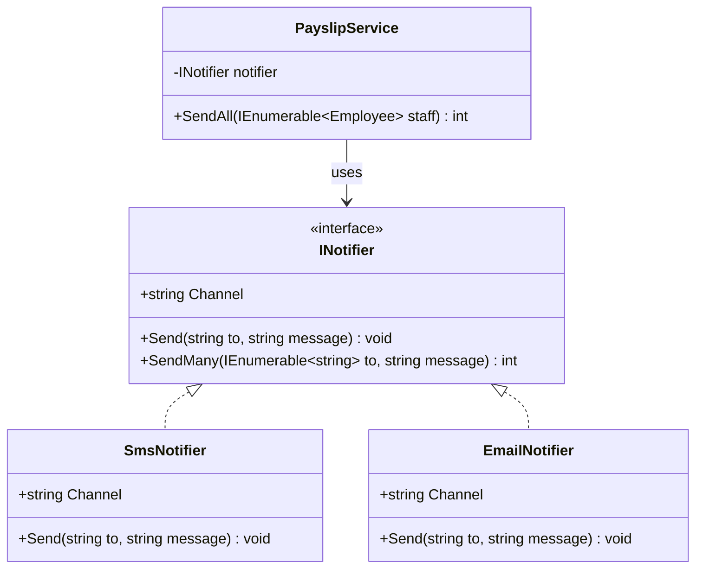
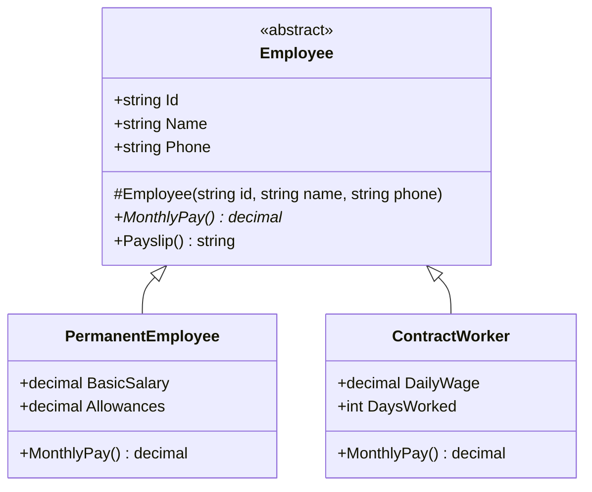
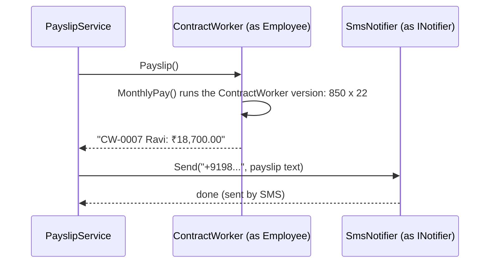

Interfaces and abstract classes appear in almost every lesson after this one. Dependency injection, design patterns, testing and clean architecture all rely on them. The good news is that the core idea is simple. This lesson goes slowly, uses everyday examples, and assumes you only know basic C#: classes, objects, methods and properties.

## Learning objectives

By the end of this lesson you will be able to:

1. Explain in plain words what an **interface** is (a promise of what something can do) and write one in C#.
2. Make a class **implement** an interface, and use objects through the interface type.
3. Explain what an **abstract class** is (a half-built class that other classes finish) and write one with abstract and normal members.
4. List the main differences between interfaces and abstract classes.
5. Use a **default interface method** to add behaviour to an interface without breaking existing classes.
6. Recognise **static abstract members** in interfaces and what they are for (a short first look).
7. Choose between an interface, an abstract class, or neither, for a given situation.

## Prerequisites

- [Classes, objects, fields, properties and methods](#/lesson/m01-classes-objects): you should be able to write a class with properties and methods.
- [Constructors and object initialization](#/lesson/m01-constructors): we'll use constructors in abstract classes.
- [Encapsulation, abstraction, inheritance and polymorphism](#/lesson/m01-oop-pillars): we'll build on `virtual`, `override` and "one call, many behaviours".

If some of those feel shaky, keep going anyway. Every new idea here is explained from the start.

## Explain it like I'm a beginner

### Interfaces: a promise

Think about the electrical socket in your wall. In India, most sockets follow the same standard shape. That shape is a **promise**: "anything with a matching plug can draw power here". The socket doesn't care whether you plug in a phone charger, a fan or a laptop. And the fan manufacturer doesn't need to know which house the fan will be used in. Both sides only agree on the **shape of the plug**.

An **interface** in C# is that kind of promise. It says *what* something can do, not *how* it does it.

```csharp
public interface INotifier
{
    void Send(string to, string message);
}
```

This says: "anything that is an `INotifier` can send a message to someone". It doesn't say whether that's by SMS, email or WhatsApp. Each class that **implements** the interface keeps the promise in its own way.

Another analogy: a job advertisement for "driver" lists what the person must be able to do (drive, read maps, keep a log). It doesn't describe a specific person. Anyone who can do those things can take the job. The ad is the interface; each driver is a class that implements it.

### Abstract classes: a half-built thing

Now think about a printed form at a bank. Some parts are already filled in and the same for everyone: the bank's name, the rules at the bottom, the layout. Other parts are **blank**, and each customer must fill them in: name, account number, signature.

You can't submit the blank form as it is; it's incomplete. You must fill in the blanks first.

An **abstract class** is like that form:

- Some members are **already written** and shared by everyone (the printed parts).
- Some members are **abstract**: declared but left blank. Each subclass must fill them in.
- You **can't create an object** of an abstract class directly, because it's incomplete.

```csharp
public abstract class Employee
{
    public string Name { get; }                       // printed part: every employee has a name
    protected Employee(string name) => Name = name;

    public abstract decimal MonthlyPay();             // blank: each kind of employee fills this in

    public string Payslip() => $"{Name}: ₹{MonthlyPay():N2}";   // printed part that uses the blank
}
```

### The one-sentence difference

- An **interface** is a promise: "I can do these things".
- An **abstract class** is a partly finished class: "here's the shared part; you finish the rest".

## First-principles explanation

### Why do we need either?

Imagine a payroll program that sends each employee their payslip. On day one, it sends SMS:

```csharp
public class PayslipSender
{
    private readonly SmsSender _sms = new SmsSender();
    public void SendAll(List<Employee> employees)
    {
        foreach (var e in employees) _sms.SendSms(e.Phone, e.Payslip());
    }
}
```

Then the company asks for email too, for some employees. And WhatsApp next month. If `PayslipSender` knows about `SmsSender`, `EmailSender` and `WhatsAppSender` directly, it fills up with `if` statements, and every new channel means changing it.

An interface fixes this. `PayslipSender` only knows "something that can send" (`INotifier`). SMS, email and WhatsApp are separate classes that each keep that promise. Adding a fourth channel means writing one new class; `PayslipSender` doesn't change. This idea of "one call, many behaviours" is **polymorphism**, which you met in the previous lesson.

### Writing and implementing an interface

```csharp
public interface INotifier
{
    string Channel { get; }                       // a property in the promise
    void Send(string to, string message);         // a method in the promise
}

public class SmsNotifier : INotifier              // ": INotifier" means "I keep this promise"
{
    public string Channel => "SMS";
    public void Send(string to, string message) => Console.WriteLine($"SMS to {to}: {message}");
}

public class EmailNotifier : INotifier
{
    public string Channel => "Email";
    public void Send(string to, string message) => Console.WriteLine($"Email to {to}: {message}");
}
```

Points to notice:

- Interface members have **no access modifier** (`public` is implied) and, normally, **no body**. They're just the promise.
- The class must provide **every** member of the interface, with matching names and types. If it forgets one, the code doesn't compile. The compiler checks that the promise is kept.
- By convention, interface names in C# start with a capital `I`: `INotifier`, `IShape`, `IComparable`.

### Using an object through its interface

```csharp
INotifier notifier = new SmsNotifier();      // variable type: the interface. Object: a real class.
notifier.Send("+919812345678", "Your payslip is ready");

notifier = new EmailNotifier();              // same variable, different object
notifier.Send("asha@example.com", "Your payslip is ready");
```

The variable's type is `INotifier`, so you can only call what the promise includes (`Channel` and `Send`). The **object** decides what actually happens. At runtime, .NET looks at the real object and runs its version of `Send`.

You **can't** write `new INotifier()`. A promise isn't a thing you can create; only classes that keep it can be created.

### One class, many interfaces

A class can have only **one** base class, but it can implement **many** interfaces:

```csharp
public class WhatsAppNotifier : INotifier, IDisposable
{
    public string Channel => "WhatsApp";
    public void Send(string to, string message) { /* ... */ }
    public void Dispose() { /* close the connection */ }
}
```

This is like a person who is both a "driver" and a "first-aider": two job descriptions, one person. It's one of the biggest practical differences from abstract classes.

### Writing an abstract class

```csharp
public abstract class Employee
{
    public string Id { get; }
    public string Name { get; }

    // Only subclasses can call this constructor (protected), and it checks the shared rules once.
    protected Employee(string id, string name)
    {
        if (string.IsNullOrWhiteSpace(name)) throw new ArgumentException("Name is required.");
        Id = id;
        Name = name;
    }

    // Blank: every kind of employee must say how their pay is worked out.
    public abstract decimal MonthlyPay();

    // Printed part: shared by everyone. It can call the blank method.
    public string Payslip() => $"{Id} {Name}: ₹{MonthlyPay():N2}";
}

public class PermanentEmployee : Employee
{
    public decimal BasicSalary { get; }
    public decimal Allowances { get; }

    public PermanentEmployee(string id, string name, decimal basic, decimal allowances) : base(id, name)
    {
        BasicSalary = basic;
        Allowances = allowances;
    }

    public override decimal MonthlyPay() => BasicSalary + Allowances;
}

public class ContractWorker : Employee
{
    public decimal DailyWage { get; }
    public int DaysWorked { get; set; }

    public ContractWorker(string id, string name, decimal dailyWage) : base(id, name) => DailyWage = dailyWage;

    public override decimal MonthlyPay() => DailyWage * DaysWorked;
}
```

What's going on:

- `abstract class Employee`: you can't write `new Employee(...)`. You can only create `PermanentEmployee` or `ContractWorker`.
- `public abstract decimal MonthlyPay();` has **no body** and ends with a semicolon. Each subclass **must** `override` it, or it won't compile.
- `Payslip()` is a normal method with a body, shared by all employees. It calls `MonthlyPay()`, and C# runs the right version for each object. A permanent employee with ₹45,000 basic and ₹12,000 allowances gets "₹57,000.00"; a contract worker on ₹850 a day for 22 days gets "₹18,700.00".
- The abstract class can have **fields, constructors and validation**. Interfaces can't hold per-object data (they have no instance fields).

### Abstract vs virtual

You met `virtual` in the previous lesson. The difference:

| Keyword | Has a body? | Must subclasses override it? |
|---|---|---|
| `abstract` | No | Yes, every non-abstract subclass must |
| `virtual` | Yes (a default) | No, they may if they want |

So an abstract class often mixes three kinds of members: normal ones (shared, fixed), `virtual` ones (shared default, can be changed), and `abstract` ones (must be filled in).

### Interfaces vs abstract classes side by side

| | Interface | Abstract class |
|---|---|---|
| Meaning | A promise of what it can do | A partly built class to finish |
| How many can a class use? | Many | Only one base class |
| Can hold data (instance fields)? | No | Yes |
| Constructors? | No | Yes (usually `protected`) |
| Method bodies? | Normally no (see default methods below) | Yes, plus abstract members without bodies |
| Access modifiers on members | Public by default | Any (`public`, `protected`, `private`...) |
| Can you `new` it? | No | No |
| Good for | Swappable parts: SMS vs email, real vs fake in tests | A family of closely related classes that share real code and data |

### Default interface methods

Since C# 8, an interface method **can** have a body. That's called a **default interface method**. Why would you want that?

Imagine `INotifier` is used by 12 classes in your company. You want to add `SendMany(...)` to the promise. Without a body, all 12 classes stop compiling until someone adds the method to each one. With a default body, they all keep working:

```csharp
public interface INotifier
{
    string Channel { get; }
    void Send(string to, string message);

    // New member with a default body: existing classes don't need to change.
    int SendMany(IEnumerable<string> recipients, string message)
    {
        var count = 0;
        foreach (var r in recipients) { Send(r, message); count++; }
        return count;
    }
}
```

A class that can do it better (for example, an SMS provider that accepts 500 numbers in one request) can write its own `SendMany` to replace the default.

Two things beginners trip over:

1. A default method is only visible **through the interface type**. If `sms` is a variable of type `SmsNotifier` and `SmsNotifier` didn't write its own `SendMany`, then `sms.SendMany(...)` doesn't compile. `((INotifier)sms).SendMany(...)` does.
2. Default methods can't use instance fields (interfaces have none). They can only call other members of the interface.

Use default methods mostly for **evolving an interface** that many classes already implement. Don't use them to turn interfaces into abstract classes.

### A short look at static abstract members

Since C# 11, an interface can require a **static** member. That sounds odd at first, so here's why it exists.

Sometimes you want to ask a **type** something, not an object. For example: "what's the code prefix for this kind of employee?" or "how do I parse this type from text?". Before C# 11, a generic method couldn't do that, because there was no object yet to ask.

```csharp
public interface IEmployeeKind<TSelf> where TSelf : IEmployeeKind<TSelf>
{
    static abstract string CodePrefix { get; }      // every implementing TYPE must provide this
}

public static class EmployeeCodes
{
    public static string Make<T>(int number) where T : IEmployeeKind<T> => $"{T.CodePrefix}-{number:D4}";
}

// EmployeeCodes.Make<PermanentEmployee>(42) == "EMP-0042"
```

`T.CodePrefix` asks the type, not an object. This feature powers .NET's **generic math** (`INumber<T>`, which lets one `Sum<T>` method work for `int`, `decimal` and `double`) and `IParsable<T>` (a standard `T.Parse(...)`). As a beginner you'll mostly **use** these interfaces rather than write your own. It's enough to recognise the syntax and know it exists.

### When to use which

Ask these questions in order:

1. **Do I need to swap one implementation for another?** (SMS vs email, real database vs fake in a test, one payment provider vs another.) Use an **interface**.
2. **Do several closely related classes share real code *and* data, and do they all genuinely "be a kind of" the same thing?** (Every employee has an id, name and payslip format; only pay calculation differs.) An **abstract class** fits.
3. **Neither?** Then you may not need either. A plain class is fine. Not every class needs an interface.

Many real designs use **both**: an interface for the outside world (`INotifier`), and sometimes an abstract base class that implementations can inherit to share helper code (`NotifierBase : INotifier`). The interface keeps callers flexible; the base class saves the implementations from repeating themselves.

### When not to use them

- **An interface for every class "just because"** adds files and indirection with no benefit. Add an interface when something needs to be swapped, or when a test needs a stand-in.
- **An abstract class just to share one helper method** ties classes together forever (a class can only have one base). A small helper class used by both is often better. The lesson [Composition versus inheritance](#/lesson/m04-composition-inheritance) explains this in depth.
- **Huge interfaces** with 20 methods force every implementer to write all 20, even if they only need 3. Prefer small, focused interfaces; see [Interface Segregation Principle](#/lesson/m04-isp).

## Visual explanation

### One promise, many implementations



How to read it: the box marked `<<interface>>` is the promise. The dotted lines with hollow triangles mean "implements" (keeps the promise). `PayslipService` has a solid arrow to the **interface**, not to `SmsNotifier` or `EmailNotifier`. That's the important part: the service doesn't know or care which kind of notifier it has. Notice that neither notifier lists `SendMany`; they get the default version from the interface.

### A half-built class and the classes that finish it



Here the solid lines with hollow triangles mean "inherits from". `Employee` is marked `<<abstract>>`. The `*` after `MonthlyPay()` means it's abstract: declared but not written. The `#` before the constructor means `protected`: only subclasses can call it. Each subclass adds its own data (salary or daily wage) and fills in `MonthlyPay()`. Both get `Payslip()` for free.

### What happens at runtime



`PayslipService` only knows two types: `Employee` and `INotifier`. When it calls `Payslip()`, the shared code in `Employee` runs, which calls `MonthlyPay()`. Because the real object is a `ContractWorker`, its version runs (₹850 × 22 days). When the service calls `Send`, the real object is an `SmsNotifier`, so the message goes by SMS. Swap in an `EmailNotifier` and the service code doesn't change at all.

## Step-by-step example

Let's build the payroll example in small steps.

### Step 1 — start with concrete classes only

```csharp
public class PayslipService
{
    public void SendAll(List<PermanentEmployee> staff)
    {
        var sms = new SmsNotifier();
        foreach (var e in staff) sms.Send(e.Phone, $"{e.Name}: ₹{e.BasicSalary + e.Allowances:N2}");
    }
}
```

It works for permanent staff and SMS only. Contract workers don't fit, and email isn't possible.

### Step 2 — notice the two things that vary

1. **How pay is calculated** varies by *kind of employee*. They share id, name, phone and payslip format. That's a family of related classes sharing data: an abstract class `Employee` with an abstract `MonthlyPay()`.
2. **How the message is sent** varies by *channel*. SMS and email share nothing except "can send". That's a promise: an interface `INotifier`.

### Step 3 — write the abstraction for each

Write `abstract class Employee` and `interface INotifier`, as shown earlier.

### Step 4 — change the service to depend on the abstractions

```csharp
public class PayslipService
{
    private readonly INotifier _notifier;
    public PayslipService(INotifier notifier) => _notifier = notifier;   // given from outside

    public int SendAll(IEnumerable<Employee> staff)
    {
        var sent = 0;
        foreach (var e in staff) { _notifier.Send(e.Phone, e.Payslip()); sent++; }
        return sent;
    }
}
```

The service takes an `INotifier` in its constructor instead of creating `new SmsNotifier()` itself. This is your first taste of **dependency injection**, covered properly in [a later lesson](#/lesson/m03-dependency-injection).

### Step 5 — try it

```csharp
var staff = new List<Employee>
{
    new PermanentEmployee("EMP-0001", "Asha", "+919811111111", basic: 45_000m, allowances: 12_000m),
    new ContractWorker("CW-0007", "Ravi", "+919822222222", dailyWage: 850m) { DaysWorked = 22 },
};
var service = new PayslipService(new SmsNotifier());
service.SendAll(staff);   // Asha: ₹57,000.00 ; Ravi: ₹18,700.00
```

To send by email instead, change one word: `new EmailNotifier()`. To test without sending real messages, pass a fake notifier that just stores messages in a list. You'll do that in the exercises.

## Production-style C# implementation

Here's the same idea as a small ASP.NET Core app, the kind you'll build later in the course. Read the comments; you don't need to understand every ASP.NET Core detail yet.

```text
Payroll.Api/
  Program.cs
  Payroll/
    Employee.cs          abstract class + two subclasses
    EmployeeCodes.cs     static abstract members (short demo)
    PayslipService.cs
  Notifications/
    INotifier.cs         interface with a default method
    Notifiers.cs         SMS and email implementations
```

```csharp file=Payroll/Employee.cs
namespace Payroll;

/// <summary>A half-built class: shared data and payslip format here, pay rules in subclasses.</summary>
public abstract class Employee
{
    public string Id { get; }
    public string Name { get; }
    public string Phone { get; }

    protected Employee(string id, string name, string phone)
    {
        ArgumentException.ThrowIfNullOrWhiteSpace(id);
        ArgumentException.ThrowIfNullOrWhiteSpace(name);
        ArgumentException.ThrowIfNullOrWhiteSpace(phone);
        Id = id;
        Name = name;
        Phone = phone;
    }

    /// <summary>The blank every subclass must fill in.</summary>
    public abstract decimal MonthlyPay();

    /// <summary>A shared default that subclasses may change.</summary>
    public virtual string Category => "Employee";

    /// <summary>Shared code that uses the abstract member.</summary>
    public string Payslip() => $"{Id} {Name} ({Category}): ₹{MonthlyPay():N2}";
}

public sealed class PermanentEmployee : Employee, IEmployeeKind<PermanentEmployee>
{
    public static string CodePrefix => "EMP";

    public decimal BasicSalary { get; }
    public decimal Allowances { get; }

    public PermanentEmployee(string id, string name, string phone, decimal basic, decimal allowances)
        : base(id, name, phone)
    {
        ArgumentOutOfRangeException.ThrowIfNegative(basic);
        ArgumentOutOfRangeException.ThrowIfNegative(allowances);
        BasicSalary = basic;
        Allowances = allowances;
    }

    public override string Category => "Permanent";
    public override decimal MonthlyPay() => BasicSalary + Allowances;
}

public sealed class ContractWorker : Employee, IEmployeeKind<ContractWorker>
{
    public static string CodePrefix => "CW";

    public decimal DailyWage { get; }
    public int DaysWorked { get; private set; }

    public ContractWorker(string id, string name, string phone, decimal dailyWage) : base(id, name, phone)
    {
        ArgumentOutOfRangeException.ThrowIfNegativeOrZero(dailyWage);
        DailyWage = dailyWage;
    }

    public void RecordDays(int days)
    {
        if (days is < 0 or > 31) throw new ArgumentOutOfRangeException(nameof(days), "Days must be between 0 and 31.");
        DaysWorked = days;
    }

    public override string Category => "Contract";
    public override decimal MonthlyPay() => DailyWage * DaysWorked;
}
```

```csharp file=Payroll/EmployeeCodes.cs
namespace Payroll;

/// <summary>Static abstract member: each implementing TYPE says what its code prefix is.</summary>
public interface IEmployeeKind<TSelf> where TSelf : IEmployeeKind<TSelf>
{
    static abstract string CodePrefix { get; }
}

public static class EmployeeCodes
{
    /// <summary>Asks the type, not an object: Make&lt;ContractWorker&gt;(7) gives "CW-0007".</summary>
    public static string Make<T>(int number) where T : IEmployeeKind<T>
    {
        ArgumentOutOfRangeException.ThrowIfNegativeOrZero(number);
        return $"{T.CodePrefix}-{number:D4}";
    }
}
```

```csharp file=Notifications/INotifier.cs
namespace Notifications;

/// <summary>A promise: "I can send a text message to someone." Not how.</summary>
public interface INotifier
{
    string Channel { get; }

    Task SendAsync(string to, string message, CancellationToken ct);

    /// <summary>Default interface method: added later without breaking existing notifiers.
    /// Implementations that can batch (one request for many numbers) should replace it.</summary>
    async Task<int> SendManyAsync(IEnumerable<(string To, string Message)> items, CancellationToken ct)
    {
        var sent = 0;
        foreach (var (to, message) in items)
        {
            await SendAsync(to, message, ct);
            sent++;
        }
        return sent;
    }
}
```

```csharp file=Notifications/Notifiers.cs
using Microsoft.Extensions.Logging;

namespace Notifications;

/// <summary>Keeps the INotifier promise by SMS. Here it only logs; a real one would call an SMS provider.</summary>
public sealed class SmsNotifier(ILogger<SmsNotifier> logger) : INotifier
{
    public string Channel => "SMS";

    public Task SendAsync(string to, string message, CancellationToken ct)
    {
        logger.LogInformation("SMS to {To}: {Message}", to, message);
        return Task.CompletedTask;
    }
}

/// <summary>Keeps the same promise by email, and does NOT replace SendManyAsync, so it gets the default.</summary>
public sealed class EmailNotifier(ILogger<EmailNotifier> logger) : INotifier
{
    public string Channel => "Email";

    public Task SendAsync(string to, string message, CancellationToken ct)
    {
        logger.LogInformation("Email to {To}: {Message}", to, message);
        return Task.CompletedTask;
    }
}
```

```csharp file=Payroll/PayslipService.cs
using Notifications;

namespace Payroll;

/// <summary>Knows only two abstractions: Employee (abstract class) and INotifier (interface).</summary>
public sealed class PayslipService(INotifier notifier)
{
    public string Channel => notifier.Channel;

    public IReadOnlyList<string> Preview(IEnumerable<Employee> staff) => staff.Select(e => e.Payslip()).ToList();

    public Task<int> SendAllAsync(IEnumerable<Employee> staff, CancellationToken ct) =>
        notifier.SendManyAsync(staff.Select(e => (e.Phone, e.Payslip())), ct);
}
```

```csharp file=Program.cs
using Notifications;
using Payroll;

var builder = WebApplication.CreateBuilder(args);

// Choose which class keeps the INotifier promise. Change SmsNotifier to EmailNotifier and nothing else changes.
builder.Services.AddSingleton<INotifier, SmsNotifier>();
builder.Services.AddSingleton<PayslipService>();

var app = builder.Build();

// A tiny in-memory staff list for the demo.
var worker = new ContractWorker(EmployeeCodes.Make<ContractWorker>(7), "Ravi Kumar", "+919822222222", dailyWage: 850m);
worker.RecordDays(22);
var staff = new List<Employee>
{
    new PermanentEmployee(EmployeeCodes.Make<PermanentEmployee>(1), "Asha Verma", "+919811111111", basic: 45_000m, allowances: 12_000m),
    worker,
};

app.MapGet("/payslips", (PayslipService payslips) => Results.Ok(payslips.Preview(staff)));

app.MapPost("/payslips/send", async (PayslipService payslips, CancellationToken ct) =>
{
    var sent = await payslips.SendAllAsync(staff, ct);
    return Results.Ok(new { sent, channel = payslips.Channel });
});

app.Run();
```

What to notice:

- `PayslipService` never mentions `SmsNotifier`, `PermanentEmployee` or `ContractWorker`. It works with the abstractions only.
- `Program.cs` is the one place that picks the real classes. Changing the notification channel is a one-line change there.
- `EmailNotifier` didn't write `SendManyAsync`, yet `PayslipService` can call it, because the call goes through the `INotifier` type and gets the default body.
- `EmployeeCodes.Make<ContractWorker>(7)` uses the static abstract member to produce `CW-0007`.

## Bad design vs good design

### Bad: checking types instead of using an abstraction

```csharp
public decimal Pay(object employee)
{
    if (employee is PermanentEmployee p) return p.BasicSalary + p.Allowances;
    if (employee is ContractWorker c) return c.DailyWage * c.DaysWorked;
    throw new ArgumentException("Unknown employee type");
}
```

Every new kind of employee (intern, consultant) means editing this method, and every other method like it. With `abstract decimal MonthlyPay()`, each class carries its own rule and the compiler forces new classes to provide one.

### Bad: an interface nobody needs

```csharp
public interface IAddressFormatter { string Format(Address a); }
public class AddressFormatter : IAddressFormatter { /* the only one, never swapped, never faked */ }
```

One implementation, no tests that need a fake, no plan to swap it. The interface just doubles the number of files. A plain class is fine. Add the interface on the day you need it.

### Bad: an abstract class used only to share a helper

```csharp
public abstract class ServiceBase { protected string FormatRupees(decimal v) => $"₹{v:N2}"; }
public class InvoiceService : ServiceBase { }
public class PayrollService : ServiceBase { }
```

Both services now use up their one and only base class for a single helper method, and are tied together for no real reason. A small `static class Rupees { public static string Format(decimal v) => ... }` does the same job without inheritance.

### Good

- An **interface** where something must be swappable (notification channel, storage, payment provider) or faked in tests.
- An **abstract class** where a family of closely related classes shares real data and code (every employee has an id, name and payslip format).
- **Neither** for simple classes that have one job and one implementation.

:::callout type=tip title="Program to the interface"
Write variables, parameters and fields using the most general type that has what you need: `INotifier` rather than `SmsNotifier`, `Employee` rather than `ContractWorker`, `IEnumerable<Employee>` rather than `List<Employee>`. Your code then works with more kinds of objects without changes.
:::

:::callout type=mistake title="Calling an abstract or virtual method from a constructor"
If `Employee`'s constructor called `MonthlyPay()`, it would run the subclass's version *before* the subclass's constructor had set `DailyWage`. You'd get 0 or a crash. Keep base-class constructors to simple assignments and checks.
:::

## Practical playground

Run this program. It has one interface, one abstract class and four classes. Then try the changes listed below it.

:::playground type=csharp title="Interfaces and abstract classes"
```csharp file=Program.cs
using System;
using System.Collections.Generic;

public interface INotifier
{
    string Channel { get; }
    void Send(string to, string message);

    // Default interface method: works for every notifier unless it writes its own.
    int SendMany(IEnumerable<string> recipients, string message)
    {
        var n = 0;
        foreach (var r in recipients) { Send(r, message); n++; }
        return n;
    }
}

public sealed class SmsNotifier : INotifier
{
    public string Channel => "SMS";
    public void Send(string to, string message) => Console.WriteLine($"  [SMS]   {to}: {message}");
}

public sealed class EmailNotifier : INotifier
{
    public string Channel => "Email";
    public void Send(string to, string message) => Console.WriteLine($"  [Email] {to}: {message}");
}

public abstract class Employee
{
    public string Name { get; }
    public string Contact { get; }
    protected Employee(string name, string contact) { Name = name; Contact = contact; }
    public abstract decimal MonthlyPay();
    public string Payslip() => $"{Name}: Rs {MonthlyPay():N2}";
}

public sealed class PermanentEmployee(string name, string contact, decimal basic, decimal allowances) : Employee(name, contact)
{
    public override decimal MonthlyPay() => basic + allowances;
}

public sealed class ContractWorker(string name, string contact, decimal dailyWage, int days) : Employee(name, contact)
{
    public override decimal MonthlyPay() => dailyWage * days;
}

public static class Program
{
    public static void Main()
    {
        var staff = new List<Employee>
        {
            new PermanentEmployee("Asha", "+919811111111", 45_000m, 12_000m),
            new ContractWorker("Ravi", "+919822222222", 850m, 22),
        };

        INotifier notifier = new SmsNotifier();      // try: new EmailNotifier()
        Console.WriteLine($"Sending payslips by {notifier.Channel}:");
        foreach (var e in staff) notifier.Send(e.Contact, e.Payslip());

        var count = notifier.SendMany(new[] { "+919833333333", "+919844444444" }, "Office closed on Friday");
        Console.WriteLine($"Bulk message sent to {count} people.");
    }
}
```
:::

Things to try:

1. Change `new SmsNotifier()` to `new EmailNotifier()`. Only the output changes, not the logic.
2. Add a class `Intern : Employee` with a fixed stipend of ₹15,000. Forget to write `MonthlyPay()` at first and read the compiler error. Then fix it.
3. Try `var e = new Employee("X", "Y");`. Read the error: you can't create an abstract class.
4. Write your own `SendMany` inside `SmsNotifier` that prints "one bulk request for N numbers". Run again and see which version is used.
5. Change `INotifier notifier` to `var notifier` and call `notifier.SendMany(...)`. Why does it stop compiling? (Hint: `var` makes the variable type `SmsNotifier`, and default methods are only visible through the interface type.)

## Exercises

:::exercise id=m01-interfaces-abstract-ex1 difficulty=beginner kind=code title="Shapes that keep a promise"
A land-survey app needs to work out the area and boundary length of plots of different shapes. Implement the `IShape` interface for a circle, a rectangle and a right triangle, and a helper that adds up areas.
::requirements
- `Circle(radius)`: area = π × r², perimeter = 2 × π × r. Use `Math.PI`.
- `Rectangle(width, height)`: area = w × h, perimeter = 2 × (w + h).
- `RightTriangle(baseLength, height)`: area = ½ × b × h, perimeter = b + h + √(b² + h²).
- Each shape has a `Name`: `"Circle"`, `"Rectangle"`, `"Right triangle"`.
- `ShapeMath.TotalArea(shapes)` returns the sum of all areas.
- Any size that is zero or negative throws `ArgumentOutOfRangeException` in the constructor.
::acceptance
- Rectangle 20 × 15 → area 300, perimeter 70.
- Circle with radius 10 → area ≈ 314.159, perimeter ≈ 62.832.
- Right triangle 30 × 40 → area 600, perimeter 120.
- Total area of those three ≈ 1214.159.
- `new Rectangle(0, 5)` throws.
::hint
Each class needs `: IShape` after its name, and must provide every member that `IShape` lists.
::hint
Store the sizes in read-only properties set by the constructor. Check them first with `ArgumentOutOfRangeException.ThrowIfNegativeOrZero(value)`.
::hint
`Math.Sqrt(x)` gives a square root. `Math.PI` is π.
::hint
`TotalArea` can loop with `foreach` and add `shape.Area` each time, or use LINQ: `shapes.Sum(s => s.Area)`.
::hint
```csharp
public sealed class Rectangle : IShape
{
    public Rectangle(double width, double height) { /* check, then store */ }
    public string Name => "Rectangle";
    public double Area => Width * Height;
    public double Perimeter => 2 * (Width + Height);
}
```
::starter
```csharp file=Shapes.cs
using System;
using System.Collections.Generic;
using System.Linq;

public interface IShape
{
    string Name { get; }
    double Area { get; }
    double Perimeter { get; }
}

public sealed class Circle : IShape
{
    public Circle(double radius) => throw new NotImplementedException();
    public double Radius { get; }
    public string Name => throw new NotImplementedException();
    public double Area => throw new NotImplementedException();
    public double Perimeter => throw new NotImplementedException();
}

public sealed class Rectangle : IShape
{
    public Rectangle(double width, double height) => throw new NotImplementedException();
    public double Width { get; }
    public double Height { get; }
    public string Name => throw new NotImplementedException();
    public double Area => throw new NotImplementedException();
    public double Perimeter => throw new NotImplementedException();
}

public sealed class RightTriangle : IShape
{
    public RightTriangle(double baseLength, double height) => throw new NotImplementedException();
    public double BaseLength { get; }
    public double Height { get; }
    public string Name => throw new NotImplementedException();
    public double Area => throw new NotImplementedException();
    public double Perimeter => throw new NotImplementedException();
}

public static class ShapeMath
{
    public static double TotalArea(IEnumerable<IShape> shapes) => throw new NotImplementedException();
}
```
::tests
```csharp file=ShapesTests.cs
using System;
using System.Collections.Generic;
using Xunit;

public class ShapesTests
{
    [Fact]
    public void Rectangle_area_and_perimeter()
    {
        IShape r = new Rectangle(20, 15);
        Assert.Equal(300, r.Area, 3);
        Assert.Equal(70, r.Perimeter, 3);
        Assert.Equal("Rectangle", r.Name);
    }

    [Fact]
    public void Circle_area_and_perimeter()
    {
        IShape c = new Circle(10);
        Assert.Equal(314.159, c.Area, 3);
        Assert.Equal(62.832, c.Perimeter, 3);
        Assert.Equal("Circle", c.Name);
    }

    [Fact]
    public void Right_triangle_area_and_perimeter()
    {
        IShape t = new RightTriangle(30, 40);
        Assert.Equal(600, t.Area, 3);
        Assert.Equal(120, t.Perimeter, 3);
        Assert.Equal("Right triangle", t.Name);
    }

    [Fact]
    public void Total_area_works_for_any_shapes()
    {
        var plots = new List<IShape> { new Rectangle(20, 15), new Circle(10), new RightTriangle(30, 40) };
        Assert.Equal(1214.159, ShapeMath.TotalArea(plots), 3);
    }

    [Fact] public void Zero_size_rejected() => Assert.Throws<ArgumentOutOfRangeException>(() => new Rectangle(0, 5));
    [Fact] public void Negative_radius_rejected() => Assert.Throws<ArgumentOutOfRangeException>(() => new Circle(-1));
}
```
::solution
Each shape keeps the same promise (`Name`, `Area`, `Perimeter`) in its own way. `TotalArea` only knows about `IShape`, so it works for any shape, including ones you add later.

```csharp file=Shapes.cs
using System;
using System.Collections.Generic;
using System.Linq;

public interface IShape
{
    string Name { get; }
    double Area { get; }
    double Perimeter { get; }
}

public sealed class Circle : IShape
{
    public Circle(double radius)
    {
        ArgumentOutOfRangeException.ThrowIfNegativeOrZero(radius);
        Radius = radius;
    }
    public double Radius { get; }
    public string Name => "Circle";
    public double Area => Math.PI * Radius * Radius;
    public double Perimeter => 2 * Math.PI * Radius;
}

public sealed class Rectangle : IShape
{
    public Rectangle(double width, double height)
    {
        ArgumentOutOfRangeException.ThrowIfNegativeOrZero(width);
        ArgumentOutOfRangeException.ThrowIfNegativeOrZero(height);
        Width = width;
        Height = height;
    }
    public double Width { get; }
    public double Height { get; }
    public string Name => "Rectangle";
    public double Area => Width * Height;
    public double Perimeter => 2 * (Width + Height);
}

public sealed class RightTriangle : IShape
{
    public RightTriangle(double baseLength, double height)
    {
        ArgumentOutOfRangeException.ThrowIfNegativeOrZero(baseLength);
        ArgumentOutOfRangeException.ThrowIfNegativeOrZero(height);
        BaseLength = baseLength;
        Height = height;
    }
    public double BaseLength { get; }
    public double Height { get; }
    public string Name => "Right triangle";
    public double Area => 0.5 * BaseLength * Height;
    public double Perimeter => BaseLength + Height + Math.Sqrt(BaseLength * BaseLength + Height * Height);
}

public static class ShapeMath
{
    public static double TotalArea(IEnumerable<IShape> shapes) => shapes.Sum(s => s.Area);
}
```
::mistakes
- Writing `TotalArea(List<Rectangle> shapes)`. It then only works for rectangles. Use the interface type.
- Forgetting the square root in the triangle's perimeter (using b² + h² directly).
- Using `int` for sizes, so a 7.5 m side can't be stored.
::extensions
Add a `Trapezium` shape. Notice that `ShapeMath` doesn't change at all.
:::

:::exercise id=m01-interfaces-abstract-ex2 difficulty=beginner kind=code title="Finish the half-built Employee class"
`Employee` is an abstract class with shared data and a shared `Payslip()` method. Finish the two subclasses by filling in `MonthlyPay()` and `Category`, and complete their constructors.
::requirements
- `PermanentEmployee`: pay = basic salary + allowances. Category `"Permanent"`.
- `ContractWorker`: pay = daily wage × days worked. Category `"Contract"`. Days must be 0–31, otherwise `ArgumentOutOfRangeException`.
- Both constructors must call the base constructor so `Id` and `Name` are set and checked.
- Don't change the `Employee` class.
::acceptance
- Permanent, basic ₹45,000 + allowances ₹12,000 → pay ₹57,000, payslip `"EMP-0001 Asha Verma (Permanent): 57000.00"`.
- Contract, ₹850/day × 22 days → pay ₹18,700, payslip `"CW-0007 Ravi Kumar (Contract): 18700.00"`.
- Contract with 32 days → `ArgumentOutOfRangeException`.
- A blank name → `ArgumentException` (from the base constructor).
::hint
A subclass constructor passes values up to the base constructor with `: base(id, name)` after its parameter list.
::hint
To fill in an abstract member, write `public override decimal MonthlyPay() => ...;`. The same goes for the abstract `Category` property.
::hint
Check the days in the `ContractWorker` constructor before storing them: `if (days is < 0 or > 31) throw new ArgumentOutOfRangeException(nameof(days));`.
::hint
```csharp
public ContractWorker(string id, string name, decimal dailyWage, int days) : base(id, name)
{
    if (days is < 0 or > 31) throw new ArgumentOutOfRangeException(nameof(days));
    DailyWage = dailyWage;
    DaysWorked = days;
}
public override string Category => "Contract";
public override decimal MonthlyPay() => DailyWage * DaysWorked;
```
::starter
```csharp file=Employees.cs
using System;
using System.Globalization;

public abstract class Employee
{
    public string Id { get; }
    public string Name { get; }

    protected Employee(string id, string name)
    {
        if (string.IsNullOrWhiteSpace(id)) throw new ArgumentException("Id is required.", nameof(id));
        if (string.IsNullOrWhiteSpace(name)) throw new ArgumentException("Name is required.", nameof(name));
        Id = id;
        Name = name;
    }

    public abstract string Category { get; }
    public abstract decimal MonthlyPay();

    public string Payslip() => string.Create(CultureInfo.InvariantCulture, $"{Id} {Name} ({Category}): {MonthlyPay():0.00}");
}

public sealed class PermanentEmployee : Employee
{
    public decimal BasicSalary { get; }
    public decimal Allowances { get; }

    public PermanentEmployee(string id, string name, decimal basicSalary, decimal allowances) : base(id, name)
    {
        throw new NotImplementedException();
    }

    public override string Category => throw new NotImplementedException();
    public override decimal MonthlyPay() => throw new NotImplementedException();
}

public sealed class ContractWorker : Employee
{
    public decimal DailyWage { get; }
    public int DaysWorked { get; }

    public ContractWorker(string id, string name, decimal dailyWage, int days) : base(id, name)
    {
        throw new NotImplementedException();
    }

    public override string Category => throw new NotImplementedException();
    public override decimal MonthlyPay() => throw new NotImplementedException();
}
```
::tests
```csharp file=EmployeesTests.cs
using System;
using System.Collections.Generic;
using System.Linq;
using Xunit;

public class EmployeesTests
{
    [Fact]
    public void Permanent_pay_and_payslip()
    {
        Employee e = new PermanentEmployee("EMP-0001", "Asha Verma", 45_000m, 12_000m);
        Assert.Equal(57_000m, e.MonthlyPay());
        Assert.Equal("EMP-0001 Asha Verma (Permanent): 57000.00", e.Payslip());
    }

    [Fact]
    public void Contract_pay_and_payslip()
    {
        Employee e = new ContractWorker("CW-0007", "Ravi Kumar", 850m, 22);
        Assert.Equal(18_700m, e.MonthlyPay());
        Assert.Equal("CW-0007 Ravi Kumar (Contract): 18700.00", e.Payslip());
    }

    [Fact]
    public void Total_payroll_through_base_type()
    {
        var staff = new List<Employee> { new PermanentEmployee("E1", "A", 30_000m, 5_000m), new ContractWorker("C1", "B", 700m, 20) };
        Assert.Equal(49_000m, staff.Sum(s => s.MonthlyPay()));
    }

    [Fact] public void Too_many_days_rejected() => Assert.Throws<ArgumentOutOfRangeException>(() => new ContractWorker("C1", "B", 700m, 32));
    [Fact] public void Negative_days_rejected() => Assert.Throws<ArgumentOutOfRangeException>(() => new ContractWorker("C1", "B", 700m, -1));
    [Fact] public void Blank_name_rejected_by_base() => Assert.Throws<ArgumentException>(() => new PermanentEmployee("E1", " ", 1m, 1m));
}
```
::solution
Each subclass passes the shared values to `base(...)`, stores its own data, and fills in the two blanks. `Payslip()` is written once in `Employee` and works for both.

```csharp file=Employees.cs
using System;
using System.Globalization;

public abstract class Employee
{
    public string Id { get; }
    public string Name { get; }

    protected Employee(string id, string name)
    {
        if (string.IsNullOrWhiteSpace(id)) throw new ArgumentException("Id is required.", nameof(id));
        if (string.IsNullOrWhiteSpace(name)) throw new ArgumentException("Name is required.", nameof(name));
        Id = id;
        Name = name;
    }

    public abstract string Category { get; }
    public abstract decimal MonthlyPay();

    public string Payslip() => string.Create(CultureInfo.InvariantCulture, $"{Id} {Name} ({Category}): {MonthlyPay():0.00}");
}

public sealed class PermanentEmployee : Employee
{
    public decimal BasicSalary { get; }
    public decimal Allowances { get; }

    public PermanentEmployee(string id, string name, decimal basicSalary, decimal allowances) : base(id, name)
    {
        BasicSalary = basicSalary;
        Allowances = allowances;
    }

    public override string Category => "Permanent";
    public override decimal MonthlyPay() => BasicSalary + Allowances;
}

public sealed class ContractWorker : Employee
{
    public decimal DailyWage { get; }
    public int DaysWorked { get; }

    public ContractWorker(string id, string name, decimal dailyWage, int days) : base(id, name)
    {
        if (days is < 0 or > 31) throw new ArgumentOutOfRangeException(nameof(days), "Days must be between 0 and 31.");
        DailyWage = dailyWage;
        DaysWorked = days;
    }

    public override string Category => "Contract";
    public override decimal MonthlyPay() => DailyWage * DaysWorked;
}
```
::mistakes
- Re-checking the name in each subclass. The base constructor already does it once, for everyone.
- Writing `public new decimal MonthlyPay()` instead of `override`. `new` hides the method instead of filling in the blank, and won't compile for an abstract member anyway.
- Using `double` for money, which can give results like 18699.999999.
::extensions
Add an `Intern` class with a fixed monthly stipend, and a `virtual` method `Deductions()` in `Employee` that returns 0 by default. Make `PermanentEmployee` override it with 12 % of basic salary for provident fund.
:::

:::exercise id=m01-interfaces-abstract-ex3 difficulty=intermediate kind=code title="Add a method to an interface without breaking anyone"
`IMessageSender` is already used by several classes. Add a `SendToMany` method with a **default body**, so existing classes keep compiling. Then write a `BulkSmsSender` that replaces the default with a faster batch version.
::requirements
- `IMessageSender.SendToMany(recipients, text)` has a default body: call `Send` once per recipient and return how many were sent. Skip blank recipients.
- `SimpleSender` implements only `Send` (it records each call in `SentTo`) and gets `SendToMany` for free.
- `BulkSmsSender` implements `Send` **and** its own `SendToMany`, which makes **one** call to `BatchApi.SendBatch` with all non-blank recipients and returns that count. It never calls `Send` from `SendToMany`.
::acceptance
- Through an `IMessageSender` variable, `SimpleSender.SendToMany(["a", "", "b"], "hi")` returns 2 and records `["a", "b"]`.
- `BulkSmsSender.SendToMany` with 3 valid numbers makes exactly one batch call containing all 3, and `Send` isn't called.
- `BulkSmsSender.Send` on its own still works (one batch call with one number).
::hint
A default interface method is written inside the interface with a normal method body. Interface members are public by default, so no access modifier is needed.
::hint
The default body can only use other interface members (here, `Send`). It can't use fields.
::hint
In `BulkSmsSender`, write a `public int SendToMany(...)` with the same signature. That replaces the default for this class.
::hint
Filter blanks with `recipients.Where(r => !string.IsNullOrWhiteSpace(r)).ToList()`.
::hint
```csharp
int SendToMany(IEnumerable<string> recipients, string text)
{
    var count = 0;
    foreach (var r in recipients)
    {
        if (string.IsNullOrWhiteSpace(r)) continue;
        Send(r, text);
        count++;
    }
    return count;
}
```
::starter
```csharp file=MessageSenders.cs
using System;
using System.Collections.Generic;
using System.Linq;

public interface IMessageSender
{
    void Send(string to, string text);

    int SendToMany(IEnumerable<string> recipients, string text)
    {
        throw new NotImplementedException();
    }
}

public sealed class SimpleSender : IMessageSender
{
    public List<string> SentTo { get; } = new();
    public void Send(string to, string text) => SentTo.Add(to);
}

/// <summary>Pretend SMS provider API that accepts many numbers in one request.</summary>
public class BatchApi
{
    public List<IReadOnlyList<string>> Batches { get; } = new();
    public virtual void SendBatch(IReadOnlyList<string> numbers, string text) => Batches.Add(numbers);
}

public sealed class BulkSmsSender : IMessageSender
{
    public BulkSmsSender(BatchApi api) => throw new NotImplementedException();

    public int SendCalls { get; private set; }

    public void Send(string to, string text) => throw new NotImplementedException();

    public int SendToMany(IEnumerable<string> recipients, string text) => throw new NotImplementedException();
}
```
::tests
```csharp file=MessageSendersTests.cs
using System;
using System.Collections.Generic;
using System.Linq;
using Xunit;

public class MessageSendersTests
{
    [Fact]
    public void Default_method_works_through_the_interface()
    {
        var simple = new SimpleSender();
        IMessageSender sender = simple;
        var count = sender.SendToMany(new[] { "+911", "", "+912" }, "Site closed tomorrow");
        Assert.Equal(2, count);
        Assert.Equal(new[] { "+911", "+912" }, simple.SentTo.ToArray());
    }

    [Fact]
    public void Bulk_sender_uses_one_batch_call()
    {
        var api = new BatchApi();
        var bulk = new BulkSmsSender(api);
        IMessageSender sender = bulk;
        var count = sender.SendToMany(new[] { "+911", "+912", " ", "+913" }, "Payday");
        Assert.Equal(3, count);
        Assert.Equal(new[] { "+911", "+912", "+913" }, Assert.Single(api.Batches).ToArray());
        Assert.Equal(0, bulk.SendCalls);
    }

    [Fact]
    public void Bulk_sender_single_send_still_works()
    {
        var api = new BatchApi();
        var bulk = new BulkSmsSender(api);
        bulk.Send("+919", "Hello");
        Assert.Equal(1, bulk.SendCalls);
        Assert.Equal(new[] { "+919" }, Assert.Single(api.Batches).ToArray());
    }
}
```
::solution
The default body lets the interface grow without breaking `SimpleSender` (or any other existing class). `BulkSmsSender` replaces it because it can do the job better with one request.

```csharp file=MessageSenders.cs
using System;
using System.Collections.Generic;
using System.Linq;

public interface IMessageSender
{
    void Send(string to, string text);

    int SendToMany(IEnumerable<string> recipients, string text)
    {
        var count = 0;
        foreach (var r in recipients)
        {
            if (string.IsNullOrWhiteSpace(r)) continue;
            Send(r, text);
            count++;
        }
        return count;
    }
}

public sealed class SimpleSender : IMessageSender
{
    public List<string> SentTo { get; } = new();
    public void Send(string to, string text) => SentTo.Add(to);
}

public class BatchApi
{
    public List<IReadOnlyList<string>> Batches { get; } = new();
    public virtual void SendBatch(IReadOnlyList<string> numbers, string text) => Batches.Add(numbers);
}

public sealed class BulkSmsSender : IMessageSender
{
    private readonly BatchApi _api;

    public BulkSmsSender(BatchApi api)
    {
        ArgumentNullException.ThrowIfNull(api);
        _api = api;
    }

    public int SendCalls { get; private set; }

    public void Send(string to, string text)
    {
        SendCalls++;
        _api.SendBatch(new[] { to }, text);
    }

    public int SendToMany(IEnumerable<string> recipients, string text)
    {
        var numbers = recipients.Where(r => !string.IsNullOrWhiteSpace(r)).ToList();
        if (numbers.Count > 0) _api.SendBatch(numbers, text);
        return numbers.Count;
    }
}
```

Try this in your editor: declare `var s = new SimpleSender();` and type `s.SendToMany(...)`. It doesn't compile, because `SimpleSender` itself has no `SendToMany`; the default lives on the interface. Use `IMessageSender s = new SimpleSender();` instead.
::alternatives
Before C# 8, the usual way to add a method without breaking implementers was an **extension method** (`public static int SendToMany(this IMessageSender s, ...)`). It works, but implementers can't replace it with a faster version, which is exactly what `BulkSmsSender` needed.
::mistakes
- Calling `Send` in a loop inside `BulkSmsSender.SendToMany`. That's correct but loses the whole point (one request instead of many).
- Giving the method a slightly different signature in `BulkSmsSender` (for example `List<string>` instead of `IEnumerable<string>`). That creates a *new* method; calls through the interface still use the default.
:::

:::exercise id=m01-interfaces-abstract-ex4 difficulty=intermediate kind=written title="Interface, abstract class, or neither?"
For each situation, choose **interface**, **abstract class**, **both**, or **neither**, and give a one-sentence reason.

1. A ticket-booking app must support paying by UPI, card and net banking, and tests need a fake payment that never charges anyone.
2. A school system has `Student`, `Teacher` and `Clerk`. All have a name, an ID card number and a photo, and a shared method that prints an ID card. Only "role description" differs.
3. A class that formats a phone number for display. There's one way to do it and nobody needs to replace it.
4. A logging system where some loggers write to a file, some to the console and some to a cloud service, and a class needs to be both a logger and disposable.
5. Several report exporters (PDF, Excel, CSV) all share a 40-line method that loads and sorts the data, and differ only in how they write the file. Other code should be able to accept "any exporter", including ones from other teams that might not want your base class.
::acceptance
- Each answer has a choice and a reason tied to the situation (swapping, shared data/code, multiple roles, or no need).
- Item 3 is answered "neither".
- Item 4 explains why a class implementing two roles points to interfaces.
- Item 5 recognises that "both" (an interface for callers, an optional abstract base for shared code) fits.
::hint
Interfaces are about swapping and multiple roles. Abstract classes are about a close family that shares data and code.
::hint
If there's only one implementation and no test needs a fake, do you need any abstraction at all?
::hint
A class can implement several interfaces but inherit only one class. Which situation needs two roles?
::solution
1. **Interface** (`IPaymentMethod`). The implementations share almost nothing, they must be swappable, and tests need a fake.
2. **Abstract class** (`Person` or `SchoolMember`). They share real data (name, ID number, photo) and real code (printing the ID card); only the role description is abstract.
3. **Neither.** One job, one implementation, nothing to swap. A plain (maybe static) class is simplest.
4. **Interfaces** (`ILogger` and `IDisposable`). The class has two roles, and a class can implement many interfaces but inherit only one class.
5. **Both.** An `IReportExporter` interface lets any team plug in an exporter. An optional `ReportExporterBase : IReportExporter` abstract class holds the shared loading and sorting code with an abstract `WriteFile` method. Teams can use the base class or implement the interface directly.
::mistakes
- Choosing an abstract class for payment methods "because they're all payments". They share no data or code; the only shared thing is the promise.
- Adding an interface to item 3 "for good practice". Abstractions should solve a problem you actually have.
:::

:::exercise id=m01-interfaces-abstract-ex5 difficulty=advanced kind=code title="Static abstract members: one parser for many code types"
Your system has codes like `EMP-0042` (employees) and `VEN-1203` (vendors). Use a **static abstract member** so one generic method can parse any code type, asking the *type* for its prefix and how to create itself.
::requirements
- `ICode<TSelf>` declares `static abstract string Prefix { get; }`, `static abstract TSelf Create(int number)` and an instance property `int Number { get; }`.
- `EmployeeCode` (prefix `EMP`) and `VendorCode` (prefix `VEN`) are records that implement it. `ToString()` gives `PREFIX-0000` (4 digits, zero-padded).
- `Codes.Parse<T>(text)`: trims and accepts upper or lower case (`" emp-42 "` is fine). The part after `-` must be a positive whole number. Wrong prefix, missing dash or bad number → `FormatException` with a helpful message.
- `Codes.TryParse<T>(text, out T? code)` returns false instead of throwing.
- `Codes.ParseAll<T>(texts)` parses a list and returns only the valid codes, in order.
::acceptance
- `Codes.Parse<EmployeeCode>("EMP-0042")` gives `EmployeeCode(42)`, whose `ToString()` is `"EMP-0042"`.
- `Codes.Parse<VendorCode>(" ven-1203 ")` gives `VendorCode(1203)`.
- `Codes.Parse<EmployeeCode>("VEN-0001")` throws `FormatException` mentioning `EMP`.
- `"EMP-0"`, `"EMP-x"` and `"EMP42"` are rejected.
- `ParseAll<EmployeeCode>(["EMP-1", "bad", "EMP-0003"])` gives codes 1 and 3.
::hint
A generic method with `where T : ICode<T>` can call `T.Prefix` and `T.Create(...)`, because the constraint promises that every `T` has them.
::hint
Split on the first `-` with `text.IndexOf('-')`. Compare the prefix with `string.Equals(a, b, StringComparison.OrdinalIgnoreCase)`.
::hint
`int.TryParse(numberPart, NumberStyles.None, CultureInfo.InvariantCulture, out var n)` accepts only digits. Then check `n > 0`.
::hint
Write `TryParse` first, returning false on every problem; `Parse` can call it and throw a `FormatException` when it returns false. `ParseAll` loops and keeps the successes.
::hint
```csharp
public static bool TryParse<T>(string? text, out T? code) where T : class, ICode<T>
{
    code = null;
    if (string.IsNullOrWhiteSpace(text)) return false;
    var s = text.Trim();
    var dash = s.IndexOf('-');
    if (dash <= 0 || !string.Equals(s[..dash], T.Prefix, StringComparison.OrdinalIgnoreCase)) return false;
    if (!int.TryParse(s[(dash + 1)..], NumberStyles.None, CultureInfo.InvariantCulture, out var n) || n <= 0) return false;
    code = T.Create(n);
    return true;
}
```
::starter
```csharp file=Codes.cs
using System;
using System.Collections.Generic;
using System.Globalization;
using System.Linq;

public interface ICode<TSelf> where TSelf : class, ICode<TSelf>
{
    static abstract string Prefix { get; }
    static abstract TSelf Create(int number);
    int Number { get; }
}

public sealed record EmployeeCode(int Number) : ICode<EmployeeCode>
{
    public static string Prefix => "EMP";
    public static EmployeeCode Create(int number) => new(number);
    public override string ToString() => throw new NotImplementedException();
}

public sealed record VendorCode(int Number) : ICode<VendorCode>
{
    public static string Prefix => "VEN";
    public static VendorCode Create(int number) => new(number);
    public override string ToString() => throw new NotImplementedException();
}

public static class Codes
{
    public static bool TryParse<T>(string? text, out T? code) where T : class, ICode<T>
    {
        throw new NotImplementedException();
    }

    public static T Parse<T>(string text) where T : class, ICode<T>
    {
        throw new NotImplementedException();
    }

    public static IReadOnlyList<T> ParseAll<T>(IEnumerable<string> texts) where T : class, ICode<T>
    {
        throw new NotImplementedException();
    }
}
```
::tests
```csharp file=CodesTests.cs
using System;
using System.Linq;
using Xunit;

public class CodesTests
{
    [Fact]
    public void Parses_employee_code()
    {
        var code = Codes.Parse<EmployeeCode>("EMP-0042");
        Assert.Equal(new EmployeeCode(42), code);
        Assert.Equal("EMP-0042", code.ToString());
    }

    [Fact] public void Parses_vendor_code_case_insensitively() => Assert.Equal(new VendorCode(1203), Codes.Parse<VendorCode>(" ven-1203 "));

    [Fact]
    public void Wrong_prefix_mentions_expected_prefix()
    {
        var ex = Assert.Throws<FormatException>(() => Codes.Parse<EmployeeCode>("VEN-0001"));
        Assert.Contains("EMP", ex.Message);
    }

    [Theory]
    [InlineData("EMP-0")]
    [InlineData("EMP-x")]
    [InlineData("EMP42")]
    [InlineData("-42")]
    [InlineData("EMP--5")]
    public void Rejects_bad_codes(string text) => Assert.False(Codes.TryParse<EmployeeCode>(text, out _));

    [Fact] public void Null_is_rejected() => Assert.False(Codes.TryParse<EmployeeCode>(null, out _));

    [Fact]
    public void Parse_all_keeps_valid_codes_in_order()
    {
        var codes = Codes.ParseAll<EmployeeCode>(new[] { "EMP-1", "bad", "EMP-0003" });
        Assert.Equal(new[] { 1, 3 }, codes.Select(c => c.Number).ToArray());
    }

    [Fact] public void Vendor_to_string_pads() => Assert.Equal("VEN-0007", new VendorCode(7).ToString());
}
```
::solution
The constraint `where T : class, ICode<T>` is the key: it guarantees that every `T` has a static `Prefix` and a static `Create`, so one generic method serves every code type. Adding `ProjectCode` with prefix `PRJ` needs no change to `Codes`.

```csharp file=Codes.cs
using System;
using System.Collections.Generic;
using System.Globalization;
using System.Linq;

public interface ICode<TSelf> where TSelf : class, ICode<TSelf>
{
    static abstract string Prefix { get; }
    static abstract TSelf Create(int number);
    int Number { get; }
}

public sealed record EmployeeCode(int Number) : ICode<EmployeeCode>
{
    public static string Prefix => "EMP";
    public static EmployeeCode Create(int number) => new(number);
    public override string ToString() => $"{Prefix}-{Number:D4}";
}

public sealed record VendorCode(int Number) : ICode<VendorCode>
{
    public static string Prefix => "VEN";
    public static VendorCode Create(int number) => new(number);
    public override string ToString() => $"{Prefix}-{Number:D4}";
}

public static class Codes
{
    public static bool TryParse<T>(string? text, out T? code) where T : class, ICode<T>
    {
        code = null;
        if (string.IsNullOrWhiteSpace(text)) return false;

        var s = text.Trim();
        var dash = s.IndexOf('-');
        if (dash <= 0) return false;
        if (!string.Equals(s[..dash], T.Prefix, StringComparison.OrdinalIgnoreCase)) return false;
        if (!int.TryParse(s[(dash + 1)..], NumberStyles.None, CultureInfo.InvariantCulture, out var n) || n <= 0) return false;

        code = T.Create(n);
        return true;
    }

    public static T Parse<T>(string text) where T : class, ICode<T> =>
        TryParse<T>(text, out var code)
            ? code!
            : throw new FormatException($"'{text}' is not a valid code. Expected {T.Prefix}-<number>, for example {T.Prefix}-0001.");

    public static IReadOnlyList<T> ParseAll<T>(IEnumerable<string> texts) where T : class, ICode<T>
    {
        var result = new List<T>();
        foreach (var t in texts)
            if (TryParse<T>(t, out var code)) result.Add(code!);
        return result;
    }
}
```
::alternatives
.NET already has a standard interface with static abstract members for this: `IParsable<TSelf>` (with `static abstract TSelf Parse(string s, IFormatProvider? provider)` and `TryParse`). Implementing it means your code types also work with framework features that expect `IParsable<T>`, such as minimal-API route and query binding. A plain abstract class can't do this, because static members can't be abstract in classes.
::mistakes
- Trying to write `ICode<T>.Prefix` or calling `Prefix` on an instance. Static abstract members are reached through the type parameter: `T.Prefix`.
- Using `int.Parse` with default styles, which accepts a leading sign (`"EMP--5"` would parse as `-5` after the first dash). `NumberStyles.None` accepts digits only.
- Forgetting the `where T : ICode<T>` constraint; without it, `T.Prefix` doesn't compile.
:::

## Automated testing

Interfaces make testing much easier, and you'll use this idea throughout the course.

**Testing through an interface with a fake.** `PayslipService` needs an `INotifier`. In a test, we don't want real SMS messages, so we write a tiny fake that just remembers what it was asked to send:

```csharp
public class PayslipServiceTests
{
    private sealed class RecordingNotifier : INotifier
    {
        public List<(string To, string Message)> Sent { get; } = new();
        public string Channel => "Test";
        public Task SendAsync(string to, string message, CancellationToken ct)
        {
            Sent.Add((to, message));
            return Task.CompletedTask;
        }
    }

    [Fact]
    public async Task Sends_one_payslip_per_employee()
    {
        var notifier = new RecordingNotifier();
        var service = new PayslipService(notifier);
        var worker = new ContractWorker("CW-0007", "Ravi", "+919822222222", 850m);
        worker.RecordDays(22);

        var sent = await service.SendAllAsync(new Employee[] { worker }, CancellationToken.None);

        Assert.Equal(1, sent);
        Assert.Contains("18,700.00", notifier.Sent[0].Message);
    }
}
```

`RecordingNotifier` doesn't override `SendManyAsync`, so the test also proves the default interface method calls `SendAsync` for each item. A stand-in like this is called a **test double**; you'll meet the different kinds in [Designing for testability](#/lesson/m04-testability).

**Testing abstract classes.** You can't create an `Employee`, so test it through its subclasses (as exercise 2 does), or through a tiny test-only subclass when you want to test the shared code on its own:

```csharp
private sealed class FixedPayEmployee(decimal pay) : Employee("T-1", "Test", "+910000000000")
{
    public override decimal MonthlyPay() => pay;
}

[Fact]
public void Payslip_uses_category_and_pay() =>
    Assert.Contains("(Employee)", new FixedPayEmployee(1_000m).Payslip());
```

**What to cover:** each implementation's own rules (pay formulas, validation), the shared code in the abstract class once, and the classes that *use* the abstractions with fakes. Don't write tests that just check an interface "exists"; the compiler already does that.

## Real-world application

- **.NET itself is full of interfaces.** `IEnumerable<T>` is the promise "you can loop over me", kept by `List<T>`, arrays, `HashSet<T>` and database query results. `IDisposable` means "call `Dispose` when you're done". `IComparable<T>` means "I can be sorted". `ILogger<T>` lets ASP.NET Core send logs to the console, files or cloud services without your code changing.
- **ASP.NET Core uses abstract classes too.** `ControllerBase` gives controllers shared helpers like `Ok()` and `NotFound()`. `BackgroundService` is an abstract class with one abstract method, `ExecuteAsync`, that you fill in to write a background job.
- **Payment systems** put each provider (UPI, cards, wallets) behind one payment interface, so checkout code doesn't change when a provider is added.
- **Infrastructure project software** often has an abstract `Measurement` or `BillItem` base with shared data (item code, quantity, unit), and subclasses for earthwork, concrete or steel with their own calculation rules.
- **Generic math** in .NET (`INumber<T>`, `IParsable<T>`) uses static abstract members so one method can work with `int`, `decimal` and `double` alike.

## Interview questions

:::interview
::q beginner
What is an interface in C#?
::a
An interface is a contract that lists members (methods, properties, events) a class promises to provide, without saying how. A class implements it with `class SmsNotifier : INotifier` and must provide every member, or it won't compile. Code can then use any implementing object through the interface type (`INotifier n = new SmsNotifier();`), which lets you swap implementations, for example SMS for email, or a fake in tests, without changing that code. You can't create an instance of an interface, and a class can implement many interfaces.
::q beginner
What is an abstract class, and how is it different from an interface?
::a
An abstract class is a class that can't be instantiated and is meant to be inherited. It can have fields, constructors, normal methods with bodies, `virtual` methods, and `abstract` members with no body that subclasses must override. Differences from an interface: a class can inherit only one abstract class but implement many interfaces; abstract classes can hold per-object data and constructors, interfaces can't; abstract class members can have any access level, interface members are public by default. Use an abstract class for a closely related family that shares real code and data; use an interface for a capability that unrelated classes can provide.
::q intermediate
What are default interface methods, and when would you use one?
::a
Since C# 8, an interface member can have a body: a default implementation. Implementing classes get it automatically and can replace it with their own version. The main use is evolving an interface that many classes already implement: you add a new member with a sensible default, and existing implementations keep compiling. Caveats: the default is only callable through the interface type (not through a variable of the class type unless the class implements it), and it can't use instance fields because interfaces don't have any. Don't use default methods to turn an interface into a substitute for an abstract class.
::q intermediate
When would you choose an abstract class over an interface, or use both?
::a
Choose an abstract class when several classes are genuinely "a kind of" the same thing and share real state and behaviour, and when you want to enforce a shared structure, such as constructor validation or a fixed algorithm with steps that subclasses fill in (the Template Method pattern). Choose an interface when you need swappable implementations, multiple roles per class, or test doubles. Use both when callers should depend on a small interface but implementations benefit from shared code: `IReportExporter` for callers, plus an optional `ReportExporterBase : IReportExporter`. This keeps callers flexible and avoids forcing every implementer into your base class.
::q advanced
What are static abstract members in interfaces, and what problem do they solve?
::a
Since C# 11, interfaces can declare `static abstract` (and `static virtual`) members that each implementing type must provide. With a generic constraint like `where T : IParsable<T>`, code can call `T.Parse(...)` or `T.Zero`, asking the *type* for something before any instance exists. That was impossible before, because static members weren't part of interfaces. It powers .NET's generic math (`INumber<T>`, so one `Sum<T>` works for `int`, `decimal` and `double`) and `IParsable<T>`/`ISpanParsable<T>`, which framework features like minimal-API binding use. Limitations: these members can only be used through a type parameter constrained to the interface, not through an interface-typed variable, and the pattern usually needs the "curiously recurring" form `ICode<TSelf> where TSelf : ICode<TSelf>`.
::q advanced
A colleague adds an interface for every class in the project "for testability and flexibility". What do you think?
::a
Interfaces have a cost: twice the files, one more hop when reading code, and the illusion of flexibility where nothing varies. I'd add interfaces at real boundaries: things that are slow, external or non-deterministic (databases, HTTP APIs, messaging, the clock) and things with genuinely multiple implementations (payment providers, notification channels). Pure logic and simple classes with one implementation don't need them; tests can use the real class. I'd also prefer small, role-focused interfaces over large ones (Interface Segregation), and I'd introduce an interface when the second implementation or the first test double actually appears, which is a cheap refactoring with modern IDEs.
:::

## Summary and revision

**Key takeaways**

- An **interface** is a promise of *what* a class can do. Classes implement it in their own way. You can't create an interface, and a class can implement many.
- An **abstract class** is a half-built class: shared data and code plus `abstract` members that subclasses must fill in. You can't create one, and a class can inherit only one.
- `abstract` members have no body and **must** be overridden; `virtual` members have a default body and **may** be overridden.
- Use objects through the most general type you need (`INotifier`, `Employee`); the real object decides what happens.
- **Default interface methods** let an interface grow without breaking existing classes. They're visible only through the interface type.
- **Static abstract members** let generic code ask a *type* for things (`T.Prefix`, `T.Parse`). You'll mostly use them via .NET's own interfaces.
- Choose: swappable or multiple roles → interface; a close family sharing data and code → abstract class; neither → a plain class.

**Terminology**: interface, implement, contract, abstract class, abstract member, virtual member, override, polymorphism, default interface method, static abstract member, generic constraint.

:::flashcards
Q: What is an interface, in one sentence?
A: A promise (contract) listing what a class can do, without saying how; classes implement it in their own way.
Q: What is an abstract class, in one sentence?
A: A half-built class that can't be created directly: it has shared data and code, plus abstract members that subclasses must fill in.
Q: How many interfaces and how many base classes can a C# class have?
A: Many interfaces, but only one base class.
Q: abstract vs virtual?
A: abstract has no body and must be overridden; virtual has a default body and may be overridden.
Q: Can you write new INotifier() or new Employee() if Employee is abstract?
A: No. Only concrete classes that implement the interface or finish the abstract class can be created.
Q: What is a default interface method for?
A: Adding a member to an existing interface with a default body, so classes that already implement it keep compiling.
Q: Why can't you call a default interface method on a variable of the class type?
A: The default body belongs to the interface, so it's only visible through the interface type (unless the class writes its own version).
Q: What does a static abstract interface member let generic code do?
A: Ask the type itself for something, like T.Prefix or T.Parse(...), before any object exists.
Q: Quick rule for choosing?
A: Need to swap or play several roles → interface. Close family sharing data and code → abstract class. Neither → plain class.
:::

## Knowledge check

:::quiz pass=70
::q single
A delivery app must send order updates by SMS today, and by WhatsApp and email soon. Tests must not send real messages. What should the order code depend on?
- [ ] The `SmsSender` class directly.
- [x] An interface such as `INotifier`, with one class per channel and a fake in tests.
- [ ] An abstract class `SmsSender` that WhatsApp and email inherit from.
- [ ] A `switch` on a channel string inside the order code.
> The channels share only a promise ("can send"), they must be swappable, and tests need a fake. That's exactly what an interface is for.
::q single
`Student`, `Teacher` and `Clerk` all have a name, ID number and photo, and share a 30-line method that prints an ID card. Only the role text differs. What's the best fit?
- [ ] Three unrelated classes with copied code.
- [x] An abstract base class with the shared data and method, and an abstract `RoleDescription` member.
- [ ] An interface with a default method that prints the card using fields.
- [ ] A static class with a method for each role.
> They're a close family sharing real data and code. An abstract class holds both; interfaces can't hold per-object fields.
::q single
`ContractWorker` inherits from abstract `Employee` but doesn't override `public abstract decimal MonthlyPay()`. What happens?
- [ ] It returns 0 at runtime.
- [ ] It uses `Employee`'s version.
- [x] It doesn't compile, unless `ContractWorker` is also marked abstract.
- [ ] It throws `NotImplementedException` when called.
> Abstract members have no body, so every non-abstract subclass must provide one. The compiler enforces it.
::q single
`IMessageSender` has a default method `SendToMany`. `SimpleSender` implements only `Send`. Which line compiles?
- [ ] `var s = new SimpleSender(); s.SendToMany(list, "hi");`
- [x] `IMessageSender s = new SimpleSender(); s.SendToMany(list, "hi");`
- [ ] `SimpleSender.SendToMany(list, "hi");`
- [ ] `new IMessageSender().SendToMany(list, "hi");`
> The default body belongs to the interface, so it's visible only through the interface type. You can't create an interface with `new`.
::q multi
Which statements are true? (Select all that apply.)
- [x] A class can implement several interfaces.
- [ ] A class can inherit from several abstract classes.
- [x] An abstract class can have a constructor.
- [x] An interface can't have instance fields.
> C# allows one base class and many interfaces. Abstract classes can have constructors (usually protected); interfaces can't hold per-object data.
::q single
You have one `AddressFormatter` class, nobody swaps it, and tests use it directly. A teammate wants to add `IAddressFormatter`. What's the best advice?
- [ ] Always add an interface for every class.
- [x] Not needed now; add an interface when there's a second implementation or a test needs a stand-in.
- [ ] Make it an abstract class instead.
- [ ] Make it a default interface method.
> Abstractions should solve a problem you have. An interface with one implementation and no test need just adds files.
::q single
Which is a correct use of a static abstract interface member?
- [ ] Storing a counter shared by all objects.
- [x] A generic method `Make<T>()` calling `T.CodePrefix`, where `T : IEmployeeKind<T>`.
- [ ] Calling `notifier.CodePrefix` on an `INotifier` variable.
- [ ] Replacing constructors in abstract classes.
> Static abstract members are reached through a constrained type parameter, so generic code can ask the type for something.
:::

## Completion criteria

You have finished this lesson when you can:

- [ ] Score at least 70 % on the knowledge check.
- [ ] Complete exercises 1 and 2 with `dotnet test` passing.
- [ ] Complete exercise 3 and explain why `var s = new SimpleSender(); s.SendToMany(...)` doesn't compile.
- [ ] Explain the difference between an interface and an abstract class to a friend, using your own everyday analogy.
- [ ] Look at a small program you've written and point to one place where an interface would help and one where it wouldn't.
