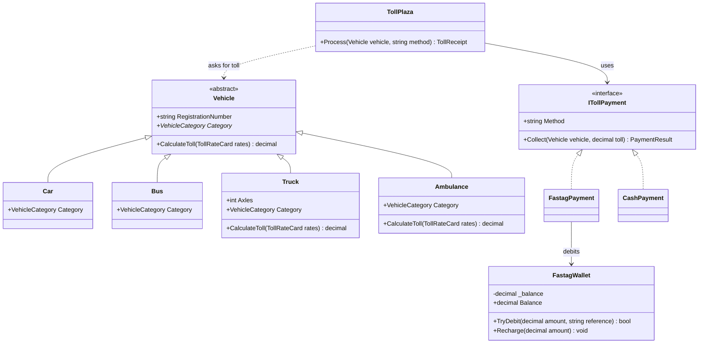
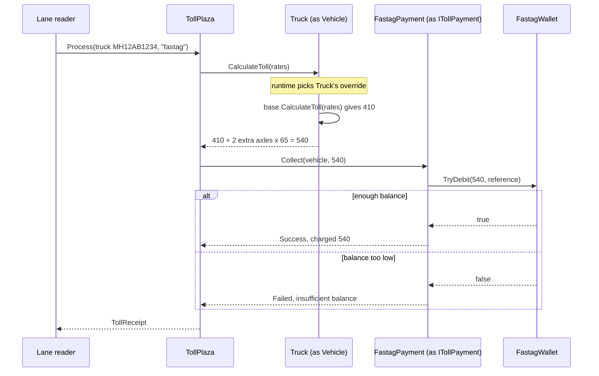
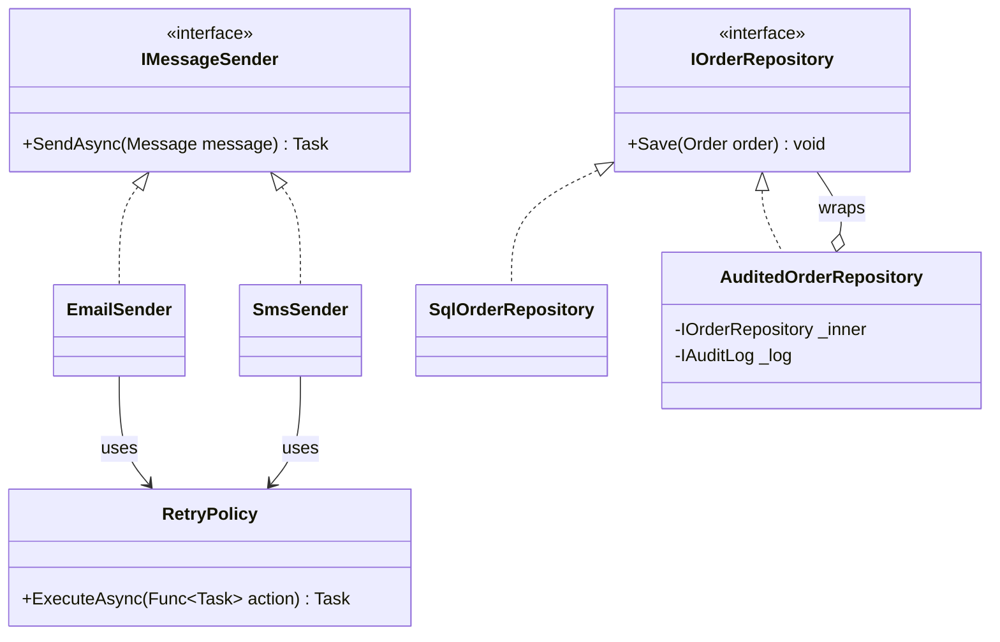

Object-oriented programming (OOP) is often introduced as "four pillars". The names sound academic, but each one answers a practical question you will face every week: *Who is allowed to change this data? What does the caller really need to know? Where does shared behaviour live? How do I handle many kinds of thing without a giant `if`?* This lesson answers all four with one running example: an expressway toll plaza, the kind every driver with a FASTag passes through.

## Learning objectives

By the end of this lesson you will be able to:

1. Explain encapsulation, abstraction, inheritance and polymorphism in plain words, each with an analogy.
2. Use C# access modifiers (`public`, `private`, `protected`, `internal` and their combinations) deliberately.
3. Build a small class hierarchy with `abstract`, `virtual`, `override`, `base` and `sealed`.
4. Replace a type-checking `switch` with polymorphic method calls.
5. Use an interface to hide *how* something is done from the code that uses it.
6. Recognise when inheritance is the wrong tool, and use composition instead.
7. Explain what the runtime does when you call a virtual method.

## Prerequisites

- [Classes, objects, fields, properties and methods](#/lesson/m01-classes-objects).
- [Constructors and object initialization](#/lesson/m01-constructors): you will chain to a base constructor with `: base(...)`.

## Explain it like I'm a beginner

Picture a toll plaza on the Delhi–Mumbai Expressway. Cars, buses, trucks and ambulances arrive all day. Some pay by FASTag, some pay cash. The four pillars are all visible here.

### Encapsulation: the cash box is locked

The toll booth has a cash drawer. The driver can't reach in and take change. They hand over money, and the operator follows the rules: count it, give change, print a receipt. Your FASTag wallet works the same way. You can't edit your balance; you can only **recharge** it or have a toll **debited**, and each operation checks its rules.

**Encapsulation** means *keep the data inside, and only allow changes through approved actions that enforce the rules.* You practised this in [the classes lesson](#/lesson/m01-classes-objects) with the metro card.

### Abstraction: "pay the toll" is all you need to know

When the boom barrier lifts, the driver doesn't know about the bank network, the tag reader's radio frequency or the settlement file sent at midnight. They see one simple idea: *the toll got paid*.

**Abstraction** means *show only what the user of something needs, and hide the complicated details behind a simple contract.* The plaza software also just asks "collect ₹120 from this vehicle". Whether that happens through FASTag or cash is someone else's problem.

### Inheritance: every truck is a vehicle

Cars, buses, trucks and ambulances are all **vehicles**. All of them have a registration number. All of them pass through the lane. Instead of writing "has a registration number" four times, you write it once in a general `Vehicle` class and say "a `Truck` *is a* `Vehicle`, plus a few extras (number of axles)".

**Inheritance** means *a new class can start from an existing class and add or change behaviour.* The general class is the **base class** (parent). The specific one is the **derived class** (child).

### Polymorphism: same question, different answers

The plaza asks every vehicle the same question: "How much is your toll?" A car answers with the car rate. A truck answers with the truck rate plus extra for extra axles. An ambulance answers "zero, I'm exempt".

The plaza doesn't check "if car… else if truck…". It just asks, and each vehicle gives its own answer. **Polymorphism** (Greek for "many shapes") means *one call, many behaviours, chosen by the actual type of the object at runtime.*

### How they fit together

| Pillar | Question it answers | Toll plaza |
|---|---|---|
| Encapsulation | Who can change this data, and under which rules? | FASTag balance changes only by recharge or debit |
| Abstraction | What does the caller really need to know? | "Collect the toll", not "talk to the bank" |
| Inheritance | Where does shared behaviour live? | `Vehicle` holds the registration and default toll rule |
| Polymorphism | How do I treat many types the same way? | `vehicle.CalculateToll(rates)` gives each type's answer |

## First-principles explanation

### Encapsulation in detail

Encapsulation is about **protecting invariants**: rules that must always hold. For a FASTag wallet, "the balance is never negative" is an invariant. The tools are:

- **Private fields** for the data.
- **Public methods** that check rules before changing the data (`TryDebit`, `Recharge`).
- **Read-only views** of data that outsiders may see (`Balance { get; private set; }`, `IReadOnlyList<T>`).

Encapsulation is *not* "every field gets a getter and a setter". A public setter with no rules leaves the data as exposed as a public field, with extra syntax.

### Access modifiers: the locks you can use

C# gives you six levels of visibility. Think of a company building:

| Modifier | Who can use it | Building analogy |
|---|---|---|
| `public` | Any code | The reception desk |
| `private` | Only this class | Your own locked drawer |
| `protected` | This class and classes derived from it | A family locker: you and your children |
| `internal` | Any code in the same project (assembly) | Staff-only floors, any department |
| `protected internal` | Same project, **or** derived classes anywhere | Staff floors, plus family who work elsewhere |
| `private protected` | Derived classes **in the same project** only | Family locker, only for family who work here |

Defaults matter. Members of a class are `private` unless you say otherwise. Top-level classes are `internal` unless you say otherwise. A good rule: **start with the most restrictive level that works, and open up only when you need to.** It is easy to make something public later. It is very hard to make it private once 30 other classes use it.

### Abstraction in detail

Abstraction is about **reducing what the caller must think about**. You do it by designing a simple contract and hiding the rest. In C#, the tools are:

- **Interfaces**: a pure contract with no data. `ITollPayment` says "you can collect a toll", and nothing about how.
- **Abstract classes**: a partial implementation that leaves some steps for subclasses (`abstract VehicleCategory Category { get; }`).
- **Well-named public methods** on any class. `plaza.Process(vehicle, "fastag")` is an abstraction over a dozen steps.

Encapsulation and abstraction are related but not the same. **Encapsulation hides data to protect it. Abstraction hides complexity to simplify use.** A wallet's private balance is encapsulation. An `ITollPayment` interface that covers FASTag, cash and UPI is abstraction.

Abstractions have a cost. Each interface is one more thing to name, find and understand. An interface with exactly one implementation that will never have a second is often noise. More on choosing in [Interfaces and abstract classes](#/lesson/m01-interfaces-abstract).

### Inheritance in detail

```csharp
public abstract class Vehicle
{
    protected Vehicle(string registrationNumber) => RegistrationNumber = registrationNumber;
    public string RegistrationNumber { get; }
}

public sealed class Truck : Vehicle
{
    public Truck(string registrationNumber, int axles) : base(registrationNumber) => Axles = axles;
    public int Axles { get; }
}
```

- `Truck : Vehicle` reads "Truck inherits from Vehicle". A `Truck` object has everything a `Vehicle` has, plus `Axles`.
- `: base(registrationNumber)` calls the parent's constructor first. The parent part is always set up before the child's constructor body runs.
- `abstract class` means "you can't create a plain `Vehicle`, only a specific kind". `new Vehicle(...)` does not compile.
- `sealed class` means "nobody may inherit from `Truck`". Sealing classes you didn't design for inheritance is a good default. It prevents surprising subclasses, and lets the runtime optimise some calls.

C# allows **single inheritance of classes**: one parent class only. A class can implement **many interfaces**. Every class ultimately inherits from `System.Object`, which is why every object has `ToString()`, `Equals()` and `GetHashCode()`.

Inheritance should model **"is a"**, and must keep the parent's promises. If code works with a `Vehicle`, it must still work when given a `Truck`. This is the [Liskov Substitution Principle](#/lesson/m04-lsp). If a subclass has to throw `NotSupportedException` for a parent method, the "is a" claim is false.

### Polymorphism in detail

There are two kinds.

**1. Runtime polymorphism (overriding).** The base class marks a method `virtual` (has a default, may be replaced) or `abstract` (no default, must be replaced). The derived class uses `override`:

```csharp
public abstract class Vehicle
{
    public virtual decimal CalculateToll(TollRateCard rates) => rates.RateFor(Category);
    public abstract VehicleCategory Category { get; }
}

public sealed class Truck : Vehicle
{
    public override decimal CalculateToll(TollRateCard rates)
        => base.CalculateToll(rates) + Math.Max(0, Axles - 3) * rates.PerExtraAxle;
}
```

`base.CalculateToll(rates)` calls the parent's version, so the truck *extends* the default instead of copying it.

**2. Compile-time polymorphism (overloading).** Several methods share a name but take different parameters: `Recharge(decimal amount)` and `Recharge(decimal amount, string upiReference)`. The compiler picks one based on the arguments. This is handy but much less important for design than overriding.

### What the runtime does with a virtual call

Every object carries a hidden pointer to its **type information**, including a table of method addresses (often called a *vtable*, or the method table in .NET). For `Truck`, the slot for `CalculateToll` points at `Truck`'s override. For `Car`, which didn't override it, the slot points at `Vehicle`'s version.

When you write `vehicle.CalculateToll(rates)` and `vehicle` is declared as `Vehicle`, the compiler emits a *virtual call*. At runtime the CLR follows the object's type pointer, looks up the slot and jumps there. It costs a few nanoseconds, which is negligible next to any database or network call. The JIT can often remove even that cost for `sealed` types.

### `new` is not `override`

If a derived class declares a method with the same name *without* `override`, it **hides** the parent's method. The compiler warns you (CS0108) and suggests the `new` keyword to confirm. Hiding is not polymorphism: a call through a `Vehicle` variable still runs the parent's version. It almost always indicates a mistake. Use `override`.

### Composition: the other way to reuse code

Inheritance is not the only way to share behaviour. **Composition** means *an object holds other objects and delegates work to them*: "has a" instead of "is a".

- A `TollPlaza` **has** a rate card and **has** a set of payment methods. It doesn't inherit from them.
- A truck that tows a trailer: model `Truck` **has** an optional `Trailer`, rather than creating `TruckWithTrailer : Truck`.

Inheritance links the child tightly to the parent's internals. A change in the base class can break subclasses you have never seen (the *fragile base class* problem). Composition keeps parts independent and swappable. The common advice "favour composition over inheritance" doesn't mean "never inherit". It means *inherit only for a true, stable "is a" relationship, and compose for everything else.* See [Composition versus inheritance](#/lesson/m04-composition-inheritance).

### When the pillars are overkill

- **A three-value enum with one `switch`** in one place is simpler than a class hierarchy. Polymorphism pays off when the same type check appears in many places, or when new types arrive often.
- **Deep hierarchies** (`Vehicle → MotorVehicle → HeavyVehicle → GoodsVehicle → Truck → TankerTruck`) are hard to understand and change. Two levels is common; four is a warning sign.
- **Interfaces for everything** (`ICar`, `ICarFactory`, `ICarFactoryProvider`) add files and indirection with no benefit until a second implementation or a test double exists.

## Visual explanation

### Class diagram: hierarchy and abstraction



All four pillars are on this one picture. **Inheritance**: solid lines with hollow triangles from `Car`, `Bus`, `Truck` and `Ambulance` to `Vehicle`. **Polymorphism**: `Truck` and `Ambulance` list `CalculateToll` again because they override it; `Car` and `Bus` don't, so they use the default. `Category` is marked `*` (abstract) on `Vehicle`, so every subclass must supply it. **Abstraction**: `TollPlaza` points only at the `ITollPayment` interface (dotted lines with hollow triangles show the implementations). **Encapsulation**: `FastagWallet` has a private `-_balance` and public operations. [Class diagrams](#/lesson/m05-class-diagrams) teaches this notation fully.

### Sequence diagram: one crossing



Read it top to bottom. `TollPlaza` only knows it has "a `Vehicle`" and "an `ITollPayment`". When it calls `CalculateToll`, the runtime runs `Truck`'s override (polymorphism), which reuses the base rule through `base.CalculateToll` (inheritance). Payment is delegated to whichever `ITollPayment` was chosen (abstraction). The wallet decides whether the debit is allowed (encapsulation). Note the `alt` box: the wallet's rule produces two possible outcomes, and the plaza handles both. The amounts are from our illustrative rate card, not any real plaza's.

## Step-by-step example

### Step 1 — the naive version: one class and a switch

```csharp
public class Vehicle
{
    public string Registration = "";
    public string Type = "";       // "car", "bus", "truck", "ambulance"
    public int Axles;
}

public decimal Toll(Vehicle v) => v.Type switch
{
    "car" => 120m,
    "bus" => 410m,
    "truck" => 410m + Math.Max(0, v.Axles - 3) * 65m,
    "ambulance" => 0m,
    _ => throw new ArgumentException($"Unknown type {v.Type}")
};
```

It works, and for a one-off script it might be fine. Now imagine the same `switch` in four more places: the receipt printer, the monthly report, the overload check and the lane display. Adding "electric bus at a concession" means finding and editing all five. Miss one and you get a bug.

Also, `Axles` exists on every vehicle, even cars, where it means nothing. And `Type = "Truk"` (typo) compiles happily.

### Step 2 — encapsulate the data

Make fields private, validate in the constructor, expose read-only properties. A misspelt type can no longer be stored, because types become classes in the next step.

### Step 3 — a base class with a default rule

```csharp
public abstract class Vehicle
{
    protected Vehicle(string registrationNumber) { /* validate */ RegistrationNumber = registrationNumber; }
    public string RegistrationNumber { get; }
    public abstract VehicleCategory Category { get; }
    public virtual decimal CalculateToll(TollRateCard rates) => rates.RateFor(Category);
}
```

Cars and buses don't need to override `CalculateToll`. They only say which category they are.

### Step 4 — subclasses override only what differs

`Truck` adds axles and extends the toll rule with `base.CalculateToll(...)`. `Ambulance` overrides it to return zero. The `switch` is gone from the toll logic. The plaza code says `vehicle.CalculateToll(rates)` for every vehicle.

### Step 5 — abstract the payment

The plaza needs to "collect money", not to know about wallets. Introduce `ITollPayment` with `FastagPayment` and `CashPayment`. Adding UPI later means one new class.

The full version follows.

## Production-style C# implementation

```text
Toll.Api/
  Program.cs
  Tolling/
    VehicleCategory.cs
    TollRateCard.cs            // illustrative rates
    Vehicles.cs                // Vehicle (abstract) + Car, LightCommercialVehicle, Bus, Truck, Ambulance
    VehicleFactory.cs          // the one place that turns a request "kind" into a class
    FastagWallet.cs            // encapsulation
    IFastagWalletStore.cs      // storage abstraction + in-memory version
    Payments.cs                // ITollPayment abstraction + FastagPayment + CashPayment
    TollPlaza.cs               // uses only abstractions
```

```csharp file=Tolling/VehicleCategory.cs
namespace Toll.Api.Tolling;

public enum VehicleCategory { Car, LightCommercial, BusOrTruck, MultiAxle, Exempt }

public sealed record PaymentResult(bool Success, decimal AmountCharged, string Message);

public sealed record TollReceipt(string RegistrationNumber, VehicleCategory Category, string Method,
    decimal Toll, PaymentResult Payment, DateTimeOffset At);
```

```csharp file=Tolling/TollRateCard.cs
namespace Toll.Api.Tolling;

/// <summary>Illustrative single-journey rates. Real plazas publish their own rates per section.</summary>
public sealed class TollRateCard
{
    public decimal Car { get; init; } = 120m;
    public decimal LightCommercial { get; init; } = 195m;
    public decimal BusOrTruck { get; init; } = 410m;
    public decimal MultiAxle { get; init; } = 410m;
    public decimal PerExtraAxle { get; init; } = 65m;      // per axle beyond three

    public decimal RateFor(VehicleCategory category) => category switch
    {
        VehicleCategory.Car => Car,
        VehicleCategory.LightCommercial => LightCommercial,
        VehicleCategory.BusOrTruck => BusOrTruck,
        VehicleCategory.MultiAxle => MultiAxle,
        VehicleCategory.Exempt => 0m,
        _ => throw new ArgumentOutOfRangeException(nameof(category), category, null),
    };
}
```

```csharp file=Tolling/Vehicles.cs
namespace Toll.Api.Tolling;

/// <summary>Base class: shared data (registration) and the default toll rule.
/// Abstract: there is no such thing as "just a vehicle" at the plaza.</summary>
public abstract class Vehicle
{
    protected Vehicle(string registrationNumber) => RegistrationNumber = NormaliseRegistration(registrationNumber);

    /// <summary>"mh 12 ab-1234" and "MH12AB1234" are the same vehicle. Every part of the system
    /// (vehicles, wallets, lookups) must use this one rule, or lookups silently miss.</summary>
    public static string NormaliseRegistration(string? registrationNumber)
    {
        var normalised = new string((registrationNumber ?? "").Where(char.IsLetterOrDigit).ToArray()).ToUpperInvariant();
        if (normalised.Length is < 6 or > 11)
            throw new ArgumentException($"'{registrationNumber}' is not a valid registration number.", nameof(registrationNumber));
        return normalised;
    }

    public string RegistrationNumber { get; }

    /// <summary>Every concrete vehicle must say which rate category it belongs to.</summary>
    public abstract VehicleCategory Category { get; }

    /// <summary>Default rule: the rate for the category. Subclasses may extend or replace it.</summary>
    public virtual decimal CalculateToll(TollRateCard rates)
    {
        ArgumentNullException.ThrowIfNull(rates);
        return rates.RateFor(Category);
    }

    public override string ToString() => $"{GetType().Name} {RegistrationNumber}";
}

public sealed class Car(string registrationNumber) : Vehicle(registrationNumber)
{
    public override VehicleCategory Category => VehicleCategory.Car;
}

public sealed class LightCommercialVehicle(string registrationNumber) : Vehicle(registrationNumber)
{
    public override VehicleCategory Category => VehicleCategory.LightCommercial;
}

public sealed class Bus(string registrationNumber) : Vehicle(registrationNumber)
{
    public override VehicleCategory Category => VehicleCategory.BusOrTruck;
}

public sealed class Truck : Vehicle
{
    public Truck(string registrationNumber, int axles) : base(registrationNumber)
    {
        ArgumentOutOfRangeException.ThrowIfLessThan(axles, 2);
        ArgumentOutOfRangeException.ThrowIfGreaterThan(axles, 9);
        Axles = axles;
    }

    public int Axles { get; }

    public override VehicleCategory Category => Axles <= 2 ? VehicleCategory.BusOrTruck : VehicleCategory.MultiAxle;

    /// <summary>Extends the base rule instead of copying it.</summary>
    public override decimal CalculateToll(TollRateCard rates) =>
        base.CalculateToll(rates) + Math.Max(0, Axles - 3) * rates.PerExtraAxle;
}

public sealed class Ambulance(string registrationNumber) : Vehicle(registrationNumber)
{
    public override VehicleCategory Category => VehicleCategory.Exempt;
    public override decimal CalculateToll(TollRateCard rates) => 0m;
}
```

```csharp file=Tolling/VehicleFactory.cs
namespace Toll.Api.Tolling;

/// <summary>The one place where text from the outside world becomes a concrete class.
/// A switch here is fine: it is the boundary, and it exists only once.</summary>
public static class VehicleFactory
{
    public static Vehicle Create(string kind, string registrationNumber, int? axles = null) =>
        kind.Trim().ToLowerInvariant() switch
        {
            "car" => new Car(registrationNumber),
            "lcv" => new LightCommercialVehicle(registrationNumber),
            "bus" => new Bus(registrationNumber),
            "truck" => new Truck(registrationNumber, axles ?? 2),
            "ambulance" => new Ambulance(registrationNumber),
            _ => throw new ArgumentException($"Unknown vehicle kind '{kind}'.", nameof(kind)),
        };
}
```

```csharp file=Tolling/FastagWallet.cs
namespace Toll.Api.Tolling;

/// <summary>Encapsulation: the balance can change only through Recharge and TryDebit.</summary>
public sealed class FastagWallet
{
    private readonly Lock _gate = new();
    private readonly List<string> _statement = new();
    private decimal _balance;

    public FastagWallet(string registrationNumber, decimal openingBalance = 0m)
    {
        ArgumentOutOfRangeException.ThrowIfNegative(openingBalance);
        RegistrationNumber = Vehicle.NormaliseRegistration(registrationNumber);
        _balance = openingBalance;
    }

    public string RegistrationNumber { get; }
    public decimal Balance { get { lock (_gate) return _balance; } }
    public IReadOnlyList<string> Statement { get { lock (_gate) return _statement.ToArray(); } }

    public void Recharge(decimal amount)
    {
        ArgumentOutOfRangeException.ThrowIfNegativeOrZero(amount);
        lock (_gate)
        {
            _balance += amount;
            _statement.Add($"+{amount} recharge");
        }
    }

    public bool TryDebit(decimal amount, string reference)
    {
        ArgumentOutOfRangeException.ThrowIfNegative(amount);
        lock (_gate)
        {
            if (amount > _balance) return false;
            _balance -= amount;
            _statement.Add($"-{amount} {reference}");
            return true;
        }
    }
}
```

```csharp file=Tolling/IFastagWalletStore.cs
using System.Collections.Concurrent;

namespace Toll.Api.Tolling;

public interface IFastagWalletStore
{
    FastagWallet? FindByVehicle(string registrationNumber);
    void Add(FastagWallet wallet);
}

public sealed class InMemoryFastagWalletStore : IFastagWalletStore
{
    private readonly ConcurrentDictionary<string, FastagWallet> _wallets = new(StringComparer.OrdinalIgnoreCase);
    public FastagWallet? FindByVehicle(string registrationNumber) => _wallets.GetValueOrDefault(registrationNumber);
    public void Add(FastagWallet wallet) => _wallets[wallet.RegistrationNumber] = wallet;
}
```

```csharp file=Tolling/Payments.cs
namespace Toll.Api.Tolling;

/// <summary>Abstraction: the plaza only needs "collect this toll". How is someone else's job.</summary>
public interface ITollPayment
{
    string Method { get; }
    PaymentResult Collect(Vehicle vehicle, decimal toll);
}

public sealed class FastagPayment(IFastagWalletStore wallets, TimeProvider clock) : ITollPayment
{
    public string Method => "fastag";

    public PaymentResult Collect(Vehicle vehicle, decimal toll)
    {
        if (toll == 0m) return new PaymentResult(true, 0m, "Exempt");
        var wallet = wallets.FindByVehicle(vehicle.RegistrationNumber);
        if (wallet is null) return new PaymentResult(false, 0m, "No FASTag linked to this vehicle.");
        var reference = $"TOLL-{clock.GetUtcNow():yyyyMMddHHmmss}-{vehicle.RegistrationNumber}";
        return wallet.TryDebit(toll, reference)
            ? new PaymentResult(true, toll, $"Debited from FASTag, balance {wallet.Balance}")
            : new PaymentResult(false, 0m, "Insufficient FASTag balance.");
    }
}

/// <summary>In this example plaza, cash payers are charged twice the toll. That is an illustrative rule.</summary>
public sealed class CashPayment : ITollPayment
{
    public const decimal CashMultiplier = 2m;
    public string Method => "cash";

    public PaymentResult Collect(Vehicle vehicle, decimal toll) =>
        new(true, toll * CashMultiplier, toll == 0m ? "Exempt" : "Collected in cash");
}
```

```csharp file=Tolling/TollPlaza.cs
using Microsoft.Extensions.Logging;

namespace Toll.Api.Tolling;

/// <summary>Depends only on abstractions: Vehicle (base class) and ITollPayment (interface).
/// Adding a new vehicle type or payment method does not change this class.</summary>
public sealed class TollPlaza
{
    private readonly TollRateCard _rates;
    private readonly IReadOnlyDictionary<string, ITollPayment> _payments;
    private readonly TimeProvider _clock;
    private readonly ILogger<TollPlaza> _logger;

    public TollPlaza(TollRateCard rates, IEnumerable<ITollPayment> payments, TimeProvider clock, ILogger<TollPlaza> logger)
    {
        _rates = rates;
        _payments = payments.ToDictionary(p => p.Method, StringComparer.OrdinalIgnoreCase);
        _clock = clock;
        _logger = logger;
    }

    public TollReceipt Process(Vehicle vehicle, string method)
    {
        ArgumentNullException.ThrowIfNull(vehicle);
        if (!_payments.TryGetValue(method, out var payment))
            throw new ArgumentException($"Unknown payment method '{method}'.", nameof(method));

        var toll = vehicle.CalculateToll(_rates);          // polymorphism: each type answers for itself
        var result = payment.Collect(vehicle, toll);       // abstraction: we don't know or care how

        _logger.LogInformation("{Vehicle} toll {Toll} via {Method}: {Success}", vehicle, toll, payment.Method, result.Success);
        return new TollReceipt(vehicle.RegistrationNumber, vehicle.Category, payment.Method, toll, result, _clock.GetUtcNow());
    }
}
```

```csharp file=Program.cs
using Toll.Api.Tolling;

var builder = WebApplication.CreateBuilder(args);

builder.Services.AddSingleton(new TollRateCard());
builder.Services.AddSingleton(TimeProvider.System);
builder.Services.AddSingleton<IFastagWalletStore, InMemoryFastagWalletStore>();
builder.Services.AddSingleton<ITollPayment, FastagPayment>();
builder.Services.AddSingleton<ITollPayment, CashPayment>();
builder.Services.AddSingleton<TollPlaza>();

var app = builder.Build();

app.MapPost("/fastag", (CreateWalletRequest req, IFastagWalletStore store) =>
{
    try
    {
        var wallet = new FastagWallet(req.RegistrationNumber, req.OpeningBalance);
        store.Add(wallet);
        return Results.Created($"/fastag/{wallet.RegistrationNumber}", new { wallet.RegistrationNumber, wallet.Balance });
    }
    catch (ArgumentException ex) { return Results.Problem(ex.Message, statusCode: StatusCodes.Status400BadRequest); }
});

app.MapPost("/crossings", (CrossingRequest req, TollPlaza plaza) =>
{
    try
    {
        var vehicle = VehicleFactory.Create(req.Kind, req.RegistrationNumber, req.Axles);
        var receipt = plaza.Process(vehicle, req.PaymentMethod);
        return receipt.Payment.Success ? Results.Ok(receipt) : Results.Json(receipt, statusCode: StatusCodes.Status402PaymentRequired);
    }
    catch (ArgumentException ex) { return Results.Problem(ex.Message, statusCode: StatusCodes.Status400BadRequest); }
});

app.Run();

public sealed record CreateWalletRequest(string RegistrationNumber, decimal OpeningBalance);
public sealed record CrossingRequest(string Kind, string RegistrationNumber, int? Axles, string PaymentMethod);
```

What to notice:

- **`TollPlaza` has no `switch` on vehicle type or payment method.** It asks the vehicle for its toll and gives the job to the chosen payment. This is the payoff of polymorphism and abstraction.
- **There is still one `switch`**, in `VehicleFactory`. Text arriving from the outside world must be turned into a class somewhere. Keep that in one place, at the edge.
- **`ArgumentOutOfRangeException` from `Truck`'s constructor** is an `ArgumentException`, so the endpoint's single `catch` turns all input problems into a 400 response.
- **`FastagWallet` locks its own state.** Two lanes could read the same tag at nearly the same moment. The wallet, which owns the balance, also owns the thread safety.
- **One normalisation rule for registration numbers.** The wallet and the vehicle both call `Vehicle.NormaliseRegistration`, so "MH 12 AB 1234" typed at recharge time still matches the tag read at the lane. Two slightly different clean-up rules in two classes is a classic "lookup silently returns null" bug.
- **Most classes are `sealed`.** Only `Vehicle` is designed for inheritance. Everything else is closed by default.

:::callout type=warning title="What this sample leaves out"
Real tag readers often report the same vehicle twice within a second. A production plaza would give every read a unique id and ignore repeats (idempotency), so one crossing is never debited twice. Wallets would live in a database, not in memory, and the debit would be a single conditional `UPDATE ... SET balance = balance - @toll WHERE balance >= @toll`, so two lanes on two servers can't both spend the same rupees. The OOP shape stays the same; only the classes behind the interfaces change.
:::

## Bad design vs good design

**Bad: inheritance used for code reuse, not for "is a".**

```csharp
public class FastagWallet : List<string>     // "I want Add() for my statement"
{
    public decimal Balance;
}

wallet.Clear();            // statement erased: List<T>'s public methods came along for free
wallet.Balance = -500m;    // no encapsulation at all
```

A wallet *has* a statement; it isn't a list. Inheriting exposes every public member of `List<string>` as part of the wallet's API, forever.

**Bad: a subclass that breaks the parent's promise.**

```csharp
public class Ambulance : Vehicle
{
    public override decimal CalculateToll(TollRateCard rates) => throw new NotSupportedException("Ambulances don't pay");
}
```

Any code looping over vehicles now crashes on ambulances. The correct override returns `0m`. "Exempt" is a valid answer to "what is your toll?", not an error.

**Bad: type checks that defeat polymorphism.**

```csharp
if (vehicle is Truck t) toll += t.Axles * 65m;
else if (vehicle is Ambulance) toll = 0m;
```

Every new vehicle type means hunting for checks like these. Move the behaviour into the types.

**Good:** the implementation above. Inheritance only where "is a" is true (`Truck` is a `Vehicle`). Composition where "has a" is true (`TollPlaza` has payment methods; `FastagWallet` has a statement). Behaviour that varies by type lives in the type.

**Is the class hierarchy always worth it?** No. If the only thing that varies is a number in a lookup table (car ₹120, bus ₹410), a `Dictionary<VehicleCategory, decimal>` is simpler than subclasses. Subclasses earn their keep when types differ in **behaviour** (trucks count axles, ambulances are exempt) or **data** (only trucks have axles).

:::callout type=mistake title="Calling virtual methods from a constructor"
If `Vehicle`'s constructor called `CalculateToll(...)`, the `Truck` override would run *before* `Truck`'s constructor had set `Axles`. It would see `Axles == 0`. Keep constructors to simple assignments and validation.
:::

## Practical playground

The program builds a mixed list of vehicles and processes them through the same loop. Run it, then try the experiments.

:::playground type=csharp title="Polymorphic toll plaza"
```csharp file=Program.cs
using System;
using System.Collections.Generic;

public abstract class Vehicle
{
    protected Vehicle(string registration) => Registration = registration;
    public string Registration { get; }
    public abstract string Category { get; }
    public virtual decimal Toll() => 120m;
    public override string ToString() => $"{GetType().Name,-10} {Registration,-12} {Category,-10}";
}

public sealed class Car(string registration) : Vehicle(registration)
{
    public override string Category => "Car";
}

public sealed class Bus(string registration) : Vehicle(registration)
{
    public override string Category => "Bus";
    public override decimal Toll() => 410m;
}

public sealed class Truck(string registration, int axles) : Vehicle(registration)
{
    public int Axles { get; } = axles;
    public override string Category => Axles <= 2 ? "Truck" : "MultiAxle";
    public override decimal Toll() => 410m + Math.Max(0, Axles - 3) * 65m;
}

public sealed class Ambulance(string registration) : Vehicle(registration)
{
    public override string Category => "Exempt";
    public override decimal Toll() => 0m;
}

public static class Program
{
    public static void Main()
    {
        List<Vehicle> queue =
        [
            new Car("DL3CAB1234"),
            new Truck("MH12AB1234", 5),
            new Bus("KA01F5678"),
            new Ambulance("HR26EM0108"),
            new Truck("GJ05XY9876", 2),
        ];

        decimal total = 0;
        foreach (var v in queue)        // one loop, no type checks
        {
            var toll = v.Toll();        // the runtime chooses each type's override
            total += toll;
            Console.WriteLine($"{v} pays {toll,6}");
        }
        Console.WriteLine($"Total collected: {total}");

        // Experiments:
        // 1. Add `public sealed class Tractor(string r) : Vehicle(r)` without overriding Category. What does the compiler say?
        // 2. In Bus, change `override` to `new` on Toll(). What does the loop print for the bus now? Why?
        // 3. Add an ElectricBus that gets 20 % off the bus toll. Inherit from Bus or from Vehicle? (Bus is sealed: what does that tell you?)
    }
}
```
:::

## Exercises

:::exercise id=m01-oop-pillars-ex1 difficulty=beginner kind=code title="Parcel shipping with inheritance and override"
A courier company prices parcels differently by type. Build a small hierarchy so the checkout can total a mixed list of parcels without knowing their types.
::requirements
- `Parcel` is abstract, with a `WeightKg` property set through its constructor (must be > 0, otherwise `ArgumentOutOfRangeException`) and an abstract `ShippingCost()` method.
- `DocumentParcel`: flat ₹50, whatever the weight.
- `BoxParcel`: ₹40 plus ₹20 per kg, with weight rounded **up** to the next whole kg.
- `FragileParcel` inherits from `BoxParcel` and adds 25 % to the box price. It must call `base.ShippingCost()` rather than repeating the formula.
- `Checkout.Total(IEnumerable<Parcel>)` returns the sum.
::acceptance
- A document of 0.2 kg costs ₹50.
- A 2.3 kg box costs ₹40 + 3 × ₹20 = ₹100.
- A 2.3 kg fragile box costs ₹125.
- A total of one of each is ₹275.
- A weight of 0 throws `ArgumentOutOfRangeException`.
::hint
Start with the base class. Which members are the same for every parcel, and which must each type decide?
::hint
`abstract decimal ShippingCost();` in `Parcel` forces every subclass to answer. `BoxParcel` must not be sealed, because `FragileParcel` inherits from it, and its `ShippingCost` must be `override` (it is already virtual because it overrides an abstract method).
::hint
`Math.Ceiling(2.3m)` gives `3`. Use `decimal` for money and weight.
::hint
```csharp
public override decimal ShippingCost() => base.ShippingCost() * 1.25m;
```
::starter
```csharp file=Parcels.cs
using System;
using System.Collections.Generic;
using System.Linq;

public abstract class Parcel
{
    protected Parcel(decimal weightKg) => throw new NotImplementedException();
    public decimal WeightKg { get; }
    public abstract decimal ShippingCost();
}

public sealed class DocumentParcel(decimal weightKg) : Parcel(weightKg)
{
    public override decimal ShippingCost() => throw new NotImplementedException();
}

public class BoxParcel(decimal weightKg) : Parcel(weightKg)
{
    public override decimal ShippingCost() => throw new NotImplementedException();
}

public sealed class FragileParcel(decimal weightKg) : BoxParcel(weightKg)
{
    public override decimal ShippingCost() => throw new NotImplementedException();
}

public static class Checkout
{
    public static decimal Total(IEnumerable<Parcel> parcels) => throw new NotImplementedException();
}
```
::tests
```csharp file=ParcelTests.cs
using System;
using System.Collections.Generic;
using Xunit;

public class ParcelTests
{
    [Fact] public void Document_is_flat() => Assert.Equal(50m, new DocumentParcel(0.2m).ShippingCost());
    [Fact] public void Box_rounds_weight_up() => Assert.Equal(100m, new BoxParcel(2.3m).ShippingCost());
    [Fact] public void Fragile_adds_quarter() => Assert.Equal(125m, new FragileParcel(2.3m).ShippingCost());

    [Fact]
    public void Checkout_totals_mixed_list()
    {
        var parcels = new List<Parcel> { new DocumentParcel(0.2m), new BoxParcel(2.3m), new FragileParcel(2.3m) };
        Assert.Equal(275m, Checkout.Total(parcels));
    }

    [Fact] public void Fragile_is_a_box() => Assert.True(new FragileParcel(1m) is BoxParcel);

    [Fact] public void Zero_weight_throws() => Assert.Throws<ArgumentOutOfRangeException>(() => new BoxParcel(0m));
}
```
::solution
```csharp file=Parcels.cs
using System;
using System.Collections.Generic;
using System.Linq;

public abstract class Parcel
{
    protected Parcel(decimal weightKg)
    {
        ArgumentOutOfRangeException.ThrowIfNegativeOrZero(weightKg);
        WeightKg = weightKg;
    }

    public decimal WeightKg { get; }
    public abstract decimal ShippingCost();
}

public sealed class DocumentParcel(decimal weightKg) : Parcel(weightKg)
{
    public override decimal ShippingCost() => 50m;
}

public class BoxParcel(decimal weightKg) : Parcel(weightKg)
{
    public override decimal ShippingCost() => 40m + Math.Ceiling(WeightKg) * 20m;
}

public sealed class FragileParcel(decimal weightKg) : BoxParcel(weightKg)
{
    public override decimal ShippingCost() => base.ShippingCost() * 1.25m;
}

public static class Checkout
{
    public static decimal Total(IEnumerable<Parcel> parcels) => parcels.Sum(p => p.ShippingCost());
}
```

`Checkout.Total` never checks a type. Adding an `ExpressParcel` tomorrow means one new class and no change to `Checkout`. `FragileParcel` reuses the box formula through `base`, so if box pricing changes, fragile pricing follows automatically.
::mistakes
- Copying `40m + Math.Ceiling(WeightKg) * 20m` into `FragileParcel`. The two formulas drift apart at the next price change.
- Making `BoxParcel` sealed, then wondering why `FragileParcel` doesn't compile.
- Using `Math.Round` instead of `Math.Ceiling`. 2.3 kg would be billed as 2 kg.
::extensions
Add an `InsuredParcel` that adds 2 % of a declared value to *any* parcel type. Can you do it with inheritance? (You'd need one subclass per type.) Try composition instead: a class that *wraps* any `Parcel`.
:::

:::exercise id=m01-oop-pillars-ex2 difficulty=beginner kind=code title="Encapsulate a library book's state"
A `LibraryBook` can be on the shelf, borrowed or lost. Callers must not be able to put it into an impossible state.
::requirements
- `Status` is readable but not settable from outside. A new book is `Available`.
- `Borrow(string memberId)`: allowed only when `Available`. It sets `BorrowedBy`. Otherwise throw `InvalidOperationException`. A blank member id throws `ArgumentException`.
- `Return()`: allowed only when `Borrowed`. It clears `BorrowedBy` and increments `TimesBorrowed`. Otherwise throw `InvalidOperationException`.
- `MarkLost()`: allowed from `Available` or `Borrowed`. It clears `BorrowedBy`. A lost book can't be borrowed or returned.
::acceptance
- Borrow then return: `Available`, `TimesBorrowed` is 1, `BorrowedBy` is `null`.
- Borrowing twice throws `InvalidOperationException`.
- Returning an available book throws `InvalidOperationException`.
- A lost book can't be borrowed.
::hint
Which members need `private set`? Think about what outside code should only be able to *read*.
::hint
Each method starts with a guard: "if the current status doesn't allow this action, throw".
::hint
Change several fields together, only after the guard passes, so the book is never half-updated.
::hint
```csharp
public void Borrow(string memberId)
{
    ArgumentException.ThrowIfNullOrWhiteSpace(memberId);
    if (Status != BookStatus.Available) throw new InvalidOperationException($"Book is {Status}.");
    Status = BookStatus.Borrowed;
    BorrowedBy = memberId;
}
```
::starter
```csharp file=LibraryBook.cs
using System;

public enum BookStatus { Available, Borrowed, Lost }

public sealed class LibraryBook
{
    public LibraryBook(string isbn, string title)
    {
        Isbn = isbn;
        Title = title;
    }

    public string Isbn { get; }
    public string Title { get; }
    public BookStatus Status { get; private set; } = BookStatus.Available;
    public string? BorrowedBy { get; private set; }
    public int TimesBorrowed { get; private set; }

    public void Borrow(string memberId) => throw new NotImplementedException();
    public void Return() => throw new NotImplementedException();
    public void MarkLost() => throw new NotImplementedException();
}
```
::tests
```csharp file=LibraryBookTests.cs
using System;
using Xunit;

public class LibraryBookTests
{
    private static LibraryBook NewBook() => new("978-0-13-468599-1", "The Pragmatic Programmer");

    [Fact]
    public void Borrow_then_return()
    {
        var b = NewBook();
        b.Borrow("M-1001");
        Assert.Equal(BookStatus.Borrowed, b.Status);
        Assert.Equal("M-1001", b.BorrowedBy);
        b.Return();
        Assert.Equal(BookStatus.Available, b.Status);
        Assert.Null(b.BorrowedBy);
        Assert.Equal(1, b.TimesBorrowed);
    }

    [Fact]
    public void Cannot_borrow_twice()
    {
        var b = NewBook();
        b.Borrow("M-1");
        Assert.Throws<InvalidOperationException>(() => b.Borrow("M-2"));
        Assert.Equal("M-1", b.BorrowedBy);
    }

    [Fact] public void Cannot_return_available_book() => Assert.Throws<InvalidOperationException>(() => NewBook().Return());

    [Fact]
    public void Lost_book_cannot_be_borrowed()
    {
        var b = NewBook();
        b.Borrow("M-1");
        b.MarkLost();
        Assert.Null(b.BorrowedBy);
        Assert.Throws<InvalidOperationException>(() => b.Borrow("M-2"));
        Assert.Throws<InvalidOperationException>(() => b.Return());
    }

    [Fact] public void Blank_member_throws() => Assert.Throws<ArgumentException>(() => NewBook().Borrow(" "));
}
```
::solution
```csharp file=LibraryBook.cs
using System;

public enum BookStatus { Available, Borrowed, Lost }

public sealed class LibraryBook
{
    public LibraryBook(string isbn, string title)
    {
        Isbn = isbn;
        Title = title;
    }

    public string Isbn { get; }
    public string Title { get; }
    public BookStatus Status { get; private set; } = BookStatus.Available;
    public string? BorrowedBy { get; private set; }
    public int TimesBorrowed { get; private set; }

    public void Borrow(string memberId)
    {
        ArgumentException.ThrowIfNullOrWhiteSpace(memberId);
        if (Status != BookStatus.Available)
            throw new InvalidOperationException($"'{Title}' cannot be borrowed while {Status}.");
        Status = BookStatus.Borrowed;
        BorrowedBy = memberId;
    }

    public void Return()
    {
        if (Status != BookStatus.Borrowed)
            throw new InvalidOperationException($"'{Title}' cannot be returned while {Status}.");
        Status = BookStatus.Available;
        BorrowedBy = null;
        TimesBorrowed++;
    }

    public void MarkLost()
    {
        if (Status == BookStatus.Lost)
            throw new InvalidOperationException($"'{Title}' is already lost.");
        Status = BookStatus.Lost;
        BorrowedBy = null;
    }
}
```

Because `Status` and `BorrowedBy` have private setters, the only way to change them is through the three methods, and each method checks the rule first. "Borrowed but nobody has it" is impossible.
::alternatives
When the number of states and rules grows (reserved, under repair, transferred to another branch), consider the [State pattern](#/lesson/m06-state) or a transition table. For three states, guard clauses are clearer.
::mistakes
- `public BookStatus Status { get; set; }`, so a controller sets `Status = Borrowed` without setting `BorrowedBy`.
- Setting `Status` before checking the member id, leaving the book "Borrowed by nobody" when the check fails.
- Using exceptions for "book not found" inside the book. That is a question for whoever holds the collection of books.
::extensions
Add a due date set by `Borrow(memberId, TimeProvider clock)` and an `IsOverdue(TimeProvider clock)` query.
:::

:::exercise id=m01-oop-pillars-ex3 difficulty=intermediate kind=code title="Replace a type switch with polymorphism"
The starter has a `TollCalculator` with a `switch` on a `Kind` string. Refactor so each vehicle type calculates its own toll, then make `TollCalculator.Total` work for any mix of vehicles with no type checks.
::requirements
- `Vehicle` is abstract, with a `virtual decimal CalculateToll(RateCard rates)` that returns `rates.Base`.
- `Car` uses the default.
- `Bus` returns `rates.Base * 3`.
- `Truck(int axles)` returns the bus amount (`rates.Base * 3`) plus `rates.PerExtraAxle` for each axle beyond 3. Axles must be 2–9, otherwise `ArgumentOutOfRangeException`.
- `Ambulance` returns 0.
- `TollCalculator.Total(IEnumerable<Vehicle>, RateCard)` contains no `is`, `switch` or `GetType()`.
::acceptance
- With Base = 100 and PerExtraAxle = 50: car 100, bus 300, 5-axle truck 400, 3-axle truck 300, ambulance 0.
- The total for one of each (with the 5-axle truck) is 800.
- A truck with 1 axle throws `ArgumentOutOfRangeException`.
::hint
Ask "what varies?" The toll formula varies by type. That is the method each type should own.
::hint
Mark the base method `virtual` so subclasses can override it. Make `Vehicle` abstract so nobody creates a plain one.
::hint
Is a truck's toll "a bus toll plus extras"? You can't call `Bus`'s method from `Truck` unless `Truck` inherits from `Bus`, and a truck is not a bus. Use a shared constant or a protected helper on `Vehicle` instead.
::hint
A protected helper keeps the "heavy vehicle" rate in one place:
```csharp
protected static decimal HeavyRate(RateCard r) => r.Base * 3;
```
::hint
`Total` becomes one line: `vehicles.Sum(v => v.CalculateToll(rates))`.
::starter
```csharp file=Tolls.cs
using System;
using System.Collections.Generic;
using System.Linq;

public sealed record RateCard(decimal Base, decimal PerExtraAxle);

public abstract class Vehicle
{
    public virtual decimal CalculateToll(RateCard rates) => throw new NotImplementedException();
}

public sealed class Car : Vehicle { }

public sealed class Bus : Vehicle
{
    public override decimal CalculateToll(RateCard rates) => throw new NotImplementedException();
}

public sealed class Truck : Vehicle
{
    public Truck(int axles) => throw new NotImplementedException();
    public int Axles { get; }
    public override decimal CalculateToll(RateCard rates) => throw new NotImplementedException();
}

public sealed class Ambulance : Vehicle
{
    public override decimal CalculateToll(RateCard rates) => throw new NotImplementedException();
}

public static class TollCalculator
{
    // BEFORE (for reference):
    // switch (kind) { case "car": return r.Base; case "bus": return r.Base * 3;
    //   case "truck": return r.Base * 3 + Math.Max(0, axles - 3) * r.PerExtraAxle; case "ambulance": return 0; }
    public static decimal Total(IEnumerable<Vehicle> vehicles, RateCard rates) => throw new NotImplementedException();
}
```
::tests
```csharp file=TollTests.cs
using System;
using System.Collections.Generic;
using Xunit;

public class TollTests
{
    private static readonly RateCard Rates = new(100m, 50m);

    [Fact] public void Car_uses_base() => Assert.Equal(100m, new Car().CalculateToll(Rates));
    [Fact] public void Bus_is_triple() => Assert.Equal(300m, new Bus().CalculateToll(Rates));
    [Fact] public void Five_axle_truck() => Assert.Equal(400m, new Truck(5).CalculateToll(Rates));
    [Fact] public void Three_axle_truck() => Assert.Equal(300m, new Truck(3).CalculateToll(Rates));
    [Fact] public void Ambulance_is_exempt() => Assert.Equal(0m, new Ambulance().CalculateToll(Rates));

    [Fact]
    public void Total_of_mixed_list()
    {
        var vehicles = new List<Vehicle> { new Car(), new Bus(), new Truck(5), new Ambulance() };
        Assert.Equal(800m, TollCalculator.Total(vehicles, Rates));
    }

    [Fact] public void One_axle_truck_throws() => Assert.Throws<ArgumentOutOfRangeException>(() => new Truck(1));
}
```
::solution
```csharp file=Tolls.cs
using System;
using System.Collections.Generic;
using System.Linq;

public sealed record RateCard(decimal Base, decimal PerExtraAxle);

public abstract class Vehicle
{
    public virtual decimal CalculateToll(RateCard rates) => rates.Base;

    /// <summary>Shared by every heavy vehicle; protected so only subclasses use it.</summary>
    protected static decimal HeavyRate(RateCard rates) => rates.Base * 3;
}

public sealed class Car : Vehicle { }

public sealed class Bus : Vehicle
{
    public override decimal CalculateToll(RateCard rates) => HeavyRate(rates);
}

public sealed class Truck : Vehicle
{
    public Truck(int axles)
    {
        ArgumentOutOfRangeException.ThrowIfLessThan(axles, 2);
        ArgumentOutOfRangeException.ThrowIfGreaterThan(axles, 9);
        Axles = axles;
    }

    public int Axles { get; }

    public override decimal CalculateToll(RateCard rates) =>
        HeavyRate(rates) + Math.Max(0, Axles - 3) * rates.PerExtraAxle;
}

public sealed class Ambulance : Vehicle
{
    public override decimal CalculateToll(RateCard rates) => 0m;
}

public static class TollCalculator
{
    public static decimal Total(IEnumerable<Vehicle> vehicles, RateCard rates) =>
        vehicles.Sum(v => v.CalculateToll(rates));
}
```

The `switch` is gone. Each class carries its own rule, `Axles` exists only on `Truck`, and the shared "heavy vehicle" rate lives in one `protected` helper. A new vehicle type changes nothing in `TollCalculator`.
::alternatives
If the only difference between types were the number (100, 300, 0), a `Dictionary<VehicleKind, decimal>` would be simpler than classes. Classes win here because trucks have extra data (axles) and extra logic.
::mistakes
- Making `Truck` inherit from `Bus` to reuse its formula. A truck is not a bus. Any future bus-only rule (a student concession, say) would silently apply to trucks.
- Leaving `if (v is Ambulance) continue;` in `Total`. That is the old switch in disguise.
- Putting `Axles` on `Vehicle` "just in case". Cars then carry meaningless data.
::extensions
Add an `ElectricBus` with a 20 % concession. Should `Bus` be unsealed so `ElectricBus` can inherit from it? Write down the trade-off before deciding.
:::

:::exercise id=m01-oop-pillars-ex4 difficulty=intermediate kind=design title="Inheritance, interface or composition?"
For each proposal from a code review, decide whether to use **inheritance**, **an interface**, or **composition**, and draw a small class diagram for your answer.

1. `class Manager : Employee`: managers are employees who also have direct reports.
2. `class AuditedOrderRepository : OrderRepository`: overrides `Save` to also write an audit log.
3. `class SmsSender : EmailSender`: "they both send messages, and EmailSender already has retry logic".
4. `class Square : Rectangle`: setting `Width` on a square must also set `Height`.
5. `class PdfReport`, `class ExcelReport` and `class CsvReport` all need an `Export(Stream)` method, and the report screen should work with any of them.
::acceptance
- A decision and a one-sentence reason for each of the five.
- At least one answer identifies an "is a" claim that is false.
- At least one answer moves shared logic (such as retries) into a separate class used by composition.
- At least one class diagram uses an interface with two or more implementations.
::hint
Say each one aloud as a sentence: "an SMS sender *is an* email sender". Does it sound true?
::hint
For proposal 4, think about code that receives a `Rectangle`, sets width 5 and height 10, and expects an area of 50.
::hint
"Overrides Save to add something" is a classic case for wrapping instead of subclassing: an object that *has* a repository and adds behaviour around it.
::hint
Shared retry logic belongs in its own class (say `RetryPolicy`), which both senders *have*.
::solution
1. **Manager → inheritance is acceptable**, if a manager truly is an employee in every way the system cares about (paid, has leave, has an id). Composition is also valid: an `Employee` *has* a `Role` and an optional list of reports. Prefer composition if people change roles often, because an object can't change its class at runtime.
2. **Audited repository → composition (a decorator).** Wrap any `IOrderRepository`: `AuditedOrderRepository(IOrderRepository inner, IAuditLog log)`. It works with any repository, not just one base class, and doesn't depend on the parent's internals.
3. **SmsSender : EmailSender → wrong.** An SMS sender is not an email sender. Extract `RetryPolicy` and have both senders use it. Both implement `IMessageSender`.
4. **Square : Rectangle → wrong.** It breaks the parent's promise that width and height are independent (a Liskov violation). Make them separate types implementing `IShape { decimal Area { get; } }`, or make shapes immutable.
5. **Reports → interface.** `IReportExporter.Export(Stream)` with three implementations. The screen depends on the interface.



The top half shows shared retry logic reused through composition, with an interface for the senders. The bottom half shows the wrapper (decorator): `AuditedOrderRepository` both *is* an `IOrderRepository` (so callers can't tell the difference) and *has* one (the real one it delegates to).
::mistakes
- Accepting inheritance because "it saves code". Saving code is a side effect; the "is a" relationship must be true.
- Forgetting that a class can only have one base class. If `SmsSender` inherits from `EmailSender`, it can't inherit anything else later.
:::

:::exercise id=m01-oop-pillars-ex5 difficulty=advanced kind=code title="Fix a fragile base class with composition"
A team built `CountingAuditLog : AuditLog` to count entries by overriding both `Add` and `AddRange`. When the base class's `AddRange` was changed to call `Add` in a loop, every batch was counted twice. Rebuild the counter with **composition** so it counts correctly whatever the wrapped log does internally.
::requirements
- `IAuditLog` has `Add(string entry)`, `AddRange(IEnumerable<string> entries)` and `IReadOnlyList<string> Entries { get; }`.
- Two implementations are given: `LoopingAuditLog` (its `AddRange` calls `Add`) and `BulkAuditLog` (its `AddRange` adds directly).
- Implement `CountingAuditLog : IAuditLog`, which wraps any `IAuditLog`, forwards every call, and exposes `Count`, the number of entries added through it.
- Blank entries throw `ArgumentException` (from the counter, before forwarding), and nothing is counted or forwarded for that call.
::acceptance
- Wrapping either implementation, `Add("a")` then `AddRange(["b", "c"])` gives `Count == 3` and 3 entries.
- An `AddRange` containing a blank entry throws `ArgumentException` and adds nothing.
- `Entries` comes from the wrapped log.
::hint
The bug came from *inheriting* implementation details. What if the counter didn't inherit at all, and just held a reference to another log?
::hint
The counter implements the same interface and stores `private readonly IAuditLog _inner`. Each method does its own counting, then forwards to `_inner`.
::hint
Because the counter calls `_inner.AddRange`, not its own `Add`, how the inner log implements `AddRange` no longer matters.
::hint
Materialise the batch first (`entries.ToList()`), validate every item, and only then count and forward. Otherwise a bad item halfway through leaves a partial batch.
::hint
```csharp
public void AddRange(IEnumerable<string> entries)
{
    var batch = entries.ToList();
    foreach (var e in batch) ArgumentException.ThrowIfNullOrWhiteSpace(e);
    _inner.AddRange(batch);
    Count += batch.Count;
}
```
::starter
```csharp file=AuditLogs.cs
using System;
using System.Collections.Generic;
using System.Linq;

public interface IAuditLog
{
    void Add(string entry);
    void AddRange(IEnumerable<string> entries);
    IReadOnlyList<string> Entries { get; }
}

public sealed class LoopingAuditLog : IAuditLog
{
    private readonly List<string> _entries = new();
    public IReadOnlyList<string> Entries => _entries;
    public void Add(string entry) => _entries.Add(entry);
    public void AddRange(IEnumerable<string> entries) { foreach (var e in entries) Add(e); }
}

public sealed class BulkAuditLog : IAuditLog
{
    private readonly List<string> _entries = new();
    public IReadOnlyList<string> Entries => _entries;
    public void Add(string entry) => _entries.Add(entry);
    public void AddRange(IEnumerable<string> entries) => _entries.AddRange(entries);
}

public sealed class CountingAuditLog : IAuditLog
{
    public CountingAuditLog(IAuditLog inner) => throw new NotImplementedException();
    public int Count => throw new NotImplementedException();
    public IReadOnlyList<string> Entries => throw new NotImplementedException();
    public void Add(string entry) => throw new NotImplementedException();
    public void AddRange(IEnumerable<string> entries) => throw new NotImplementedException();
}
```
::tests
```csharp file=AuditLogTests.cs
using System;
using System.Collections.Generic;
using Xunit;

public class AuditLogTests
{
    private static IEnumerable<IAuditLog> Inners() => new IAuditLog[] { new LoopingAuditLog(), new BulkAuditLog() };

    [Fact]
    public void Counts_correctly_for_any_inner_log()
    {
        foreach (var inner in Inners())
        {
            var log = new CountingAuditLog(inner);
            log.Add("a");
            log.AddRange(new[] { "b", "c" });
            Assert.Equal(3, log.Count);
            Assert.Equal(3, log.Entries.Count);
            Assert.Equal(3, inner.Entries.Count);
        }
    }

    [Fact]
    public void Bad_batch_adds_nothing()
    {
        foreach (var inner in Inners())
        {
            var log = new CountingAuditLog(inner);
            Assert.Throws<ArgumentException>(() => log.AddRange(new[] { "ok", " " }));
            Assert.Equal(0, log.Count);
            Assert.Empty(inner.Entries);
        }
    }

    [Fact]
    public void Blank_single_entry_throws()
    {
        var log = new CountingAuditLog(new BulkAuditLog());
        Assert.Throws<ArgumentException>(() => log.Add(""));
        Assert.Equal(0, log.Count);
    }
}
```
::solution
```csharp file=AuditLogs.cs
using System;
using System.Collections.Generic;
using System.Linq;

public interface IAuditLog
{
    void Add(string entry);
    void AddRange(IEnumerable<string> entries);
    IReadOnlyList<string> Entries { get; }
}

public sealed class LoopingAuditLog : IAuditLog
{
    private readonly List<string> _entries = new();
    public IReadOnlyList<string> Entries => _entries;
    public void Add(string entry) => _entries.Add(entry);
    public void AddRange(IEnumerable<string> entries) { foreach (var e in entries) Add(e); }
}

public sealed class BulkAuditLog : IAuditLog
{
    private readonly List<string> _entries = new();
    public IReadOnlyList<string> Entries => _entries;
    public void Add(string entry) => _entries.Add(entry);
    public void AddRange(IEnumerable<string> entries) => _entries.AddRange(entries);
}

/// <summary>Composition: has an IAuditLog and is an IAuditLog. Counts what passes through it,
/// independent of how the wrapped log works internally.</summary>
public sealed class CountingAuditLog : IAuditLog
{
    private readonly IAuditLog _inner;

    public CountingAuditLog(IAuditLog inner) => _inner = inner ?? throw new ArgumentNullException(nameof(inner));

    public int Count { get; private set; }
    public IReadOnlyList<string> Entries => _inner.Entries;

    public void Add(string entry)
    {
        ArgumentException.ThrowIfNullOrWhiteSpace(entry);
        _inner.Add(entry);
        Count++;
    }

    public void AddRange(IEnumerable<string> entries)
    {
        ArgumentNullException.ThrowIfNull(entries);
        var batch = entries.ToList();
        foreach (var e in batch) ArgumentException.ThrowIfNullOrWhiteSpace(e);
        _inner.AddRange(batch);
        Count += batch.Count;
    }
}
```

With inheritance, `CountingAuditLog.AddRange` would call `base.AddRange`, which (in the looping version) calls the *overridden* `Add`, which counts again. That is the fragile base class problem: the subclass depended on a private detail of the parent. With composition, the counter calls `_inner.AddRange`, and whatever `_inner` does inside stays inside. This wrapping shape is the [Decorator pattern](#/lesson/m06-decorator).
::alternatives
If you own the base class, you can make inheritance safer by making `AddRange` non-virtual and documenting that it calls `Add` (the *template method* style). That still couples every subclass to the base class's internals. Composition removes the coupling entirely.
::mistakes
- Counting inside `Add` and forwarding `AddRange` to `this.Add` in a loop. Correct count, but it no longer uses the inner log's efficient bulk path.
- Validating while forwarding, so half a batch is written before the bad entry is found.
- Exposing the inner log publicly, so callers can bypass the counter.
::extensions
Add a `ThreadSafeAuditLog` wrapper that locks around every call, and stack it: `new CountingAuditLog(new ThreadSafeAuditLog(new BulkAuditLog()))`. Which order of wrapping gives an accurate count under concurrency?
:::

## Automated testing

Each pillar suggests a testing habit.

**Encapsulation: test through the public surface.** Call public methods and check public results. Every invariant gets a "can't break it" test, including "failure leaves state unchanged".

**Polymorphism: test each override, and test the caller with a mix.** One test class per subtype checks its own formula. One test proves the caller (`TollPlaza`) handles a list of different subtypes without knowing them.

**Inheritance: a shared contract test for every subtype.** If every `Vehicle` must return a non-negative toll and a non-empty registration, write that check once and run it for each type:

```csharp
public class VehicleContractTests
{
    private static readonly TollRateCard Rates = new();

    private static IEnumerable<Vehicle> AllKinds() => new Vehicle[]
    {
        new Car("DL3CAB1234"), new LightCommercialVehicle("UP16CT4321"), new Bus("KA01F5678"),
        new Truck("MH12AB1234", 2), new Truck("MH12AB1235", 7), new Ambulance("HR26EM0108"),
    };

    [Fact]
    public void Every_vehicle_keeps_the_base_class_promises()
    {
        foreach (var v in AllKinds())
        {
            Assert.True(v.CalculateToll(Rates) >= 0m, $"{v} returned a negative toll");
            Assert.False(string.IsNullOrWhiteSpace(v.RegistrationNumber));
        }
    }
}
```

This is a cheap guard for the Liskov Substitution Principle: when someone adds a new subtype, they add it to the list and the contract is checked automatically.

**Abstraction: test with hand-written fakes.** `TollPlaza` depends on `ITollPayment`, so a test can pass a fake that always succeeds or always fails. Then you test the plaza's own logic without wallets or cash:

```csharp
sealed class AlwaysFails : ITollPayment
{
    public string Method => "test";
    public PaymentResult Collect(Vehicle v, decimal toll) => new(false, 0m, "declined");
}
```

## Real-world application

- **ASP.NET Core** is full of all four. `ControllerBase` is a base class your controllers inherit from. Middleware, authentication handlers and logging providers are interfaces with many implementations (abstraction plus polymorphism). `HttpContext` hides the details of Kestrel's connection handling (abstraction) and keeps its internals private (encapsulation).
- **.NET streams**: `Stream` is an abstract base class. `FileStream`, `MemoryStream` and `NetworkStream` override `Read` and `Write`. Code that compresses or hashes "a stream" works with all of them.
- **Payments and notifications**: a checkout uses `IPaymentGateway` for cards, UPI and net banking; a notification service uses `INotificationChannel` for SMS, email and WhatsApp. New providers are new classes.
- **Ride-hailing and food delivery pricing**: a bike taxi, an auto and a cab each compute their fare differently (per-km rate, minimum fare, waiting charges, surge). A base `RideType` with an overridden `Fare(trip)` keeps the booking screen free of type checks. When only the numbers differ between types, a rate table is the simpler choice.

## Interview questions

:::interview
::q beginner
Explain the four pillars of OOP in one sentence each.
::a
**Encapsulation**: keep an object's data private and change it only through methods that enforce its rules. **Abstraction**: expose a simple contract (an interface or public methods) and hide the complex details behind it. **Inheritance**: a derived class reuses and extends a base class, modelling an "is a" relationship. **Polymorphism**: one call (`vehicle.CalculateToll()`) runs different code depending on the object's actual type at runtime, through `virtual`/`override` or interfaces.
::q beginner
What is the difference between `virtual`, `abstract` and `override`?
::a
`virtual` marks a base-class member that has a default implementation and *may* be replaced. `abstract` marks a member with no implementation that *must* be provided by non-abstract subclasses, and it can only appear in an abstract class. `override` in a derived class provides the replacement. The derived version can still call the original with `base.Method()`. Without `virtual` or `abstract` on the base member, you cannot override it.
::q intermediate
What is the difference between encapsulation and abstraction?
::a
Both hide something, but for different reasons. Encapsulation hides *data and internal state* to protect invariants: a private `_balance` that only `TryDebit` can change. Abstraction hides *complexity and implementation choice* so callers can think in simpler terms: an `ITollPayment` interface hides whether money moves by FASTag, cash or UPI. You can have one without the other: a class with private fields but a confusing API is encapsulated but poorly abstracted.
::q intermediate
When would you choose composition over inheritance?
::a
When the relationship is "has a" or "uses a", not a true and stable "is a". Also when you want to swap behaviour at runtime, combine several behaviours (a class can have many parts but only one base class), or avoid depending on a base class's internals (the fragile base class problem). Typical examples: adding logging, caching or auditing around a service (decorator), sharing retry logic between senders, or a role that can change over time. Inheritance is fine for genuine type hierarchies with shared behaviour and a stable base, such as `Stream` → `FileStream`.
::q advanced
What is the fragile base class problem, and how do you guard against it in C#?
::a
A change inside a base class (often harmless-looking, like making `AddRange` call `Add`) breaks subclasses that depended on how the base worked, not just on what it promised. Guards: seal classes by default and design for inheritance explicitly; keep virtual methods few and documented (what they're called by, and when); prefer composition and interfaces so subclasses don't see internals; use `protected` sparingly, because every protected member is part of the API to subclasses; and write contract tests that run against every subtype.
::q advanced
How does a virtual method call work at runtime in .NET, and what does `new` do instead?
::a
Each object header points to its type's method table, which has a slot for each virtual method. Overrides replace the slot's target in the derived type's table. A call through a base-typed reference (`Vehicle v`) compiles to a `callvirt` that looks up the slot at runtime, so the actual type's implementation runs. The JIT can devirtualise when it can prove the exact type (for example, with `sealed` classes). `new` on a member *hides* the base member: it creates a separate slot, so calls through a `Vehicle` reference still run the base version, and calls through a `Bus` reference run the new one. Hiding is rarely intended. The compiler warns (CS0108) when you hide by accident.
:::

## Summary and revision

**Key takeaways**

- **Encapsulation** protects data: private fields, public operations with rules.
- **Abstraction** simplifies use: callers depend on a small contract, not on details.
- **Inheritance** shares behaviour along a true "is a" line. Use `abstract`, `virtual`, `override`, `base` and `sealed` deliberately, and keep hierarchies shallow.
- **Polymorphism** replaces repeated type checks: one call, each type's own behaviour, chosen at runtime.
- Start with the most restrictive **access modifier** that works.
- **Composition** ("has a") is often better than inheritance for reuse. It avoids the fragile base class problem.
- Don't build hierarchies for differences that are just numbers in a table.

**Terminology**: encapsulation, abstraction, inheritance, polymorphism, base class, derived class, `abstract`, `virtual`, `override`, `base`, `sealed`, `new` (hiding), access modifiers, method table, composition, "is a" vs "has a", fragile base class, Liskov Substitution Principle.

:::flashcards
Q: Encapsulation in one line?
A: Keep data private and change it only through methods that enforce the object's rules.
Q: Abstraction in one line?
A: Expose a simple contract and hide the complex details and implementation choices behind it.
Q: Polymorphism in one line?
A: One call runs different code depending on the object's actual type at runtime.
Q: Difference between `virtual` and `abstract`?
A: `virtual` has a default implementation that may be overridden; `abstract` has none and must be overridden.
Q: What does `base.CalculateToll(rates)` do inside an override?
A: Calls the parent class's implementation, so the override can extend it instead of copying it.
Q: What does `sealed` on a class mean, and why is it a good default?
A: No class can inherit from it; it prevents unplanned subclasses and lets the JIT optimise calls.
Q: What does `protected` allow?
A: Access from the class itself and from classes derived from it.
Q: Override vs `new` (hiding)?
A: Override replaces the behaviour for calls through a base reference; `new` hides it, so base-typed calls still run the base version.
Q: "Favour composition over inheritance" means?
A: Inherit only for a true, stable "is a" relationship; reuse behaviour by holding and delegating to other objects otherwise.
:::

## Knowledge check

:::quiz pass=70
::q single
A reporting module has the same `switch (vehicle.Type)` in six places, and two new vehicle types arrive next month. Which pillar addresses this most directly?
- [ ] Encapsulation
- [x] Polymorphism: move each type's behaviour into its own class and call it through the base type.
- [ ] Making every field public
- [ ] Adding more comments
> Repeated type checks are the classic signal for polymorphism. New types then add classes instead of editing six switches.
::q single
`class Bus : Vehicle` declares `public decimal CalculateToll(TollRateCard r)` without `override`, while `Vehicle`'s version is `virtual`. Code does `Vehicle v = new Bus(...); v.CalculateToll(rates);`. Which version runs?
- [x] `Vehicle`'s version, because `Bus`'s method hides it rather than overriding it.
- [ ] `Bus`'s version, because the object is a Bus.
- [ ] A compile error.
- [ ] Both, one after the other.
> Without `override`, the method hides the base one (with warning CS0108). Calls through a `Vehicle` reference use the base slot.
::q single
A developer writes `class FastagWallet : List<string>` "to get Add for free". What is the main problem?
- [ ] Lists can't hold strings.
- [x] A wallet is not a list. Every public `List` method (`Clear`, `RemoveAt`) becomes part of the wallet's API and bypasses its rules.
- [ ] It runs slower.
- [ ] C# doesn't allow inheriting from generic types.
> Use composition: a private `List<string>` field, exposed read-only.
::q single
`Ambulance` overrides `CalculateToll` to throw `NotSupportedException`. A daily report loops over all vehicles. What happens, and what principle is broken?
- [ ] Nothing; exceptions are normal for exempt vehicles.
- [x] The report crashes on the first ambulance. The subclass breaks the base class's promise (Liskov Substitution).
- [ ] The compiler rejects the override.
- [ ] Encapsulation is broken.
> "Exempt" is a valid answer: return 0. Subtypes must be usable anywhere the base type is expected.
::q multi
Which are good uses of an interface (abstraction)? (Select all that apply.)
- [x] `ITollPayment` with FASTag, cash and UPI implementations.
- [x] `IClock` or `TimeProvider`, so tests can control the time.
- [ ] `ICustomerNameFormatter` with one implementation that will never change and is never faked in tests.
- [x] `IReportExporter` so the report screen works with PDF, Excel and CSV.
> Abstractions pay off with several implementations or test doubles. One fixed implementation behind an interface is usually just indirection.
::q single
You need `protected` on a helper in `Vehicle`. Who can call it?
- [ ] Any code in the solution.
- [ ] Only `Vehicle` itself.
- [x] `Vehicle` and any class that derives from it.
- [ ] Only code in the same namespace.
> `protected` is the "family locker". `internal` would be "same project", and `private protected` is "derived classes in the same project".
::q single
Which is the best reason to make a class `sealed`?
- [ ] It makes all its methods static.
- [x] The class wasn't designed for inheritance, and sealing prevents subclasses that depend on its internals.
- [ ] Sealed classes can't have constructors.
- [ ] Sealed classes can't implement interfaces.
> Seal by default. Unseal deliberately when you design for extension, and then document the virtual members.
::q single
A `TollPlaza` must log every crossing and also, at one plaza only, send a copy to a government feed. The team proposes `class GovFeedTollPlaza : TollPlaza`. What is a better design?
- [ ] Copy `TollPlaza` and edit the copy.
- [x] Keep one `TollPlaza` and give it an injected list of `ICrossingListener` (logger, gov feed); each plaza's configuration chooses its listeners.
- [ ] Add `if (plazaId == "X")` inside `TollPlaza`.
- [ ] Make every method `virtual` so anyone can override anything.
> Composition with an interface lets you add behaviours without new subclasses or conditionals, and combine them freely.
:::

## Completion criteria

You have finished this lesson when you can:

- [ ] Score at least 70 % on the knowledge check.
- [ ] Complete exercises 1 and 2, with all tests passing in your downloaded project.
- [ ] Complete at least one of exercises 3–5 and compare your answer with the solution.
- [ ] Explain the four pillars using the toll plaza analogy, without notes, in under three minutes.
- [ ] Find one `switch` on a type in your own code and sketch how polymorphism would replace it, or explain why the `switch` is simpler.
