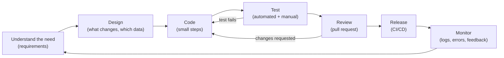
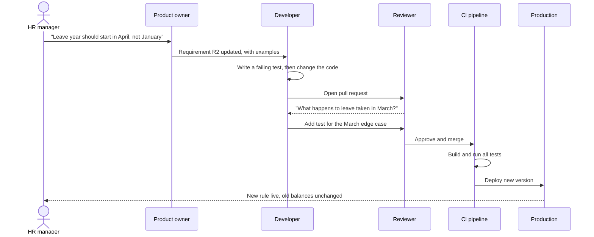

Anyone who has written a few lines of code has *programmed*. Very few people have *engineered* software on day one, and that is fine. This lesson explains the gap between the two, with one running example: a small leave-tracking tool for a 40-person office. By the end you will know why professional developers spend so much time on questions, tests and reviews, and so little time typing.

## Learning objectives

By the end of this lesson you will be able to:

1. Explain the difference between coding and software engineering with an everyday analogy.
2. Turn a vague request ("I want an app for leave") into clear, testable requirements.
3. Explain why most of the money spent on software is spent *after* the first release (maintenance).
4. Describe the basic life of a change: requirement, design, code, review, test, release, monitor.
5. Explain why software is a team activity, and what habits make teamwork possible.
6. Read a small, well-structured C# program and point to the parts that make it easy to change.

## Prerequisites

None. This is the first lesson of the course. If you have never written code, read it anyway: most of it is about *thinking*, not syntax. The C# examples are short and explained line by line in [Variables, types, conditions, loops and functions in C#](#/lesson/m01-csharp-basics).

## Explain it like I'm a beginner

### Cooking dinner versus running a restaurant kitchen

Making dinner for yourself is like **coding**. You know what you want, you taste as you go, and if the dal is a little salty, only you suffer. Nobody needs to read your recipe. Tomorrow you might cook something different.

Running a restaurant kitchen that serves 300 plates a night is like **software engineering**. Now:

- The menu is decided *before* cooking starts, based on what customers want (**requirements**).
- Recipes are written down so any cook can make the same paneer tikka (**design and documentation**).
- Food is tasted before it leaves the kitchen (**testing**).
- The head chef checks new dishes before they go on the menu (**code review**).
- Ten cooks work together without bumping into each other (**teamwork and process**).
- The kitchen runs for ten years. Equipment is repaired, recipes change, new cooks join (**maintenance**).

The individual skills (chopping, frying) are the same. What changes is **scale, time and people**. That is the whole idea of software engineering.

### A one-line definition

Software engineering is **building software that solves the right problem, keeps working correctly, and can be changed safely by a team over a long time, within a budget**.

Every word matters:

- **The right problem**: a beautiful app that nobody needs is a failure.
- **Keeps working**: on bad input, on slow networks, on the busiest day of the year.
- **Changed safely**: next month's new rule must not break last month's features.
- **By a team**: someone else will read and change your code, often after you have left.
- **Over a long time**: good business software often lives for 5–15 years.
- **Within a budget**: time and money are always limited, so every decision is a trade-off.

## First-principles explanation

### Coding versus engineering

| | Coding (programming) | Software engineering |
|---|---|---|
| Main question | "How do I make this work?" | "How do we make this keep working, and keep it easy to change?" |
| Time horizon | Today | Years |
| People | Usually one | A team, plus users, managers, support staff |
| Success | It runs on my laptop | It meets agreed requirements, in production, under real load |
| Tools | Editor, compiler | Plus version control, tests, reviews, CI/CD, monitoring |

Coding is a *part* of engineering, the way bricklaying is a part of building a bridge. A bridge also needs surveys, drawings, load calculations, inspections and a maintenance plan. You would not trust a bridge built by talented bricklayers with no plan. Users feel the same about software that holds their salary data or their money.

**Google's engineers have a short way to say this: software engineering is "programming integrated over time".** A script you run once does not need tests. A system that 40 people use every day for ten years absolutely does.

### Requirements: deciding what "correct" means

A computer does exactly what it is told. If you tell it the wrong thing, it does the wrong thing perfectly. So the first engineering job is to agree, in writing, **what the software must do**. These statements are called **requirements**.

Suppose an office manager in Pune says: *"I want a small app for leave."* That is a wish, not a requirement. An engineer asks questions:

- Who applies? Who approves? Is approval needed at all?
- How many days does each person get per year? Does it reset in January or April?
- Do Saturdays and Sundays count? What about public holidays?
- Can someone apply for leave that already happened (a sick day)?
- What happens if two leaves overlap?
- How many people will use it? From phones or laptops?

After a 30-minute conversation, the wish becomes a list like this:

| Id | Requirement | Kind |
|---|---|---|
| R1 | An employee can apply for leave by giving a start date and an end date. | Functional |
| R2 | Each employee has 18 working days of leave per calendar year. | Functional (business rule) |
| R3 | One request may cover at most 10 working days. | Functional (business rule) |
| R4 | Leave cannot start in the past. | Functional (business rule) |
| R5 | Saturdays and Sundays are not counted as leave days. | Functional (business rule) |
| R6 | Two approved leaves of the same person may not overlap. | Functional (business rule) |
| R7 | Applying for leave must answer within 1 second for 40 users. | Non-functional (performance) |
| R8 | Only HR can see everyone's leave; employees see only their own. | Non-functional (security) |

**Functional requirements** say *what* the system does. **Non-functional requirements** (also called quality attributes) say *how well*: speed, security, availability, cost. A good requirement is **testable**: you can write a check that passes or fails. "The app should be fast" is not testable. "Applying for leave answers within 1 second for 40 users" is. The [requirements lesson](#/lesson/m02-requirements) goes much deeper.

Notice something important: R2–R6 are **rules** a programmer could never guess. Getting them wrong is not a coding mistake; it is a requirements mistake. Industry experience (and many published studies) consistently shows that mistakes found at the requirements stage are far cheaper to fix than the same mistakes found after release. Changing a sentence in a document costs minutes. Changing a rule that 40 people's leave balances already depend on costs days and some uncomfortable conversations.

### The life of a change

Professional software is never "finished". It moves through the same loop again and again, once for every feature or fix:

1. **Understand** the need and write it as a requirement.
2. **Design** a solution: which parts of the program change, which data is stored.
3. **Code** it in small steps.
4. **Test** it: automated tests that run in seconds, and some manual checks.
5. **Review**: a teammate reads the change before it is merged (a pull request, covered in [the Git lesson](#/lesson/m01-git)).
6. **Release** it to users, ideally automatically (continuous integration and delivery, CI/CD).
7. **Monitor** it: logs, error counts, user feedback. This feeds the next "understand".

Different teams name these steps differently (waterfall, Scrum, Kanban). The steps themselves are always there. A waterfall project does each step once for the whole system over many months. An agile team does all seven steps for a small feature every week or two. The agile approach usually wins for business software, because users only discover what they really want after they see something working.

### Maintenance: where the money really goes

Here is a fact that surprises every beginner: **writing the first version is usually the smaller part of the cost.** Industry estimates (they vary by study and type of system) commonly put maintenance at well over half of the total lifetime cost of business software.

"Maintenance" sounds like fixing bugs, but it is mostly *change*:

- **Corrective**: fixing bugs that users find.
- **Adaptive**: the world changes. A new GST rate, a new tax regime, a new Android version, .NET 8 reaching end of support.
- **Perfective**: users want more. "Can it email my manager?" "Can we export to Excel?"
- **Preventive**: cleaning up code so that future changes are cheaper (refactoring).

Let us put rough, illustrative numbers on our leave tool. Say the first version takes one developer 6 weeks. Over the next 5 years the office asks for half-day leave, a new leave type for paternity leave, a change from January to April year start, a mobile view, and a payroll export. Each of those takes a week or two. If the original code was a tangle, each change takes three times longer and breaks something else. Over 5 years, the *changes* easily cost more than the first version did. That is why engineers care so much about code that is easy to read and easy to change.

:::callout type=tip title="The two-reader rule"
Code is read far more often than it is written. Every line you write will be read by a computer (once, when compiled) and by humans (many times, for years). Write for the human reader. The computer will understand either way.
:::

### Teams: software is a group activity

A single person can build a small tool. Anything bigger needs a team, and teams create new problems:

- **Communication**: with 2 people there is 1 conversation line. With 10 people there are 45 (n × (n − 1) ÷ 2). This is why big teams split into small ones.
- **Shared understanding**: everyone must agree on what the code does. Tests and clear names act as a shared, always-up-to-date description.
- **Working at the same time**: version control (Git) lets 10 people change the same project without overwriting each other.
- **Quality gates**: code reviews catch mistakes, spread knowledge, and stop one person from becoming the only one who understands a module (the "bus factor").
- **Conventions**: a team agrees on naming, folder layout, and formatting, so any file looks familiar to anyone.

Typical roles you will meet: product owner or business analyst (decides *what*), developers (build it), testers or QA engineers (check it), DevOps or platform engineers (run it), architects or tech leads (keep the big picture consistent), and of course users. In a small company one person may wear several of these hats.

### Engineering is trade-offs

There is almost never one perfect answer. Every decision balances things like:

- **Speed of delivery vs quality**: shipping a rough version this week to learn from users, or a polished one next month.
- **Simplicity vs flexibility**: hard-coding "18 days" is simple; reading it from configuration is flexible.
- **Cost vs reliability**: one server is cheap; two servers survive a crash.

A good engineer can say *which* option they chose, *why*, and *what it costs*. A key skill is noticing when the simple option is enough. A tool for 40 people does not need the architecture of a system for 40 crore people. Over-engineering (building for problems you do not have) is as real a mistake as under-engineering.

## Visual explanation

### The loop every change goes through



This diagram shows the loop from the "life of a change" section. The main path goes left to right, from understanding the need to monitoring it in production, and then back to the start because monitoring always produces new needs. Two backward arrows matter: a failing test sends the work back to coding, and a reviewer's comments do the same. These loops are *cheap* because they happen before users see anything. The expensive loop is the long one, where a bug escapes to production and comes back through user complaints.

### A change request moving through a small team



This sequence diagram follows one real-looking change through time, top to bottom. The HR manager asks for a change in plain words. The product owner turns it into an updated requirement with examples. The developer writes a test that describes the new rule *before* changing the code, so the test proves the change works. The reviewer's question about March is the kind of edge case that one person often misses and two people often catch. Only after review and an automatic build with all tests passing does the change reach production. Notice that no single person carries the whole responsibility: the process does.

## Step-by-step example

Let us see the difference between coding and engineering on rule R2–R6 of the leave tool.

### Step 1 — the "just make it work" version

```csharp
// Somewhere in a button click handler
int days = (int)(endDate - startDate).TotalDays + 1;
if (days <= 18 - usedDays)
{
    usedDays += days;
    Console.WriteLine("Approved");
}
```

It runs. It also has at least five problems:

- Weekends are counted (breaks R5). Leave from Friday to Monday costs 4 days instead of 2.
- There is no 10-day limit (R3), no past-date check (R4), no overlap check (R6).
- `18` is a "magic number". When the policy changes to 21, someone has to find every `18` in the code.
- The rule lives inside a button handler. A mobile app or a payroll job would have to copy it.
- There is no test, so nobody knows which of these is intended.

### Step 2 — name the rules

Move each rule to one place with a clear name:

```csharp
public sealed class LeavePolicy
{
    public int AnnualAllowanceDays { get; init; } = 18;        // R2
    public int MaxConsecutiveWorkingDays { get; init; } = 10;  // R3
}
```

Now changing 18 to 21 is a one-line change, and the requirement id in the comment tells a reader *why* the number exists.

### Step 3 — make the calculation correct and testable

```csharp
public int CountWorkingDays(DateOnly from, DateOnly to)
{
    var days = 0;
    for (var d = from; d <= to; d = d.AddDays(1))
        if (d.DayOfWeek is not (DayOfWeek.Saturday or DayOfWeek.Sunday)) days++;
    return days;
}
```

This method needs no screen, no database and no user. You can test it in a millisecond: Friday to Monday must give 2.

### Step 4 — return a clear answer instead of printing

A rule check should *return* a result that says what happened and why. The caller (a web page, a mobile app, a test) decides how to show it. We will use a small `LeaveResult` type with `Succeeded` and `Error`.

### Step 5 — depend on "today" through a clock you can control

R4 says "cannot start in the past". If the code calls `DateTime.Now` directly, a test written today might fail next year. .NET has a built-in abstraction, `TimeProvider`, so tests can pretend that today is any date they like.

### Step 6 — write tests that read like the requirements

```csharp
[Fact]
public void Friday_to_Monday_costs_two_days() { /* ... */ }

[Fact]
public void Leave_cannot_start_in_the_past() { /* ... */ }
```

The test names *are* the requirements, in code. When a new developer joins, the tests tell them exactly what the system promises. The complete version is below.

## Production-style C# implementation

A small but complete leave tracker. It is a console program so you can focus on structure, not web plumbing. Each file has one job, and each business rule appears in exactly one place with its requirement id.

```text
LeaveTracker/
  Program.cs                    // wires the parts together and runs a short demo
  Leave/
    LeaveRequest.cs             // the data for one approved leave
    LeaveResult.cs              // success or a clear reason for failure
    LeavePolicy.cs              // the numbers and the working-day rule (R2, R3, R5)
    ILeaveStore.cs              // where leave is stored (an interface)
    InMemoryLeaveStore.cs       // a simple store for demos and tests
    LeaveService.cs             // applies all rules in order (R1–R6)
```

```csharp file=Leave/LeaveRequest.cs
namespace LeaveTracker.Leave;

public enum LeaveStatus { Approved, Cancelled }

/// <summary>One leave request. A record is a compact type for data that does not change.</summary>
public sealed record LeaveRequest(
    Guid Id,
    string EmployeeId,
    DateOnly From,
    DateOnly To,
    int WorkingDays,
    LeaveStatus Status);
```

```csharp file=Leave/LeaveResult.cs
namespace LeaveTracker.Leave;

/// <summary>The outcome of applying for leave. Expected business failures are values, not exceptions.</summary>
public sealed record LeaveResult(bool Succeeded, string? Error, LeaveRequest? Request)
{
    public static LeaveResult Ok(LeaveRequest request) => new(true, null, request);
    public static LeaveResult Fail(string error) => new(false, error, null);
}
```

```csharp file=Leave/LeavePolicy.cs
namespace LeaveTracker.Leave;

/// <summary>Company leave rules in one place. Values are illustrative defaults;
/// in a real system they would come from configuration (appsettings.json).</summary>
public sealed class LeavePolicy
{
    public int AnnualAllowanceDays { get; init; } = 18;        // R2
    public int MaxConsecutiveWorkingDays { get; init; } = 10;  // R3

    /// <summary>R5: Saturdays and Sundays are not leave days.</summary>
    public int CountWorkingDays(DateOnly from, DateOnly to)
    {
        if (to < from) throw new ArgumentException("End date must not be before start date.", nameof(to));
        var days = 0;
        for (var d = from; d <= to; d = d.AddDays(1))
            if (d.DayOfWeek is not (DayOfWeek.Saturday or DayOfWeek.Sunday)) days++;
        return days;
    }
}
```

```csharp file=Leave/ILeaveStore.cs
namespace LeaveTracker.Leave;

/// <summary>Storage behind an interface, so the rules do not care whether data lives in memory or PostgreSQL.</summary>
public interface ILeaveStore
{
    void Add(LeaveRequest request);
    IReadOnlyList<LeaveRequest> ForEmployee(string employeeId, int year);
}
```

```csharp file=Leave/InMemoryLeaveStore.cs
namespace LeaveTracker.Leave;

/// <summary>Good for demos and tests. Data is lost when the program stops.</summary>
public sealed class InMemoryLeaveStore : ILeaveStore
{
    private readonly Lock _gate = new();
    private readonly List<LeaveRequest> _requests = new();

    public void Add(LeaveRequest request)
    {
        lock (_gate) _requests.Add(request);
    }

    public IReadOnlyList<LeaveRequest> ForEmployee(string employeeId, int year)
    {
        lock (_gate)
        {
            return _requests
                .Where(r => string.Equals(r.EmployeeId, employeeId, StringComparison.OrdinalIgnoreCase)
                            && r.From.Year == year)
                .ToArray();
        }
    }
}
```

```csharp file=Leave/LeaveService.cs
namespace LeaveTracker.Leave;

/// <summary>Applies the leave rules in a fixed order and returns a clear result.
/// It knows nothing about screens or databases, which makes it easy to test and reuse.</summary>
public sealed class LeaveService(ILeaveStore store, LeavePolicy policy, TimeProvider clock)
{
    public LeaveResult Apply(string employeeId, DateOnly from, DateOnly to)
    {
        if (string.IsNullOrWhiteSpace(employeeId)) return LeaveResult.Fail("Employee id is required.");
        if (to < from) return LeaveResult.Fail("End date is before start date.");

        var today = DateOnly.FromDateTime(clock.GetLocalNow().DateTime);
        if (from < today) return LeaveResult.Fail("Leave cannot start in the past.");                  // R4
        if (from.Year != to.Year) return LeaveResult.Fail("Split leave that crosses 31 December into two requests.");

        var days = policy.CountWorkingDays(from, to);                                                 // R5
        if (days == 0) return LeaveResult.Fail("The selected dates contain no working days.");
        if (days > policy.MaxConsecutiveWorkingDays)                                                  // R3
            return LeaveResult.Fail($"One request may cover at most {policy.MaxConsecutiveWorkingDays} working days.");

        var approved = store.ForEmployee(employeeId, from.Year)
            .Where(r => r.Status == LeaveStatus.Approved)
            .ToList();

        if (approved.Any(r => r.From <= to && from <= r.To))                                          // R6
            return LeaveResult.Fail("This overlaps a leave you already have.");

        var remaining = policy.AnnualAllowanceDays - approved.Sum(r => r.WorkingDays);
        if (days > remaining)                                                                         // R2
            return LeaveResult.Fail($"You asked for {days} days but only {remaining} remain this year.");

        var request = new LeaveRequest(Guid.NewGuid(), employeeId.Trim(), from, to, days, LeaveStatus.Approved);
        store.Add(request);                                                                           // R1
        return LeaveResult.Ok(request);
    }

    public int RemainingDays(string employeeId, int year) =>
        policy.AnnualAllowanceDays - store.ForEmployee(employeeId, year)
            .Where(r => r.Status == LeaveStatus.Approved)
            .Sum(r => r.WorkingDays);
}
```

```csharp file=Program.cs
using LeaveTracker.Leave;

// Composition: build the parts once and connect them. In ASP.NET Core this is done by
// dependency injection (builder.Services.AddSingleton<...>()), covered in Module 3.
var clock = TimeProvider.System;
var service = new LeaveService(new InMemoryLeaveStore(), new LeavePolicy(), clock);

var today = DateOnly.FromDateTime(clock.GetLocalNow().DateTime);
var daysUntilMonday = ((int)DayOfWeek.Monday - (int)today.DayOfWeek + 7) % 7;
var nextMonday = today.AddDays(daysUntilMonday == 0 ? 7 : daysUntilMonday);

Show("Mon-Fri next week", service.Apply("EMP-017", nextMonday, nextMonday.AddDays(4)));
Show("Overlapping Wednesday", service.Apply("EMP-017", nextMonday.AddDays(2), nextMonday.AddDays(2)));
Show("Fri-Mon the week after", service.Apply("EMP-017", nextMonday.AddDays(11), nextMonday.AddDays(14)));
Show("Yesterday", service.Apply("EMP-017", today.AddDays(-1), today.AddDays(-1)));
Console.WriteLine($"Remaining this year: {service.RemainingDays("EMP-017", nextMonday.Year)} days");

static void Show(string label, LeaveResult result) =>
    Console.WriteLine(result.Succeeded
        ? $"{label}: approved, {result.Request!.WorkingDays} working day(s)"
        : $"{label}: refused, {result.Error}");
```

What to notice:

- **Every rule has one home and a requirement id.** When HR changes the allowance to 21 days, you change one number. When someone asks "why do we refuse past dates?", the comment `R4` points to the requirement.
- **Expected failures are values, not crashes.** "Not enough leave left" is a normal answer, so `Apply` returns a `LeaveResult`. Exceptions are kept for real bugs, such as passing an end date before a start date to `CountWorkingDays`. The [exceptions lesson](#/lesson/m01-exceptions) explains this choice.
- **The service does not know where data lives.** `ILeaveStore` could be replaced by a PostgreSQL version later without touching any rule.
- **Time is injected.** `TimeProvider` means a test can say "today is 1 March 2026" and get the same result every year.
- **Known limitation, written down honestly.** Two requests from the same person arriving at the same moment could both pass the overlap check before either is saved. For 40 users clicking a button, the risk is tiny; in a busy system you would enforce the rule in the database (a unique constraint or a transaction). Engineers write such trade-offs down instead of hiding them.

## Bad design vs good design

**Bad**: everything in one place, numbers repeated, no tests.

```csharp
void ApplyButton_Click()
{
    var days = (endPicker.Value - startPicker.Value).Days + 1;
    if (startPicker.Value < DateTime.Now) { label.Text = "Past!"; return; }
    if (days > 10) { label.Text = "Too long"; return; }
    var used = db.Query("SELECT SUM(days) FROM leave WHERE emp = '" + empBox.Text + "'");
    if (used + days > 18) { label.Text = "No balance"; return; }
    db.Execute("INSERT INTO leave VALUES ('" + empBox.Text + "', " + days + ")");
    label.Text = "OK";
}
```

Problems:

- Business rules, screen code and database code are mixed. To add a mobile app you must copy all of it.
- `18` and `10` are hidden in the middle of UI code. A policy change means hunting for numbers.
- Weekends count as leave days, and nobody notices because there are no tests.
- Building SQL by gluing strings with user input allows SQL injection, a serious security hole.
- `DateTime.Now` makes the past-date rule impossible to test reliably, and it also compares date *and time*, so leave for today is refused after midnight passes.

**Good**: the structure in the previous section. Rules live in `LeavePolicy` and `LeaveService`, storage hides behind `ILeaveStore`, time comes from `TimeProvider`, and tests describe each requirement.

**Is the good version always worth it?** No. If you are writing a one-time script to rename 200 photos, the "bad" style is perfectly reasonable: it runs once, you check the result by eye, and you delete it. Engineering effort should match the **lifetime, number of users and cost of mistakes**. Leave balances affect people's salaries, so they deserve the care. The photo script does not.

:::callout type=mistake title="Confusing 'it works on my machine' with 'it works'"
Your laptop has one user, perfect network, test data you typed yourself and today's date. Production has hundreds of users, slow phones, strange data, time zones and next year's date. Software engineering is mostly about the gap between those two worlds.
:::

## Practical playground

Run the program. Then try the experiments in the comments. Before each run, **predict** the output and write your prediction down. Predicting first is how you train engineering judgement.

:::playground type=csharp title="Requirements as code"
```csharp file=Program.cs
using System;
using System.Collections.Generic;
using System.Linq;

public sealed class LeavePolicy
{
    public int AnnualAllowanceDays { get; init; } = 18;       // R2
    public int MaxConsecutiveWorkingDays { get; init; } = 10; // R3

    public int CountWorkingDays(DateOnly from, DateOnly to)   // R5
    {
        var days = 0;
        for (var d = from; d <= to; d = d.AddDays(1))
            if (d.DayOfWeek is not (DayOfWeek.Saturday or DayOfWeek.Sunday)) days++;
        return days;
    }
}

public sealed class LeaveBook(LeavePolicy policy)
{
    private readonly List<(DateOnly From, DateOnly To, int Days)> _taken = new();

    public string Apply(DateOnly from, DateOnly to)
    {
        var days = policy.CountWorkingDays(from, to);
        if (days == 0) return "refused: no working days";
        if (days > policy.MaxConsecutiveWorkingDays) return $"refused: more than {policy.MaxConsecutiveWorkingDays} days";
        if (_taken.Any(t => t.From <= to && from <= t.To)) return "refused: overlaps";
        var remaining = policy.AnnualAllowanceDays - _taken.Sum(t => t.Days);
        if (days > remaining) return $"refused: only {remaining} left";
        _taken.Add((from, to, days));
        return $"approved: {days} day(s), {remaining - days} left";
    }
}

public static class Program
{
    public static void Main()
    {
        var book = new LeaveBook(new LeavePolicy());

        // 2 March 2026 is a Monday.
        Console.WriteLine(book.Apply(new DateOnly(2026, 3, 2), new DateOnly(2026, 3, 6)));   // Mon-Fri
        Console.WriteLine(book.Apply(new DateOnly(2026, 3, 13), new DateOnly(2026, 3, 16))); // Fri-Mon
        Console.WriteLine(book.Apply(new DateOnly(2026, 3, 7), new DateOnly(2026, 3, 8)));   // Sat-Sun
        Console.WriteLine(book.Apply(new DateOnly(2026, 3, 4), new DateOnly(2026, 3, 4)));   // overlap
        Console.WriteLine(book.Apply(new DateOnly(2026, 4, 1), new DateOnly(2026, 4, 17)));  // too long

        // Experiments:
        // 1. HR changes the allowance to 21 days. How many lines of code must change?
        //    Try: new LeaveBook(new LeavePolicy { AnnualAllowanceDays = 21 })
        // 2. Some site offices work on Saturdays. Change CountWorkingDays so only Sunday is skipped.
        //    Which outputs change? Is that a coding change or a requirements change?
        // 3. Apply for 1 April to 14 April three times with different years. What happens and why?
        // 4. Add a rule: at least 2 days' notice. What information would the method need that it lacks?
    }
}
```
:::

## Exercises

:::exercise id=m01-software-engineering-ex1 difficulty=beginner kind=written title="Turn a wish into requirements"
The owner of a school canteen in Jaipur says: *"I want an app so parents can pre-order lunch for their kids."*

Write:

1. Five **functional** requirements, each one sentence, each testable.
2. Three **non-functional** requirements with a number in each (time, users, availability, cost).
3. Five **questions** you would ask the owner before building anything.
::acceptance
- Every functional requirement starts with who does what ("A parent can...").
- Every requirement could be checked with a pass/fail test.
- Each non-functional requirement contains a measurable number.
- At least two questions are about rules or edge cases (cut-off time, cancellations, refunds, allergies).
::hint
Imagine one parent's full morning: open the app, choose a meal, pay, change their mind, the child is absent. Each step hides a requirement.
::hint
Ask yourself "what could go wrong?" for each step. The answers become rules: cut-off times, sold-out items, failed payments.
::hint
For non-functional requirements, think about the busiest moment. When do 300 parents all order at once? (Probably 7:30 am, just before the cut-off.)
::hint
A template that works: "A **[who]** can **[do what]** **[under which rule]**." For example: "A parent can cancel an order until 8:00 am on the same day and receives a full refund."
::solution
A sample answer (yours may differ and still be good):

**Functional**

- F1: A parent can register one or more children with name, class and section.
- F2: A parent can see the menu for the next 5 school days, with price and whether each item is vegetarian.
- F3: A parent can order lunch for a child for a given day until 8:00 am that day.
- F4: A parent can cancel an order until 8:00 am that day; the amount returns to the parent's canteen wallet.
- F5: The canteen staff can see, by 8:15 am, the total number of each item ordered for the day, grouped by class.

**Non-functional**

- N1: The app must handle 500 parents placing orders in the same 15 minutes (7:45–8:00 am) with each order confirmed within 2 seconds.
- N2: The order list for staff must be available on 99% of school days (illustrative target; a short outage outside 7–9 am matters little).
- N3: Running cost must stay under ₹3,000 per month (illustrative budget), which rules out expensive dedicated servers.

**Questions**

1. What happens if a child is absent after lunch was ordered? Refund, credit, or nothing?
2. Do any children have allergies we must warn about?
3. Is payment through UPI, a prepaid wallet, or a monthly bill?
4. What if an item sells out? Is there a maximum number per item?
5. Are there holidays or half days when no lunch is served, and who updates that calendar?

Notice how the questions uncover rules that would otherwise be guessed by a programmer, and guesses become bugs.
::mistakes
- Writing features instead of requirements ("Use Firebase"). That is a design decision, not a need.
- Non-testable words: "fast", "easy", "secure" with no numbers.
- Forgetting the staff side. Most systems have more than one kind of user.
- Not asking about money: refunds, failed payments and cancellations cause most real complaints.
:::

:::exercise id=m01-software-engineering-ex2 difficulty=beginner kind=code title="Parking fee from written rules"
A mall in Hyderabad gives you these parking rules. Implement them exactly.

- Up to 15 minutes: free (grace period).
- Otherwise the first hour, or any part of it, costs ₹20.
- Each additional started hour costs ₹10.
- The fee for one visit never exceeds ₹150.
- A negative duration, or a duration over 24 hours, throws `ArgumentOutOfRangeException` (overnight parking is handled by another system).
::requirements
Implement `ParkingFeeCalculator.Calculate(TimeSpan duration)` returning a `decimal`.
::acceptance
- 15 minutes costs ₹0; 16 minutes costs ₹20.
- 60 minutes costs ₹20; 61 minutes costs ₹30.
- 3 hours costs ₹40; 3 hours and 1 minute costs ₹50.
- 20 hours costs ₹150 (the cap).
- −1 minute and 25 hours both throw `ArgumentOutOfRangeException`.
::hint
Write the rules as a numbered list on paper first, then turn each line into one `if` or one calculation.
::hint
"Any part of an hour" means rounding *up*. 61 minutes is 2 started hours.
::hint
`Math.Ceiling(duration.TotalMinutes / 60.0)` gives the number of started hours as a `double`. Convert it to `int`.
::hint
Order matters: check invalid input first, then the grace period, then the hourly price, then the cap.
::hint
```csharp
var hours = (int)Math.Ceiling(duration.TotalMinutes / 60.0);
var fee = FirstHour + (hours - 1) * EachExtraHour;
return Math.Min(fee, DailyCap);
```
::starter
```csharp file=ParkingFeeCalculator.cs
using System;

public static class ParkingFeeCalculator
{
    public const decimal FirstHour = 20m;
    public const decimal EachExtraHour = 10m;
    public const decimal DailyCap = 150m;
    public static readonly TimeSpan GracePeriod = TimeSpan.FromMinutes(15);
    public static readonly TimeSpan MaximumStay = TimeSpan.FromHours(24);

    public static decimal Calculate(TimeSpan duration) => throw new NotImplementedException();
}
```
::tests
```csharp file=ParkingFeeCalculatorTests.cs
using System;
using Xunit;

public class ParkingFeeCalculatorTests
{
    [Theory]
    [InlineData(0, 0)]
    [InlineData(10, 0)]
    [InlineData(15, 0)]
    [InlineData(16, 20)]
    [InlineData(60, 20)]
    [InlineData(61, 30)]
    [InlineData(180, 40)]
    [InlineData(181, 50)]
    [InlineData(1200, 150)]
    [InlineData(1440, 150)]
    public void Fee_follows_the_rules(int minutes, int expectedRupees) =>
        Assert.Equal((decimal)expectedRupees, ParkingFeeCalculator.Calculate(TimeSpan.FromMinutes(minutes)));

    [Fact]
    public void Negative_duration_throws() =>
        Assert.Throws<ArgumentOutOfRangeException>(() => ParkingFeeCalculator.Calculate(TimeSpan.FromMinutes(-1)));

    [Fact]
    public void More_than_a_day_throws() =>
        Assert.Throws<ArgumentOutOfRangeException>(() => ParkingFeeCalculator.Calculate(TimeSpan.FromHours(25)));
}
```
::solution
Each written rule becomes one line, in the same order as the rules. Named constants mean a price change is a one-line edit.

```csharp file=ParkingFeeCalculator.cs
using System;

public static class ParkingFeeCalculator
{
    public const decimal FirstHour = 20m;
    public const decimal EachExtraHour = 10m;
    public const decimal DailyCap = 150m;
    public static readonly TimeSpan GracePeriod = TimeSpan.FromMinutes(15);
    public static readonly TimeSpan MaximumStay = TimeSpan.FromHours(24);

    public static decimal Calculate(TimeSpan duration)
    {
        if (duration < TimeSpan.Zero || duration > MaximumStay)
            throw new ArgumentOutOfRangeException(nameof(duration), "Duration must be between 0 and 24 hours.");

        if (duration <= GracePeriod) return 0m;

        var startedHours = (int)Math.Ceiling(duration.TotalMinutes / 60.0);
        var fee = FirstHour + (startedHours - 1) * EachExtraHour;
        return Math.Min(fee, DailyCap);
    }
}
```

Look at the test list: almost every case sits on a **boundary** (15/16, 60/61, 180/181). Boundaries are where requirement mistakes hide. "Up to 15 minutes" could mean `< 15` or `<= 15`; the test makes the agreed meaning permanent.
::mistakes
- Rounding down with `(int)duration.TotalHours`, which makes 61 minutes cost ₹20.
- Checking the cap before the hourly calculation, or forgetting it.
- Using `<` instead of `<=` for the grace period, so exactly 15 minutes costs ₹20.
- Using `double` for money. Use `decimal`.
::extensions
The mall adds a rule: electric vehicles get the first 2 hours free. Add a `bool isElectric` parameter, write the tests *first*, then change the code. Did any old test need to change? (It should not.)
:::

:::exercise id=m01-software-engineering-ex3 difficulty=intermediate kind=code title="Make a delivery-charge rule maintainable"
A grocery app has this legacy method. It works, but every price change causes a bug.

```csharp
decimal Charge(decimal t, decimal km, bool m, bool x)
{
    decimal c = (t >= 499 || m) ? 0 : 40;
    if (km > 10) c += Math.Ceiling(km - 10) * 5;
    if (x) c += 30;
    return c;
}
```

Rewrite it as a clear, configurable calculator **with exactly the same behaviour** for the default numbers.
::requirements
- `DeliveryRules` holds the numbers: free-delivery threshold (₹499), base charge (₹40), included distance (10 km), charge per extra started km (₹5), express charge (₹30). Defaults as listed.
- `DeliveryOrder(decimal OrderTotal, decimal DistanceKm, bool IsMember, bool IsExpress)`.
- `DeliveryChargeCalculator(DeliveryRules rules).Calculate(order)` returns the charge.
- Base charge is waived when the total reaches the threshold *or* the customer is a member. Distance and express charges always apply.
- A negative total or negative distance throws `ArgumentOutOfRangeException`.
::acceptance
- ₹300 order, 5 km: ₹40.
- ₹499 order, 5 km: ₹0.
- ₹300 order, 12.5 km: ₹55 (40 + 3 started km × 5).
- ₹600 order, 12 km, express: ₹40 (0 + 10 + 30).
- Member, ₹100 order, 3 km: ₹0.
- With a custom threshold of ₹999, a ₹600 order at 5 km costs ₹40.
::hint
Start by reading the old code slowly and writing in plain English what each line does. That is the specification you must keep.
::hint
Give every number a name in `DeliveryRules`. Give every flag a name in `DeliveryOrder`. Single-letter names are the first maintenance problem.
::hint
Split the calculation into three small private methods: `BaseCharge`, `DistanceCharge`, `ExpressCharge`. Then `Calculate` is just their sum.
::hint
`Math.Ceiling(decimal)` exists and returns a `decimal`, so you can stay in `decimal` the whole way.
::hint
```csharp
private decimal DistanceCharge(decimal km) =>
    km <= _rules.IncludedKm ? 0m : Math.Ceiling(km - _rules.IncludedKm) * _rules.PerExtraKm;
```
::starter
```csharp file=DeliveryCharge.cs
using System;

public sealed record DeliveryRules
{
    public decimal FreeDeliveryThreshold { get; init; } = 499m;
    public decimal BaseCharge { get; init; } = 40m;
    public decimal IncludedKm { get; init; } = 10m;
    public decimal PerExtraKm { get; init; } = 5m;
    public decimal ExpressCharge { get; init; } = 30m;
}

public sealed record DeliveryOrder(decimal OrderTotal, decimal DistanceKm, bool IsMember, bool IsExpress);

public sealed class DeliveryChargeCalculator
{
    private readonly DeliveryRules _rules;

    public DeliveryChargeCalculator(DeliveryRules rules) => _rules = rules;

    public decimal Calculate(DeliveryOrder order) => throw new NotImplementedException();
}
```
::tests
```csharp file=DeliveryChargeTests.cs
using System;
using Xunit;

public class DeliveryChargeTests
{
    private static decimal Charge(decimal total, decimal km, bool member = false, bool express = false) =>
        new DeliveryChargeCalculator(new DeliveryRules()).Calculate(new DeliveryOrder(total, km, member, express));

    [Fact] public void Small_order_pays_base() => Assert.Equal(40m, Charge(300m, 5m));
    [Fact] public void Threshold_is_free() => Assert.Equal(0m, Charge(499m, 5m));
    [Fact] public void Extra_km_rounds_up() => Assert.Equal(55m, Charge(300m, 12.5m));
    [Fact] public void Free_order_still_pays_distance_and_express() => Assert.Equal(40m, Charge(600m, 12m, express: true));
    [Fact] public void Member_gets_free_base() => Assert.Equal(0m, Charge(100m, 3m, member: true));
    [Fact] public void Exactly_included_km_is_free() => Assert.Equal(40m, Charge(300m, 10m));

    [Fact]
    public void Custom_rules_are_used()
    {
        var calc = new DeliveryChargeCalculator(new DeliveryRules { FreeDeliveryThreshold = 999m });
        Assert.Equal(40m, calc.Calculate(new DeliveryOrder(600m, 5m, false, false)));
    }

    [Fact]
    public void Negative_distance_throws() =>
        Assert.Throws<ArgumentOutOfRangeException>(() => Charge(300m, -1m));

    [Fact]
    public void Negative_total_throws() =>
        Assert.Throws<ArgumentOutOfRangeException>(() => Charge(-5m, 1m));
}
```
::solution
```csharp file=DeliveryCharge.cs
using System;

public sealed record DeliveryRules
{
    public decimal FreeDeliveryThreshold { get; init; } = 499m;
    public decimal BaseCharge { get; init; } = 40m;
    public decimal IncludedKm { get; init; } = 10m;
    public decimal PerExtraKm { get; init; } = 5m;
    public decimal ExpressCharge { get; init; } = 30m;
}

public sealed record DeliveryOrder(decimal OrderTotal, decimal DistanceKm, bool IsMember, bool IsExpress);

public sealed class DeliveryChargeCalculator
{
    private readonly DeliveryRules _rules;

    public DeliveryChargeCalculator(DeliveryRules rules) => _rules = rules;

    public decimal Calculate(DeliveryOrder order)
    {
        ArgumentOutOfRangeException.ThrowIfNegative(order.OrderTotal);
        ArgumentOutOfRangeException.ThrowIfNegative(order.DistanceKm);
        return BaseCharge(order) + DistanceCharge(order.DistanceKm) + ExpressCharge(order.IsExpress);
    }

    private decimal BaseCharge(DeliveryOrder order) =>
        order.IsMember || order.OrderTotal >= _rules.FreeDeliveryThreshold ? 0m : _rules.BaseCharge;

    private decimal DistanceCharge(decimal km) =>
        km <= _rules.IncludedKm ? 0m : Math.Ceiling(km - _rules.IncludedKm) * _rules.PerExtraKm;

    private decimal ExpressCharge(bool isExpress) => isExpress ? _rules.ExpressCharge : 0m;
}
```

The behaviour is identical for the default numbers (the tests prove it), but now each rule has a name, the numbers can come from configuration, and a new rule (say, a rainy-day surcharge) is one new method instead of a fourth tangled line. This kind of change, improving structure without changing behaviour, is called **refactoring**.
::alternatives
For a tiny app, keeping the numbers as `const` fields in the calculator is fine. Use a rules object when the business changes prices often or different cities have different prices; then you can load `DeliveryRules` from `appsettings.json` with the Options pattern.
::mistakes
- "Improving" the behaviour while refactoring (for example, waiving the distance charge for members). Refactoring must not change behaviour; a behaviour change is a separate, requested change.
- Forgetting the rounding up of partial kilometres.
- Deleting the old tests or not having any before refactoring. Write tests around the old behaviour first, then change the structure.
::extensions
Add a rainy-day surcharge of ₹20 that applies only to non-members. Write the new tests first.
:::

:::exercise id=m01-software-engineering-ex4 difficulty=intermediate kind=written title="Estimate the real cost of a feature"
A small team built an attendance app for 12 construction sites. The first version took 2 developers 3 months. Assume (illustrative numbers) a developer costs the company ₹1.5 lakh per month all-inclusive.

Over the next 4 years, the client asks for: GPS check-in (1 month), offline mode for sites with poor network (2 months), a new labour-law report (0.5 months), an Android upgrade every year (0.25 months each), and bug fixes taking about 10% of one developer's time all year.

1. Calculate the cost of version 1 and the cost of the next 4 years.
2. What percentage of the 4-year-plus-build total is maintenance?
3. The original code had no tests. The team estimates every change takes 40% longer because of manual re-testing and surprise bugs. How much extra does that cost over 4 years?
4. In one paragraph, argue whether writing tests in version 1 would have been worth an extra 3 developer-weeks.
::acceptance
- Shows the arithmetic for each step, not just answers.
- Correctly separates first-build cost from maintenance cost.
- Gives a percentage for maintenance.
- The argument mentions both cost and risk (bugs reaching site supervisors), and states one situation where tests would *not* be worth it.
::hint
Convert everything to developer-months first, then multiply by ₹1.5 lakh.
::hint
Version 1: 2 developers × 3 months. Bug fixing: 10% of one developer × 12 months × 4 years.
::hint
Add up the changes: 1 + 2 + 0.5 + 4 × 0.25. Then add bug fixing. Then apply the 40% to the changes (and decide whether bug-fixing time also grows).
::hint
3 developer-weeks is about 0.75 developer-months. Compare that with the 40% extra you calculated.
::solution
**1. Costs**

- Version 1: 2 × 3 = 6 developer-months × ₹1.5 lakh = **₹9 lakh**.
- Changes over 4 years: 1 + 2 + 0.5 + (4 × 0.25) = 4.5 developer-months.
- Bug fixing: 0.10 × 12 × 4 = 4.8 developer-months.
- Maintenance total: 4.5 + 4.8 = 9.3 developer-months × ₹1.5 lakh = **₹13.95 lakh**.

**2. Maintenance share**

Total = 9 + 13.95 = ₹22.95 lakh. Maintenance = 13.95 ÷ 22.95 ≈ **61%**.

**3. Cost of no tests**

Applying 40% to the 9.3 developer-months: 9.3 × 0.4 ≈ 3.7 developer-months ≈ **₹5.6 lakh** extra. (If you applied it only to the 4.5 months of changes, you get 1.8 months, about ₹2.7 lakh. Either is acceptable if you explain your assumption.)

**4. Argument**

Three extra developer-weeks (about 0.75 months, ≈ ₹1.1 lakh) in version 1 would very likely have paid for itself several times over, saving ₹2.7–5.6 lakh in this estimate. It also lowers risk: a broken attendance report can delay wages for site workers, which is a far bigger cost than developer time. Tests would *not* be worth it for a throw-away prototype built only to show the client an idea, which would be rewritten anyway once the client agreed to the project.
::mistakes
- Treating the first build as the main cost and ignoring the 4 years after it.
- Mixing units (weeks, months, lakhs) without converting.
- Presenting estimates as facts. Say "assuming" and "about".
- Arguing that tests are always worth it. Engineering is about when, not always.
:::

:::exercise id=m01-software-engineering-ex5 difficulty=advanced kind=code title="A rule that changes on a date"
The company's leave policy changed on 1 April 2026: site offices moved to a 6-day week, so **Saturday became a working day** (and therefore counts as a leave day). Leave before that date must still use the old rules, because payroll for those months is already closed. Build a `PolicyBook` that keeps every version of the rules.
::requirements
- `LeaveRules(DateOnly EffectiveFrom, int AnnualAllowance, bool SaturdayIsWorkingDay)`.
- `PolicyBook.Add(rules)`: adding two rule sets with the same `EffectiveFrom` throws `InvalidOperationException`. Rules may be added in any order.
- `PolicyBook.For(date)`: returns the rule set with the latest `EffectiveFrom` that is on or before `date`. If none, throws `InvalidOperationException`.
- `PolicyBook.WorkingDays(from, to, holidays)`: counts leave days from `from` to `to` inclusive, using **the rules in force on each day**. Sunday is never a working day. Saturday is a working day only if that day's rules say so. Any date in `holidays` is not a working day. If `to` is before `from`, throw `ArgumentException`.
::acceptance
- Old rules (from 1 Jan 2025, Saturday off) and new rules (from 1 Apr 2026, Saturday working) are registered.
- Fri 27 Mar to Tue 31 Mar 2026 counts 3 days.
- Wed 1 Apr to Sun 5 Apr 2026 counts 4 days.
- Sat 28 Mar to Sat 4 Apr 2026 counts 6 days (the first Saturday does not count, the second does).
- With 14 Apr 2026 as a holiday, 13–14 Apr counts 1 day.
- `For(31 Dec 2024)` throws `InvalidOperationException`; adding a second rule set for 1 Apr 2026 throws.
::hint
This is a real engineering problem: requirements change, but old data must keep its old meaning. The trick is to keep *every* version of the rules, each with a start date.
::hint
Store rules in a list. To find the rules for a date, filter to `EffectiveFrom <= date` and take the one with the largest `EffectiveFrom`.
::hint
`WorkingDays` loops day by day, asks `For(day)` each time, and decides whether that day counts.
::hint
A day counts when: it is not in `holidays`, it is not Sunday, and it is not (Saturday while `!rules.SaturdayIsWorkingDay`).
::hint
```csharp
public LeaveRules For(DateOnly date) =>
    _rules.Where(r => r.EffectiveFrom <= date)
          .OrderByDescending(r => r.EffectiveFrom)
          .FirstOrDefault()
    ?? throw new InvalidOperationException($"No leave rules in force on {date}.");
```
::starter
```csharp file=PolicyBook.cs
using System;
using System.Collections.Generic;
using System.Linq;

public sealed record LeaveRules(DateOnly EffectiveFrom, int AnnualAllowance, bool SaturdayIsWorkingDay);

public sealed class PolicyBook
{
    public void Add(LeaveRules rules) => throw new NotImplementedException();

    public LeaveRules For(DateOnly date) => throw new NotImplementedException();

    public int WorkingDays(DateOnly from, DateOnly to, IReadOnlySet<DateOnly> holidays) => throw new NotImplementedException();
}
```
::tests
```csharp file=PolicyBookTests.cs
using System;
using System.Collections.Generic;
using Xunit;

public class PolicyBookTests
{
    private static readonly IReadOnlySet<DateOnly> NoHolidays = new HashSet<DateOnly>();

    private static PolicyBook Book()
    {
        var book = new PolicyBook();
        book.Add(new LeaveRules(new DateOnly(2026, 4, 1), 21, SaturdayIsWorkingDay: true));   // added out of order on purpose
        book.Add(new LeaveRules(new DateOnly(2025, 1, 1), 18, SaturdayIsWorkingDay: false));
        return book;
    }

    [Fact] public void Old_rules_before_change() => Assert.Equal(3, Book().WorkingDays(new DateOnly(2026, 3, 27), new DateOnly(2026, 3, 31), NoHolidays));
    [Fact] public void New_rules_after_change() => Assert.Equal(4, Book().WorkingDays(new DateOnly(2026, 4, 1), new DateOnly(2026, 4, 5), NoHolidays));
    [Fact] public void Span_uses_each_days_rules() => Assert.Equal(6, Book().WorkingDays(new DateOnly(2026, 3, 28), new DateOnly(2026, 4, 4), NoHolidays));

    [Fact]
    public void Holidays_do_not_count()
    {
        var holidays = new HashSet<DateOnly> { new DateOnly(2026, 4, 14) };
        Assert.Equal(1, Book().WorkingDays(new DateOnly(2026, 4, 13), new DateOnly(2026, 4, 14), holidays));
    }

    [Fact] public void For_picks_latest_applicable() => Assert.Equal(21, Book().For(new DateOnly(2026, 4, 1)).AnnualAllowance);
    [Fact] public void For_day_before_change_uses_old() => Assert.Equal(18, Book().For(new DateOnly(2026, 3, 31)).AnnualAllowance);
    [Fact] public void No_rules_yet_throws() => Assert.Throws<InvalidOperationException>(() => Book().For(new DateOnly(2024, 12, 31)));

    [Fact]
    public void Duplicate_effective_date_throws() =>
        Assert.Throws<InvalidOperationException>(() => Book().Add(new LeaveRules(new DateOnly(2026, 4, 1), 25, true)));

    [Fact]
    public void Reversed_range_throws() =>
        Assert.Throws<ArgumentException>(() => Book().WorkingDays(new DateOnly(2026, 4, 5), new DateOnly(2026, 4, 1), NoHolidays));
}
```
::solution
```csharp file=PolicyBook.cs
using System;
using System.Collections.Generic;
using System.Linq;

public sealed record LeaveRules(DateOnly EffectiveFrom, int AnnualAllowance, bool SaturdayIsWorkingDay);

public sealed class PolicyBook
{
    private readonly List<LeaveRules> _rules = new();

    public void Add(LeaveRules rules)
    {
        ArgumentNullException.ThrowIfNull(rules);
        if (_rules.Any(r => r.EffectiveFrom == rules.EffectiveFrom))
            throw new InvalidOperationException($"Rules effective from {rules.EffectiveFrom} already exist.");
        _rules.Add(rules);
    }

    public LeaveRules For(DateOnly date) =>
        _rules.Where(r => r.EffectiveFrom <= date)
              .OrderByDescending(r => r.EffectiveFrom)
              .FirstOrDefault()
        ?? throw new InvalidOperationException($"No leave rules in force on {date}.");

    public int WorkingDays(DateOnly from, DateOnly to, IReadOnlySet<DateOnly> holidays)
    {
        if (to < from) throw new ArgumentException("End date must not be before start date.", nameof(to));
        var count = 0;
        for (var day = from; day <= to; day = day.AddDays(1))
            if (IsWorkingDay(day, holidays)) count++;
        return count;
    }

    private bool IsWorkingDay(DateOnly day, IReadOnlySet<DateOnly> holidays)
    {
        if (holidays.Contains(day)) return false;
        return day.DayOfWeek switch
        {
            DayOfWeek.Sunday => false,
            DayOfWeek.Saturday => For(day).SaturdayIsWorkingDay,
            _ => true,
        };
    }
}
```

The key engineering idea is **never overwrite history**. If you had simply changed a `SaturdayIsWorkingDay` flag from `false` to `true`, every past leave would be recalculated with the new rule, and March payroll would no longer match. Versioned rules with effective dates are how real payroll, tax (GST rate changes) and pricing systems stay correct over years.
::alternatives
In a database, the same idea is a `leave_rules` table with an `effective_from` column, queried with `WHERE effective_from <= @day ORDER BY effective_from DESC LIMIT 1`. For many lookups, sort the list once when adding and use binary search instead of filtering every time.
::mistakes
- Using the rules of the *start date* for the whole range, so the 28 Mar–4 Apr case gives 5 or 7 instead of 6.
- Assuming rules are added in date order. The test adds them out of order on purpose.
- Overwriting the old rules instead of keeping both.
::extensions
Add `ValidUntil` support so a temporary rule (for example, a 6-day week only during a monsoon catch-up period) ends automatically. What should happen if two rule sets overlap?
:::

## Automated testing

Tests are where software engineering becomes visible. A test is a small program that checks another program, automatically, in milliseconds, as often as you like. For our leave tracker, tests are the *living version of the requirements*.

```csharp
public class LeaveServiceTests
{
    private sealed class FixedClock(DateTimeOffset now) : TimeProvider
    {
        public override DateTimeOffset GetUtcNow() => now;
        public override TimeZoneInfo LocalTimeZone => TimeZoneInfo.Utc;
    }

    private static LeaveService ServiceOn(int year, int month, int day) =>
        new(new InMemoryLeaveStore(), new LeavePolicy(),
            new FixedClock(new DateTimeOffset(year, month, day, 9, 0, 0, TimeSpan.Zero)));

    [Fact]
    public void R5_Friday_to_Monday_costs_two_days()
    {
        var service = ServiceOn(2026, 3, 1);
        var result = service.Apply("EMP-1", new DateOnly(2026, 3, 13), new DateOnly(2026, 3, 16));
        Assert.True(result.Succeeded);
        Assert.Equal(2, result.Request!.WorkingDays);
    }

    [Fact]
    public void R4_leave_cannot_start_in_the_past()
    {
        var service = ServiceOn(2026, 3, 10);
        var result = service.Apply("EMP-1", new DateOnly(2026, 3, 9), new DateOnly(2026, 3, 9));
        Assert.False(result.Succeeded);
    }
}
```

What to notice:

- **Test names carry requirement ids.** If `R4_...` fails, everyone knows which promise broke.
- **A fake clock (`FixedClock`) makes time predictable.** The test gives the same answer today and in 2030.
- **Each test follows Arrange, Act, Assert**: set up, do one thing, check the result.
- **Tests run on every change in CI**, so a broken rule is caught before a reviewer even looks.

What to test first in any business tool: each rule at its boundary (18th day allowed, 19th refused), each failure path (overlap, past date, zero working days), and the "happy path". You will learn the tools properly in [Unit testing and debugging fundamentals](#/lesson/m01-testing-debugging).

## Real-world application

- **Payroll and HR systems** (leave, attendance, salary) are full of rules that change with laws and company policy. Versioned rules, tests per rule and careful reviews are standard practice because mistakes affect people's pay.
- **Tax and billing**: when GST rates change for a category, billing software must apply the new rate from the effective date and keep old invoices unchanged. This is the `PolicyBook` idea at national scale.
- **Infrastructure projects**: software that tracks progress, bills and measurements on a highway or metro project often lives as long as the project, 5 years or more, with many developers and many rule changes along the way. Maintenance cost dominates.
- **Open-source .NET itself** follows these practices in public: every change to the .NET runtime goes through a pull request on GitHub, automated builds and tests across many operating systems, and review by maintainers. You can read the discussions to see engineering in action.
- **Startups** deliberately ship rough first versions to learn fast, then invest in tests and structure once the product is proven. Choosing *when* to invest is itself an engineering decision.

## Interview questions

:::interview
::q beginner
What is the difference between programming and software engineering?
::a
Programming is writing code that makes a computer do something. Software engineering includes programming, but adds everything needed to make software useful and sustainable over time and across a team: understanding requirements, design, testing, code review, version control, release, monitoring and maintenance. A useful summary is "programming integrated over time". A one-off script needs only programming; a payroll system used for ten years by many people needs engineering.
::q beginner
What is a requirement, and what makes a good one?
::a
A requirement is an agreed statement of what the system must do (functional) or how well it must do it (non-functional, such as performance, security or availability). A good requirement is clear, has one meaning, and is testable: you could write a check that passes or fails. "Leave cannot start in the past" is good. "The app should be user-friendly" is not, until it is made measurable, for example "a new employee can apply for leave in under 1 minute without training".
::q intermediate
Why do people say most of the cost of software is maintenance? What can a team do about it?
::a
After release, software keeps changing: bugs are fixed, laws and platforms change, users ask for new features, and code is cleaned up. These changes continue for the whole life of the system, often many years, so their total usually exceeds the first build. Teams reduce that cost with readable code, clear names, one place for each rule, automated tests that catch regressions, small frequent releases, code reviews that spread knowledge, and documentation of decisions. The goal is not zero maintenance; it is making each change cheap and safe.
::q intermediate
A manager asks you to skip tests to meet a deadline. How do you respond?
::a
I would make the trade-off visible instead of just refusing. Skipping tests saves time now but raises the risk of bugs in production and makes later changes slower. I would propose options: test only the critical rules (money, security, data loss) and record the rest as technical debt with a date to pay it back; reduce scope to keep quality; or move the deadline if the risk is too high. The right choice depends on the cost of a mistake. For a demo prototype skipping tests may be fine; for salary calculations it is not.
::q advanced
How would you handle a business rule that changes over time, but old records must keep the old meaning?
::a
Version the rule instead of overwriting it. Store each version with an effective-from date (and optionally an effective-to date) and choose the version based on the date of the event, not today's date. In code that is a lookup like `PolicyBook.For(date)`; in PostgreSQL it is a rules table queried with `effective_from <= @date ORDER BY effective_from DESC LIMIT 1`. Store the computed results (for example, the number of leave days charged) with the record, so history does not depend on recalculation. Add tests that span the change date. Tax rates, prices and leave policies are typical examples.
::q advanced
Your team grows from 4 to 16 developers and delivery slows down. Why might that happen, and what would you change?
::a
Communication paths grow roughly with the square of team size (n × (n − 1) ÷ 2: 6 paths for 4 people, 120 for 16), so more time goes into coordination, merge conflicts and waiting for reviews. Knowledge also spreads thinner. I would split into small teams (about 4–8 people) that each own a clear part of the system with clear interfaces between parts, automate checks (CI, formatting, tests) so reviews focus on design, keep pull requests small, and write down key decisions (architecture decision records). Adding people to a late project often makes it later in the short term, because new people need time to learn.
:::

## Summary and revision

**Key takeaways**

- **Coding** makes a computer do something. **Software engineering** builds software that solves the right problem, keeps working, and can be changed safely by a team for years, within a budget.
- **Requirements** come first. They should be clear and **testable**. Functional requirements say *what*; non-functional say *how well*, with numbers.
- Every change goes through a loop: understand, design, code, test, review, release, monitor.
- **Maintenance** (bug fixes, adapting to change, new features, clean-up) is usually most of the lifetime cost. Readable, tested, well-structured code keeps it low.
- Software is a **team activity**. Version control, reviews, tests and shared conventions make teamwork possible.
- Every decision is a **trade-off**. Match the engineering effort to the software's lifetime, users and cost of mistakes. Over-engineering is also a mistake.

**Terminology**: software engineering, requirement, functional requirement, non-functional requirement (quality attribute), testable, maintenance (corrective, adaptive, perfective, preventive), refactoring, code review, pull request, CI/CD, technical debt, trade-off, bus factor.

:::flashcards
Q: Software engineering in one sentence?
A: Building software that solves the right problem, keeps working, and can be changed safely by a team over a long time, within a budget.
Q: Functional vs non-functional requirement?
A: Functional says what the system does ("apply for leave"). Non-functional says how well ("responds within 1 second for 40 users").
Q: What makes a requirement testable?
A: You can write a check with a clear pass or fail, usually because it has concrete values instead of words like "fast".
Q: Where does most of the lifetime cost of business software usually go?
A: Maintenance: bug fixes, adapting to change, new features and clean-up after the first release.
Q: Four kinds of maintenance?
A: Corrective (bugs), adaptive (environment changes), perfective (new features), preventive (refactoring).
Q: What is refactoring?
A: Improving the structure of code without changing its behaviour, usually protected by tests.
Q: Why does a 16-person team coordinate more than a 4-person team?
A: Communication paths grow as n × (n − 1) ÷ 2: 6 paths for 4 people, 120 for 16.
Q: Why inject a clock (TimeProvider) instead of calling DateTime.Now?
A: So tests can fix "today" and give the same result every day and every year.
:::

## Knowledge check

:::quiz pass=70
::q single
A colleague builds a perfect, bug-free leave app, but HR needed approval by managers and the app has no approval step. What kind of failure is this?
- [ ] A coding error.
- [x] A requirements failure: the right problem was not understood.
- [ ] A performance problem.
- [ ] A testing failure.
> The code may be excellent, but it solves the wrong problem. Requirements work (asking "who approves?") would have caught it.
::q single
Which requirement is testable?
- [ ] The app must be fast.
- [ ] The app should be easy to use.
- [x] The leave balance page loads within 1 second for 95% of requests with 40 users.
- [ ] The app must be secure.
> Only the third has concrete numbers you can measure as pass or fail.
::q single
Over five years, an attendance app receives a new labour-law report, offline mode, two Android upgrades and many bug fixes. What are these, collectively?
- [ ] Version 1 development.
- [x] Maintenance.
- [ ] Requirements gathering.
- [ ] Deployment.
> Everything that changes software after its first release is maintenance: corrective, adaptive, perfective and preventive.
::q single
You are writing a script that will run once to rename 300 photos on your own laptop. Which approach is most sensible?
- [ ] Full requirements document, unit tests, code review and CI pipeline.
- [x] A quick script, checked by looking at the result, then deleted.
- [ ] Hire a tester.
- [ ] Refuse to write it without tests.
> Engineering effort should match lifetime, users and cost of mistakes. A one-time personal script needs very little.
::q single
A pull request changes the leave allowance rule. Which practice gives the reviewer the most confidence that nothing else broke?
- [ ] The author says "I tested it on my machine".
- [x] The automated test suite runs in CI and every existing test still passes, plus new tests for the change.
- [ ] The change is small.
- [ ] The author is senior.
> Automated tests check all the existing promises every time. Opinions and seniority do not.
::q multi
Which are signs of software engineering rather than just coding? (Select all that apply.)
- [x] Business rules have one home and a clear name.
- [x] Tests describe the requirements.
- [ ] Numbers like 18 and 10 appear in several places in the UI code.
- [x] Known limitations are written down with the reason they were accepted.
> Named rules, tests and honest notes about trade-offs all make future change safe. Repeated magic numbers make it risky.
::q single
GST on a product category changes from 12% to 5% on 1 October. What should the billing software do with an invoice dated 15 September that is reprinted in November?
- [ ] Recalculate it at 5%.
- [x] Keep 12%, because rules in force on the invoice date apply.
- [ ] Ask the user to choose.
- [ ] Delete and recreate the invoice.
> Rules that change over time must be versioned by effective date. Old records keep the meaning they had when they were created.
::q single
Why does the leave service return a `LeaveResult` instead of throwing an exception when the balance is too low?
- [ ] Exceptions are not allowed in C#.
- [x] Not enough balance is a normal, expected business outcome, not a programming bug.
- [ ] Returning a value is always faster.
- [ ] So that the caller cannot ignore it.
> Expected outcomes are easier for callers to handle as values. Exceptions are for situations the code cannot reasonably handle where it is.
:::

## Completion criteria

You have finished this lesson when you can:

- [ ] Score at least 70 % on the knowledge check.
- [ ] Complete exercises 1 and 2, with all tests passing for exercise 2.
- [ ] Complete at least one of exercises 3–5 and compare your answer with the solution.
- [ ] Explain the restaurant-kitchen analogy to a friend in your own words.
- [ ] Take a vague request from your own work and turn it into five testable requirements.
