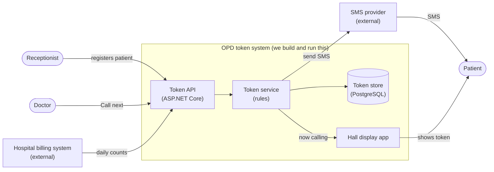
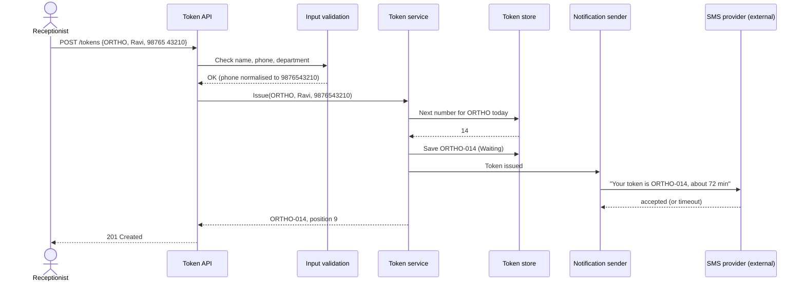

When people say "the system is down" or "the system charged me twice", they mean something bigger than one program. This lesson teaches you to look at software the way an engineer does: as a **system** with parts, inputs, outputs, users and a boundary. The running example is a token system for the outpatient department (OPD) of a city hospital in Lucknow.

## Learning objectives

By the end of this lesson you will be able to:

1. Define a software system and name its five basic ingredients: users, inputs, processing, outputs and storage.
2. Break a system into **components** and say what each one is responsible for.
3. Draw a **system boundary** and decide what is inside (you build and own it) and outside (you depend on it).
4. Identify the different **users** (actors) of a system, including other systems.
5. Explain why every input that crosses the boundary must be checked.
6. Read a small ASP.NET Core system and point to its components, its inputs, its outputs and its boundary.

## Prerequisites

- [What is software engineering?](#/lesson/m01-software-engineering): the idea of requirements and why structure matters.

No C# knowledge is required to follow the explanation. The code sections are easier if you have read [Variables, types, conditions, loops and functions in C#](#/lesson/m01-csharp-basics), but you can come back to them later.

## Explain it like I'm a beginner

### A hospital OPD without software

Picture the outpatient department of a busy hospital at 9 am. About 600 patients arrive in the morning. Here is what happens:

1. A patient goes to the **registration counter** and gives their name, phone number and the department they need (general medicine, orthopaedics, children's).
2. The receptionist writes a **token** on a slip: "ORTHO-014".
3. The patient sits in the **waiting hall**, watching a board.
4. When the orthopaedic doctor is free, an attendant shouts "ORTHO-014!" and writes it on the board.
5. The patient goes in. Later, the record clerk files a note of the visit.

Even without a computer, this is a **system**: a set of parts (counter, slips, board, attendant, register) working together to turn **inputs** (patients and their details) into **outputs** (patients seen in a fair order, a record of visits). Each part has one job. The parts talk to each other through agreed messages (the token number).

### The same OPD with software

Now replace the paper with software:

- A **registration screen** at the counter (input).
- A **token service** that hands out the next number per department and keeps the queue (processing).
- A **database** that remembers every token (storage).
- A **display screen** in the waiting hall and an **SMS** to the patient's phone (outputs).
- A **doctor's screen** with a "Call next" button (input and output).

The job is the same; the parts are now programs and machines. That collection, working together for one purpose, is a **software system**.

### The fence around the system

The hospital builds and runs its token service. It does **not** build the mobile network that delivers SMS, or the payment gateway that collects the ₹50 OPD fee. Those belong to other companies. If you draw a fence around the parts the hospital owns, you have drawn the **system boundary**. Everything inside the fence is yours to design, change and fix. Everything outside is something you *depend on* but cannot control. You can only talk to it through its agreed interface, and you must plan for it being slow or broken.

## First-principles explanation

### A definition

A **software system** is a set of software components (and the hardware and data they use) that work together to deliver a purpose to its users, by turning inputs into outputs.

Every system, from a calculator app to a national payments network, has the same five ingredients:

| Ingredient | Question it answers | OPD example |
|---|---|---|
| **Users** (actors) | Who or what uses it? | Patients, receptionists, doctors, the hall display, the SMS provider |
| **Inputs** | What comes in? | Registration details, "Call next" clicks, a request to see the queue |
| **Processing** | What does it do with inputs? | Assign the next token number, keep the queue fair, estimate waiting time |
| **Storage** (state) | What must it remember? | Tokens issued today, their status, which doctor called them |
| **Outputs** | What comes out? | Token slip, display board update, SMS, daily report |

This is sometimes called the **input-process-output** (IPO) model, with storage added because almost every useful system must remember things between inputs.

### Components: parts with one job each

A **component** is a part of the system with a clear responsibility and a clear way to talk to it. It can be as small as a class or as large as a separate server. For the OPD system:

- **Registration UI**: collects and shows patient details. It does not decide token numbers.
- **Token service**: owns the rules: numbering per department, first-come first-served, one active token per phone per department.
- **Token store**: saves and loads tokens. It does not know any rules.
- **Notification sender**: turns "token ORTHO-014 called" into an SMS. It does not know how the queue works.
- **Display board client**: polls or listens for "now calling" events and shows them.

Why split it this way? Because each part can change for its *own* reason. The SMS provider may change; only the notification sender changes. A new rule ("senior citizens first") changes only the token service. This idea is called **separation of concerns**, and it is the seed of everything you will learn about architecture in [Module 2](#/lesson/m02-what-is-architecture).

Components talk through **interfaces**: agreed shapes of messages. In code, that is a C# `interface` or a method signature. Between machines, it is usually an HTTP API with JSON. As long as the interface stays the same, the inside of a component can be rewritten without the others noticing.

### Users are not only people

An **actor** is anything outside the system that interacts with it. There are three common kinds:

- **Human users**, often in several roles with different permissions: patient, receptionist, doctor, administrator.
- **Other systems** that call yours: a hospital billing system asking "how many patients did orthopaedics see today?"
- **Time**: a scheduled job at midnight that closes the day's queue is triggered by the clock, not by a person.

Listing actors early prevents a classic mistake: designing only for the main user and forgetting the receptionist who uses the system 8 hours a day, or the administrator who has to fix a wrong entry.

### The boundary, and why it matters so much

The **system boundary** separates what you own from what you depend on. Deciding it is one of the first and most important design decisions, because:

1. **It sets the scope.** Anything inside is your work to build, test, secure and run. Drawing the boundary too wide (building your own SMS network) wastes money. Drawing it too narrow (assuming someone else validates input) leaves gaps.
2. **Inputs crossing it cannot be trusted.** A phone number typed by a tired receptionist, a JSON body from the internet, a reply from a partner API: all may be wrong, missing, or even malicious. Every input must be **validated at the boundary**, once, before it reaches the core rules.
3. **Things outside it fail independently.** The SMS provider may be down for 20 minutes. Your system must still issue tokens. Good systems treat every external dependency as "may be slow, may fail, may answer twice".
4. **It defines what you must monitor.** You cannot fix the SMS provider, but you must *know* when messages are failing.

A simple rule of thumb: **outside the boundary, trust nothing; inside, enforce your rules in one place.**

### Inputs and outputs are contracts

Every input and output has a **shape** (which fields, which types), **rules** (a phone has 10 digits) and **meaning** (what the system promises when it accepts it). For example:

- Input: `POST /tokens` with `{ "department": "ORTHO", "patientName": "Ravi Kumar", "phone": "9876543210" }`.
- Output on success: `201 Created` with `{ "number": "ORTHO-014", "position": 9, "estimatedWaitMinutes": 72 }`.
- Output on bad input: `400 Bad Request` with a list of clear error messages.

Once other people or systems depend on this shape, changing it carelessly breaks them. That is why APIs are versioned and changed carefully, which you will study in Module 13.

### Systems contain systems

Zoom out and the hospital OPD system is one part of a larger hospital system (billing, pharmacy, lab). Zoom in and the token service is itself a small system with its own parts. **Where you draw the boundary depends on the question you are asking.** A useful habit, taken from the C4 model, is to start with a *context diagram* (one box for your system, its users and the external systems around it) before drawing anything inside.

### When a "system" is overkill

A spreadsheet shared on a drive is a perfectly good system for a clinic that sees 20 patients a day. Building a token service with SMS and a display board for them would cost more than it saves. Thinking in systems helps you see *what is needed*, not to build more than is needed.

## Visual explanation

### Context diagram: the boundary and the actors



Everything inside the box labelled "OPD token system" is built and run by the hospital's team. The rounded shapes on the left are human actors. The two boxes outside on the right are external systems: the hospital cannot change them, only talk to them. Follow the arrows: the receptionist and doctor send **inputs** into the API; the API passes them to the token service, which applies the rules and saves to the store; **outputs** leave as display updates and SMS. Notice that the patient never touches the API directly: they receive outputs through the display and their phone. The billing system is also an actor, because it *calls* our system for daily counts. Every arrow crossing the box edge is a place where input must be validated or a failure must be handled.

### One input travelling through the components



Read it top to bottom. The receptionist's input first meets **validation**, at the boundary, so the token service only ever sees clean data. The service asks the store for the next number, saves the token, and asks the notification sender to send an SMS. The SMS provider is outside the boundary, so its answer may be "accepted" or a timeout. A well-designed system does not refuse the token just because the SMS failed: the patient already has a printed slip. The reply to the receptionist depends only on parts the hospital controls.

## Step-by-step example

Let us find the system in a plain-English description, the way you would on day one of a project.

### Step 1 — read the description and mark nouns and verbs

> "Receptionists **register** patients for a department. Each patient **gets** a token. Doctors **call** the next patient. The waiting hall **shows** who is being called. Patients **get** an SMS when their token is issued and when it is called. At the end of the day, the hospital billing system **asks** how many patients each department saw."

Nouns (people and things): receptionist, patient, department, token, doctor, waiting hall display, SMS, billing system.
Verbs (actions): register, get token, call next, show, send SMS, ask for counts.

### Step 2 — sort the nouns

| Noun | Actor, data, or component? |
|---|---|
| Receptionist, doctor, patient | Human actors |
| Billing system, SMS provider | External system actors |
| Token, department | Data the system stores |
| Waiting hall display | A component we build (an output) |

### Step 3 — list inputs and outputs per actor

| Actor | Inputs into the system | Outputs from the system |
|---|---|---|
| Receptionist | Patient details | Token number, position, estimated wait |
| Doctor | "Call next" | Next patient's token and name |
| Patient | (none directly) | SMS, display board |
| Billing system | Request for daily counts | Counts per department |

### Step 4 — draw the boundary

Inside: API, token service, store, display app, notification sender. Outside: SMS provider, billing system, the mobile network, the patients' phones.

### Step 5 — note the risks at each boundary crossing

- Receptionist input: typos in the phone number, unknown department. **Validate.**
- SMS provider: may be down. **Never block token issue on SMS; log failures; retry later.**
- Billing system: may call many times. **Make the counts endpoint read-only and cheap.**
- Two doctors pressing "Call next" at the same moment: **the token service must hand out each token once.**

### Step 6 — turn components into code

Each component becomes a small class or interface. The next section shows it.

## Production-style C# implementation

A small ASP.NET Core web API for the OPD token system. The folder names match the components in the context diagram, so you can see the system shape in the code.

```text
Opd.Api/
  Program.cs                          // starts the app, maps HTTP inputs to the service
  Tokens/
    Department.cs                     // reference data: departments and average consult time
    Token.cs                          // one token and its status
    TokenService.cs                   // the rules (inside the boundary)
    ITokenStore.cs                    // storage port
    InMemoryTokenStore.cs             // simple storage adapter
  Boundary/
    IssueTokenRequest.cs              // the input contract + validation
    TokenViews.cs                     // the output contracts
    INotificationSender.cs            // port to an external system
    LoggingNotificationSender.cs      // stand-in adapter that logs instead of sending SMS
```

```csharp file=Tokens/Department.cs
namespace Opd.Api.Tokens;

/// <summary>Reference data. Average minutes per patient are illustrative.</summary>
public sealed record Department(string Code, string Name, int AverageMinutesPerPatient)
{
    public static readonly IReadOnlyList<Department> All =
    [
        new("GEN", "General medicine", 6),
        new("ORTHO", "Orthopaedics", 8),
        new("PAED", "Paediatrics", 7),
    ];

    public static Department? Find(string code) =>
        All.FirstOrDefault(d => string.Equals(d.Code, code, StringComparison.OrdinalIgnoreCase));
}
```

```csharp file=Tokens/Token.cs
namespace Opd.Api.Tokens;

public enum TokenStatus { Waiting, Called }

/// <summary>One token. Immutable: a status change creates a new value with 'with'.</summary>
public sealed record Token(
    string Number,
    string DepartmentCode,
    string PatientName,
    string Phone,
    DateTimeOffset IssuedAt,
    TokenStatus Status,
    DateTimeOffset? CalledAt = null);
```

```csharp file=Tokens/ITokenStore.cs
namespace Opd.Api.Tokens;

/// <summary>Where tokens live. Today: memory. Later: a PostgreSQL table. The rules do not care.</summary>
public interface ITokenStore
{
    int CountIssued(string departmentCode);
    void Save(Token token);
    IReadOnlyList<Token> Waiting(string departmentCode);
    IReadOnlyDictionary<string, int> CalledCountsByDepartment();
}
```

```csharp file=Tokens/InMemoryTokenStore.cs
namespace Opd.Api.Tokens;

/// <summary>Not thread-safe on its own; TokenService serialises access with a lock.</summary>
public sealed class InMemoryTokenStore : ITokenStore
{
    private readonly Dictionary<string, Token> _byNumber = new(StringComparer.OrdinalIgnoreCase);

    public int CountIssued(string departmentCode) =>
        _byNumber.Values.Count(t => t.DepartmentCode == departmentCode);

    public void Save(Token token) => _byNumber[token.Number] = token;

    public IReadOnlyList<Token> Waiting(string departmentCode) =>
        _byNumber.Values
            .Where(t => t.DepartmentCode == departmentCode && t.Status == TokenStatus.Waiting)
            .OrderBy(t => t.IssuedAt)
            .ToArray();

    public IReadOnlyDictionary<string, int> CalledCountsByDepartment() =>
        _byNumber.Values
            .Where(t => t.Status == TokenStatus.Called)
            .GroupBy(t => t.DepartmentCode)
            .ToDictionary(g => g.Key, g => g.Count());
}
```

```csharp file=Boundary/INotificationSender.cs
namespace Opd.Api.Boundary;

/// <summary>Port to an external system (an SMS provider). It may be slow or fail; callers must cope.</summary>
public interface INotificationSender
{
    Task<bool> TrySendAsync(string phone, string message, CancellationToken ct);
}
```

```csharp file=Boundary/LoggingNotificationSender.cs
namespace Opd.Api.Boundary;

/// <summary>Stand-in adapter for development. A real one would call the SMS provider's HTTP API
/// through HttpClient with a timeout.</summary>
public sealed class LoggingNotificationSender(ILogger<LoggingNotificationSender> logger) : INotificationSender
{
    public Task<bool> TrySendAsync(string phone, string message, CancellationToken ct)
    {
        var masked = phone.Length >= 4 ? new string('*', phone.Length - 4) + phone[^4..] : "****";
        logger.LogInformation("SMS to {Phone}: {Message}", masked, message);
        return Task.FromResult(true);
    }
}
```

```csharp file=Tokens/TokenService.cs
using Opd.Api.Boundary;

namespace Opd.Api.Tokens;

public sealed record IssuedToken(Token Token, int Position, int EstimatedWaitMinutes);

/// <summary>The core of the system: all queue rules live here, nowhere else.</summary>
public sealed class TokenService(
    ITokenStore store,
    INotificationSender notifications,
    TimeProvider clock,
    ILogger<TokenService> logger)
{
    private readonly Lock _gate = new();   // one process; a database would enforce this across servers

    public async Task<IssuedToken> IssueAsync(Department dept, string patientName, string phone, CancellationToken ct)
    {
        IssuedToken issued;
        lock (_gate)
        {
            var next = store.CountIssued(dept.Code) + 1;
            var token = new Token($"{dept.Code}-{next:D3}", dept.Code, patientName, phone,
                                  clock.GetUtcNow(), TokenStatus.Waiting);
            store.Save(token);
            var position = store.Waiting(dept.Code).Count;
            issued = new IssuedToken(token, position, (position - 1) * dept.AverageMinutesPerPatient);
        }

        // Output to an external system. Failure must not undo the token: the patient already has it.
        await NotifySafelyAsync(phone,
            $"Your OPD token is {issued.Token.Number}. Approx. wait {issued.EstimatedWaitMinutes} min.", ct);
        return issued;
    }

    public async Task<Token?> CallNextAsync(Department dept, CancellationToken ct)
    {
        Token? called;
        lock (_gate)
        {
            var next = store.Waiting(dept.Code).FirstOrDefault();
            if (next is null) return null;
            called = next with { Status = TokenStatus.Called, CalledAt = clock.GetUtcNow() };
            store.Save(called);
        }

        await NotifySafelyAsync(called.Phone, $"Token {called.Number}: please go to {dept.Name} now.", ct);
        return called;
    }

    public IReadOnlyList<Token> Queue(Department dept)
    {
        lock (_gate) return store.Waiting(dept.Code);
    }

    public IReadOnlyDictionary<string, int> SeenToday()
    {
        lock (_gate) return store.CalledCountsByDepartment();
    }

    private async Task NotifySafelyAsync(string phone, string message, CancellationToken ct)
    {
        try
        {
            if (!await notifications.TrySendAsync(phone, message, ct))
                logger.LogWarning("SMS provider refused a message");
        }
        catch (Exception ex) when (ex is not OperationCanceledException)
        {
            logger.LogWarning(ex, "SMS provider failed; token flow continues");
        }
    }
}
```

```csharp file=Boundary/IssueTokenRequest.cs
using System.Text.RegularExpressions;
using Opd.Api.Tokens;

namespace Opd.Api.Boundary;

/// <summary>The input contract. Everything arriving here is untrusted until Validate() says otherwise.</summary>
public sealed record IssueTokenRequest(string? Department, string? PatientName, string? Phone)
{
    private static readonly Regex IndianMobile = new("^[6-9][0-9]{9}$", RegexOptions.Compiled);

    public (Department? Dept, string Name, string Phone, Dictionary<string, string[]> Errors) Validate()
    {
        var errors = new Dictionary<string, string[]>();

        var dept = Tokens.Department.Find(Department ?? "");
        if (dept is null) errors["department"] = ["Unknown department."];

        var name = (PatientName ?? "").Trim();
        if (name.Length is < 2 or > 80) errors["patientName"] = ["Name must be 2 to 80 characters."];

        var phone = (Phone ?? "").Replace(" ", "").Replace("-", "");
        if (phone.StartsWith("+91")) phone = phone[3..];
        if (!IndianMobile.IsMatch(phone)) errors["phone"] = ["Phone must be a 10-digit Indian mobile number."];

        return (dept, name, phone, errors);
    }
}
```

```csharp file=Boundary/TokenViews.cs
using Opd.Api.Tokens;

namespace Opd.Api.Boundary;

/// <summary>Output contracts. They expose only what callers need: no phone numbers on the hall display.</summary>
public sealed record IssuedTokenView(string Number, int Position, int EstimatedWaitMinutes)
{
    public static IssuedTokenView From(IssuedToken t) => new(t.Token.Number, t.Position, t.EstimatedWaitMinutes);
}

public sealed record DisplayTokenView(string Number, string PatientFirstName)
{
    public static DisplayTokenView From(Token t) => new(t.Number, t.PatientName.Split(' ')[0]);
}
```

```csharp file=Program.cs
using Opd.Api.Boundary;
using Opd.Api.Tokens;

var builder = WebApplication.CreateBuilder(args);

// Wire the components together. Swapping InMemoryTokenStore for a PostgreSQL store,
// or LoggingNotificationSender for a real SMS adapter, changes only these lines.
builder.Services.AddSingleton<ITokenStore, InMemoryTokenStore>();
builder.Services.AddSingleton<INotificationSender, LoggingNotificationSender>();
builder.Services.AddSingleton(TimeProvider.System);
builder.Services.AddSingleton<TokenService>();

var app = builder.Build();

// Input: receptionist registers a patient.
app.MapPost("/tokens", async (IssueTokenRequest request, TokenService tokens, CancellationToken ct) =>
{
    var (dept, name, phone, errors) = request.Validate();
    if (errors.Count > 0 || dept is null) return Results.ValidationProblem(errors);
    var issued = await tokens.IssueAsync(dept, name, phone, ct);
    return Results.Created($"/tokens/{issued.Token.Number}", IssuedTokenView.From(issued));
});

// Input: doctor presses "Call next". Output: who to call.
app.MapPost("/departments/{code}/call-next", async (string code, TokenService tokens, CancellationToken ct) =>
{
    if (Department.Find(code) is not { } dept) return Results.NotFound();
    var called = await tokens.CallNextAsync(dept, ct);
    return called is null ? Results.NoContent() : Results.Ok(DisplayTokenView.From(called));
});

// Output: hall display reads the queue (no phone numbers leave the system here).
app.MapGet("/departments/{code}/queue", (string code, TokenService tokens) =>
    Department.Find(code) is { } dept
        ? Results.Ok(tokens.Queue(dept).Select(DisplayTokenView.From))
        : Results.NotFound());

// Output for an external system: billing asks for daily counts.
app.MapGet("/reports/seen-today", (TokenService tokens) => Results.Ok(tokens.SeenToday()));

app.Run();
```

What to notice:

- **The folder layout mirrors the context diagram.** `Tokens/` is the core inside the boundary. `Boundary/` holds everything that touches the outside world: input contracts, output contracts and the port to the SMS provider.
- **Validation happens once, at the edge.** `IssueTokenRequest.Validate()` cleans and checks the input. `TokenService` can then trust that names, phones and departments are valid.
- **Outputs are shaped for each actor.** The hall display gets `DisplayTokenView` with only a first name; it never sees phone numbers. Exposing less data is a simple and strong privacy measure.
- **The external system cannot break the core flow.** `NotifySafelyAsync` catches SMS failures and logs them. The token is still issued.
- **Each part can be replaced.** A real SMS adapter, or a PostgreSQL store, is a new class plus one changed line in `Program.cs`.
- **Known limit.** Token numbering uses a `Lock` in one process. With two servers behind a load balancer, both could issue "ORTHO-015". At that point the database must hand out numbers (a sequence or a unique constraint). For one server in one hospital, the simple version is enough.

## Bad design vs good design

**Bad**: one big endpoint that does everything, trusts its input, and waits on the external system.

```csharp
app.MapPost("/token", async (HttpRequest req) =>
{
    var form = await req.ReadFormAsync();
    var dept = form["d"];                                  // any string accepted
    var n = ++counter;                                      // one counter for all departments, not thread-safe
    var token = dept + "-" + n;
    db.Add(new { token, name = form["n"], phone = form["p"] });
    await new HttpClient().GetAsync(                        // blocks token issue on the SMS provider
        "https://sms.example.com/send?to=" + form["p"] + "&msg=" + token);
    return token;                                           // returns raw text, no contract
});
```

Problems:

- **No boundary checks.** Department "XYZ", an empty name or a 4-digit phone are all accepted and stored. Bad data spreads into reports and SMS.
- **No component separation.** Numbering rules, storage and SMS are tangled. Changing the SMS provider means editing the token logic.
- **External failure becomes your failure.** If the SMS provider takes 30 seconds, the receptionist waits 30 seconds for every patient, and the queue at the counter grows.
- **No output contract.** A plain string with no position or wait time; the display team cannot rely on its shape.
- **One shared counter** gives ORTHO-1, GEN-2, ORTHO-3: confusing for patients and unsafe under concurrent requests.

**Good**: the structure above. Inputs are validated at the boundary; rules live in one service; storage and SMS sit behind interfaces; outputs are explicit records; an external failure is logged, not passed on to the patient.

**Is the separation always worth it?** For a 30-line internal tool used by one person, a single endpoint may be fine. Separate components when parts change for different reasons, when there are external dependencies that can fail, or when more than one kind of user is involved. The OPD system has all three.

:::callout type=warning title="The boundary is also a security line"
Every input crossing the boundary may be malicious, not just mistaken. Validate type, length and format; never build SQL or shell commands by joining strings with user input; and never return more data than the actor needs. The [OWASP lesson](#/lesson/m14-owasp) builds on this habit.
:::

## Practical playground

This small program models the five ingredients: input, validation at the boundary, processing, storage and output. Run it, then try the experiments.

:::playground type=csharp title="Inputs, processing, outputs"
```csharp file=Program.cs
using System;
using System.Collections.Generic;
using System.Linq;

// Storage + processing (inside the boundary)
public sealed class TokenQueue
{
    private readonly Dictionary<string, int> _issued = new(StringComparer.OrdinalIgnoreCase);
    private readonly Dictionary<string, Queue<string>> _waiting = new(StringComparer.OrdinalIgnoreCase);

    public string Issue(string dept)
    {
        var n = _issued.GetValueOrDefault(dept) + 1;
        _issued[dept] = n;
        var token = $"{dept.ToUpperInvariant()}-{n:D3}";
        if (!_waiting.TryGetValue(dept, out var q)) _waiting[dept] = q = new Queue<string>();
        q.Enqueue(token);
        return token;
    }

    public string? CallNext(string dept) =>
        _waiting.TryGetValue(dept, out var q) && q.Count > 0 ? q.Dequeue() : null;

    public int Waiting(string dept) => _waiting.TryGetValue(dept, out var q) ? q.Count : 0;
}

// The boundary: untrusted input is checked here
public static class Boundary
{
    private static readonly string[] Departments = ["GEN", "ORTHO", "PAED"];

    public static string? Check(string dept, string phone)
    {
        if (!Departments.Contains(dept, StringComparer.OrdinalIgnoreCase)) return "unknown department";
        if (phone.Length != 10 || !phone.All(char.IsDigit) || phone[0] < '6') return "bad phone";
        return null;
    }
}

public static class Program
{
    public static void Main()
    {
        var queue = new TokenQueue();
        var inputs = new (string Dept, string Phone)[]
        {
            ("ORTHO", "9876543210"), ("GEN", "9123456780"), ("ortho", "8877665544"),
            ("DENTAL", "9000000000"), ("GEN", "12345"),
        };

        foreach (var (dept, phone) in inputs)
        {
            var error = Boundary.Check(dept, phone);                      // input validation
            Console.WriteLine(error is null
                ? $"Issued {queue.Issue(dept)} for {phone[^4..]}"          // processing + output
                : $"Rejected {dept}/{phone}: {error}");
        }

        Console.WriteLine($"ORTHO waiting: {queue.Waiting("ORTHO")}");
        Console.WriteLine($"Doctor calls: {queue.CallNext("ORTHO")}");
        Console.WriteLine($"Doctor calls: {queue.CallNext("ORTHO")}");
        Console.WriteLine($"Doctor calls: {queue.CallNext("ORTHO") ?? "nobody waiting"}");

        // Experiments:
        // 1. Remove the Boundary.Check call. Which bad inputs now reach the queue? What would a report show?
        // 2. Add "DENTAL" as a department. How many places did you change? Is that acceptable?
        // 3. Add a fake SMS step that throws an exception for phones starting with 8.
        //    Make sure the token is still issued and the loop continues.
        // 4. Who are the actors in this program? Which of them are missing compared with the real OPD?
    }
}
```
:::

## Exercises

:::exercise id=m01-software-system-ex1 difficulty=beginner kind=written title="Find the system in an ATM"
Think of a bank ATM in your city. Describe it as a software system:

1. List at least four **actors** (include at least one that is not a person).
2. List at least four **inputs** and four **outputs**.
3. Name four **components** inside the ATM system and the one job of each.
4. Draw the **boundary**: which parts does the bank own, and which external systems does it depend on?
5. For two boundary crossings, say what could go wrong and how the system should react.
::acceptance
- Actors include at least one non-human actor (another system or a timer).
- Inputs and outputs are concrete (not just "data").
- Each component has one clear responsibility.
- At least two failure cases are described with a sensible reaction.
::hint
Walk through one withdrawal step by step: card in, PIN, amount, cash out, receipt. Each step is an input or an output.
::hint
Who else is involved besides the customer? Think of who fills cash, and of the systems that check whether your account has money.
::hint
Non-human actors: the card network (RuPay, Visa), your bank's core banking system, a nightly reconciliation job.
::hint
Classic failure: the account is debited but the cash dispenser jams. What must the system do? (Reverse the debit automatically, and record the event.)
::solution
**Actors**: customer; cash-loading staff (refill and audit); the bank's core banking system; the card network that routes requests for other banks' cards; a nightly reconciliation job (time-triggered).

**Inputs**: card details read from the chip; PIN; chosen language and transaction type; amount; cash cassette counts entered by staff.

**Outputs**: cash notes; printed or SMS receipt; screen messages; transaction record sent to the bank; alerts when cash is low.

**Components** (inside the ATM system):

- *Card reader and PIN pad driver*: reads the card and the encrypted PIN. Nothing else.
- *Transaction app*: the screens and the flow (choose, confirm, dispense).
- *Host connector*: talks to the bank or card network in an agreed message format.
- *Cash dispenser controller*: counts and dispenses notes and reports jams.
- *Journal*: records every step locally for audits and disputes.

**Boundary**: the bank (or its ATM operator) owns the machine, its software, and the switch that connects ATMs. Outside: the card network, other banks, the telecom link, the electricity supply.

**Failures**:

- *Network times out after the debit was approved*: the ATM must not dispense if it never got a clear approval; if it did dispense, the journal and reconciliation make sure the books match.
- *Cash jams after the debit*: the ATM sends a reversal, shows a clear message, and the journal records it so a dispute can be resolved. Banks in India are required to auto-reverse failed ATM debits within a fixed time; the system design must support that.
::mistakes
- Listing only the customer as an actor.
- Calling the database or network "inputs". They are components or external systems; inputs are what crosses into the system.
- Ignoring the "debited but no cash" case, which is the most common real complaint.
:::

:::exercise id=m01-software-system-ex2 difficulty=beginner kind=code title="Per-department token dispenser"
Build the core processing component of the OPD system: a dispenser that gives out token numbers.
::requirements
- The constructor takes the list of valid department codes (for example `GEN`, `ORTHO`, `PAED`).
- `Issue(departmentCode)` returns `"<CODE>-<number>"`, with the code in upper case and the number with at least 3 digits: `GEN-001`, `GEN-002`. Each department counts separately. Codes are matched ignoring case.
- An unknown department throws `ArgumentException`.
- `IssuedCount(departmentCode)` returns how many tokens that department has issued (0 if none).
- `TotalIssued` returns the total across all departments.
::acceptance
- Two GEN tokens then one ORTHO token gives `GEN-001`, `GEN-002`, `ORTHO-001`.
- `Issue("ortho")` returns `ORTHO-...`.
- `Issue("DENTAL")` throws `ArgumentException` when DENTAL is not configured.
- Two dispensers do not share counts.
::hint
You need one counter per department. Which collection maps a key (the code) to a value (the count)?
::hint
A `Dictionary<string, int>` created with `StringComparer.OrdinalIgnoreCase` treats "ortho" and "ORTHO" as the same key.
::hint
Fill the dictionary with every valid code and a count of 0 in the constructor. Then "unknown department" is simply "key not found".
::hint
`$"{code}-{n:D3}"` formats 7 as `007`.
::hint
```csharp
if (!_counts.TryGetValue(departmentCode, out var current))
    throw new ArgumentException($"Unknown department '{departmentCode}'.", nameof(departmentCode));
var next = current + 1;
_counts[departmentCode] = next;
return $"{departmentCode.ToUpperInvariant()}-{next:D3}";
```
::starter
```csharp file=TokenDispenser.cs
using System;
using System.Collections.Generic;
using System.Linq;

public sealed class TokenDispenser
{
    public TokenDispenser(IEnumerable<string> departmentCodes) => throw new NotImplementedException();

    public int TotalIssued => throw new NotImplementedException();

    public string Issue(string departmentCode) => throw new NotImplementedException();

    public int IssuedCount(string departmentCode) => throw new NotImplementedException();
}
```
::tests
```csharp file=TokenDispenserTests.cs
using System;
using Xunit;

public class TokenDispenserTests
{
    private static TokenDispenser New() => new(new[] { "GEN", "ORTHO", "PAED" });

    [Fact]
    public void Departments_count_separately()
    {
        var d = New();
        Assert.Equal("GEN-001", d.Issue("GEN"));
        Assert.Equal("GEN-002", d.Issue("GEN"));
        Assert.Equal("ORTHO-001", d.Issue("ORTHO"));
    }

    [Fact] public void Code_is_case_insensitive_and_upper_cased() => Assert.Equal("ORTHO-001", New().Issue("ortho"));

    [Fact] public void Unknown_department_throws() => Assert.Throws<ArgumentException>(() => New().Issue("DENTAL"));

    [Fact]
    public void Counts_are_reported()
    {
        var d = New();
        d.Issue("GEN"); d.Issue("GEN"); d.Issue("PAED");
        Assert.Equal(2, d.IssuedCount("gen"));
        Assert.Equal(0, d.IssuedCount("ORTHO"));
        Assert.Equal(3, d.TotalIssued);
    }

    [Fact]
    public void Dispensers_are_independent()
    {
        var a = New(); var b = New();
        a.Issue("GEN");
        Assert.Equal("GEN-001", b.Issue("GEN"));
    }

    [Fact]
    public void Numbers_grow_past_three_digits()
    {
        var d = New();
        string last = "";
        for (var i = 0; i < 1000; i++) last = d.Issue("GEN");
        Assert.Equal("GEN-1000", last);
    }
}
```
::solution
```csharp file=TokenDispenser.cs
using System;
using System.Collections.Generic;
using System.Linq;

public sealed class TokenDispenser
{
    private readonly Dictionary<string, int> _counts = new(StringComparer.OrdinalIgnoreCase);

    public TokenDispenser(IEnumerable<string> departmentCodes)
    {
        ArgumentNullException.ThrowIfNull(departmentCodes);
        foreach (var code in departmentCodes)
        {
            ArgumentException.ThrowIfNullOrWhiteSpace(code);
            _counts[code.Trim()] = 0;
        }
    }

    public int TotalIssued => _counts.Values.Sum();

    public string Issue(string departmentCode)
    {
        if (!_counts.TryGetValue(departmentCode, out var current))
            throw new ArgumentException($"Unknown department '{departmentCode}'.", nameof(departmentCode));
        var next = current + 1;
        _counts[departmentCode] = next;
        return $"{departmentCode.ToUpperInvariant()}-{next:D3}";
    }

    public int IssuedCount(string departmentCode) => _counts.GetValueOrDefault(departmentCode);
}
```

The dispenser is pure processing plus a little storage: no screen, no SMS, no database. That is why it is so easy to test. In the full system it sits inside the boundary and receives only validated department codes, but it still protects itself by rejecting unknown codes.
::mistakes
- One shared counter for all departments, giving `GEN-001`, `ORTHO-002`.
- Making the dictionary `static`, so two dispensers (or two test runs) share counts.
- Returning the code exactly as typed (`ortho-001`), so the display shows mixed case.
::extensions
Add `ResetForNewDay()`. Then think: should the dispenser itself know about dates, or should something outside call reset at midnight? Who is the actor that triggers it?
:::

:::exercise id=m01-software-system-ex3 difficulty=intermediate kind=code title="Validate input at the boundary"
Write the boundary check for patient registration. It must collect *all* problems at once (so the receptionist fixes everything in one go) and produce a clean, trusted `Patient` only when everything is valid.
::requirements
- Name: trimmed; 2 to 80 characters. Error: `"Name must be 2 to 80 characters."`
- Phone: remove spaces and dashes, and a leading `+91`. The result must be 10 digits starting with 6, 7, 8 or 9. Error: `"Phone must be a 10-digit Indian mobile number."`
- Age: required, 0 to 120. Error: `"Age must be between 0 and 120."`
- Department: one of `GEN`, `ORTHO`, `PAED`, `ENT`, ignoring case; stored in upper case. Error: `"Unknown department."`
- When there are errors, `Patient` is `null`. When there are none, `Patient` holds the cleaned values.
::acceptance
- `("  Asha Verma ", "+91 98765-43210", 34, "ortho")` gives `Patient("Asha Verma", "9876543210", 34, "ORTHO")`.
- An input with every field missing gives exactly 4 errors and no patient.
- `"12345"` as phone gives the phone error.
- Age 130 gives the age error.
::hint
Think of the boundary as a security guard with a checklist: they check every item and hand you the full list of problems, rather than sending you back four times.
::hint
Create a `List<string> errors`, check each field independently, and add a message for each failure. Do not `return` early.
::hint
Normalise before checking: `phone.Replace(" ", "").Replace("-", "")`, then remove `+91` if present.
::hint
For the phone format, `Regex.IsMatch(phone, "^[6-9][0-9]{9}$")` is clear and exact.
::hint
```csharp
var errors = new List<string>();
var name = (input.Name ?? "").Trim();
if (name.Length is < 2 or > 80) errors.Add("Name must be 2 to 80 characters.");
// ... phone, age, department ...
return errors.Count == 0
    ? new ValidationResult(new Patient(name, phone, input.Age!.Value, dept.ToUpperInvariant()), errors)
    : new ValidationResult(null, errors);
```
::starter
```csharp file=RegistrationValidator.cs
using System;
using System.Collections.Generic;
using System.Text.RegularExpressions;

public sealed record RegistrationInput(string? Name, string? Phone, int? Age, string? Department);

public sealed record Patient(string Name, string Phone, int Age, string Department);

public sealed record ValidationResult(Patient? Patient, IReadOnlyList<string> Errors)
{
    public bool IsValid => Errors.Count == 0;
}

public static class RegistrationValidator
{
    public static readonly IReadOnlySet<string> Departments =
        new HashSet<string>(StringComparer.OrdinalIgnoreCase) { "GEN", "ORTHO", "PAED", "ENT" };

    public static ValidationResult Validate(RegistrationInput input) => throw new NotImplementedException();
}
```
::tests
```csharp file=RegistrationValidatorTests.cs
using System;
using Xunit;

public class RegistrationValidatorTests
{
    [Fact]
    public void Valid_input_is_cleaned()
    {
        var r = RegistrationValidator.Validate(new RegistrationInput("  Asha Verma ", "+91 98765-43210", 34, "ortho"));
        Assert.True(r.IsValid);
        Assert.Equal(new Patient("Asha Verma", "9876543210", 34, "ORTHO"), r.Patient);
    }

    [Fact]
    public void All_errors_are_collected()
    {
        var r = RegistrationValidator.Validate(new RegistrationInput(null, null, null, null));
        Assert.False(r.IsValid);
        Assert.Equal(4, r.Errors.Count);
        Assert.Null(r.Patient);
    }

    [Fact]
    public void Short_phone_is_rejected()
    {
        var r = RegistrationValidator.Validate(new RegistrationInput("Ravi", "12345", 40, "GEN"));
        Assert.Contains("Phone must be a 10-digit Indian mobile number.", r.Errors);
        Assert.Single(r.Errors);
    }

    [Fact]
    public void Phone_starting_with_5_is_rejected()
    {
        var r = RegistrationValidator.Validate(new RegistrationInput("Ravi", "5876543210", 40, "GEN"));
        Assert.False(r.IsValid);
    }

    [Fact]
    public void Age_out_of_range_is_rejected()
    {
        var r = RegistrationValidator.Validate(new RegistrationInput("Ravi", "9876543210", 130, "GEN"));
        Assert.Contains("Age must be between 0 and 120.", r.Errors);
    }

    [Fact]
    public void Newborn_is_allowed()
    {
        var r = RegistrationValidator.Validate(new RegistrationInput("Baby of Meena", "9876543210", 0, "PAED"));
        Assert.True(r.IsValid);
    }

    [Fact]
    public void Unknown_department_is_rejected()
    {
        var r = RegistrationValidator.Validate(new RegistrationInput("Ravi", "9876543210", 40, "DENTAL"));
        Assert.Contains("Unknown department.", r.Errors);
    }
}
```
::solution
```csharp file=RegistrationValidator.cs
using System;
using System.Collections.Generic;
using System.Text.RegularExpressions;

public sealed record RegistrationInput(string? Name, string? Phone, int? Age, string? Department);

public sealed record Patient(string Name, string Phone, int Age, string Department);

public sealed record ValidationResult(Patient? Patient, IReadOnlyList<string> Errors)
{
    public bool IsValid => Errors.Count == 0;
}

public static class RegistrationValidator
{
    public static readonly IReadOnlySet<string> Departments =
        new HashSet<string>(StringComparer.OrdinalIgnoreCase) { "GEN", "ORTHO", "PAED", "ENT" };

    private static readonly Regex IndianMobile = new("^[6-9][0-9]{9}$", RegexOptions.Compiled);

    public static ValidationResult Validate(RegistrationInput input)
    {
        ArgumentNullException.ThrowIfNull(input);
        var errors = new List<string>();

        var name = (input.Name ?? "").Trim();
        if (name.Length is < 2 or > 80) errors.Add("Name must be 2 to 80 characters.");

        var phone = NormalisePhone(input.Phone);
        if (!IndianMobile.IsMatch(phone)) errors.Add("Phone must be a 10-digit Indian mobile number.");

        if (input.Age is not (>= 0 and <= 120)) errors.Add("Age must be between 0 and 120.");

        var dept = (input.Department ?? "").Trim();
        if (!Departments.Contains(dept)) errors.Add("Unknown department.");

        return errors.Count == 0
            ? new ValidationResult(new Patient(name, phone, input.Age!.Value, dept.ToUpperInvariant()), errors)
            : new ValidationResult(null, errors);
    }

    private static string NormalisePhone(string? raw)
    {
        var phone = (raw ?? "").Replace(" ", "").Replace("-", "");
        return phone.StartsWith("+91", StringComparison.Ordinal) ? phone[3..] : phone;
    }
}
```

The validator turns untrusted input into a trusted `Patient`. Code inside the boundary can accept only `Patient`, never `RegistrationInput`, so it is impossible to forget validation. The pattern `input.Age is not (>= 0 and <= 120)` also handles `null`, because `null` matches neither range.
::alternatives
ASP.NET Core supports data annotations (`[Required]`, `[Range(0, 120)]`) on request types, and .NET 10 minimal APIs can validate them automatically. For rules that need code (normalising phones), a hand-written validator like this one, or a library such as FluentValidation, is common. Hand-written is fine and has no dependencies.
::mistakes
- Returning at the first error, so the receptionist fixes one field at a time.
- Validating the raw phone and storing the raw phone, so the database contains "+91 98765-43210" and "9876543210" for the same person.
- Treating age 0 as invalid; newborns visit paediatrics.
- Spreading checks across the service and the database instead of one place at the boundary.
:::

:::exercise id=m01-software-system-ex4 difficulty=intermediate kind=code title="Talk to an external system safely"
The hospital wants SMS reminders for booked appointments. The SMS provider is **outside the boundary**: it may refuse a message or crash. Build `AppointmentReminder` so it keeps working when the provider misbehaves.
::requirements
- `SendDueReminders(appointments)` sends one SMS for each appointment that starts **after now and within the next 24 hours**, and that has not already been reminded successfully.
- The message must contain `"appointment <Id>"`.
- If `TrySend` returns `false` or throws an exception, that appointment is **not** marked as reminded (so the next run retries), and the remaining appointments are still processed.
- Returns the number of reminders sent successfully in this run.
- `WasReminded(id)` tells whether a reminder was sent successfully.
- "Now" comes from the injected `TimeProvider`.
::acceptance
- With appointments in 2 hours, in 2 days and 1 hour ago, exactly one SMS is sent.
- Running twice sends the reminder only once.
- A refused message is retried on the next run.
- If the provider throws for one phone, the other appointments still get their SMS.
::hint
The provider is like a courier you do not control. You hand over a parcel and must be ready for "refused", "lost" or "the courier office is closed".
::hint
Keep a private `HashSet<int>` of appointment ids that were reminded successfully. Only add to it when sending succeeded.
::hint
"Due" means `a.StartsAt > now && a.StartsAt <= now + 24 hours`. Get `now` once at the start of the run with `clock.GetUtcNow()`.
::hint
Wrap each send in its own `try/catch`, inside the loop, so one failure does not stop the loop.
::hint
```csharp
foreach (var a in appointments)
{
    if (_reminded.Contains(a.Id) || !IsDue(a, now)) continue;
    bool ok;
    try { ok = _sms.TrySend(a.PatientPhone, $"Reminder: appointment {a.Id} at {a.StartsAt:dd MMM HH:mm}"); }
    catch (Exception) { ok = false; }
    if (ok) { _reminded.Add(a.Id); sent++; }
}
```
::starter
```csharp file=AppointmentReminder.cs
using System;
using System.Collections.Generic;

public sealed record Appointment(int Id, string PatientPhone, DateTimeOffset StartsAt);

/// <summary>Port to the external SMS provider.</summary>
public interface ISmsGateway
{
    bool TrySend(string phone, string message);
}

public sealed class AppointmentReminder
{
    public AppointmentReminder(ISmsGateway sms, TimeProvider clock) => throw new NotImplementedException();

    public int SendDueReminders(IEnumerable<Appointment> appointments) => throw new NotImplementedException();

    public bool WasReminded(int appointmentId) => throw new NotImplementedException();
}
```
::tests
```csharp file=AppointmentReminderTests.cs
using System;
using System.Collections.Generic;
using Xunit;

public class AppointmentReminderTests
{
    private sealed class FixedClock(DateTimeOffset now) : TimeProvider
    {
        public override DateTimeOffset GetUtcNow() => now;
    }

    private sealed class FakeSms : ISmsGateway
    {
        public List<(string Phone, string Message)> Sent { get; } = new();
        public HashSet<string> Refuse { get; } = new();
        public HashSet<string> Crash { get; } = new();

        public bool TrySend(string phone, string message)
        {
            if (Crash.Contains(phone)) throw new InvalidOperationException("provider down");
            if (Refuse.Contains(phone)) return false;
            Sent.Add((phone, message));
            return true;
        }
    }

    private static readonly DateTimeOffset Now = new(2026, 3, 10, 8, 0, 0, TimeSpan.Zero);

    [Fact]
    public void Sends_only_for_the_next_24_hours()
    {
        var sms = new FakeSms();
        var r = new AppointmentReminder(sms, new FixedClock(Now));
        var sent = r.SendDueReminders(new[]
        {
            new Appointment(1, "9000000001", Now.AddHours(2)),
            new Appointment(2, "9000000002", Now.AddDays(2)),
            new Appointment(3, "9000000003", Now.AddHours(-1)),
        });
        Assert.Equal(1, sent);
        var only = Assert.Single(sms.Sent);
        Assert.Contains("appointment 1", only.Message);
    }

    [Fact]
    public void Does_not_send_twice()
    {
        var sms = new FakeSms();
        var r = new AppointmentReminder(sms, new FixedClock(Now));
        var list = new[] { new Appointment(7, "9000000007", Now.AddHours(5)) };
        Assert.Equal(1, r.SendDueReminders(list));
        Assert.Equal(0, r.SendDueReminders(list));
        Assert.Single(sms.Sent);
        Assert.True(r.WasReminded(7));
    }

    [Fact]
    public void Refused_message_is_retried_next_run()
    {
        var sms = new FakeSms();
        sms.Refuse.Add("9000000008");
        var r = new AppointmentReminder(sms, new FixedClock(Now));
        var list = new[] { new Appointment(8, "9000000008", Now.AddHours(3)) };
        Assert.Equal(0, r.SendDueReminders(list));
        Assert.False(r.WasReminded(8));
        sms.Refuse.Clear();
        Assert.Equal(1, r.SendDueReminders(list));
        Assert.True(r.WasReminded(8));
    }

    [Fact]
    public void One_crash_does_not_stop_the_others()
    {
        var sms = new FakeSms();
        sms.Crash.Add("9000000009");
        var r = new AppointmentReminder(sms, new FixedClock(Now));
        var sent = r.SendDueReminders(new[]
        {
            new Appointment(9, "9000000009", Now.AddHours(1)),
            new Appointment(10, "9000000010", Now.AddHours(1)),
        });
        Assert.Equal(1, sent);
        Assert.False(r.WasReminded(9));
        Assert.True(r.WasReminded(10));
    }

    [Fact]
    public void Exactly_24_hours_ahead_is_due()
    {
        var sms = new FakeSms();
        var r = new AppointmentReminder(sms, new FixedClock(Now));
        Assert.Equal(1, r.SendDueReminders(new[] { new Appointment(11, "9000000011", Now.AddHours(24)) }));
    }
}
```
::solution
```csharp file=AppointmentReminder.cs
using System;
using System.Collections.Generic;

public sealed record Appointment(int Id, string PatientPhone, DateTimeOffset StartsAt);

/// <summary>Port to the external SMS provider.</summary>
public interface ISmsGateway
{
    bool TrySend(string phone, string message);
}

public sealed class AppointmentReminder
{
    private static readonly TimeSpan Window = TimeSpan.FromHours(24);

    private readonly ISmsGateway _sms;
    private readonly TimeProvider _clock;
    private readonly HashSet<int> _reminded = new();

    public AppointmentReminder(ISmsGateway sms, TimeProvider clock)
    {
        _sms = sms ?? throw new ArgumentNullException(nameof(sms));
        _clock = clock ?? throw new ArgumentNullException(nameof(clock));
    }

    public int SendDueReminders(IEnumerable<Appointment> appointments)
    {
        var now = _clock.GetUtcNow();
        var sent = 0;
        foreach (var a in appointments)
        {
            if (_reminded.Contains(a.Id) || !IsDue(a, now)) continue;
            if (TrySendOne(a))
            {
                _reminded.Add(a.Id);
                sent++;
            }
        }
        return sent;
    }

    public bool WasReminded(int appointmentId) => _reminded.Contains(appointmentId);

    private static bool IsDue(Appointment a, DateTimeOffset now) => a.StartsAt > now && a.StartsAt <= now + Window;

    private bool TrySendOne(Appointment a)
    {
        try
        {
            return _sms.TrySend(a.PatientPhone, $"Reminder: appointment {a.Id} at {a.StartsAt:dd MMM HH:mm}.");
        }
        catch (Exception)
        {
            // The provider is outside our boundary. Treat a crash like a refusal: retry on the next run.
            // A real system would also log the exception and count failures for monitoring.
            return false;
        }
    }
}
```

The reminder never assumes the external system works. Success is recorded only after the provider confirms it, so nothing is lost; failures are isolated per appointment, so one bad phone number cannot block 500 other patients.
::alternatives
In ASP.NET Core this would run as a `BackgroundService` every 10 minutes, and the "already reminded" set would be a column in the appointments table (so a restart does not resend everything). For high volume you would put messages on a queue and let a worker send them with retries, which you will meet in Module 12.
::mistakes
- Marking the appointment as reminded *before* sending, so a failure is never retried.
- A single `try/catch` around the whole loop, so one crash skips everyone after it.
- Calling `DateTime.Now` instead of the injected clock, which makes the tests impossible to write reliably.
- Catching the exception and silently ignoring it with no plan for monitoring.
:::

:::exercise id=m01-software-system-ex5 difficulty=advanced kind=hld title="Grow the OPD system to 20 hospitals"
The state health department wants the OPD token system in 20 district hospitals. Each hospital sees about 1,500 OPD patients a day, mostly between 8 am and 12 pm. Each hospital has 3 hall displays. Patients get an SMS when issued and when called. The state wants one dashboard showing waiting patients per hospital.

Starting from the single-hospital graph, design the system. Mark the boundary clearly in your reasoning: what the state team builds and runs, and what is external.
::acceptance
- Shows clients for receptionists/doctors, displays and the state dashboard.
- Keeps the SMS provider outside the boundary and sends SMS asynchronously so a slow provider cannot slow token issue.
- Includes a database with a plan for failure (backup or replica) and a way to run more than one API instance.
- Includes back-of-the-envelope numbers for peak requests per second.
- States one simpler alternative and when it would be good enough.
::hint
Start with numbers: 20 hospitals × 1,500 patients = how many tokens per day? Most arrive in 4 hours. How many per second at peak?
::hint
Each patient creates more than one request: issue, call, a few display refreshes. Estimate about 10 requests per patient including displays.
::hint
The SMS provider is the slowest and least reliable part. Put a queue between the token service and an SMS worker.
::hint
Displays refresh often. A WebSocket gateway (push) avoids 60 displays polling every second.
::hint
Shape: clients → load balancer → 2+ API instances → PostgreSQL (with a replica); API → queue → SMS worker → external SMS provider; API → WebSocket gateway → displays; dashboard reads from the replica.
::starter
```json
{
  "nodes": [
    { "id": "rec", "type": "client", "label": "Reception and doctor screens", "props": { "rps": 2 } },
    { "id": "api", "type": "app-server", "label": "Token API", "props": { "instances": 1 } },
    { "id": "db", "type": "database", "label": "PostgreSQL", "props": { "replicas": 0 } },
    { "id": "sms", "type": "external", "label": "SMS provider" }
  ],
  "edges": [
    { "from": "rec", "to": "api", "kind": "sync" },
    { "from": "api", "to": "db", "kind": "sync", "label": "SQL" },
    { "from": "api", "to": "sms", "kind": "sync", "label": "send SMS" }
  ]
}
```
::solution
**Numbers (estimates)**

- Tokens per day: 20 × 1,500 = 30,000.
- Peak window: about 4 hours = 14,400 s. If 80% of patients arrive then: 24,000 ÷ 14,400 ≈ 1.7 tokens per second on average in the morning; allow ×3 for bursts ≈ 5 per second.
- Requests per patient (issue, call, queue reads): about 10 → roughly 50 requests per second at peak. One modest ASP.NET Core server can handle that comfortably; we run two for **availability**, not for speed.
- SMS: 2 per patient → 60,000 per day, up to about 10 per second in bursts.

**Reference architecture**

```json
{
  "nodes": [
    { "id": "rec", "type": "client", "label": "Reception and doctor screens (20 hospitals)", "props": { "rps": 50 } },
    { "id": "disp", "type": "client", "label": "Hall displays (60)" },
    { "id": "dash", "type": "client", "label": "State dashboard" },
    { "id": "lb", "type": "load-balancer", "label": "Load balancer" },
    { "id": "api", "type": "app-server", "label": "Token API", "props": { "instances": 2, "multiAz": true } },
    { "id": "ws", "type": "websocket-gateway", "label": "Display push (SignalR)" },
    { "id": "db", "type": "database", "label": "PostgreSQL (tokens)", "props": { "replicas": 1 } },
    { "id": "rr", "type": "read-replica", "label": "Reporting replica" },
    { "id": "q", "type": "queue", "label": "SMS queue" },
    { "id": "w", "type": "worker", "label": "SMS worker", "props": { "instances": 1 } },
    { "id": "sms", "type": "external", "label": "SMS provider" },
    { "id": "mon", "type": "monitoring", "label": "Logs and alerts" }
  ],
  "edges": [
    { "from": "rec", "to": "lb", "kind": "sync" },
    { "from": "dash", "to": "lb", "kind": "sync" },
    { "from": "lb", "to": "api", "kind": "sync" },
    { "from": "api", "to": "db", "kind": "sync", "label": "issue / call (transaction)" },
    { "from": "db", "to": "rr", "kind": "async", "label": "replication" },
    { "from": "api", "to": "rr", "kind": "sync", "label": "dashboard queries" },
    { "from": "api", "to": "ws", "kind": "async", "label": "now calling" },
    { "from": "ws", "to": "disp", "kind": "async", "label": "push" },
    { "from": "api", "to": "q", "kind": "async", "label": "SMS request" },
    { "from": "q", "to": "w", "kind": "async" },
    { "from": "w", "to": "sms", "kind": "sync", "label": "HTTP with timeout and retry" },
    { "from": "api", "to": "mon", "kind": "async" },
    { "from": "w", "to": "mon", "kind": "async" }
  ]
}
```

**Reasoning**

- **Boundary**: the state team builds and runs everything except the SMS provider (and the hospitals' internet links). The provider is reached only by the SMS worker, through a queue, so its slowness or outage never blocks a receptionist.
- **Two API instances** behind a load balancer survive one server crash. Because there are now two servers, token numbering moves into PostgreSQL (one row per hospital-department-day updated in a transaction, or a unique constraint on the token number), as noted in the lesson.
- **Displays get pushed updates** through a WebSocket gateway instead of polling every second.
- **The dashboard reads from a replica**, so a heavy report cannot slow token issue. A few seconds of replication delay is acceptable for a dashboard.
- **Monitoring** watches failed SMS counts and API errors per hospital, because the team must know about problems before patients complain.

**Simpler alternative**: a separate single-server copy per hospital, each with its own database, plus a nightly export for the state. That is cheaper and isolates failures (one hospital's outage affects only that hospital), and is good enough if the state only needs yesterday's numbers rather than a live dashboard. Its cost is 20 servers to patch and update.
::mistakes
- Calling the SMS provider synchronously inside the token request, so a slow provider stops registration in every hospital.
- Adding servers without moving the numbering rule into the database, which causes duplicate tokens.
- Letting the dashboard run heavy queries on the main database during the morning peak.
- Designing for millions of requests per second when the numbers say about 50.
:::

## Automated testing

Systems are tested at the level of their components and at the boundary.

**Component tests** check one part alone, with fakes for its neighbours. The `TokenService` can be tested with an `InMemoryTokenStore` and a fake notification sender that records messages or throws on purpose:

```csharp
public class TokenServiceTests
{
    private sealed class BrokenSms : INotificationSender
    {
        public Task<bool> TrySendAsync(string phone, string message, CancellationToken ct) =>
            throw new HttpRequestException("provider down");
    }

    [Fact]
    public async Task Token_is_issued_even_when_SMS_fails()
    {
        var service = new TokenService(new InMemoryTokenStore(), new BrokenSms(),
            TimeProvider.System, NullLogger<TokenService>.Instance);
        var dept = Department.Find("ORTHO")!;

        var issued = await service.IssueAsync(dept, "Ravi Kumar", "9876543210", CancellationToken.None);

        Assert.Equal("ORTHO-001", issued.Token.Number);
        Assert.Single(service.Queue(dept));
    }
}
```

What this test protects: the rule "an external failure must not break the core flow". Without a fake that throws on purpose, you would only discover this behaviour the first time the real provider goes down.

**Boundary tests** check the input and output contracts:

- Each validation rule with one valid and one invalid value at its edge (age 0 and 120 valid; −1 and 121 invalid).
- That the hall display output never contains a phone number.
- That bad input returns `400` with a list of errors, not `500`.

**End-to-end tests** start the whole web app in memory (ASP.NET Core's `WebApplicationFactory`) and send real HTTP requests. They are slower, so keep a few for the main journeys and rely on component tests for the detailed rules. More on this in [Unit testing and debugging fundamentals](#/lesson/m01-testing-debugging).

## Real-world application

- **UPI payments** are a system of systems: your payments app, your bank, the receiver's bank and the central switch each sit inside their own boundary and talk through strict message contracts. Each assumes the others can time out, which is why "payment pending" states and automatic reversals exist.
- **Railway reservation**: a booking system with many actors (passengers, agents, ticket checkers, other systems like payment gateways) and very strict input rules. Its peak (the Tatkal window) shapes the whole design.
- **Infrastructure project dashboards**: a highway monitoring system takes inputs from site engineers' mobile apps, drone surveys and contractors' bills, processes them into progress percentages, and outputs reports for the client. Each external data source is a boundary crossing that needs validation.
- **Any ASP.NET Core app**: the HTTP endpoint is the input boundary, the request and response records are the contracts, services in DI are components, and `HttpClient` calls go to external systems. The structure in this lesson is the default shape of most business web APIs.

## Interview questions

:::interview
::q beginner
What is a software system? Give an example with its inputs and outputs.
::a
A software system is a set of components that work together to turn inputs into useful outputs for its users, usually remembering some state along the way. Example: a hospital token system. Inputs are patient registrations and doctors' "Call next" clicks. Processing assigns token numbers per department in order. Storage keeps today's tokens. Outputs are token slips, display updates and SMS messages. Users include patients, receptionists, doctors and other systems such as billing.
::q beginner
What is a system boundary, and why does it matter?
::a
The boundary separates what you build and own from what you depend on. It matters because it defines scope (what you must build, test and run), where untrusted input enters (and must be validated), which dependencies can fail independently (and must be handled with timeouts, retries or fallbacks), and what you must monitor. Inside the boundary you enforce your rules once; outside it you trust nothing.
::q intermediate
Your system calls an external SMS provider. How do you stop it from hurting your system when it is slow or down?
::a
Put it behind an interface (a port) so it is replaceable and testable. Never let it block the core flow: send messages asynchronously through a queue and a worker, with timeouts, limited retries with backoff, and a record of what was sent so retries do not duplicate messages. Log and count failures and alert when they rise. Decide what the user sees when it fails (the printed token is still valid). Test this with a fake that refuses or throws on purpose.
::q intermediate
Where should input validation happen, and why not everywhere?
::a
At the boundary, as soon as input enters the system, in one place per input type. That produces trusted values (for example a `Patient` instead of a raw request) that inner components can rely on. Validating everywhere duplicates rules, which drift apart over time. Inner components still protect their own invariants (a dispenser rejects an unknown department), but the detailed format checks belong at the edge. The database adds a last line of defence with constraints.
::q advanced
How do you decide what to put inside your system and what to depend on externally?
::a
Build what is core to your value and what you must control; depend on what is commodity and better run by specialists. SMS delivery, payments and maps are usually external; your business rules and data are internal. Consider cost, risk (can the provider fail or change prices?), compliance (where must data live?), and how hard it is to switch later. Reduce lock-in by hiding each external system behind your own interface. Revisit the decision as scale changes: something cheap to buy at 1,000 users may be worth building at 10 million.
::q advanced
Two receptionists issue tokens at the same moment on two different servers and both get ORTHO-015. Explain why and fix it.
::a
Each server computed "next number" from its own view (count + 1) at the same time, then saved. This is a race condition: the check and the update were not atomic across servers, and an in-process lock only protects one process. Fix it where both servers share state: the database. Options include a counter row per hospital-department-day updated with `UPDATE ... SET last = last + 1 RETURNING last` inside a transaction, a PostgreSQL sequence per department, or a unique constraint on the token number with a retry on conflict. Add a test that issues tokens concurrently and asserts all numbers are distinct.
:::

## Summary and revision

**Key takeaways**

- A **software system** is a set of components that work together to turn **inputs** into **outputs** for its **users**, usually keeping some **storage** (state).
- **Components** each have one responsibility and talk through **interfaces** (contracts). This lets each part change for its own reason.
- **Actors** include people in different roles, other systems, and time (scheduled jobs).
- The **system boundary** separates what you own from what you depend on. Validate every input that crosses it, shape every output for its actor, and assume external systems can be slow or fail.
- Systems contain systems. Start with a **context diagram** before drawing the inside.
- Match the system to the need. A shared spreadsheet is a fine system for a small clinic.

**Terminology**: software system, component, interface, actor, input, output, state, input-process-output, system boundary, context diagram, external system, port, adapter, validation, contract, separation of concerns.

:::flashcards
Q: Five ingredients of a software system?
A: Users (actors), inputs, processing, storage (state) and outputs.
Q: What is a component?
A: A part of a system with one clear responsibility and a defined way to talk to it (an interface).
Q: Name three kinds of actor.
A: Human users (in roles), other systems, and time (scheduled jobs).
Q: What is the system boundary?
A: The line between what you build and own and what you depend on but do not control.
Q: Where should input validation happen?
A: At the boundary, once per input type, producing trusted values for the inside.
Q: How should a system treat an external dependency?
A: As something that may be slow, fail or answer twice: use an interface, timeouts, retries, and never let it block the core flow.
Q: What is a context diagram?
A: A picture with your system as one box, surrounded by its users and the external systems it talks to.
Q: Why shape outputs per actor?
A: To expose only what each actor needs (privacy, security) and to keep contracts stable.
:::

## Knowledge check

:::quiz pass=70
::q single
In the OPD token system, which of these is an **output**?
- [ ] The patient's phone number typed at the counter.
- [ ] The doctor pressing "Call next".
- [x] The hall display showing "ORTHO-014".
- [ ] The token database.
> Outputs leave the system for an actor. The display update leaves the system for patients. The database is storage, a component inside.
::q single
The SMS provider is down for 15 minutes in the morning. What should a well-designed token system do?
- [ ] Refuse to issue tokens until SMS works again.
- [x] Keep issuing tokens, log the SMS failures, and retry sending later.
- [ ] Crash so that an engineer notices.
- [ ] Switch off the hall display.
> The SMS provider is outside the boundary. Its failure must not stop the core flow inside it.
::q single
Which is an actor that is **not** a person?
- [ ] The token database.
- [x] The hospital billing system that requests daily counts.
- [ ] The TokenService class.
- [ ] The hall display app the team built.
> Actors are outside the system and interact with it. The billing system calls our API. The database, service and display app are our own components.
::q single
A request arrives with phone "+91 98765-43210". Where should it become "9876543210"?
- [ ] In the database, with a trigger.
- [ ] In every service that uses the phone.
- [x] At the boundary, in the input validation, before the core sees it.
- [ ] In the SMS provider.
> Normalise and validate once at the edge. Inner code then works with clean, trusted values.
::q single
Why does the hall display receive `DisplayTokenView` instead of the full `Token`?
- [ ] Records cannot be sent over HTTP.
- [x] The display only needs number and first name; exposing phone numbers would leak private data.
- [ ] It is faster to serialise.
- [ ] The display cannot read dates.
> Shape each output for its actor and expose the minimum. This is both a privacy and a contract-stability measure.
::q multi
Which are good reasons to separate the notification sender from the token service? (Select all that apply.)
- [x] The SMS provider can change without touching the queue rules.
- [x] Tests can use a fake sender that fails on purpose.
- [ ] It makes the code run faster.
- [x] A failure in sending can be handled in one place.
> Separation lets parts change and fail independently, and makes testing easy. Speed is not the reason.
::q single
A small clinic sees 20 patients a day and has one receptionist. What is the most sensible "system"?
- [ ] Two API servers, a load balancer, PostgreSQL with a replica and an SMS queue.
- [x] A simple shared spreadsheet or a basic single-page app.
- [ ] A microservices architecture.
- [ ] A custom mobile network.
> Systems thinking tells you what is needed. For 20 patients a day, the simplest tool that works is the right one.
:::

## Completion criteria

You have finished this lesson when you can:

- [ ] Score at least 70 % on the knowledge check.
- [ ] Complete exercises 1 and 2, with all tests passing for exercise 2.
- [ ] Complete at least one of exercises 3–5 and compare your answer with the solution.
- [ ] Draw a context diagram for an app you use daily, with at least three actors and one external system.
- [ ] Explain, with the SMS example, why an external failure should not break the core flow.
