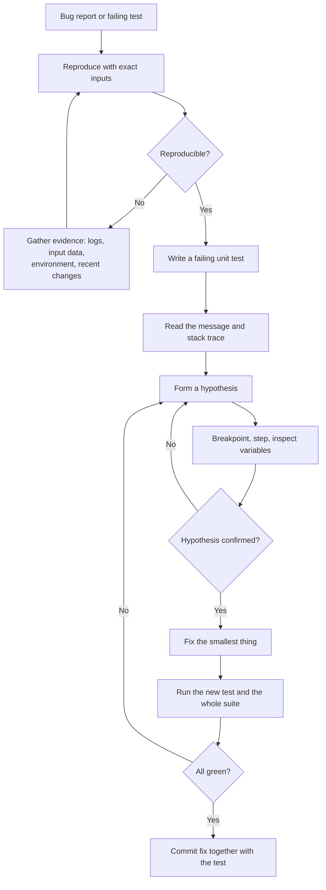
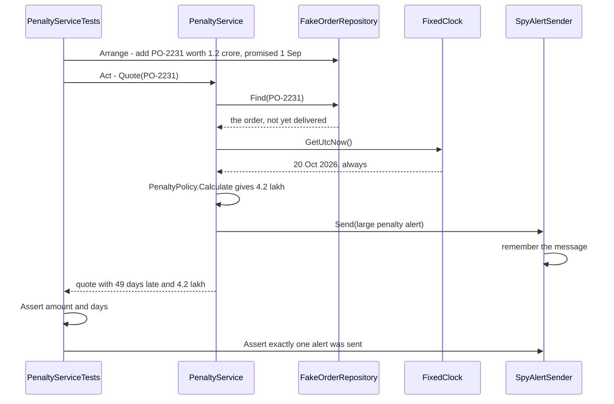

Writing code is half the job. The other half is knowing it works, and finding out quickly when it doesn't. Beginners check their code by running the app and clicking around. Professionals write small programs that check the code for them, in milliseconds, every time anything changes: **unit tests**. And when something breaks, they don't sprinkle `Console.WriteLine` everywhere and guess; they pause the program and look inside it with a **debugger**. This lesson teaches both skills with one running example: calculating late-delivery penalties on purchase orders for a construction project.

## Learning objectives

By the end of this lesson you will be able to:

1. Explain what a unit test is, why teams write them, and where unit tests sit among integration and end-to-end tests.
2. Write xUnit tests with `[Fact]` and `[Theory]`, structured as arrange, act, assert.
3. Choose test cases with boundary values and equivalence classes instead of random examples.
4. Replace databases, clocks and message senders with test doubles (stubs, fakes, spies, mocks) written by hand.
5. Design code so that it is easy to test, by injecting dependencies such as `TimeProvider`.
6. Debug systematically: reproduce, read the stack trace, set breakpoints, step through code, inspect variables, and use conditional breakpoints.
7. Refactor duplicated code safely by pinning its current behaviour with characterisation tests first.

## Prerequisites

- [Variables, types, conditions, loops and functions in C#](#/lesson/m01-csharp-basics) and [Exceptions and error handling](#/lesson/m01-exceptions).
- [Interfaces and abstract classes](#/lesson/m01-interfaces-abstract): test doubles are classes that implement an interface.

## Explain it like I'm a beginner

### The concrete cube test

On every construction site, when concrete is poured, the engineers fill a few small steel moulds with the same concrete. Those **cubes** are cured and crushed in a testing machine after 7 and 28 days, to check that the concrete reached its required strength. Nobody waits for the finished building to fall down to find out the concrete was weak.

A **unit test** is the cube test for code:

| Construction site | Software | Technical term |
|---|---|---|
| A small sample cube instead of the whole building | test one method or class, not the whole app | unit test |
| A required strength written in the specification | an expected result written in the test | assertion |
| The same test procedure for every batch | tests run automatically on every change | regression testing |
| A dummy load instead of a real truck | a fake database or a fixed clock instead of the real ones | test double |

Because each cube test is small and quick, you can run many of them. A typical project has hundreds or thousands of unit tests that all run in a few seconds.

### The detective

**Debugging** is detective work. A bug report is a crime scene: "the penalty for order PO-2231 shows ₹0 but the supplier was 10 days late". A bad detective guesses the culprit and arrests someone. A good detective collects evidence: they reproduce the problem, read the clues (the error message and stack trace), form a hypothesis, and test it.

The **debugger** is the detective's magnifying glass and pause button. You tell it "stop the program at this line" (a **breakpoint**), and when it stops you can look at every variable, step forward one line at a time, and watch the bug happen in slow motion.

## First-principles explanation

### What makes a test a unit test

A unit test:

- Calls **one unit of behaviour** (usually a method or a small group of classes) with specific inputs.
- **Checks** the result automatically, without a human looking at output.
- Runs **fast** (milliseconds) and **in isolation**: no real database, no network, no real clock, no files, and no dependency on other tests.

A helpful checklist is **FIRST**: Fast, Isolated, Repeatable (same result every run, on every machine), Self-validating (pass or fail, no reading logs), and Timely (written alongside the code, not months later).

### Why bother

- **Fast feedback.** You find a mistake seconds after making it, while the code is still fresh in your head.
- **Safety for change.** When you change code next year, the tests tell you within seconds whether you broke something that used to work (a **regression**). This is the biggest benefit, and the reason teams with good tests change code confidently.
- **Living documentation.** A test named `No_penalty_within_two_day_grace_period` explains a business rule better than most documents, and it can't go out of date without failing.
- **Better design.** Code that is hard to test is usually code that does too much or depends on too many things directly. Tests push you towards small, focused classes.

### The test pyramid

Not every test is a unit test:

| Level | Checks | Speed | Typical share (rule of thumb) |
|---|---|---|---|
| **Unit** | one class or method, with fakes for its dependencies | milliseconds | most tests |
| **Integration** | several real parts together: your code plus a real PostgreSQL in a container, or the full ASP.NET Core pipeline in memory | tenths of a second to seconds | fewer |
| **End-to-end** | the whole system through its UI or public API | seconds to minutes | a handful of critical journeys |

The higher the level, the more realistic and the slower and more brittle the test. Unit tests catch logic mistakes cheaply; integration tests catch "the pieces don't fit" mistakes (a wrong SQL column name, a missing DI registration). You need both. The exact proportions vary by project; the shape is what matters.

### xUnit in five minutes

**xUnit.net** is the most widely used test framework for .NET (MSTest and NUnit are the main alternatives, and they work similarly). The newest major version is xUnit v3 (package `xunit.v3`); the attributes and asserts in this lesson work the same in v2 and v3. Tests live in a separate **test project** that references the project under test:

```text
dotnet new xunit -n Procurement.Tests
dotnet add Procurement.Tests reference Procurement.Api
dotnet test                                  # build and run every test
dotnet test --filter "FullyQualifiedName~Penalty"   # run only matching tests
```

A test is a public method marked `[Fact]` in a public class:

```csharp
public class PenaltyPolicyTests
{
    [Fact]
    public void No_penalty_when_delivered_on_time()
    {
        var penalty = PenaltyPolicy.Calculate(
            orderValue: 5_00_000m,
            promised: new DateOnly(2026, 10, 1),
            actual: new DateOnly(2026, 10, 1),
            forceMajeure: false);

        Assert.Equal(0m, penalty);
    }
}
```

A `[Theory]` runs one test method with several sets of data, one `[InlineData]` per row:

```csharp
[Theory]
[InlineData(0, 0)]       // on time
[InlineData(2, 0)]       // last day of grace
[InlineData(3, 2500)]    // first day of penalty: 0.5 % of 5,00,000
[InlineData(8, 5000)]    // second week started
public void Penalty_by_days_late(int daysLate, int expected)
{
    var promised = new DateOnly(2026, 10, 1);
    var penalty = PenaltyPolicy.Calculate(5_00_000m, promised, promised.AddDays(daysLate), false);
    Assert.Equal(expected, penalty);
}
```

Things worth knowing:

- **xUnit creates a new instance of the test class for every test.** Fields set in the constructor are fresh each time, so tests can't leak state into each other through fields. Shared expensive setup goes in a fixture (`IClassFixture<T>`). Cleanup goes in `Dispose`.
- **Common asserts**: `Assert.Equal(expected, actual)` (expected first!), `Assert.True`, `Assert.Null`, `Assert.Contains`, `Assert.Empty`, `Assert.Single`, `Assert.Same` (same object), and `Assert.Throws<T>(() => ...)`, which returns the exception so you can inspect it.
- Attribute values must be constants, so `decimal` can't appear in `[InlineData]`. Pass `int`, `double` or `string` and convert, or use `[MemberData]` for complex data.

### Arrange, act, assert

Almost every good test has three parts, often marked with comments:

```csharp
[Fact]
public void Penalty_is_capped_at_ten_percent()
{
    // Arrange: set up the inputs and the world
    var promised = new DateOnly(2026, 1, 1);
    var veryLate = promised.AddDays(400);

    // Act: do exactly one thing
    var penalty = PenaltyPolicy.Calculate(10_00_000m, promised, veryLate, forceMajeure: false);

    // Assert: check the outcome
    Assert.Equal(1_00_000m, penalty);
}
```

Rules that keep tests readable:

- **One behaviour per test.** A test called `Penalty_works` that checks eight things tells you nothing when it fails. Several asserts are fine if they describe *one* outcome (all fields of a result).
- **Name tests after the behaviour**, as a sentence: `Penalty_is_capped_at_ten_percent`, or the `Method_Scenario_ExpectedResult` style: `Calculate_VeryLateDelivery_CapsAtTenPercent`. Pick one style per project.
- **No logic in tests.** No loops, no `if`, no re-implementing the formula to compute the expected value. Write the expected number as a literal you worked out by hand. If the test contains the same formula as the code, it will share the same bug.
- **Test through public behaviour**, not private fields. Tests that depend on internal details break whenever you refactor, even when behaviour is unchanged.

### Choosing good test cases

You can't test every input. Two techniques give you the most bug-catching power for the fewest tests:

- **Equivalence classes**: group inputs that the rule treats the same way, and pick one from each group. For our penalty: on time; within grace (1–2 days late); penalised (3+ days); capped (very late); force majeure.
- **Boundary values**: bugs cluster at edges, where someone wrote `<` instead of `<=`. Test the last value of each group and the first value of the next: 2 days late (no penalty) and 3 days late (penalty); 7 days (one week) and 8 days (two weeks); the exact point where the cap starts.

Don't forget the **unhappy paths**: negative values, empty lists, `null`, and the exceptions your code promises to throw.

### Test doubles: stand-ins for the real thing

Real code talks to databases, clocks, email servers and payment gateways. In a unit test you replace those with **test doubles**, a term from Gerard Meszaros's *xUnit Test Patterns* (like a stunt double in a film):

| Double | What it does | Example |
|---|---|---|
| **Dummy** | Passed in only to fill a parameter; never used | a `null` logger, `NullLogger<T>.Instance` |
| **Stub** | Returns canned answers | a clock that always says "20 October 2026, 09:00 UTC" |
| **Fake** | A working but simplified implementation | an in-memory repository backed by a `Dictionary` |
| **Spy** | Records how it was called, so the test can check afterwards | an SMS sender that stores every message in a list |
| **Mock** | Pre-programmed with expectations and verifies them itself | usually created with a library such as Moq or NSubstitute |

In everyday speech people call all of these "mocks". The distinction that matters: **stubs and fakes provide input** to the code under test, while **spies and mocks check output** that the code sends somewhere.

You don't need a library to make doubles. A hand-written class that implements the interface is often clearer:

```csharp
private sealed class FixedClock(DateTimeOffset now) : TimeProvider
{
    public override DateTimeOffset GetUtcNow() => now;     // a stub: always the same time
}

private sealed class SpyAlertSender : IAlertSender
{
    public List<string> Sent { get; } = new();
    public void Send(string message) => Sent.Add(message);  // a spy: remembers what was sent
}
```

**Don't over-mock.** If a test needs five mocks with precise call-by-call expectations, it's testing *how* the code works rather than *what* it achieves, and it will break on every refactor. Prefer real objects for simple collaborators, fakes for storage, and spies only for side effects you genuinely care about ("an alert was sent").

### Designing code you can test

You can only swap in a double if the code lets you. Compare:

```csharp
// Hard to test: hidden dependencies created inside
public decimal QuoteHard(string orderNo)
{
    var order = new SqlOrderRepository("Host=prod-db...").Find(orderNo);   // real database
    var today = DateOnly.FromDateTime(DateTime.Now);                       // real clock
    ...
}

// Easy to test: dependencies passed in through the constructor
public sealed class PenaltyService(IPurchaseOrderRepository orders, TimeProvider clock, IAlertSender alerts)
```

The second version receives its dependencies (this is **dependency injection**, covered in [its own lesson](#/lesson/m03-dependency-injection)). In production, ASP.NET Core passes the real database repository and `TimeProvider.System`. In tests, you pass fakes. **`TimeProvider`** (built into .NET since version 8) exists precisely so that "today" can be controlled in tests; never call `DateTime.Now` deep inside business logic.

Even better, keep the core rule a **pure function** (`PenaltyPolicy.Calculate`) with no dependencies at all. Pure functions need no doubles: inputs in, answer out.

### Code coverage: useful, not a goal

**Coverage** tools (`dotnet test --collect:"XPlat Code Coverage"`) report which lines your tests executed. Low coverage reliably shows untested areas. High coverage does **not** prove good tests: a test that calls every method but asserts nothing gets 100 % coverage and catches nothing. Use coverage to find gaps, not as a score to chase.

### Test-driven development, briefly

**TDD** flips the order: write a failing test for the next small behaviour (**red**), write the simplest code that passes (**green**), then clean up the code with the test as a safety net (**refactor**). Repeat in cycles of a few minutes. It's a discipline worth trying; it produces naturally testable code. Many good engineers use it for business rules and skip it for exploratory UI work. You don't have to use TDD to write good tests, but you do have to write the tests.

### Debugging, systematically

When a test fails or a user reports a bug:

1. **Reproduce it.** Find exact inputs that trigger it, ideally as a failing unit test. A bug you can't reproduce, you can't confirm you fixed.
2. **Read the evidence.** The exception message and **stack trace** tell you *what* failed and *where*: the top line of the trace is where it was thrown, the lines below are who called whom. Read them slowly; beginners often skip the most useful information on screen.
3. **Form a hypothesis**: "I think `daysLate` is 0 because the dates are swapped."
4. **Test it with the debugger.** Set a breakpoint just before the suspicious line, run the test in debug mode, and look.
5. **Fix it, and keep the test.** The failing test now passes, and it stays in the suite so the bug can never come back silently.

### Debugger tools you'll use daily

These exist in Visual Studio, VS Code with the C# Dev Kit, and JetBrains Rider (keyboard shortcuts differ; these are Visual Studio's defaults):

| Tool | What it does |
|---|---|
| **Breakpoint** (F9) | Pauses execution when that line is about to run. |
| **Continue** (F5) | Runs until the next breakpoint. |
| **Step over** (F10) | Runs the current line, including any method it calls, and stops at the next line. |
| **Step into** (F11) | Goes *inside* the method called on this line. |
| **Step out** (Shift+F11) | Finishes the current method and stops back in the caller. |
| **Locals / Autos / Watch** | Show variable values. In Watch you can type expressions such as `order.Value * 0.005m`. |
| **Call stack** | Shows the chain of method calls that led here. Double-click a frame to inspect that method's variables. |
| **Conditional breakpoint** | Pauses only when an expression is true, e.g. `order.Number == "PO-2231"`, so you don't stop 5,000 times in a loop. |
| **Hit count** | Pauses on the Nth time the line runs. |
| **Tracepoint / logpoint** | Prints a message (with variable values) without pausing and without editing code. |
| **Exception settings** | "Break when thrown": stops at the `throw` itself, before any `catch` hides it. |

Two practical notes. First, debug in a **Debug** build: a Release build is optimised, so some variables show as "optimized away" and lines may seem to execute out of order. Second, for a bug in production, where you can't attach a debugger, the evidence comes from **logs, metrics and traces** ([Logging and observability](#/lesson/m03-logging)); good log messages are debugging tools you write in advance.

Other techniques worth having: explaining the code line by line to a colleague, or to a rubber duck on your desk (**rubber duck debugging**, which works surprisingly often); halving the search space when you don't know where the bug is (comment out half, or use `git bisect` to find the commit that introduced it, see [the Git lesson](#/lesson/m01-git)); and a `Debug.Assert(condition)` to catch impossible states early in debug builds.

## Visual explanation

### The debugging loop



This flowchart is the habit to build. The first loop says: don't start fixing until you can **reproduce** the bug; keep gathering evidence until you can. Turning the reproduction into a **failing test** early pays twice: it gives you a one-click way to re-run the bug under the debugger, and it later proves the fix. The inner loop between "form a hypothesis" and "inspect variables" is where the debugger lives: each pass either confirms your idea or replaces it with a better one. Finally, running the **whole** suite, not just the new test, catches fixes that break something else. Committing the test with the fix means this bug can never silently return.

### A unit test with test doubles



This sequence diagram shows one unit test from start to finish. The test **arranges** the world with three doubles: a **fake** repository holding one order in memory, a **stub** clock frozen at 20 October 2026, and a **spy** that records alerts. Then it **acts** with a single call. The service does its normal job, but every dependency it touches is under the test's control, so the result is the same on every run, on every machine, forever. No database, no waiting for a real date, no SMS sent to a real phone. Finally, the test **asserts** two things: the returned quote (the main output) and the spy's record (the side effect). If the penalty rule changes, this test tells you within milliseconds.

## Step-by-step example

We'll test the penalty rule, find a bug with the debugger, and add a service test with doubles. The rule (illustrative, not taken from any specific contract):

- Delivery up to 2 days after the promised date: no penalty (grace period).
- From the 3rd day: 0.5 % of the order value for every week or part-week of delay, counted from the promised date.
- The penalty is capped at 10 % of the order value.
- Force majeure (floods, strikes, as certified by the engineer) means no penalty.

### Step 1: list the cases before writing code

| Case | Days late | Order ₹ | Expected ₹ |
|---|---|---|---|
| On time | 0 | 5,00,000 | 0 |
| Early (delivered before promised) | −3 | 5,00,000 | 0 |
| Last grace day | 2 | 5,00,000 | 0 |
| First penalised day | 3 | 5,00,000 | 2,500 (1 week) |
| End of week 1 | 7 | 5,00,000 | 2,500 |
| Start of week 2 | 8 | 5,00,000 | 5,000 |
| Exactly at cap | 140 (20 weeks) | 5,00,000 | 50,000 |
| Beyond cap | 400 | 5,00,000 | 50,000 |
| Force majeure | 30 | 5,00,000 | 0 |

Nine cases, chosen from equivalence classes and boundaries. Writing the table first often reveals questions for the business ("is day 7 still week 1?") before any code exists.

### Step 2: a first implementation, and a failing test

Suppose the first version of the weeks calculation was:

```csharp
int weeks = late / 7;      // whole weeks
```

The theory row for 3 days late fails:

```text
Penalty_by_days_late(daysLate: 3, expected: 2500) [FAIL]
  Assert.Equal() Failure
  Expected: 2500
  Actual:   0
```

### Step 3: debug it

Set a breakpoint on the `weeks` line, right-click the failing test and choose **Debug Test**. Execution pauses. The Locals window shows `late = 3`. Press F10 (step over): `weeks = 0`. Hypothesis confirmed: integer division rounds 3 / 7 down to 0, but "part of a week counts as a week". The fix is to round up:

```csharp
int weeks = (late + 6) / 7;     // ceiling division for positive numbers: 3 -> 1, 7 -> 1, 8 -> 2
```

Run all tests: green. Notice *which* row exposed the bug: the boundary case, 3 days late. A mid-range example such as 20 days late also fails (2 weeks instead of 3), but 3 days gives the clearest clue, because the answer drops all the way to zero.

### Step 4: test the service with doubles

`PenaltyService.Quote` loads the order, finds "today" and sends an alert for large penalties on undelivered orders. With hand-written doubles:

```csharp
public class PenaltyServiceTests
{
    private readonly FakeOrderRepository _orders = new();
    private readonly SpyAlertSender _alerts = new();
    private readonly PenaltyService _service;

    public PenaltyServiceTests()
    {
        var clock = new FixedClock(new DateTimeOffset(2026, 10, 20, 9, 0, 0, TimeSpan.Zero));
        _service = new PenaltyService(_orders, clock, _alerts);
    }

    [Fact]
    public void Undelivered_order_accrues_penalty_until_today_and_alerts_when_large()
    {
        _orders.Add(new PurchaseOrder("PO-2231", "Shree Steel", 1_20_00_000m,
            PromisedOn: new DateOnly(2026, 9, 1), DeliveredOn: null, ForceMajeure: false));

        var quote = _service.Quote("PO-2231");

        Assert.NotNull(quote);
        Assert.Equal(49, quote.DaysLate);              // 1 Sep to 20 Oct
        Assert.Equal(4_20_000m, quote.Amount);         // 7 weeks x 0.5 % of 1.2 crore
        Assert.False(quote.IsFinal);
        Assert.Single(_alerts.Sent);
    }
}
```

The constructor runs before *each* test, so every test gets a fresh repository and a fresh spy.

## Production-style C# implementation

The penalty feature as a small ASP.NET Core API, written so that every piece can be tested.

```text
Procurement.Api/
  Program.cs
  Penalties/
    PurchaseOrder.cs                   // data
    PenaltyPolicy.cs                   // the pure rule: easiest to test
    IPurchaseOrderRepository.cs        // storage abstraction
    InMemoryPurchaseOrderRepository.cs // demo storage
    IAlertSender.cs                    // side-effect abstraction
    LogAlertSender.cs                  // production implementation
    PenaltyService.cs                  // orchestration: uses repo, clock, alerts
```

```csharp file=Penalties/PurchaseOrder.cs
namespace Procurement.Api.Penalties;

public sealed record PurchaseOrder(
    string Number,
    string Supplier,
    decimal Value,
    DateOnly PromisedOn,
    DateOnly? DeliveredOn,
    bool ForceMajeure);
```

```csharp file=Penalties/PenaltyPolicy.cs
namespace Procurement.Api.Penalties;

/// <summary>Illustrative late-delivery rule. Pure: no clock, no database, so tests need no doubles.</summary>
public static class PenaltyPolicy
{
    public const int GraceDays = 2;
    public const decimal RatePerWeek = 0.005m;   // 0.5 % per week or part-week
    public const decimal CapRate = 0.10m;        // never more than 10 % of the order value

    public static int DaysLate(DateOnly promised, DateOnly actual) =>
        Math.Max(0, actual.DayNumber - promised.DayNumber);

    public static decimal Calculate(decimal orderValue, DateOnly promised, DateOnly actual, bool forceMajeure)
    {
        ArgumentOutOfRangeException.ThrowIfNegative(orderValue);
        if (forceMajeure) return 0m;

        int late = DaysLate(promised, actual);
        if (late <= GraceDays) return 0m;

        int weeks = (late + 6) / 7;                          // part of a week counts as a week
        decimal rate = Math.Min(weeks * RatePerWeek, CapRate);
        return Math.Round(orderValue * rate, 2, MidpointRounding.AwayFromZero);
    }
}
```

```csharp file=Penalties/IPurchaseOrderRepository.cs
namespace Procurement.Api.Penalties;

public interface IPurchaseOrderRepository
{
    PurchaseOrder? Find(string number);
}
```

```csharp file=Penalties/InMemoryPurchaseOrderRepository.cs
using System.Collections.Concurrent;

namespace Procurement.Api.Penalties;

/// <summary>Demo storage, also usable as a fake in tests. Production would query PostgreSQL.</summary>
public sealed class InMemoryPurchaseOrderRepository : IPurchaseOrderRepository
{
    private readonly ConcurrentDictionary<string, PurchaseOrder> _orders = new(StringComparer.OrdinalIgnoreCase);

    public void Add(PurchaseOrder order)
    {
        if (!_orders.TryAdd(order.Number, order))
            throw new InvalidOperationException($"Order {order.Number} already exists.");
    }

    public PurchaseOrder? Find(string number) => _orders.GetValueOrDefault(number);
}
```

```csharp file=Penalties/IAlertSender.cs
namespace Procurement.Api.Penalties;

public interface IAlertSender
{
    void Send(string message);
}
```

```csharp file=Penalties/LogAlertSender.cs
namespace Procurement.Api.Penalties;

/// <summary>Production stand-in: writes alerts to the log. A real system might send email or Teams messages.</summary>
public sealed class LogAlertSender(ILogger<LogAlertSender> logger) : IAlertSender
{
    public void Send(string message) => logger.LogWarning("PENALTY ALERT: {Message}", message);
}
```

```csharp file=Penalties/PenaltyService.cs
namespace Procurement.Api.Penalties;

public sealed record PenaltyQuote(string OrderNumber, int DaysLate, decimal Amount, bool IsFinal);

/// <summary>Every dependency arrives through the constructor, so tests can pass fakes, stubs and spies.</summary>
public sealed class PenaltyService(IPurchaseOrderRepository orders, TimeProvider clock, IAlertSender alerts)
{
    public const decimal AlertThreshold = 1_00_000m;

    public PenaltyQuote? Quote(string orderNumber)
    {
        ArgumentException.ThrowIfNullOrWhiteSpace(orderNumber);
        if (orders.Find(orderNumber) is not { } order) return null;     // "not found" is expected: no exception

        // UTC date for simplicity. A site in India would convert to IST (UTC+5:30) first.
        var today = DateOnly.FromDateTime(clock.GetUtcNow().UtcDateTime);
        var asOf = order.DeliveredOn ?? today;
        var amount = PenaltyPolicy.Calculate(order.Value, order.PromisedOn, asOf, order.ForceMajeure);
        var isFinal = order.DeliveredOn is not null;

        if (!isFinal && amount >= AlertThreshold)
            alerts.Send($"{order.Number} ({order.Supplier}) has accrued a penalty of {amount:N0} and is still undelivered.");

        return new PenaltyQuote(order.Number, PenaltyPolicy.DaysLate(order.PromisedOn, asOf), amount, isFinal);
    }
}
```

```csharp file=Program.cs
using Procurement.Api.Penalties;

var builder = WebApplication.CreateBuilder(args);

var repository = new InMemoryPurchaseOrderRepository();
repository.Add(new PurchaseOrder("PO-2231", "Shree Steel", 1_20_00_000m, new DateOnly(2026, 9, 1), null, false));
repository.Add(new PurchaseOrder("PO-2232", "Deccan Cement", 8_50_000m, new DateOnly(2026, 9, 10), new DateOnly(2026, 9, 12), false));

builder.Services.AddSingleton<IPurchaseOrderRepository>(repository);
builder.Services.AddSingleton(TimeProvider.System);            // tests pass a fixed clock instead
builder.Services.AddSingleton<IAlertSender, LogAlertSender>();
builder.Services.AddScoped<PenaltyService>();

var app = builder.Build();

app.MapGet("/orders/{number}/penalty", (string number, PenaltyService service) =>
    service.Quote(number) is { } quote ? Results.Ok(quote) : Results.NotFound());

app.Run();
```

What to notice:

- **The rule is a pure static method.** All nine boundary cases from the step-by-step table can be tested with no setup at all.
- **The service only coordinates.** It finds the order, works out "as of" which date, calls the rule and decides whether to alert. Each of those decisions is visible and testable with the doubles from the sequence diagram.
- **`TimeProvider` instead of `DateTime.Now`.** In production it is `TimeProvider.System`; in tests a two-line stub. Without it, a test about "49 days late" would pass today and fail tomorrow.
- **Interfaces at the edges only.** `IPurchaseOrderRepository` and `IAlertSender` exist because they wrap things we can't use in unit tests (a database, a notification channel). `PenaltyPolicy` has no interface: nothing needs to replace it.
- **Limits.** The alert is sent on every `Quote` call, so an often-viewed order would spam the procurement team. A real system would record that an alert was sent. A test that calls `Quote` twice and asserts one alert would have caught that design gap, which is a good reason to think about tests while designing.

## Bad design vs good design

**Bad**: untestable code and tests that are worse than none.

```csharp
public decimal Quote(string orderNo)
{
    var order = new SqlOrderRepository(Config.ConnectionString).Find(orderNo);   // real database
    var days = (DateTime.Now - order.PromisedOn.ToDateTime(TimeOnly.MinValue)).Days;  // real clock
    if (days > 2) EmailClient.Send("procurement@site.example", "Penalty!");       // real email
    return days > 2 ? order.Value * 0.005m * ((days + 6) / 7) : 0;
}

[Fact]
public void Test1()                                   // name says nothing
{
    var result = new QuoteService().Quote("PO-2231");  // needs the production database
    Thread.Sleep(2000);                                 // "wait for the email"
    Assert.True(result > 0);                            // passes for almost any bug
}
```

Problems:

- The code creates its own database connection, reads the real clock and sends real email. A unit test is impossible; this "test" is an accidental end-to-end test against production data.
- The test's result depends on today's date and on what is in the database. It will pass this month and fail next month (a **flaky** test). Flaky tests teach a team to ignore red builds.
- `Thread.Sleep` makes the suite slow and still doesn't guarantee anything.
- `Assert.True(result > 0)` would pass even if the penalty were ten times too large.
- `Test1` gives no hint of what broke.

**Good**: the `PenaltyService` above, with injected `TimeProvider`, repository and alert sender, plus tests like `Undelivered_order_accrues_penalty_until_today_and_alerts_when_large` that assert exact values with a fixed clock.

**Is the improvement always worth it?** For a script you run once, no tests may be fine. For business rules that involve money, deadlines or compliance, tests are cheap insurance. Don't, however, add an interface for every class "for testability": wrap only what is slow, non-deterministic or has side effects (database, clock, network, file system, random numbers).

:::callout type=mistake title="A test that never fails is not a test"
After writing a test, briefly break the code (change `<=` to `<`) and check that the test goes red. If it stays green, it is not testing what you think. This quick habit is a manual version of **mutation testing**, which tools such as Stryker.NET automate.
:::

## Practical playground

The playground can't run xUnit, so this program contains a ten-line "test runner" of its own. One function has a bug. Run it, see which test fails, and find the bug. Use the debugger if you have the project open locally; here, use the trace lines.

:::playground type=csharp title="Find the bug with tests"
```csharp file=Program.cs
using System;
using System.Collections.Generic;

public static class PenaltyPolicy
{
    public static decimal Calculate(decimal orderValue, DateOnly promised, DateOnly actual, bool forceMajeure)
    {
        if (forceMajeure) return 0m;
        int late = Math.Max(0, actual.DayNumber - promised.DayNumber);
        if (late <= 2) return 0m;
        int weeks = (late + 6) / 7;
        decimal rate = Math.Min(weeks * 0.005m, 0.10m);
        return Math.Round(orderValue * rate, 2, MidpointRounding.AwayFromZero);
    }
}

public static class LeaveCalculator
{
    // Counts Monday-to-Friday days from 'from' to 'to', both inclusive. There is a bug in here.
    public static int WorkingDays(DateOnly from, DateOnly to)
    {
        int days = 0;
        for (var d = from; d < to; d = d.AddDays(1))
        {
            // Console.WriteLine($"  trace: {d} {d.DayOfWeek} days={days}");   // uncomment to trace
            if (d.DayOfWeek is DayOfWeek.Saturday or DayOfWeek.Sunday) continue;
            days++;
        }
        return days;
    }
}

public static class Program
{
    static int s_passed, s_failed;

    static void Check(string name, object expected, object actual)
    {
        bool ok = Equals(expected, actual);
        if (ok) s_passed++; else s_failed++;
        Console.WriteLine($"{(ok ? "PASS" : "FAIL")}  {name}{(ok ? "" : $"  expected {expected}, got {actual}")}");
    }

    public static void Main()
    {
        var promised = new DateOnly(2026, 10, 1);

        // Arrange-act-assert, compressed into one line each
        Check("on time", 0m, PenaltyPolicy.Calculate(500000m, promised, promised, false));
        Check("last grace day", 0m, PenaltyPolicy.Calculate(500000m, promised, promised.AddDays(2), false));
        Check("first penalised day", 2500m, PenaltyPolicy.Calculate(500000m, promised, promised.AddDays(3), false));
        Check("start of week two", 5000m, PenaltyPolicy.Calculate(500000m, promised, promised.AddDays(8), false));
        Check("capped", 50000m, PenaltyPolicy.Calculate(500000m, promised, promised.AddDays(400), false));
        Check("force majeure", 0m, PenaltyPolicy.Calculate(500000m, promised, promised.AddDays(30), true));

        // 19 Oct 2026 is a Monday, 23 Oct a Friday
        Check("Mon to Fri", 5, LeaveCalculator.WorkingDays(new DateOnly(2026, 10, 19), new DateOnly(2026, 10, 23)));
        Check("single Monday", 1, LeaveCalculator.WorkingDays(new DateOnly(2026, 10, 19), new DateOnly(2026, 10, 19)));
        Check("Sat to Sun", 0, LeaveCalculator.WorkingDays(new DateOnly(2026, 10, 24), new DateOnly(2026, 10, 25)));

        Console.WriteLine($"\n{s_passed} passed, {s_failed} failed");

        // Experiments:
        // 1. Which tests fail? What do they have in common? Form a hypothesis before reading the loop.
        // 2. Uncomment the trace line and run "Mon to Fri" only. Which date never appears?
        // 3. Fix the bug. Then break PenaltyPolicy on purpose (change <= 2 to < 2). Which test catches it?
        // 4. Why does "Sat to Sun" pass even with the bug? What does that tell you about choosing test cases?
    }
}
```
:::

## Exercises

:::exercise id=m01-testing-debugging-ex1 difficulty=beginner kind=code title="Write unit tests for a delivery charge rule"
A grocery app's delivery charge is already implemented. Your job is the tests. Fill in the test methods in `DeliveryChargeTests.cs` so that they would catch any change to the rules.

The rules:
- Distance must be 1 to 20 km and the order value must be positive, otherwise `ArgumentOutOfRangeException`.
- Orders of ₹999 or more get free delivery.
- Otherwise: ₹40 for the first 5 km, plus ₹8 for each km beyond 5.
- Prime members pay half the fee.
::requirements
- Replace every `throw new NotImplementedException(...)` in `DeliveryChargeTests.cs` with a real arrange-act-assert test.
- Use exact expected values worked out by hand, not formulas.
- Cover each boundary: ₹998.99 vs ₹999, 5 km vs 6 km, 20 km vs 21 km, 0 km.
- Don't change `DeliveryCharge.cs`.
::acceptance
- All tests pass against the given implementation.
- If you change `>=` to `>` in the free-delivery check in `DeliveryCharge.cs`, at least one of your tests fails. The same for changing `BaseKm` from 5 to 4, and for removing the Prime discount.
- Every test name describes the behaviour it checks.
::hint
Start with the table: list each rule, then for each rule the input just inside and just outside its boundary. Each row becomes one test or one `[InlineData]` row.
::hint
Work out the numbers by hand. 6 km for a non-Prime ₹500 order: 40 + 1 × 8 = ₹48. With Prime: ₹24.
::hint
Exceptions: `Assert.Throws<ArgumentOutOfRangeException>(() => DeliveryCharge.For(500m, 21, false));`. Use a `[Theory]` with `[InlineData(0)]` and `[InlineData(21)]` for both distance boundaries.
::hint
```csharp
[Fact]
public void Free_delivery_at_exactly_999()
{
    // Arrange: nothing to set up, the method is static
    // Act
    var fee = DeliveryCharge.For(999m, 12, isPrime: false);
    // Assert
    Assert.Equal(0m, fee);
}
```
::starter
```csharp file=DeliveryCharge.cs
using System;

/// <summary>The code under test. It is correct: do not change it.</summary>
public static class DeliveryCharge
{
    public const decimal FreeDeliveryFrom = 999m;
    public const decimal BaseFee = 40m;
    public const int BaseKm = 5;
    public const decimal PerExtraKm = 8m;
    public const int MaxKm = 20;

    public static decimal For(decimal orderValue, int distanceKm, bool isPrime)
    {
        ArgumentOutOfRangeException.ThrowIfNegativeOrZero(orderValue);
        ArgumentOutOfRangeException.ThrowIfLessThan(distanceKm, 1);
        ArgumentOutOfRangeException.ThrowIfGreaterThan(distanceKm, MaxKm);

        if (orderValue >= FreeDeliveryFrom) return 0m;

        decimal fee = BaseFee + Math.Max(0, distanceKm - BaseKm) * PerExtraKm;
        return isPrime ? fee / 2 : fee;
    }
}
```
```csharp file=DeliveryChargeTests.cs
using System;
using Xunit;

public class DeliveryChargeTests
{
    [Fact] public void Short_distance_pays_base_fee() => throw new NotImplementedException("Write this test");
    [Fact] public void Exactly_five_km_pays_base_fee() => throw new NotImplementedException("Write this test");
    [Fact] public void Each_km_beyond_five_costs_eight() => throw new NotImplementedException("Write this test");
    [Fact] public void Free_delivery_at_exactly_999() => throw new NotImplementedException("Write this test");
    [Fact] public void Just_below_999_pays() => throw new NotImplementedException("Write this test");
    [Fact] public void Prime_pays_half() => throw new NotImplementedException("Write this test");
    [Fact] public void Twenty_km_is_allowed() => throw new NotImplementedException("Write this test");
    [Fact] public void Distance_outside_range_throws() => throw new NotImplementedException("Write this test");
    [Fact] public void Non_positive_order_value_throws() => throw new NotImplementedException("Write this test");
}
```
::tests
```csharp file=DeliveryChargeExampleTests.cs
using Xunit;

/// <summary>A worked example to copy the style from.</summary>
public class DeliveryChargeExampleTests
{
    [Fact]
    public void Example_free_delivery_for_large_order()
    {
        // Arrange
        decimal orderValue = 1500m;

        // Act
        decimal fee = DeliveryCharge.For(orderValue, distanceKm: 18, isPrime: false);

        // Assert
        Assert.Equal(0m, fee);
    }
}
```
::solution
Each test checks one rule at one boundary, with a hand-calculated expected value.

```csharp file=DeliveryChargeTests.cs
using System;
using Xunit;

public class DeliveryChargeTests
{
    [Fact]
    public void Short_distance_pays_base_fee() => Assert.Equal(40m, DeliveryCharge.For(500m, 3, isPrime: false));

    [Fact]
    public void Exactly_five_km_pays_base_fee() => Assert.Equal(40m, DeliveryCharge.For(500m, 5, isPrime: false));

    [Fact]
    public void Each_km_beyond_five_costs_eight()
    {
        Assert.Equal(48m, DeliveryCharge.For(500m, 6, isPrime: false));    // 40 + 1 x 8
        Assert.Equal(160m, DeliveryCharge.For(500m, 20, isPrime: false));  // 40 + 15 x 8
    }

    [Fact]
    public void Free_delivery_at_exactly_999() => Assert.Equal(0m, DeliveryCharge.For(999m, 12, isPrime: false));

    [Fact]
    public void Just_below_999_pays() => Assert.Equal(96m, DeliveryCharge.For(998.99m, 12, isPrime: false));  // 40 + 7 x 8

    [Fact]
    public void Prime_pays_half()
    {
        Assert.Equal(20m, DeliveryCharge.For(500m, 3, isPrime: true));
        Assert.Equal(24m, DeliveryCharge.For(500m, 6, isPrime: true));
    }

    [Fact]
    public void Twenty_km_is_allowed() => Assert.Equal(0m, DeliveryCharge.For(2000m, 20, isPrime: false));

    [Fact]
    public void Distance_outside_range_throws()
    {
        Assert.Throws<ArgumentOutOfRangeException>(() => DeliveryCharge.For(500m, 0, isPrime: false));
        Assert.Throws<ArgumentOutOfRangeException>(() => DeliveryCharge.For(500m, 21, isPrime: false));
    }

    [Fact]
    public void Non_positive_order_value_throws()
    {
        Assert.Throws<ArgumentOutOfRangeException>(() => DeliveryCharge.For(0m, 5, isPrime: false));
        Assert.Throws<ArgumentOutOfRangeException>(() => DeliveryCharge.For(-10m, 5, isPrime: false));
    }
}
```

Check your tests the way the acceptance criteria say: break the code on purpose. Changing `>=` to `>` in the free-delivery check turns `Free_delivery_at_exactly_999` red. Changing `BaseKm` to 4 turns `Each_km_beyond_five_costs_eight` red. Removing the Prime branch turns `Prime_pays_half` red. Each test guards one rule.
::alternatives
Most of these could be one `[Theory]` with rows like `[InlineData(500, 6, false, 48)]`, converting to `decimal` inside the test. Theories are compact for tables of cases; separate `[Fact]`s give a clearer name per rule when one fails. Both are good; mix them.
::mistakes
- Writing `Assert.Equal(DeliveryCharge.BaseFee + (6 - 5) * DeliveryCharge.PerExtraKm, fee)`: the test repeats the formula and can't catch a formula bug.
- Testing only "typical" values like 10 km and ₹500, which pass even if every boundary is wrong.
- Swapping expected and actual in `Assert.Equal`, which makes failure messages misleading.
::extensions
Add a rule: between 10 pm and 6 am, the fee is doubled. How would you test it without staying up late? (Pass a `TimeProvider` or the time itself.)
:::

:::exercise id=m01-testing-debugging-ex2 difficulty=beginner kind=code title="Debug the leave calculator"
HR reports that leave requests show the wrong number of working days. The tests below reproduce the bug reports; several of them fail. Use the debugger (or trace output) to find **every** bug in `LeaveCalculator.WorkingDaysBetween` and fix it.

Rules: count days from `from` to `to`, **both inclusive**; Saturdays and Sundays are not working days; dates in `holidays` are not working days (a holiday may be listed twice, and may fall on a weekend); `to` before `from` throws `ArgumentException`.
::requirements
- Fix the method so that every test passes.
- Before each fix, write down your hypothesis and what the debugger showed you.
- Don't change the tests.
::acceptance
- All tests pass.
- You can name each bug in one sentence, and say which test exposed it.
- The method still throws `ArgumentException` when `to` is before `from`.
::hint
Run the failing tests one at a time. "Mon to Fri should be 5" is the simplest. Put a breakpoint inside the loop and watch `d`. Which date never shows up?
::hint
Read the weekend condition aloud: "if the day is Saturday **and** the day is Sunday". Can a day be both?
::hint
For "a holiday on Sunday should not reduce the count", step through the holiday loop. The holiday is subtracted even though the loop never counted that Sunday in the first place.
::hint
A cleaner design avoids the second loop: build a `HashSet<DateOnly>` of holidays (which also removes duplicates), and inside the single day loop `continue` when the day is a weekend **or** in the set.
::starter
```csharp file=LeaveCalculator.cs
using System;
using System.Collections.Generic;

public static class LeaveCalculator
{
    public static int WorkingDaysBetween(DateOnly from, DateOnly to, IReadOnlyCollection<DateOnly> holidays)
    {
        if (to < from) throw new ArgumentException("'to' must not be before 'from'.", nameof(to));

        int days = 0;
        for (var d = from; d < to; d = d.AddDays(1))
        {
            if (d.DayOfWeek == DayOfWeek.Saturday && d.DayOfWeek == DayOfWeek.Sunday) continue;
            days++;
        }

        foreach (var h in holidays)
        {
            if (h >= from && h <= to) days--;
        }
        return days;
    }
}
```
::tests
```csharp file=LeaveCalculatorTests.cs
using System;
using Xunit;

public class LeaveCalculatorTests
{
    // 19 Oct 2026 is a Monday.
    private static readonly DateOnly Mon = new DateOnly(2026, 10, 19);
    private static readonly DateOnly Wed = new DateOnly(2026, 10, 21);
    private static readonly DateOnly Fri = new DateOnly(2026, 10, 23);
    private static readonly DateOnly Sat = new DateOnly(2026, 10, 24);
    private static readonly DateOnly Sun = new DateOnly(2026, 10, 25);
    private static readonly DateOnly NextMon = new DateOnly(2026, 10, 26);
    private static readonly DateOnly[] None = Array.Empty<DateOnly>();

    [Fact] public void Mon_to_Fri_is_five() => Assert.Equal(5, LeaveCalculator.WorkingDaysBetween(Mon, Fri, None));
    [Fact] public void Single_Monday_is_one() => Assert.Equal(1, LeaveCalculator.WorkingDaysBetween(Mon, Mon, None));
    [Fact] public void Fri_to_next_Mon_is_two() => Assert.Equal(2, LeaveCalculator.WorkingDaysBetween(Fri, NextMon, None));
    [Fact] public void Weekend_only_is_zero() => Assert.Equal(0, LeaveCalculator.WorkingDaysBetween(Sat, Sun, None));

    [Fact]
    public void Weekday_holiday_is_excluded() =>
        Assert.Equal(4, LeaveCalculator.WorkingDaysBetween(Mon, Fri, new[] { Wed }));

    [Fact]
    public void Weekend_holiday_does_not_reduce_count() =>
        Assert.Equal(6, LeaveCalculator.WorkingDaysBetween(Mon, NextMon, new[] { Sun }));

    [Fact]
    public void Duplicate_holiday_counts_once() =>
        Assert.Equal(4, LeaveCalculator.WorkingDaysBetween(Mon, Fri, new[] { Wed, Wed }));

    [Fact]
    public void Three_weeks() =>
        Assert.Equal(15, LeaveCalculator.WorkingDaysBetween(Mon, new DateOnly(2026, 11, 8), None));

    [Fact]
    public void Reversed_range_throws() =>
        Assert.Throws<ArgumentException>(() => LeaveCalculator.WorkingDaysBetween(Fri, Mon, None));
}
```
::solution
There are three bugs:

1. **Off-by-one**: `d < to` never visits the last day, so the inclusive range loses a day. Exposed by `Mon_to_Fri_is_five` (gives 4) and `Single_Monday_is_one` (gives 0).
2. **Impossible condition**: `Saturday && Sunday` is never true, so weekends are counted. Exposed by `Fri_to_next_Mon_is_two` and `Three_weeks`. `Weekend_only_is_zero` gives 1: bug 1 skips Sunday and bug 2 counts Saturday. Two bugs, one confusing symptom, which is why you fix one at a time and re-run.
3. **Holidays subtracted blindly**: a second loop subtracts every holiday in range, including weekend holidays that were never counted and duplicates. Exposed by `Duplicate_holiday_counts_once`. `Weekend_holiday_does_not_reduce_count` actually *passes* on the original code, purely by accident: bug 1 drops the last Monday (−1), bug 2 counts Saturday and Sunday (+2), bug 3 subtracts the Sunday holiday (−1), and the total happens to be right. It only fails after you fix bugs 1 and 2. Passing tests on buggy code is a reminder to run the whole suite after every fix.

```csharp file=LeaveCalculator.cs
using System;
using System.Collections.Generic;

public static class LeaveCalculator
{
    public static int WorkingDaysBetween(DateOnly from, DateOnly to, IReadOnlyCollection<DateOnly> holidays)
    {
        if (to < from) throw new ArgumentException("'to' must not be before 'from'.", nameof(to));

        var holidaySet = new HashSet<DateOnly>(holidays);     // duplicates disappear, lookup is O(1)
        int days = 0;
        for (var d = from; d <= to; d = d.AddDays(1))          // <= : both ends inclusive
        {
            if (d.DayOfWeek is DayOfWeek.Saturday or DayOfWeek.Sunday) continue;
            if (holidaySet.Contains(d)) continue;              // only exclude days we would have counted
            days++;
        }
        return days;
    }
}
```

The fix also simplifies the design: one loop that decides, for each day, "is this a working day?". Two loops that count and then un-count are easy to get out of step.
::alternatives
For very long ranges (years), compute whole weeks arithmetically (`weeks * 5`) and loop only over the remaining days, then subtract weekday holidays in range. It is faster but harder to get right; the simple loop handles a year (365 iterations) instantly.
::mistakes
- Fixing only the first failing test and stopping. Run the whole suite after each fix: here three separate bugs were hiding behind each other.
- "Fixing" the off-by-one by adding `+ 1` to the result, which breaks the weekend and holiday logic for ranges that end on a weekend.
- Changing a test to match the buggy output.
::extensions
Add support for "second and fourth Saturdays are holidays", common in Indian government offices. Write the tests first.
:::

:::exercise id=m01-testing-debugging-ex3 difficulty=intermediate kind=code title="A reminder service tested with fakes, stubs and spies"
An insurance broker sends SMS reminders for vehicle policies expiring soon. Implement `RenewalReminderService` so that the given tests pass. The tests use a **fake** repository, a **stub** clock and a **spy** SMS sender, all written by hand.
::requirements
- "Today" is the UTC date from the injected `TimeProvider`.
- Ask the repository for policies expiring from today to today + 7 days, inclusive.
- Skip a policy (count it as `Skipped`) if it was already reminded today, or if its phone is not a valid Indian mobile number: exactly 10 digits, first digit 6–9.
- Otherwise send: `Dear {HolderName}, your policy {Number} expires on {ExpiresOn:dd MMM yyyy}. Renew to stay covered.` (format the date with the invariant culture), then call `MarkReminded(number, today)`.
- If sending throws `SmsFailedException`, count it as `Failed`, do **not** mark it reminded, and carry on with the next policy. Other exceptions propagate.
- Return a `ReminderSummary(Sent, Skipped, Failed)`.
::acceptance
- With the clock at 20 Oct 2026, the repository is asked for 20 Oct to 27 Oct.
- A valid policy gets exactly one SMS containing its number and "27 Oct 2026", and is marked reminded on 20 Oct.
- A policy already reminded today and one with phone "12345" are skipped.
- When the SMS for one policy fails, the next policy is still sent, and the failed one is not marked.
::hint
Start by storing the three dependencies in fields. The constructor does nothing else.
::hint
`var today = DateOnly.FromDateTime(_clock.GetUtcNow().UtcDateTime);` then `today.AddDays(DaysAhead)`.
::hint
Write a small private `IsValidMobile(string phone)` helper: length 10, all characters `'0'` to `'9'`, first character `'6'` to `'9'`.
::hint
Put the `try`/`catch (SmsFailedException)` around the `Send` call only, inside the loop, so one failure doesn't stop the loop and the `MarkReminded` call happens only after a successful send:
```csharp
try
{
    _sms.Send(p.Phone, message);
}
catch (SmsFailedException)
{
    failed++;
    continue;
}
_policies.MarkReminded(p.Number, today);
sent++;
```
::starter
```csharp file=RenewalReminderService.cs
using System;
using System.Collections.Generic;
using System.Globalization;

public sealed record Policy(string Number, string HolderName, string Phone, DateOnly ExpiresOn, DateOnly? LastRemindedOn);

public interface IPolicyRepository
{
    IReadOnlyList<Policy> ExpiringBetween(DateOnly from, DateOnly to);
    void MarkReminded(string policyNumber, DateOnly on);
}

public interface ISmsSender
{
    void Send(string phone, string message);
}

public sealed class SmsFailedException(string message) : Exception(message);

public sealed record ReminderSummary(int Sent, int Skipped, int Failed);

public sealed class RenewalReminderService
{
    public const int DaysAhead = 7;

    public RenewalReminderService(IPolicyRepository policies, ISmsSender sms, TimeProvider clock) =>
        throw new NotImplementedException();

    public ReminderSummary SendDueReminders() => throw new NotImplementedException();
}
```
::tests
```csharp file=RenewalReminderServiceTests.cs
using System;
using System.Collections.Generic;
using System.Linq;
using Xunit;

public class RenewalReminderServiceTests
{
    // ---- Hand-written test doubles ----
    private sealed class FixedClock(DateTimeOffset now) : TimeProvider            // stub
    {
        public override DateTimeOffset GetUtcNow() => now;
    }

    private sealed class FakePolicyRepository : IPolicyRepository                 // fake + records calls
    {
        public List<Policy> Policies { get; } = new();
        public List<(string Number, DateOnly On)> Marked { get; } = new();
        public DateOnly? AskedFrom { get; private set; }
        public DateOnly? AskedTo { get; private set; }

        public IReadOnlyList<Policy> ExpiringBetween(DateOnly from, DateOnly to)
        {
            AskedFrom = from;
            AskedTo = to;
            return Policies.Where(p => p.ExpiresOn >= from && p.ExpiresOn <= to).ToList();
        }

        public void MarkReminded(string policyNumber, DateOnly on) => Marked.Add((policyNumber, on));
    }

    private sealed class SpySmsSender : ISmsSender                                 // spy
    {
        public List<(string Phone, string Message)> Sent { get; } = new();
        public string? FailFor { get; init; }

        public void Send(string phone, string message)
        {
            if (phone == FailFor) throw new SmsFailedException("Gateway rejected the number");
            Sent.Add((phone, message));
        }
    }

    // ---- Shared arrange ----
    private static readonly DateOnly Today = new DateOnly(2026, 10, 20);
    private readonly FakePolicyRepository _repo = new();

    private RenewalReminderService Service(SpySmsSender sms) =>
        new RenewalReminderService(_repo, sms, new FixedClock(new DateTimeOffset(2026, 10, 20, 3, 30, 0, TimeSpan.Zero)));

    [Fact]
    public void Asks_for_the_next_seven_days()
    {
        Service(new SpySmsSender()).SendDueReminders();
        Assert.Equal(Today, _repo.AskedFrom);
        Assert.Equal(new DateOnly(2026, 10, 27), _repo.AskedTo);
    }

    [Fact]
    public void Sends_one_reminder_and_marks_it()
    {
        _repo.Policies.Add(new Policy("MH12-POL-8812", "Asha Patil", "9876543210", new DateOnly(2026, 10, 27), null));
        var sms = new SpySmsSender();

        var summary = Service(sms).SendDueReminders();

        Assert.Equal(new ReminderSummary(1, 0, 0), summary);
        var (phone, message) = Assert.Single(sms.Sent);
        Assert.Equal("9876543210", phone);
        Assert.Contains("MH12-POL-8812", message);
        Assert.Contains("27 Oct 2026", message);
        Assert.Contains("Asha Patil", message);
        Assert.Equal(("MH12-POL-8812", Today), Assert.Single(_repo.Marked));
    }

    [Fact]
    public void Skips_already_reminded_and_invalid_phones()
    {
        _repo.Policies.Add(new Policy("P1", "Ravi", "9876543210", Today.AddDays(2), LastRemindedOn: Today));
        _repo.Policies.Add(new Policy("P2", "Meera", "12345", Today.AddDays(3), null));
        _repo.Policies.Add(new Policy("P3", "Kabir", "5876543210", Today.AddDays(3), null));   // starts with 5
        _repo.Policies.Add(new Policy("P4", "Imran", "9876543211", Today.AddDays(4), LastRemindedOn: Today.AddDays(-1)));
        var sms = new SpySmsSender();

        var summary = Service(sms).SendDueReminders();

        Assert.Equal(new ReminderSummary(1, 3, 0), summary);
        Assert.Equal("9876543211", Assert.Single(sms.Sent).Phone);
    }

    [Fact]
    public void One_failure_does_not_stop_the_others()
    {
        _repo.Policies.Add(new Policy("P1", "Ravi", "9000000001", Today.AddDays(1), null));
        _repo.Policies.Add(new Policy("P2", "Meera", "9000000002", Today.AddDays(1), null));
        var sms = new SpySmsSender { FailFor = "9000000001" };

        var summary = Service(sms).SendDueReminders();

        Assert.Equal(new ReminderSummary(1, 0, 1), summary);
        Assert.Equal("P2", Assert.Single(_repo.Marked).Number);
    }

    [Fact]
    public void Nothing_due_sends_nothing()
    {
        _repo.Policies.Add(new Policy("P9", "Late", "9876543210", Today.AddDays(30), null));
        var sms = new SpySmsSender();
        Assert.Equal(new ReminderSummary(0, 0, 0), Service(sms).SendDueReminders());
        Assert.Empty(sms.Sent);
    }
}
```
::solution
```csharp file=RenewalReminderService.cs
using System;
using System.Collections.Generic;
using System.Globalization;

public sealed record Policy(string Number, string HolderName, string Phone, DateOnly ExpiresOn, DateOnly? LastRemindedOn);

public interface IPolicyRepository
{
    IReadOnlyList<Policy> ExpiringBetween(DateOnly from, DateOnly to);
    void MarkReminded(string policyNumber, DateOnly on);
}

public interface ISmsSender
{
    void Send(string phone, string message);
}

public sealed class SmsFailedException(string message) : Exception(message);

public sealed record ReminderSummary(int Sent, int Skipped, int Failed);

public sealed class RenewalReminderService
{
    public const int DaysAhead = 7;

    private readonly IPolicyRepository _policies;
    private readonly ISmsSender _sms;
    private readonly TimeProvider _clock;

    public RenewalReminderService(IPolicyRepository policies, ISmsSender sms, TimeProvider clock)
    {
        _policies = policies ?? throw new ArgumentNullException(nameof(policies));
        _sms = sms ?? throw new ArgumentNullException(nameof(sms));
        _clock = clock ?? throw new ArgumentNullException(nameof(clock));
    }

    public ReminderSummary SendDueReminders()
    {
        var today = DateOnly.FromDateTime(_clock.GetUtcNow().UtcDateTime);
        int sent = 0, skipped = 0, failed = 0;

        foreach (var p in _policies.ExpiringBetween(today, today.AddDays(DaysAhead)))
        {
            if (p.LastRemindedOn == today || !IsValidMobile(p.Phone))
            {
                skipped++;
                continue;
            }

            string message = string.Create(CultureInfo.InvariantCulture,
                $"Dear {p.HolderName}, your policy {p.Number} expires on {p.ExpiresOn:dd MMM yyyy}. Renew to stay covered.");

            try
            {
                _sms.Send(p.Phone, message);
            }
            catch (SmsFailedException)
            {
                failed++;              // not marked, so tomorrow's run will try again
                continue;
            }

            _policies.MarkReminded(p.Number, today);
            sent++;
        }

        return new ReminderSummary(sent, skipped, failed);
    }

    private static bool IsValidMobile(string phone)
    {
        if (phone is null || phone.Length != 10 || phone[0] is < '6' or > '9') return false;
        foreach (char c in phone)
            if (c is < '0' or > '9') return false;
        return true;
    }
}
```

The service has no idea whether it talks to PostgreSQL and a real SMS gateway, or to the doubles in the test. That is what makes these tests fast and exact. Note the time in the test clock: 03:30 UTC is 09:00 IST, chosen so the UTC date and the Indian date agree. A real system should decide the time zone on purpose, because at 20:00 UTC it is already the next day in India.
::alternatives
With a mocking library such as NSubstitute or Moq, the doubles would be generated (`Substitute.For<ISmsSender>()`) and you would verify calls with `sms.Received(1).Send(...)`. That saves typing for large interfaces. Hand-written doubles are easier to read for beginners, need no package, and push you to keep interfaces small. The `Microsoft.Extensions.TimeProvider.Testing` package provides a ready-made `FakeTimeProvider` that can also advance time.
::mistakes
- Calling `DateTime.UtcNow` directly, which makes the tests depend on the real date.
- Catching `Exception` around the send, so a bug (e.g. a `NullReferenceException`) is counted as an SMS failure.
- Marking the policy reminded *before* sending, so a failed SMS is never retried.
- Formatting the date with the current culture, giving "27-Oct-2026" or a non-English month name on some servers.
::extensions
Add a test and code for "don't send between 9 pm and 8 am IST": convert the UTC time with `TimeZoneInfo.FindSystemTimeZoneById("Asia/Kolkata")` and return early.
:::

:::exercise id=m01-testing-debugging-ex4 difficulty=intermediate kind=written title="Design the test cases for a toll rule"
A highway toll plaza applies this (illustrative) rule for cars:

- Single journey: ₹120.
- Return journey within 24 hours of the first crossing: ₹180 total, so the return costs ₹60.
- Vehicles registered within 20 km of the plaza with a local pass: ₹0.
- A FASTag with insufficient balance: double toll, paid in cash.
- Emergency vehicles: ₹0.

Design the unit test cases for a method `TollFor(Crossing crossing, Crossing? previous)` **before** any code exists. Present them as a table: case name, inputs, expected result, and why the case matters.
::acceptance
- At least 10 cases, grouped by equivalence class.
- Boundary cases for the 24-hour window (just under, exactly 24 hours, just over) and decide what "within 24 hours" means at exactly 24:00:00.
- At least two cases that combine rules (for example a return journey with insufficient balance) and an explicit decision on which rule wins.
- At least one question you would ask the business owner because the rule is ambiguous.
::hint
List the equivalence classes first: single journey, return in window, return out of window, local pass, emergency, insufficient balance. Then look for boundaries in each.
::hint
"Within 24 hours" is ambiguous at exactly 24 hours. Write down your assumption as a test name, e.g. `Return_at_exactly_24_hours_is_still_discounted`, and flag it as a question.
::hint
Combinations reveal rule ordering. Does an emergency vehicle with zero FASTag balance pay double? Does a return journey paid with insufficient balance cost ₹120 (double of ₹60) or ₹240?
::solution
| # | Case | Inputs | Expected | Why |
|---|---|---|---|---|
| 1 | Single journey | car, no previous, balance ok | ₹120 | Base class |
| 2 | Return after 2 hours | previous 2 h ago | ₹60 | Return class |
| 3 | Return at 23:59:59 | previous 23 h 59 m 59 s ago | ₹60 | Just inside boundary |
| 4 | Return at exactly 24:00:00 | previous 24 h ago | ₹60 (assumption) | Boundary: ask the business |
| 5 | Return at 24:00:01 | previous 24 h 1 s ago | ₹120 | Just outside boundary |
| 6 | Third crossing in 24 h | previous was itself a discounted return | ₹120 | A return can't be the start of another return (assumption) |
| 7 | Local pass | local pass holder | ₹0 | Exemption class |
| 8 | Emergency vehicle | ambulance | ₹0 | Exemption class |
| 9 | Insufficient balance, single | balance too low | ₹240 cash | Penalty class |
| 10 | Insufficient balance, return | return in window, balance too low | ₹120 cash (double of ₹60) | Combination: penalty doubles the applicable fare (assumption) |
| 11 | Emergency, insufficient balance | ambulance, balance zero | ₹0 | Combination: exemptions win over penalties |
| 12 | Previous crossing in the future | clock skew between lanes | treat as single, ₹120, and log | Robustness |

Questions for the business: Is exactly 24 hours inside the window? Does the discount apply to a crossing that was itself discounted? Is the penalty "double the applicable fare" or "double the full fare"? Which time source is authoritative when two lanes' clocks disagree?

The test names from this table (e.g. `Emergency_vehicle_pays_nothing_even_with_zero_balance`) become the first draft of the specification.
::mistakes
- Only testing typical cases (2 hours, 30 hours) and missing the 24-hour edge.
- Deciding ambiguous rules silently in code instead of writing them down as named tests and asking.
- Forgetting combinations, which is where real systems usually go wrong.
:::

:::exercise id=m01-testing-debugging-ex5 difficulty=advanced kind=code title="Refactor duplicated code safely"
`InvoiceCalculator` has three methods that were copied and pasted, then slightly edited. A new material is coming next month, and nobody wants a fourth copy. Remove the duplication **without changing any behaviour**. The given tests are **characterisation tests**: they record what the code does today, including two odd behaviours. They all pass on the starter, and they must all still pass after your refactor.
::requirements
- Keep the three public methods and their signatures (other code calls them).
- Move the shared logic into one private method, driven by a small description of each material's rules (GST rate, discount threshold and rate, and the two quirks).
- Preserve both quirks exactly: steel rounds each **line** to paise before adding, while cement and aggregate add unrounded line amounts; and aggregate rejects an empty invoice with `ArgumentException` while the others return an all-zero invoice.
- Work in small steps and run the tests after every step.
- The GST rates and thresholds in this exercise are illustrative only.
::acceptance
- All characterisation tests pass after the refactor.
- The calculation logic (loop, validation, discount, GST, rounding, total) appears **once**.
- Adding a fourth material needs one new rules entry and one small public method, nothing else.
- A short note lists the two quirks as questions for the business, not silently "fixed".
::hint
Before touching anything, run the tests and confirm they pass. Read each method side by side and list every difference. Those differences become the fields of your rules type.
::hint
A `sealed record MaterialRules(decimal GstRate, decimal DiscountThreshold, decimal DiscountRate, bool RoundEachLine, bool RejectEmpty)` captures every difference. Aggregate has no discount: model that as a rate of 0.
::hint
Refactor in steps: (1) extract the private method with all parameters, copy one method's body into it, make `ForCement` call it, run tests; (2) make `ForSteel` call it with `RoundEachLine: true`, run tests; (3) the same for `ForAggregate`; (4) replace the long parameter list with the rules record.
::hint
```csharp
private static Invoice Calculate(IReadOnlyList<InvoiceLine> lines, MaterialRules rules)
{
    if (rules.RejectEmpty && lines.Count == 0) throw new ArgumentException("An invoice needs at least one line.", nameof(lines));
    decimal subtotal = 0m;
    foreach (var line in lines)
    {
        if (line.Quantity <= 0) throw new ArgumentOutOfRangeException(nameof(lines), "Quantity must be positive.");
        var amount = line.Quantity * line.UnitPrice;
        subtotal += rules.RoundEachLine ? Round(amount) : amount;
    }
    // discount, GST, total ...
}
```
::starter
```csharp file=InvoiceCalculator.cs
using System;
using System.Collections.Generic;

public sealed record InvoiceLine(string Description, decimal Quantity, decimal UnitPrice);
public sealed record Invoice(decimal Subtotal, decimal Discount, decimal Gst, decimal Total);

/// <summary>Working but duplicated. Characterisation tests pin today's behaviour, quirks included.</summary>
public static class InvoiceCalculator
{
    public static Invoice ForCement(IReadOnlyList<InvoiceLine> lines)
    {
        decimal subtotal = 0m;
        foreach (var l in lines)
        {
            if (l.Quantity <= 0) throw new ArgumentOutOfRangeException(nameof(lines), "Quantity must be positive.");
            subtotal += l.Quantity * l.UnitPrice;
        }
        decimal discount = subtotal >= 100_000m ? subtotal * 0.02m : 0m;
        discount = Math.Round(discount, 2, MidpointRounding.AwayFromZero);
        decimal gst = Math.Round((subtotal - discount) * 0.18m, 2, MidpointRounding.AwayFromZero);
        return new Invoice(subtotal, discount, gst, subtotal - discount + gst);
    }

    public static Invoice ForSteel(IReadOnlyList<InvoiceLine> lines)
    {
        decimal subtotal = 0m;
        foreach (var l in lines)
        {
            if (l.Quantity <= 0) throw new ArgumentOutOfRangeException(nameof(lines), "Quantity must be positive.");
            subtotal += Math.Round(l.Quantity * l.UnitPrice, 2, MidpointRounding.AwayFromZero);
        }
        decimal discount = subtotal >= 200_000m ? subtotal * 0.03m : 0m;
        discount = Math.Round(discount, 2, MidpointRounding.AwayFromZero);
        decimal gst = Math.Round((subtotal - discount) * 0.18m, 2, MidpointRounding.AwayFromZero);
        return new Invoice(subtotal, discount, gst, subtotal - discount + gst);
    }

    public static Invoice ForAggregate(IReadOnlyList<InvoiceLine> lines)
    {
        if (lines.Count == 0) throw new ArgumentException("An invoice needs at least one line.", nameof(lines));
        decimal subtotal = 0m;
        foreach (var l in lines)
        {
            if (l.Quantity <= 0) throw new ArgumentOutOfRangeException(nameof(lines), "Quantity must be positive.");
            subtotal += l.Quantity * l.UnitPrice;
        }
        decimal gst = Math.Round(subtotal * 0.05m, 2, MidpointRounding.AwayFromZero);
        return new Invoice(subtotal, 0m, gst, subtotal + gst);
    }
}
```
::tests
```csharp file=InvoiceCalculatorCharacterisationTests.cs
using System;
using Xunit;

public class InvoiceCalculatorCharacterisationTests
{
    private static InvoiceLine L(decimal qty, decimal price) => new InvoiceLine("item", qty, price);

    [Fact]
    public void Cement_above_threshold_gets_two_percent() =>
        Assert.Equal(new Invoice(190_000m, 3_800m, 33_516m, 219_716m), InvoiceCalculator.ForCement(new[] { L(500m, 380m) }));

    [Fact]
    public void Cement_below_threshold() =>
        Assert.Equal(new Invoice(76_000m, 0m, 13_680m, 89_680m), InvoiceCalculator.ForCement(new[] { L(200m, 380m) }));

    [Fact]
    public void Cement_does_not_round_lines()        // quirk: subtotal keeps fractions of a paisa
    {
        var inv = InvoiceCalculator.ForCement(new[] { L(0.333m, 10.05m), L(0.333m, 10.05m) });
        Assert.Equal(6.6933m, inv.Subtotal);
        Assert.Equal(1.20m, inv.Gst);
        Assert.Equal(7.8933m, inv.Total);
    }

    [Fact]
    public void Steel_rounds_each_line()             // quirk: per-line rounding
    {
        var inv = InvoiceCalculator.ForSteel(new[] { L(0.333m, 10.05m), L(0.333m, 10.05m) });
        Assert.Equal(6.70m, inv.Subtotal);
        Assert.Equal(1.21m, inv.Gst);
        Assert.Equal(7.91m, inv.Total);
    }

    [Fact]
    public void Steel_below_threshold() =>
        Assert.Equal(new Invoice(194_626.73m, 0m, 35_032.81m, 229_659.54m),
            InvoiceCalculator.ForSteel(new[] { L(2.345m, 56_250.50m), L(1.115m, 56_250.50m) }));

    [Fact]
    public void Steel_above_threshold_gets_three_percent() =>
        Assert.Equal(new Invoice(225_002m, 6_750.06m, 39_285.35m, 257_537.29m),
            InvoiceCalculator.ForSteel(new[] { L(4m, 56_250.50m) }));

    [Fact]
    public void Aggregate_never_discounts() =>
        Assert.Equal(new Invoice(145_000m, 0m, 7_250m, 152_250m), InvoiceCalculator.ForAggregate(new[] { L(100m, 1_450m) }));

    [Fact]
    public void Aggregate_small() =>
        Assert.Equal(new Invoice(18_125m, 0m, 906.25m, 19_031.25m), InvoiceCalculator.ForAggregate(new[] { L(12.5m, 1_450m) }));

    [Fact]
    public void Empty_invoice_differs_by_material()  // quirk: only aggregate rejects empty
    {
        Assert.Equal(new Invoice(0m, 0m, 0m, 0m), InvoiceCalculator.ForCement(Array.Empty<InvoiceLine>()));
        Assert.Equal(new Invoice(0m, 0m, 0m, 0m), InvoiceCalculator.ForSteel(Array.Empty<InvoiceLine>()));
        Assert.Throws<ArgumentException>(() => InvoiceCalculator.ForAggregate(Array.Empty<InvoiceLine>()));
    }

    [Fact]
    public void Zero_quantity_rejected_everywhere()
    {
        var bad = new[] { L(0m, 100m) };
        Assert.Throws<ArgumentOutOfRangeException>(() => InvoiceCalculator.ForCement(bad));
        Assert.Throws<ArgumentOutOfRangeException>(() => InvoiceCalculator.ForSteel(bad));
        Assert.Throws<ArgumentOutOfRangeException>(() => InvoiceCalculator.ForAggregate(bad));
    }
}
```
::solution
Every difference between the three methods became a field of `MaterialRules`. The logic exists once.

```csharp file=InvoiceCalculator.cs
using System;
using System.Collections.Generic;

public sealed record InvoiceLine(string Description, decimal Quantity, decimal UnitPrice);
public sealed record Invoice(decimal Subtotal, decimal Discount, decimal Gst, decimal Total);

public static class InvoiceCalculator
{
    /// <summary>Everything that differs between materials. Rates are illustrative.</summary>
    private sealed record MaterialRules(
        decimal GstRate,
        decimal DiscountThreshold,
        decimal DiscountRate,
        bool RoundEachLine,       // quirk kept on purpose: steel rounds lines, others do not (question for finance)
        bool RejectEmpty);        // quirk kept on purpose: only aggregate rejects empty invoices (question for finance)

    private static readonly MaterialRules Cement = new(0.18m, 100_000m, 0.02m, RoundEachLine: false, RejectEmpty: false);
    private static readonly MaterialRules Steel = new(0.18m, 200_000m, 0.03m, RoundEachLine: true, RejectEmpty: false);
    private static readonly MaterialRules Aggregate = new(0.05m, 0m, 0m, RoundEachLine: false, RejectEmpty: true);

    public static Invoice ForCement(IReadOnlyList<InvoiceLine> lines) => Calculate(lines, Cement);
    public static Invoice ForSteel(IReadOnlyList<InvoiceLine> lines) => Calculate(lines, Steel);
    public static Invoice ForAggregate(IReadOnlyList<InvoiceLine> lines) => Calculate(lines, Aggregate);

    private static Invoice Calculate(IReadOnlyList<InvoiceLine> lines, MaterialRules rules)
    {
        // No new null check here: today a null list throws NullReferenceException, and a refactor must not change behaviour.
        if (rules.RejectEmpty && lines.Count == 0)
            throw new ArgumentException("An invoice needs at least one line.", nameof(lines));

        decimal subtotal = 0m;
        foreach (var line in lines)
        {
            if (line.Quantity <= 0) throw new ArgumentOutOfRangeException(nameof(lines), "Quantity must be positive.");
            decimal amount = line.Quantity * line.UnitPrice;
            subtotal += rules.RoundEachLine ? Round(amount) : amount;
        }

        bool qualifies = rules.DiscountRate > 0m && subtotal >= rules.DiscountThreshold;
        decimal discount = qualifies ? Round(subtotal * rules.DiscountRate) : 0m;
        decimal gst = Round((subtotal - discount) * rules.GstRate);
        return new Invoice(subtotal, discount, gst, subtotal - discount + gst);
    }

    private static decimal Round(decimal amount) => Math.Round(amount, 2, MidpointRounding.AwayFromZero);
}
```

Note the `DiscountRate > 0m` guard: aggregate's threshold of 0 would otherwise "qualify" every invoice, harmlessly multiplying by 0, but stating it explicitly makes the intent clear. A fourth material is now one `MaterialRules` line plus a one-line public method.

**Note for the business**: (1) Should every material round per line, or none? Today steel and cement invoices for the same quantities differ by a paisa or more. (2) Should an empty invoice ever be allowed? Fix these in separate, reviewed changes, each with its own test change, never hidden inside a refactor.
::alternatives
Replace the three public methods with `Calculate(MaterialKind kind, ...)` and an enum, keeping the old methods as wrappers marked `[Obsolete]` until callers move. Rules could also come from configuration or a database table if finance wants to change rates without a deployment. If materials start needing genuinely different *logic*, not just different numbers, that is the point to consider the [Strategy pattern](#/lesson/m06-strategy).
::mistakes
- "Fixing" the quirks during the refactor. The tests go red and you can no longer tell a refactoring mistake from an intended change.
- Refactoring in one big step and then facing six failing tests with no idea which change caused which.
- Deleting characterisation tests because they "test weird behaviour". They document what the system does today, which is exactly what you need before changing it.
::extensions
Add a fourth material, "bricks" (GST 5 %, 1 % discount above ₹50,000, no per-line rounding), test-first. Then write the business-facing tests that you would add once finance answers the two questions.
:::

## Automated testing

This whole lesson is about automated testing, so this section collects the practical habits that make a test suite something a team trusts.

**Organise tests like the code.** One test project per production project (`Procurement.Api` → `Procurement.Tests`), one test class per class under test, and folders that mirror the namespace. A new teammate should find the tests for `PenaltyService` in seconds.

**Run them all the time.** In your editor, run the tests for the class you're editing on every save. Before committing, run the full suite with `dotnet test`. In the team's pipeline, every pull request runs every test, and a red build blocks the merge ([CI/CD](#/lesson/m15-ci-cd)).

**Keep them deterministic.** No `DateTime.Now`, no `Random` without a fixed seed, no real network, no reliance on test order, no shared static state. A test that fails one run in fifty is worse than no test, because people learn to re-run until green.

**Integration tests complement unit tests.** ASP.NET Core's `WebApplicationFactory<Program>` (package `Microsoft.AspNetCore.Mvc.Testing`) starts your real app in memory. You can replace one service, such as the clock, and send real HTTP requests:

```csharp
public class PenaltyApiTests(WebApplicationFactory<Program> factory) : IClassFixture<WebApplicationFactory<Program>>
{
    [Fact]
    public async Task Penalty_endpoint_returns_quote()
    {
        var client = factory.WithWebHostBuilder(b => b.ConfigureServices(s =>
            s.AddSingleton<TimeProvider>(new FixedClock(new DateTimeOffset(2026, 10, 20, 3, 30, 0, TimeSpan.Zero)))))
            .CreateClient();

        var response = await client.GetAsync("/orders/PO-2231/penalty");

        response.EnsureSuccessStatusCode();
        var quote = await response.Content.ReadFromJsonAsync<PenaltyQuote>();
        Assert.Equal(4_20_000m, quote!.Amount);
    }
}
```

This one test checks routing, DI registration, JSON serialisation and the business rule together, which unit tests can't. Use a few of these for each important endpoint, and keep the detailed rule cases in fast unit tests. For a real database, Testcontainers can start PostgreSQL in Docker for the duration of the test run.

**Treat test code as production code.** Clear names, no copy-paste walls (use small helper methods like `L(qty, price)` in exercise 5), and refactor tests when they get hard to read. But keep each test's arrange-act-assert visible in the test itself; hiding everything in helpers makes failures hard to understand.

## Real-world application

- **Every serious .NET codebase** (ASP.NET Core itself, EF Core, the runtime) has tens of thousands of automated tests that run on every pull request. Contributors are expected to add tests with every fix.
- **Financial and billing systems** use theories and boundary tables exactly like the penalty example, because a rounding or `<=` bug in a rule that runs on lakhs of invoices becomes a real financial error. Many teams require a test for each rule in the specification.
- **Infrastructure project software** (measurement books, running bills, price-escalation clauses) implements contract formulas that auditors check. A suite of tests named after the contract clauses doubles as evidence that the system implements the contract.
- **Legacy modernisation** starts with characterisation tests, as in exercise 5, before any refactoring. The [Refactoring legacy code](#/lesson/m04-refactoring-legacy) lesson builds on this.
- **Production debugging** relies on the same mindset with different tools: logs and traces instead of breakpoints, and a reproduction turned into a failing test before the fix ships.

## Interview questions

:::interview
::q beginner
What is a unit test, and how does it differ from an integration test?
::a
A unit test checks one small unit of behaviour, usually a method or class, in isolation: dependencies such as databases, clocks and network calls are replaced with test doubles, so it runs in milliseconds and gives the same result every time. An integration test checks that several real components work together, for example your repository against a real PostgreSQL instance, or the full ASP.NET Core pipeline via `WebApplicationFactory`. Integration tests are slower and need more setup but catch wiring problems that unit tests can't, such as wrong SQL or missing DI registrations. A healthy suite has many unit tests and fewer integration tests.
::q beginner
What is the arrange-act-assert pattern?
::a
It is a structure for each test. Arrange sets up the inputs and dependencies; act performs the single behaviour under test, usually one method call; assert checks the outcome. Keeping these three parts visible and separate makes tests easy to read and makes it obvious what each test is about. If a test has several act steps, it is usually testing several behaviours and should be split.
::q intermediate
What is the difference between a stub, a fake, a spy and a mock?
::a
They are all test doubles that stand in for real dependencies. A stub returns canned answers, such as a clock that always returns a fixed time. A fake is a working, simplified implementation, such as an in-memory repository using a dictionary. A spy records how it was called so the test can check afterwards, such as an SMS sender that keeps a list of messages. A mock is pre-programmed with expectations and verifies them, usually created with a library like Moq or NSubstitute. Stubs and fakes provide inputs to the code under test; spies and mocks verify outputs or side effects. Over-using mocks couples tests to implementation details, so prefer fakes and spies where they are enough.
::q intermediate
How do you test code that depends on the current date or time?
::a
Don't call `DateTime.Now` or `DateTime.UtcNow` inside business logic. Inject a `TimeProvider` (built into .NET 8 and later) or pass the date as a parameter. In production, register `TimeProvider.System`; in tests, pass a stub that returns a fixed time, or `FakeTimeProvider` from `Microsoft.Extensions.TimeProvider.Testing`, which can also advance time for testing timeouts and expiry. Also decide explicitly which time zone defines "today" for the business, and test around midnight in that zone.
::q advanced
You need to change a 2,000-line legacy class with no tests. How do you proceed safely?
::a
First write characterisation tests that capture current behaviour through the class's public interface, including odd behaviour, using real recorded inputs where possible. If dependencies make testing impossible, introduce seams with the smallest possible changes, such as extracting an interface for the database calls or passing in a `TimeProvider`, and do those steps carefully, ideally with tool-assisted refactorings. Then refactor in small steps, running tests after each, committing often. Keep behaviour changes separate from refactorings, each with its own test changes, so reviewers can see what changed on purpose. Code coverage can show which branches the characterisation tests miss. Michael Feathers' "Working Effectively with Legacy Code" is the classic reference for these techniques.
::q advanced
A test passes on developers' machines but fails intermittently on the CI server. How do you investigate?
::a
Treat it as a real bug, not bad luck. Common causes: dependence on the current time or time zone (the CI server runs in UTC); culture-specific formatting or parsing; test order dependence through shared static state or a shared database; real network or file system access; timing assumptions such as `Thread.Sleep` or "the background task will be done in 100 ms"; parallel test execution racing on shared resources; and random data without a fixed seed. To investigate, run the test repeatedly and in a different order, run the suite with the CI's culture and time zone locally, and add diagnostic output for the failing assertion. Fix the cause by injecting time, isolating state per test, awaiting completion signals instead of sleeping, and using unique resources per test. Quarantining a flaky test is a short-term measure only.
:::

## Summary and revision

**Key takeaways**

- A **unit test** checks one behaviour, fast and in isolation, automatically. Many unit tests, fewer integration tests, a handful of end-to-end tests.
- In xUnit, `[Fact]` is one test and `[Theory]` with `[InlineData]` is a table of cases. A new test-class instance is created for every test.
- Structure tests as **arrange, act, assert**, one behaviour each, named as a sentence, with hand-calculated expected values and no logic.
- Pick cases from **equivalence classes** and **boundaries**; bugs live at edges.
- **Test doubles** replace dependencies: stubs and fakes feed inputs, spies and mocks check outputs. Hand-written doubles are fine. Don't over-mock.
- Make code testable by **injecting dependencies** such as `TimeProvider`, and keep core rules **pure**.
- **Debug systematically**: reproduce, write a failing test, read the stack trace, hypothesise, use breakpoints and stepping, fix, run everything.
- Before refactoring, pin behaviour with **characterisation tests**, then change in small steps and keep behaviour changes separate.

**Terminology**: unit test, integration test, end-to-end test, test pyramid, regression, xUnit, fact, theory, assertion, fixture, arrange-act-assert, equivalence class, boundary value, test double, dummy, stub, fake, spy, mock, `TimeProvider`, flaky test, code coverage, mutation testing, TDD, red-green-refactor, breakpoint, step over, step into, step out, call stack, conditional breakpoint, tracepoint, characterisation test.

:::flashcards
Q: What does FIRST stand for in unit testing?
A: Fast, Isolated, Repeatable, Self-validating, Timely.
Q: Fact vs Theory in xUnit?
A: A Fact is one test with no parameters; a Theory runs the same test for each data row (InlineData/MemberData).
Q: Does xUnit share one test-class instance across tests?
A: No. It creates a new instance for every test, so constructor setup is fresh each time.
Q: Stub vs spy?
A: A stub returns canned answers (input to the code); a spy records calls so the test can check what the code sent (output).
Q: How do you make "today" testable in .NET?
A: Inject `TimeProvider`; use `TimeProvider.System` in production and a fixed or fake provider in tests.
Q: Which test cases find the most bugs per test?
A: Boundary values: the last value inside each rule and the first value outside it.
Q: Step over vs step into?
A: Step over runs the whole line (including calls) and stops at the next line; step into enters the method being called.
Q: What is a conditional breakpoint for?
A: Pausing only when an expression is true, e.g. a specific order number inside a loop of thousands.
Q: What is a characterisation test?
A: A test that records what existing code does today (quirks included) so you can refactor without changing behaviour.
:::

## Knowledge check

:::quiz pass=70
::q single
A penalty rule says "no penalty for up to 2 days late". Which pair of test cases is the most valuable?
- [ ] 0 days and 30 days late.
- [x] 2 days and 3 days late.
- [ ] 10 days and 11 days late.
- [ ] Only 1 day late.
> The boundary between "no penalty" and "penalty" is where `<` versus `<=` mistakes live. Testing the last allowed value and the first penalised value catches them.
::q single
A test asserts `Assert.Equal(PenaltyPolicy.RatePerWeek * 2 * value, penalty)`. What is the main weakness?
- [ ] Assert.Equal can't compare decimals.
- [x] It repeats the production formula, so a mistake in the formula is copied into the test and goes unnoticed.
- [ ] Tests must never use constants from production code.
- [ ] It should use Assert.True instead.
> Expected values should be worked out independently, usually by hand as literals. A test that recomputes the answer the same way as the code proves little.
::q single
`PenaltyService` calls `DateTime.Now` internally. Its test passes today and fails next week. What is the best fix?
- [ ] Update the expected value in the test every week.
- [ ] Mark the test as skipped.
- [x] Inject a `TimeProvider` and give the test a fixed clock.
- [ ] Run the test only on the same date each year.
> The real clock is an uncontrolled dependency. Injecting it lets tests fix "now", making them repeatable.
::q single
Which double is most appropriate for checking that exactly one alert was sent?
- [ ] A dummy.
- [ ] A stub that returns true.
- [x] A spy that records each call to Send.
- [ ] The real email client.
> A spy records the side effect so the test can assert on it afterwards. A stub only supplies inputs.
::q single
While debugging, execution is paused on the line `var amount = PenaltyPolicy.Calculate(...)`. You want to see what happens *inside* Calculate. Which command do you use?
- [ ] Step over
- [x] Step into
- [ ] Step out
- [ ] Continue
> Step into enters the called method. Step over would run it completely and stop on the next line of the current method.
::q single
A loop processes 8,000 purchase orders and only PO-2231 misbehaves. What is the most efficient way to stop at the right moment?
- [ ] Press F5 about 2,231 times.
- [x] A conditional breakpoint with `order.Number == "PO-2231"`.
- [ ] Add `Console.WriteLine` for every order and read the output.
- [ ] Delete the other orders from the database.
> Conditional breakpoints pause only when the expression is true, so you skip straight to the interesting iteration.
::q multi
Which make a test flaky? (Select all that apply.)
- [x] Reading `DateTime.Now` inside the code under test.
- [x] Depending on another test having run first.
- [x] Using `Thread.Sleep(500)` and hoping a background task has finished.
- [ ] Using a hand-written fake repository.
> Time, ordering and timing assumptions make results vary between runs. An in-memory fake is deterministic.
::q single
You must refactor duplicated code that has no tests. What should you do first?
- [ ] Refactor it, then write tests for the new version.
- [x] Write characterisation tests that pin the current behaviour, then refactor in small steps.
- [ ] Fix any odd behaviour you notice while refactoring.
- [ ] Rewrite it from scratch.
> Tests first make refactoring safe: any accidental behaviour change turns a test red immediately. Behaviour fixes come later, separately.
:::

## Completion criteria

You have finished this lesson when you can:

- [ ] Score at least 70 % on the knowledge check.
- [ ] Complete exercises 1 and 2 with all tests passing, and check your exercise 1 tests by breaking the code on purpose.
- [ ] Complete exercise 3 or 5 with all tests passing.
- [ ] Set a breakpoint, step into and out of a method, and use a conditional breakpoint in your own editor.
- [ ] Explain the difference between a stub, a fake and a spy using an example from your own project.
