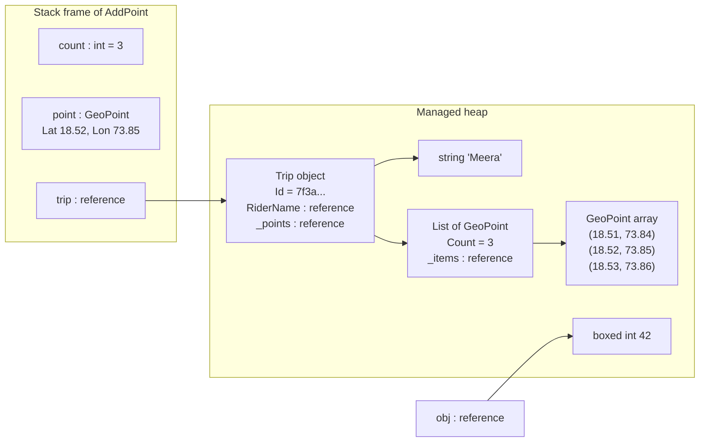
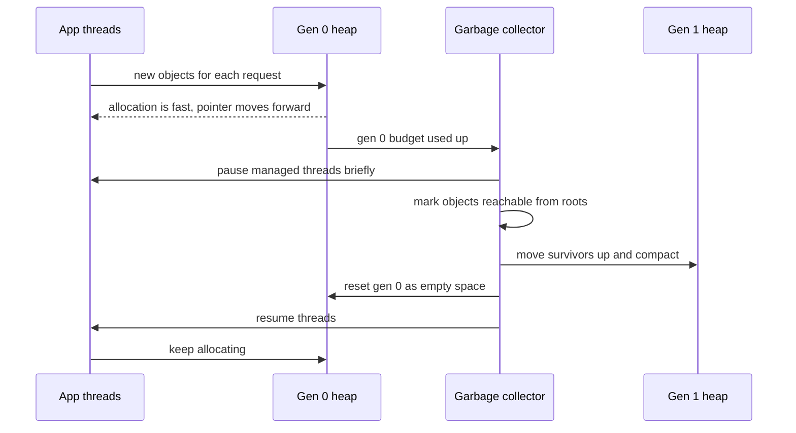

Sooner or later every C# developer meets this surprise: you change one variable, and a *different* variable changes too. Or you change a variable inside a method, and the caller sees nothing. Both behaviours follow from one rule about how C# copies data. This lesson explains that rule, the memory areas behind it (the stack and the heap), the hidden cost called boxing, how to choose between `struct` and `class`, and how .NET cleans up memory for you. The running example is a ride-hailing trip tracker that records the GPS points of each ride.

## Learning objectives

By the end of this lesson you will be able to:

1. Predict what `var b = a;` copies for a value type and for a reference type.
2. Explain the stack and the managed heap in plain words, and say where a given piece of data lives.
3. Spot boxing in code, explain its cost, and remove it with generics.
4. Decide between `struct`, `record struct`, `class` and `record` for a new type, using clear rules.
5. Avoid the classic mutable-struct and shared-reference bugs.
6. Explain how the garbage collector decides what to free, what generations are, and why `using` is still needed.
7. Recognise the common causes of memory leaks in a .NET web app.

## Prerequisites

- [Variables, types, conditions, loops and functions in C#](#/lesson/m01-csharp-basics): types such as `int`, `decimal` and `string`, and methods with parameters.
- [Classes, objects, fields, properties and methods](#/lesson/m01-classes-objects): what `new` does and what a reference is.

## Explain it like I'm a beginner

### A photocopy or a shared link

Imagine you have the receipt for a shared cab ride and your flatmate asks for it, to split the fare.

- **Option 1: you hand over a photocopy.** Your flatmate scribbles on their copy. Your original is untouched. Two separate pieces of paper now exist.
- **Option 2: you send a link to a shared online document.** There is still only *one* document. If your flatmate edits it, you see the edits too, because you are both looking at the same thing.

C# has exactly these two behaviours:

| Everyday | C# | Technical term |
|---|---|---|
| Handing over a photocopy | `int`, `decimal`, `bool`, `DateTime`, any `struct` | **value type**: assignment copies the data |
| Sharing a link | any `class`, `string`, arrays, `List<T>` | **reference type**: assignment copies the link (reference) |

That is the whole rule. Everything else in this lesson is a consequence of it.

### A desk and a warehouse

Where does the data physically live? Think of a busy office.

- The **desk** is small and very fast to use. When you start a task, you put a sticky note on the pile; when you finish, you throw away the top note. This is the **stack**: short-lived, tidy, automatic.
- The **warehouse** is huge. Big things, or things that must be kept after the current task finishes, go there, each with a tag. This is the **managed heap**.
- Every so often the **cleaning crew** walks through the warehouse. Anything that nobody holds a tag for any more is thrown away, and the rest is pushed together to make space. This crew is the **garbage collector (GC)**.

You rarely think about the desk or the crew. But knowing they exist explains why some code is fast, why some code uses a lot of memory, and why a web server can slowly run out of memory even though .NET "cleans up for you".

## First-principles explanation

### Value types: the variable *is* the data

A value-type variable holds its data directly. Assigning it copies all of the data:

```csharp
int a = 10;
int b = a;     // copy the number 10
b = 99;
Console.WriteLine(a);   // 10, a is untouched
```

The built-in value types are the numbers (`int`, `long`, `double`, `decimal`...), `bool`, `char`, `DateTime`, `DateOnly`, `TimeSpan`, `Guid`, every `enum`, tuples like `(int X, int Y)`, and every type you declare with `struct`.

### Reference types: the variable holds a link

A reference-type variable holds a **reference**, the address of an object stored somewhere else. Assigning it copies the address, not the object:

```csharp
var receipt = new RideReceipt { Rider = "Meera" };
var sameReceipt = receipt;            // copy the link
sameReceipt.Rider = "Kabir";
Console.WriteLine(receipt.Rider); // Kabir: one object, two links
```

Reference types are everything declared with `class` or `record` (which means `record class`), plus `string`, arrays, delegates and interfaces (when a variable has an interface type, it holds a reference). A reference variable can also hold **`null`**, meaning "no link at all". Using a member through a `null` reference throws the famous `NullReferenceException`. A plain value type can't be `null`; `int?` (short for `Nullable<int>`) is a value type with an extra "has a value?" flag.

### Passing to methods: always a copy, but a copy of what?

C# passes arguments **by value** by default. The method receives a copy of whatever the variable holds:

```csharp
static void Rename(RideReceipt r) => r.Rider = "Changed";   // changes the shared object
static void Replace(RideReceipt r) => r = new RideReceipt();      // changes only the local copy of the link
static void AddOne(int n) => n++;                               // changes only the local copy

var receipt = new RideReceipt { Rider = "Meera" };
Rename(receipt);   // receipt.Rider is now "Changed"
Replace(receipt);  // receipt still points to the same object
int count = 5;
AddOne(count);    // count is still 5
```

`Rename` follows the link and edits the object both sides can see. `Replace` points its own copy of the link somewhere new; the caller's link is unaffected. This one example clears up most beginner confusion.

If you truly need a method to change the caller's variable, C# has **`ref`** (read and write the caller's variable), **`out`** (the method must assign it, as in `TryParse`) and **`in`** (pass a large struct by reference without copying, read-only). Use them sparingly: returning a new value is usually clearer.

### Equality follows the same split

- For value types, `==` and `Equals` normally compare the **data**: two `DateOnly` values for 15 August 2026 are equal.
- For classes, `==` by default compares the **references**: two different `RideReceipt` objects with identical fields are *not* equal unless the class overrides equality. `ReferenceEquals(a, b)` always asks "is this the same object?".
- **Records** (`record` and `record struct`) generate value-based equality for you: two records with the same property values are equal.
- **`string`** is a reference type that overrides `==` to compare text. It is also **immutable**, so sharing a string is always safe: nobody can change it under you. That is why strings *feel* like values.

### The stack

Each thread has a **stack**: a block of memory (typically 1 MB per thread on Windows and 1.5 to 8 MB on Linux, depending on the thread) used for method calls. When a method starts, a **stack frame** is pushed holding its parameters and local variables. When it returns, the frame is popped and that memory is instantly reused. No cleaning crew is needed. That makes the stack extremely cheap.

Recursion that never stops keeps pushing frames until the stack is full, which crashes the process with a `StackOverflowException`. You can't catch that one; you must avoid it.

### The managed heap

Objects created with `new` for a class live on the **managed heap**. Creating one is fast (the runtime mostly just moves an "allocation pointer" forward), but each object has an overhead (on 64-bit .NET, at least 24 bytes for even an empty object, as an estimate) and must be cleaned up later by the GC.

### "Value types live on the stack" is only half true

You will often hear this. The accurate version:

> **Data lives where its container lives.**

- A value-type **local variable** usually lives in the method's stack frame (or a CPU register).
- A value-type **field inside a class** lives *inside that object*, on the heap.
- The elements of an **array** of structs (`GeoPoint[]`) live inline in the array object, on the heap.
- A reference-type **object** lives on the heap, and the variable that points to it lives wherever *that* variable lives.

Modern .NET also blurs the line in your favour. Since .NET 9 and 10, the JIT compiler can sometimes place a small object on the stack when it can prove the object never escapes the method (escape analysis). Treat "objects go on the heap" as the mental model, not a guarantee. The thing you control, and the thing that matters for correctness, is **copy versus share**.

### Boxing: when a value pretends to be an object

Sometimes a value type has to be treated as an `object` or an interface. C# then **boxes** it: it allocates a small object on the heap and copies the value into it. Getting the value back out is **unboxing**:

```csharp
int reading = 42;
object boxed = reading;        // boxing: heap allocation + copy
int back = (int)boxed;         // unboxing: type check + copy
long wrong = (long)boxed;      // InvalidCastException: a boxed int unboxes only to int
```

Each box is a separate heap object (about 24 bytes for a boxed `int` on 64-bit, an estimate). One box is nothing. Ten million boxes in a loop is real work for the GC. Common hidden sources of boxing:

- Old non-generic collections: `ArrayList`, `Hashtable`. Use `List<int>`, `Dictionary<string, int>`.
- Storing value types in `object` or `List<object>`.
- Calling an interface method through an interface variable on a struct: `IComparable c = 5;`.
- `string.Format("{0}", number)` and `string.Concat(object...)`. (C# string interpolation `$"{number}"` uses interpolated-string handlers since C# 10 and avoids boxing for common types.)

**Generics remove boxing.** `List<int>` stores real `int`s in an `int[]` inside. A generic method `T Max<T>(T a, T b) where T : IComparable<T>` gets specialised code for each value type, so nothing is boxed.

### Struct or class?

You choose by meaning first, then by size:

| Question | Struct (value type) | Class (reference type) |
|---|---|---|
| Is it "just a value", where two with the same data are the same thing? | Yes: a coordinate, money, a date range | No: a customer, an invoice, a trip has *identity* |
| Should a copy be independent? | Yes | No, sharing is the point |
| Is it small? | Ideally 16 bytes or less (Microsoft's guideline) | Any size |
| Is it immutable? | It should be (`readonly struct`) | Either |
| Will it be boxed often (stored as `object`)? | Then a class may be better | — |
| Does it need inheritance? | Structs can't inherit | Classes can |

A `GeoPoint` (two `double`s, 16 bytes) is a textbook struct. A `Trip` with a rider, a list of points and a status is a textbook class. When in doubt, choose a **class**: the bugs from accidentally copying a big mutable struct are worse than the small cost of an allocation.

C# gives you convenient shapes:

- `readonly record struct GeoPoint(double Latitude, double Longitude);`: immutable value type with value equality and a nice `ToString`.
- `record Invoice(...)` (a reference type) with value equality, good for immutable data with identity-free comparison.
- `class Trip { ... }` for mutable objects with identity and behaviour.

**Every struct has a default value.** `default(GeoPoint)` (or a `new GeoPoint[100]` array) gives all fields zeroed, with no constructor run. So a struct must make sense when all its fields are zero, or code must check for it. For a `Money` struct, `default` has a `null` currency, which is a trap you will meet in the exercises.

### The mutable struct trap

A struct that can be changed in place causes confusing bugs, because you so often edit a **copy**:

```csharp
public struct MutablePoint { public double X; public double Y; }

var points = new List<MutablePoint> { new() { X = 1, Y = 1 } };
// points[0].X = 5;          // compile error CS1612: the indexer returns a copy
var p = points[0];
p.X = 5;                     // edits the copy only
Console.WriteLine(points[0].X);   // still 1
```

The compiler catches some cases (CS1612), but not all, for example when a method on the struct mutates a copy returned by a property. The fix is simple: **make structs `readonly`** and give them methods that return a new value (`point.MoveBy(10, 0)`).

### How the garbage collector works

The GC frees heap objects that are no longer **reachable**. It starts from the **roots**: local variables in active stack frames, static fields, and a few internal handles. It follows every reference from those roots, marking each object it reaches. Anything not marked can't be used by your program ever again, so its memory is reclaimed. Surviving objects are then usually moved together (**compaction**) so free space is one big block, which keeps allocation fast.

Most objects die young: a request's temporary strings and lists are garbage within milliseconds. .NET exploits this with **generations**:

- **Generation 0**: new objects. Collected often and quickly.
- **Generation 1**: survived one collection. A buffer between young and old.
- **Generation 2**: long-lived objects, such as caches and singletons. Collected rarely, and a full collection is the most expensive.
- The **Large Object Heap (LOH)**: objects of 85,000 bytes or more (for example a big array) go here directly. It is collected with gen 2 and not compacted by default, so creating many large temporary arrays is costly. `ArrayPool<T>` helps by reusing them.

During parts of a collection, the GC must pause your threads. For gen 0 this pause is typically very short, but a server that allocates heavily triggers it often. ASP.NET Core apps use **Server GC** by default, which collects in parallel on several heaps. Since .NET 9 it also turns on **DATAS** (dynamic adaptation to application sizes) by default: it starts with few heaps and adds more only as load grows, so a small container no longer reserves one heap per CPU core up front.

Three practical rules follow:

1. **Don't call `GC.Collect()`** in application code. The GC's heuristics are better than yours, and forcing a full collection pauses everything.
2. **The GC manages memory, not resources.** A file handle, database connection or network socket must be released promptly with `Dispose`, usually via `using`. The GC would eventually run a finaliser, but "eventually" could be minutes, and your connection pool will be empty long before.
3. **A memory leak in .NET means something still holds a reference.** The GC can't free what is reachable. Classic culprits: a `static` list or dictionary that only grows, an unbounded cache, and event handlers that are never unsubscribed (the publisher's event keeps a reference to every subscriber).

### When not to worry

For most business code, write clear classes and records and let the GC do its job. Reach for structs, `Span<T>`, pooling and allocation tuning only when a profiler or a benchmark shows a real hot path, for example parsing millions of GPS readings per minute. Premature micro-optimisation makes code harder to read and often doesn't help.

## Visual explanation

### Where the data lives



This is a snapshot of memory while a method called `AddPoint` runs. The stack frame on the left holds three locals. `count` and `point` are value types, so their data sits **right inside the frame**: the latitude and longitude are not anywhere else. `trip` is a reference type, so the frame only holds an arrow to the `Trip` object on the heap. That object holds arrows of its own: to the `RiderName` string and to a `List`, whose internal array stores the `GeoPoint` structs **inline**, three pairs of numbers back to back with no extra objects. Finally, `obj` shows boxing: the `int` 42 needed its own little heap object. When `AddPoint` returns, its frame disappears instantly. The heap objects stay until the GC finds that no arrow leads to them.

### A garbage collection, step by step



Read this top to bottom as time. Your code allocates new objects into generation 0, which is cheap because the runtime just moves a pointer forward. When gen 0's budget is used up, the GC starts. It pauses managed threads for a short time, **marks** every object reachable from the roots, and moves the survivors into generation 1, packing them together. Everything left in gen 0 was unreachable, so the whole area is simply reused. Then threads resume. Because most request objects die young, a gen 0 collection usually finds little to keep, which is why it is fast. Objects that survive again move to gen 2, which is collected far less often.

## Step-by-step example

We'll build the trip tracker's core types and hit each surprise on purpose.

### Step 1: a coordinate as a class (shared by accident)

```csharp
public class PointClass { public double Lat; public double Lon; }

var start = new PointClass { Lat = 18.52, Lon = 73.85 };
var next = start;          // intention: "the next ping starts from the same place, then moves"
next.Lat += 0.01;
Console.WriteLine(start.Lat);   // 18.53: we moved the start point too!
```

The developer thought `next` was a copy. It was a second link to the same object.

### Step 2: the same thing as a struct (copied)

```csharp
public struct PointStruct { public double Lat; public double Lon; }

var start = new PointStruct { Lat = 18.52, Lon = 73.85 };
var next = start;          // a full copy of both numbers
next.Lat += 0.01;
Console.WriteLine(start.Lat);   // 18.52: untouched
```

For a coordinate, this is the behaviour we want. A point is a value: "18.52, 73.85" is the same point whoever holds it.

### Step 3: make it immutable

The struct still has public fields that can be changed, which invites the mutable struct trap. Make it a `readonly record struct` and give it a method that returns a *new* point:

```csharp
public readonly record struct GeoPoint(double Latitude, double Longitude)
{
    public GeoPoint Offset(double dLat, double dLon) => new(Latitude + dLat, Longitude + dLon);
}

var start = new GeoPoint(18.52, 73.85);
var next = start.Offset(0.01, 0);
Console.WriteLine(start == new GeoPoint(18.52, 73.85));   // True: value equality, for free
```

### Step 4: the trip is a class, on purpose

A trip has **identity**: "Meera's 9:10 ride from Pune station to Hinjewadi on 12 March" is one specific thing that the rider app, the driver app, the fare calculator and support all refer to and update. Sharing is the point:

```csharp
public sealed class Trip
{
    private readonly List<GeoPoint> _points = new();
    public Guid Id { get; } = Guid.NewGuid();
    public IReadOnlyList<GeoPoint> Points => _points;
    public void Add(GeoPoint p) => _points.Add(p);
}
```

Two trips with identical points are still two different trips (two riders can take the same route). Class (reference) semantics match that.

### Step 5: see boxing happen

```csharp
long before = GC.GetAllocatedBytesForCurrentThread();
var list = new System.Collections.ArrayList();
for (int i = 0; i < 100_000; i++) list.Add(i);     // boxes every int
long after = GC.GetAllocatedBytesForCurrentThread();
Console.WriteLine($"ArrayList: {after - before:N0} bytes");
```

Run the same loop with `List<int>` and compare. On a 64-bit machine the `ArrayList` version allocates several megabytes, most of it boxes; the `List<int>` version allocates a fraction of that, all of it the growing internal array. (Exact numbers vary by runtime version, so measure on your machine; the playground does this for you.)

## Production-style C# implementation

A small ASP.NET Core API for recording the GPS trace of a ride, as the driver's phone sends a ping every few seconds. Notice which types are structs, which are classes, and why.

```text
Rides.Api/
  Program.cs
  Trips/
    GeoPoint.cs              // readonly record struct: a value
    OdometerReading.cs       // readonly record struct: the car's odometer in whole metres
    Trip.cs                  // class: has identity, changes over time
    ITripStore.cs            // where trips are kept
    InMemoryTripStore.cs
    Contracts.cs             // request and response shapes
```

```csharp file=Trips/GeoPoint.cs
namespace Rides.Api.Trips;

/// <summary>A WGS-84 coordinate. A small immutable value (16 bytes), so a struct is the right choice.
/// Note: default(GeoPoint) is (0, 0), a real point in the Atlantic Ocean, so callers must not
/// treat "default" as "missing". Use GeoPoint? for an optional point.</summary>
public readonly record struct GeoPoint
{
    private const double EarthRadiusMetres = 6_371_000;

    public GeoPoint(double latitude, double longitude)
    {
        if (latitude is < -90 or > 90) throw new ArgumentOutOfRangeException(nameof(latitude));
        if (longitude is < -180 or > 180) throw new ArgumentOutOfRangeException(nameof(longitude));
        Latitude = latitude;
        Longitude = longitude;
    }

    public double Latitude { get; }
    public double Longitude { get; }

    /// <summary>Great-circle distance (haversine formula). Straight line between two pings:
    /// good enough between pings a few seconds apart, not a replacement for road-snapped distance.</summary>
    public double DistanceTo(GeoPoint other)
    {
        static double Rad(double deg) => deg * Math.PI / 180.0;
        double dLat = Rad(other.Latitude - Latitude);
        double dLon = Rad(other.Longitude - Longitude);
        double a = Math.Sin(dLat / 2) * Math.Sin(dLat / 2)
                 + Math.Cos(Rad(Latitude)) * Math.Cos(Rad(other.Latitude)) * Math.Sin(dLon / 2) * Math.Sin(dLon / 2);
        return 2 * EarthRadiusMetres * Math.Asin(Math.Min(1.0, Math.Sqrt(a)));
    }
}
```

```csharp file=Trips/OdometerReading.cs
namespace Rides.Api.Trips;

/// <summary>The car's odometer, stored as whole metres: one int, 4 bytes, compared by value.
/// Shown as "km.metres", e.g. 48213.350 km. An int holds up to about 2.1 million km, plenty for a car.</summary>
public readonly record struct OdometerReading(int Metres) : IComparable<OdometerReading>
{
    public static OdometerReading FromKm(int km, int metres = 0)
    {
        ArgumentOutOfRangeException.ThrowIfNegative(km);
        if (metres is < 0 or > 999) throw new ArgumentOutOfRangeException(nameof(metres));
        return new(checked(km * 1000 + metres));
    }

    public OdometerReading Add(double metres) => new(checked(Metres + (int)Math.Round(metres)));
    public int CompareTo(OdometerReading other) => Metres.CompareTo(other.Metres);
    public override string ToString() => $"{Metres / 1000}.{Metres % 1000:D3} km";
}
```

```csharp file=Trips/Trip.cs
namespace Rides.Api.Trips;

/// <summary>A trip has identity and changes over time, so it is a class (reference type).
/// Everyone holding a reference sees the same trip.</summary>
public sealed class Trip
{
    public const int MaxPoints = 50_000;     // about 14 hours at one ping per second: bounds memory per trip

    private readonly Lock _gate = new();
    private readonly List<GeoPoint> _points = new();   // structs stored inline, no box per point
    private double _lengthMetres;

    public Trip(string riderName, OdometerReading startOdometer)
    {
        ArgumentException.ThrowIfNullOrWhiteSpace(riderName);
        RiderName = riderName.Trim();
        StartOdometer = startOdometer;
    }

    public Guid Id { get; } = Guid.NewGuid();
    public string RiderName { get; }
    public OdometerReading StartOdometer { get; }

    public int PointCount { get { lock (_gate) return _points.Count; } }
    public double LengthMetres { get { lock (_gate) return _lengthMetres; } }
    public OdometerReading CurrentOdometer => StartOdometer.Add(LengthMetres);

    /// <summary>Returns a copy. Handing out the live List would let callers change the trip without rules.</summary>
    public GeoPoint[] SnapshotPoints() { lock (_gate) return _points.ToArray(); }

    public void AddPoint(GeoPoint point)
    {
        lock (_gate)
        {
            if (_points.Count >= MaxPoints)
                throw new InvalidOperationException($"A trip can hold at most {MaxPoints} points.");
            if (_points.Count > 0)
                _lengthMetres += _points[^1].DistanceTo(point);   // _points[^1] returns a copy of the struct: cheap and safe
            _points.Add(point);
        }
    }
}
```

```csharp file=Trips/ITripStore.cs
namespace Rides.Api.Trips;

public interface ITripStore
{
    void Add(Trip trip);
    Trip? Find(Guid id);
}
```

```csharp file=Trips/InMemoryTripStore.cs
using System.Collections.Concurrent;

namespace Rides.Api.Trips;

/// <summary>Demo store. The dictionary holds references, so trips stay alive (reachable) until removed:
/// in production, store trips in PostgreSQL and keep only active trips in memory.</summary>
public sealed class InMemoryTripStore : ITripStore
{
    private readonly ConcurrentDictionary<Guid, Trip> _trips = new();

    public void Add(Trip trip)
    {
        if (!_trips.TryAdd(trip.Id, trip)) throw new InvalidOperationException("Duplicate trip id.");
    }

    public Trip? Find(Guid id) => _trips.GetValueOrDefault(id);
}
```

```csharp file=Trips/Contracts.cs
namespace Rides.Api.Trips;

public sealed record StartTripRequest(string RiderName, int OdometerKm, int OdometerMetres);
public sealed record AddPointRequest(double Latitude, double Longitude);

public sealed record TripView(Guid Id, string RiderName, string StartOdometer, string CurrentOdometer, int PointCount, double LengthMetres)
{
    public static TripView From(Trip trip) => new(
        trip.Id, trip.RiderName, trip.StartOdometer.ToString(), trip.CurrentOdometer.ToString(),
        trip.PointCount, Math.Round(trip.LengthMetres, 1));
}
```

```csharp file=Program.cs
using Rides.Api.Trips;

var builder = WebApplication.CreateBuilder(args);
builder.Services.AddSingleton<ITripStore, InMemoryTripStore>();
var app = builder.Build();

app.MapPost("/trips", (StartTripRequest req, ITripStore store) =>
{
    try
    {
        var trip = new Trip(req.RiderName, OdometerReading.FromKm(req.OdometerKm, req.OdometerMetres));
        store.Add(trip);
        return Results.Created($"/trips/{trip.Id}", TripView.From(trip));
    }
    catch (ArgumentException ex) { return Results.Problem(ex.Message, statusCode: 400); }
    catch (OverflowException) { return Results.Problem("Odometer reading is too large.", statusCode: 400); }
});

app.MapPost("/trips/{id:guid}/points", (Guid id, AddPointRequest req, ITripStore store) =>
{
    if (store.Find(id) is not { } trip) return Results.NotFound();
    try
    {
        trip.AddPoint(new GeoPoint(req.Latitude, req.Longitude));
        return Results.Ok(TripView.From(trip));
    }
    catch (ArgumentOutOfRangeException ex) { return Results.Problem(ex.Message, statusCode: 400); }
    catch (InvalidOperationException ex) { return Results.Problem(ex.Message, statusCode: 409); }
});

app.MapGet("/trips/{id:guid}", (Guid id, ITripStore store) =>
    store.Find(id) is { } trip ? Results.Ok(TripView.From(trip)) : Results.NotFound());

app.Run();
```

What to notice:

- **`GeoPoint` and `OdometerReading` are `readonly record struct`s.** They are small, they are values, and they can never be modified after creation. Copying them is as cheap as copying one or two numbers, and you get `==` that compares data.
- **`Trip` is a class.** The store, the endpoint, the fare calculator and any background job all hold references to the *same* trip. A struct here would make every `store.Find(id)` return a separate copy, and `AddPoint` would update a copy that is immediately thrown away.
- **`List<GeoPoint>` stores points inline.** 50,000 points take roughly 800 KB in one array (16 bytes each, an estimate ignoring list growth). With a class `GeoPoint`, the same data would need 50,000 separate heap objects (about 32 bytes each) plus an 8-byte reference per slot, roughly 2.5 times the memory and 50,000 things for the GC to track.
- **`SnapshotPoints()` returns a copy.** The array copy costs memory, but no caller can change the trip's internal list. That is the reference-type version of "hand over a photocopy, not a link".
- **`MaxPoints` bounds memory.** An in-memory collection that only grows is the most common .NET "leak". The store has the same issue: trips stay reachable forever. Fine for a demo; a real system keeps finished trips in PostgreSQL and holds only active ones in memory (and needs an idempotency key on pings, because phones on a flaky network retry).
- **`default(GeoPoint)` is a valid-looking point** (0, 0). The comment warns about it. Where a point is optional, use `GeoPoint?`.

## Bad design vs good design

**Bad**: a large mutable struct, a shared mutable class used as a value, and boxing in a hot loop.

```csharp
public struct TripStruct                   // 1. identity-bearing, mutable, large: should be a class
{
    public string RiderName;
    public List<double> Lats;
    public double Length;
    public void AddLength(double m) => Length += m;
}

public class Money                         // 2. a value modelled as a shared, mutable class
{
    public decimal Amount;
}

var fare = new Money { Amount = 500m };
var receiptA = fare;
var receiptB = fare;
receiptB.Amount += 90m;                    // tip added to B: receipt A silently changes too

var fares = new ArrayList();               // 3. boxing every fare in a hot path
foreach (int f in faresInPaise) fares.Add(f);
```

Problems:

1. `TripStruct` copied into a dictionary and read back gives *copies*. `dict[id].AddLength(10)` updates a temporary and the change is lost, yet `Lats` (a reference inside the struct) *is* shared between copies. Half value, half reference: the worst of both.
2. `Money` as a mutable class means two receipts can share one amount object. A tip added to receipt B leaks into receipt A. This class of bug can sit unnoticed for months.
3. `ArrayList` boxes every `int`, creating one heap object per fare and extra GC work, and reading back needs casts that can fail at runtime.

**Good**:

```csharp
public sealed class Trip { /* class: identity, behaviour, private list */ }
public readonly record struct Money(decimal Amount, string Currency);   // immutable value
var fares = new List<int>(capacity: faresInPaise.Length);              // no boxing, one array
```

**Is the improvement always worth it?** The `List<int>` change is free and always right. Converting a class to a struct is only worth it when the type is small, immutable and value-like. If you are unsure, a `record` class gives you value equality and immutability without any copying surprises, at the cost of one heap allocation per instance, which for most business code is irrelevant.

:::callout type=mistake title="Structs are not 'faster classes'"
A struct is copied on every assignment, parameter pass and return. A 200-byte struct passed through five method calls copies 1,000 bytes; a class would copy five 8-byte references. Structs help when they are small and stop helping when they are big or get boxed. Choose by meaning first, then measure.
:::

## Practical playground

Run it and predict each line before you look. Allocation numbers depend on your runtime version, so focus on the *difference* between the lines, not the exact values.

:::playground type=csharp title="Copy, share, box"
```csharp file=Program.cs
using System;
using System.Collections;
using System.Collections.Generic;

public struct PointStruct { public double Lat; public double Lon; }
public class PointClass { public double Lat; public double Lon; }
public readonly record struct GeoPoint(double Lat, double Lon);
public sealed class RideReceipt { public string Rider = ""; }

public static class Program
{
    public static void Main()
    {
        // 1. Copy vs share
        var s1 = new PointStruct { Lat = 18.52, Lon = 73.85 };
        var s2 = s1;
        s2.Lat = 0;
        var c1 = new PointClass { Lat = 18.52, Lon = 73.85 };
        var c2 = c1;
        c2.Lat = 0;
        Console.WriteLine($"struct: s1.Lat = {s1.Lat}   class: c1.Lat = {c1.Lat}");

        // 2. Methods get a copy of the variable
        var receipt = new RideReceipt { Rider = "Meera" };
        Rename(receipt);
        Replace(receipt);
        int count = 5;
        AddOne(count);
        Console.WriteLine($"Rider = {receipt.Rider}, count = {count}");

        // 3. Equality
        Console.WriteLine($"record struct equal? {new GeoPoint(1, 2) == new GeoPoint(1, 2)}");
        Console.WriteLine($"class equal?         {new PointClass() == new PointClass()}");
        string a = "KA-01", b = string.Concat("KA-", "01");
        Console.WriteLine($"strings == ? {a == b}   same object? {ReferenceEquals(a, b)}");

        // 4. The mutable struct trap
        var list = new List<PointStruct> { new PointStruct { Lat = 1 } };
        var copy = list[0];
        copy.Lat = 99;
        Console.WriteLine($"list[0].Lat after editing a copy = {list[0].Lat}");

        // 5. Boxing cost
        const int N = 100_000;
        long before = GC.GetAllocatedBytesForCurrentThread();
        var boxed = new ArrayList();
        for (int i = 0; i < N; i++) boxed.Add(i);
        long mid = GC.GetAllocatedBytesForCurrentThread();
        var unboxed = new List<int>();
        for (int i = 0; i < N; i++) unboxed.Add(i);
        long after = GC.GetAllocatedBytesForCurrentThread();
        Console.WriteLine($"ArrayList of {N:N0} ints allocated  {mid - before,12:N0} bytes");
        Console.WriteLine($"List<int> of {N:N0} ints allocated  {after - mid,12:N0} bytes");

        // 6. Unboxing must match the exact type
        object o = 42;
        try { long l = (long)o; Console.WriteLine(l); }
        catch (InvalidCastException) { Console.WriteLine("(long)boxedInt -> InvalidCastException"); }

        // 7. Generations
        var survivor = new byte[100];
        Console.WriteLine($"new object generation: {GC.GetGeneration(survivor)}");
        var big = new byte[100_000];
        Console.WriteLine($"100,000-byte array generation: {GC.GetGeneration(big)} (Large Object Heap)");

        // Experiments:
        // 1. Change PointStruct to a class. Which lines change, and why?
        // 2. Uncomment the next line. Why does the compiler refuse it?
        // list[0].Lat = 5;
        // 3. Replace ArrayList with List<object>. Does boxing go away?
        // 4. Make the array 84,000 bytes. Which generation does it start in now?
    }

    static void Rename(RideReceipt r) => r.Rider = "Kabir";
    static void Replace(RideReceipt r) => r = new RideReceipt { Rider = "Nobody" };
    static void AddOne(int n) => n++;
}
```
:::

## Exercises

:::exercise id=m01-value-reference-memory-ex1 difficulty=beginner kind=code title="A Money value type"
Model money as an immutable value. Two ₹100 amounts are the same thing, and adding to an amount must give a *new* amount, never change the old one.
::requirements
- `Money` is a `readonly record struct` with `Amount` (decimal) and `Currency` (string, e.g. "INR").
- `Money.Rupees(decimal amount)` creates an INR amount.
- `Add(Money other)` and `Subtract(Money other)` return new values. If the currencies differ (compared exactly, case-sensitive), throw `InvalidOperationException`. That includes `default(Money)`, whose currency is `null`.
- `Multiply(decimal factor)` returns a new value rounded to 2 decimal places, midpoints away from zero.
- `IsZero` is true when `Amount` is 0.
::acceptance
- `Rupees(100).Add(Rupees(50)) == Rupees(150)` is true (value equality).
- After `var b = a.Add(Rupees(5));`, `a` still has its old amount.
- `Rupees(10).Add(new Money(10, "USD"))` throws `InvalidOperationException`.
- `Rupees(999.99m).Multiply(0.18m)` is ₹180.00 (179.9982 rounded).
- `default(Money).Add(Rupees(1))` throws `InvalidOperationException`.
::hint
`readonly record struct` already gives you value equality and immutability. You only need to write the methods.
::hint
Use a `with` expression to make a modified copy: `this with { Amount = Amount + other.Amount }`.
::hint
Put the currency check in one private helper and call it from `Add` and `Subtract`. Use `string.Equals(a, b, StringComparison.Ordinal)`, which handles `null` without throwing.
::hint
```csharp
private void EnsureSameCurrency(Money other)
{
    if (!string.Equals(Currency, other.Currency, StringComparison.Ordinal))
        throw new InvalidOperationException($"Cannot combine {Currency ?? "(none)"} and {other.Currency ?? "(none)"}.");
}
```
::starter
```csharp file=Money.cs
using System;

public readonly record struct Money(decimal Amount, string Currency)
{
    public static Money Rupees(decimal amount) => throw new NotImplementedException();

    public bool IsZero => throw new NotImplementedException();

    public Money Add(Money other) => throw new NotImplementedException();
    public Money Subtract(Money other) => throw new NotImplementedException();
    public Money Multiply(decimal factor) => throw new NotImplementedException();
}
```
::tests
```csharp file=MoneyTests.cs
using System;
using Xunit;

public class MoneyTests
{
    [Fact]
    public void Add_gives_value_equal_result() =>
        Assert.True(Money.Rupees(100m).Add(Money.Rupees(50m)) == Money.Rupees(150m));

    [Fact]
    public void Add_does_not_change_original()
    {
        var a = Money.Rupees(10m);
        var b = a.Add(Money.Rupees(5m));
        Assert.Equal(10m, a.Amount);
        Assert.Equal(15m, b.Amount);
    }

    [Fact]
    public void Copies_are_independent()
    {
        var a = Money.Rupees(10m);
        var b = a;
        b = b.Subtract(Money.Rupees(3m));
        Assert.Equal(10m, a.Amount);
        Assert.Equal(7m, b.Amount);
    }

    [Fact]
    public void Different_currencies_throw() =>
        Assert.Throws<InvalidOperationException>(() => Money.Rupees(10m).Add(new Money(10m, "USD")));

    [Fact]
    public void Default_money_cannot_be_combined() =>
        Assert.Throws<InvalidOperationException>(() => default(Money).Add(Money.Rupees(1m)));

    [Fact]
    public void Multiply_rounds_to_paise() => Assert.Equal(180.00m, Money.Rupees(999.99m).Multiply(0.18m).Amount);

    [Fact]
    public void Multiply_rounds_midpoint_away_from_zero() => Assert.Equal(0.13m, Money.Rupees(0.25m).Multiply(0.5m).Amount);

    [Fact]
    public void Is_zero() => Assert.True(Money.Rupees(5m).Subtract(Money.Rupees(5m)).IsZero);

    [Fact]
    public void Rupees_uses_INR() => Assert.Equal("INR", Money.Rupees(1m).Currency);
}
```
::solution
```csharp file=Money.cs
using System;

public readonly record struct Money(decimal Amount, string Currency)
{
    public static Money Rupees(decimal amount) => new(amount, "INR");

    public bool IsZero => Amount == 0m;

    public Money Add(Money other)
    {
        EnsureSameCurrency(other);
        return this with { Amount = Amount + other.Amount };
    }

    public Money Subtract(Money other)
    {
        EnsureSameCurrency(other);
        return this with { Amount = Amount - other.Amount };
    }

    public Money Multiply(decimal factor) =>
        this with { Amount = Math.Round(Amount * factor, 2, MidpointRounding.AwayFromZero) };

    private void EnsureSameCurrency(Money other)
    {
        if (!string.Equals(Currency, other.Currency, StringComparison.Ordinal))
            throw new InvalidOperationException(
                $"Cannot combine {Currency ?? "(no currency)"} with {other.Currency ?? "(no currency)"}.");
    }
}
```

The struct holds a `decimal` (16 bytes) and a string reference (8 bytes): 24 bytes, slightly above the 16-byte guideline but still cheap to copy, and its meaning is clearly "a value". Every method returns a new `Money`; nothing can change an existing one. The `default` case shows why structs need care: no constructor ran, so `Currency` is `null`, and the currency check is what protects you.
::alternatives
A `sealed record Money(decimal Amount, string Currency)` (a reference type) gives the same equality and immutability with no `default` problem, because a missing value would be `null` instead of a half-valid struct. It costs one heap allocation per value. For an invoicing app, either is fine. For code that creates millions of amounts per second, the struct wins.
::mistakes
- Writing `Amount += other.Amount` in a mutable struct. That changes a copy, or fails to compile in a `readonly struct`.
- Comparing currencies with `Currency.Equals(other.Currency)`, which throws `NullReferenceException` for `default(Money)`.
- Rounding with the default banker's rounding: 0.125 becomes 0.12 instead of 0.13.
::extensions
Add `operator +` and `operator -`. Add `Allocate(int parts)` that splits ₹100 into 3 parts as 33.34, 33.33, 33.33 so no paisa is lost.
:::

:::exercise id=m01-value-reference-memory-ex2 difficulty=beginner kind=code title="Defensive copies for a bus route"
A `BusRoute` keeps its list of stops in an array. Arrays are reference types, so a careless constructor or property lets outside code change the route. Make it safe.
::requirements
- `BusRoute(string number, string[] stops)` needs at least 2 stops, otherwise throw `ArgumentException`.
- Changing the caller's array *after* creating the route must not change the route.
- `Stops` returns the stops as `IReadOnlyList<string>`. A caller who casts it to `string[]` and edits it must not change the route.
- `WithExtraStop(string stop)` returns a **new** route with the stop added at the end. The original route is unchanged.
::acceptance
- Creating a route from `["Majestic", "Shivajinagar", "Hebbal"]`, then setting `stops[0] = "X"`, leaves `route.Stops[0]` as "Majestic".
- `if (route.Stops is string[] arr) arr[0] = "HACKED";` leaves the route unchanged.
- `WithExtraStop("Yelahanka")` gives 4 stops; the original still has 3, and the two routes are different objects.
- A single stop throws `ArgumentException`.
::hint
The constructor receives a *reference* to the caller's array. If you store that reference, you are sharing the caller's array.
::hint
Copy on the way in: `_stops = (string[])stops.Clone();` or `stops.ToArray()`.
::hint
On the way out, either return a fresh copy or wrap the array in a read-only view that can't be cast back: `Array.AsReadOnly(_stops)` returns a `ReadOnlyCollection<string>`.
::hint
`WithExtraStop` can build a new array one longer, copy the stops, put the new one at the end and call the constructor: `new BusRoute(Number, [.. _stops, stop])`.
::starter
```csharp file=BusRoute.cs
using System;
using System.Collections.Generic;

public sealed class BusRoute
{
    public BusRoute(string number, string[] stops) => throw new NotImplementedException();

    public string Number => throw new NotImplementedException();
    public IReadOnlyList<string> Stops => throw new NotImplementedException();

    public BusRoute WithExtraStop(string stop) => throw new NotImplementedException();
}
```
::tests
```csharp file=BusRouteTests.cs
using System;
using Xunit;

public class BusRouteTests
{
    private static string[] Stops() => new[] { "Majestic", "Shivajinagar", "Hebbal" };

    [Fact]
    public void Caller_array_changes_do_not_leak_in()
    {
        var stops = Stops();
        var route = new BusRoute("42", stops);
        stops[0] = "X";
        Assert.Equal("Majestic", route.Stops[0]);
    }

    [Fact]
    public void Returned_stops_cannot_be_used_to_edit()
    {
        var route = new BusRoute("42", Stops());
        if (route.Stops is string[] arr) arr[0] = "HACKED";
        Assert.Equal("Majestic", route.Stops[0]);
    }

    [Fact]
    public void WithExtraStop_returns_new_route()
    {
        var route = new BusRoute("42", Stops());
        var longer = route.WithExtraStop("Yelahanka");
        Assert.Equal(4, longer.Stops.Count);
        Assert.Equal("Yelahanka", longer.Stops[3]);
        Assert.Equal(3, route.Stops.Count);
        Assert.NotSame(route, longer);
        Assert.Equal("42", longer.Number);
    }

    [Fact]
    public void Needs_two_stops() =>
        Assert.Throws<ArgumentException>(() => new BusRoute("42", new[] { "Majestic" }));
}
```
::solution
```csharp file=BusRoute.cs
using System;
using System.Collections.Generic;

public sealed class BusRoute
{
    private readonly string[] _stops;

    public BusRoute(string number, string[] stops)
    {
        ArgumentException.ThrowIfNullOrWhiteSpace(number);
        ArgumentNullException.ThrowIfNull(stops);
        if (stops.Length < 2) throw new ArgumentException("A route needs at least two stops.", nameof(stops));
        Number = number;
        _stops = (string[])stops.Clone();      // copy in: we own our array
    }

    public string Number { get; }

    // A read-only wrapper: cannot be cast back to string[]
    public IReadOnlyList<string> Stops => Array.AsReadOnly(_stops);

    public BusRoute WithExtraStop(string stop)
    {
        ArgumentException.ThrowIfNullOrWhiteSpace(stop);
        return new BusRoute(Number, [.. _stops, stop]);
    }
}
```

The fix is "copy in, protect on the way out". `Clone()` gives the route its own array, so the caller's later edits hit only the caller's array. `Array.AsReadOnly` wraps our array in a `ReadOnlyCollection<string>`: a cast to `string[]` fails (the `is` check is false), and the wrapper has no setter. Strings themselves are immutable, so sharing the string objects is safe; only the array needed copying.
::alternatives
Use `ImmutableArray<string>` from `System.Collections.Immutable`: it is a struct wrapper around an array that can never change, so you can expose it directly. Or make `BusRoute` a `record` with an `ImmutableArray<string>` property. Note that a record with a plain `string[]` property is *not* deeply immutable: the array inside can still be edited.
::mistakes
- Storing `_stops = stops;` (sharing the caller's array).
- Returning `_stops` typed as `IReadOnlyList<string>`. The interface hides the setter, but the object is still a `string[]` and a cast gets it back.
- Making `WithExtraStop` call `Array.Resize(ref _stops, ...)`, which changes the original route.
::extensions
Add `Reversed()` returning the return-direction route. Add value equality: two routes are equal if they have the same number and the same stops in order.
:::

:::exercise id=m01-value-reference-memory-ex3 difficulty=intermediate kind=code title="Remove the boxing from a fare log"
A legacy class in the payments service keeps the fares of completed trips (whole numbers in paise, so ₹245.50 is 24550) like this:

```csharp
public class OldFareLog
{
    private readonly ArrayList _items = new();
    public void Add(int farePaise) => _items.Add(farePaise);       // boxes
    public long Sum() { long s = 0; foreach (object o in _items) s += (int)o; return s; }   // unboxes
}
```

At an evening peak of 200 completed trips per second, that is 200 extra heap objects per second (about 24 bytes each, plus an 8-byte slot), 1.7 crore a day, every one of which the GC must trace, and every read needs a cast that can fail at runtime. Rewrite it so that storing fares never boxes and analysing the log allocates nothing.
::requirements
- `Add(int farePaise)` stores a fare. A negative fare throws `ArgumentOutOfRangeException` (a zero fare, such as a fully discounted promo ride, is allowed).
- `Count`, `Sum()` (as `long`), `Max()` and `CountAbove(int threshold)`.
- `Max()` on an empty log throws `InvalidOperationException`.
- `Sum()`, `Max()` and `CountAbove()` must not allocate on the heap.
::acceptance
- Fares 12,000, 45,000 and 9,000 paise give Count 3, Sum 66,000, Max 45,000, `CountAbove(9_999)` = 2.
- The sum of 100,000 fares of 30,000 paise (₹300 each) is 3,000,000,000 paise, bigger than `int.MaxValue`, so it must be summed in `long`.
- A test measuring `GC.GetAllocatedBytesForCurrentThread()` around `Sum`, `Max` and `CountAbove` sees fewer than 1,000 bytes allocated.
::hint
Which collection stores `int`s without boxing? The generic one.
::hint
`List<int>` keeps an `int[]` inside. `foreach` over a `List<int>` uses a struct enumerator, so it doesn't allocate either.
::hint
Be careful with LINQ in the "no allocation" methods: `_items.Count(r => r > threshold)` captures `threshold` in a closure, which allocates an object (and, depending on the runtime, an enumerator). A plain loop does not.
::hint
```csharp
public int CountAbove(int threshold)
{
    int n = 0;
    foreach (int r in _items) if (r > threshold) n++;
    return n;
}
```
::starter
```csharp file=FareLog.cs
using System;
using System.Collections.Generic;

public sealed class FareLog
{
    public int Count => throw new NotImplementedException();

    public void Add(int farePaise) => throw new NotImplementedException();
    public long Sum() => throw new NotImplementedException();
    public int Max() => throw new NotImplementedException();
    public int CountAbove(int threshold) => throw new NotImplementedException();
}
```
::tests
```csharp file=FareLogTests.cs
using System;
using Xunit;

public class FareLogTests
{
    [Fact]
    public void Basic_statistics()
    {
        var log = new FareLog();
        log.Add(12_000); log.Add(45_000); log.Add(9_000);
        Assert.Equal(3, log.Count);
        Assert.Equal(66_000L, log.Sum());
        Assert.Equal(45_000, log.Max());
        Assert.Equal(2, log.CountAbove(9_999));
    }

    [Fact]
    public void Sum_does_not_overflow()
    {
        var log = new FareLog();
        for (int i = 0; i < 100_000; i++) log.Add(30_000);
        Assert.Equal(3_000_000_000L, log.Sum());
    }

    [Fact] public void Max_of_empty_throws() => Assert.Throws<InvalidOperationException>(() => new FareLog().Max());

    [Fact] public void Negative_fare_throws() => Assert.Throws<ArgumentOutOfRangeException>(() => new FareLog().Add(-1));

    [Fact]
    public void Analysis_does_not_allocate()
    {
        var log = new FareLog();
        for (int i = 0; i < 10_000; i++) log.Add(i);
        log.Sum(); log.Max(); log.CountAbove(5);          // warm up so JIT work is not measured

        long before = GC.GetAllocatedBytesForCurrentThread();
        long sum = log.Sum();
        int max = log.Max();
        int above = log.CountAbove(5_000);
        long allocated = GC.GetAllocatedBytesForCurrentThread() - before;

        Assert.True(allocated < 1_000, "Allocated " + allocated + " bytes");
        Assert.Equal(49_995_000L, sum);
        Assert.Equal(9_999, max);
        Assert.Equal(4_999, above);
    }
}
```
::solution
```csharp file=FareLog.cs
using System;
using System.Collections.Generic;

public sealed class FareLog
{
    private readonly List<int> _items = new();     // stores real ints in an int[]: no boxes

    public int Count => _items.Count;

    public void Add(int farePaise)
    {
        ArgumentOutOfRangeException.ThrowIfNegative(farePaise);
        _items.Add(farePaise);
    }

    public long Sum()
    {
        long sum = 0;                                 // long: 100,000 x 30,000 does not fit in int
        foreach (int r in _items) sum += r;           // List<int>.Enumerator is a struct: no allocation
        return sum;
    }

    public int Max()
    {
        if (_items.Count == 0) throw new InvalidOperationException("The log is empty.");
        int max = _items[0];
        foreach (int r in _items) if (r > max) max = r;
        return max;
    }

    public int CountAbove(int threshold)
    {
        int n = 0;
        foreach (int r in _items) if (r > threshold) n++;
        return n;
    }
}
```

`List<int>` stores the values inline in one array, so `Add` only allocates when the list grows (it doubles its capacity, so that is rare). The analysis methods use plain loops: no boxes, no closures, no enumerator objects. Measuring with `GC.GetAllocatedBytesForCurrentThread()` turns "should not allocate" into a test that will catch a regression.
::alternatives
`CollectionsMarshal.AsSpan(_items)` gives a `Span<int>` over the list's array, and `foreach` over a span is as fast as it gets. For a log that must cover only the last N trips, a fixed-size ring buffer (`int[]` plus a start index) caps memory. LINQ (`_items.Sum(r => (long)r)`) is fine for code that isn't hot; in .NET 8 and later, several LINQ methods are optimised for lists, but a lambda that captures a local still allocates a closure.
::mistakes
- Switching to `List<object>`: still boxing, just with a different collection.
- Summing into an `int`, which silently overflows at about 2.1 billion.
- Measuring allocations without a warm-up, so the first call's one-time work makes the test flaky.
::extensions
Add `Average()` returning `double`, and `Percentile(double p)` that sorts a *copy* of the data (sorting the original would change the log order).
:::

:::exercise id=m01-value-reference-memory-ex4 difficulty=intermediate kind=written title="Struct or class? Decide and defend"
For each type below, choose `readonly record struct`, `struct`, `record` (class) or `class`. Give a one-line reason based on identity, size, mutability and how it will be used.

1. `GeoPoint` (latitude and longitude, two doubles).
2. `Invoice` for a corporate ride account (number, trip lines, status that changes from Draft to Issued to Paid).
3. `Money` (amount and currency).
4. `RgbColour` (three bytes).
5. `Customer` (id, name, addresses, order history).
6. `DateRange` (start and end `DateOnly`).
7. `Matrix4x4` of `double` used in a 3-D city map renderer (16 doubles = 128 bytes), created millions of times per second.
8. `HttpRequestLog` entry (URL, headers dictionary, body text) produced once per request.
::acceptance
- A choice for all 8 types.
- Each reason mentions at least one of: identity, size, mutability, copying cost, boxing, default value.
- At least one answer discusses a trade-off where the "obvious" choice could be wrong.
::hint
Ask first: "If I have two of these with the same data, are they the *same thing*?" If yes, it's value-like. If no, it has identity.
::hint
Then ask about size: the guideline is about 16 bytes for a struct. A bigger struct is copied on every assignment.
::hint
Anything that changes over time and is shared by many parts of the program (status, history) is a strong signal for a class.
::hint
For the matrix, think about the trade-off: 128-byte copies versus millions of heap allocations. How do `in` parameters change the picture?
::solution
| Type | Choice | Reason |
|---|---|---|
| `GeoPoint` | `readonly record struct` | Pure value, 16 bytes, immutable, compared by data. |
| `Invoice` | `class` | Has identity (invoice number) and a lifecycle; many parts of the app share and update it. |
| `Money` | `readonly record struct` (or `record`) | A value; 24 bytes is slightly over the guideline but cheap. Watch the `default` currency. A record class avoids that trap. |
| `RgbColour` | `readonly record struct` | 3 bytes, a pure value, often stored in large arrays where inline storage matters. |
| `Customer` | `class` | Identity, mutable state, references to collections. |
| `DateRange` | `readonly record struct` | Two `DateOnly`s (8 bytes), a value. Validate `Start <= End` in the constructor and remember `default` is 1 Jan 0001 to 1 Jan 0001. |
| `Matrix4x4` | `readonly struct`, passed with `in` | The trade-off case: 128 bytes is large, but millions of allocations per second would load the GC far more. `System.Numerics.Matrix4x4` is a struct for exactly this reason (it uses `float`). Pass with `in` to avoid copies, and measure. |
| `HttpRequestLog` | `record` (class) or `class` | Created once per request, contains references (dictionary, string), size varies. A struct would gain nothing and be copied when passed around. |

The general rule: **identity or mutability → class; small immutable value → readonly struct; unsure → class or record**.
::mistakes
- Choosing struct for `Invoice` "for speed". Updating the status of a copy loses the change.
- Choosing class for `RgbColour` in a 4K image buffer: about 8 million objects instead of one array.
- Forgetting that every struct has a `default` value that skips your constructor's validation.
:::

:::exercise id=m01-value-reference-memory-ex5 difficulty=advanced kind=code title="Fix the event-handler memory leak"
A ride-operations dashboard has an alert hub ("Zone-3: driver shortage, surge 1.8x"). Each open dashboard page subscribes to alerts with `hub.Alerted += page.OnAlert;` and never unsubscribes. Each page holds about 2 MB of map and chart data. After a day of operations staff opening and closing pages, the server's memory keeps climbing: the hub's event still references every closed page, so the GC can't free them. The hub also keeps *every* alert ever published in a list.

Rebuild `AlertHub` so that subscriptions can be ended and memory stays bounded.
::requirements
- `new AlertHub(int capacity)`: capacity below 1 throws `ArgumentOutOfRangeException`.
- `IDisposable Subscribe(Action<Alert> handler)`: a null handler throws `ArgumentNullException`. Disposing the returned object unsubscribes that handler. Disposing twice is safe and does not remove anyone else.
- `Publish(Alert alert)` calls every current handler. A handler may dispose its own subscription while it is being called, without breaking the loop.
- `SubscriberCount` reports current subscribers.
- `Recent` returns at most `capacity` alerts, oldest first. Older ones are forgotten.
::acceptance
- A subscribed handler receives published alerts. After disposing, it receives nothing and `SubscriberCount` drops.
- Subscribing A and B, then disposing A's subscription twice, leaves `SubscriberCount` at 1.
- With capacity 3, publishing 5 alerts leaves the last 3 in `Recent`, oldest first.
- A handler that disposes itself during `Publish` is called exactly once across two publishes, and no exception is thrown.
::hint
Why does the leak happen? An event (or a list of handlers) stores delegates, and a delegate to an instance method holds a reference to that instance. As long as the hub is alive (it's a singleton), every page it references stays reachable.
::hint
Return an object from `Subscribe` that knows how to remove exactly that handler. This "subscription token" pattern is used by `IObservable<T>`, `IOptionsMonitor<T>.OnChange` and `CancellationToken.Register`.
::hint
Removing a handler while you loop over the handler list throws "Collection was modified". Copy the list to an array (a snapshot) inside the lock, release the lock, then call the handlers.
::hint
For `Recent`, use a fixed-size array as a ring buffer: keep a `_start` index and a `_count`. When full, overwrite the oldest slot and move `_start` forward: `_start = (_start + 1) % capacity`.
::hint
```csharp
private sealed class Subscription : IDisposable
{
    private AlertHub? _hub;
    private readonly Action<Alert> _handler;
    public Subscription(AlertHub hub, Action<Alert> handler) { _hub = hub; _handler = handler; }
    public void Dispose()
    {
        _hub?.Unsubscribe(_handler);
        _hub = null;              // second Dispose does nothing, and we stop referencing the hub
    }
}
```
::starter
```csharp file=AlertHub.cs
using System;
using System.Collections.Generic;

public sealed record Alert(string Zone, string Message, int Severity);

public sealed class AlertHub
{
    public AlertHub(int capacity) => throw new NotImplementedException();

    public int Capacity => throw new NotImplementedException();
    public int SubscriberCount => throw new NotImplementedException();
    public IReadOnlyList<Alert> Recent => throw new NotImplementedException();

    public IDisposable Subscribe(Action<Alert> handler) => throw new NotImplementedException();
    public void Publish(Alert alert) => throw new NotImplementedException();
}
```
::tests
```csharp file=AlertHubTests.cs
using System;
using System.Collections.Generic;
using Xunit;

public class AlertHubTests
{
    private static Alert A(int n) => new Alert("Zone-" + n, "Driver shortage", 2);

    [Fact]
    public void Subscriber_receives_until_disposed()
    {
        var hub = new AlertHub(10);
        var received = new List<Alert>();
        var sub = hub.Subscribe(received.Add);
        hub.Publish(A(1));
        sub.Dispose();
        hub.Publish(A(2));
        Assert.Single(received);
        Assert.Equal(0, hub.SubscriberCount);
    }

    [Fact]
    public void Double_dispose_removes_only_own_handler()
    {
        var hub = new AlertHub(10);
        var subA = hub.Subscribe(_ => { });
        hub.Subscribe(_ => { });
        subA.Dispose();
        subA.Dispose();
        Assert.Equal(1, hub.SubscriberCount);
    }

    [Fact]
    public void Recent_is_bounded_and_ordered()
    {
        var hub = new AlertHub(3);
        for (int i = 1; i <= 5; i++) hub.Publish(A(i));
        Assert.Equal(3, hub.Recent.Count);
        Assert.Equal("Zone-3", hub.Recent[0].Zone);
        Assert.Equal("Zone-5", hub.Recent[2].Zone);
    }

    [Fact]
    public void Recent_before_full()
    {
        var hub = new AlertHub(3);
        hub.Publish(A(1));
        hub.Publish(A(2));
        Assert.Equal(2, hub.Recent.Count);
        Assert.Equal("Zone-1", hub.Recent[0].Zone);
    }

    [Fact]
    public void Handler_can_unsubscribe_itself_during_publish()
    {
        var hub = new AlertHub(5);
        IDisposable? sub = null;
        int calls = 0;
        sub = hub.Subscribe(_ => { calls++; sub!.Dispose(); });
        hub.Subscribe(_ => { });
        hub.Publish(A(1));
        hub.Publish(A(2));
        Assert.Equal(1, calls);
        Assert.Equal(1, hub.SubscriberCount);
    }

    [Fact] public void Zero_capacity_throws() => Assert.Throws<ArgumentOutOfRangeException>(() => new AlertHub(0));

    [Fact] public void Null_handler_throws() => Assert.Throws<ArgumentNullException>(() => new AlertHub(1).Subscribe(null!));
}
```
::solution
```csharp file=AlertHub.cs
using System;
using System.Collections.Generic;
using System.Threading;

public sealed record Alert(string Zone, string Message, int Severity);

public sealed class AlertHub
{
    private readonly Lock _gate = new();
    private readonly List<Action<Alert>> _handlers = new();
    private readonly Alert[] _recent;     // ring buffer: fixed memory however many alerts arrive
    private int _start;
    private int _count;

    public AlertHub(int capacity)
    {
        ArgumentOutOfRangeException.ThrowIfLessThan(capacity, 1);
        _recent = new Alert[capacity];
    }

    public int Capacity => _recent.Length;

    public int SubscriberCount { get { lock (_gate) return _handlers.Count; } }

    public IReadOnlyList<Alert> Recent
    {
        get
        {
            lock (_gate)
            {
                var result = new Alert[_count];
                for (int i = 0; i < _count; i++) result[i] = _recent[(_start + i) % _recent.Length];
                return result;
            }
        }
    }

    public IDisposable Subscribe(Action<Alert> handler)
    {
        ArgumentNullException.ThrowIfNull(handler);
        lock (_gate) _handlers.Add(handler);
        return new Subscription(this, handler);
    }

    public void Publish(Alert alert)
    {
        ArgumentNullException.ThrowIfNull(alert);
        Action<Alert>[] snapshot;
        lock (_gate)
        {
            if (_count < _recent.Length)
            {
                _recent[(_start + _count) % _recent.Length] = alert;
                _count++;
            }
            else
            {
                _recent[_start] = alert;                      // overwrite the oldest
                _start = (_start + 1) % _recent.Length;
            }
            snapshot = _handlers.ToArray();                  // handlers may unsubscribe while we call them
        }
        foreach (var handler in snapshot) handler(alert);    // call outside the lock: no deadlocks
    }

    private void Unsubscribe(Action<Alert> handler)
    {
        lock (_gate) _handlers.Remove(handler);
    }

    private sealed class Subscription : IDisposable
    {
        private AlertHub? _hub;
        private readonly Action<Alert> _handler;

        public Subscription(AlertHub hub, Action<Alert> handler)
        {
            _hub = hub;
            _handler = handler;
        }

        public void Dispose()
        {
            _hub?.Unsubscribe(_handler);
            _hub = null;
        }
    }
}
```

Why it fixes the leak: once a page disposes its subscription (typically in its own `Dispose`), the hub no longer holds a delegate pointing to the page, so the page and its 2 MB of map and chart data become unreachable and the GC can reclaim them. The ring buffer caps alert history at `capacity` items, so memory stays flat no matter how long the server runs. The snapshot makes self-unsubscribe safe and lets handlers run outside the lock, so a slow handler can't block publishers.
::alternatives
Weak event patterns (holding subscribers through `WeakReference<T>`) let the GC collect forgotten subscribers, but they add complexity and make timing unpredictable. In ASP.NET Core, prefer explicit `IDisposable` subscriptions tied to a scope's lifetime, or a channel (`System.Threading.Channels`) that consumers read from and simply stop reading.
::mistakes
- Looping over `_handlers` directly while a handler removes itself: "Collection was modified" exception.
- Calling handlers while holding the lock. A handler that publishes again, or blocks, can deadlock or stall the hub.
- Keeping alerts in a `List<Alert>` and calling `RemoveAt(0)` when full: correct but O(n) per publish; a ring buffer is O(1).
- Thinking `GC.Collect()` will fix a leak. The GC never frees reachable objects.
::extensions
Log a warning when `SubscriberCount` exceeds a threshold (a cheap leak detector). Add `Subscribe(int minSeverity, Action<Alert>)` that filters.
:::

## Automated testing

Value and reference behaviour is easy to pin down with tests, and worth pinning, because a refactor that changes `struct` to `class` (or the reverse) silently changes behaviour everywhere.

```csharp
public class GeoPointAndTripTests
{
    [Fact]
    public void GeoPoint_has_value_equality()
    {
        Assert.Equal(new GeoPoint(18.52, 73.85), new GeoPoint(18.52, 73.85));
    }

    [Fact]
    public void Store_returns_the_same_trip_object()
    {
        var store = new InMemoryTripStore();
        var trip = new Trip("Meera", OdometerReading.FromKm(48_213));
        store.Add(trip);
        Assert.Same(trip, store.Find(trip.Id));      // identity, not just equal data
    }

    [Fact]
    public void Snapshot_is_a_copy()
    {
        var trip = new Trip("Meera", OdometerReading.FromKm(48_213));
        trip.AddPoint(new GeoPoint(18.52, 73.85));
        var snapshot = trip.SnapshotPoints();
        trip.AddPoint(new GeoPoint(18.53, 73.85));
        Assert.Single(snapshot);                      // the earlier copy did not change
        Assert.Equal(2, trip.PointCount);
    }

    [Fact]
    public void Odometer_formats_km_and_metres() => Assert.Equal("48213.050 km", OdometerReading.FromKm(48_213, 50).ToString());
}
```

Testing tips for this topic:

- Use **`Assert.Same` / `Assert.NotSame`** to test identity (same object) and **`Assert.Equal`** to test value equality. They answer different questions.
- Test that **copies are independent** after the original changes: this catches "shared the array" bugs.
- Test the **`default`** value of every struct you write, and decide on purpose what it means.
- For allocation-sensitive code, an allocation test with `GC.GetAllocatedBytesForCurrentThread()` (after a warm-up call) is a cheap guard. For real performance work, use **BenchmarkDotNet** with `[MemoryDiagnoser]`, which reports bytes allocated per operation and GC counts reliably.
- Memory leaks are found with tools, not unit tests: `dotnet-counters` shows GC heap size live, and `dotnet-gcdump` or Visual Studio's memory profiler show which objects are holding which. The [testing and debugging lesson](#/lesson/m01-testing-debugging) shows how to start a debugging session.

## Real-world application

- **.NET itself uses structs for small values**: `DateTime`, `TimeSpan`, `Guid`, `decimal`, `KeyValuePair<TKey, TValue>`, `Span<T>` and `System.Numerics.Vector3` are all structs. `string`, `List<T>` and `HttpClient` are classes.
- **High-throughput ASP.NET Core** code (Kestrel, the JSON serializer) avoids allocations with `Span<T>`, `ArrayPool<T>` and struct enumerators, because fewer allocations mean fewer GC pauses under load. Your business code rarely needs that level of care.
- **Maps and ride-hailing software** keeps GPS traces as arrays of structs, so 10 lakh pings from one city zone are one contiguous block of memory rather than 10 lakh separate objects.
- **Domain models** use immutable value objects (money, distances, time slots) and entity classes with identity (trips, riders, invoices). That split, covered in [Entities, value objects and services](#/lesson/m07-entities-values-services), is the same split as this lesson's value and reference types, seen from the business side.
- **Production incidents** labelled "memory leak" in .NET services are very often an unbounded in-memory cache, a growing static collection, or forgotten event subscriptions: exactly the patterns in exercise 5.

## Interview questions

:::interview
::q beginner
What is the difference between a value type and a reference type in C#?
::a
A value-type variable contains its data directly, so assignment and parameter passing copy the data, and each copy is independent. Examples are `int`, `decimal`, `DateTime`, enums and structs. A reference-type variable contains a reference to an object on the managed heap, so assignment copies the reference and both variables point to the same object. Examples are classes, records, strings, arrays and delegates. Reference variables can be `null`; value types can't, unless you use `Nullable<T>` (`int?`). Equality follows the same split: value types compare data, classes compare identity unless they override equality (records do so automatically).
::q beginner
A method receives a `List<string>` parameter and calls `Add` on it. Does the caller see the new item? What if the method assigns a new list to the parameter?
::a
The caller sees the added item: the parameter is a copy of the reference, and both references point to the same list object. If the method assigns `list = new List<string>()`, only its local copy of the reference changes; the caller still points to the original list and doesn't see the new one. To replace the caller's variable you would need `ref`, but returning the new list is usually clearer.
::q intermediate
What is boxing, why does it matter, and how do you avoid it?
::a
Boxing is converting a value type to `object` or to an interface type: the runtime allocates an object on the heap and copies the value into it. Unboxing copies it back out after a type check, and must use the exact type (a boxed `int` can't be unboxed as `long`). Each box is a small heap allocation, so boxing in a hot loop creates lots of garbage and GC work, and it also hides type errors until runtime. Avoid it with generic collections (`List<int>` instead of `ArrayList`), generic methods with constraints (`where T : IComparable<T>`), not storing values as `object`, and string interpolation instead of `string.Format` with value types.
::q intermediate
When would you choose a struct over a class?
::a
When the type represents a single small value, where two instances with the same data are interchangeable (a coordinate, money, a colour, a date range); when it is small (Microsoft suggests about 16 bytes or less); when it can be immutable; and when it won't be boxed often. Make it a `readonly struct` or `readonly record struct`. Choose a class when the type has identity or a lifecycle, is mutable and shared, is large, needs inheritance, or when `default` (all fields zero, constructor skipped) would be a dangerous half-valid state. If unsure, a class or `record` is the safer default.
::q advanced
"Value types live on the stack, reference types live on the heap." Correct this statement.
::a
It's a simplification. Storage depends on the container, not just the type. Value-type locals and parameters usually live in the stack frame or registers; value-type fields of a class live inside that object on the heap; array elements of a struct type live inline in the array on the heap; and captured locals in lambdas or async methods are moved into heap-allocated closure or state-machine objects. Boxing puts a copy of a value on the heap. Reference-type objects normally live on the heap, but since .NET 9 and 10 the JIT can stack-allocate some objects that provably don't escape a method. The semantic difference that matters to correctness is copy-versus-share, not where the bytes sit.
::q advanced
Memory on your ASP.NET Core service grows steadily until the container is killed. How do you investigate, and what are likely causes?
::a
First confirm it's managed memory: use `dotnet-counters` to watch GC heap size and gen 2 size over time. If the heap grows after full collections, objects are still reachable. Take two heap dumps some minutes apart with `dotnet-gcdump` (or `dotnet-dump`) and compare which types grow, then look at their GC roots to see what holds them. Typical causes: an unbounded static dictionary or `MemoryCache` without size limits or expiry; event handlers or callbacks registered on a singleton and never removed; a singleton service capturing scoped objects such as a `DbContext`; and large arrays allocated per request that land on the LOH and fragment it. If the managed heap is flat but process memory grows, look at native memory: undisposed streams, `HttpClient` created per request, or native libraries. Fixes are bounding caches, disposing subscriptions, correct DI lifetimes and pooling large buffers.
:::

## Summary and revision

**Key takeaways**

- **Value types** (numbers, `bool`, `DateTime`, enums, structs) are copied on assignment. **Reference types** (classes, records, strings, arrays) share one object through references.
- Method parameters are copies of the variable: for a reference type, a copy of the **link**. Changing the object is visible to the caller; reassigning the parameter is not.
- The **stack** holds method frames and is freed instantly on return. The **managed heap** holds objects and is cleaned by the **GC**. Data lives where its container lives.
- **Boxing** wraps a value in a heap object when it's treated as `object` or an interface. Generics avoid it.
- Choose **struct** for small, immutable, value-like types (`readonly record struct`). Choose **class** for identity, mutability, size or inheritance. Every struct has a **`default`** that skips constructors.
- The GC frees **unreachable** objects, in **generations** (0, 1, 2, plus the LOH for 85,000+ bytes). It doesn't release files or connections (use `using`), and it can't free objects you still reference, which is what a .NET memory leak is.

**Terminology**: value type, reference type, reference, `null`, `Nullable<T>`, by value, `ref`, `out`, `in`, value equality, reference equality, stack, stack frame, managed heap, escape analysis, boxing, unboxing, struct, `readonly struct`, `record struct`, `default`, garbage collector, root, mark and compact, generation, Large Object Heap, Server GC, finaliser, `IDisposable`, memory leak.

:::flashcards
Q: What does `var b = a;` copy for a struct, and for a class?
A: For a struct, all the data (independent copy). For a class, only the reference (both point to the same object).
Q: Why doesn't `void Replace(RideReceipt r) { r = new RideReceipt(); }` affect the caller?
A: The parameter is a copy of the caller's reference; reassigning the copy doesn't touch the caller's variable.
Q: What is boxing?
A: Wrapping a value type in a heap object so it can be treated as `object` or an interface. It allocates and copies.
Q: What is the struct size guideline?
A: About 16 bytes or less, immutable, value-like, rarely boxed.
Q: What is `default(MyStruct)`?
A: All fields zero or null, with no constructor run. Design structs so this is safe, or check for it.
Q: How does the GC decide what to free?
A: It marks everything reachable from roots (stack locals, statics, handles); unmarked objects are garbage.
Q: What are GC generations for?
A: Most objects die young, so gen 0 is collected often and cheaply; long-lived objects move to gen 1 and gen 2, collected rarely.
Q: What goes on the Large Object Heap?
A: Objects of 85,000 bytes or more, such as big arrays. Collected with gen 2, not compacted by default.
Q: Does the GC close files and database connections?
A: Not promptly. Use `Dispose` (via `using`) for resources; the GC manages memory only.
:::

## Knowledge check

:::quiz pass=70
::q single
`var a = new RideReceipt { Rider = "Meera" }; var b = a; b.Rider = "Kabir";` What is `a.Rider` if `RideReceipt` is a class?
- [ ] Meera
- [x] Kabir
- [ ] null
- [ ] It does not compile.
> `b = a` copies the reference. Both variables point to one object, so a change through `b` is visible through `a`.
::q single
The same code, but `RideReceipt` is a struct. What is `a.Rider`?
- [x] Meera
- [ ] Kabir
- [ ] null
- [ ] It throws an exception.
> For a struct, `b = a` copies all the data. `b` is an independent copy.
::q single
A method `void Reset(List<int> scores) { scores = new List<int>(); }` is called with a list of 5 scores. How many scores does the caller's list have afterwards?
- [x] 5
- [ ] 0
- [ ] It depends on the GC.
- [ ] It does not compile.
> The method reassigned its own copy of the reference. The caller's list object was never touched. `scores.Clear()` would have emptied it.
::q single
A profiler shows millions of small `System.Int32` objects on the heap in a telemetry service. What is the most likely cause?
- [ ] `int` is a reference type in .NET.
- [x] Integers are being boxed, for example stored in `ArrayList`, `List<object>` or passed as `object`.
- [ ] The stack is full, so ints spill to the heap.
- [ ] The GC is disabled.
> An `Int32` object on the heap is a boxed int. Switch to generic collections and typed methods.
::q single
`var points = new List<MutablePoint> { new() }; points[0].X = 5;` does not compile. Why?
- [ ] Lists cannot hold structs.
- [x] The indexer returns a copy of the struct, so changing it would change a temporary that is immediately discarded.
- [ ] Struct fields are always read-only.
- [ ] `X` must be a property.
> The compiler blocks the edit (CS1612) because it would be lost. The real fix is to make the struct immutable and replace the element: `points[0] = points[0] with { X = 5 }` for a record struct.
::q multi
Which are good candidates for a `readonly record struct`? (Select all that apply.)
- [x] A latitude/longitude pair.
- [x] A colour with three byte channels.
- [ ] A customer with an order history that changes.
- [ ] A 4 KB buffer of GPS samples passed between many methods.
> Small, immutable values fit structs. Entities with identity and changing state should be classes, and large data is expensive to copy as a struct.
::q single
A singleton service subscribes each new request's handler object to its event and never unsubscribes. What happens?
- [ ] Nothing: the GC frees handlers when the request ends.
- [x] Memory grows: the singleton's event references every handler object, so they stay reachable and are never collected.
- [ ] The app crashes immediately with OutOfMemoryException.
- [ ] Each handler is collected at the next gen 0 GC.
> The GC only frees unreachable objects. A long-lived publisher holding delegates keeps every subscriber alive. Unsubscribe or dispose the subscription.
::q single
Why should `FileStream` be wrapped in `using` even though .NET has a garbage collector?
- [ ] The GC cannot see FileStream objects.
- [x] The GC frees memory at an unpredictable time, while the file handle should be released as soon as you are done.
- [ ] `using` makes the file read faster.
- [ ] Without `using`, the file is deleted.
> Dispose releases the operating-system resource right away. Waiting for a finaliser could keep the file locked for an unknown time.
:::

## Completion criteria

You have finished this lesson when you can:

- [ ] Score at least 70 % on the knowledge check.
- [ ] Complete exercises 1 and 2 with all tests passing.
- [ ] Complete exercise 3 or 5 and explain, in your own words, why the fix reduces memory use.
- [ ] Draw the stack-and-heap picture for a method that has an `int`, a struct and a class local, without looking.
- [ ] Look at three types in your own code and say whether each should be a struct, a record or a class, and why.
