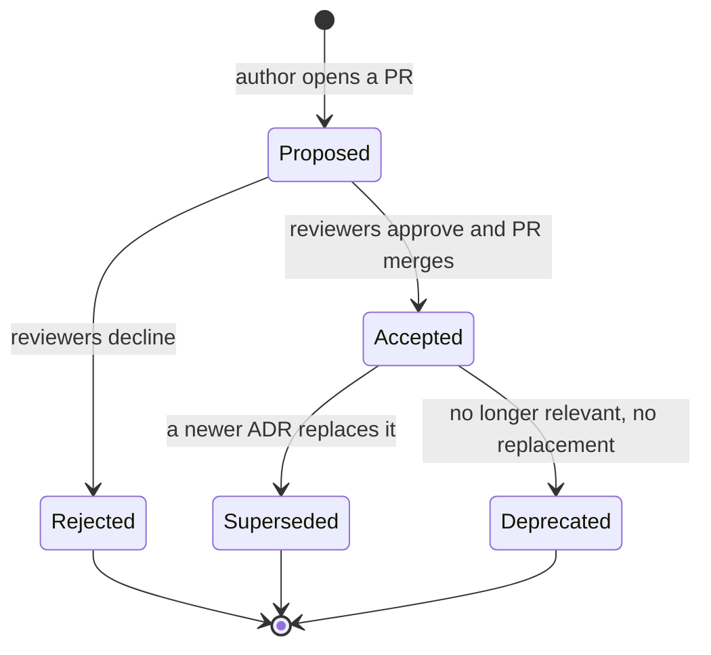
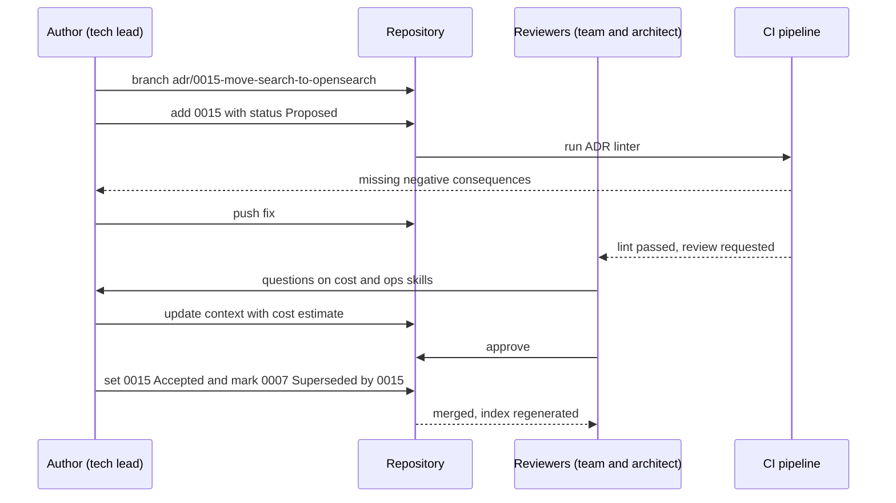

Every system is the sum of hundreds of decisions: which database, which message broker, how to authenticate, where to put the cache. Most teams make those decisions in meetings and chat threads, and six months later nobody can remember *why*. An Architecture Decision Record (ADR) is a one-to-two-page note that captures one decision, the situation that forced it, and what it costs. It lives in the repository, next to the code it explains.

## Learning objectives

By the end of this lesson you will be able to:

1. Explain what an ADR is, what problem it solves, and which decisions deserve one.
2. Write an ADR using the Nygard template and the richer MADR template.
3. Manage the status lifecycle: Proposed, Accepted, Rejected, Deprecated, Superseded.
4. Write a context section that a stranger understands, and consequences that include the downsides.
5. Run ADRs as part of normal engineering work: numbering, pull-request review, linking from code.
6. Build small C# tooling that parses, lints and indexes ADRs, and test it.

## Prerequisites

- [What is software architecture?](#/lesson/m02-what-is-architecture): ADRs record the decisions that are hard to change.
- [Functional and non-functional requirements](#/lesson/m02-requirements): good ADR context cites measurable requirements.
- [Business requirements and technical constraints](#/lesson/m02-constraints): constraints are often the real reason behind a decision.

Basic Git knowledge ([Git, branches, commits and code reviews](#/lesson/m01-git)) helps, because ADRs are reviewed as pull requests.

## Explain it like I'm a beginner

Imagine you move into a house and the kitchen sink is in an odd corner, far from the window. You think, "Silly design, I'll move it." You hire a plumber, open the wall, and discover the main drain pipe runs right there. Moving the sink costs ₹1.5 lakh. The original builder knew this. They just never wrote it down.

Software is full of odd-looking sinks. "Why do we use PostgreSQL full-text search instead of Elasticsearch?" "Why are invoices stored as immutable rows?" "Why does this service poll instead of using webhooks?" Without a record, new engineers either:

- **blindly accept** the decision, even when the reason no longer applies, or
- **blindly change** it, and rediscover the original problem the hard way.

An ADR is the note taped inside the cabinet: *"Sink is here because the main drain runs here. Moving it means re-routing the drain. Decided 2026-03-14 by the site team."* It is short. It is dated. And it is never edited later. If the decision changes, you write a **new** note that says "this replaces the old one".

Analogy two: a court judgement. It states the facts (context), the ruling (decision) and its effects (consequences). Later judgements can overrule it, but nobody rewrites the old judgement. They cite it.

## First-principles explanation

### What it is

An **Architecture Decision Record** captures a single *architecturally significant* decision. Michael Nygard proposed the format in 2011 with five parts:

1. **Title**: a short noun phrase with a number, such as "ADR-0007: Use PostgreSQL full-text search for document search".
2. **Status**: Proposed, Accepted, Rejected, Deprecated, or Superseded by ADR-N.
3. **Context**: the forces at play. Requirements, constraints, numbers, team skills, deadlines. Neutral language, no decision yet.
4. **Decision**: what we will do, in active voice. "We will…"
5. **Consequences**: what becomes easier, what becomes harder, and what we must now do. Good *and* bad.

The collection of ADRs for a system is the **decision log**. It usually lives in `docs/adr/` as numbered Markdown files: `0001-record-architecture-decisions.md`, `0002-…`.

### Why it exists

Decisions decay in three ways:

1. **Memory loss.** People leave or forget. In a team with typical turnover, within two or three years most of the people who made the early decisions may have moved on. The rationale goes with them.
2. **Context drift.** A decision made for 50 users may be wrong for 50,000. Without the recorded context, you can't tell whether the original reason still holds.
3. **Relitigating.** Without a record, the same debate repeats every time a new senior engineer joins. That can cost a team many meeting hours a year.

An ADR fixes all three at very low cost: typically 30–90 minutes to write, a few minutes per reviewer.

### What counts as architecturally significant

Write an ADR when a decision is **hard or expensive to reverse**, or **affects many people or components**. A practical checklist. Write one if any of these is true:

- It changes a **quality attribute** target: availability, latency, security, cost.
- It picks or replaces a **technology** that many components depend on: database, broker, identity provider, cloud service.
- It sets a **structural rule**: module boundaries, "services don't share databases", API versioning policy.
- It **constrains future work**, such as "all money is stored as `numeric(18,2)` in rupees".
- More than one reasonable option existed, and people disagreed.

Don't write one for choices that are cheap to change and local: a variable name, a private helper, which logging message to use. A team writing 1–4 ADRs a month is normal. A team writing 30 a month is probably documenting trivia.

### Immutability: the core rule

Once an ADR is **Accepted**, its context, decision and consequences are not edited. You can fix typos and add links. If the decision changes, you write a new ADR whose status says *Supersedes ADR-0007*, and you update the old one's status to *Superseded by ADR-0015*. That status line is the only thing you change on the old ADR.

Why so strict? Because the value of an ADR is that it shows what was known **at the time**. If you rewrite history, you lose the ability to say "that was the right call in March 2026 with what we knew".

### Status lifecycle

| Status | Meaning | Who moves it |
|---|---|---|
| **Proposed** | Draft under discussion, usually an open pull request | Author |
| **Accepted** | Agreed and in force | Reviewers approve, PR merged |
| **Rejected** | Considered and declined. Kept, so the option isn't proposed again without new facts | Reviewers |
| **Deprecated** | No longer applies, with no direct replacement (the feature was removed) | Any maintainer, via a small PR |
| **Superseded** | Replaced by a newer ADR, which is linked | The author of the new ADR |

Keeping **Rejected** ADRs is one of the most useful habits. "We looked at MongoDB in 2026 and rejected it because our reports need joins across six tables" saves the next debate.

### Templates

**Nygard** (minimal): Title, Status, Context, Decision, Consequences. Good default for most teams.

**MADR** (Markdown Any Decision Records) adds structure for bigger decisions:

- Context and problem statement
- **Decision drivers**: the criteria, such as "p95 search latency under 300 ms" or "no new infrastructure to operate"
- **Considered options**: at least two
- Decision outcome, with the chosen option and a short justification
- Pros and cons of each option
- Confirmation: how we'll check the decision is followed, such as an architecture test or a dashboard

**Y-statement**, a one-sentence format useful as a summary line:
*"In the context of document search for 2 million PDFs, facing a team of four with no search-cluster experience, we decided for PostgreSQL full-text search and against Elasticsearch, to achieve zero new infrastructure, accepting weaker relevance ranking and no fuzzy matching."*

### Writing good context

Context is the part most people write badly. Rules of thumb:

- **Write for a stranger in two years.** Spell out acronyms. Name the system, the users, the scale.
- **Use numbers.** "Search is slow" is useless. "Search over 1.8 M documents takes 2–6 s at p95 with `ILIKE '%term%'`, and users run about 4,000 searches a day" is useful.
- **State constraints and forces, including non-technical ones**: budget, deadline, team skills, compliance rules, existing contracts.
- **Stay neutral.** Context describes the problem, not the answer. If your context already argues for one option, readers can't tell whether others were fairly considered.
- **Link evidence**: benchmarks you ran, incident reports, cost estimates. Label estimates as estimates.

### Writing good consequences

Consequences are where honesty shows. Include three kinds:

- **Positive**: what becomes easier.
- **Negative**: what becomes harder, slower or more expensive. Every real decision has some. An ADR with no negatives is either trivial or not honest.
- **Follow-up actions**: new work this creates, such as "add a GIN index migration" or "re-evaluate when the corpus passes 10 M documents".

A **revisit trigger** is a gift to your future team: a measurable condition that would make this decision worth reopening.

### Trade-offs of using ADRs

| You gain | You pay |
|---|---|
| Rationale survives people leaving | 30–90 minutes per significant decision |
| Fewer repeated debates | Discipline: the log is only useful if it's complete |
| Faster onboarding (read 20 ADRs, understand the system's shape) | Risk of "ADR theatre": documents written after the fact to justify a done deal |
| A forcing function to compare at least two options | Old ADRs can mislead if nobody marks them deprecated |

### When ADRs are unnecessary

A two-person prototype that may be thrown away next month doesn't need a decision log. A short `DECISIONS.md` with one line per choice is enough. Start writing ADRs when the code is expected to live for more than a few months, or when more than one team touches it.

## Visual explanation

### Status lifecycle



How to read it: every ADR starts as **Proposed**. From there it is either **Accepted** or **Rejected**. An accepted ADR stays in force until a newer ADR **supersedes** it, or the thing it governs disappears and it becomes **Deprecated**. Rejected, Superseded and Deprecated are final states. Notice there is no arrow back from Accepted to Proposed: you never reopen an accepted ADR. You write a new one.

### How a decision becomes an ADR



This is the everyday workflow. The ADR is a pull request like any other change. CI runs a linter (we build one later) that catches missing sections. Reviewers ask questions in the PR, and the answers go *into the ADR*, not just into PR comments. On merge, the author flips the status to Accepted and updates the old ADR's status line. That status line is the only edit ever made to an accepted ADR. A script regenerates the index page.

## Step-by-step example

Scenario: a document-management module for an engineering consultancy. Users upload drawings, contracts and inspection reports as PDFs. They want to search inside them.

### Step 1 — notice that a decision is needed

The current search uses `WHERE extracted_text ILIKE '%' || @term || '%'`. A sequential scan over 1.8 million rows takes 2–6 seconds at p95 (measured on staging). Users complain. Two options are on the table: PostgreSQL full-text search, or a dedicated search engine such as Elasticsearch or OpenSearch. This is a technology choice, and it affects operations. That makes it ADR-worthy.

### Step 2 — draft the context, before deciding

```text
# 7. Use PostgreSQL full-text search for document search

Date: 2026-03-14

## Status

Proposed

## Context

The Document Library holds 1.8 M PDFs (drawings, contracts, inspection reports) with
text extracted at upload. Search currently uses ILIKE with leading wildcards, which
cannot use an index. Measured p95 latency on staging is 2-6 s. About 4,000 searches
run per working day (application logs, Feb 2026). Target: p95 under 500 ms.

Most searches are exact terms: drawing numbers, contract clause numbers, chainages.
Fuzzy matching was requested by 2 of 31 surveyed users.

The platform team is four engineers. Nobody has run a search cluster in production.
The hosting budget for FY 2026-27 allows no new always-on clusters without approval.
Data already lives in PostgreSQL 17 with nightly backups and point-in-time recovery.

Corpus growth is estimated (not measured) at 400 k documents a year.
```

Notice what's there: the scale, a measured baseline, a target, the shape of real queries, team skills, budget, and growth. Notice what's not there: any opinion about the answer.

### Step 3 — decide and state consequences honestly

```text
## Decision

We will use PostgreSQL full-text search: a generated tsvector column over title and
extracted text, a GIN index, websearch_to_tsquery for user input, and ts_rank for
ordering. We will not introduce Elasticsearch or OpenSearch at this time.

## Consequences

Positive
- No new infrastructure. Backups, failover and access control stay as they are.
- Search results are transactionally consistent with document metadata.
- Prototype on a staging copy: p95 of 40-120 ms for single-term queries.

Negative
- Relevance ranking is basic. No synonyms, no typo tolerance, no per-field boosting
  beyond setweight.
- Index build adds write cost on upload. Acceptable at ~1,600 uploads a day.
- Heavy search load shares CPU with transactional queries on the primary.

Follow-up
- Migration to add the column and index concurrently (ticket DOC-412).
- Route search to the read replica once it exists (ADR-0009).

Revisit when
- the corpus passes 10 M documents, or
- p95 search latency exceeds 500 ms for a week, or
- fuzzy or multilingual search becomes a contractual requirement.
```

### Step 4 — review and accept

The ADR goes up as a PR. A reviewer asks: "What about Hindi-language documents?" The author adds a line to the context ("fewer than 1 % of documents are in Hindi, the `simple` text-search configuration handles exact-term matches for them") and a revisit trigger. The PR merges, and the status becomes Accepted.

### Step 5 — eighteen months later, supersede it

The firm wins a large state contract. The contract requires multilingual, typo-tolerant search over 14 M documents. Two revisit triggers have fired. A new ADR-0015, "Move document search to OpenSearch", cites ADR-0007 and explains what changed. ADR-0007's status line becomes "Superseded by ADR-0015". Nobody needs to argue about whether ADR-0007 was a mistake. It records that it was the right call for its time.

## Production-style C# implementation

ADRs are plain text, but small tools make them pleasant to use: a linter in CI, an index generator and an endpoint that shows the decision log in an internal portal. Here is a compact, testable ADR toolkit.

```text
DecisionLog/
  Program.cs                 minimal API: GET /adrs, GET /adrs/{n}, GET /adrs/lint
  Adr/AdrStatus.cs           status enum and lifecycle rules
  Adr/AdrDocument.cs         parsed record
  Adr/AdrParser.cs           Markdown to AdrDocument
  Adr/AdrLinter.cs           rules: sections present, honest consequences, links valid
  Adr/AdrIndexBuilder.cs     README table
  Adr/AdrSource.cs           where ADR files come from
```

```csharp file=Adr/AdrStatus.cs
namespace DecisionLog.Adr;

public enum AdrStatus { Proposed, Accepted, Rejected, Deprecated, Superseded }

public static class AdrLifecycle
{
    private static readonly Dictionary<AdrStatus, AdrStatus[]> Allowed = new()
    {
        [AdrStatus.Proposed] = [AdrStatus.Accepted, AdrStatus.Rejected],
        [AdrStatus.Accepted] = [AdrStatus.Superseded, AdrStatus.Deprecated],
        [AdrStatus.Rejected] = [],
        [AdrStatus.Deprecated] = [],
        [AdrStatus.Superseded] = [],
    };

    public static bool CanMove(AdrStatus from, AdrStatus to) => Allowed[from].Contains(to);

    public static bool IsFinal(AdrStatus s) => Allowed[s].Length == 0;
}
```

```csharp file=Adr/AdrDocument.cs
namespace DecisionLog.Adr;

public sealed record AdrDocument(
    int Number,
    string Title,
    DateOnly? Date,
    AdrStatus Status,
    int? SupersededBy,
    IReadOnlyList<int> Supersedes,
    IReadOnlyDictionary<string, string> Sections)
{
    public string Section(string name) => Sections.TryGetValue(name, out var s) ? s : "";
}

public sealed record AdrParseResult(AdrDocument? Document, IReadOnlyList<string> Errors);
```

The parser understands the format produced by the common `adr-tools` command-line tool: an H1 of the form `# 7. Title`, an optional `Date:` line, and H2 sections. Status lines such as `Superseded by [ADR-0015](0015-move-search.md)` are parsed for numbers.

```csharp file=Adr/AdrParser.cs
using System.Globalization;
using System.Text.RegularExpressions;

namespace DecisionLog.Adr;

public static partial class AdrParser
{
    [GeneratedRegex(@"^#\s+(\d+)\.\s+(.+)$")] private static partial Regex TitleLine();
    [GeneratedRegex(@"^Date:\s*(\d{4}-\d{2}-\d{2})\s*$")] private static partial Regex DateLine();
    [GeneratedRegex(@"^##\s+(.+?)\s*$")] private static partial Regex SectionLine();
    [GeneratedRegex(@"(?i)superseded\s+by\s+\[?ADR-?0*(\d+)")] private static partial Regex SupersededByRef();
    [GeneratedRegex(@"(?i)supersedes\s+\[?ADR-?0*(\d+)")] private static partial Regex SupersedesRef();

    public static AdrParseResult Parse(string markdown)
    {
        var errors = new List<string>();
        var lines = markdown.Replace("\r\n", "\n").Split('\n');
        int? number = null; string? title = null; DateOnly? date = null;
        var sections = new Dictionary<string, List<string>>(StringComparer.OrdinalIgnoreCase);
        List<string>? current = null;

        foreach (var raw in lines)
        {
            var line = raw.TrimEnd();
            if (number is null && TitleLine().Match(line) is { Success: true } t)
            {
                number = int.Parse(t.Groups[1].Value, CultureInfo.InvariantCulture);
                title = t.Groups[2].Value.Trim();
                continue;
            }
            if (current is null && DateLine().Match(line) is { Success: true } d)
            {
                date = DateOnly.ParseExact(d.Groups[1].Value, "yyyy-MM-dd", CultureInfo.InvariantCulture);
                continue;
            }
            if (SectionLine().Match(line) is { Success: true } s)
            {
                current = new List<string>();
                sections[s.Groups[1].Value] = current;
                continue;
            }
            current?.Add(line);
        }

        if (number is null || title is null) errors.Add("Missing title line of the form '# 7. Title'.");
        var statusText = sections.TryGetValue("Status", out var st) ? string.Join("\n", st).Trim() : "";
        AdrStatus? status = ParseStatus(statusText);
        if (status is null) errors.Add($"Unknown or missing status '{statusText}'.");
        if (errors.Count > 0) return new AdrParseResult(null, errors);

        var supersededBy = SupersededByRef().Match(statusText) is { Success: true } sb
            ? int.Parse(sb.Groups[1].Value, CultureInfo.InvariantCulture) : (int?)null;
        var supersedes = SupersedesRef().Matches(statusText)
            .Select(m => int.Parse(m.Groups[1].Value, CultureInfo.InvariantCulture)).ToList();

        var doc = new AdrDocument(number!.Value, title!, date, status!.Value, supersededBy, supersedes,
            sections.ToDictionary(kv => kv.Key, kv => string.Join("\n", kv.Value).Trim(), StringComparer.OrdinalIgnoreCase));
        return new AdrParseResult(doc, errors);
    }

    /// <summary>The first word of the first non-empty status line decides the status.</summary>
    public static AdrStatus? ParseStatus(string statusText)
    {
        var first = statusText.Split('\n').Select(l => l.Trim()).FirstOrDefault(l => l.Length > 0);
        if (first is null) return null;
        var word = first.Split(' ', StringSplitOptions.RemoveEmptyEntries)[0];
        return Enum.TryParse<AdrStatus>(word, ignoreCase: true, out var s) ? s : null;
    }
}
```

The linter encodes the writing rules from this lesson. Some are hard errors; others are heuristics, labelled as warnings, because no regex can judge whether a context section is good.

```csharp file=Adr/AdrLinter.cs
namespace DecisionLog.Adr;

public enum LintSeverity { Warning, Error }
public sealed record LintIssue(int AdrNumber, LintSeverity Severity, string Message);

public sealed class AdrLinter
{
    private static readonly string[] Required = ["Status", "Context", "Decision", "Consequences"];
    // Heuristic only: words that usually signal a downside has been written down.
    private static readonly string[] DownsideWords = ["negative", "cost", "harder", "slower", "risk", "downside", "lose", "trade-off", "accepting"];

    public IReadOnlyList<LintIssue> Lint(IReadOnlyList<AdrDocument> adrs)
    {
        var issues = new List<LintIssue>();
        var byNumber = new Dictionary<int, AdrDocument>();
        foreach (var a in adrs)
            if (!byNumber.TryAdd(a.Number, a)) issues.Add(new(a.Number, LintSeverity.Error, $"Duplicate ADR number {a.Number}."));

        foreach (var a in adrs)
        {
            foreach (var name in Required)
                if (string.IsNullOrWhiteSpace(a.Section(name)))
                    issues.Add(new(a.Number, LintSeverity.Error, $"Section '{name}' is missing or empty."));

            var contextWords = a.Section("Context").Split((char[]?)null, StringSplitOptions.RemoveEmptyEntries).Length;
            if (contextWords is > 0 and < 40)
                issues.Add(new(a.Number, LintSeverity.Warning, $"Context has only {contextWords} words. Would a stranger understand it?"));

            if (!a.Section("Context").Any(char.IsDigit))
                issues.Add(new(a.Number, LintSeverity.Warning, "Context contains no numbers. Add scale, latency, cost or dates."));

            var consequences = a.Section("Consequences");
            if (consequences.Length > 0 && !DownsideWords.Any(w => consequences.Contains(w, StringComparison.OrdinalIgnoreCase)))
                issues.Add(new(a.Number, LintSeverity.Warning, "Consequences list no downsides. Every real decision has some."));

            if (a.Status == AdrStatus.Superseded)
            {
                if (a.SupersededBy is not int next)
                    issues.Add(new(a.Number, LintSeverity.Error, "Status is Superseded but no 'Superseded by ADR-N' link."));
                else if (!byNumber.TryGetValue(next, out var successor))
                    issues.Add(new(a.Number, LintSeverity.Error, $"Superseded by ADR-{next}, which does not exist."));
                else if (!successor.Supersedes.Contains(a.Number))
                    issues.Add(new(a.Number, LintSeverity.Warning, $"ADR-{next} does not say it supersedes ADR-{a.Number}."));
            }
        }
        return issues.OrderBy(i => i.AdrNumber).ThenByDescending(i => i.Severity).ToList();
    }
}
```

```csharp file=Adr/AdrIndexBuilder.cs
using System.Text;

namespace DecisionLog.Adr;

public static class AdrIndexBuilder
{
    public static string Build(IEnumerable<AdrDocument> adrs)
    {
        var sb = new StringBuilder();
        sb.AppendLine("| ADR | Title | Status | Date |");
        sb.AppendLine("|---|---|---|---|");
        foreach (var a in adrs.OrderBy(a => a.Number))
        {
            var status = a.Status == AdrStatus.Superseded && a.SupersededBy is int n
                ? $"Superseded by ADR-{n:0000}" : a.Status.ToString();
            sb.AppendLine($"| ADR-{a.Number:0000} | {a.Title.Replace("|", "\\|")} | {status} | {a.Date?.ToString("yyyy-MM-dd") ?? "-"} |");
        }
        return sb.ToString();
    }
}
```

```csharp file=Adr/AdrSource.cs
namespace DecisionLog.Adr;

public interface IAdrSource
{
    IEnumerable<(string FileName, string Markdown)> ReadAll();
}

public sealed class AdrFolderOptions { public string Path { get; set; } = "docs/adr"; }

public sealed class FileSystemAdrSource(Microsoft.Extensions.Options.IOptions<AdrFolderOptions> options) : IAdrSource
{
    public IEnumerable<(string FileName, string Markdown)> ReadAll()
    {
        var dir = options.Value.Path;
        if (!Directory.Exists(dir)) yield break;
        foreach (var f in Directory.EnumerateFiles(dir, "*.md").Order(StringComparer.Ordinal))
            if (char.IsDigit(System.IO.Path.GetFileName(f)[0]))
                yield return (System.IO.Path.GetFileName(f), File.ReadAllText(f));
    }
}

public sealed class DecisionLogService(IAdrSource source)
{
    public (IReadOnlyList<AdrDocument> Adrs, IReadOnlyList<string> ParseErrors) Load()
    {
        var adrs = new List<AdrDocument>();
        var errors = new List<string>();
        foreach (var (file, md) in source.ReadAll())
        {
            var r = AdrParser.Parse(md);
            if (r.Document is not null) adrs.Add(r.Document);
            else errors.AddRange(r.Errors.Select(e => $"{file}: {e}"));
        }
        return (adrs, errors);
    }
}
```

```csharp file=Program.cs
using DecisionLog.Adr;

var builder = WebApplication.CreateBuilder(args);
builder.Services.Configure<AdrFolderOptions>(builder.Configuration.GetSection("DecisionLog"));
builder.Services.AddSingleton<IAdrSource, FileSystemAdrSource>();
builder.Services.AddSingleton<DecisionLogService>();
builder.Services.AddSingleton<AdrLinter>();

var app = builder.Build();

app.MapGet("/adrs", (DecisionLogService log) =>
{
    var (adrs, _) = log.Load();
    return Results.Text(AdrIndexBuilder.Build(adrs), "text/markdown");
});

app.MapGet("/adrs/{number:int}", (int number, DecisionLogService log) =>
    log.Load().Adrs.FirstOrDefault(a => a.Number == number) is { } adr ? Results.Ok(adr) : Results.NotFound());

app.MapGet("/adrs/lint", (DecisionLogService log, AdrLinter linter) =>
{
    var (adrs, parseErrors) = log.Load();
    return Results.Ok(new { parseErrors, issues = linter.Lint(adrs) });
});

app.Run();
```

In CI you would run the same parser and linter from a small console project or a unit test, and fail the build on any `Error`. Warnings show up in the PR for reviewers to judge.

### Tooling you can use instead of building

- **adr-tools** (a shell script by Nat Pryce): `adr new "Use PostgreSQL full-text search"` creates the next numbered file. `adr new -s 7 "Move search to OpenSearch"` creates a new ADR and updates ADR-7's status for you.
- **MADR templates**: copy the Markdown template into `docs/adr/`.
- **Log4brains**: generates a static website from an ADR folder.
- **Your wiki or docs platform**: workable, but ADRs next to the code get reviewed with the code and versioned with it. That's usually the better default.

## Bad design vs good design

**Bad ADR:**

```text
# 12. Use Redis

## Status
Accepted

## Context
We need caching.

## Decision
Use Redis because it is fast and industry standard.

## Consequences
Faster app.
```

Problems:

- **Context** gives no scale, no latency numbers, no reason caching is needed, no constraints. A reader can't tell whether this still applies.
- **Decision** justifies with slogans ("fast", "industry standard") instead of the forces in the context.
- **Consequences** list no downsides. Redis adds a network hop, a new failure mode (cache down), cache-invalidation work and infrastructure cost.
- **No alternatives**. Was in-process `IMemoryCache` or `HybridCache` considered? For a single-instance app it may have been enough.

**Good version (abridged):**

```text
# 12. Use a shared Redis cache for tender search results

## Status
Accepted

## Context
The tender portal runs 3 API instances behind a load balancer. Tender search
(p95 1.4 s, measured) is called about 90 k times a day, and 70 % of calls repeat
one of ~2,000 popular filter combinations (log sample, 7 days). Results may be up
to 5 minutes stale per product owner. Each instance caching separately would give
a lower hit ratio and inconsistent results between instances. The ops team
already runs a managed Redis for sessions.

## Decision
We will cache tender search results in the existing managed Redis via HybridCache
(in-process L1 plus Redis L2), keyed by normalised filter, with a 5 minute TTL.

## Consequences
Positive: estimated p95 under 50 ms for cache hits, less load on PostgreSQL.
Negative: results can be up to 5 minutes stale; a Redis outage falls back to the
database at full load, so the DB must still handle peak without cache.
Follow-up: add hit-ratio and fallback-rate metrics.
Revisit when: product requires real-time tender status in search results.
```

:::callout type=mistake title="ADR theatre"
Writing ADRs after the code ships, to justify choices already made, produces documents with neutral-sounding context that was never actually weighed. Reviewers can often spot it: there are no rejected options, and no downsides. Write the ADR while the decision is still open, even if it's a 20-line draft.
:::

:::callout type=tip title="Link code to decisions"
A short comment such as `// See ADR-0007: why search uses tsvector` next to surprising code turns the ADR into a just-in-time explanation. Don't copy the ADR into the comment. Link it.
:::

## Practical playground

The playground parses a small ADR and runs three lint rules on it. Run it, read the warnings, then edit the ADR text until it is clean. Try adding a numeric fact to the context and a real downside to the consequences.

:::playground type=csharp title="Lint an ADR"
```csharp file=Program.cs
using System;
using System.Collections.Generic;
using System.Linq;

public static class MiniAdrLinter
{
    public static Dictionary<string, string> Sections(string md)
    {
        var result = new Dictionary<string, string>(StringComparer.OrdinalIgnoreCase);
        string? current = null;
        foreach (var line in md.Split('\n'))
        {
            if (line.StartsWith("## ")) { current = line[3..].Trim(); result[current] = ""; continue; }
            if (current is not null) result[current] += line + "\n";
        }
        return result;
    }

    public static IEnumerable<string> Lint(string md)
    {
        var s = Sections(md);
        foreach (var name in new[] { "Status", "Context", "Decision", "Consequences" })
            if (!s.TryGetValue(name, out var body) || string.IsNullOrWhiteSpace(body)) yield return $"ERROR: '{name}' missing";
        if (s.TryGetValue("Context", out var ctx) && !ctx.Any(char.IsDigit)) yield return "WARN: context has no numbers";
        var downs = new[] { "negative", "cost", "harder", "risk", "slower" };
        if (s.TryGetValue("Consequences", out var cons) && !downs.Any(d => cons.Contains(d, StringComparison.OrdinalIgnoreCase)))
            yield return "WARN: no downsides listed";
    }
}

public static class Program
{
    public static void Main()
    {
        var adr = """
            # 3. Use RabbitMQ for notification fan-out

            ## Status
            Proposed

            ## Context
            We send notifications to users.

            ## Decision
            We will publish NotificationRequested events to RabbitMQ.

            ## Consequences
            Notifications are decoupled from the request path.
            """;
        var issues = MiniAdrLinter.Lint(adr).ToList();
        Console.WriteLine(issues.Count == 0 ? "Clean ADR" : string.Join(Environment.NewLine, issues));
    }
}
```
:::

## Exercises

:::exercise id=m02-adr-ex1 difficulty=beginner kind=written title="Write your first ADR"
A small team builds an internal attendance app for 300 site staff across 12 project offices. It runs as **one** ASP.NET Core instance on a single VM. The employee master list (about 300 rows) is read on almost every request and changes maybe twice a week. A developer proposes adding Redis. Another says `IMemoryCache` is enough.

Write a full ADR (Nygard format) that records the decision you would make. Use realistic numbers and include at least two negative consequences and one revisit trigger.
::acceptance
- Title is numbered and states the decision, not just the topic.
- Context mentions the single instance, the data size, the change rate, and at least one constraint.
- Context is neutral: it doesn't argue for an option.
- Decision is in active voice ("We will…").
- Consequences include positives, at least two negatives, and a revisit trigger.
::hint
What problem does a *shared* cache solve? Does a single instance have that problem?
::hint
300 rows of employee data is tiny. Estimate its memory size in kilobytes.
::hint
Negatives of an in-process cache: lost on restart, and becomes inconsistent if a second instance is ever added. What about staleness after an edit?
::hint
A revisit trigger should be measurable, such as "when we run more than one instance".
::solution
```text
# 4. Cache the employee master in process with IMemoryCache

Date: 2026-10-20

## Status

Accepted

## Context

The attendance app serves 300 site staff in 12 project offices from a single
ASP.NET Core instance on one VM. Nearly every request reads the employee master
(about 300 rows, roughly 150 KB serialised, estimated). The list changes about
twice a week through the HR admin screen. Reading it from PostgreSQL adds an
estimated 5-15 ms per request. There is no ops support for new infrastructure;
the team is two developers. A proposal exists to add Redis, and another to use
in-process caching.

## Decision

We will cache the employee master in process using IMemoryCache with a 10 minute
absolute expiry, and evict the entry immediately when the HR admin screen saves
a change. We will not add Redis now.

## Consequences

Positive
- No new infrastructure, no network hop, nothing new to secure or monitor.
- Employee lookups become in-memory reads.

Negative
- The cache is lost on every restart or deployment, so the first requests after
  a deploy hit the database.
- If a second instance is added, edits on one instance will not evict the other
  instance's cache, so users may see stale data for up to 10 minutes.
- Edits made directly in the database (bypassing the admin screen) are not seen
  for up to 10 minutes.

Revisit when
- we run more than one app instance, or
- the employee master grows past about 50,000 rows.
```
The key insight: Redis solves *sharing* across instances. With one instance, that problem doesn't exist yet.
::mistakes
- Writing "Redis is overkill" in the context. That's the decision leaking into the context.
- Listing only positives.
- Forgetting that an in-process cache becomes a consistency problem the moment you scale out.
:::

:::exercise id=m02-adr-ex2 difficulty=beginner kind=code title="Enforce the status lifecycle"
Implement `AdrStatusRules.Move`. It returns the new status when the transition is allowed, and throws `InvalidAdrTransitionException` otherwise.
::requirements
- Proposed → Accepted or Rejected.
- Accepted → Superseded or Deprecated.
- Rejected, Superseded and Deprecated are final.
- Moving to the same status is not allowed.
- `IsFinal(status)` returns true for the three final statuses.
::acceptance
- Proposed → Accepted works.
- Accepted → Proposed throws (no reopening).
- Rejected → Accepted throws.
- `IsFinal` is correct for all five statuses.
::hint
This is a tiny state machine. A dictionary from status to the set of allowed next statuses is enough.
::hint
`IsFinal` is "the allowed set is empty".
::hint
```csharp
private static readonly Dictionary<AdrState, AdrState[]> Next = new() { [AdrState.Proposed] = new[] { AdrState.Accepted, AdrState.Rejected }, ... };
```
::starter
```csharp file=AdrStatusRules.cs
using System;
using System.Collections.Generic;
using System.Linq;

public enum AdrState { Proposed, Accepted, Rejected, Deprecated, Superseded }

public sealed class InvalidAdrTransitionException(AdrState from, AdrState to)
    : Exception($"An ADR cannot move from {from} to {to}.")
{
    public AdrState From { get; } = from;
    public AdrState To { get; } = to;
}

public static class AdrStatusRules
{
    public static AdrState Move(AdrState from, AdrState to) => throw new NotImplementedException();
    public static bool IsFinal(AdrState state) => throw new NotImplementedException();
}
```
::tests
```csharp file=AdrStatusRulesTests.cs
using Xunit;

public class AdrStatusRulesTests
{
    [Theory]
    [InlineData(AdrState.Proposed, AdrState.Accepted)]
    [InlineData(AdrState.Proposed, AdrState.Rejected)]
    [InlineData(AdrState.Accepted, AdrState.Superseded)]
    [InlineData(AdrState.Accepted, AdrState.Deprecated)]
    public void Allowed(AdrState from, AdrState to) => Assert.Equal(to, AdrStatusRules.Move(from, to));

    [Theory]
    [InlineData(AdrState.Accepted, AdrState.Proposed)]
    [InlineData(AdrState.Rejected, AdrState.Accepted)]
    [InlineData(AdrState.Superseded, AdrState.Accepted)]
    [InlineData(AdrState.Proposed, AdrState.Proposed)]
    [InlineData(AdrState.Proposed, AdrState.Superseded)]
    public void Forbidden(AdrState from, AdrState to)
    {
        var ex = Assert.Throws<InvalidAdrTransitionException>(() => AdrStatusRules.Move(from, to));
        Assert.Equal(from, ex.From);
    }

    [Fact]
    public void Final_states()
    {
        Assert.False(AdrStatusRules.IsFinal(AdrState.Proposed));
        Assert.False(AdrStatusRules.IsFinal(AdrState.Accepted));
        Assert.True(AdrStatusRules.IsFinal(AdrState.Rejected));
        Assert.True(AdrStatusRules.IsFinal(AdrState.Deprecated));
        Assert.True(AdrStatusRules.IsFinal(AdrState.Superseded));
    }
}
```
::solution
```csharp file=AdrStatusRules.cs
using System;
using System.Collections.Generic;
using System.Linq;

public enum AdrState { Proposed, Accepted, Rejected, Deprecated, Superseded }

public sealed class InvalidAdrTransitionException(AdrState from, AdrState to)
    : Exception($"An ADR cannot move from {from} to {to}.")
{
    public AdrState From { get; } = from;
    public AdrState To { get; } = to;
}

public static class AdrStatusRules
{
    private static readonly Dictionary<AdrState, AdrState[]> Next = new()
    {
        [AdrState.Proposed] = new[] { AdrState.Accepted, AdrState.Rejected },
        [AdrState.Accepted] = new[] { AdrState.Superseded, AdrState.Deprecated },
        [AdrState.Rejected] = Array.Empty<AdrState>(),
        [AdrState.Deprecated] = Array.Empty<AdrState>(),
        [AdrState.Superseded] = Array.Empty<AdrState>(),
    };

    public static AdrState Move(AdrState from, AdrState to) =>
        Next[from].Contains(to) ? to : throw new InvalidAdrTransitionException(from, to);

    public static bool IsFinal(AdrState state) => Next[state].Length == 0;
}
```
The table *is* the policy. Anyone reading it sees the whole lifecycle in five lines, which is the same reason the lesson's state diagram is useful.
::mistakes
- Allowing Accepted → Proposed "to rework it". That breaks immutability. Write a new ADR instead.
- Allowing Proposed → Superseded. A proposal that's replaced before acceptance is simply Rejected, or withdrawn and deleted.
:::

:::exercise id=m02-adr-ex3 difficulty=intermediate kind=code title="Parse an ADR file"
Implement `SimpleAdrParser.Parse` for the adr-tools Markdown format, returning the number, title, status and a dictionary of sections.
::requirements
- The title line is `# <number>. <title>`. It must be the first non-empty line.
- Sections start with `## <Name>`. Section bodies are trimmed. Section names are case-insensitive keys.
- Status is the first word of the first non-empty line in the Status section, parsed case-insensitively into `AdrKind`.
- Return a list of errors instead of throwing: missing title line, missing Status section, unknown status word.
- Handle both `\n` and `\r\n` line endings.
::acceptance
- A well-formed ADR parses with zero errors and correct sections.
- `# Use Kafka` (no number) gives a title error.
- Status `Approved` (not a valid word) gives a status error.
- Windows line endings parse the same as Unix ones.
::hint
Normalise line endings first, then walk the lines once, keeping track of the "current section".
::hint
A regex `^#\s+(\d+)\.\s+(.+)$` captures the number and title. Note `#` followed by a space, not `##`.
::hint
Use a `Dictionary<string, List<string>>` with `StringComparer.OrdinalIgnoreCase` and join and trim each list at the end.
::hint
For the status: take `sections["Status"]`, split into lines, find the first non-empty, split on spaces, `Enum.TryParse(word, true, out AdrKind k)`.
::starter
```csharp file=SimpleAdrParser.cs
using System;
using System.Collections.Generic;
using System.Linq;
using System.Text.RegularExpressions;

public enum AdrKind { Proposed, Accepted, Rejected, Deprecated, Superseded }

public sealed record ParsedAdr(int Number, string Title, AdrKind Status, IReadOnlyDictionary<string, string> Sections);

public sealed record ParseOutcome(ParsedAdr? Adr, IReadOnlyList<string> Errors);

public static class SimpleAdrParser
{
    public static ParseOutcome Parse(string markdown) => throw new NotImplementedException();
}
```
::tests
```csharp file=SimpleAdrParserTests.cs
using Xunit;

public class SimpleAdrParserTests
{
    private const string Good = "# 7. Use PostgreSQL full-text search\n\nDate: 2026-03-14\n\n## Status\n\nAccepted\n\n## Context\n\n1.8 M PDFs, p95 2-6 s.\n\n## Decision\n\nWe will use tsvector and GIN.\n\n## Consequences\n\nNegative: basic ranking.\n";

    [Fact]
    public void Parses_good_adr()
    {
        var r = SimpleAdrParser.Parse(Good);
        Assert.Empty(r.Errors);
        Assert.Equal(7, r.Adr!.Number);
        Assert.Equal("Use PostgreSQL full-text search", r.Adr.Title);
        Assert.Equal(AdrKind.Accepted, r.Adr.Status);
        Assert.Equal("We will use tsvector and GIN.", r.Adr.Sections["decision"]);
    }

    [Fact]
    public void Missing_number_is_an_error()
    {
        var r = SimpleAdrParser.Parse("# Use Kafka\n\n## Status\nProposed\n");
        Assert.Null(r.Adr);
        Assert.Contains(r.Errors, e => e.Contains("title"));
    }

    [Fact]
    public void Unknown_status_is_an_error()
    {
        var r = SimpleAdrParser.Parse("# 3. Use Kafka\n\n## Status\nApproved by architect\n");
        Assert.Null(r.Adr);
        Assert.Contains(r.Errors, e => e.Contains("status"));
    }

    [Fact]
    public void Missing_status_section_is_an_error() =>
        Assert.Contains(SimpleAdrParser.Parse("# 3. Use Kafka\n\n## Context\nX\n").Errors, e => e.Contains("status"));

    [Fact]
    public void Windows_line_endings()
    {
        var r = SimpleAdrParser.Parse(Good.Replace("\n", "\r\n"));
        Assert.Empty(r.Errors);
        Assert.Equal("1.8 M PDFs, p95 2-6 s.", r.Adr!.Sections["Context"]);
    }

    [Fact]
    public void Status_first_word_wins() =>
        Assert.Equal(AdrKind.Superseded, SimpleAdrParser.Parse("# 7. X\n## Status\n\nSuperseded by ADR-0015\n").Adr!.Status);
}
```
::solution
```csharp file=SimpleAdrParser.cs
using System;
using System.Collections.Generic;
using System.Linq;
using System.Text.RegularExpressions;

public enum AdrKind { Proposed, Accepted, Rejected, Deprecated, Superseded }

public sealed record ParsedAdr(int Number, string Title, AdrKind Status, IReadOnlyDictionary<string, string> Sections);

public sealed record ParseOutcome(ParsedAdr? Adr, IReadOnlyList<string> Errors);

public static class SimpleAdrParser
{
    private static readonly Regex Title = new(@"^#\s+(\d+)\.\s+(.+)$");
    private static readonly Regex Section = new(@"^##\s+(.+?)\s*$");

    public static ParseOutcome Parse(string markdown)
    {
        var lines = markdown.Replace("\r\n", "\n").Split('\n');
        var errors = new List<string>();
        int? number = null; string? title = null;
        var sections = new Dictionary<string, List<string>>(StringComparer.OrdinalIgnoreCase);
        List<string>? current = null;
        var seenContent = false;

        foreach (var raw in lines)
        {
            var line = raw.TrimEnd();
            if (!seenContent && line.Length > 0)
            {
                seenContent = true;
                var t = Title.Match(line);
                if (t.Success) { number = int.Parse(t.Groups[1].Value); title = t.Groups[2].Value.Trim(); continue; }
            }
            var s = Section.Match(line);
            if (s.Success) { current = new List<string>(); sections[s.Groups[1].Value] = current; continue; }
            current?.Add(line);
        }

        if (number is null) errors.Add("Missing title line '# <number>. <title>'.");

        AdrKind? status = null;
        if (!sections.TryGetValue("Status", out var statusLines)) errors.Add("Missing status section.");
        else
        {
            var first = statusLines.Select(l => l.Trim()).FirstOrDefault(l => l.Length > 0);
            var word = first?.Split(' ', StringSplitOptions.RemoveEmptyEntries)[0];
            if (word is not null && Enum.TryParse<AdrKind>(word, true, out var k)) status = k;
            else errors.Add($"Unknown status '{first}'.");
        }

        if (errors.Count > 0) return new ParseOutcome(null, errors);

        var bodies = sections.ToDictionary(kv => kv.Key, kv => string.Join("\n", kv.Value).Trim(), StringComparer.OrdinalIgnoreCase);
        return new ParseOutcome(new ParsedAdr(number!.Value, title!, status!.Value, bodies), errors);
    }
}
```
Returning errors instead of throwing lets a linter report every broken file in one CI run, rather than stopping at the first one.
::mistakes
- Matching `##` lines as titles because the regex was `^#+`.
- Forgetting that `Enum.TryParse` accepts numbers: `"1"` parses as `Accepted`. If that matters, also check `Enum.IsDefined` and that the word is not numeric.
- Building the dictionary with the default comparer, so `Sections["decision"]` fails.
::extensions
Parse `Date:` and the `Superseded by ADR-N` link, and add the `Decision drivers` and `Considered options` sections from MADR.
:::

:::exercise id=m02-adr-ex4 difficulty=intermediate kind=written title="Repair a weak ADR"
Here is a real-looking ADR from a payroll project:

```text
# 9. Microservices

## Status
Accepted

## Context
Monoliths don't scale and microservices are the modern best practice.
Netflix and Amazon use them.

## Decision
We will split the payroll system into microservices.

## Consequences
The system will be scalable and the teams will be independent.
```

The payroll system serves 2,400 employees of one company, is built by a team of five, and runs a monthly payroll batch that currently takes 40 minutes. The deadline for the batch is 4 hours.

1. List every problem with this ADR.
2. Rewrite it with an honest context and consequences. You may change the decision if the facts don't support it.
::acceptance
- At least five distinct problems are named (context, decision, consequences, alternatives, evidence).
- The rewritten context uses the given numbers and is neutral.
- The rewrite either changes the decision, or justifies microservices from the facts. Most good answers change it.
- Consequences include real downsides and a revisit trigger.
::hint
Check the context for numbers. Are there any? Is it about *this* system or about Netflix?
::hint
Does a 40-minute batch with a 4-hour deadline have a scaling problem?
::hint
What does running microservices cost a team of five? Think about deployment, monitoring, data consistency across services, and on-call.
::hint
A modular monolith keeps one deployable app but enforces module boundaries. Is that a better fit?
::solution
**Problems:**

1. Context argues for an answer ("monoliths don't scale") instead of describing the situation.
2. Appeals to authority (Netflix, Amazon), whose scale and team size bear no resemblance to this system.
3. No numbers: users, load, batch time, deadline, team size.
4. No alternatives considered: modular monolith, or keeping the monolith and fixing hot spots.
5. Decision is vague: which services, split along which boundaries, sharing which data?
6. Consequences are only positive. No mention of distributed transactions, operational cost, or network failure.
7. Title is a topic, not a decision.

**Rewrite:**

```text
# 9. Keep payroll as a modular monolith with enforced module boundaries

## Status
Accepted

## Context
Payroll serves 2,400 employees of one company. The monthly batch takes 40 minutes
against a 4-hour deadline. The team is five developers sharing one on-call rota.
Pain points reported in the Q3 retrospective are merge conflicts in the shared
PayrollService class and slow builds (about 9 minutes), not runtime load.
A proposal exists to split the system into microservices. Options considered:
(a) microservices per domain area, (b) modular monolith with separate modules
for employees, attendance, pay calculation and statutory filings,
(c) keep the current structure and refactor the shared service.

## Decision
We will restructure payroll into a modular monolith (option b): one deployable
app, one PostgreSQL database with a schema per module, modules talking only
through public interfaces, enforced by architecture tests in CI.

## Consequences
Positive
- Addresses the real pain (shared code ownership) without distributed systems.
- Pay calculation stays in one database transaction.
Negative
- Modules still deploy together, so one module's bug can block another's release.
- One process: a memory leak in one module affects all.
- Refactoring effort estimated at 6-8 developer-weeks.
Revisit when
- a module needs independent scaling, a different release cadence, or a separate
  team owns it, or
- the batch time exceeds 2 hours.
```
::mistakes
- Fixing the wording but keeping a decision the facts don't support.
- Rewriting with only positives again ("the modular monolith is simpler").
- Forgetting to list the rejected options, so the microservices debate restarts next quarter.
:::

:::exercise id=m02-adr-ex5 difficulty=advanced kind=code title="Resolve supersession chains"
Given a set of ADRs, find the decision that is **currently in force** for any ADR number, and report broken chains.
::requirements
- `Current(n)` follows `SupersededBy` links from ADR `n` until it reaches an ADR with no successor, and returns that ADR's number.
- If the chain points to a missing ADR, throw `BrokenAdrChainException` naming the missing number.
- If the chain loops (7 → 15 → 7), throw `BrokenAdrChainException` naming the cycle.
- `Validate()` returns all problems without throwing, sorted by ADR number: missing target, cycle, a `Superseded` status with no link, and a link on an ADR whose status is not `Superseded`.
- A chain that ends at a `Deprecated` or `Rejected` ADR is still valid. `Current` returns it, and the caller decides what to show.
::acceptance
- 7 → 15 → 21 returns 21 for `Current(7)` and `Current(15)`.
- An ADR with no successor returns itself.
- Missing target and cycle both throw from `Current` and appear in `Validate`.
- `Validate` flags status/link mismatches.
::hint
This is following pointers in a linked list. Keep a `HashSet<int>` of visited numbers to detect cycles.
::hint
Build a `Dictionary<int, AdrNode>` once in the constructor.
::hint
For `Validate`, call the same walk for every ADR inside a try/catch, and add the status checks separately. Deduplicate the cycle messages, since every member of a cycle will detect it.
::hint
```csharp
var seen = new HashSet<int>(); var cur = n;
while (true) { if (!seen.Add(cur)) throw Cycle(); var node = _byNumber[cur]; if (node.SupersededBy is not int next) return cur; if (!_byNumber.ContainsKey(next)) throw Missing(next); cur = next; }
```
::starter
```csharp file=AdrChain.cs
using System;
using System.Collections.Generic;
using System.Linq;

public enum ChainStatus { Proposed, Accepted, Rejected, Deprecated, Superseded }

public sealed record AdrNode(int Number, ChainStatus Status, int? SupersededBy);

public sealed class BrokenAdrChainException(string message) : Exception(message);

public sealed record ChainProblem(int AdrNumber, string Message);

public sealed class AdrChain(IEnumerable<AdrNode> adrs)
{
    public int Current(int number) => throw new NotImplementedException();
    public IReadOnlyList<ChainProblem> Validate() => throw new NotImplementedException();
}
```
::tests
```csharp file=AdrChainTests.cs
using System.Linq;
using Xunit;

public class AdrChainTests
{
    private static AdrNode N(int n, ChainStatus s, int? next = null) => new(n, s, next);

    [Fact]
    public void Follows_chain_to_the_end()
    {
        var c = new AdrChain(new[] { N(7, ChainStatus.Superseded, 15), N(15, ChainStatus.Superseded, 21), N(21, ChainStatus.Accepted) });
        Assert.Equal(21, c.Current(7));
        Assert.Equal(21, c.Current(15));
        Assert.Equal(21, c.Current(21));
        Assert.Empty(c.Validate());
    }

    [Fact]
    public void Missing_target_throws_and_is_reported()
    {
        var c = new AdrChain(new[] { N(7, ChainStatus.Superseded, 99) });
        Assert.Contains("99", Assert.Throws<BrokenAdrChainException>(() => c.Current(7)).Message);
        Assert.Contains(c.Validate(), p => p.AdrNumber == 7 && p.Message.Contains("99"));
    }

    [Fact]
    public void Cycle_throws_and_is_reported_once()
    {
        var c = new AdrChain(new[] { N(7, ChainStatus.Superseded, 15), N(15, ChainStatus.Superseded, 7) });
        Assert.Throws<BrokenAdrChainException>(() => c.Current(7));
        Assert.Single(c.Validate().Where(p => p.Message.Contains("cycle")));
    }

    [Fact]
    public void Status_and_link_must_agree()
    {
        var c = new AdrChain(new[] { N(3, ChainStatus.Superseded), N(4, ChainStatus.Accepted, 5), N(5, ChainStatus.Accepted) });
        var problems = c.Validate();
        Assert.Equal(new[] { 3, 4 }, problems.Select(p => p.AdrNumber).ToArray());
    }

    [Fact]
    public void Chain_may_end_at_deprecated()
    {
        var c = new AdrChain(new[] { N(1, ChainStatus.Superseded, 2), N(2, ChainStatus.Deprecated) });
        Assert.Equal(2, c.Current(1));
        Assert.Empty(c.Validate());
    }
}
```
::solution
```csharp file=AdrChain.cs
using System;
using System.Collections.Generic;
using System.Linq;

public enum ChainStatus { Proposed, Accepted, Rejected, Deprecated, Superseded }

public sealed record AdrNode(int Number, ChainStatus Status, int? SupersededBy);

public sealed class BrokenAdrChainException(string message) : Exception(message);

public sealed record ChainProblem(int AdrNumber, string Message);

public sealed class AdrChain(IEnumerable<AdrNode> adrs)
{
    private readonly Dictionary<int, AdrNode> _byNumber = adrs.ToDictionary(a => a.Number);

    public int Current(int number)
    {
        if (!_byNumber.ContainsKey(number)) throw new BrokenAdrChainException($"ADR-{number} does not exist.");
        var seen = new List<int>();
        var cur = number;
        while (true)
        {
            if (seen.Contains(cur))
            {
                var loop = seen.SkipWhile(x => x != cur).Append(cur);
                throw new BrokenAdrChainException($"Supersession cycle: {string.Join(" -> ", loop)}.");
            }
            seen.Add(cur);
            var node = _byNumber[cur];
            if (node.SupersededBy is not int next) return cur;
            if (!_byNumber.ContainsKey(next))
                throw new BrokenAdrChainException($"ADR-{cur} is superseded by ADR-{next}, which does not exist.");
            cur = next;
        }
    }

    public IReadOnlyList<ChainProblem> Validate()
    {
        var problems = new List<ChainProblem>();
        var cycleReported = false;
        foreach (var a in _byNumber.Values.OrderBy(a => a.Number))
        {
            if (a.Status == ChainStatus.Superseded && a.SupersededBy is null)
                problems.Add(new(a.Number, "Status is Superseded but there is no successor link."));
            if (a.Status != ChainStatus.Superseded && a.SupersededBy is not null)
                problems.Add(new(a.Number, $"Has a successor link but status is {a.Status}."));
            try { Current(a.Number); }
            catch (BrokenAdrChainException ex)
            {
                var isCycle = ex.Message.StartsWith("Supersession cycle");
                if (isCycle && cycleReported) continue;
                cycleReported |= isCycle;
                if (isCycle || a.SupersededBy is int next && !_byNumber.ContainsKey(next))
                    problems.Add(new(a.Number, isCycle ? "Part of a supersession cycle." : ex.Message));
            }
        }
        return problems.OrderBy(p => p.AdrNumber).ToList();
    }
}
```

Two design notes. First, `Validate` only reports a missing target on the ADR that holds the broken link, not on every ADR upstream of it, so one bad link produces one problem. Second, a cycle is reported once. In real tooling you would list every member, but one message is enough to fail CI and find it.
::mistakes
- Looping forever on a cycle because there was no visited set.
- Reporting the same missing link once for every ADR earlier in the chain.
- Treating a chain that ends in Deprecated as broken. It is a valid history: the decision was replaced, and the replacement was later retired.
::extensions
Add `History(n)`: the full ordered chain from the oldest ADR to the current one, for an "evolution of this decision" page.
:::

## Automated testing

Treat ADR tooling like any other code:

- **Parser tests** with realistic files, including Windows line endings, missing sections and odd status lines (exercise 3).
- **Lifecycle tests**: a table-driven `[Theory]` over all 25 status pairs, so nobody quietly allows reopening (exercise 2).
- **Linter tests**: one test per rule, each with a minimal ADR that breaks only that rule.
- **Repository-level test in CI**: load every file in `docs/adr/`, parse it, and fail on any `Error`. This is the test that keeps the decision log honest.

```csharp
public class DecisionLogTests
{
    [Fact]
    public void All_adrs_in_repo_are_valid()
    {
        var dir = Path.Combine(AppContext.BaseDirectory, "../../../../docs/adr");
        var docs = Directory.EnumerateFiles(dir, "*.md").Select(f => AdrParser.Parse(File.ReadAllText(f))).ToList();
        Assert.All(docs, d => Assert.Empty(d.Errors));
        var issues = new AdrLinter().Lint(docs.Select(d => d.Document!).ToList());
        Assert.DoesNotContain(issues, i => i.Severity == LintSeverity.Error);
    }
}
```

Beyond tooling, the best "test" of an ADR is human: ask someone who wasn't in the discussion to read it and explain the decision back to you. If they can't, the context is incomplete.

## Real-world application

- **Many open-source projects and large engineering organisations publish their decision logs** in the repository under `docs/adr` or `docs/decisions`. Reading a few real ones is the fastest way to learn the tone.
- **Cloud architecture frameworks**, such as Microsoft's Azure Well-Architected Framework, recommend keeping an ADR log as part of the architect's role.
- **Regulated and government projects** benefit especially. When an auditor asks "why is citizen data stored in this region?", an ADR with a date, context and approver is a ready answer.
- **Consultancies handing systems over to clients**: a decision log is one of the most valuable hand-over documents, because the client's team inherits the *why* along with the code.
- **Interviews**: in system design rounds, saying "I'd record this as an ADR, with the revisit trigger being X" signals maturity. See [Defending database and messaging choices](#/lesson/m19-defending-choices).

## Interview questions

:::interview
::q beginner
What is an Architecture Decision Record?
::a
A short document that records one architecturally significant decision: its context (the forces and constraints), the decision itself, and its consequences, both good and bad. It has a number, a date and a status. ADRs are usually Markdown files stored in the repository and reviewed through pull requests. Together they form the system's decision log.
::q beginner
Why shouldn't you edit an accepted ADR?
::a
Because its value is showing what was known and decided at that time. If you rewrite it, readers can't tell whether the original decision was reasonable, or what changed. To change a decision, write a new ADR that supersedes the old one, and update only the old one's status line to point to the new one.
::q intermediate
Which decisions deserve an ADR, and which don't?
::a
Ones that are expensive to reverse or affect many components or people: choosing a database or broker, module or service boundaries, authentication approach, data retention, API versioning policy, quality-attribute targets. Ones that are local and cheap to change don't: naming, private helpers, a library used in one place. A useful test: would a new senior engineer plausibly ask "why did we do it this way?" and would the answer take more than a sentence?
::q intermediate
What makes a good context section?
::a
It's written for a stranger in two years. It includes concrete numbers (scale, latency, cost, dates), constraints (budget, team skills, compliance, deadlines), the options on the table, and links to evidence. It is neutral and doesn't argue for the answer. If you can predict the decision from the first sentence of the context, it's probably biased.
::q advanced
How would you introduce ADRs to a team of 40 engineers that has never used them, without creating bureaucracy?
::a
Start small: ADR-0001 "Record architecture decisions" explains the practice. Give a template and a 10-minute example. Agree a lightweight trigger list (new technology, cross-team boundary, quality-attribute change) rather than "everything". Make ADRs part of the existing PR review, with no separate board. Seed the log by writing three to five retrospective ADRs for the most-asked "why" questions, clearly marked as written after the fact. Add a CI linter for structure only. Measure success by fewer repeated debates and faster onboarding, not by ADR count. Review the practice after a quarter and drop what isn't helping.
::q advanced
Two ADRs conflict: ADR-0012 says "services never share databases", and ADR-0031 says the reporting service reads the orders database directly. What do you do?
::a
First check whether ADR-0031 explicitly supersedes or carves out an exception to ADR-0012. If it doesn't, the log is inconsistent, and the team made a decision without confronting the earlier one. Raise a new ADR that resolves it. Either reporting reads through a replica or a CDC-fed copy (keeping ADR-0012 intact), or ADR-0012 is amended by a superseding ADR with an explicit exception for read-only reporting, plus its consequences (schema changes now affect two teams). Then add a check, such as an architecture test or a linter for "Supersedes" links, and talk about why the conflict slipped through review.
:::

## Summary and revision

**Key takeaways**

- An ADR records one significant decision: context, decision, consequences, with a number, date and status.
- Accepted ADRs are immutable. Changes come as new ADRs that supersede old ones.
- Lifecycle: Proposed → Accepted or Rejected. Accepted → Superseded or Deprecated.
- Good context is neutral, numeric and written for a stranger. Good consequences include downsides and a revisit trigger.
- Keep ADRs in the repository and review them as pull requests. Small tools (linter, index) keep the log healthy.
- Don't document trivia. One to four ADRs a month is typical for an active team.

**Terminology**: ADR, decision log, Nygard template, MADR, Y-statement, decision drivers, considered options, supersede, deprecate, revisit trigger.

:::flashcards
Q: What are the five parts of a Nygard ADR?
A: Title (numbered), Status, Context, Decision, Consequences.
Q: What are the ADR statuses?
A: Proposed, Accepted, Rejected, Deprecated, Superseded (by ADR-N).
Q: How do you change an accepted decision?
A: Write a new ADR that supersedes it, and update only the old ADR's status line to link to the new one.
Q: Why keep rejected ADRs?
A: So the same option isn't proposed again without new facts. The reasons for rejecting it are recorded.
Q: What does MADR add to Nygard's template?
A: Decision drivers, considered options with pros and cons, and confirmation of how compliance is checked.
Q: What is a revisit trigger?
A: A measurable condition (for example corpus over 10 M documents) that would make the decision worth reopening.
Q: Sign of a biased context section?
A: You can predict the decision from it. It argues for an answer instead of describing the situation.
Q: Where should ADRs live?
A: Usually in the repository (for example docs/adr), versioned and reviewed with the code.
:::

## Knowledge check

:::quiz pass=70
::q single
A year after ADR-0007 ("Use PostgreSQL full-text search") was accepted, the team moves to OpenSearch. What is the right way to record this?
- [ ] Edit ADR-0007's decision and consequences to describe OpenSearch.
- [x] Write ADR-0015 that supersedes ADR-0007, and change ADR-0007's status to "Superseded by ADR-0015".
- [ ] Delete ADR-0007, since it no longer applies.
- [ ] Add a comment in the code and leave the ADRs as they are.
> Accepted ADRs are immutable history. Only the status line of the old ADR changes, to link forward.
::q single
Which context sentence is best?
- [ ] "Elasticsearch is the industry standard for search."
- [ ] "Search is slow and users are unhappy."
- [x] "Search over 1.8 M documents takes 2–6 s at p95 with ILIKE. About 4,000 searches run per day. Target p95 is 500 ms."
- [ ] "We should obviously add a search engine."
> Good context is specific, numeric and neutral. The others are slogans, vague, or already argue for the answer.
::q multi
Which decisions usually deserve an ADR? (Select all that apply.)
- [x] Choosing RabbitMQ versus Kafka for order events.
- [x] A rule that modules may only call each other through public interfaces.
- [ ] Renaming a private method.
- [x] Changing the availability target from 99.5 % to 99.9 %.
- [ ] Choosing between two equivalent string-formatting styles.
> Technology choices, structural rules and quality-attribute targets are hard to reverse or affect many people. Local, cheap changes are not.
::q single
An ADR's consequences section lists only benefits. What is the most likely problem?
- [ ] It's fine, the decision was clearly good.
- [x] The author hasn't weighed the trade-offs honestly, or the decision is too trivial to need an ADR.
- [ ] Consequences should only list benefits.
- [ ] Downsides belong in the context section.
> Every real architectural decision has costs. Missing negatives usually mean they weren't considered, or weren't written down.
::q single
A proposal is discussed and the team decides not to do it. What should happen to the ADR?
- [ ] Delete the pull request and the file.
- [x] Merge it with status Rejected, keeping the reasons.
- [ ] Leave it as Proposed forever.
- [ ] Mark it Deprecated.
> Rejected ADRs prevent the same debate from restarting without new information.
::q single
Where is the best default place to store ADRs for a product team?
- [ ] In a personal notebook of the architect.
- [ ] In email threads.
- [x] In the code repository, for example `docs/adr/`, reviewed through pull requests.
- [ ] In the database.
> Storing ADRs with the code keeps them versioned with the code, reviewed by the same people, and easy to find.
::q single
A team writes 35 ADRs in its first month, mostly about library versions and naming conventions. What would you advise?
- [ ] Great, more documentation is always better.
- [x] Agree on a trigger list for significant decisions, and keep minor conventions in a style guide.
- [ ] Stop writing ADRs altogether.
- [ ] Merge them all into one big ADR.
> ADR fatigue sets in when trivia drowns the important decisions. Keep the log for decisions that are hard to reverse.
:::

## Completion criteria

You have finished this lesson when you can:

- [ ] Score at least 70 % on the knowledge check.
- [ ] Write a complete ADR for a real decision in your own project (exercise 1 or your own).
- [ ] Complete exercises 2 and 3, with `dotnet test` passing.
- [ ] Complete exercise 4 or 5 and compare with the model answer.
- [ ] Explain, without notes, why accepted ADRs are never edited and how supersession works.
