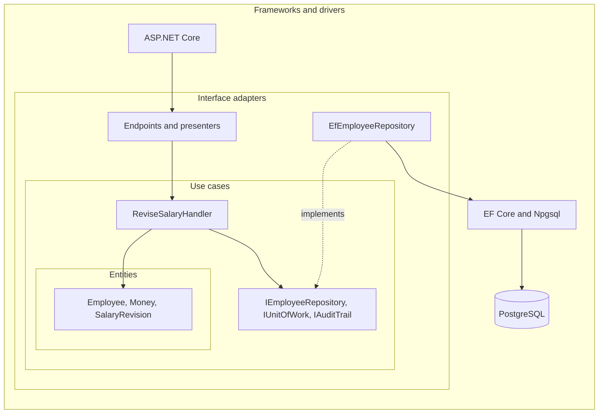
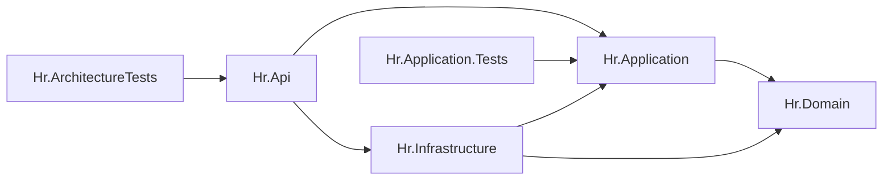
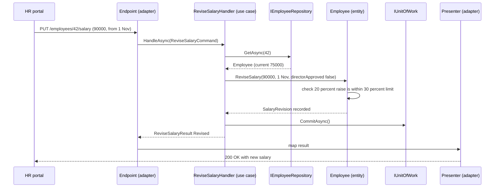
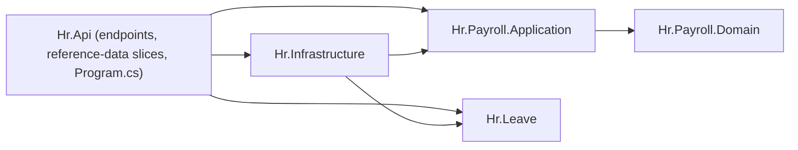

Clean Architecture and Onion Architecture are two names, from two authors, for a very similar idea: put the business rules at the centre, put frameworks and databases at the edge, and make every source-code dependency point toward the centre. If you have done the [hexagonal architecture](#/lesson/m02-hexagonal) lesson, you already know the core move. This lesson adds the rings, the vocabulary (entities, use cases, interface adapters), and the concrete .NET project layout most teams use, with a salary-revision feature from an HR system as the running example.

## Learning objectives

By the end of this lesson you will be able to:

1. State the **dependency rule** and explain why it protects business rules from technology change.
2. Name the rings of Clean Architecture (entities, use cases, interface adapters, frameworks and drivers) and of Onion Architecture (domain model, domain services, application services, infrastructure and UI).
3. Decide which ring a given piece of code belongs to.
4. Lay out a .NET solution as `Domain`, `Application`, `Infrastructure` and `Api` projects with the correct references.
5. Implement an entity with invariants and a use case with ports, and wire them in `Program.cs`.
6. Enforce the dependency rule with architecture tests.
7. Compare Clean, Onion, hexagonal and layered architecture, and recognise when the full ring structure is overkill.

## Prerequisites

- [Hexagonal architecture](#/lesson/m02-hexagonal): ports, adapters and the inward dependency direction.
- [Layered architecture](#/lesson/m02-layered): we contrast the classic top-to-bottom layers.
- [Dependency Inversion Principle](#/lesson/m04-dip): the mechanism that lets the rule work across boundaries.

## Explain it like I'm a beginner

Think of how a country's rules are organised.

- At the centre is the **constitution**: a few deep rules that rarely change. "Every citizen has the right to vote." It says nothing about ballot paper, voting machines or mobile apps.
- Around it are **laws and procedures**: "To vote, show an ID, sign the register, then vote." These use the constitution's rules, and they change more often.
- Around those are **offices and forms**: the polling booth, the voter slip, the registration form. They turn real-world input into something the procedures understand.
- At the very edge is **equipment and technology**: electronic voting machines, printers, phones, databases. These change most often of all.

The key rule: **inner layers never depend on outer layers.** The constitution doesn't mention voting machines. If the Election Commission replaces the machines, the constitution doesn't change. Procedures don't change either. Only the outer layers adapt.

Software built in Clean or Onion style works the same way:

| Country | Clean Architecture ring | HR example |
|---|---|---|
| Constitution | **Entities** (enterprise business rules) | "A salary can't be cut through a revision, and a raise above 30 % needs a director's approval." |
| Laws and procedures | **Use cases** (application business rules) | "To revise a salary: load the employee, apply the revision, save it, record an audit entry." |
| Offices and forms | **Interface adapters** | An HTTP endpoint that reads JSON, a repository that maps rows to objects, a presenter that turns results into status codes |
| Equipment | **Frameworks and drivers** | ASP.NET Core, EF Core, PostgreSQL, an SMTP server |

Onion Architecture draws the same picture as an onion: peel away the outer skins (UI, database) and the core (the domain model) is untouched.

## First-principles explanation

### What it is

**Clean Architecture** (Robert C. Martin, 2012, and his 2017 book) arranges code in concentric rings:

1. **Entities**: business objects and the rules that would be true even without this application. `Employee`, `Money`, the salary-revision rule.
2. **Use cases** (interactors): application-specific rules that orchestrate entities to achieve a goal. `ReviseSalary`, `TransferEmployee`. They define the interfaces they need (repositories, clocks, notifiers).
3. **Interface adapters**: convert data between the form most convenient for use cases and the form most convenient for external agencies. Controllers or endpoints, presenters, repository implementations, DTO mappers.
4. **Frameworks and drivers**: ASP.NET Core, EF Core, Npgsql, message-broker clients, the database itself.

**Onion Architecture** (Jeffrey Palermo, 2008) arranges code as:

1. **Domain model** at the core: entities and value objects.
2. **Domain services**: domain logic that doesn't fit one entity (for example, checking a pay band across a grade table). Repository interfaces often live here or in the next ring.
3. **Application services**: use cases that coordinate domain objects.
4. **Outer ring**: UI, infrastructure (database, file system, web services) and tests.

### The dependency rule

> Source code dependencies can only point inward. Nothing in an inner ring can know anything at all about something in an outer ring.

Concretely, in C#:

- An inner ring never has a `using` for an outer namespace, never references an outer project, and never mentions an outer type (`DbContext`, `HttpContext`, `IFormFile`, `NpgsqlConnection`).
- Data that crosses a boundary inward is in simple forms the inner ring defines (command records, entities), not framework types.
- When an inner ring needs something from outside (saving data, sending email), it **declares an interface**, and an outer ring implements it. This is the Dependency Inversion Principle: control flows outward at runtime (the use case calls the database), but the source dependency points inward (the database code implements the use case's interface).

### Why it exists — the problem

Business rules are the most valuable and the longest-lived part of most systems. An HR company's leave and salary rules may outlive three UI frameworks, two ORMs and a move from on-premises SQL Server to cloud PostgreSQL. When those rules are tangled with framework code:

- **Framework upgrades become rewrites.** Moving from ASP.NET MVC 5 to ASP.NET Core meant rewriting business logic that lived in controllers and `HttpContext`-dependent helpers.
- **Rules can't be tested in isolation.** Every test needs a web host and a database.
- **Rules are scattered.** The 30 % raise limit lives in a JavaScript validator, a controller check and a database trigger, and the three disagree.

The rings and the dependency rule keep the rules in one place, free of technology.

### How it works in a .NET solution

The usual layout is one project per ring, with project references enforcing the rule:

```text
Hr.sln
  src/
    Hr.Domain/            entities, value objects, domain exceptions, domain events
                          references: nothing (only the BCL)
    Hr.Application/       use cases (commands, queries, handlers), port interfaces, DTOs
                          references: Hr.Domain
    Hr.Infrastructure/    EF Core DbContext, repositories, email, file storage, clocks
                          references: Hr.Application, Hr.Domain, EF Core, Npgsql
    Hr.Api/               ASP.NET Core host: endpoints, presenters, DI composition root
                          references: Hr.Application, Hr.Infrastructure (for registration only)
  tests/
    Hr.Domain.Tests/          pure unit tests
    Hr.Application.Tests/     use-case tests with fakes
    Hr.Infrastructure.Tests/  repository tests against a real database
    Hr.ArchitectureTests/     checks the dependency rule
```

Because `Hr.Domain.csproj` has no `<ProjectReference>` or `<PackageReference>` to EF Core, the compiler rejects `using Microsoft.EntityFrameworkCore;` in a domain class. The rule is enforced by the build itself.

`Hr.Api` references `Hr.Infrastructure` only so `Program.cs` can call `builder.Services.AddInfrastructure(...)`. Endpoints should use Application types, not Infrastructure types. An architecture test can check that.

### Clean, Onion, hexagonal and layered compared

| | Layered (classic) | Hexagonal | Onion | Clean |
|---|---|---|---|---|
| Picture | Stack, top to bottom | Hexagon with ports | Concentric rings | Concentric rings |
| Centre | (none: data layer at the bottom) | Application core | Domain model | Entities |
| Business layer depends on database? | Yes | No | No | No |
| Explicit inner rings | No | Not prescribed | Domain model, domain services, application services | Entities, use cases |
| Key idea | Separation by technical role | Symmetry of all inputs and outputs, ports | Domain at the centre, infrastructure outside | The dependency rule, use cases as first-class |

All three of hexagonal, Onion and Clean share one idea: **invert the dependency on infrastructure so the business rules sit in the middle.** They differ mostly in vocabulary and in how many inner rings they name. In practice, a .NET "Clean Architecture" solution and an "Onion" solution usually look almost the same.

### What happens without it

Without the dependency rule, framework types creep inward. Entities get `[Table]` and `[JsonPropertyName]` attributes, then navigation properties shaped for the ORM, then methods that call `HttpContext.User`. Within a year, "upgrade EF Core" or "add a gRPC endpoint" touches business classes, and the business rules can't be read without understanding the infrastructure.

### When it is useful

- **Rich, long-lived business logic**: payroll, leave policy, billing, contracts, claims. Rules worth protecting and testing thoroughly.
- **Several delivery mechanisms** (web API, background jobs, message consumers) that must share the same use cases.
- **Teams of several developers** who benefit from a predictable place for every kind of code.
- **Expected technology change**: a database migration, a new UI, a vendor swap.

### When it is overkill

- **CRUD screens with no rules.** Four projects, a command, a handler, a repository interface, a repository, a DTO and two mappers to save a department name is ceremony. A [vertical slice](#/lesson/m02-vertical-slice) or a minimal API with direct data access is clearer.
- **Small or short-lived apps** where the cost of structure outweighs the benefit.
- **Teams that copy the template blindly**: every entity gets a repository interface, every repository gets a generic base class, and nobody can find where a rule lives because everything is three hops away.

### Trade-offs it introduces

| You gain | You pay |
|---|---|
| Business rules independent of frameworks and databases | More projects, interfaces and mapping code |
| Fast, isolated tests of entities and use cases | Navigating several projects for one feature |
| Framework or database changes stay in outer rings | Some database features (locking, bulk updates) need deliberate port design |
| A predictable home for every kind of code | Risk of rigid templates applied to code that doesn't need them |
| Use cases reusable from API, jobs and consumers | Abstractions with one implementation forever, if applied mechanically |

:::callout type=tradeoff title="Persistence ignorance is a spectrum"
Strictly, entities should know nothing about EF Core. In practice many teams accept small compromises, such as a private parameterless constructor so EF Core can materialise an entity, or configuring mappings with the Fluent API in Infrastructure instead of attributes in Domain. That keeps entities clean without a separate persistence model. Decide the line as a team, write it down in an [ADR](#/lesson/m02-adr), and check it with an architecture test.
:::

## Visual explanation

### The rings and the dependency rule



How to read it: each nested box is a ring, with entities at the centre. Every solid arrow is a source-code dependency, and each one points inward or stays inside its ring: ASP.NET Core calls the endpoints, endpoints call the use case, and the use case uses entities and its own port interfaces. The one arrow from an outer ring that "reaches" a port is dotted: `EfEmployeeRepository` **implements** `IEmployeeRepository`, which the use-case ring owns. At runtime the handler calls the repository (control flows outward), but in the source code the repository depends on the handler's interface. That inversion is how Clean Architecture satisfies the dependency rule while still saving to a database.

### Project references in the solution



Arrows are `<ProjectReference>` entries. `Hr.Domain` has no outgoing arrows at all. `Hr.Application` points only to Domain. Infrastructure points inward to both. The API host points to Application for use cases and to Infrastructure only to register services. An arrow from Domain or Application to Infrastructure would break the rule, and the architecture tests look for exactly that.

### Revising a salary across the rings



The endpoint converts HTTP into a command and hands it to the use case. The use case loads the entity through a port, asks the **entity** to apply the revision (the 30 % rule lives in `Employee`, not in the handler), and commits through another port. The result travels back out, and a presenter in the adapter ring turns it into an HTTP response. A raise from ₹75,000 to ₹90,000 is 20 %, so no director approval is needed. Notice that the business decision is made two rings deep, where no HTTP or SQL types exist.

## Step-by-step example

### Step 1 — the starting point

```csharp
[HttpPut("employees/{id}/salary")]
public async Task<IActionResult> Revise(int id, decimal newSalary, bool directorApproved)
{
    var emp = await _db.Employees.Include(e => e.Revisions).SingleAsync(e => e.Id == id);
    if (newSalary < emp.MonthlySalary) return BadRequest("No cuts");
    if (newSalary > emp.MonthlySalary * 1.3m && !directorApproved && !User.IsInRole("Director")) return Forbid();
    emp.Revisions.Add(new SalaryRevisionRow { Old = emp.MonthlySalary, New = newSalary, At = DateTime.Now });
    emp.MonthlySalary = newSalary;
    await _db.SaveChangesAsync();
    return Ok();
}
```

The rule is in a controller, mixed with `User`, `DateTime.Now` and EF Core. A nightly job that applies approved revisions from a spreadsheet would have to copy it.

### Step 2 — find the entity rule

"A revision can't reduce salary. A raise above 30 % needs director approval. Revisions take effect in date order." These are true however the app is built, so they go into the `Employee` entity in `Hr.Domain`.

### Step 3 — find the use case

"Revise an employee's salary": load, apply, save, audit. That is `ReviseSalaryHandler` in `Hr.Application`, with the ports `IEmployeeRepository`, `IUnitOfWork` and `IAuditTrail` defined next to it.

### Step 4 — move framework details outward

`DateTime.Now` becomes a value passed in (or `TimeProvider` injected into the use case). `User.IsInRole` becomes data on the command (who is asking and whether a director approved), set by the endpoint from the authenticated user. EF Core moves into `Hr.Infrastructure`.

### Step 5 — wire and enforce

`Program.cs` calls `AddApplication()` and `AddInfrastructure()`. An architecture test checks that `Hr.Domain` and `Hr.Application` reference no infrastructure assemblies.

## Production-style C# implementation

All files below compile together for this lesson. Their namespaces show which project each belongs to.

### Domain (entities)

```csharp file=Hr.Domain/Employees/Employee.cs
namespace Hr.Domain.Employees;

public sealed class DomainException(string message) : Exception(message);

/// <summary>Value object: an amount in a currency. Immutable and compared by value.</summary>
public readonly record struct Money
{
    public decimal Amount { get; }
    public string Currency { get; }

    public Money(decimal amount, string currency)
    {
        if (amount < 0) throw new DomainException("Money cannot be negative.");
        if (string.IsNullOrWhiteSpace(currency) || currency.Length != 3) throw new DomainException("Currency must be a 3-letter ISO code.");
        Amount = decimal.Round(amount, 2);
        Currency = currency.ToUpperInvariant();
    }

    public static Money Inr(decimal amount) => new(amount, "INR");
    public override string ToString() => $"{Currency} {Amount:N2}";
}

public sealed record SalaryRevision(Money From, Money To, DateOnly EffectiveFrom, bool DirectorApproved)
{
    public decimal IncreasePercent => From.Amount == 0 ? 100m : decimal.Round((To.Amount - From.Amount) / From.Amount * 100m, 2);
}

/// <summary>Entity: identity plus enterprise rules that hold no matter how the app is delivered.</summary>
public sealed class Employee
{
    public const decimal MaxRaiseWithoutDirectorPercent = 30m;
    private readonly List<SalaryRevision> _revisions = new();

    public Guid Id { get; }
    public string FullName { get; private set; }
    public Money MonthlySalary { get; private set; }
    public bool IsActive { get; private set; } = true;
    public IReadOnlyList<SalaryRevision> Revisions => _revisions;

    public Employee(Guid id, string fullName, Money monthlySalary)
    {
        if (string.IsNullOrWhiteSpace(fullName)) throw new DomainException("Name is required.");
        Id = id;
        FullName = fullName.Trim();
        MonthlySalary = monthlySalary;
    }

    public SalaryRevision ReviseSalary(Money newSalary, DateOnly effectiveFrom, bool directorApproved)
    {
        if (!IsActive) throw new DomainException("Cannot revise the salary of an inactive employee.");
        if (newSalary.Currency != MonthlySalary.Currency) throw new DomainException("Currency cannot change in a revision.");
        if (newSalary.Amount <= MonthlySalary.Amount) throw new DomainException("A revision must increase the salary.");
        if (_revisions.Count > 0 && effectiveFrom <= _revisions[^1].EffectiveFrom)
            throw new DomainException("Revisions must take effect after the previous revision.");

        var revision = new SalaryRevision(MonthlySalary, newSalary, effectiveFrom, directorApproved);
        if (revision.IncreasePercent > MaxRaiseWithoutDirectorPercent && !directorApproved)
            throw new DomainException($"A raise of {revision.IncreasePercent} % needs director approval (limit {MaxRaiseWithoutDirectorPercent} %).");

        _revisions.Add(revision);
        MonthlySalary = newSalary;
        return revision;
    }

    public void Deactivate() => IsActive = false;
}
```

No `using` for any framework. The rules are readable on their own: a business analyst could review this file.

### Application (use cases and ports)

```csharp file=Hr.Application/Abstractions/Ports.cs
using Hr.Domain.Employees;

namespace Hr.Application.Abstractions;

public interface IEmployeeRepository
{
    Task<Employee?> GetAsync(Guid id, CancellationToken ct);
    Task AddAsync(Employee employee, CancellationToken ct);
}

/// <summary>Commits all changes made in this use case as one transaction.</summary>
public interface IUnitOfWork
{
    Task CommitAsync(CancellationToken ct);
}

public interface IAuditTrail
{
    Task RecordAsync(string action, Guid subjectId, Guid actorId, string details, CancellationToken ct);
}
```

```csharp file=Hr.Application/Salaries/ReviseSalary.cs
using Hr.Application.Abstractions;
using Hr.Domain.Employees;

namespace Hr.Application.Salaries;

public sealed record ReviseSalaryCommand(Guid EmployeeId, decimal NewMonthlySalary, DateOnly EffectiveFrom, bool DirectorApproved, Guid ActorId);

public enum ReviseSalaryStatus { Revised, NotFound, Rejected }

public sealed record ReviseSalaryResult(ReviseSalaryStatus Status, decimal? NewMonthlySalary, decimal? IncreasePercent, string? Error);

/// <summary>Use case: application-specific orchestration. The business rule itself lives in the entity.</summary>
public sealed class ReviseSalaryHandler(IEmployeeRepository employees, IUnitOfWork unitOfWork, IAuditTrail audit, TimeProvider clock)
{
    private const int MaxBackdatedDays = 31;

    public async Task<ReviseSalaryResult> HandleAsync(ReviseSalaryCommand command, CancellationToken ct)
    {
        var employee = await employees.GetAsync(command.EmployeeId, ct);
        if (employee is null) return new(ReviseSalaryStatus.NotFound, null, null, "Employee not found.");

        // Application rule (this system's policy, not a universal business truth): limited backdating.
        var today = DateOnly.FromDateTime(clock.GetUtcNow().UtcDateTime);
        if (command.EffectiveFrom < today.AddDays(-MaxBackdatedDays))
            return new(ReviseSalaryStatus.Rejected, null, null, $"Revisions cannot be backdated more than {MaxBackdatedDays} days.");

        SalaryRevision revision;
        try
        {
            revision = employee.ReviseSalary(new Money(command.NewMonthlySalary, employee.MonthlySalary.Currency),
                command.EffectiveFrom, command.DirectorApproved);
        }
        catch (DomainException ex)
        {
            return new(ReviseSalaryStatus.Rejected, null, null, ex.Message);
        }

        await audit.RecordAsync("salary.revised", employee.Id, command.ActorId,
            $"{revision.From} -> {revision.To} from {revision.EffectiveFrom:yyyy-MM-dd}", ct);
        await unitOfWork.CommitAsync(ct);
        return new(ReviseSalaryStatus.Revised, revision.To.Amount, revision.IncreasePercent, null);
    }
}
```

```csharp file=Hr.Application/DependencyInjection.cs
using Hr.Application.Salaries;
using Microsoft.Extensions.DependencyInjection;

namespace Hr.Application;

public static class ApplicationServiceCollectionExtensions
{
    public static IServiceCollection AddApplication(this IServiceCollection services)
    {
        services.AddScoped<ReviseSalaryHandler>();
        return services;
    }
}
```

`Hr.Application` references `Microsoft.Extensions.DependencyInjection.Abstractions` for this extension method. Many teams accept that small, stable abstraction package in the Application project. Others keep all registrations in the API project. Either is fine if it's a conscious choice.

Two kinds of rule appear here, and the split matters. "A raise above 30 % needs a director" is an **enterprise rule**: it is in the entity, and it would hold even in a spreadsheet. "No more than 31 days of backdating" is an **application rule**: it's this system's policy for this use case, so it is in the handler.

### Infrastructure (adapters for the ports)

```csharp file=Hr.Infrastructure/Persistence/InMemoryPersistence.cs
using System.Collections.Concurrent;
using Hr.Application.Abstractions;
using Hr.Domain.Employees;

namespace Hr.Infrastructure.Persistence;

/// <summary>Stand-in for an EF Core implementation. With EF Core, GetAsync loads the aggregate with its revisions,
/// and the unit of work is the DbContext's SaveChangesAsync.</summary>
public sealed class InMemoryEmployeeStore
{
    public ConcurrentDictionary<Guid, Employee> Committed { get; } = new();
}

public sealed class InMemoryEmployeeRepository(InMemoryEmployeeStore store, InMemoryUnitOfWork unitOfWork) : IEmployeeRepository
{
    public Task<Employee?> GetAsync(Guid id, CancellationToken ct)
    {
        var employee = store.Committed.GetValueOrDefault(id);
        if (employee is not null) unitOfWork.Track(employee);
        return Task.FromResult(employee);
    }

    public Task AddAsync(Employee employee, CancellationToken ct)
    {
        unitOfWork.Track(employee);
        return Task.CompletedTask;
    }
}

public sealed class InMemoryUnitOfWork(InMemoryEmployeeStore store) : IUnitOfWork
{
    private readonly List<Employee> _tracked = new();
    public void Track(Employee employee) { if (!_tracked.Contains(employee)) _tracked.Add(employee); }

    public Task CommitAsync(CancellationToken ct)
    {
        foreach (var e in _tracked) store.Committed[e.Id] = e;
        _tracked.Clear();
        return Task.CompletedTask;
    }
}

public sealed class LoggingAuditTrail(ILogger<LoggingAuditTrail> logger) : IAuditTrail
{
    public Task RecordAsync(string action, Guid subjectId, Guid actorId, string details, CancellationToken ct)
    {
        logger.LogInformation("AUDIT {Action} subject={SubjectId} actor={ActorId} {Details}", action, subjectId, actorId, details);
        return Task.CompletedTask;
    }
}
```

```csharp file=Hr.Infrastructure/DependencyInjection.cs
using Hr.Application.Abstractions;
using Hr.Infrastructure.Persistence;
using Microsoft.Extensions.DependencyInjection;

namespace Hr.Infrastructure;

public static class InfrastructureServiceCollectionExtensions
{
    public static IServiceCollection AddInfrastructure(this IServiceCollection services)
    {
        services.AddSingleton(TimeProvider.System);
        services.AddSingleton<InMemoryEmployeeStore>();
        services.AddScoped<InMemoryUnitOfWork>();
        services.AddScoped<IUnitOfWork>(sp => sp.GetRequiredService<InMemoryUnitOfWork>());
        services.AddScoped<IEmployeeRepository, InMemoryEmployeeRepository>();
        services.AddScoped<IAuditTrail, LoggingAuditTrail>();
        return services;
    }
}
```

With EF Core and PostgreSQL, this file would instead call `services.AddDbContext<HrDbContext>(o => o.UseNpgsql(connectionString))`, register an `EfEmployeeRepository`, and make `IUnitOfWork` delegate to `HrDbContext.SaveChangesAsync`. Nothing in Domain or Application changes.

### API (frameworks ring: endpoints, presenters and the composition root)

```csharp file=Hr.Api/SalaryEndpoints.cs
using Hr.Application.Salaries;

namespace Hr.Api;

public sealed record ReviseSalaryRequest(decimal NewMonthlySalary, DateOnly EffectiveFrom, bool DirectorApproved);

public static class SalaryEndpoints
{
    public static IEndpointRouteBuilder MapSalaryEndpoints(this IEndpointRouteBuilder app)
    {
        app.MapPut("/employees/{id:guid}/salary", async (Guid id, ReviseSalaryRequest body, HttpContext http,
            ReviseSalaryHandler handler, CancellationToken ct) =>
        {
            // Adapter work: turn HTTP and identity into a plain command.
            var actorId = Guid.TryParse(http.User.FindFirst("sub")?.Value, out var sub) ? sub : Guid.Empty;
            var command = new ReviseSalaryCommand(id, body.NewMonthlySalary, body.EffectiveFrom, body.DirectorApproved, actorId);
            return Present(await handler.HandleAsync(command, ct));
        });
        return app;
    }

    /// <summary>Presenter: maps a use-case result to HTTP. The use case never sees status codes.</summary>
    internal static IResult Present(ReviseSalaryResult result) => result.Status switch
    {
        ReviseSalaryStatus.Revised => Results.Ok(new { result.NewMonthlySalary, result.IncreasePercent }),
        ReviseSalaryStatus.NotFound => Results.NotFound(),
        _ => Results.Problem(result.Error, statusCode: StatusCodes.Status422UnprocessableEntity),
    };
}
```

```csharp file=Program.cs
using Hr.Api;
using Hr.Application;
using Hr.Infrastructure;

var builder = WebApplication.CreateBuilder(args);

builder.Services.AddApplication();
builder.Services.AddInfrastructure();

var app = builder.Build();
app.MapSalaryEndpoints();
app.Run();
```

`Program.cs` is the only place that knows every ring. It's the "main" component in Clean Architecture terms: the dirtiest, most concrete part of the system, whose job is to plug everything together.

### Enforcing the dependency rule

With separate projects, the strongest test checks assembly references. This version needs only reflection (shown as a snippet, because this lesson compiles as one project):

```csharp
public class DependencyRuleTests
{
    private static readonly string[] Forbidden =
        ["Microsoft.EntityFrameworkCore", "Npgsql", "Microsoft.AspNetCore", "Hr.Infrastructure", "Hr.Api"];

    [Theory]
    [InlineData(typeof(Hr.Domain.Employees.Employee))]
    [InlineData(typeof(Hr.Application.Salaries.ReviseSalaryHandler))]
    public void Inner_rings_do_not_reference_outer_rings(Type marker)
    {
        var bad = marker.Assembly.GetReferencedAssemblies()
            .Select(a => a.Name!)
            .Where(name => Forbidden.Any(f => name.StartsWith(f, StringComparison.Ordinal)))
            .ToList();
        Assert.True(bad.Count == 0, $"{marker.Assembly.GetName().Name} references: {string.Join(", ", bad)}");
    }

    [Fact]
    public void Domain_references_nothing_from_the_solution() =>
        Assert.DoesNotContain(typeof(Hr.Domain.Employees.Employee).Assembly.GetReferencedAssemblies(),
            a => a.Name!.StartsWith("Hr.", StringComparison.Ordinal));
}
```

Libraries such as NetArchTest.Rules express the same rules more fluently, and also catch namespace-level leaks inside one assembly.

## Bad design vs good design

**Bad: Clean Architecture folders, layered dependencies.**

- `Hr.Domain` references EF Core because entities have `[Table]`, `[ForeignKey]` and `virtual ICollection<>` navigation properties everywhere.
- `Hr.Application` has `ReviseSalaryHandler` that takes `HrDbContext` directly, "because the repository pattern is overkill".
- The 30 % rule is in the handler, and a different handler for bulk revisions re-implements it with 25 %.
- Every entity has `IRepository<T>` with 14 generic methods, most unused.

Problems: the folders say Clean, but the dependencies say layered. The rule exists twice and already disagrees. The generic repository leaks query concerns into Application, and adds abstraction without meaning.

**Good: rules in entities, orchestration in use cases, technology at the edge.**

- Entities hold enterprise rules and have no framework references. EF Core mapping is in Infrastructure with the Fluent API.
- Each use case declares the narrow ports it needs (`GetAsync`, `AddAsync`) rather than a generic repository.
- Bulk revision is a different **use case** that calls the same `Employee.ReviseSalary`, so the rule exists once.
- Architecture tests guard the project references.

**Is the improvement worth it?** For salary revision, yes: the rule is valuable, audited and reused. For "rename a department", a minimal API endpoint with EF Core directly may be the better choice, even inside the same solution. Many mature teams combine Clean Architecture for the complex core with [vertical slices](#/lesson/m02-vertical-slice) for simple features.

:::callout type=mistake title="Anaemic entities with fat use cases"
If every entity is a bag of public setters and all the rules are in handlers, you have moved the rules from controllers to handlers, but they are still spread across use cases and duplicated. Put rules that are always true about the entity inside the entity. Keep use cases thin: load, ask the entity, save, notify.
:::

## Practical playground

The program runs the salary use case twice: once with a raise within the limit and once above it. Run it, then try to break the dependency rule on purpose by making `Employee` print to the console or read `DateTime.Now`, and ask yourself which ring that code belongs to.

:::playground type=csharp title="Rules in the centre"
```csharp file=Program.cs
using System;
using System.Collections.Generic;

// ---- Entities ring ----
public sealed class Employee(string name, decimal monthly)
{
    public string Name { get; } = name;
    public decimal Monthly { get; private set; } = monthly;

    public decimal ReviseTo(decimal newMonthly, bool directorApproved)
    {
        if (newMonthly <= Monthly) throw new InvalidOperationException("A revision must increase the salary.");
        var pct = Math.Round((newMonthly - Monthly) / Monthly * 100m, 2);
        if (pct > 30m && !directorApproved) throw new InvalidOperationException($"{pct} % raise needs director approval.");
        Monthly = newMonthly;
        return pct;
    }
}

// ---- Use-case ring: owns its port ----
public interface IEmployeeRepository { Employee Get(string name); void Save(Employee e); }

public sealed class ReviseSalary(IEmployeeRepository repo)
{
    public string Run(string name, decimal newMonthly, bool directorApproved)
    {
        var e = repo.Get(name);
        try { var pct = e.ReviseTo(newMonthly, directorApproved); repo.Save(e); return $"{name}: +{pct} % to {e.Monthly:N0}"; }
        catch (InvalidOperationException ex) { return $"{name}: rejected ({ex.Message})"; }
    }
}

// ---- Adapter ring ----
public sealed class InMemoryRepo : IEmployeeRepository
{
    private readonly Dictionary<string, Employee> _rows = new()
    {
        ["Asha"] = new Employee("Asha", 75_000m),
        ["Ravi"] = new Employee("Ravi", 60_000m),
    };
    public Employee Get(string name) => _rows[name];
    public void Save(Employee e) => _rows[e.Name] = e;
}

// ---- Frameworks ring: the composition root ----
public static class Program
{
    public static void Main()
    {
        var useCase = new ReviseSalary(new InMemoryRepo());
        Console.WriteLine(useCase.Run("Asha", 90_000m, directorApproved: false));   // +20 %
        Console.WriteLine(useCase.Run("Ravi", 84_000m, directorApproved: false));   // +40 %, rejected
        Console.WriteLine(useCase.Run("Ravi", 84_000m, directorApproved: true));    // approved
    }
}
```
:::

## Exercises

:::exercise id=m02-clean-onion-ex1 difficulty=beginner kind=code title="Put the rule in the entity"
Implement `Employee.ReviseSalary` so the entity protects its own invariants. No other class should need to know these rules.
::requirements
- The new salary must be greater than the current one. Otherwise throw `DomainException`.
- A raise above 30 % (compared with the current salary, rounded to 2 decimals) needs `directorApproved = true`. Otherwise throw `DomainException`.
- The effective date must be after the last revision's effective date, if there is one.
- On success, add a `SalaryRevision(from, to, effectiveFrom)` to `Revisions`, update `MonthlySalary` and return the increase percentage.
::acceptance
- ₹75,000 to ₹90,000 returns 20 and needs no approval.
- ₹60,000 to ₹84,000 (40 %) throws without approval and succeeds with it.
- Exactly 30 % is allowed without approval.
- A second revision dated on or before the first one throws.
- A failed revision leaves `MonthlySalary` and `Revisions` unchanged.
::hint
Check all the rules before changing any state.
::hint
`Math.Round((newSalary - MonthlySalary) / MonthlySalary * 100m, 2)` gives the percentage.
::hint
`_revisions[^1]` is the last element of a list, when the list is not empty.
::hint
Compare with `> 30m`, not `>= 30m`, so exactly 30 % passes.
::starter
```csharp file=Employee.cs
using System;
using System.Collections.Generic;

namespace Hr.Domain
{
    public sealed class DomainException(string message) : Exception(message);

    public sealed record SalaryRevision(decimal From, decimal To, DateOnly EffectiveFrom);

    public sealed class Employee
    {
        private readonly List<SalaryRevision> _revisions = new();

        public Employee(string name, decimal monthlySalary)
        {
            Name = name;
            MonthlySalary = monthlySalary;
        }

        public string Name { get; }
        public decimal MonthlySalary { get; private set; }
        public IReadOnlyList<SalaryRevision> Revisions => _revisions;

        public decimal ReviseSalary(decimal newSalary, DateOnly effectiveFrom, bool directorApproved) => throw new NotImplementedException();
    }
}
```
::tests
```csharp file=EmployeeTests.cs
using System;
using Hr.Domain;
using Xunit;

public class EmployeeTests
{
    private static readonly DateOnly Nov1 = new(2026, 11, 1);

    [Fact]
    public void Twenty_percent_needs_no_approval()
    {
        var e = new Employee("Asha", 75_000m);
        Assert.Equal(20m, e.ReviseSalary(90_000m, Nov1, false));
        Assert.Equal(90_000m, e.MonthlySalary);
        Assert.Single(e.Revisions);
    }

    [Fact]
    public void Forty_percent_needs_approval()
    {
        var e = new Employee("Ravi", 60_000m);
        Assert.Throws<DomainException>(() => e.ReviseSalary(84_000m, Nov1, false));
        Assert.Equal(40m, e.ReviseSalary(84_000m, Nov1, true));
    }

    [Fact]
    public void Exactly_thirty_percent_is_allowed() =>
        Assert.Equal(30m, new Employee("Meera", 50_000m).ReviseSalary(65_000m, Nov1, false));

    [Fact]
    public void Cut_is_rejected() =>
        Assert.Throws<DomainException>(() => new Employee("Asha", 75_000m).ReviseSalary(70_000m, Nov1, true));

    [Fact]
    public void Revisions_must_move_forward_in_time()
    {
        var e = new Employee("Asha", 75_000m);
        e.ReviseSalary(80_000m, Nov1, false);
        Assert.Throws<DomainException>(() => e.ReviseSalary(85_000m, Nov1, false));
        Assert.Throws<DomainException>(() => e.ReviseSalary(85_000m, new DateOnly(2026, 10, 1), false));
    }

    [Fact]
    public void Failure_leaves_state_unchanged()
    {
        var e = new Employee("Ravi", 60_000m);
        Assert.Throws<DomainException>(() => e.ReviseSalary(90_000m, Nov1, false));
        Assert.Equal(60_000m, e.MonthlySalary);
        Assert.Empty(e.Revisions);
    }
}
```
::solution
```csharp file=Employee.cs
using System;
using System.Collections.Generic;

namespace Hr.Domain
{
    public sealed class DomainException(string message) : Exception(message);

    public sealed record SalaryRevision(decimal From, decimal To, DateOnly EffectiveFrom);

    public sealed class Employee
    {
        private const decimal MaxRaiseWithoutDirector = 30m;
        private readonly List<SalaryRevision> _revisions = new();

        public Employee(string name, decimal monthlySalary)
        {
            Name = name;
            MonthlySalary = monthlySalary;
        }

        public string Name { get; }
        public decimal MonthlySalary { get; private set; }
        public IReadOnlyList<SalaryRevision> Revisions => _revisions;

        public decimal ReviseSalary(decimal newSalary, DateOnly effectiveFrom, bool directorApproved)
        {
            if (newSalary <= MonthlySalary) throw new DomainException("A revision must increase the salary.");
            if (_revisions.Count > 0 && effectiveFrom <= _revisions[^1].EffectiveFrom)
                throw new DomainException("Revisions must take effect after the previous revision.");

            var percent = Math.Round((newSalary - MonthlySalary) / MonthlySalary * 100m, 2);
            if (percent > MaxRaiseWithoutDirector && !directorApproved)
                throw new DomainException($"A raise of {percent} % needs director approval.");

            _revisions.Add(new SalaryRevision(MonthlySalary, newSalary, effectiveFrom));
            MonthlySalary = newSalary;
            return percent;
        }
    }
}
```

The entity is the only place these rules exist. A web endpoint, a bulk-revision job and a test all go through `ReviseSalary`, so they can't disagree. The private setter on `MonthlySalary` makes it impossible to bypass the rule from outside.
::mistakes
- Updating `MonthlySalary` before the approval check, so a rejected call still changes state.
- Comparing percentages with `double`, which gives values like 29.999999 for money. Use `decimal`.
- Exposing `List<SalaryRevision>` publicly, so callers can add revisions without the rules.
:::

:::exercise id=m02-clean-onion-ex2 difficulty=beginner kind=written title="Which ring does it belong to?"
For each item, name the Clean Architecture ring (**entities**, **use cases**, **interface adapters**, **frameworks and drivers**) and give a one-line reason.

1. The rule "an employee's notice period is 60 days for grade M3 and above, 30 days otherwise".
2. `ResignEmployeeHandler`, which loads the employee, records the resignation and schedules an exit interview.
3. An EF Core `HrDbContext` with entity mappings.
4. A minimal API endpoint that reads JSON and calls `ResignEmployeeHandler`.
5. The interface `IExitInterviewScheduler`.
6. The class that sends calendar invites through the Microsoft Graph SDK and implements `IExitInterviewScheduler`.
7. A function that maps a `ResignEmployeeResult` to HTTP 200 or 422.
8. PostgreSQL itself.
::acceptance
- All 8 items placed in a ring, each with a reason.
- Item 5 correctly placed with the use case that needs it, not with its implementation.
::hint
Would the rule still be true if the company ran HR on paper? Then it's an entity rule.
::hint
Interfaces live with the code that **needs** them, not with the code that implements them.
::hint
Anything that converts between "the outside format" and "the use case's format" is an adapter.
::solution
1. **Entities.** It's a business truth about employees, independent of this app.
2. **Use cases.** It orchestrates entities and ports for one application goal.
3. **Interface adapters** (persistence gateway), using a **framework** (EF Core). In .NET it lives in the Infrastructure project.
4. **Interface adapters** (controller). It translates HTTP into a command.
5. **Use cases.** The use case declares the port it needs. Placing it with the Graph implementation would make the inner ring depend on the outer one.
6. **Interface adapters / frameworks and drivers.** It's an outer-ring implementation of an inner-ring port, typically in the Infrastructure project.
7. **Interface adapters** (presenter). It converts a use-case result into the delivery format.
8. **Frameworks and drivers.** It's an external detail, the outermost ring.
:::

:::exercise id=m02-clean-onion-ex3 difficulty=intermediate kind=code title="A use case with ports and a single commit"
Implement `TransferEmployeeHandler`, which moves an employee to another department. It must use only its ports and commit exactly once on success.
::requirements
- Unknown employee: `NotFound`. Unknown target department: `Rejected` with `"Unknown department"`.
- Inactive employee: `Rejected` with `"Employee is not active"`.
- Same department as now: `Rejected` with `"Already in this department"`.
- On success: change the employee's department, record the history entry through `ITransferHistory`, commit once through `IUnitOfWork`, and return `Transferred`.
- On any rejection: no history entry and no commit.
::acceptance
- A valid transfer changes the department, writes one history entry and commits once.
- Each rejection path leaves the commit count at 0.
- The handler references no concrete infrastructure classes.
::hint
Load everything you need first (employee, department existence), then validate, then change state.
::hint
`Employee.MoveTo(string departmentCode)` belongs on the entity. Keep "is active" and "same department" checks there or in the handler, but in one place.
::hint
Write tiny hand-rolled fakes in the tests: a `FakeUnitOfWork` with a `Commits` counter.
::starter
```csharp file=TransferEmployee.cs
using System;
using System.Collections.Generic;
using System.Threading;
using System.Threading.Tasks;

namespace Hr.Domain
{
    public sealed class Employee
    {
        public Employee(Guid id, string departmentCode, bool isActive = true)
        {
            Id = id;
            DepartmentCode = departmentCode;
            IsActive = isActive;
        }

        public Guid Id { get; }
        public string DepartmentCode { get; private set; }
        public bool IsActive { get; }

        public void MoveTo(string departmentCode) => DepartmentCode = departmentCode;
    }
}

namespace Hr.Application
{
    using Hr.Domain;

    public interface IEmployeeRepository { Task<Employee?> GetAsync(Guid id, CancellationToken ct); }
    public interface IDepartmentDirectory { Task<bool> ExistsAsync(string code, CancellationToken ct); }
    public interface ITransferHistory { void Record(Guid employeeId, string from, string to, DateOnly effectiveFrom); }
    public interface IUnitOfWork { Task CommitAsync(CancellationToken ct); }

    public sealed record TransferEmployee(Guid EmployeeId, string ToDepartment, DateOnly EffectiveFrom);
    public enum TransferStatus { Transferred, NotFound, Rejected }
    public sealed record TransferResult(TransferStatus Status, string? Reason);

    public sealed class TransferEmployeeHandler
    {
        private readonly IEmployeeRepository _employees;
        private readonly IDepartmentDirectory _departments;
        private readonly ITransferHistory _history;
        private readonly IUnitOfWork _unitOfWork;

        public TransferEmployeeHandler(IEmployeeRepository employees, IDepartmentDirectory departments, ITransferHistory history, IUnitOfWork unitOfWork)
        {
            _employees = employees;
            _departments = departments;
            _history = history;
            _unitOfWork = unitOfWork;
        }

        public Task<TransferResult> HandleAsync(TransferEmployee command, CancellationToken ct) => throw new NotImplementedException();
    }
}
```
::tests
```csharp file=TransferEmployeeTests.cs
using System;
using System.Collections.Generic;
using System.Threading;
using System.Threading.Tasks;
using Hr.Application;
using Hr.Domain;
using Xunit;

public class TransferEmployeeTests
{
    private sealed class Repo : IEmployeeRepository
    {
        public readonly Dictionary<Guid, Employee> Rows = new();
        public Task<Employee?> GetAsync(Guid id, CancellationToken ct) => Task.FromResult(Rows.TryGetValue(id, out var e) ? e : null);
    }
    private sealed class Depts : IDepartmentDirectory
    {
        public Task<bool> ExistsAsync(string code, CancellationToken ct) => Task.FromResult(code is "FIN" or "PRJ" or "HR");
    }
    private sealed class History : ITransferHistory
    {
        public readonly List<string> Entries = new();
        public void Record(Guid employeeId, string from, string to, DateOnly effectiveFrom) => Entries.Add($"{from}->{to}");
    }
    private sealed class Uow : IUnitOfWork
    {
        public int Commits;
        public Task CommitAsync(CancellationToken ct) { Commits++; return Task.CompletedTask; }
    }

    private readonly Repo _repo = new();
    private readonly History _history = new();
    private readonly Uow _uow = new();
    private TransferEmployeeHandler Sut() => new(_repo, new Depts(), _history, _uow);
    private static readonly DateOnly Nov1 = new(2026, 11, 1);

    private Guid Add(string dept, bool active = true)
    {
        var id = Guid.NewGuid();
        _repo.Rows[id] = new Employee(id, dept, active);
        return id;
    }

    [Fact]
    public async Task Valid_transfer_commits_once()
    {
        var id = Add("FIN");
        var r = await Sut().HandleAsync(new TransferEmployee(id, "PRJ", Nov1), CancellationToken.None);
        Assert.Equal(TransferStatus.Transferred, r.Status);
        Assert.Equal("PRJ", _repo.Rows[id].DepartmentCode);
        Assert.Equal(new[] { "FIN->PRJ" }, _history.Entries);
        Assert.Equal(1, _uow.Commits);
    }

    [Fact]
    public async Task Unknown_employee_is_not_found()
    {
        var r = await Sut().HandleAsync(new TransferEmployee(Guid.NewGuid(), "PRJ", Nov1), CancellationToken.None);
        Assert.Equal(TransferStatus.NotFound, r.Status);
        Assert.Equal(0, _uow.Commits);
    }

    [Theory]
    [InlineData("XYZ", true, "FIN", "Unknown department")]
    [InlineData("PRJ", false, "FIN", "Employee is not active")]
    [InlineData("FIN", true, "FIN", "Already in this department")]
    public async Task Rejections_do_not_commit(string to, bool active, string from, string reason)
    {
        var id = Add(from, active);
        var r = await Sut().HandleAsync(new TransferEmployee(id, to, Nov1), CancellationToken.None);
        Assert.Equal(TransferStatus.Rejected, r.Status);
        Assert.Equal(reason, r.Reason);
        Assert.Empty(_history.Entries);
        Assert.Equal(0, _uow.Commits);
        Assert.Equal(from, _repo.Rows[id].DepartmentCode);
    }
}
```
::solution
```csharp file=TransferEmployee.cs
using System;
using System.Collections.Generic;
using System.Threading;
using System.Threading.Tasks;

namespace Hr.Domain
{
    public sealed class Employee
    {
        public Employee(Guid id, string departmentCode, bool isActive = true)
        {
            Id = id;
            DepartmentCode = departmentCode;
            IsActive = isActive;
        }

        public Guid Id { get; }
        public string DepartmentCode { get; private set; }
        public bool IsActive { get; }

        public void MoveTo(string departmentCode) => DepartmentCode = departmentCode;
    }
}

namespace Hr.Application
{
    using Hr.Domain;

    public interface IEmployeeRepository { Task<Employee?> GetAsync(Guid id, CancellationToken ct); }
    public interface IDepartmentDirectory { Task<bool> ExistsAsync(string code, CancellationToken ct); }
    public interface ITransferHistory { void Record(Guid employeeId, string from, string to, DateOnly effectiveFrom); }
    public interface IUnitOfWork { Task CommitAsync(CancellationToken ct); }

    public sealed record TransferEmployee(Guid EmployeeId, string ToDepartment, DateOnly EffectiveFrom);
    public enum TransferStatus { Transferred, NotFound, Rejected }
    public sealed record TransferResult(TransferStatus Status, string? Reason);

    public sealed class TransferEmployeeHandler
    {
        private readonly IEmployeeRepository _employees;
        private readonly IDepartmentDirectory _departments;
        private readonly ITransferHistory _history;
        private readonly IUnitOfWork _unitOfWork;

        public TransferEmployeeHandler(IEmployeeRepository employees, IDepartmentDirectory departments, ITransferHistory history, IUnitOfWork unitOfWork)
        {
            _employees = employees;
            _departments = departments;
            _history = history;
            _unitOfWork = unitOfWork;
        }

        public async Task<TransferResult> HandleAsync(TransferEmployee command, CancellationToken ct)
        {
            var employee = await _employees.GetAsync(command.EmployeeId, ct);
            if (employee is null) return new(TransferStatus.NotFound, "Employee not found");
            if (!await _departments.ExistsAsync(command.ToDepartment, ct)) return new(TransferStatus.Rejected, "Unknown department");
            if (!employee.IsActive) return new(TransferStatus.Rejected, "Employee is not active");
            if (employee.DepartmentCode == command.ToDepartment) return new(TransferStatus.Rejected, "Already in this department");

            var from = employee.DepartmentCode;
            employee.MoveTo(command.ToDepartment);
            _history.Record(employee.Id, from, command.ToDepartment, command.EffectiveFrom);
            await _unitOfWork.CommitAsync(ct);
            return new(TransferStatus.Transferred, null);
        }
    }
}
```

The handler is pure orchestration over ports: there's no `DbContext`, `HttpClient` or `DateTime.Now`. Its tests use four tiny fakes and run in milliseconds. In a richer domain, the active and same-department checks would move into `Employee.MoveTo`, which would throw a `DomainException`, as in exercise 1.
::mistakes
- Calling `CommitAsync` inside the history adapter or the repository, so one use case causes several commits and partial saves become possible.
- Checking the department through the employee repository ("load all employees in PRJ"), which mixes two responsibilities in one port.
:::

:::exercise id=m02-clean-onion-ex4 difficulty=intermediate kind=code title="Check the dependency rule on a project graph"
Write `DependencyRule.FindViolations`. It takes each project's references and each project's ring number (0 = innermost) and reports every reference that points **outward**, meaning to a project with a higher ring number than the referencing project.
::requirements
- Input: `IReadOnlyDictionary<string, string[]> references` and `IReadOnlyDictionary<string, int> ring`.
- A reference from A to B is a violation when `ring[B] > ring[A]`. References within the same ring are allowed.
- If any project, or any referenced project, is missing from `ring`, throw `ArgumentException` naming it.
- Return violations as `"A -> B"` strings, sorted alphabetically.
::acceptance
- The standard layout (Domain 0, Application 1, Infrastructure 2, Api 3, with the usual references) has no violations.
- Application referencing Infrastructure is reported as `"Hr.Application -> Hr.Infrastructure"`.
- Domain referencing Api is reported.
- An unknown project name throws `ArgumentException`.
::hint
Loop over every (project, referenced project) pair.
::hint
Validate first: collect every name that appears as a key or as a reference, and check it is in `ring`.
::hint
Collect violations into a list, then `OrderBy(s => s, StringComparer.Ordinal)`.
::starter
```csharp file=DependencyRule.cs
using System;
using System.Collections.Generic;
using System.Linq;

namespace Hr.ArchitectureTests
{
    public static class DependencyRule
    {
        public static IReadOnlyList<string> FindViolations(IReadOnlyDictionary<string, string[]> references, IReadOnlyDictionary<string, int> ring) =>
            throw new NotImplementedException();
    }
}
```
::tests
```csharp file=DependencyRuleTests.cs
using System;
using System.Collections.Generic;
using Hr.ArchitectureTests;
using Xunit;

public class DependencyRuleTests
{
    private static readonly Dictionary<string, int> Rings = new()
    {
        ["Hr.Domain"] = 0, ["Hr.Application"] = 1, ["Hr.Infrastructure"] = 2, ["Hr.Api"] = 3,
    };

    private static Dictionary<string, string[]> Standard() => new()
    {
        ["Hr.Domain"] = Array.Empty<string>(),
        ["Hr.Application"] = new[] { "Hr.Domain" },
        ["Hr.Infrastructure"] = new[] { "Hr.Application", "Hr.Domain" },
        ["Hr.Api"] = new[] { "Hr.Application", "Hr.Infrastructure" },
    };

    [Fact]
    public void Standard_layout_is_clean() => Assert.Empty(DependencyRule.FindViolations(Standard(), Rings));

    [Fact]
    public void Application_to_infrastructure_is_a_violation()
    {
        var refs = Standard();
        refs["Hr.Application"] = new[] { "Hr.Domain", "Hr.Infrastructure" };
        Assert.Equal(new[] { "Hr.Application -> Hr.Infrastructure" }, DependencyRule.FindViolations(refs, Rings));
    }

    [Fact]
    public void Multiple_violations_are_sorted()
    {
        var refs = Standard();
        refs["Hr.Domain"] = new[] { "Hr.Api" };
        refs["Hr.Application"] = new[] { "Hr.Domain", "Hr.Infrastructure" };
        Assert.Equal(new[] { "Hr.Application -> Hr.Infrastructure", "Hr.Domain -> Hr.Api" }, DependencyRule.FindViolations(refs, Rings));
    }

    [Fact]
    public void Unknown_project_throws()
    {
        var refs = Standard();
        refs["Hr.Api"] = new[] { "Hr.Reporting" };
        var ex = Assert.Throws<ArgumentException>(() => DependencyRule.FindViolations(refs, Rings));
        Assert.Contains("Hr.Reporting", ex.Message);
    }
}
```
::solution
```csharp file=DependencyRule.cs
using System;
using System.Collections.Generic;
using System.Linq;

namespace Hr.ArchitectureTests
{
    public static class DependencyRule
    {
        public static IReadOnlyList<string> FindViolations(IReadOnlyDictionary<string, string[]> references, IReadOnlyDictionary<string, int> ring)
        {
            var unknown = references.Keys.Concat(references.Values.SelectMany(v => v))
                .Distinct().Where(name => !ring.ContainsKey(name)).ToList();
            if (unknown.Count > 0) throw new ArgumentException($"No ring defined for: {string.Join(", ", unknown)}");

            var violations = new List<string>();
            foreach (var (project, refs) in references)
                foreach (var target in refs)
                    if (ring[target] > ring[project]) violations.Add($"{project} -> {target}");

            return violations.OrderBy(s => s, StringComparer.Ordinal).ToList();
        }
    }
}
```

In a real pipeline, build the reference map by parsing each `.csproj` (`<ProjectReference Include="...">`) or from `Assembly.GetReferencedAssemblies()`, and keep the ring map in one checked-in file. Failing on unknown projects is deliberate: a new project must be assigned a ring before it can be merged, which forces the architectural conversation.
::mistakes
- Allowing outward references "just for DTOs". DTOs used by the inner ring belong to the inner ring.
- Silently ignoring unknown projects, so a new `Hr.Common` project that everything references slips past the check.
:::

:::exercise id=m02-clean-onion-ex5 difficulty=advanced kind=design title="A pragmatic layout for a mixed HR system"
The HR system has three kinds of features. **Payroll and salary revision** have complex, audited rules (TDS, PF, revisions, arrears). **Leave** has moderate rules. **Reference data** (departments, locations, designations, about 40 screens) is pure CRUD. The team of 7 complains that adding a "designation" field takes 9 files across 4 projects. Propose a solution layout and rules for where code goes, so complex areas keep full Clean Architecture and simple areas stay simple, without breaking the dependency rule.
::acceptance
- A project and folder layout, with references.
- Clear criteria for when a feature uses full use-case structure and when it uses a simpler slice.
- How the dependency rule is still enforced for the complex areas.
- A diagram.
- At least one risk of the mixed approach and how to manage it.
::hint
The dependency rule is about direction, not about the number of projects. A simple feature can still keep EF Core at the edge without four layers of indirection.
::hint
Vertical slices: one folder per feature holding its endpoint, request, handler and data access together.
::hint
Write the criteria down as questions: does it have business rules beyond validation? Is it audited? Is it reused by jobs or consumers?
::hint
Architecture tests can apply to namespaces, so "Payroll.Domain must not reference EF Core" works even inside a mixed project.
::solution
**Layout**

```text
src/
  Hr.Payroll.Domain/        entities and value objects (Employee pay, Money, TaxRegime, Revision)
  Hr.Payroll.Application/   use cases + ports (ReviseSalary, RunPayroll, ComputeArrears)
  Hr.Leave/                 one project: Domain/ and Application/ folders, ports in Application/
  Hr.Infrastructure/        EF Core DbContext(s), repositories for Payroll and Leave, email, files
  Hr.Api/
    Features/ReferenceData/Departments/   endpoint + request + EF Core query in one file per action
    Features/ReferenceData/Locations/
    Endpoints/Payroll/                     thin adapters calling Payroll use cases
    Endpoints/Leave/
    Program.cs
```

**Criteria for full Clean structure** (any "yes" means use it): the feature has business rules beyond field validation; it is audited or has financial or legal impact; it is invoked from more than one delivery mechanism (API, job, consumer); the rules change on a different schedule from the UI. Otherwise, use a vertical slice in `Hr.Api/Features`, which may use `HrDbContext` directly.



**Enforcement.** Project references keep `Hr.Payroll.Domain` and `Hr.Payroll.Application` free of EF Core. A namespace-level architecture test keeps `Hr.Leave.Domain` free of infrastructure. Another test ensures that reference-data slices don't reference Payroll internals (they may call Payroll use cases only).

**Effect on the complaint.** A new designation field touches 2–3 files in one folder (the slice's request record, the endpoint and the EF Core mapping) instead of 9.

**Risks.** (1) A "simple" area grows rules, for example designations start carrying pay bands. Mitigation: review the criteria when rules appear, and promote the feature to a use case with a short ADR. (2) Inconsistency confuses new developers. Mitigation: document the two styles and the criteria in the repository's README, with one example of each.
::alternatives
Use vertical slices everywhere, with a rich domain model shared by the complex slices. This is also valid and often simpler. The key is that payroll rules still live in entities that don't reference infrastructure.
::mistakes
- Splitting every area into four projects for consistency, which keeps the 9-file problem.
- Letting reference-data slices write payroll tables "because it's all one database".
:::

## Automated testing

Each ring has its natural kind of test.

**1. Entity tests** (`Hr.Domain.Tests`): pure, no fakes at all. Feed values in, check the result or the exception, as in exercise 1. These are the cheapest and most valuable tests, because they pin the business rules.

**2. Use-case tests** (`Hr.Application.Tests`): the handler with hand-written fakes for its ports and a controllable clock.

```csharp
public class ReviseSalaryHandlerTests
{
    private sealed class FixedClock(DateTimeOffset now) : TimeProvider { public override DateTimeOffset GetUtcNow() => now; }

    [Fact]
    public async Task Backdating_beyond_31_days_is_rejected_without_commit()
    {
        var store = new InMemoryEmployeeStore();
        var uow = new InMemoryUnitOfWork(store);
        var repo = new InMemoryEmployeeRepository(store, uow);
        var asha = new Employee(Guid.NewGuid(), "Asha Rao", Money.Inr(75_000m));
        store.Committed[asha.Id] = asha;
        var handler = new ReviseSalaryHandler(repo, uow, new NullAudit(),
            new FixedClock(new DateTimeOffset(2026, 10, 20, 0, 0, 0, TimeSpan.Zero)));

        var result = await handler.HandleAsync(
            new ReviseSalaryCommand(asha.Id, 80_000m, new DateOnly(2026, 9, 1), false, Guid.NewGuid()), CancellationToken.None);

        Assert.Equal(ReviseSalaryStatus.Rejected, result.Status);
        Assert.Equal(75_000m, store.Committed[asha.Id].MonthlySalary.Amount);
    }
}
```

**3. Infrastructure tests** (`Hr.Infrastructure.Tests`): repositories against a real PostgreSQL (for example a container started for the test run), checking that an `Employee` with revisions round-trips through EF Core mappings. Use shared contract tests if you also keep in-memory adapters, as in the [hexagonal lesson](#/lesson/m02-hexagonal).

**4. API tests**: `WebApplicationFactory<Program>` to check routing, authentication and the presenter's status-code mapping.

**5. Architecture tests** (`Hr.ArchitectureTests`): the dependency rule over assemblies or namespaces, as shown above and in exercise 4. Run them in every pull request, because the rule erodes one convenient shortcut at a time.

A healthy suite is shaped like a pyramid: many entity and use-case tests, fewer infrastructure tests, and a handful of end-to-end tests.

## Real-world application

- **Enterprise .NET applications.** Microsoft's architecture guidance for ASP.NET Core describes Clean Architecture with `ApplicationCore`, `Infrastructure` and `Web` projects, and its reference application eShopOnWeb uses that layout. Many teams start from community templates with Domain, Application, Infrastructure and Web or Api projects.
- **Payroll and tax systems.** Statutory rules (income-tax slabs, PF and ESI contributions, professional tax by state) change by regulation, while UI and storage change for other reasons. Keeping these rules in a framework-free domain makes yearly updates testable with hundreds of fast cases.
- **Infrastructure and project-management platforms.** Rules such as how a running-account bill is computed from measurements, or when a milestone payment is due, are long-lived contract logic. Clean structure lets the same use cases serve a web portal, a mobile site app and a nightly ERP sync.
- **Combined with DDD.** Entities and value objects from [domain-driven design](#/lesson/m08-entities-value-objects) fill the inner ring naturally, and [application services](#/lesson/m08-application-services) are the use-case ring. The deep-dive [Clean Architecture in ASP.NET Core](#/lesson/m08-clean-architecture-aspnet) builds a full solution with these pieces.

## Interview questions

:::interview
::q beginner
What is the dependency rule in Clean Architecture?
::a
Source-code dependencies may only point inward, toward higher-level policy. Inner rings (entities, use cases) must not reference anything in outer rings (controllers, databases, frameworks). When an inner ring needs an outer capability, it declares an interface that the outer ring implements, which is dependency inversion. This keeps business rules independent of technology.
::q beginner
What are the four rings of Clean Architecture?
::a
Entities (enterprise-wide business rules and objects), use cases (application-specific rules that orchestrate entities), interface adapters (controllers, presenters, gateways and repositories that convert data between use cases and the outside), and frameworks and drivers (web framework, ORM, database, external tools). The number of rings isn't fixed, but the dependency rule always applies.
::q intermediate
How do Clean, Onion and hexagonal architectures differ?
::a
They share the main idea: business logic in the centre, infrastructure at the edge, dependencies pointing inward. Hexagonal emphasises ports and adapters and the symmetry of driving inputs (UI, tests, jobs) and driven outputs (database, email), without prescribing inner layers. Onion names concentric rings: domain model, domain services, application services, then UI and infrastructure. Clean names entities, use cases, interface adapters and frameworks, and states the dependency rule explicitly. In .NET solutions they often produce nearly identical project layouts.
::q intermediate
Where should a business rule like "a raise above 30 % needs director approval" live, and why?
::a
In the entity (`Employee.ReviseSalary`), because it is an enterprise rule that holds no matter which use case or delivery mechanism triggers a revision. If it lived in a handler or controller, a second use case (bulk revisions, an import job) could skip or duplicate it. Application-specific policies, such as "no more than 31 days of backdating in this system", belong in the use case.
::q advanced
Your team's Clean Architecture solution needs 9 files across 4 projects to add a field to a simple lookup screen. What do you do?
::a
Recognise that the full ring structure is being applied to code that has no business rules. Keep the dependency rule but reduce ceremony: use vertical slices for CRUD features (endpoint, request and data access in one folder, using the DbContext directly), and keep full use-case and entity structure for areas with real rules (payroll, leave). Write explicit criteria for which style a feature uses, enforce the rule for the complex areas with architecture tests, and record the decision in an ADR. Also check for accidental complexity, such as generic repositories, automatic mappers for everything, or a mediator pipeline adding indirection without value.
::q advanced
How do you deal with persistence concerns such as EF Core needing a parameterless constructor or navigation properties, without breaking the dependency rule?
::a
Configure mappings with EF Core's Fluent API in the Infrastructure project, not with attributes on entities. Use EF Core's support for private constructors, private setters and backing fields, so entities can keep encapsulation (for example, mapping a private `_revisions` list). Accept small, documented compromises if needed, such as a private parameterless constructor, which doesn't create a source dependency on EF Core. If the domain model and the storage model diverge a lot, map between a separate persistence model and the domain model in Infrastructure. That costs more code but gives full independence. Check the line with an architecture test that forbids EF Core references from the Domain assembly.
:::

## Summary and revision

**Key takeaways**

- Clean and Onion Architecture put business rules at the centre and frameworks at the edge.
- The dependency rule says source code may only depend inward. Inner rings declare interfaces, and outer rings implement them.
- Entities hold enterprise rules. Use cases orchestrate entities through ports. Adapters translate. Frameworks are details.
- In .NET: `Domain` → nothing, `Application` → `Domain`, `Infrastructure` → `Application` and `Domain`, `Api` → `Application` and `Infrastructure` for wiring.
- Enforce the rule with project references and architecture tests.
- Apply the full structure where rules are rich. Use simpler slices for CRUD.

**Terminology**: dependency rule, entity, value object, use case (interactor), port, interface adapter, presenter, gateway, frameworks and drivers, composition root, domain model, domain service, application service, persistence ignorance.

:::flashcards
Q: State the dependency rule.
A: Source-code dependencies point only inward. Inner rings never reference outer rings.
Q: Four rings of Clean Architecture?
A: Entities, use cases, interface adapters, frameworks and drivers.
Q: Rings of Onion Architecture?
A: Domain model, domain services, application services, then UI, infrastructure and tests outside.
Q: Where does a repository interface live in Clean Architecture?
A: In the use-case (Application) ring, which needs it. Its implementation is in Infrastructure.
Q: Which project should Hr.Domain reference?
A: None from the solution, only the base class library.
Q: Enterprise rule versus application rule?
A: Enterprise rules are true about the business everywhere (entities). Application rules are this system's policies (use cases).
Q: What is a presenter?
A: An interface adapter that turns a use-case result into the delivery format, such as an HTTP status and body.
Q: How do you keep EF Core out of entities?
A: Fluent API configuration in Infrastructure, private setters and backing fields, no data annotations in Domain.
Q: When is full Clean Architecture overkill?
A: For CRUD features with no business rules, and for small or short-lived apps.
:::

## Knowledge check

:::quiz pass=70
::q single
`ReviseSalaryHandler` in `Hr.Application` needs to save employees. Where should `IEmployeeRepository` be declared?
- [ ] In `Hr.Infrastructure`, next to the EF Core implementation.
- [x] In `Hr.Application`, because the use case needs it.
- [ ] In `Hr.Api`, because it composes everything.
- [ ] In a shared `Common` project referenced by all.
> The interface lives with its consumer in the inner ring. Infrastructure implements it, so the dependency points inward.
::q single
A developer adds `[Table("employees")]` and `using System.ComponentModel.DataAnnotations.Schema;` to the `Employee` entity "to save time". What is the most precise criticism?
- [ ] Attributes are slow at runtime.
- [x] It couples the entity to persistence concerns. Mapping belongs in Infrastructure, for example with EF Core's Fluent API.
- [ ] Entities can't have attributes in C#.
- [ ] It violates the Single Responsibility Principle of the database.
> It's a small leak, but it's how persistence knowledge creeps into the core. Fluent API mapping keeps entities persistence-ignorant.
::q multi
Which project references respect the dependency rule in the standard .NET layout? (Select all that apply.)
- [x] `Hr.Application` → `Hr.Domain`
- [x] `Hr.Infrastructure` → `Hr.Application`
- [ ] `Hr.Domain` → `Hr.Infrastructure`
- [x] `Hr.Api` → `Hr.Application`
> Only references pointing inward are allowed. Domain must reference nothing from the solution.
::q single
Where should the rule "an employee's notice period is 60 days for grade M3 and above" live?
- [x] In the entities ring, for example on `Employee` or a value object.
- [ ] In the endpoint that handles resignations.
- [ ] In a database trigger.
- [ ] In the presenter.
> It's an enterprise rule that holds regardless of how resignation is submitted, so it belongs with the entities.
::q single
A use case returns `ReviseSalaryResult.Rejected`. Which component should turn that into HTTP 422?
- [ ] The entity.
- [ ] The use case.
- [x] A presenter or endpoint in the interface-adapter ring.
- [ ] The repository.
> Status codes are a delivery detail. The use case reports what happened, and an adapter decides how to show it.
::q single
How are Clean Architecture and hexagonal architecture best related?
- [ ] They are opposites.
- [ ] Hexagonal requires microservices and Clean doesn't.
- [x] Both invert dependencies so business logic is independent of infrastructure. Clean names more inner rings explicitly.
- [ ] Clean Architecture forbids interfaces.
> Same core idea, different vocabulary and emphasis.
::q single
A team of 7 spends days adding fields to 40 lookup screens because each one has a command, handler, repository interface, repository, DTO and mapper across 4 projects. Best advice?
- [ ] Add a code generator so the 9 files are created automatically.
- [x] Use simpler vertical slices for logic-free CRUD and keep full Clean structure for areas with real rules.
- [ ] Abandon the dependency rule entirely.
- [ ] Merge all projects into one and remove all interfaces everywhere.
> Structure should match complexity. The dependency rule can still protect the complex core while simple features stay simple.
:::

## Completion criteria

You have finished this lesson when you can:

- [ ] Score at least 70 % on the knowledge check.
- [ ] Complete exercises 1 and 3 and see their tests pass.
- [ ] Draw the rings and the .NET project references from memory, with every arrow pointing inward.
- [ ] Place any given class (rule, handler, endpoint, repository, presenter) in the right ring and explain why.
- [ ] Explain in under two minutes how Clean, Onion and hexagonal architecture relate, and when you would use something simpler.
