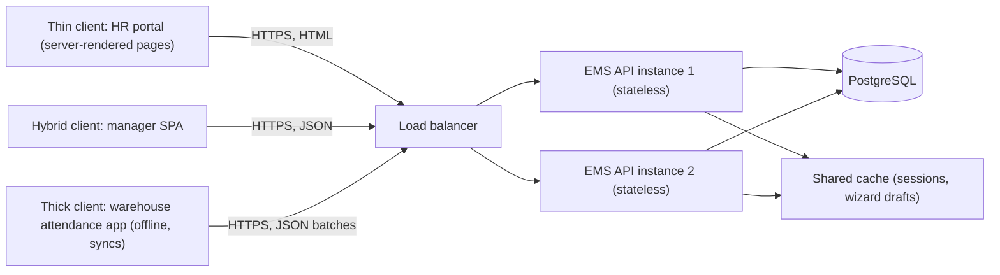
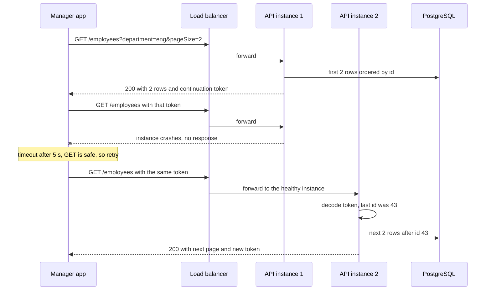

Almost every application you use is a client talking to a server: the browser loading a web page, the UPI app checking a balance, the HR portal fetching a leave balance. Client-server is the oldest and most common distributed architecture, and every other style in this module (monolith, n-tier, microservices) is built on top of it. This lesson explains how it works, the design choices it forces, and how to build both sides well, using the **employee management application** (EMS) as the example.

## Learning objectives

By the end of this lesson you will be able to:

1. Describe the client-server model: who starts the conversation, who waits, and what a request and a response contain.
2. Explain the costs a network adds compared with an in-process call: latency, partial failure, and versioning.
3. Compare thin, thick and hybrid clients, and choose one for a given situation.
4. Explain why stateless servers scale and recover well, and where state goes instead.
5. Build a stateless pagination endpoint in ASP.NET Core and a client that uses timeouts and safe retries.
6. Recognise when client-server is not the right shape (peer-to-peer, push-heavy or offline-first cases).

## Prerequisites

- [What is a software system?](#/lesson/m01-software-system): components, inputs, outputs and boundaries.
- [What is software architecture?](#/lesson/m02-what-is-architecture): quality attributes such as availability and scalability.

## Explain it like I'm a beginner

Think of ordering at a tea stall at a railway station.

You (the **client**) walk up and say: "One masala chai, less sugar." The stall owner (the **server**) makes it and hands it over with the price. You start the conversation; the stall owner waits for customers and answers whoever comes. Hundreds of travellers can be served by one stall, one after another or a few at a time.

That is the whole client-server idea:

- The **client** asks. It decides when to ask and what to ask for.
- The **server** answers. It waits for requests, does the work, and sends back a reply.
- The question is a **request**. The answer is a **response**.

A few details from the tea stall carry straight into software:

- **The stall owner does not need to remember you.** If your order says everything ("one masala chai, less sugar"), any person behind the counter can serve it. That is a **stateless** server. If instead you said "the usual", only the one person who remembers you can help, and if they go on break you are stuck. That is a **stateful** server.
- **Some customers bring a lot themselves.** One traveller just says "chai" and takes whatever comes (a **thin client**). Another brings their own cup, sugar and a flask to carry tea onto the train for later (a **thick client**: it holds more logic and data itself).
- **Sometimes the answer never comes.** The stall gets busy, or you have to run for your train. A good customer decides how long to wait (a **timeout**) and whether it is safe to ask again (a **retry**). Asking "how much is a chai?" twice is harmless. Paying twice is not.

In EMS, the HR person's browser or the manager's mobile app is the client. The EMS API is the server. "Show me employee 42" is a request. The JSON with Vikram Rao's profile is the response.

## First-principles explanation

### The model

Client-server has three defining properties:

1. **Asymmetric roles.** Clients initiate, servers respond. A server never calls a client out of the blue in the classic model (push techniques bend this rule, see below).
2. **Many clients, fewer servers.** One server (or a group of identical servers) serves many clients. 2,500 EMS users share one API.
3. **A network in between.** Client and server run on different machines and talk through a protocol, most often HTTP over TCP, secured with TLS.

A typical EMS request and response over HTTP:

```text
GET /employees/42 HTTP/1.1
Host: ems.example.in
Authorization: Bearer eyJhbGciOi...
Accept: application/json

HTTP/1.1 200 OK
Content-Type: application/json
ETag: "v7"
Cache-Control: private, max-age=60

{"id":42,"name":"Vikram Rao","department":"Engineering"}
```

The request names a **method** (GET), a **resource** (`/employees/42`), and **headers** (who I am, what format I accept). The response has a **status code** (200), headers (content type, a version tag, caching rules) and a **body**.

### What the network costs you

Compared with a method call inside one process, every client-server call adds:

- **Latency.** A request from Chennai to a server in Mumbai typically takes tens of milliseconds for the round trip, before the server does any work. Over a congested mobile network it can be hundreds of milliseconds. A method call takes nanoseconds. A screen that needs 20 sequential calls feels slow even if each one is fast on the server.
- **Partial failure.** The request may be lost, the server may crash halfway, or the response may be lost after the server has done the work. The client cannot always tell which happened. This is the single most important difference from in-process code.
- **Serialization.** Data must be turned into bytes (JSON, Protobuf) and back.
- **Versioning.** Clients and servers are deployed separately. A mobile app installed six months ago is still calling your API today. Changing a response field can break it.
- **Security boundary.** The client runs on a device you do not control. Anything it sends can be faked, so the server must re-check every rule. Client-side validation is for user convenience, never for security.

### Safe and idempotent requests

Because of partial failure, clients retry. Whether a retry is safe depends on the operation:

- **Safe** methods (GET, HEAD) do not change anything. Retrying is always fine.
- **Idempotent** methods (GET, PUT, DELETE) have the same effect whether sent once or many times. "Set employee 42's phone number to X" twice still leaves it as X.
- **Non-idempotent** methods (typically POST) may repeat the effect. "Submit leave request" twice might create two requests.

For non-idempotent operations that clients must retry, the server accepts an **idempotency key** (a unique id per logical operation, chosen by the client) and returns the original result if it sees the same key again.

### Thin, thick and hybrid clients

| Client type | Where logic and data live | EMS example | Strengths | Weaknesses |
|---|---|---|---|---|
| Thin client | Almost everything on the server. Client renders what the server sends. | Razor Pages HR portal: the server renders HTML, the browser displays it | Easy to update (deploy the server only), works on weak devices, logic cannot be tampered with | Needs the network for everything, each interaction is a round trip |
| Thick (fat, rich) client | Significant logic and local data on the client | A warehouse attendance app that works offline and syncs later, or a Windows payroll admin tool | Works offline, fast local interactions, can use device features | Hard to update (app store, installers), versions in the field vary, logic must still be re-checked on the server |
| Hybrid | UI logic on the client, business rules and data on the server | A single-page app (React, Blazor WebAssembly) or a typical mobile app calling a JSON API | Responsive UI, server remains the authority | Two codebases, API versioning, more complex security (tokens, CORS) |

There is no universally best choice. Thin clients suit internal tools on good networks. Thick clients suit offline or device-heavy work (warehouses and rural areas with poor connectivity, kiosks). Hybrid is the common default for public-facing apps.

### Stateless servers

A server is **stateless** when it keeps no memory of a client between requests. Each request carries everything needed to process it: who the user is (a token or cookie), what they want, and any position information (such as which page of results).

Why it matters:

- **Scaling.** If no instance holds a client's state, a load balancer can send each request to any instance. Adding a fourth instance just works.
- **Recovery.** If an instance crashes, clients retry on another instance and lose nothing.
- **Deployment.** You can replace instances one at a time (rolling deploys) without logging anyone out.

Where does the state go instead?

- **In the request**: a signed token (cookie or JWT) for identity, a continuation token for pagination, an ETag for "the version I last saw".
- **In a shared store**: a database or distributed cache (Redis, or PostgreSQL itself) for sessions, shopping carts or multi-step forms.
- **On the client**: a thick client keeps drafts locally and submits them when complete.

"Stateless" refers to the **server process**. The system obviously has state (the database). The point is that no single server instance is the only holder of a client's conversation.

Some servers are legitimately stateful: a WebSocket server holds open connections, a multiplayer game server keeps the game in memory. Those need different scaling techniques (connection-aware routing, a backplane to broadcast between instances), so keep them small and separate from the stateless API.

### Pull vs push

Classic client-server is **pull**: the client asks when it wants something. When the server needs to tell the client something ("your leave was approved"), options are:

- **Polling**: the client asks every N seconds. Simple, but wasteful and delayed.
- **Server-Sent Events (SSE)**: the client opens one long HTTP connection and the server streams events down it.
- **WebSockets** (in ASP.NET Core, usually through SignalR): a two-way connection.
- **Push notifications** to mobile devices via the platform's service.

Each push option makes the server hold connections, so it reintroduces some state.

### When client-server is not the right shape

- **Peer-to-peer** systems (file sharing, some video calls) have no central server for the main data flow.
- **Offline-first** apps treat the local database as primary and sync opportunistically; the server becomes a sync partner rather than the authority for every action.
- **Event-driven** back ends communicate through messages rather than request/response (see [event-driven architecture](#/lesson/m02-event-driven)).

Even these usually keep a client-server part for login, configuration and coordination.

## Visual explanation

### EMS clients and server



Three kinds of client use the same server. The HR portal is a thin client: the server renders HTML and the browser only displays it. The manager single-page app is a hybrid: it renders screens itself and asks the API for JSON. The attendance app used in the company's warehouses is a thick client: it records punches offline and uploads them in batches when the signal returns. All of them reach the API through a load balancer. Because both API instances are stateless, the load balancer may send any request to either. Anything that must survive between requests lives in PostgreSQL or the shared cache, never in one instance's memory.

### A request, a lost response and a safe retry



The first page comes back with a **continuation token**, a small encoded value that says "the last employee id you saw was 43, page size 2". The server stores nothing about this client. On the second request, instance 1 crashes before answering. The client waits up to its timeout, then retries, which is safe because GET changes nothing. The load balancer now picks instance 2, which has never seen this client before. It does not need to: the token in the request tells it exactly where to continue. This is statelessness paying off. With a server-side "current page" stored in instance 1's memory, the retry would have failed or restarted from page 1.

## Step-by-step example

### Step 1 — define the contract

EMS publishes `GET /employees?department={d}&pageSize={n}&token={t}`, returning `{ items: [...], nextToken: "..." | null }`. The contract is versioned (`/v1/`) because the mobile app will live on phones for months.

### Step 2 — make the server stateless

The first version stored "current page" in session memory. With two instances it broke whenever the load balancer switched. The fix: put the position in a continuation token that the client sends back. The token is protected with ASP.NET Core Data Protection so clients cannot tamper with it, and all instances share the key ring so any instance can read any token.

### Step 3 — pick the client type per audience

HR uses the thin Razor Pages portal on office PCs. Managers use the SPA on laptops and phones. Warehouse supervisors, whose phones lose signal inside large metal-roofed sheds, use the thick attendance app, which queues punches locally.

### Step 4 — make clients resilient

Every client call has a timeout (5 seconds for API calls, longer for exports). GET requests are retried up to 3 times with growing delays on timeouts and 5xx responses. POST requests that create things send an `Idempotency-Key` header and are retried only with the same key.

### Step 5 — never trust the client

The SPA hides the "approve" button from non-managers, but the server still checks that the caller is the employee's manager. The attendance app validates punch times locally for a good experience, and the server validates them again.

## Production-style C# implementation

Server side: a stateless, tamper-proof pagination endpoint and an ETag on single-employee reads. Client side: a typed `HttpClient` with a timeout, as a hybrid client or another server would use it.

```csharp file=Server/EmployeeCatalog.cs
namespace Ems.ClientServer.Server;

public sealed record EmployeeDto(int Id, string Name, string Department, int Version);

public sealed class EmployeeCatalog
{
    private readonly List<EmployeeDto> _all =
    [
        new(41, "Neha Kapoor", "Engineering", 3),
        new(42, "Vikram Rao", "Engineering", 7),
        new(43, "Ananya Das", "Engineering", 1),
        new(44, "Kavya Iyer", "Engineering", 2),
        new(45, "Farhan Ali", "Finance", 5),
        new(46, "Rahul Verma", "Engineering", 1),
    ];

    public EmployeeDto? Get(int id) => _all.FirstOrDefault(e => e.Id == id);

    /// <summary>Keyset pagination: rows after a given id, ordered by id. Stable even if rows are added.</summary>
    public IReadOnlyList<EmployeeDto> PageAfter(string department, int afterId, int take) =>
        _all.Where(e => e.Department.Equals(department, StringComparison.OrdinalIgnoreCase) && e.Id > afterId)
            .OrderBy(e => e.Id)
            .Take(take)
            .ToList();
}
```

```csharp file=Server/ContinuationTokens.cs
using System.Text.Json;
using Microsoft.AspNetCore.DataProtection;

namespace Ems.ClientServer.Server;

public sealed record PagePosition(string Department, int AfterId, int PageSize);

/// <summary>Encodes the client's position in a tamper-proof token, so the server stores nothing between requests.
/// All instances must share the Data Protection key ring (for example in a database or blob storage).</summary>
public sealed class ContinuationTokens(IDataProtectionProvider provider)
{
    private readonly IDataProtector _protector = provider.CreateProtector("Ems.Employees.Paging.v1");

    public string Create(PagePosition position) => _protector.Protect(JsonSerializer.Serialize(position));

    public PagePosition? TryRead(string token)
    {
        try
        {
            return JsonSerializer.Deserialize<PagePosition>(_protector.Unprotect(token));
        }
        catch (Exception ex) when (ex is System.Security.Cryptography.CryptographicException or JsonException)
        {
            return null;   // tampered, expired key or garbage: treat as a bad request
        }
    }
}
```

```csharp file=Server/EmployeeEndpoints.cs
namespace Ems.ClientServer.Server;

public sealed record EmployeePage(IReadOnlyList<EmployeeDto> Items, string? NextToken);

public static class EmployeeEndpoints
{
    public static void MapEmployeeEndpoints(this IEndpointRouteBuilder app)
    {
        var v1 = app.MapGroup("/v1/employees");

        // Conditional GET: if the client already has this version, send 304 and no body.
        v1.MapGet("/{id:int}", (int id, HttpRequest request, HttpResponse response, EmployeeCatalog catalog) =>
        {
            var e = catalog.Get(id);
            if (e is null) return Results.NotFound();

            var etag = $"\"v{e.Version}\"";
            response.Headers.ETag = etag;
            response.Headers.CacheControl = "private, max-age=60";
            // Simplified: a real If-None-Match header may list several tags or use W/ weak tags.
            return request.Headers.IfNoneMatch == etag ? Results.StatusCode(StatusCodes.Status304NotModified) : Results.Ok(e);
        });

        // Stateless pagination: the position travels in the token, not in server memory.
        v1.MapGet("/", (string? department, int? pageSize, string? token, EmployeeCatalog catalog, ContinuationTokens tokens) =>
        {
            PagePosition position;
            if (token is null)
            {
                if (string.IsNullOrWhiteSpace(department)) return Results.Problem("department is required", statusCode: 400);
                position = new PagePosition(department, AfterId: 0, PageSize: Math.Clamp(pageSize ?? 20, 1, 100));
            }
            else
            {
                var read = tokens.TryRead(token);
                if (read is null) return Results.Problem("Invalid or expired continuation token.", statusCode: 400);
                position = read;
            }

            var items = catalog.PageAfter(position.Department, position.AfterId, position.PageSize);
            var next = items.Count == position.PageSize
                ? tokens.Create(position with { AfterId = items[^1].Id })
                : null;
            return Results.Ok(new EmployeePage(items, next));
        });
    }
}
```

```csharp file=Client/EmployeeApiClient.cs
using System.Net;
using System.Net.Http.Json;

namespace Ems.ClientServer.Client;

public sealed record EmployeeView(int Id, string Name, string Department, int Version);
public sealed record EmployeePageView(List<EmployeeView> Items, string? NextToken);

/// <summary>A typed client, as a back-office tool or another service would use it.
/// Timeout and base address are set where it is registered.</summary>
public sealed class EmployeeApiClient(HttpClient http)
{
    public async Task<EmployeeView?> GetAsync(int id, CancellationToken ct)
    {
        using var response = await http.GetAsync($"v1/employees/{id}", ct);
        if (response.StatusCode == HttpStatusCode.NotFound) return null;
        response.EnsureSuccessStatusCode();
        return await response.Content.ReadFromJsonAsync<EmployeeView>(ct);
    }

    /// <summary>Reads every page by following continuation tokens. Each call is independent and safe to retry.</summary>
    public async IAsyncEnumerable<EmployeeView> ListDepartmentAsync(string department,
        [System.Runtime.CompilerServices.EnumeratorCancellation] CancellationToken ct)
    {
        string? token = null;
        do
        {
            var url = token is null
                ? $"v1/employees/?department={Uri.EscapeDataString(department)}&pageSize=50"
                : $"v1/employees/?token={Uri.EscapeDataString(token)}";
            var page = await http.GetFromJsonAsync<EmployeePageView>(url, ct)
                       ?? throw new InvalidOperationException("Empty response from EMS API.");
            foreach (var e in page.Items) yield return e;
            token = page.NextToken;
        } while (token is not null);
    }
}
```

```csharp file=Program.cs
using Ems.ClientServer.Client;
using Ems.ClientServer.Server;

var builder = WebApplication.CreateBuilder(args);

// Server side
builder.Services.AddDataProtection();   // in production, persist keys to shared storage for all instances
builder.Services.AddSingleton<EmployeeCatalog>();
builder.Services.AddSingleton<ContinuationTokens>();

// Client side (for example a reporting tool calling the EMS API)
builder.Services.AddHttpClient<EmployeeApiClient>(c =>
{
    c.BaseAddress = new Uri(builder.Configuration["EmsApi:BaseUrl"] ?? "https://localhost:5001/");
    c.Timeout = TimeSpan.FromSeconds(5);   // never wait forever for a server
});

var app = builder.Build();

app.MapEmployeeEndpoints();

app.Run();
```

**Why keyset pagination (`id > lastId`) instead of page numbers?** With `OFFSET 40`, if a new employee is inserted while the client is paging, everyone shifts by one and a row is shown twice or skipped. Keyset pagination is stable and also faster on large tables with an index, because PostgreSQL does not have to count and skip rows.

**Why protect the token?** A plain base64 token can be edited by the client (for example to change the department filter and read another department's list). Data Protection signs and encrypts it. Authorization must still be checked on every request; the protection just stops tampering with the position.

**Why `IHttpClientFactory`?** Creating a new `HttpClient` per call can exhaust sockets, while one long-lived static client keeps old connections and misses DNS changes unless you set `SocketsHttpHandler.PooledConnectionLifetime`. The factory pools handlers and is the recommended approach. For retries in production, add `Microsoft.Extensions.Http.Resilience` (`AddStandardResilienceHandler()`), which applies timeouts, retries with backoff and a circuit breaker. Exercise 3 builds a small retry by hand so you see what it does.

## Bad design vs good design

**Bad: a stateful server and a naive client.**

```csharp
// Server keeps the paging position in memory, per user
static readonly Dictionary<string, int> CurrentPage = new();

app.MapGet("/employees/next", (HttpContext ctx) =>
{
    var user = ctx.User.Identity!.Name!;
    var page = CurrentPage.GetValueOrDefault(user);
    CurrentPage[user] = page + 1;                // a retry skips a page
    return Results.Ok(LoadPage(page));           // another instance knows nothing about this user
});

// Client
var http = new HttpClient();                     // new client per call, default 100 s timeout
var json = await http.GetStringAsync(url);       // no timeout policy, no retry, no cancellation
```

Problems: the position lives in one instance's memory, so a second instance or a restart breaks paging. A GET that changes server state means a retry silently skips a page. The client waits up to 100 seconds by default, and creating `HttpClient` per call can exhaust sockets under load.

**Good:** the implementation above. The server is stateless, GET has no side effects, the position travels in a protected token, and the client uses `IHttpClientFactory` with an explicit timeout.

**Is statelessness always worth it?** For request/response APIs, almost always: the cost is small and it unlocks scaling and safe deployments. For real-time connections (live dashboards, chat), some state is unavoidable. Keep that state in a small, separate component and the main API stateless.

:::callout type=warning title="Client-side checks are not security"
Hiding a button, disabling a field or validating in JavaScript improves the user experience, but anyone can send requests with a tool like curl. Every rule that matters (who can approve leave, who can see a salary) must be enforced on the server.
:::

:::callout type=tradeoff title="Chatty vs chunky APIs"
A screen that makes 15 small calls pays 15 round trips of latency. Over a mobile network at around 100 ms each, that is 1.5 s before any server work. Design endpoints around what a screen needs (one call for "my dashboard"), but not so broad that every call returns megabytes. This trade-off becomes even more important across tiers, see [n-tier architecture](#/lesson/m02-n-tier).
:::

## Practical playground

The simulation below sends 6 requests through a round-robin load balancer to 2 server instances. First it uses **stateful** servers that remember each user's page in memory. Then it uses **stateless** servers where the client sends a token. Run it and compare. Then set `crashAfter = 3` to make instance A restart after its third request and see which design survives.

:::playground type=csharp title="Stateful vs stateless behind a load balancer"
```csharp file=Program.cs
using System;
using System.Collections.Generic;

public interface IServer { string Name { get; } (string Body, string? Token) Handle(string user, string? token); void Restart(); }

public sealed class StatefulServer(string name) : IServer
{
    private Dictionary<string, int> _pageByUser = new();
    public string Name => name;
    public (string, string?) Handle(string user, string? token)
    {
        var page = _pageByUser.GetValueOrDefault(user) + 1;
        _pageByUser[user] = page;
        return ($"page {page}", null);
    }
    public void Restart() => _pageByUser = new();
}

public sealed class StatelessServer(string name) : IServer
{
    public string Name => name;
    public (string, string?) Handle(string user, string? token)
    {
        var page = token is null ? 1 : int.Parse(token) + 1;
        return ($"page {page}", page.ToString());
    }
    public void Restart() { }
}

public static class Program
{
    public static void Main()
    {
        const int crashAfter = 0;   // set to 3 to restart instance A after its third request
        Run("STATEFUL", new IServer[] { new StatefulServer("A"), new StatefulServer("B") }, crashAfter);
        Run("STATELESS", new IServer[] { new StatelessServer("A"), new StatelessServer("B") }, crashAfter);
    }

    private static void Run(string title, IServer[] servers, int crashAfter)
    {
        Console.WriteLine($"--- {title} ---");
        string? token = null;
        var handledByA = 0;
        for (var i = 0; i < 6; i++)
        {
            var server = servers[i % servers.Length];          // round-robin load balancer
            var (body, next) = server.Handle("priya", token);
            token = next;
            Console.WriteLine($"request {i + 1} -> instance {server.Name}: {body} (expected page {i + 1})");
            if (server.Name == "A" && ++handledByA == crashAfter) { server.Restart(); Console.WriteLine("  instance A restarted"); }
        }
    }
}
```
:::

## Exercises

:::exercise id=m02-client-server-ex1 difficulty=beginner kind=code title="Stateless pagination with continuation tokens"
Implement a stateless paginator for EMS employee ids. The server keeps no memory between calls: the client's position is encoded in a token that the client sends back.
::requirements
- `PageTokens.Encode(int afterId, int pageSize)` returns a URL-safe string. `PageTokens.Decode(string)` returns `(AfterId, PageSize)` or `null` if the token is malformed.
- Token format: base64url of the text `v1:{afterId}:{pageSize}`. Anything else (wrong prefix, non-numbers, page size outside 1–100, bad base64) decodes to `null`.
- `Paginator.GetPage(sortedIds, token, pageSize)` returns the ids after the token's position (or from the start if the token is null) and a `NextToken`, which is null on the last page.
- When a token is given, its page size wins over the `pageSize` argument.
::acceptance
- Encode then decode returns the same values.
- Reading all pages of 7 ids with page size 3 returns all 7 ids exactly once, in 3 pages.
- Garbage tokens decode to null.
- The last page has `NextToken == null`.
::hint
Base64url is normal base64 with `+` → `-`, `/` → `_` and the `=` padding removed. Restore the padding before decoding.
::hint
Use keyset logic: "ids greater than `afterId`", not "skip N items".
::hint
A next token exists only if this page is full **and** more ids follow.
::hint
```csharp
var page = sortedIds.Where(id => id > afterId).Take(size).ToList();
var hasMore = page.Count == size && sortedIds.Any(id => id > page[^1]);
```
::starter
```csharp file=Paging.cs
using System;
using System.Collections.Generic;
using System.Linq;
using System.Text;

public static class PageTokens
{
    public static string Encode(int afterId, int pageSize) => throw new NotImplementedException();

    public static (int AfterId, int PageSize)? Decode(string token) => throw new NotImplementedException();
}

public sealed record Page(IReadOnlyList<int> Ids, string? NextToken);

public static class Paginator
{
    public static Page GetPage(IReadOnlyList<int> sortedIds, string? token, int pageSize)
    {
        throw new NotImplementedException();
    }
}
```
::tests
```csharp file=PagingTests.cs
using System.Collections.Generic;
using System.Linq;
using Xunit;

public class PagingTests
{
    [Fact]
    public void Round_trip()
    {
        var decoded = PageTokens.Decode(PageTokens.Encode(43, 20));
        Assert.NotNull(decoded);
        Assert.Equal(43, decoded!.Value.AfterId);
        Assert.Equal(20, decoded.Value.PageSize);
    }

    [Fact]
    public void Token_is_url_safe()
    {
        var t = PageTokens.Encode(int.MaxValue, 100);
        Assert.DoesNotContain("+", t);
        Assert.DoesNotContain("/", t);
        Assert.DoesNotContain("=", t);
    }

    [Theory]
    [InlineData("not-a-token!!")]
    [InlineData("djI6MToy")]        // "v2:1:2"
    [InlineData("djE6eDoy")]        // "v1:x:2"
    [InlineData("djE6MTowMDA")]     // "v1:1:000" (page size 0)
    public void Garbage_decodes_to_null(string token) => Assert.Null(PageTokens.Decode(token));

    [Fact]
    public void Reads_all_pages_once()
    {
        var ids = new List<int> { 3, 8, 15, 16, 23, 42, 51 };
        var seen = new List<int>();
        string? token = null;
        var pages = 0;
        do
        {
            var page = Paginator.GetPage(ids, token, 3);
            seen.AddRange(page.Ids);
            token = page.NextToken;
            pages++;
        } while (token is not null && pages < 10);

        Assert.Equal(ids, seen);
        Assert.Equal(3, pages);
    }

    [Fact]
    public void Exact_multiple_has_no_empty_last_page()
    {
        var ids = new List<int> { 1, 2, 3, 4 };
        var first = Paginator.GetPage(ids, null, 2);
        var second = Paginator.GetPage(ids, first.NextToken, 2);
        Assert.Equal(new List<int> { 3, 4 }, second.Ids.ToList());
        Assert.Null(second.NextToken);
    }
}
```
::solution
```csharp file=Paging.cs
using System;
using System.Collections.Generic;
using System.Linq;
using System.Text;

public static class PageTokens
{
    public static string Encode(int afterId, int pageSize)
    {
        var bytes = Encoding.UTF8.GetBytes($"v1:{afterId}:{pageSize}");
        return Convert.ToBase64String(bytes).TrimEnd('=').Replace('+', '-').Replace('/', '_');
    }

    public static (int AfterId, int PageSize)? Decode(string token)
    {
        try
        {
            var b64 = token.Replace('-', '+').Replace('_', '/');
            b64 = b64.PadRight(b64.Length + (4 - b64.Length % 4) % 4, '=');
            var parts = Encoding.UTF8.GetString(Convert.FromBase64String(b64)).Split(':');
            if (parts.Length != 3 || parts[0] != "v1") return null;
            if (!int.TryParse(parts[1], out var afterId) || !int.TryParse(parts[2], out var size)) return null;
            if (size is < 1 or > 100) return null;
            return (afterId, size);
        }
        catch (FormatException)
        {
            return null;
        }
    }
}

public sealed record Page(IReadOnlyList<int> Ids, string? NextToken);

public static class Paginator
{
    public static Page GetPage(IReadOnlyList<int> sortedIds, string? token, int pageSize)
    {
        var afterId = int.MinValue;
        var size = pageSize;
        if (token is not null)
        {
            var decoded = PageTokens.Decode(token) ?? throw new ArgumentException("Invalid token.", nameof(token));
            (afterId, size) = decoded;
        }

        var page = sortedIds.Where(id => id > afterId).Take(size).ToList();
        var hasMore = page.Count == size && sortedIds.Any(id => id > page[^1]);
        return new Page(page, hasMore ? PageTokens.Encode(page[^1], size) : null);
    }
}
```

The token carries the version prefix `v1` so the format can change later without breaking old tokens silently. This token is not tamper-proof: in production, sign or encrypt it (the lesson's implementation uses Data Protection) so clients cannot forge positions or filters.
::mistakes
- Using `Skip(page * size)`, which repeats or skips rows when data changes between calls.
- Returning a next token on a full last page, which forces an extra empty request.
- Throwing on garbage tokens inside `Decode`, which turns a client mistake into a 500.
::extensions
Add the department filter to the token, and sign the token with an HMAC so tampering is detected.
:::

:::exercise id=m02-client-server-ex2 difficulty=beginner kind=written title="Thin, thick or hybrid?"
Choose a client type for each EMS scenario and justify it in two or three sentences.

1. HR staff in the Gurgaon head office maintaining employee records on desktop PCs.
2. Supervisors at a tea estate in a hilly area with patchy mobile signal, recording daily attendance for 200 pickers.
3. Managers approving leave from their phones while travelling.
4. A factory gate kiosk where workers tap an ID card to check their leave balance.
::acceptance
- A choice for each with reasons tied to network, update frequency, device and security.
- At least one scenario explicitly addresses offline behaviour and later synchronization.
- Each answer states what the server must still validate.
::hint
Which of these must keep working with no network for hours?
::hint
Which ones are on devices you control and can update easily?
::hint
For every client, ask: "If someone modified this client, what could they fake?"
::solution
1. **Thin client** (server-rendered portal). Reliable office network, frequent changes to forms are deployed once on the server, no install. The server validates everything, as always.
2. **Thick client** (offline-capable mobile app with a local database). It records punches offline with device timestamps and syncs in batches with idempotency keys so a retried upload does not double-count. The server re-validates times (no future dates, no duplicates per worker per day) and flags suspicious clock differences.
3. **Hybrid** (responsive SPA or mobile app calling a JSON API). Good responsiveness on phones, needs network only for the actual approval. The server checks that the approver is the employee's manager.
4. **Thin client** (kiosk browser in locked-down mode). A device you control, read-only use, simplest to keep updated. The server authenticates the card and returns only that employee's balance.
::mistakes
- Choosing a thick client for the office portal "for speed", adding installation and update pain for no benefit.
- Forgetting idempotency for offline batch uploads, causing double attendance after retries.
:::

:::exercise id=m02-client-server-ex3 difficulty=intermediate kind=code title="A client that retries safely"
Implement `RetryingClient.GetAsync`, which sends a GET request and retries on transient failures, and `RetryingClient.ShouldRetry`, which decides what is retryable.
::requirements
- `ShouldRetry(HttpMethod method, HttpStatusCode? status)`: true only for **GET, HEAD, PUT or DELETE** (idempotent methods) **and** when the status is `null` (network error or timeout), `408`, `429` or any `5xx`. Never retry other `4xx`.
- `GetAsync(url)` makes up to `maxAttempts` attempts. Create a **new** `HttpRequestMessage` for every attempt.
- Between attempts, await `delay(attemptNumber)` (injected so tests do not wait).
- An `HttpRequestException` counts as a transient failure. If the last attempt still throws, rethrow it.
- If the last attempt returns a retryable status, return that response.
::acceptance
- Two `503` responses then a `200`: three attempts, returns `200`.
- A `404` is returned immediately after one attempt.
- Network errors on all attempts: the exception propagates after `maxAttempts`.
- POST is never retryable.
::hint
Write `ShouldRetry` first and test it on its own. It is the policy, and `GetAsync` is the loop.
::hint
An `HttpRequestMessage` cannot be sent twice. Build it inside the loop.
::hint
Inside the loop: try sending. On exception, if attempts remain, delay and continue, otherwise rethrow. On a response, return it unless it is retryable and attempts remain.
::hint
```csharp
for (var attempt = 1; ; attempt++)
{
    try
    {
        var response = await _http.SendAsync(new HttpRequestMessage(HttpMethod.Get, url));
        if (attempt >= _maxAttempts || !ShouldRetry(HttpMethod.Get, response.StatusCode)) return response;
        response.Dispose();
    }
    catch (HttpRequestException) when (attempt < _maxAttempts) { }
    await _delay(attempt);
}
```
::starter
```csharp file=RetryingClient.cs
using System;
using System.Net;
using System.Net.Http;
using System.Threading.Tasks;

public sealed class RetryingClient
{
    private readonly HttpClient _http;
    private readonly int _maxAttempts;
    private readonly Func<int, Task> _delay;

    public RetryingClient(HttpClient http, int maxAttempts, Func<int, Task> delay)
    {
        _http = http;
        _maxAttempts = maxAttempts;
        _delay = delay;
    }

    public static bool ShouldRetry(HttpMethod method, HttpStatusCode? status) => throw new NotImplementedException();

    public Task<HttpResponseMessage> GetAsync(string url) => throw new NotImplementedException();
}
```
::tests
```csharp file=RetryingClientTests.cs
using System;
using System.Collections.Generic;
using System.Net;
using System.Net.Http;
using System.Threading;
using System.Threading.Tasks;
using Xunit;

public class RetryingClientTests
{
    private sealed class ScriptedHandler(params Func<HttpResponseMessage>[] steps) : HttpMessageHandler
    {
        public int Calls { get; private set; }
        protected override Task<HttpResponseMessage> SendAsync(HttpRequestMessage request, CancellationToken ct)
        {
            var step = steps[Math.Min(Calls, steps.Length - 1)];
            Calls++;
            return Task.FromResult(step());
        }
    }

    private static Func<HttpResponseMessage> Status(HttpStatusCode code) => () => new HttpResponseMessage(code);
    private static Func<HttpResponseMessage> NetworkError() => () => throw new HttpRequestException("connection reset");

    private static (RetryingClient client, ScriptedHandler handler, List<int> delays) Make(params Func<HttpResponseMessage>[] steps)
    {
        var handler = new ScriptedHandler(steps);
        var delays = new List<int>();
        var client = new RetryingClient(new HttpClient(handler) { BaseAddress = new Uri("http://ems.test/") }, 3,
            attempt => { delays.Add(attempt); return Task.CompletedTask; });
        return (client, handler, delays);
    }

    [Fact]
    public async Task Retries_503_then_succeeds()
    {
        var (client, handler, delays) = Make(Status(HttpStatusCode.ServiceUnavailable), Status(HttpStatusCode.ServiceUnavailable), Status(HttpStatusCode.OK));
        var response = await client.GetAsync("v1/employees/42");
        Assert.Equal(HttpStatusCode.OK, response.StatusCode);
        Assert.Equal(3, handler.Calls);
        Assert.Equal(new List<int> { 1, 2 }, delays);
    }

    [Fact]
    public async Task Does_not_retry_404()
    {
        var (client, handler, _) = Make(Status(HttpStatusCode.NotFound));
        var response = await client.GetAsync("v1/employees/999");
        Assert.Equal(HttpStatusCode.NotFound, response.StatusCode);
        Assert.Equal(1, handler.Calls);
    }

    [Fact]
    public async Task Network_errors_propagate_after_max_attempts()
    {
        var (client, handler, _) = Make(NetworkError());
        await Assert.ThrowsAsync<HttpRequestException>(() => client.GetAsync("v1/employees/42"));
        Assert.Equal(3, handler.Calls);
    }

    [Fact]
    public async Task Returns_last_retryable_response_when_out_of_attempts()
    {
        var (client, handler, _) = Make(Status(HttpStatusCode.TooManyRequests));
        var response = await client.GetAsync("v1/employees/42");
        Assert.Equal(HttpStatusCode.TooManyRequests, response.StatusCode);
        Assert.Equal(3, handler.Calls);
    }

    [Theory]
    [InlineData("GET", 503, true)]
    [InlineData("GET", 408, true)]
    [InlineData("PUT", 500, true)]
    [InlineData("GET", 400, false)]
    [InlineData("POST", 503, false)]
    [InlineData("GET", 200, false)]
    public void Retry_policy(string method, int status, bool expected) =>
        Assert.Equal(expected, RetryingClient.ShouldRetry(new HttpMethod(method), (HttpStatusCode)status));

    [Fact] public void Network_error_on_get_is_retryable() => Assert.True(RetryingClient.ShouldRetry(HttpMethod.Get, null));
}
```
::solution
```csharp file=RetryingClient.cs
using System;
using System.Net;
using System.Net.Http;
using System.Threading.Tasks;

public sealed class RetryingClient
{
    private readonly HttpClient _http;
    private readonly int _maxAttempts;
    private readonly Func<int, Task> _delay;

    public RetryingClient(HttpClient http, int maxAttempts, Func<int, Task> delay)
    {
        _http = http;
        _maxAttempts = maxAttempts;
        _delay = delay;
    }

    public static bool ShouldRetry(HttpMethod method, HttpStatusCode? status)
    {
        var idempotent = method == HttpMethod.Get || method == HttpMethod.Head
                      || method == HttpMethod.Put || method == HttpMethod.Delete;
        if (!idempotent) return false;
        if (status is null) return true;
        var code = (int)status.Value;
        return code == 408 || code == 429 || code >= 500;
    }

    public async Task<HttpResponseMessage> GetAsync(string url)
    {
        for (var attempt = 1; ; attempt++)
        {
            try
            {
                var response = await _http.SendAsync(new HttpRequestMessage(HttpMethod.Get, url));
                if (attempt >= _maxAttempts || !ShouldRetry(HttpMethod.Get, response.StatusCode)) return response;
                response.Dispose();
            }
            catch (HttpRequestException) when (attempt < _maxAttempts && ShouldRetry(HttpMethod.Get, null))
            {
                // transient network failure: fall through to the delay and try again
            }
            await _delay(attempt);
        }
    }
}
```

In production, pass a delay function with exponential backoff and jitter (for example 200 ms, 400 ms, 800 ms, each ± 20 %), so many clients do not retry in lockstep and overload a recovering server. Respect a `Retry-After` header on `429` and `503` if present. The `Microsoft.Extensions.Http.Resilience` package implements all of this.
::alternatives
For POST, retry only with an `Idempotency-Key` header that the server honours. Then the server, not the client, guarantees the effect happens once.
::mistakes
- Retrying POST "because it timed out", which creates duplicate leave requests.
- Reusing the same `HttpRequestMessage`, which throws on the second send.
- Retrying `400` or `401`, which can never succeed and just adds load.
- Retrying without any delay, which turns a short outage into a self-inflicted overload.
:::

:::exercise id=m02-client-server-ex4 difficulty=intermediate kind=hld title="Client-server layout for EMS with an offline warehouse app"
Draw the client-server layout for EMS with three clients: the HR web portal (thin), the manager app (hybrid) and the warehouse attendance app (thick, offline-capable). The API must be stateless and run on at least two instances. Uploads from the warehouse app arrive in bursts when signal returns, about 200 staff × 2 punches × 40 warehouses ≈ 16,000 punches per day, often in the evening.
::acceptance
- All three clients reach the API through a load balancer.
- The API tier is stateless: sessions or drafts live in a shared store.
- Warehouse app uploads are idempotent and handled so that bursts do not slow the HR portal.
- A short explanation of where state lives for each client.
::hint
What should happen to a batch of 400 punches that arrives at 7 pm from one warehouse?
::hint
Can the API accept the batch quickly and process it in the background?
::hint
Where does a half-finished onboarding form live if any instance may handle the next step?
::starter
```json
{
  "nodes": [
    { "id": "hr", "type": "client", "label": "HR portal (thin)", "props": { "rps": 20 } },
    { "id": "mgr", "type": "client", "label": "Manager app (hybrid)", "props": { "rps": 30 } },
    { "id": "wh", "type": "client", "label": "Warehouse attendance app (thick)", "props": { "rps": 5 } },
    { "id": "api", "type": "app-server", "label": "EMS API", "props": { "instances": 1 } },
    { "id": "db", "type": "database", "label": "PostgreSQL" }
  ],
  "edges": [
    { "from": "hr", "to": "api", "kind": "sync" },
    { "from": "mgr", "to": "api", "kind": "sync" },
    { "from": "wh", "to": "api", "kind": "sync" },
    { "from": "api", "to": "db", "kind": "sync" }
  ]
}
```
::solution
```json
{
  "nodes": [
    { "id": "hr", "type": "client", "label": "HR portal (thin)", "props": { "rps": 20 } },
    { "id": "mgr", "type": "client", "label": "Manager app (hybrid)", "props": { "rps": 30 } },
    { "id": "wh", "type": "client", "label": "Warehouse attendance app (thick, local queue)", "props": { "rps": 5 } },
    { "id": "lb", "type": "load-balancer", "label": "Load balancer" },
    { "id": "api", "type": "app-server", "label": "EMS API (stateless)", "props": { "instances": 2 } },
    { "id": "cache", "type": "cache", "label": "Shared cache: sessions, form drafts", "props": { "ttlSeconds": 1800 } },
    { "id": "q", "type": "queue", "label": "Punch batch queue" },
    { "id": "worker", "type": "worker", "label": "Attendance importer", "props": { "instances": 1 } },
    { "id": "db", "type": "database", "label": "PostgreSQL" }
  ],
  "edges": [
    { "from": "hr", "to": "lb", "kind": "sync" },
    { "from": "mgr", "to": "lb", "kind": "sync" },
    { "from": "wh", "to": "lb", "kind": "sync", "label": "batch upload with idempotency key" },
    { "from": "lb", "to": "api", "kind": "sync" },
    { "from": "api", "to": "cache", "kind": "sync" },
    { "from": "api", "to": "db", "kind": "sync" },
    { "from": "api", "to": "q", "kind": "async", "label": "accept batch, return 202" },
    { "from": "q", "to": "worker", "kind": "async" },
    { "from": "worker", "to": "db", "kind": "sync", "label": "upsert punches" }
  ]
}
```

**Where state lives.** HR portal: an authentication cookie, with server-side session data (if any) in the shared cache. Manager app: a bearer token on the device, everything else in PostgreSQL. Warehouse app: punches in a local database on the phone until uploaded. Each batch carries an idempotency key (warehouse id + device id + batch number), so a retry after a lost response is ignored instead of double-counted.

**Bursts.** 16,000 punches a day is small, but they arrive in bursts. The API validates the batch shape, stores it in a queue and returns `202 Accepted` in milliseconds. The importer processes batches at its own pace, so the HR portal is unaffected. For this volume, a PostgreSQL table used as a queue is enough; a separate broker is optional.
::mistakes
- Keeping wizard drafts in API instance memory, which breaks with two instances.
- Processing large batches synchronously in the request, so the warehouse app times out and retries, duplicating work.
:::

:::exercise id=m02-client-server-ex5 difficulty=advanced kind=written title="Remove server state from onboarding and add live notifications"
EMS has a 5-step employee onboarding wizard. Today, the server keeps the half-filled form in `HttpContext.Session` (in-process memory). With 3 API instances, HR staff randomly lose their progress. Product also wants managers to see "new joiner onboarded" notifications live, without refreshing.

Design both changes. Compare at least three places to keep wizard state, choose one, and explain how live notifications work with multiple instances.
::acceptance
- At least three state options compared on durability, scalability, security and complexity.
- A clear choice with reasons.
- Live notifications design covers multiple instances (how an event raised on instance 1 reaches a manager connected to instance 3).
- Mentions what happens on reconnect after a dropped connection.
::hint
Options include: in the client (browser storage or hidden fields), in a shared cache, in the database as a draft row, or sticky sessions.
::hint
Which option survives the HR user closing the laptop and continuing tomorrow?
::hint
With SignalR on several instances, connections are spread out. What component lets one instance send to a connection held by another?
::hint
A dropped connection can miss events. How does the client catch up?
::solution
**Wizard state options.**

| Option | Durability | Scalability | Security | Complexity |
|---|---|---|---|---|
| Sticky sessions (keep in-memory session, pin user to one instance) | Lost on instance restart or deploy | Uneven load, harder scaling | Fine | Low, but fragile |
| Client-side (browser storage, signed hidden fields) | Lost if browser data cleared, not shared across devices | Excellent | Personal data on the device; must re-validate everything | Low to medium |
| Shared cache (distributed session) | Survives instance restarts, lost on cache eviction or expiry | Good | Server-side | Medium |
| Draft row in PostgreSQL (`onboarding_drafts`) | Durable for days, survives everything | Good at this volume | Server-side, auditable | Medium |

**Choice:** a draft row in PostgreSQL keyed by draft id, with the HR user's id and a `step` column. Onboarding takes days (documents arrive late), so durability matters more than microseconds. The client keeps only the draft id in the URL. Each step is a `PUT /onboarding-drafts/{id}/steps/{n}`, which is idempotent and safe to retry. Drafts older than 30 days are purged, and personal data in drafts is covered by the same access rules as employee records.

**Live notifications.** Use SignalR. Managers' browsers hold a connection to whichever instance the load balancer chose. When onboarding completes on instance 1, it publishes an "employee-onboarded" event. A **backplane** (for example Redis pub/sub, or a managed SignalR service) delivers that message to all instances, and each instance pushes it to its connected managers who should see it. The rest of the API stays stateless; only the SignalR hub holds connections.

**Reconnects.** Connections drop on mobile networks. On reconnect, the client calls `GET /notifications?since={lastSeenId}` to fetch missed events, so the live channel is a speed-up, not the source of truth. For 2,500 employees, polling every 30 seconds would also work. Choose SignalR only if "live" really matters to users.
::mistakes
- Choosing sticky sessions, which hides the problem until the next deployment.
- Storing personal data in browser local storage without considering shared PCs.
- Assuming SignalR works across instances without a backplane.
- Treating live notifications as the only delivery path, so a dropped connection loses events.
:::

## Automated testing

Client-server code has two sides, and each needs its own tests.

**1. Server endpoint tests** with `WebApplicationFactory`, through real HTTP:

```csharp
[Fact]
public async Task Paging_returns_every_engineer_exactly_once()
{
    var client = factory.CreateClient();
    var seen = new List<int>();
    string? token = null;
    do
    {
        var url = token is null ? "/v1/employees/?department=Engineering&pageSize=2" : $"/v1/employees/?token={Uri.EscapeDataString(token)}";
        var page = await client.GetFromJsonAsync<EmployeePage>(url);
        seen.AddRange(page!.Items.Select(e => e.Id));
        token = page.NextToken;
    } while (token is not null);

    Assert.Equal(new[] { 41, 42, 43, 44, 46 }, seen);
}

[Fact]
public async Task Tampered_token_is_rejected()
{
    var response = await factory.CreateClient().GetAsync("/v1/employees/?token=abc123");
    Assert.Equal(HttpStatusCode.BadRequest, response.StatusCode);
}
```

**2. Statelessness test.** Create two separate `WebApplicationFactory` instances that share one Data Protection key ring. Fetch page 1 from the first and page 2 from the second with the token. If it works, any instance can serve any request.

**3. Client tests with a fake `HttpMessageHandler`** (exercise 3): scripted responses, network exceptions and slow responses. No real network needed.

**4. Contract tests.** Keep a sample JSON response from each API version in the client's test project and deserialize it. If the server team renames a field, the client's test fails before users notice.

**5. Conditional GET test.** Request `/v1/employees/42`, read the `ETag`, request again with `If-None-Match` and expect `304`.

## Real-world application

- **The web itself** is client-server: browsers are clients, web servers respond. HTTP was designed around stateless request/response, which is why the web scales the way it does.
- **Banking and UPI apps** are hybrid clients. The app handles screens and local checks, while every transaction is authorised and recorded on the bank's servers. Idempotency is central: a retried payment request must not debit twice.
- **Email** uses client-server protocols (IMAP, SMTP), and mail apps are classic thick clients that cache mail offline.
- **Field-service and delivery apps** (technician job cards, proof-of-delivery photos, attendance) are often offline-first thick clients that sync with a central server when connectivity returns.
- **Database access** is client-server too: your ASP.NET Core app is a client of PostgreSQL, speaking its wire protocol over a pooled connection.

## Interview questions

:::interview
::q beginner
What is client-server architecture?
::a
A model where clients send requests to servers over a network, and servers process them and send responses. Clients initiate, servers wait and respond. Many clients share one server or a group of identical servers. The web, mobile apps calling APIs and applications calling databases are all examples.
::q beginner
What is the difference between a thin client and a thick client?
::a
A thin client does little beyond displaying what the server sends (a server-rendered web page). A thick client holds significant logic and often local data, and can work offline (a desktop or mobile app with a local database). Thin clients are easy to update and secure. Thick clients are responsive and work offline but are harder to update, and the server must still re-validate everything they send.
::q intermediate
What does it mean for a server to be stateless, and why is it useful?
::a
The server process keeps no memory of a client between requests. Each request carries what is needed (identity token, position token, versions), and durable state lives in a database or shared cache. Any instance can handle any request, so you can scale out behind a load balancer, survive instance crashes and deploy instance by instance without losing sessions.
::q intermediate
When is it safe for a client to retry a request?
::a
When the operation is idempotent (GET, HEAD, PUT, DELETE by HTTP semantics) and the failure is transient: a network error, timeout, 408, 429 or 5xx. Not for other 4xx errors, which will fail again. For non-idempotent operations such as POST, retry only if the server supports idempotency keys. Always use timeouts and exponential backoff with jitter, and respect `Retry-After`.
::q advanced
A mobile app that you cannot force-update is used by 40 % of users on a version from a year ago. How do you evolve the API?
::a
Treat the API as a contract. Make additive, backward-compatible changes (new optional fields, new endpoints); never remove or rename fields in place. For breaking changes, introduce a new version (`/v2/`) and run both, tracking usage of `/v1/` by app version header. Communicate a deprecation timeline, show in-app upgrade prompts, and use contract tests with recorded responses from each supported version. Only remove `/v1/` when usage falls below an agreed threshold.
::q advanced
How would you add real-time notifications to a stateless, horizontally scaled API?
::a
Keep the request/response API stateless and add a separate real-time component, for example a SignalR hub. Because connections are spread across instances, use a backplane (Redis pub/sub or a managed service) so an event raised on any instance reaches connections on all instances. Make delivery best-effort and give clients a catch-up endpoint (`since={lastId}`) after reconnects. Consider whether polling or Server-Sent Events are enough before adding WebSockets.
:::

## Summary and revision

**Key takeaways**

- Clients initiate requests, servers respond. A network sits between them, adding latency, partial failure, serialization, versioning and a security boundary.
- Safe and idempotent operations can be retried. Non-idempotent ones need idempotency keys.
- Thin clients are simple and easy to update, thick clients work offline and feel fast, hybrid clients are the common middle.
- Stateless servers let any instance serve any request. State goes in the request (tokens), a shared store or the client.
- Clients need timeouts, backoff with jitter and careful retry rules. Servers must re-validate everything.
- Push (SSE, WebSockets) reintroduces connection state: keep it in a small, separate component.

**Terminology**: client, server, request, response, status code, latency, partial failure, safe and idempotent methods, idempotency key, thin, thick and hybrid client, stateless server, continuation token, keyset pagination, ETag, conditional GET, backplane.

:::flashcards
Q: Who initiates communication in client-server?
A: The client. The server waits and responds.
Q: Name three costs a network adds compared with an in-process call.
A: Latency, partial failure, and versioning (also serialization and a security boundary).
Q: Which HTTP methods are idempotent?
A: GET, HEAD, PUT and DELETE (also OPTIONS and TRACE). POST is not.
Q: What makes a server stateless?
A: It keeps no per-client memory between requests. Each request carries what is needed, and durable state lives in shared storage.
Q: Why use a continuation token instead of a server-side "current page"?
A: Any instance can continue the listing, retries are safe, and nothing is lost if an instance restarts.
Q: Thin vs thick client in one line each?
A: Thin: the server does nearly everything and the client displays. Thick: the client holds logic and data, and may work offline.
Q: What is an ETag used for?
A: To identify a resource version, so the client can make a conditional GET and get 304 Not Modified instead of the full body.
Q: Why must the server re-check rules the client already checks?
A: The client runs on devices you do not control, so requests can be forged.
:::

## Knowledge check

:::quiz pass=70
::q single
EMS runs two API instances. Users lose their place in a paginated list whenever the load balancer switches instance. What is the root cause?
- [ ] The load balancer is misconfigured.
- [x] The paging position is stored in one instance's memory, so the server is stateful.
- [ ] PostgreSQL is too slow.
- [ ] The client uses the wrong HTTP method.
> Put the position in a continuation token or a shared store. Then any instance can serve the next page.
::q single
A manager's app times out while submitting a leave request (POST). What should it do?
- [ ] Retry immediately, POST is always safe.
- [ ] Never retry, and show an error.
- [x] Retry with the same idempotency key, so the server returns the original result if the first attempt actually succeeded.
- [ ] Switch to GET.
> The first attempt may have succeeded with the response lost. An idempotency key lets the server detect the duplicate.
::q single
Warehouse supervisors have patchy signal for hours. Which client type fits best?
- [ ] Thin client.
- [x] Thick client with a local store and later synchronization.
- [ ] A server-rendered page that polls every second.
- [ ] Email-based reporting.
> The client must keep working offline. Sync with idempotency keys, and the server re-validates on upload.
::q multi
Which responses are reasonable to retry for a GET request? (Select all that apply.)
- [x] 503 Service Unavailable
- [x] A network timeout with no response
- [ ] 404 Not Found
- [x] 429 Too Many Requests, after the Retry-After delay
- [ ] 401 Unauthorized
> Transient errors may succeed later. 404 and 401 will fail again until something else changes.
::q single
The SPA hides the "approve" button from employees who are not managers. Is server-side checking still needed?
- [x] Yes. Anyone can send the HTTP request directly, so the server must verify the approver is the employee's manager.
- [ ] No, the button is hidden.
- [ ] Only for mobile clients.
- [ ] Only if the app is public on the internet.
> Client-side checks improve usability, not security.
::q single
A screen makes 15 sequential API calls, each taking 20 ms on the server, over a mobile network with about 100 ms round-trip time. Roughly how long before the screen has all its data?
- [ ] About 20 ms.
- [ ] About 300 ms.
- [x] About 1.8 seconds (15 × 120 ms).
- [ ] About 100 ms.
> Latency adds up for sequential calls. Fewer, chunkier calls or parallel requests reduce it.
::q single
Which of these is a legitimately stateful component?
- [ ] A REST endpoint that lists employees.
- [x] A SignalR hub holding open WebSocket connections to managers' browsers.
- [ ] A health check endpoint.
- [ ] An endpoint that returns a payslip PDF.
> Open connections are state held by a specific instance. Keep such components small and use a backplane to scale them.
:::

## Completion criteria

You have finished this lesson when you can:

- [ ] Score at least 70 % on the knowledge check.
- [ ] Complete exercises 1 and 3 with all tests passing.
- [ ] Explain, with the tea-stall analogy and then technically, why stateless servers scale.
- [ ] Choose a client type for an application you know and defend the choice.
