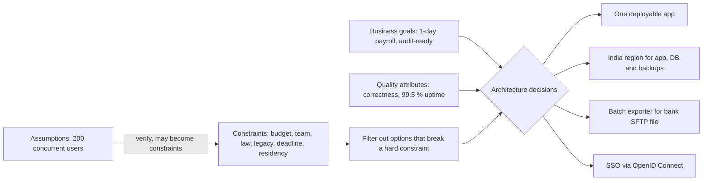
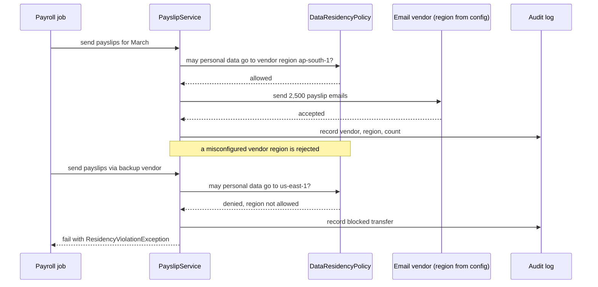

In the [previous lesson](#/lesson/m02-what-is-architecture) we said architecture is the set of hard-to-change decisions made to achieve quality attributes. But architects are never free to pick any design they like. Money, people, laws, old systems and calendars all fence in the options. This lesson is about those fences: how to find them, how to tell a real fence from an imagined one, and how to make code respect them automatically. We continue with the **employee management application** (EMS).

## Learning objectives

By the end of this lesson you will be able to:

1. Explain the difference between a business requirement, a functional requirement, a quality attribute, a constraint and an assumption.
2. List the common constraint types (budget, team skills, compliance, legacy systems, deadlines, data residency, technology mandates, operations) and give an architecture consequence for each.
3. Separate hard constraints from soft ones, and know which questions turn a "must" into a negotiable preference.
4. Turn a constraint into enforceable code: validated configuration that refuses to start, and policy classes tested with a controllable clock.
5. Explain how constraints often make the simpler architecture the right one.

## Prerequisites

- [What is software architecture?](#/lesson/m02-what-is-architecture): quality attributes and hard-to-change decisions.
- [Functional and non-functional requirements](#/lesson/m02-requirements): what a requirement is and how to make it measurable.

Some C# experience with classes and interfaces helps for the code sections.

## Explain it like I'm a beginner

Imagine you are planning a family trip from Delhi.

- **Why** you are going is the business requirement: "a relaxing holiday for the family before school reopens".
- **What** you will do is the functional part: travel, stay, sightseeing.
- **How well** it should go is the quality part: comfortable, safe, not too tiring for grandparents.
- Then come the **fences**. The budget is ₹80,000. School reopens on 1 July, so you must be back by 30 June. Grandmother cannot climb steep stairs. Your passport has expired, so the trip must be inside India. You already own a car, so a road trip is free to start.

Those fences are **constraints**. They are not things you want; they are limits you must work within. Notice something useful: the constraints did most of the deciding. Once you know "inside India, by road, under ₹80,000, back by 30 June, no steep stairs", only a handful of plans remain. You compare those few, instead of every destination on earth.

Software works the same way. A company might say:

- "EMS must cut the time HR spends on payroll from 5 days to 1 day." (business requirement, the *why*)
- "We have ₹60,000 a month for hosting, three .NET developers, and twelve weeks." (budget, team and deadline constraints)
- "Employee data must stay in India, and we must keep sending the salary file to our bank in their existing format." (compliance, data residency and legacy constraints)

Many architectures are technically possible. Very few survive those fences. A big part of an architect's job is finding the fences early, checking which are real, and choosing among the designs that fit.

## First-principles explanation

### Five kinds of input, not one

People often lump everything into "requirements". Separating them makes conversations much clearer:

| Kind | Question it answers | EMS example | Who usually owns it |
|---|---|---|---|
| Business requirement (goal) | Why are we building this? What outcome counts as success? | Reduce payroll processing from 5 days to 1 day. Cut leave-approval email back-and-forth. | Business sponsor, HR head |
| Functional requirement | What must the system do? | Managers approve leave. HR exports the bank file. | Product owner, HR |
| Quality attribute | How well must it do it? | 99.5 % availability in office hours. p95 search under 300 ms. | Business and architect together |
| Constraint | What are we not allowed to do, or forced to use? | Hosting under ₹60,000/month. Data stays in India. Must use the bank's file format. | Finance, legal, IT, external parties |
| Assumption | What are we treating as true without proof? | Peak is 200 concurrent users. The bank will not change its format this year. | Whoever made it, and it must be checked |

A **constraint** is different from a quality attribute because there is no trade-off slider. You can accept slightly slower search to save money. You cannot accept slightly illegal data storage.

An **assumption** is the dangerous one. It looks like a fact, but nobody verified it. Write assumptions down with an owner and a date to check them. When an assumption turns out false, it often becomes a new constraint, at the worst possible time.

### Business requirements drive priorities

Business requirements are often vague in wording but sharp in meaning. "Reduce payroll from 5 days to 1" tells you that **payroll correctness and automation** are the heart of the system, and that a beautiful employee profile page is secondary. Good architects translate goals into the two or three quality attributes that matter most:

- Goal "1-day payroll" → correctness of calculations, a reliable batch job that can be re-run safely, auditability.
- Goal "HR stops chasing managers on email" → notifications, mobile usability.
- Goal "pass the annual audit without a fire drill" → audit trail, retention, access control.

Ask "how will we know this succeeded?" for every goal. The answer becomes a measure you can design for.

### The common constraint types

**1. Budget.** Both build cost (team size × months) and run cost (hosting, licences, support). A ₹60,000 monthly hosting budget is roughly enough for a couple of mid-size application servers plus a managed PostgreSQL instance in most clouds (an estimate; check current regional prices). It is not enough for a Kubernetes cluster, a managed message broker, a search cluster and three environments of each. Budget is the single strongest argument for simple architectures.

**2. Team skills and size.** Three developers who know C# and PostgreSQL will build an ASP.NET Core application well. Asking them to also run Kafka, Kubernetes and a React Native app in twelve weeks is a recipe for an unstable system. A useful rule of thumb from practice: each independently deployed service needs someone who understands it at 2 am. If you have three people, you can own very few such things. Conway's Law also applies: systems tend to mirror the communication structure of the team that builds them.

**3. Compliance and regulation.** Laws and standards that apply to your data and domain. For an Indian EMS, examples to raise with the legal team include the Digital Personal Data Protection Act, 2023 (consent, purpose limitation, security safeguards, and rules about transfers outside India); the CERT-In directions of April 2022 (for example, keeping certain ICT system logs for 180 days within Indian jurisdiction); tax and labour record-keeping rules that set how long payroll records must be retained; and, if you handle payments directly, the RBI's 2018 directive that payment system data be stored only in India. Employees in the EU bring GDPR into scope. You are not expected to be a lawyer. You are expected to ask, record the answer, and design for it.

**4. Legacy systems.** Things that already exist and that you must work with: an old Oracle HR database with 12 years of history, the accounting system that consumes payroll journals, the bank's fixed-width salary file uploaded over SFTP, a biometric attendance device that only exports CSV at midnight. Legacy constraints shape integration style. You will often need an **anti-corruption layer** (a translator class or service that converts the legacy format into your clean model), batch jobs instead of real-time APIs, and data migration plans.

**5. Deadlines.** A statutory change effective 1 April, a contract go-live date, the end of the old system's licence. A hard deadline limits how much new technology you can introduce: every new tool has a learning curve. It also argues for **phasing**: what is the smallest release that meets the deadline, and what can follow in phase 2?

**6. Data residency and sovereignty.** Where data may be stored, processed and backed up. "Employee data stays in India" affects the cloud region, the backup region, the email provider, the error-tracking SaaS, the AI service you might call to summarise documents, and even where support staff can log in from. Residency constraints are easy to break by accident, because a single SDK call to a vendor can send personal data abroad.

**7. Technology mandates.** "All new systems use .NET and PostgreSQL", "must run on our on-premises VMware cluster", "must use the company identity provider". These are often good: they reduce support cost. Sometimes they are outdated and worth challenging, with evidence.

**8. Operational constraints.** "No 24×7 operations team", "deployments only on weekends", "the client's network blocks outbound internet". A system with no night-time support must fail safe and recover automatically, or be simple enough that nothing needs a 2 am fix.

### Hard vs soft constraints

Not every "must" is real. Before letting a constraint eliminate good options, ask:

- **Where does it come from?** A law, a signed contract or the bank's file specification is hard. "We have always done it this way" is soft.
- **What happens if we break it?** A fine or a failed audit is hard. "The CIO prefers Oracle" might be negotiable with a cost comparison.
- **Is it a constraint or a solution in disguise?** "We must use a message queue" is a solution. The real requirement might be "a failure in email sending must not block leave approval", which a simple background job can also satisfy.
- **Can it be relaxed for part of the system?** Data residency might apply to personal data but not to anonymised usage metrics.

Write each constraint with its **source**, **type (hard/soft)** and **consequence for the architecture**. That one table prevents months of rework.

### How constraints shape EMS

| Constraint | Source | Hard? | Architecture consequence |
|---|---|---|---|
| Hosting under ₹60,000/month | Finance | Hard (this year) | One deployable app, one managed PostgreSQL, no separate broker |
| 3 .NET developers, 12 weeks | Staffing plan | Hard | Single codebase, server-rendered or simple SPA, no microservices |
| Personal data stays in India | Company policy and legal advice | Hard | India region for app, DB, backups. Vendors checked for region. |
| Bank salary file in fixed-width format via SFTP | Bank | Hard | Exporter module plus a batch job, no real-time API to bank |
| Old Oracle HR DB with history | Legacy | Hard to retire | One-time migration plus a read-only archive, not live sync |
| Company SSO | IT standard | Hard | OpenID Connect login, no password table |
| Logs kept 180 days | Regulation (check with legal) | Hard | Central log store with retention policy in India region |
| "Must use microservices" | A senior manager's preference | Soft | Challenge with cost and team-size evidence |

Read the last column top to bottom. The constraints have already chosen most of the architecture: a single, well-structured [monolith](#/lesson/m02-monolith) in an India region, with batch integration to the bank, OpenID Connect login and a one-time migration. That is a common and healthy outcome. **Constraints frequently point to the simpler design, and that is a feature, not a limitation.**

### When to revisit constraints

Constraints change. Budgets grow after a successful launch. A new law takes effect. The team doubles. Record constraints in your [ADRs](#/lesson/m02-adr) so that, when one changes, you can find every decision that depended on it.

## Visual explanation

### From drivers to decisions



Read this left to right. Business goals and quality attributes say what to optimise. Constraints act as a **filter**: any option that breaks a hard constraint is removed before comparison begins. Assumptions sit behind constraints with a dotted line because they are unverified, and once checked they may turn into new constraints (for example, "200 users" might become "2,000 users after the acquisition"). Only then are decisions made, and for EMS they come out as one deployable application, India-only hosting, a batch exporter for the bank and single sign-on.

### Enforcing a residency constraint at runtime



This is the constraint "personal data stays in India" turned into behaviour. Before sending any personal data to a third party, the service asks a single policy object whether the destination region is allowed. In the first call the vendor is in an India region (AWS `ap-south-1` is Mumbai), so the send proceeds and is audited. In the second, someone has configured a backup vendor in a US region. The policy denies it, the attempt is logged, and the job fails loudly. Failing is the right behaviour: a delayed payslip email is a small problem, while personal data sent abroad against policy is a compliance incident. Better still, as the code below shows, the misconfiguration should stop the application at startup, before any job runs.

## Step-by-step example

### Step 1 — run a constraints workshop

Spend one hour with HR, finance, IT and legal. Ask each the same four questions: What is fixed? Why is it fixed? What happens if we break it? Who can change it? Write every answer in the constraints table.

### Step 2 — separate the soft from the hard

The HR head says "it must be a mobile app". You ask why. The real need: managers approve leave while travelling. A responsive web page with push-style email links meets that need for a fraction of the cost and with no app-store releases. The constraint was a solution in disguise. You record the real requirement instead.

### Step 3 — find the legacy edges

The bank file is fixed-width, 120 characters per line, uploaded via SFTP by 6 pm on the 28th. The old Oracle HR database has history back to 2013. Each becomes a small, isolated component: a `BankFileExporter` and a one-off migration tool. Neither leaks its format into the rest of EMS.

### Step 4 — make constraints executable

Some constraints can be enforced by code:

- Allowed regions → validated configuration that refuses to start with a non-India region.
- Retention periods → a policy class that decides which records to purge, tested with a fake clock.
- Log retention → configuration of the log store, checked by an infrastructure test.

### Step 5 — record and revisit

Each hard-to-change decision gets an ADR whose "Context" section lists the constraints it depends on. When the budget doubles next year, you search the ADRs for "budget" and know exactly which decisions to revisit.

## Production-style C# implementation

We implement two constraints for EMS:

1. **Data residency**: configuration that lists allowed regions and the regions actually used. The app **refuses to start** if they disagree, and a policy object guards every transfer to a third party.
2. **Retention**: a policy that finds former employees' records whose retention period has expired, using `TimeProvider` so tests can control "now".

```text
Ems.Api/
  Program.cs
  Compliance/
    ResidencyOptions.cs
    ResidencyOptionsValidator.cs
    DataResidencyPolicy.cs
    RetentionPolicy.cs
  Payslips/
    IEmailVendor.cs
    PayslipService.cs
```

```csharp file=Compliance/ResidencyOptions.cs
namespace Ems.Compliance;

public sealed class ResidencyOptions
{
    public const string Section = "Residency";

    /// <summary>Regions where personal data may be stored or processed, e.g. "centralindia", "ap-south-1".</summary>
    public List<string> AllowedRegions { get; set; } = [];

    public string DatabaseRegion { get; set; } = "";
    public string BackupRegion { get; set; } = "";
    public string EmailVendorRegion { get; set; } = "";
}
```

```csharp file=Compliance/ResidencyOptionsValidator.cs
using Microsoft.Extensions.Options;

namespace Ems.Compliance;

/// <summary>Turns the data residency constraint into a startup check. With ValidateOnStart, a
/// misconfigured region stops the app before it handles a single request.</summary>
public sealed class ResidencyOptionsValidator : IValidateOptions<ResidencyOptions>
{
    public ValidateOptionsResult Validate(string? name, ResidencyOptions options)
    {
        if (options.AllowedRegions.Count == 0)
            return ValidateOptionsResult.Fail("Residency:AllowedRegions must list at least one region.");

        var allowed = new HashSet<string>(options.AllowedRegions, StringComparer.OrdinalIgnoreCase);
        var failures = new List<string>();

        void Check(string setting, string value)
        {
            if (string.IsNullOrWhiteSpace(value)) failures.Add($"Residency:{setting} is required.");
            else if (!allowed.Contains(value)) failures.Add($"Residency:{setting} '{value}' is not an allowed region.");
        }

        Check(nameof(options.DatabaseRegion), options.DatabaseRegion);
        Check(nameof(options.BackupRegion), options.BackupRegion);
        Check(nameof(options.EmailVendorRegion), options.EmailVendorRegion);

        return failures.Count == 0 ? ValidateOptionsResult.Success : ValidateOptionsResult.Fail(failures);
    }
}
```

```csharp file=Compliance/DataResidencyPolicy.cs
using Microsoft.Extensions.Options;

namespace Ems.Compliance;

public sealed class ResidencyViolationException(string destination, string region)
    : Exception($"Personal data may not be sent to {destination} in region '{region}'.");

public interface IDataResidencyPolicy
{
    /// <summary>Throws ResidencyViolationException if personal data may not go to this region.</summary>
    void EnsureAllowed(string destination, string region);
}

public sealed class DataResidencyPolicy(IOptionsMonitor<ResidencyOptions> options, ILogger<DataResidencyPolicy> logger)
    : IDataResidencyPolicy
{
    public void EnsureAllowed(string destination, string region)
    {
        var allowed = options.CurrentValue.AllowedRegions;
        if (allowed.Contains(region, StringComparer.OrdinalIgnoreCase)) return;

        logger.LogError("Blocked transfer of personal data to {Destination} in {Region}", destination, region);
        throw new ResidencyViolationException(destination, region);
    }
}
```

```csharp file=Compliance/RetentionPolicy.cs
namespace Ems.Compliance;

public enum RecordKind { Profile, Payroll, Leave }

public sealed record EmployeeRecord(Guid Id, int EmployeeId, RecordKind Kind, DateOnly? ExitDate, bool LegalHold);

public sealed class RetentionOptions
{
    /// <summary>Years to keep each kind of record after the employee leaves. Set by the legal team.</summary>
    public Dictionary<RecordKind, int> YearsAfterExit { get; set; } = new()
    {
        [RecordKind.Profile] = 3,
        [RecordKind.Leave] = 3,
        [RecordKind.Payroll] = 8,
    };
}

/// <summary>Decides which records are due for deletion. Pure logic: it never deletes anything itself.</summary>
public sealed class RetentionPolicy(RetentionOptions options, TimeProvider clock)
{
    public IReadOnlyList<EmployeeRecord> DueForPurge(IEnumerable<EmployeeRecord> records)
    {
        var today = DateOnly.FromDateTime(clock.GetUtcNow().UtcDateTime);
        return records
            .Where(r => r.ExitDate is not null && !r.LegalHold)
            .Where(r => options.YearsAfterExit.TryGetValue(r.Kind, out var years)
                        && r.ExitDate!.Value.AddYears(years) <= today)
            .ToList();
    }
}
```

```csharp file=Payslips/IEmailVendor.cs
namespace Ems.Payslips;

public sealed record PayslipEmail(int EmployeeId, string To, string Month);

public interface IEmailVendor
{
    string Name { get; }
    Task SendAsync(IReadOnlyList<PayslipEmail> emails, CancellationToken ct);
}

/// <summary>Fake vendor for local runs. A real one would call the provider's SDK.</summary>
public sealed class ConsoleEmailVendor(ILogger<ConsoleEmailVendor> logger) : IEmailVendor
{
    public string Name => "console";
    public Task SendAsync(IReadOnlyList<PayslipEmail> emails, CancellationToken ct)
    {
        logger.LogInformation("Pretending to send {Count} payslip emails", emails.Count);
        return Task.CompletedTask;
    }
}
```

```csharp file=Payslips/PayslipService.cs
using Ems.Compliance;
using Microsoft.Extensions.Options;

namespace Ems.Payslips;

public sealed class PayslipService(
    IEmailVendor vendor,
    IDataResidencyPolicy residency,
    IOptions<ResidencyOptions> residencyOptions,
    ILogger<PayslipService> logger)
{
    public async Task SendAsync(IReadOnlyList<PayslipEmail> emails, CancellationToken ct)
    {
        // The constraint is checked at the boundary where data leaves our system, every time.
        residency.EnsureAllowed(vendor.Name, residencyOptions.Value.EmailVendorRegion);
        await vendor.SendAsync(emails, ct);
        logger.LogInformation("Sent {Count} payslips via {Vendor} in {Region}",
            emails.Count, vendor.Name, residencyOptions.Value.EmailVendorRegion);
    }
}
```

```csharp file=Program.cs
using Ems.Compliance;
using Ems.Payslips;
using Microsoft.Extensions.Options;

var builder = WebApplication.CreateBuilder(args);

// Defaults for the example. In a real deployment these come from appsettings.json or environment variables.
builder.Configuration.AddInMemoryCollection(new Dictionary<string, string?>
{
    ["Residency:AllowedRegions:0"] = "centralindia",
    ["Residency:AllowedRegions:1"] = "southindia",
    ["Residency:DatabaseRegion"] = "centralindia",
    ["Residency:BackupRegion"] = "southindia",
    ["Residency:EmailVendorRegion"] = "centralindia",
});

builder.Services.AddOptions<ResidencyOptions>()
    .Bind(builder.Configuration.GetSection(ResidencyOptions.Section))
    .ValidateOnStart();                       // fail fast: a bad region never reaches production traffic
builder.Services.AddSingleton<IValidateOptions<ResidencyOptions>, ResidencyOptionsValidator>();

builder.Services.AddSingleton(TimeProvider.System);
builder.Services.AddSingleton(new RetentionOptions());
builder.Services.AddSingleton<RetentionPolicy>();
builder.Services.AddSingleton<IDataResidencyPolicy, DataResidencyPolicy>();
builder.Services.AddSingleton<IEmailVendor, ConsoleEmailVendor>();
builder.Services.AddScoped<PayslipService>();

var app = builder.Build();

app.MapPost("/payslips/{month}/send", async (string month, PayslipService payslips, CancellationToken ct) =>
{
    var batch = new List<PayslipEmail> { new(1, "priya.sharma@example.in", month), new(2, "arjun.mehta@example.in", month) };
    try
    {
        await payslips.SendAsync(batch, ct);
        return Results.Accepted();
    }
    catch (ResidencyViolationException ex)
    {
        return Results.Problem(ex.Message, statusCode: StatusCodes.Status409Conflict);
    }
});

app.Run();
```

**What `ValidateOnStart` buys you.** Without it, options are validated the first time someone asks for them, which might be the payroll job at 11 pm on the 28th. With it, `app.Run()` throws an `OptionsValidationException` during startup, the deployment health check fails, and the old version keeps serving. The constraint is enforced by the deployment pipeline itself.

**Why the policy is a separate class.** Every place where personal data leaves the system (email vendor, SMS gateway, analytics, an AI summariser) calls the same `IDataResidencyPolicy`. There is one rule, one log line format and one place to test.

## Bad design vs good design

**Bad: constraints living in people's heads.**

- The rule "data stays in India" is in an email from legal two years ago. A new developer adds an error-tracking SDK whose default ingestion region is in the US. Stack traces containing employee names flow abroad for six months.
- Retention is "we'll clean up later". Seven years on, nobody dares delete anything, and a data protection request cannot be answered.
- The architecture was chosen for a team of 12, but the team is 3. Half the services have nobody who understands them.

**Good: constraints written, sourced and enforced.**

- A constraints table with source, hard or soft, and consequence, linked from the ADRs.
- Region settings validated at startup. Vendors checked through one policy.
- Retention implemented as a tested policy plus a scheduled job, with a legal-hold flag.
- An architecture sized for the team and budget that actually exist.

**Is it worth enforcing in code?** For constraints with legal or financial consequences, yes: a few dozen lines of validation are cheap insurance. For soft preferences ("we prefer tabs over spaces"), no: a linter or a team agreement is enough.

:::callout type=warning title="This lesson is not legal advice"
Laws and regulator directions change, and their exact scope depends on your industry and data. Treat the regulations named here as examples of what to ask about. Get the real constraint, in writing, from your legal or compliance team, and record its source in your ADR.
:::

:::callout type=tradeoff title="Constraints as a gift"
A tight budget and a small team rule out fashionable but complex architectures. That is often good news: fewer moving parts, fewer failure modes, faster delivery. Resist the urge to design for the team and budget you wish you had.
:::

## Practical playground

The program below scores four candidate EMS architectures against a set of constraints. Run it, then change the constraints: raise the budget to ₹4,00,000, the team to 12 people, and the deadline to 40 weeks. Watch which options become possible.

:::playground type=csharp title="Filter architectures by constraints"
```csharp file=Program.cs
using System;
using System.Collections.Generic;
using System.Linq;

public sealed record Option(string Name, int MonthlyCostInr, int MinTeam, int WeeksToBuild, bool IndiaRegionAvailable, bool NeedsKafkaSkills);
public sealed record Constraints(int BudgetInr, int TeamSize, int DeadlineWeeks, bool DataMustStayInIndia, bool TeamKnowsKafka);

public static class Program
{
    public static void Main()
    {
        // Estimates for illustration only, not quotes.
        var options = new List<Option>
        {
            new("Single deployable app + managed PostgreSQL", 35_000, 2, 10, true, false),
            new("Modular monolith + read replica + background worker", 55_000, 3, 12, true, false),
            new("8 microservices on Kubernetes + Kafka", 2_50_000, 10, 30, true, true),
            new("Overseas SaaS HR product with custom add-ons", 40_000, 1, 6, false, false),
        };

        var c = new Constraints(BudgetInr: 60_000, TeamSize: 3, DeadlineWeeks: 12, DataMustStayInIndia: true, TeamKnowsKafka: false);

        foreach (var o in options)
        {
            var broken = new List<string>();
            if (o.MonthlyCostInr > c.BudgetInr) broken.Add($"budget ({o.MonthlyCostInr:N0} > {c.BudgetInr:N0})");
            if (o.MinTeam > c.TeamSize) broken.Add($"team size ({o.MinTeam} > {c.TeamSize})");
            if (o.WeeksToBuild > c.DeadlineWeeks) broken.Add($"deadline ({o.WeeksToBuild} > {c.DeadlineWeeks} weeks)");
            if (c.DataMustStayInIndia && !o.IndiaRegionAvailable) broken.Add("data residency");
            if (o.NeedsKafkaSkills && !c.TeamKnowsKafka) broken.Add("team skills");

            Console.WriteLine(broken.Count == 0
                ? $"FITS     {o.Name}"
                : $"REJECTED {o.Name}: {string.Join(", ", broken)}");
        }
    }
}
```
:::

## Exercises

:::exercise id=m02-constraints-ex1 difficulty=beginner kind=code title="Validate data residency settings"
Implement `ResidencyValidator.Validate` so that EMS refuses to start when the database or backup region is not in the allowed list. This is the startup check from the lesson, in simplified form.
::requirements
- Fail if `AllowedRegions` is empty.
- Fail if `DatabaseRegion` or `BackupRegion` is blank or not in `AllowedRegions`.
- Region comparison ignores case (`CentralIndia` equals `centralindia`).
- Report **all** problems at once, not just the first one.
::acceptance
- Valid settings return `ValidateOptionsResult.Success` (its `Succeeded` is true).
- A US backup region fails and the failure message names `BackupRegion`.
- Two bad settings produce two failure messages.
- Case differences do not cause failures.
::hint
`IValidateOptions<T>.Validate` returns a `ValidateOptionsResult`. Look at `ValidateOptionsResult.Success` and `ValidateOptionsResult.Fail(...)`.
::hint
Collect messages in a `List<string>` and only decide success or failure at the end. `Fail` has an overload that takes `IEnumerable<string>`.
::hint
A `HashSet<string>` built with `StringComparer.OrdinalIgnoreCase` gives case-insensitive `Contains`.
::hint
```csharp
var allowed = new HashSet<string>(options.AllowedRegions, StringComparer.OrdinalIgnoreCase);
if (!allowed.Contains(options.BackupRegion)) failures.Add($"BackupRegion '{options.BackupRegion}' is not allowed.");
```
::starter
```csharp file=ResidencyValidator.cs
using System;
using System.Collections.Generic;
using Microsoft.Extensions.Options;

public sealed class ResidencySettings
{
    public List<string> AllowedRegions { get; set; } = new();
    public string DatabaseRegion { get; set; } = "";
    public string BackupRegion { get; set; } = "";
}

public sealed class ResidencyValidator : IValidateOptions<ResidencySettings>
{
    public ValidateOptionsResult Validate(string? name, ResidencySettings options)
    {
        throw new NotImplementedException();
    }
}
```
::tests
```csharp file=ResidencyValidatorTests.cs
using System.Collections.Generic;
using System.Linq;
using Xunit;

public class ResidencyValidatorTests
{
    private static ResidencySettings Valid() => new()
    {
        AllowedRegions = new List<string> { "centralindia", "southindia" },
        DatabaseRegion = "centralindia",
        BackupRegion = "southindia",
    };

    [Fact] public void Valid_settings_succeed() => Assert.True(new ResidencyValidator().Validate(null, Valid()).Succeeded);

    [Fact]
    public void Us_backup_fails_and_names_setting()
    {
        var s = Valid(); s.BackupRegion = "eastus";
        var r = new ResidencyValidator().Validate(null, s);
        Assert.True(r.Failed);
        Assert.Contains("BackupRegion", r.FailureMessage);
    }

    [Fact]
    public void Two_problems_two_messages()
    {
        var s = Valid(); s.BackupRegion = "eastus"; s.DatabaseRegion = "";
        var r = new ResidencyValidator().Validate(null, s);
        Assert.Equal(2, r.Failures!.Count());
    }

    [Fact]
    public void Empty_allowed_list_fails()
    {
        var s = Valid(); s.AllowedRegions = new List<string>();
        Assert.True(new ResidencyValidator().Validate(null, s).Failed);
    }

    [Fact]
    public void Case_is_ignored()
    {
        var s = Valid(); s.DatabaseRegion = "CentralIndia";
        Assert.True(new ResidencyValidator().Validate(null, s).Succeeded);
    }
}
```
::solution
```csharp file=ResidencyValidator.cs
using System;
using System.Collections.Generic;
using Microsoft.Extensions.Options;

public sealed class ResidencySettings
{
    public List<string> AllowedRegions { get; set; } = new();
    public string DatabaseRegion { get; set; } = "";
    public string BackupRegion { get; set; } = "";
}

public sealed class ResidencyValidator : IValidateOptions<ResidencySettings>
{
    public ValidateOptionsResult Validate(string? name, ResidencySettings options)
    {
        if (options.AllowedRegions.Count == 0)
            return ValidateOptionsResult.Fail("AllowedRegions must list at least one region.");

        var allowed = new HashSet<string>(options.AllowedRegions, StringComparer.OrdinalIgnoreCase);
        var failures = new List<string>();

        void Check(string setting, string value)
        {
            if (string.IsNullOrWhiteSpace(value)) failures.Add($"{setting} is required.");
            else if (!allowed.Contains(value)) failures.Add($"{setting} '{value}' is not an allowed region.");
        }

        Check(nameof(options.DatabaseRegion), options.DatabaseRegion);
        Check(nameof(options.BackupRegion), options.BackupRegion);

        return failures.Count == 0 ? ValidateOptionsResult.Success : ValidateOptionsResult.Fail(failures);
    }
}
```

Register it with `AddSingleton<IValidateOptions<ResidencySettings>, ResidencyValidator>()` and call `.ValidateOnStart()` on the options builder. Reporting all failures at once saves a deploy-fix-deploy loop for every setting.
::mistakes
- Returning on the first failure, so the operator fixes one setting, redeploys, and hits the next.
- Case-sensitive comparison, which fails on a harmless `CentralIndia` and tempts people to switch validation off.
- Validating lazily (no `ValidateOnStart`), so the error appears only when the first job runs.
::extensions
Add `EmailVendorRegion` and an `ExceptionsByVendor` list for vendors that legal has explicitly approved, with an expiry date.
:::

:::exercise id=m02-constraints-ex2 difficulty=beginner kind=written title="Sort the statements"
Classify each statement from an EMS kick-off meeting as **business requirement**, **functional requirement**, **quality attribute**, **constraint** or **assumption**. Mark constraints as hard or soft.

1. "Payroll must take one day instead of five."
2. "Managers can approve or reject leave."
3. "We have ₹60,000 per month for hosting."
4. "Around 200 people will use it at month end."
5. "It has to be microservices, that's modern."
6. "The bank only accepts its fixed-width file over SFTP."
7. "95 % of searches must finish in under 300 ms."
8. "Go-live must be before the new financial year on 1 April."
9. "Personal data must not leave India."
10. "HR will clean up duplicate records before migration."
::acceptance
- All ten classified.
- Each constraint marked hard or soft with a reason.
- Assumptions have a suggested owner and a way to verify.
::hint
Ask of each line: is it a *why*, a *what*, a *how well*, a *limit*, or a *belief*?
::hint
For "must" statements, ask where they come from and what happens if broken.
::hint
Two items are assumptions disguised as facts. Who could prove or disprove them?
::solution
1. Business requirement (the why; measure: 1 day).
2. Functional requirement.
3. Constraint, hard for this financial year (finance owns it).
4. Assumption: owner HR/IT, verify from login data of the old system and the acquisition plan.
5. Constraint, soft: it is a solution preference. Replace with the real need, if any.
6. Constraint, hard (external party's specification).
7. Quality attribute (performance), measurable.
8. Constraint, hard if driven by statutory changes, otherwise check how firm it is.
9. Constraint, hard (policy plus legal advice). Record the source.
10. Assumption: owner HR. Verify with a data-quality report on the old database. If false, migration needs a de-duplication tool.
::mistakes
- Treating "around 200 users" as a fact. If it is really 2,000, capacity plans change.
- Accepting "microservices" as a hard constraint without asking why.
:::

:::exercise id=m02-constraints-ex3 difficulty=intermediate kind=code title="Implement the retention policy"
HR and legal have defined how long EMS keeps former employees' records. Implement `Retention.DueForPurge` to return the records that may now be deleted.
::requirements
- Records of current employees (`ExitDate` is null) are never purged.
- Records with `LegalHold = true` are never purged.
- A record is due when `ExitDate + YearsAfterExit[Kind]` is on or before today.
- If a kind has no configured period, keep it (never delete by default).
- "Today" comes from the injected `TimeProvider`, in UTC.
- Results ordered by `ExitDate`, then `EmployeeId`.
::acceptance
- Payroll kept 8 years: an exit on 2018-03-31 is due on 2026-03-31, not on 2026-03-30.
- Legal hold and current employees are excluded.
- Unknown kind is kept.
- Tests control the date with a fake `TimeProvider`.
::hint
Get today first: `DateOnly.FromDateTime(clock.GetUtcNow().UtcDateTime)`.
::hint
`DateOnly.AddYears` handles 29 February (it moves to 28 February in non-leap years).
::hint
Filter in three steps: has exit date, not on hold, period known and expired. Then sort.
::hint
```csharp
records.Where(r => r.ExitDate is { } exit && !r.LegalHold
                   && years.TryGetValue(r.Kind, out var y) && exit.AddYears(y) <= today)
```
::starter
```csharp file=Retention.cs
using System;
using System.Collections.Generic;
using System.Linq;

public enum Kind { Profile, Payroll, Leave, Medical }

public sealed record StoredRecord(int EmployeeId, Kind Kind, DateOnly? ExitDate, bool LegalHold);

public sealed class Retention
{
    private readonly IReadOnlyDictionary<Kind, int> _yearsAfterExit;
    private readonly TimeProvider _clock;

    public Retention(IReadOnlyDictionary<Kind, int> yearsAfterExit, TimeProvider clock)
    {
        _yearsAfterExit = yearsAfterExit;
        _clock = clock;
    }

    public IReadOnlyList<StoredRecord> DueForPurge(IEnumerable<StoredRecord> records)
    {
        throw new NotImplementedException();
    }
}
```
::tests
```csharp file=RetentionTests.cs
using System;
using System.Collections.Generic;
using System.Linq;
using Xunit;

public class RetentionTests
{
    private sealed class FixedClock(DateTimeOffset now) : TimeProvider
    {
        public override DateTimeOffset GetUtcNow() => now;
    }

    private static readonly Dictionary<Kind, int> Policy = new() { [Kind.Profile] = 3, [Kind.Payroll] = 8, [Kind.Leave] = 3 };

    private static Retention At(int y, int m, int d) =>
        new(Policy, new FixedClock(new DateTimeOffset(y, m, d, 10, 0, 0, TimeSpan.Zero)));

    [Fact]
    public void Payroll_due_exactly_on_anniversary()
    {
        var r = new StoredRecord(7, Kind.Payroll, new DateOnly(2018, 3, 31), false);
        Assert.Single(At(2026, 3, 31).DueForPurge(new[] { r }));
        Assert.Empty(At(2026, 3, 30).DueForPurge(new[] { r }));
    }

    [Fact]
    public void Current_employee_never_purged() =>
        Assert.Empty(At(2040, 1, 1).DueForPurge(new[] { new StoredRecord(1, Kind.Profile, null, false) }));

    [Fact]
    public void Legal_hold_never_purged() =>
        Assert.Empty(At(2040, 1, 1).DueForPurge(new[] { new StoredRecord(1, Kind.Profile, new DateOnly(2010, 1, 1), true) }));

    [Fact]
    public void Unknown_kind_is_kept() =>
        Assert.Empty(At(2040, 1, 1).DueForPurge(new[] { new StoredRecord(1, Kind.Medical, new DateOnly(2010, 1, 1), false) }));

    [Fact]
    public void Ordered_by_exit_date_then_employee()
    {
        var records = new[]
        {
            new StoredRecord(9, Kind.Profile, new DateOnly(2020, 6, 1), false),
            new StoredRecord(5, Kind.Profile, new DateOnly(2019, 1, 1), false),
            new StoredRecord(2, Kind.Leave, new DateOnly(2020, 6, 1), false),
        };
        var ids = At(2026, 1, 1).DueForPurge(records).Select(r => r.EmployeeId).ToList();
        Assert.Equal(new List<int> { 5, 2, 9 }, ids);
    }
}
```
::solution
```csharp file=Retention.cs
using System;
using System.Collections.Generic;
using System.Linq;

public enum Kind { Profile, Payroll, Leave, Medical }

public sealed record StoredRecord(int EmployeeId, Kind Kind, DateOnly? ExitDate, bool LegalHold);

public sealed class Retention
{
    private readonly IReadOnlyDictionary<Kind, int> _yearsAfterExit;
    private readonly TimeProvider _clock;

    public Retention(IReadOnlyDictionary<Kind, int> yearsAfterExit, TimeProvider clock)
    {
        _yearsAfterExit = yearsAfterExit;
        _clock = clock;
    }

    public IReadOnlyList<StoredRecord> DueForPurge(IEnumerable<StoredRecord> records)
    {
        var today = DateOnly.FromDateTime(_clock.GetUtcNow().UtcDateTime);
        return records
            .Where(r => r.ExitDate is { } exit
                        && !r.LegalHold
                        && _yearsAfterExit.TryGetValue(r.Kind, out var years)
                        && exit.AddYears(years) <= today)
            .OrderBy(r => r.ExitDate)
            .ThenBy(r => r.EmployeeId)
            .ToList();
    }
}
```

The policy only *decides*. A separate scheduled job deletes (or anonymises) the records and writes an audit entry, which keeps the risky part small and the rule easy to test.
::alternatives
Instead of deleting, many systems **anonymise** (replace name, phone and bank account with placeholders) so that aggregate reports still add up. Which one you need is a compliance question.
::mistakes
- Using `DateTime.Now`, which makes the boundary test impossible and depends on the server's time zone.
- Treating a missing period as zero years, which deletes data nobody approved deleting.
- Forgetting legal hold, which can destroy evidence in an ongoing dispute.
:::

:::exercise id=m02-constraints-ex4 difficulty=intermediate kind=written title="Fit EMS into the budget"
Finance gives you ₹60,000 per month for all EMS hosting (production plus one test environment). Using the estimated monthly prices below (illustrative, not real quotes), propose a production and test setup that fits, and state which quality attribute you are trading away.

| Item | Estimated ₹/month |
|---|---|
| App server, 4 vCPU / 16 GB | 12,000 |
| App server, 2 vCPU / 8 GB | 6,000 |
| Managed PostgreSQL, 4 vCPU, high availability (2 nodes) | 28,000 |
| Managed PostgreSQL, 4 vCPU, single node | 14,000 |
| Managed PostgreSQL, 2 vCPU, single node | 7,000 |
| Load balancer | 2,500 |
| Log storage, 180 days | 4,000 |
| Backups (geo-redundant within India) | 3,000 |
::acceptance
- Total including test environment is at most ₹60,000, with the arithmetic shown.
- At least one explicit trade-off (what you gave up and why it is acceptable).
- Log retention and backups are not dropped, since they come from hard constraints.
::hint
Start with what you cannot drop: backups, 180-day logs, a production database.
::hint
Ask whether high availability for the database is worth ₹14,000 more. When does EMS really need it?
::hint
The test environment can be small. It does not need a load balancer or high availability.
::solution
One workable answer:

- Production: 2 × app server 2 vCPU (12,000) + load balancer (2,500) + PostgreSQL HA 4 vCPU (28,000) + logs (4,000) + backups (3,000) = **49,500**.
- Test: 1 × app server 2 vCPU (6,000) + PostgreSQL 2 vCPU single (7,000) = **13,000**.
- Total **62,500**: over by 2,500.

Adjust: switch production database to single node 4 vCPU (14,000) and keep two app servers: production = 12,000 + 2,500 + 14,000 + 4,000 + 3,000 = **35,500**, plus test 13,000 = **48,500**. That leaves ₹11,500 headroom.

Trade-off: a single-node database has no automatic failover, so a node failure means minutes to an hour of downtime while the provider restores it. That is acceptable for 99.5 % office-hours availability most of the month. Mitigate for the payroll window: temporarily upgrade to HA from the 25th to the 1st if the provider bills per hour (≈ one quarter of the month, roughly ₹3,500 extra as an estimate), and rehearse a point-in-time restore.
::mistakes
- Dropping log retention or backups to save money, which breaks a hard constraint.
- Giving the test environment production-grade HA.
- Not stating the trade-off, so the business discovers it during an outage.
:::

:::exercise id=m02-constraints-ex5 difficulty=advanced kind=written title="Twelve weeks, three developers, one legacy database"
The constraints: go-live in 12 weeks (before 1 April). Team: three C# developers, no front-end specialist, no DevOps engineer. Legacy: an Oracle HR database with 12 years of history that must remain queryable for audits. The bank file format is fixed. Hosting must be in India, under ₹60,000/month. A senior manager wants "microservices and a mobile app".

Propose the architecture and a phased plan. For each constraint, say how it shaped the design. Then write the short argument you would give the senior manager.
::acceptance
- A phase 1 that fits 12 weeks and three people, and an explicit phase 2.
- A clear approach for the legacy data (migrate, archive, or both) with reasons.
- The bank file handled behind an isolated component.
- A respectful, evidence-based answer to the microservices and mobile app request.
::hint
What is the smallest release that meets the business goal (1-day payroll) by 1 April?
::hint
Do you need 12 years of history live in the new system, or only queryable for audits?
::hint
A responsive web UI built with server-side rendering (Razor Pages or Blazor) needs no separate front-end specialist.
::hint
Argue with the constraints, not opinions: number of deployables vs number of people, monthly cost, deadline, learning curve.
::solution
**Phase 1 (12 weeks):** one ASP.NET Core application (a monolith with modules for Employees, Leave, Payroll and BankExport), server-rendered responsive UI with Razor Pages, one managed PostgreSQL in an India region, background jobs inside the same app (a hosted service) for payroll runs and emails, company SSO via OpenID Connect. Deployed as one unit with a simple pipeline.

**Legacy data:** migrate only active employees plus the last 2 years of payroll into PostgreSQL (needed for year-to-date tax calculations). Keep the Oracle database read-only as an archive for audits, with one report screen that queries it through a small read-only adapter. This avoids a 12-year migration in 12 weeks.

**Bank file:** a `BankFileExporter` class with golden-file tests (expected output compared byte by byte). Its format never leaks into the payroll model.

**Phase 2:** mobile-friendly approvals with notifications, full history migration, retirement of Oracle, and only then a review of whether any module (perhaps payroll, if it needs separate scaling or release cadence) deserves extraction.

**To the senior manager:** "With three developers and no DevOps engineer, every separate service is something we must deploy, monitor and fix at night. Eight services would mean each person owns nearly three, plus Kubernetes, in twelve weeks. It also adds an estimated ₹1.5–2 lakh per month in hosting, against a ₹60,000 budget. We will build clear module boundaries now, checked by automated tests, so that extracting a service later is a few weeks' work rather than a rewrite. Managers will approve leave from their phones on day one through the responsive web UI. A native app can follow in phase 2 if usage shows a need."
::mistakes
- Promising everything in phase 1 and missing 1 April.
- Building live two-way sync with the legacy database, which is costly and fragile.
- Dismissing the senior manager's request without evidence, or accepting it without examining the cost.
:::

## Automated testing

Constraints deserve tests just like features, because breaking one is usually more expensive than a feature bug.

**1. Options validation tests** (shown in exercise 1): valid settings succeed, each kind of misconfiguration fails with a clear message.

**2. A startup test** that proves `ValidateOnStart` is wired. Build the host with a bad region and assert it throws:

```csharp
[Fact]
public async Task App_refuses_to_start_with_overseas_backup()
{
    var builder = WebApplication.CreateBuilder();
    builder.Configuration.AddInMemoryCollection(new Dictionary<string, string?>
    {
        ["Residency:AllowedRegions:0"] = "centralindia",
        ["Residency:DatabaseRegion"] = "centralindia",
        ["Residency:BackupRegion"] = "eastus",
        ["Residency:EmailVendorRegion"] = "centralindia",
    });
    builder.Services.AddOptions<ResidencyOptions>().Bind(builder.Configuration.GetSection("Residency")).ValidateOnStart();
    builder.Services.AddSingleton<IValidateOptions<ResidencyOptions>, ResidencyOptionsValidator>();
    await using var app = builder.Build();

    await Assert.ThrowsAsync<OptionsValidationException>(() => app.StartAsync());
}
```

**3. Policy tests with a fake clock** (exercise 3): boundary dates, leap years, legal hold.

**4. Golden-file tests for legacy formats.** For the bank file, keep a known-good file in the test project and compare your exporter's output byte for byte. Fixed-width formats break silently when a name is one character too long.

**5. Infrastructure checks.** Some constraints live outside the code: the database region, log retention days, backup location. Check them with infrastructure-as-code policies (for example Azure Policy "allowed locations") or a script in the pipeline that reads the deployed resources and fails on a non-India region.

## Real-world application

- **Banks and payment companies in India** design around the RBI's payment data storage directive: payment data is stored in India, which shapes their cloud region choice and their use of global SaaS tools.
- **Government platforms** usually require hosting with government-empanelled cloud providers and specific security audits. Those constraints often decide the hosting model before any design work starts.
- **Hospitals and health platforms** worldwide work under health-data laws (such as HIPAA in the US) that drive encryption, access logging and vendor agreements.
- **Infrastructure consultancies** integrating with client ERPs or state portals often face legacy constraints: file drops at fixed times, SOAP services, VPN-only access. The architecture becomes batch-oriented around those edges, with a clean model inside.
- **Start-ups** usually have the opposite profile: tiny budget, tiny team, few compliance constraints. That is why a single deployable app on a managed platform is the most common starting point.

## Interview questions

:::interview
::q beginner
What is the difference between a requirement and a constraint?
::a
A requirement describes something the system must do or a quality it must have, and quality requirements can often be traded off against each other. A constraint is a limit on the solution that is not negotiable within the project: a budget, a law, a fixed external format, a deadline, a mandated technology. Constraints remove options rather than describe goals.
::q beginner
Give three examples of technical constraints and how each affects architecture.
::a
Data residency ("personal data stays in India") forces India regions for the app, database, backups and any vendor that touches personal data. Team skills ("three C# developers") favour a single .NET codebase over a polyglot set of services. A legacy integration ("the bank accepts only a fixed-width SFTP file") forces a batch export component and isolates that format from the core model.
::q intermediate
A stakeholder says "it must use microservices". How do you handle it?
::a
Treat it as a possible solution in disguise and ask what problem it is meant to solve: independent releases, scaling one part, team autonomy, resilience. Then check that need against the real constraints (team size, budget, deadline, operational maturity). If those needs are real and the constraints allow it, consider it. Often a modular monolith meets the underlying need at lower cost. Present the comparison in cost and risk terms and record the decision in an ADR.
::q intermediate
How can you enforce a constraint in code rather than in documentation?
::a
Validate configuration at startup (`IValidateOptions<T>` with `ValidateOnStart`) so a forbidden region or missing setting stops the deployment. Put cross-cutting rules (such as "personal data only to approved regions") in one policy class called at every boundary, with tests. Use architecture tests for structural rules, golden-file tests for legacy formats, and infrastructure policies (such as allowed-locations policies) for cloud resources.
::q advanced
A constraint you designed around changes: the budget triples and the team grows from 3 to 15. What do you do?
::a
Find every decision that depended on the old constraint, which is easy if ADRs list their constraints. For each, ask whether the original driver still holds. Do not rewrite by reflex: more people and money make some options possible, not necessary. Likely candidates are adding redundancy (database high availability, multiple app instances), splitting work into module-owning teams, and perhaps extracting a module that needs a different release cadence or scaling profile. Write new ADRs that supersede the old ones and plan migrations incrementally.
::q advanced
How do assumptions differ from constraints, and why are they risky?
::a
An assumption is something treated as true without evidence, such as "peak load is 200 users" or "the legacy data is clean". Unlike a constraint, nobody guarantees it. If it is false, the design may be wrong in a way that is expensive to fix late. Manage them by writing them down with an owner and a check date, testing the riskiest early (a load test, a data-quality report), and designing so the cost of a wrong assumption is limited (for example, a stateless app tier that can scale out if load is higher than assumed).
:::

## Summary and revision

**Key takeaways**

- Separate business requirements (why), functional requirements (what), quality attributes (how well), constraints (limits) and assumptions (unverified beliefs).
- Common constraints: budget, team skills and size, compliance, legacy systems, deadlines, data residency, technology mandates and operations.
- Check whether each "must" is hard or soft: its source, the cost of breaking it, and whether it is a solution in disguise.
- Constraints filter options before you compare them, and often point to the simpler architecture.
- Enforce important constraints in code: startup validation, policy classes, golden-file tests, infrastructure policies.
- Record constraints in ADRs so you can revisit decisions when constraints change.

**Terminology**: business requirement, constraint (hard and soft), assumption, data residency, anti-corruption layer, Conway's Law, options validation, `ValidateOnStart`, `TimeProvider`, golden-file test.

:::flashcards
Q: How is a constraint different from a quality attribute?
A: A quality attribute can be traded off ("a bit slower, much cheaper"). A constraint is a limit you must not break, such as a law, budget cap or fixed external format.
Q: What three questions test whether a constraint is really hard?
A: Where does it come from? What happens if we break it? Is it a solution in disguise?
Q: Why is an assumption risky?
A: Nobody guarantees it. If it is false, design decisions built on it may be wrong late in the project.
Q: What does ValidateOnStart do?
A: It validates options while the host starts, so invalid configuration stops the app before it serves any requests.
Q: Name four places a data residency rule can be broken by accident.
A: Backup region, email or SMS vendor, error-tracking or logging SaaS, an external AI or analytics API.
Q: Why use TimeProvider in a retention policy?
A: Tests can fix "now" and check exact boundary dates, and the code does not depend on the server's clock or time zone.
Q: What is an anti-corruption layer?
A: A translator between a legacy or external model and your own clean model, so the legacy format does not leak into your code.
:::

## Knowledge check

:::quiz pass=70
::q single
Which of these is a constraint rather than a quality attribute?
- [ ] 95 % of searches complete in under 300 ms.
- [ ] The system is available 99.5 % of office hours.
- [x] The bank accepts salary data only as a fixed-width file uploaded by SFTP.
- [ ] A new leave type can be added in two developer-days.
> The bank's format is fixed by an outside party and cannot be traded off. The others are qualities you can tune and balance.
::q single
A new developer adds an error-tracking SDK whose default ingestion region is in the US. Stack traces include employee names. What would have prevented this most reliably?
- [ ] A note in the README.
- [x] A single residency policy checked for every vendor, plus a configuration validator listing allowed regions, plus code review guidance.
- [ ] Removing all logging.
- [ ] Asking developers to remember the rule.
> Written rules get forgotten. A central policy and automated checks make the constraint part of the system.
::q single
The team has 3 developers, 12 weeks and ₹60,000/month. Which architecture best fits?
- [ ] Twelve microservices on Kubernetes with Kafka.
- [x] One well-structured deployable application with a managed PostgreSQL in an allowed region.
- [ ] A serverless function per screen.
- [ ] Two separate systems for HR and payroll with a sync job.
> The constraints favour few moving parts. Clear internal modules keep later extraction possible.
::q single
HR says "we will clean up duplicate records before migration". How should you record this?
- [ ] As a functional requirement.
- [ ] As a hard constraint.
- [x] As an assumption with an owner and a date to verify, with a fallback plan if it turns out false.
- [ ] Ignore it, it is HR's problem.
> If the clean-up does not happen, migration fails. Tracking it as an assumption makes the risk visible early.
::q multi
Which questions help decide if "must use Oracle" is a hard constraint? (Select all that apply.)
- [x] Where does the rule come from: a contract, a licence, or a preference?
- [x] What happens if we use PostgreSQL instead?
- [x] Is it really about Oracle, or about the DBA team's existing skills and support contract?
- [ ] Which database is more popular on social media?
> Source, consequence and underlying need decide hardness. Popularity is irrelevant.
::q single
Why use `ValidateOnStart` for region settings rather than validating when options are first used?
- [ ] It makes the app start faster.
- [x] A misconfiguration stops the deployment immediately instead of failing at 11 pm when the payroll job first reads the setting.
- [ ] It is required for all options.
- [ ] It encrypts the configuration.
> Fail fast at deployment, where the old version is still serving and someone is watching.
::q single
The budget triples next year. What should you do with the architecture?
- [ ] Immediately split into microservices because you can afford it.
- [x] Find decisions that depended on the budget constraint, check whether their drivers changed, and adjust only where a quality attribute now justifies it.
- [ ] Nothing, architecture never changes.
- [ ] Spend the budget on a bigger database just in case.
> A relaxed constraint makes options possible, not mandatory. Revisit decisions deliberately and record the changes.
:::

## Completion criteria

You have finished this lesson when you can:

- [ ] Score at least 70 % on the knowledge check.
- [ ] Complete exercises 1 and 3 with all tests passing.
- [ ] Produce a constraints table (source, hard or soft, consequence) for a system you know.
- [ ] Explain, using one constraint, why the simpler architecture can be the right one.
