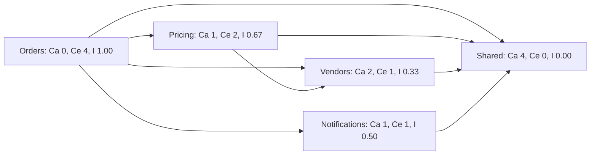
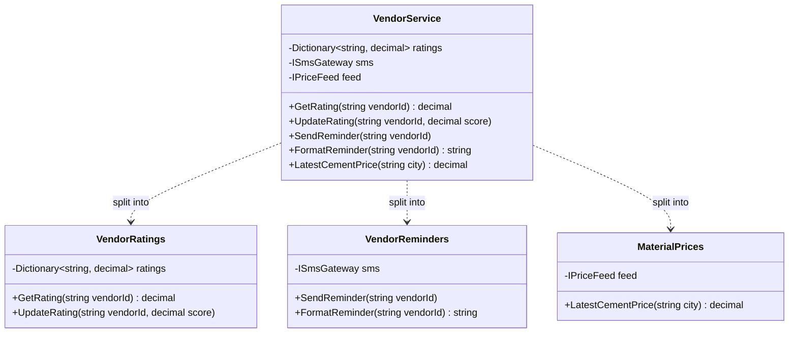
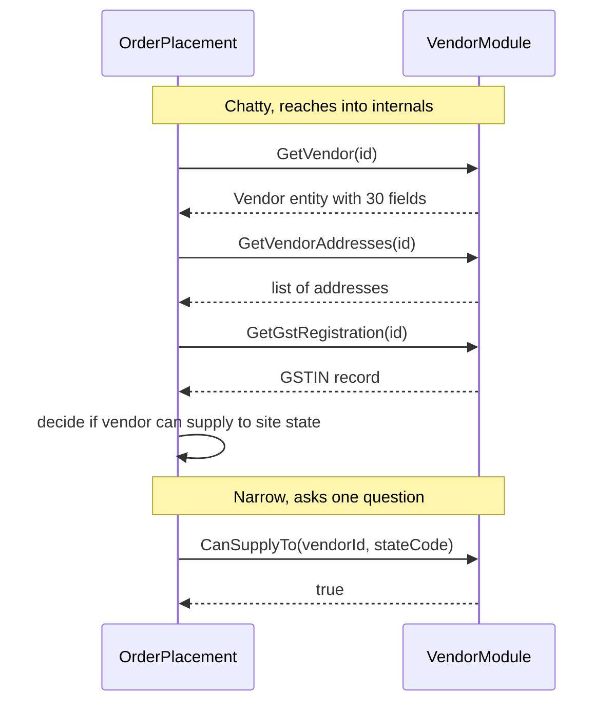
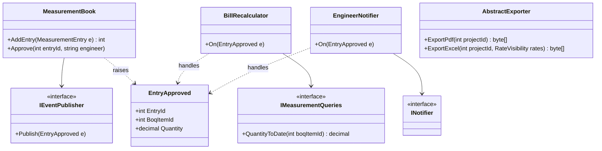

Almost every design principle you will meet later (SOLID, layers, microservices, vertical slices) is an attempt to get two things right: **parts of the system should not depend on each other more than necessary**, and **each part should do one coherent job**. Those two ideas are called coupling and cohesion. This lesson makes them concrete, shows you how to measure them, and builds a small C# tool that computes the numbers for a real codebase.

## Learning objectives

By the end of this lesson you will be able to:

1. Explain coupling, cohesion, modularity and separation of concerns in plain English, with examples.
2. Name the common types of coupling and cohesion, and rank them from worst to best.
3. Compute afferent coupling (Ca), efferent coupling (Ce), instability (I), abstractness (A) and distance from the main sequence (D) for a set of modules.
4. Measure class cohesion with LCOM4 and use it to spot classes that should be split.
5. Write C# that extracts a dependency graph with reflection and computes these metrics.
6. Use the numbers as conversation starters, not as targets, and know their limits.

## Prerequisites

- [Classes, objects, fields, properties and methods](#/lesson/m01-classes-objects): we measure how methods use fields.
- [Interfaces and abstract classes](#/lesson/m01-interfaces-abstract): abstractions are the main tool for reducing coupling.
- [What is software architecture?](#/lesson/m02-what-is-architecture): coupling decisions are among the hardest to change later.

## Explain it like I'm a beginner

### Coupling: how tangled are the wires?

Picture the electrical wiring in two houses. In house A, each appliance plugs into a standard socket. If the fridge breaks, you unplug it and plug in a new one. In house B, the previous owner wired the fridge, the geyser and the kitchen lights directly into each other with no sockets. To replace the fridge you need an electrician, and the lights go off while he works.

House B is **tightly coupled**: parts know too much about each other, so changing one disturbs the others. House A is **loosely coupled**: parts meet through a small, standard connection (an interface).

### Cohesion: does each drawer hold one kind of thing?

Now picture a kitchen. A **cohesive** kitchen has a cutlery drawer, a spice rack and a utensil stand. A **low-cohesion** kitchen has one "misc" drawer with forks, batteries, a screwdriver, old receipts and turmeric. Finding anything is slow, and every time you open it you disturb things unrelated to what you want.

A class or module with high cohesion holds things that **belong together and change together**. A class called `Utils` or `Manager` with 40 unrelated methods is the "misc" drawer.

### The two together

- **Coupling** is about the connections *between* boxes. You want few, simple, stable connections.
- **Cohesion** is about what is *inside* each box. You want each box to do one job well.

They are linked. When a box holds unrelated things (low cohesion), many other boxes need to reach into it, so coupling goes up. Fix the cohesion and the coupling often improves by itself.

### Modularity and separation of concerns

- **Separation of concerns** means each part of the program deals with one *concern*, such as pricing, storage, user interface or notifications, instead of mixing them.
- **Modularity** is the result: the system is made of modules you can understand, test, change and replace one at a time.

## First-principles explanation

### Why this matters: the cost of change

Most of the cost of software comes after the first release, from changing it. Studies and industry experience broadly agree that maintenance is the bigger share of a system's lifetime cost, though exact percentages vary widely by source. The cost of one change is roughly:

> (number of places you must edit) × (how hard each place is to understand) × (risk that the edit breaks something else)

- High coupling raises the first and third factors. One change ripples to many places.
- Low cohesion raises the second. Each place is full of unrelated code you must read and avoid breaking.

David Parnas made this point in 1972. He argued that you should split a system into modules by **hiding design decisions that are likely to change** (information hiding), not by the steps of the processing flow. Each module keeps a secret, such as "how vendor prices are stored", behind a small interface. When the secret changes, only that module changes.

### Types of coupling, from worst to best

These categories come from structured design (Stevens, Myers and Constantine, 1970s). They still apply to classes and services.

| Type | What it looks like | Example |
|---|---|---|
| **Content coupling** (worst) | One module reaches into another's internals | Using reflection to set a private field of another class, or a service reading another service's database tables directly |
| **Common (global) coupling** | Modules share global mutable state | A `static Dictionary<string, object> AppState` read and written everywhere |
| **External coupling** | Modules share an external format or device protocol | Two modules both parse the same vendor's CSV layout with their own code |
| **Control coupling** | One module tells another *how* to behave with a flag | `GenerateReport(data, isPdf: true, skipTotals: false)` |
| **Stamp coupling** | A module receives a whole structure but uses a small part | Passing the entire `Order` when the method needs only `order.Total` |
| **Data coupling** (best) | Modules pass only the simple data they need | `CalculateGst(decimal amount, string hsnCode)` |

Plus two kinds that matter a lot in distributed systems:

- **Temporal coupling**: A must run before B, or both must be online at the same time. A synchronous HTTP call couples the caller's availability to the callee's.
- **Deployment coupling**: two parts must be released together. Two microservices that always deploy together are effectively one service with a network in the middle.

Some coupling is unavoidable. A system with zero coupling does nothing. The goal is coupling that is **few in number, narrow (small interfaces), and pointed at stable things**.

### Types of cohesion, from worst to best

| Type | Elements grouped because… | Example |
|---|---|---|
| **Coincidental** (worst) | No reason at all | `Helpers` with `FormatPan()`, `RetryHttp()`, `ResizeImage()` |
| **Logical** | They do the same *kind* of thing, picked by a flag | `InputHandler.Handle(source)` that reads keyboard, file or network |
| **Temporal** | They happen at the same time | `Startup()` that loads config, warms cache, emails admin, seeds data |
| **Procedural** | They follow a sequence of steps | `ProcessOrder()` doing validate, then log, then print label |
| **Communicational** | They work on the same data | `VendorReport` methods that all read the same vendor dataset |
| **Sequential** | The output of one is the input of the next | Parse CSV, then validate rows, then map rows |
| **Functional** (best) | Everything contributes to one well-defined task | `GstCalculator` that computes GST for a line item |

You don't need to memorise every name. The useful skill is asking: **"Why are these things in the same box?"** If the honest answer is "because they all run at startup" or "no reason", cohesion is low.

### Measuring coupling between modules: Ca, Ce and instability

Robert C. Martin popularised a set of package metrics in the 1990s. At module level (a namespace, project or folder), for each module:

- **Afferent coupling, Ca** (incoming): how many *other* modules depend on this one. High Ca means many people rely on you, so changing you is risky. In this lesson we count *modules*; Martin's original definition counts *classes* outside the package. Both work, as long as you are consistent.
- **Efferent coupling, Ce** (outgoing): how many other modules this one depends on. High Ce means you are exposed to many changes elsewhere.
- **Instability, I = Ce ÷ (Ca + Ce)**, from 0 to 1.
  - **I = 0**: maximally stable. Others depend on it, it depends on nothing. It is hard to change, so it should rarely *need* to change.
  - **I = 1**: maximally unstable. It depends on others, nobody depends on it. It's easy to change, and that is fine for top-level code such as API endpoints.

"Unstable" is not an insult. It just means "easy to change without affecting others". An API project should be unstable. A shared-kernel module of value types should be stable.

**The Stable Dependencies Principle**: depend in the direction of stability. A module should only depend on modules that are *more* stable than itself (lower I). If a stable module depends on an unstable one, the stable module will keep being dragged into changes.

### Abstractness and the main sequence

- **Abstractness, A** = (abstract classes + interfaces) ÷ (total types) in the module, from 0 to 1.
- **Distance from the main sequence, D = |A + I − 1|**, from 0 to 1.

The idea: a stable module (I near 0) should be abstract (A near 1), so others can depend on it and still extend it. An unstable module (I near 1) can be concrete (A near 0). The "main sequence" is the line A + I = 1. Modules far from it fall into two bad zones:

- **Zone of pain** (A ≈ 0, I ≈ 0): concrete *and* heavily depended on. Every change hurts. A concrete database helper that 20 modules call is the classic case. Note: stable concrete modules that never change, such as `System.String`, are fine here.
- **Zone of uselessness** (A ≈ 1, I ≈ 1): abstract but nobody uses it. Interfaces written "for the future".

### Measuring cohesion inside a class: LCOM4

**LCOM** stands for *lack of cohesion of methods*. There are several versions. **LCOM4** (Hitz and Montazeri) is the easiest to understand:

1. Draw each method as a dot.
2. Connect two methods if they **use the same field**, or if one **calls** the other.
3. Count the separate groups (connected components).

- **LCOM4 = 1**: one group. The class is cohesive.
- **LCOM4 = 2 or more**: the class contains that many unrelated sub-classes waiting to be split out.
- **LCOM4 = 0**: no methods at all.

Example: `VendorService` has methods `GetRating` and `UpdateRating` using field `_ratings`, and `SendReminder` and `FormatReminder` using field `_smsGateway`. Two groups, so LCOM4 = 2. That's a hint to split it into `VendorRatings` and `VendorReminders`.

### Separation of concerns at three scales

- **Function level**: a method either calculates or does I/O, not both. Pure calculation is easy to test.
- **Class level**: one reason to change per class. This is the [Single Responsibility Principle](#/lesson/m04-srp).
- **System level**: layers separate UI from business rules from storage ([Layered architecture](#/lesson/m02-layered)). Modules or [vertical slices](#/lesson/m02-vertical-slice) separate one business capability from another.

### Trade-offs

| Pushing for lower coupling | What it can cost |
|---|---|
| Interfaces between every class | More files, more indirection, harder "go to definition" |
| Async messaging instead of direct calls | Eventual consistency, harder debugging |
| Copying a little code to avoid a shared library | Duplication you must keep in sync if it really is the same rule |

| Pushing for higher cohesion | What it can cost |
|---|---|
| Splitting classes | Many tiny classes that are hard to see as a whole |
| One module per capability | Module boundaries that must be designed and defended |

### When the metrics are misleading

- **Metrics don't know your domain.** A low-LCOM4 class can still mix two business concepts that happen to share one field.
- **Frameworks inflate coupling.** Every ASP.NET Core controller depends on `Microsoft.AspNetCore.*`. Exclude framework and BCL types, or every number looks bad.
- **Goodhart's law.** Once a number becomes a target, people game it. For example, they add an interface to every class to raise A. Use metrics to find hot spots, then judge with your eyes.
- **Small codebases don't need them.** For a 2,000-line app, reading the code is faster than computing metrics.

## Visual explanation

### A module dependency graph with instability



This is a construction-material procurement app with five modules. Each arrow means "depends on". Count the arrows: **Ce** is arrows leaving a box, **Ca** is arrows arriving. `Orders` has 4 outgoing and 0 incoming, so I = 4 ÷ (0 + 4) = 1.00. `Vendors` has 2 incoming (from Orders and Pricing) and 1 outgoing, so I = 1 ÷ 3 ≈ 0.33. `Shared` only receives arrows, so I = 0. Notice every arrow points from a higher I to a lower I. That means this graph follows the Stable Dependencies Principle. If someone added `Shared --> Orders`, that arrow would point from I = 0 to I = 1, a violation, and it would also create a cycle.

### A low-cohesion class and its split



`VendorService` on the left has three fields, and each field is used by a different group of methods. Ratings methods only touch `ratings`. Reminder methods only touch `sms`. The price method only touches `feed`. LCOM4 = 3. The dotted arrows show the refactoring: three classes, each with LCOM4 = 1. Callers that only need ratings no longer depend on an SMS gateway, so coupling drops too. That's the link between cohesion and coupling in one picture.

### Chatty versus narrow coupling



The top half shows stamp and content-like coupling. `OrderPlacement` pulls three internal structures out of the vendor module and applies the vendor rules itself. Any change to how vendors store addresses or GST data breaks `OrderPlacement`. The bottom half asks one narrow question. The rule "can this vendor supply to this state?" stays inside the vendor module, where its data lives. Fewer calls, fewer shared shapes, and the secret stays hidden, which is Parnas's information hiding in action.

## Step-by-step example

Let's compute the metrics for the procurement app by hand, then see what they tell us.

### Step 1 — list the dependencies

From `using` statements and type references:

| From | To |
|---|---|
| Orders | Pricing, Vendors, Notifications, Shared |
| Pricing | Vendors, Shared |
| Vendors | Shared |
| Notifications | Shared |
| Shared | none |

### Step 2 — count Ca and Ce

| Module | Ce (out) | Ca (in) | I = Ce ÷ (Ca + Ce) |
|---|---|---|---|
| Orders | 4 | 0 | 4 ÷ 4 = **1.00** |
| Pricing | 2 | 1 | 2 ÷ 3 = **0.67** |
| Notifications | 1 | 1 | 1 ÷ 2 = **0.50** |
| Vendors | 1 | 2 | 1 ÷ 3 = **0.33** |
| Shared | 0 | 4 | 0 ÷ 4 = **0.00** |

### Step 3 — add abstractness

Suppose `Shared` has 10 types, of which 2 are interfaces: A = 0.2. Then D = |0.2 + 0.0 − 1| = **0.8**. That's deep in the zone of pain: four modules depend on a mostly concrete module. Look inside. If `Shared` holds value types like `Money` and `Gstin` that rarely change, that is acceptable. If it holds a concrete `EmailSender` and a `DbHelper`, that is trouble: any change to them ripples to four modules.

`Orders`: 12 types, 0 abstract, A = 0, I = 1, D = |0 + 1 − 1| = **0**. On the main sequence. It's concrete and unstable, which is exactly right for top-level use-case code.

### Step 4 — act on what you find

- Move `EmailSender` out of `Shared` into `Notifications`, behind an `INotifier` interface that lives with its consumer.
- Keep `Money` and `Gstin` in `Shared`. They're stable by nature.
- Recompute: `Shared` now has 9 types (2 abstract): A ≈ 0.22, still in the zone of pain by the formula, but its contents are now stable values, so it's an *accepted* exception. Write that down in an [ADR](#/lesson/m02-adr) so the next reviewer knows it's deliberate.

### Step 5 — check a class

`VendorService` from the diagram scores LCOM4 = 3. Split it. Each new class scores 1.

## Production-style C# implementation

We'll build a small architecture-metrics library:

1. A **module graph** model with Ca, Ce, I, A and D.
2. A **reflection scanner** that builds the graph from a compiled assembly by looking at base types, interfaces, fields, properties, constructor and method signatures.
3. An **LCOM4 calculator** for class models.
4. A minimal API endpoint that reports the metrics for the running app.

```text
ArchMetrics/
  Program.cs
  Metrics/ModuleGraph.cs
  Metrics/ReflectionModuleScanner.cs
  Metrics/Lcom4.cs
  Metrics/CouplingReport.cs
  Sample/Procurement.cs        tiny sample modules so the scanner has something to measure
```

```csharp file=Metrics/ModuleGraph.cs
namespace ArchMetrics.Metrics;

public sealed record ModuleMetrics(string Module, int Ca, int Ce, double Instability, double Abstractness, double Distance, int Types);

/// <summary>A directed graph of modules. An edge A -> B means "A depends on B".</summary>
public sealed class ModuleGraph
{
    private readonly Dictionary<string, HashSet<string>> _out = new(StringComparer.Ordinal);
    private readonly Dictionary<string, (int Abstract, int Total)> _types = new(StringComparer.Ordinal);

    public void AddModule(string module) { _out.TryAdd(module, new HashSet<string>(StringComparer.Ordinal)); _types.TryAdd(module, (0, 0)); }

    public void AddDependency(string from, string to)
    {
        if (from == to) return;              // dependencies inside a module are not coupling between modules
        AddModule(from); AddModule(to);
        _out[from].Add(to);                  // HashSet removes duplicates
    }

    public void CountType(string module, bool isAbstract)
    {
        AddModule(module);
        var (a, t) = _types[module];
        _types[module] = (a + (isAbstract ? 1 : 0), t + 1);
    }

    public IReadOnlySet<string> DependenciesOf(string module) => _out.TryGetValue(module, out var s) ? s : new HashSet<string>();

    public IReadOnlyList<ModuleMetrics> Compute()
    {
        var ca = _out.Keys.ToDictionary(k => k, _ => 0, StringComparer.Ordinal);
        foreach (var (_, targets) in _out) foreach (var t in targets) ca[t]++;

        return _out.Keys.Order(StringComparer.Ordinal).Select(m =>
        {
            var ce = _out[m].Count;
            var i = ca[m] + ce == 0 ? 0.0 : (double)ce / (ca[m] + ce);
            var (abs, total) = _types[m];
            var a = total == 0 ? 0.0 : (double)abs / total;
            return new ModuleMetrics(m, ca[m], ce, Math.Round(i, 2), Math.Round(a, 2), Math.Round(Math.Abs(a + i - 1), 2), total);
        }).ToList();
    }

    /// <summary>Edges that point from a more stable module to a less stable one (Stable Dependencies Principle).</summary>
    public IReadOnlyList<(string From, string To)> StabilityViolations()
    {
        var byName = Compute().ToDictionary(m => m.Module);
        return _out.SelectMany(kv => kv.Value.Select(to => (From: kv.Key, To: to)))
                   .Where(e => byName[e.From].Instability < byName[e.To].Instability)
                   .OrderBy(e => e.From, StringComparer.Ordinal).ThenBy(e => e.To, StringComparer.Ordinal)
                   .ToList();
    }
}
```

The scanner maps each type to a module by its namespace. With root `ArchMetrics.Sample.Procurement` and depth 1, the type `ArchMetrics.Sample.Procurement.Orders.PlaceOrder` belongs to module `Orders`. Types outside the root (BCL, ASP.NET Core) are ignored, so framework references don't inflate the numbers.

```csharp file=Metrics/ReflectionModuleScanner.cs
using System.Reflection;

namespace ArchMetrics.Metrics;

public sealed class ReflectionModuleScanner(string rootNamespace, int depth = 1)
{
    private const BindingFlags All = BindingFlags.Public | BindingFlags.NonPublic | BindingFlags.Instance | BindingFlags.Static | BindingFlags.DeclaredOnly;

    public string? ModuleOf(Type t)
    {
        var ns = t.Namespace;
        if (ns is null || !(ns == rootNamespace || ns.StartsWith(rootNamespace + ".", StringComparison.Ordinal))) return null;
        string[] rest = ns.Length == rootNamespace.Length ? [] : ns[(rootNamespace.Length + 1)..].Split('.');
        return rest.Length < depth ? null : string.Join('.', rest.Take(depth));
    }

    public ModuleGraph Scan(Assembly assembly)
    {
        var graph = new ModuleGraph();
        foreach (var type in LoadableTypes(assembly))
        {
            if (type.Name.Contains('<')) continue;            // compiler-generated (closures, async state machines)
            var from = ModuleOf(type);
            if (from is null) continue;
            graph.CountType(from, type.IsInterface || (type.IsAbstract && !type.IsSealed));
            foreach (var referenced in ReferencedTypes(type))
                if (ModuleOf(referenced) is { } to) graph.AddDependency(from, to);
        }
        return graph;
    }

    private static IEnumerable<Type> LoadableTypes(Assembly a)
    {
        try { return a.GetTypes(); }
        catch (ReflectionTypeLoadException ex) { return ex.Types.OfType<Type>(); }
    }

    /// <summary>Types visible in signatures. Types used only inside method bodies need IL inspection, which this skips.</summary>
    private static IEnumerable<Type> ReferencedTypes(Type t)
    {
        var direct = new List<Type>();
        if (t.BaseType is not null) direct.Add(t.BaseType);
        direct.AddRange(t.GetInterfaces());
        direct.AddRange(t.GetFields(All).Select(f => f.FieldType));
        direct.AddRange(t.GetProperties(All).Select(p => p.PropertyType));
        foreach (var c in t.GetConstructors(All)) direct.AddRange(c.GetParameters().Select(p => p.ParameterType));
        foreach (var m in t.GetMethods(All))
        {
            direct.Add(m.ReturnType);
            direct.AddRange(m.GetParameters().Select(p => p.ParameterType));
        }
        return direct.SelectMany(Flatten).Distinct();
    }

    private static IEnumerable<Type> Flatten(Type t)
    {
        if (t.HasElementType && t.GetElementType() is { } e) { foreach (var x in Flatten(e)) yield return x; yield break; }
        if (t.IsGenericType)
        {
            foreach (var arg in t.GetGenericArguments()) foreach (var x in Flatten(arg)) yield return x;
            yield return t.GetGenericTypeDefinition();
            yield break;
        }
        if (!t.IsGenericParameter) yield return t;
    }
}
```

```csharp file=Metrics/Lcom4.cs
namespace ArchMetrics.Metrics;

/// <summary>A method as seen by LCOM4: which fields it reads or writes and which methods of the same class it calls.</summary>
public sealed record MethodUsage(string Name, IReadOnlyCollection<string> Fields, IReadOnlyCollection<string> Calls);

public static class Lcom4
{
    /// <summary>Number of connected groups of methods. 1 = cohesive, 2+ = candidates to split, 0 = no methods.</summary>
    public static int Compute(IReadOnlyList<MethodUsage> methods) => Groups(methods).Count;

    public static IReadOnlyList<IReadOnlyList<string>> Groups(IReadOnlyList<MethodUsage> methods)
    {
        var parent = methods.ToDictionary(m => m.Name, m => m.Name, StringComparer.Ordinal);
        string Find(string x) { while (parent[x] != x) x = parent[x] = parent[parent[x]]; return x; }
        void Union(string a, string b) { var ra = Find(a); var rb = Find(b); if (ra != rb) parent[ra] = rb; }

        var firstUserOfField = new Dictionary<string, string>(StringComparer.Ordinal);
        foreach (var m in methods)
        {
            foreach (var f in m.Fields)
                if (firstUserOfField.TryGetValue(f, out var other)) Union(m.Name, other);
                else firstUserOfField[f] = m.Name;
            foreach (var callee in m.Calls)
                if (parent.ContainsKey(callee)) Union(m.Name, callee);   // calls to other classes don't count
        }

        return methods.GroupBy(m => Find(m.Name))
                      .Select(g => (IReadOnlyList<string>)g.Select(m => m.Name).Order(StringComparer.Ordinal).ToList())
                      .OrderBy(g => g[0], StringComparer.Ordinal)
                      .ToList();
    }
}
```

The LCOM4 calculator uses union-find, a structure that tracks which items are in the same group. With a few hundred methods it doesn't matter, but union-find handles large classes in near-linear time.

Now some sample modules for the scanner to measure. They mirror the procurement diagram: `Orders` depends on `Pricing`, `Vendors`, `Notifications` and `Shared`.

```csharp file=Sample/Procurement.cs
namespace ArchMetrics.Sample.Procurement.Shared
{
    public readonly record struct Money(decimal Amount, string Currency);
    public readonly record struct Gstin(string Value);
    public interface IClock { DateTimeOffset Now { get; } }
}

namespace ArchMetrics.Sample.Procurement.Vendors
{
    using ArchMetrics.Sample.Procurement.Shared;
    public sealed record Vendor(string Id, string Name, Gstin Gstin, IReadOnlyList<string> StatesServed);
    public interface IVendorDirectory { bool CanSupplyTo(string vendorId, string stateCode); Vendor? Find(string vendorId); }
}

namespace ArchMetrics.Sample.Procurement.Pricing
{
    using ArchMetrics.Sample.Procurement.Shared;
    using ArchMetrics.Sample.Procurement.Vendors;
    public interface IPriceList { Money UnitPrice(Vendor vendor, string materialCode); }
}

namespace ArchMetrics.Sample.Procurement.Notifications
{
    using ArchMetrics.Sample.Procurement.Shared;
    public interface INotifier { Task NotifyAsync(string recipient, string message, Money? amount, CancellationToken ct); }
}

namespace ArchMetrics.Sample.Procurement.Orders
{
    using ArchMetrics.Sample.Procurement.Notifications;
    using ArchMetrics.Sample.Procurement.Pricing;
    using ArchMetrics.Sample.Procurement.Shared;
    using ArchMetrics.Sample.Procurement.Vendors;

    public sealed record PurchaseOrder(string VendorId, string MaterialCode, int Quantity, Money Total);

    public sealed class PlaceOrder(IVendorDirectory vendors, IPriceList prices, INotifier notifier, IClock clock)
    {
        public async Task<PurchaseOrder> HandleAsync(string vendorId, string material, int qty, string siteState, CancellationToken ct)
        {
            if (!vendors.CanSupplyTo(vendorId, siteState)) throw new InvalidOperationException("Vendor does not serve this state.");
            var vendor = vendors.Find(vendorId)!;
            var unit = prices.UnitPrice(vendor, material);
            var order = new PurchaseOrder(vendorId, material, qty, new Money(unit.Amount * qty, unit.Currency));
            await notifier.NotifyAsync(vendor.Name, $"PO for {qty} x {material} at {clock.Now:yyyy-MM-dd}", order.Total, ct);
            return order;
        }
    }
}
```

```csharp file=Metrics/CouplingReport.cs
using System.Reflection;

namespace ArchMetrics.Metrics;

public sealed record CouplingReportDto(IReadOnlyList<ModuleMetrics> Modules, IReadOnlyList<string> StabilityViolations, IReadOnlyList<string> ZoneOfPain);

public sealed class CouplingReport(Assembly assembly, ReflectionModuleScanner scanner)
{
    public CouplingReportDto Build()
    {
        var graph = scanner.Scan(assembly);
        var modules = graph.Compute();
        var violations = graph.StabilityViolations().Select(v => $"{v.From} -> {v.To}").ToList();
        // Heuristic thresholds, not standards: tune them for your codebase.
        var pain = modules.Where(m => m.Instability <= 0.3 && m.Abstractness <= 0.3 && m.Ca >= 3)
                          .Select(m => $"{m.Module} (Ca {m.Ca}, A {m.Abstractness}, D {m.Distance})").ToList();
        return new CouplingReportDto(modules, violations, pain);
    }
}
```

```csharp file=Program.cs
using ArchMetrics.Metrics;

var builder = WebApplication.CreateBuilder(args);

builder.Services.AddSingleton(new ReflectionModuleScanner("ArchMetrics.Sample.Procurement", depth: 1));
builder.Services.AddSingleton(sp => new CouplingReport(typeof(ModuleGraph).Assembly, sp.GetRequiredService<ReflectionModuleScanner>()));

var app = builder.Build();

// Internal endpoint: protect it with authorisation in a real deployment.
app.MapGet("/architecture/metrics", (CouplingReport report) => Results.Ok(report.Build()));

app.Run();
```

Calling `GET /architecture/metrics` returns the module table. For the sample, `Orders` should come out with Ce = 4 and I = 1.0, and `Shared` with Ca = 4 and I = 0.0, matching the hand calculation.

**Limits of this scanner.** It only sees types in signatures, so a `new SmtpClient()` hidden inside a method body is invisible. For full accuracy use an IL-reading tool, or Roslyn analysers on the source. Visual Studio's built-in code metrics report *class coupling* per type, which is a useful complement. NDepend (commercial) computes Ca, Ce, I, A and D directly.

## Bad design vs good design

**Bad: control coupling, stamp coupling and low cohesion in one class.**

```csharp
public static class ProcurementHelper
{
    public static object Run(Order order, int mode, bool sendSms, bool isFinal)
    {
        if (mode == 1) return order.Lines.Sum(l => l.Qty * l.Rate) * (order.Vendor.State == "HR" ? 1.18m : 1.18m);
        if (mode == 2) { if (sendSms) Sms.Send(order.Vendor.Phone, "PO raised"); return true; }
        if (mode == 3) { AppState.LastOrder = order; return isFinal ? Pdf.Render(order) : null; }
        return null;
    }
}
```

What's wrong:

- **Control coupling**: callers pass `mode`, `sendSms` and `isFinal` to choose behaviour. Every caller must know the meaning of `mode == 2`.
- **Stamp coupling**: the whole `Order` is passed even when only `Vendor.Phone` is used.
- **Common coupling**: `AppState.LastOrder` is global mutable state. Any code anywhere can change it.
- **Coincidental cohesion**: tax calculation, SMS and PDF have nothing in common. LCOM4 on this would be high if it had fields.
- **Return type `object`**: callers must cast, coupling them to undocumented behaviour.

**Good:**

```csharp
public sealed class GstCalculator { public decimal TotalWithGst(decimal taxable, decimal ratePercent) => taxable * (1 + ratePercent / 100m); }
public interface IPoNotifier { Task NotifyRaisedAsync(string phone, string poNumber, CancellationToken ct); }
public interface IPoDocumentRenderer { byte[] RenderFinal(PurchaseOrderDocument doc); }
```

Each class does one job (functional cohesion). Callers pass only the data needed (data coupling). Behaviour is chosen by calling a different method or class, not a flag. There is no global state.

**Is the improvement always worth it?** Mostly, yes. But don't overshoot. Splitting a 40-line class with LCOM4 = 2 into two 20-line classes, each with its own interface, can make simple code harder to follow. The split is worth it when the two groups **change for different reasons** or are **used by different callers**.

:::callout type=tradeoff title="DRY can increase coupling"
Extracting two similar methods into one shared helper removes duplication, but now both callers depend on the helper. If the two copies were going to change for different reasons, you've coupled them by accident. Prefer duplication over the wrong shared abstraction.
:::

:::callout type=tip title="Look at change history, not just code"
Files that are always changed in the same commit are coupled, even with no `using` between them. Git history makes this visible (logical or change coupling). A quick script over `git log --name-only` often finds coupling that static metrics miss.
:::

## Practical playground

The playground computes Ca, Ce and instability for a small module graph and prints any Stable Dependencies Principle violations. Run it, then add the edge `("Shared", "Orders")` and see what changes. Then try removing `Orders -> Notifications` and adding `Pricing -> Notifications`.

:::playground type=csharp title="Compute instability for a module graph"
```csharp file=Program.cs
using System;
using System.Collections.Generic;
using System.Linq;

public static class Program
{
    public static void Main()
    {
        var edges = new List<(string From, string To)>
        {
            ("Orders", "Pricing"), ("Orders", "Vendors"), ("Orders", "Notifications"), ("Orders", "Shared"),
            ("Pricing", "Vendors"), ("Pricing", "Shared"),
            ("Vendors", "Shared"), ("Notifications", "Shared"),
        };

        var modules = edges.SelectMany(e => new[] { e.From, e.To }).Distinct().OrderBy(m => m).ToList();
        var ce = modules.ToDictionary(m => m, m => edges.Where(e => e.From == m).Select(e => e.To).Distinct().Count());
        var ca = modules.ToDictionary(m => m, m => edges.Where(e => e.To == m).Select(e => e.From).Distinct().Count());
        var inst = modules.ToDictionary(m => m, m => ca[m] + ce[m] == 0 ? 0 : (double)ce[m] / (ca[m] + ce[m]));

        Console.WriteLine("Module          Ca  Ce  I");
        foreach (var m in modules) Console.WriteLine($"{m,-15} {ca[m],2}  {ce[m],2}  {inst[m]:0.00}");

        var bad = edges.Where(e => inst[e.From] < inst[e.To]).ToList();
        Console.WriteLine(bad.Count == 0 ? "No stability violations." : "Violations: " + string.Join(", ", bad.Select(e => $"{e.From}->{e.To}")));
    }
}
```
:::

## Exercises

:::exercise id=m02-coupling-cohesion-ex1 difficulty=beginner kind=code title="Compute Ca, Ce and instability"
Implement `CouplingCalculator.Compute` for a list of dependency edges between modules.
::requirements
- An edge `(From, To)` means From depends on To.
- Ignore self-edges (`A -> A`) and duplicate edges.
- Every module that appears in any edge gets a result, even if it only appears as a target.
- `Instability = Ce / (Ca + Ce)`, rounded to 2 decimals. A module with no edges after filtering has instability 0.
- Return results sorted by module name (ordinal).
::acceptance
- For the procurement graph in this lesson, `Orders` has Ca 0, Ce 4, I 1.00 and `Vendors` has Ca 2, Ce 1, I 0.33.
- Duplicates and self-edges don't change any count.
- A module that only appears in a self-edge is reported with zeros.
::hint
Ce is "how many distinct targets do I have". Ca is "how many distinct sources point at me".
::hint
Filter the edges first: `Where(e => e.From != e.To).Distinct()`.
::hint
Collect all module names from both ends of the *original* edges, so a self-edge-only module still appears.
::hint
```csharp
var ce = clean.GroupBy(e => e.From).ToDictionary(g => g.Key, g => g.Count());
```
::starter
```csharp file=CouplingCalculator.cs
using System;
using System.Collections.Generic;
using System.Linq;

public sealed record ModuleCoupling(string Module, int Ca, int Ce, double Instability);

public static class CouplingCalculator
{
    public static IReadOnlyList<ModuleCoupling> Compute(IEnumerable<(string From, string To)> edges) =>
        throw new NotImplementedException();
}
```
::tests
```csharp file=CouplingCalculatorTests.cs
using System.Linq;
using Xunit;

public class CouplingCalculatorTests
{
    private static readonly (string, string)[] Procurement =
    {
        ("Orders", "Pricing"), ("Orders", "Vendors"), ("Orders", "Notifications"), ("Orders", "Shared"),
        ("Pricing", "Vendors"), ("Pricing", "Shared"), ("Vendors", "Shared"), ("Notifications", "Shared"),
    };

    [Fact]
    public void Procurement_graph()
    {
        var r = CouplingCalculator.Compute(Procurement).ToDictionary(m => m.Module);
        Assert.Equal(new ModuleCoupling("Orders", 0, 4, 1.0), r["Orders"]);
        Assert.Equal(new ModuleCoupling("Vendors", 2, 1, 0.33), r["Vendors"]);
        Assert.Equal(new ModuleCoupling("Shared", 4, 0, 0.0), r["Shared"]);
        Assert.Equal(0.67, r["Pricing"].Instability);
    }

    [Fact]
    public void Sorted_by_name() =>
        Assert.Equal(new[] { "Notifications", "Orders", "Pricing", "Shared", "Vendors" },
                     CouplingCalculator.Compute(Procurement).Select(m => m.Module).ToArray());

    [Fact]
    public void Ignores_duplicates_and_self_edges()
    {
        var r = CouplingCalculator.Compute(new[] { ("A", "B"), ("A", "B"), ("A", "A"), ("C", "C") }).ToDictionary(m => m.Module);
        Assert.Equal(1, r["A"].Ce);
        Assert.Equal(1, r["B"].Ca);
        Assert.Equal(new ModuleCoupling("C", 0, 0, 0.0), r["C"]);
    }
}
```
::solution
```csharp file=CouplingCalculator.cs
using System;
using System.Collections.Generic;
using System.Linq;

public sealed record ModuleCoupling(string Module, int Ca, int Ce, double Instability);

public static class CouplingCalculator
{
    public static IReadOnlyList<ModuleCoupling> Compute(IEnumerable<(string From, string To)> edges)
    {
        var all = edges.ToList();
        var clean = all.Where(e => e.From != e.To).Distinct().ToList();
        var modules = all.SelectMany(e => new[] { e.From, e.To }).Distinct();

        var ce = clean.GroupBy(e => e.From).ToDictionary(g => g.Key, g => g.Count());
        var ca = clean.GroupBy(e => e.To).ToDictionary(g => g.Key, g => g.Count());

        return modules.Select(m =>
            {
                var o = ce.GetValueOrDefault(m);
                var i = ca.GetValueOrDefault(m);
                var instability = o + i == 0 ? 0.0 : Math.Round((double)o / (o + i), 2);
                return new ModuleCoupling(m, i, o, instability);
            })
            .OrderBy(m => m.Module, StringComparer.Ordinal)
            .ToList();
    }
}
```
Because `clean` is distinct, counting edges per source equals counting distinct targets. That's why duplicates can't inflate Ce.
::mistakes
- Swapping Ca and Ce. Remember: **e**fferent = **e**xit (outgoing), **a**fferent = **a**rriving.
- Integer division (`o / (o + i)`) giving 0 for everything except 1.
- Dividing by zero for an isolated module.
:::

:::exercise id=m02-coupling-cohesion-ex2 difficulty=beginner kind=written title="Name the coupling and cohesion"
For each snippet, name the **main** coupling or cohesion type and suggest one concrete improvement.

1. `void Export(Report r, int format) // 1 = PDF, 2 = Excel, 3 = CSV`
2. `class StartupTasks { LoadConfig(); WarmCache(); EmailAdmin(); SeedDemoData(); }`
3. `decimal Gst(Invoice invoice) => invoice.Taxable * 0.18m;` where `Invoice` has 25 properties.
4. `public static class Globals { public static User? CurrentUser; public static string? CurrentProject; }` used by 40 classes.
5. `class GstCalculator { decimal Cgst(decimal t, decimal r); decimal Sgst(decimal t, decimal r); decimal Igst(decimal t, decimal r); }`
6. `class StringUtils { Slugify(); ParseChainage(); HashPassword(); ToIndianCurrency(); }`
::acceptance
- All six are named correctly or with a well-argued alternative.
- Each improvement is concrete (a signature, a class split or an injected dependency).
- At least one answer says when the current design is acceptable.
::hint
Is a flag choosing the behaviour? That's one specific coupling type.
::hint
"Grouped because they run at the same time" has a name.
::hint
Passing a large object while using one field is a classic. Global mutable state is another.
::hint
Two of these are about cohesion (what's inside a class), and one of them is actually fine.
::solution
1. **Control coupling** (and logical cohesion inside `Export`). Improve: one exporter per format behind `IReportExporter`, chosen by the caller or by a resolver. `Export(report)` on `PdfReportExporter`.
2. **Temporal cohesion**. These run at startup but have nothing else in common. Improve: separate `IHostedService` implementations (`CacheWarmer`, `DemoDataSeeder`, `AdminStartupNotifier`), each registered in DI. Config loading belongs to the host builder.
3. **Stamp coupling**. Improve: `decimal Gst(decimal taxable, decimal ratePercent)`. Rate is a parameter too, since GST rates vary by HSN code. Acceptable if `Gst` is a method *on* `Invoice` itself.
4. **Common (global) coupling**. Improve: inject a scoped `ICurrentUser` and `IProjectContext` (backed by `HttpContext` claims) into the classes that need them. Tests can then pass fakes, and two concurrent requests can't overwrite each other.
5. **Functional cohesion**: all three compute parts of GST for a line. This is good. Leave it.
6. **Coincidental cohesion**. Improve: move each method next to its concept: `Slug` value object, `Chainage.Parse`, `IPasswordHasher` (use ASP.NET Core Identity's `PasswordHasher<T>`, never hand-rolled hashing), `IndianCurrencyFormatter`.
::mistakes
- Calling #5 low cohesion because it has several methods. Several methods serving one purpose is the goal.
- Fixing #4 by making `Globals` thread-static. It hides the problem and breaks with `async` code.
:::

:::exercise id=m02-coupling-cohesion-ex3 difficulty=intermediate kind=code title="Compute LCOM4 for a class"
Implement `CohesionAnalyzer.Lcom4` and `CohesionAnalyzer.Groups`.
::requirements
- Each method is a node. Connect two methods if they share at least one field, or one calls the other.
- Calls to names that aren't methods of this class are ignored.
- `Lcom4` returns the number of connected groups. An empty class returns 0.
- `Groups` returns each group as a sorted list of method names. Groups are sorted by their first name (ordinal).
::acceptance
- The `VendorService` example from the lesson (ratings, reminders, prices) gives 3.
- A chain A uses x, B uses x and y, C uses y gives 1 (connected through B).
- A method that calls another joins its group even with no shared fields.
- A call to an external method (`_sms.Send`) doesn't connect anything.
::hint
This is "count connected components in an undirected graph". Breadth-first search works, and so does union-find.
::hint
Build an adjacency list: for each field, connect all methods using it. For each call to a known method, connect caller and callee.
::hint
For BFS: keep a `visited` set. For each unvisited method, start a queue, collect everything reachable, and that's one group.
::hint
```csharp
foreach (var m in methods) if (visited.Add(m.Name)) { var group = new List<string>(); var q = new Queue<string>(); q.Enqueue(m.Name); while (q.Count > 0) { var cur = q.Dequeue(); group.Add(cur); foreach (var n in adj[cur]) if (visited.Add(n)) q.Enqueue(n); } groups.Add(group); }
```
::starter
```csharp file=CohesionAnalyzer.cs
using System;
using System.Collections.Generic;
using System.Linq;

public sealed record MethodInfoModel(string Name, string[] Fields, string[] Calls);

public static class CohesionAnalyzer
{
    public static int Lcom4(IReadOnlyList<MethodInfoModel> methods) => throw new NotImplementedException();
    public static IReadOnlyList<IReadOnlyList<string>> Groups(IReadOnlyList<MethodInfoModel> methods) => throw new NotImplementedException();
}
```
::tests
```csharp file=CohesionAnalyzerTests.cs
using System;
using System.Linq;
using Xunit;

public class CohesionAnalyzerTests
{
    private static MethodInfoModel M(string name, string[] fields, params string[] calls) => new(name, fields, calls);
    private static readonly string[] None = Array.Empty<string>();

    [Fact]
    public void VendorService_has_three_groups()
    {
        var methods = new[]
        {
            M("GetRating", new[] { "_ratings" }), M("UpdateRating", new[] { "_ratings" }),
            M("SendReminder", new[] { "_sms" }, "FormatReminder", "Send"), M("FormatReminder", None),
            M("LatestCementPrice", new[] { "_feed" }),
        };
        Assert.Equal(3, CohesionAnalyzer.Lcom4(methods));
        var groups = CohesionAnalyzer.Groups(methods);
        Assert.Equal(new[] { "FormatReminder", "SendReminder" }, groups[0].ToArray());
        Assert.Equal(new[] { "GetRating", "UpdateRating" }, groups[1].ToArray());
        Assert.Equal(new[] { "LatestCementPrice" }, groups[2].ToArray());
    }

    [Fact]
    public void Chain_through_shared_fields_is_one_group() =>
        Assert.Equal(1, CohesionAnalyzer.Lcom4(new[] { M("A", new[] { "x" }), M("B", new[] { "x", "y" }), M("C", new[] { "y" }) }));

    [Fact]
    public void External_calls_do_not_connect() =>
        Assert.Equal(2, CohesionAnalyzer.Lcom4(new[] { M("A", None, "Send"), M("B", None, "Send") }));

    [Fact]
    public void Empty_class_is_zero() => Assert.Equal(0, CohesionAnalyzer.Lcom4(Array.Empty<MethodInfoModel>()));
}
```
::solution
```csharp file=CohesionAnalyzer.cs
using System;
using System.Collections.Generic;
using System.Linq;

public sealed record MethodInfoModel(string Name, string[] Fields, string[] Calls);

public static class CohesionAnalyzer
{
    public static int Lcom4(IReadOnlyList<MethodInfoModel> methods) => Groups(methods).Count;

    public static IReadOnlyList<IReadOnlyList<string>> Groups(IReadOnlyList<MethodInfoModel> methods)
    {
        var adj = methods.ToDictionary(m => m.Name, _ => new HashSet<string>(), StringComparer.Ordinal);
        void Link(string a, string b) { adj[a].Add(b); adj[b].Add(a); }

        foreach (var byField in methods.SelectMany(m => m.Fields.Select(f => (Field: f, m.Name))).GroupBy(x => x.Field))
        {
            var users = byField.Select(x => x.Name).Distinct().ToList();
            for (var i = 1; i < users.Count; i++) Link(users[0], users[i]);   // a star is enough for connectivity
        }
        foreach (var m in methods)
            foreach (var c in m.Calls)
                if (adj.ContainsKey(c) && c != m.Name) Link(m.Name, c);

        var visited = new HashSet<string>(StringComparer.Ordinal);
        var groups = new List<IReadOnlyList<string>>();
        foreach (var m in methods)
        {
            if (!visited.Add(m.Name)) continue;
            var group = new List<string>();
            var queue = new Queue<string>();
            queue.Enqueue(m.Name);
            while (queue.Count > 0)
            {
                var cur = queue.Dequeue();
                group.Add(cur);
                foreach (var n in adj[cur]) if (visited.Add(n)) queue.Enqueue(n);
            }
            groups.Add(group.Order(StringComparer.Ordinal).ToList());
        }
        return groups.OrderBy(g => g[0], StringComparer.Ordinal).ToList();
    }
}
```
Linking each field's users as a star (first user to every other) instead of every pair keeps the edge count linear in the number of uses, and gives the same groups.
::mistakes
- Treating calls as one-way, so a callee that's visited first doesn't find its caller.
- Counting a call to `_sms.Send` (another class) as a link.
- Linking every pair of a field's users. It's correct, but quadratic in the number of methods per field.
::extensions
Exclude constructors and simple property getters, which tend to touch every field and hide low cohesion. Then compute LCOM4 for real classes with reflection plus a Roslyn syntax walker that finds field accesses.
:::

:::exercise id=m02-coupling-cohesion-ex4 difficulty=intermediate kind=design title="Decouple a measurement-book module"
A site measurement-book module has this class:

```csharp
public class MeasurementManager
{
    private readonly AppDbContext _db;
    private readonly SmtpClient _smtp;
    private readonly ExcelWriter _excel;
    public void AddEntry(MeasurementEntry e, bool notifyEngineer, bool recalcBill) { ... }
    public void Approve(int entryId, string engineer, bool lockForBilling) { ... }
    public byte[] ExportAbstract(int projectId, bool includeRates, bool asPdf) { ... }
    public decimal QuantityToDate(int boqItemId) { ... }
    public void RecalculateBill(int billId) { ... }
}
```

The billing module calls `RecalculateBill` and `QuantityToDate`. The reports module calls `ExportAbstract`. Site engineers' API calls `AddEntry` and `Approve`.

Propose a new design. Identify each coupling and cohesion problem, then give a class diagram and say which module each class belongs to.
::acceptance
- At least three problems named with their type (control flags, low cohesion, concrete infrastructure dependencies, misplaced responsibility).
- Boolean flags replaced by separate operations or events.
- Billing logic is owned by the billing module, not the measurement module.
- Infrastructure (SMTP, Excel) sits behind interfaces owned by the consumer.
::hint
Count the boolean parameters. Each one is control coupling.
::hint
`RecalculateBill` is about bills, not measurements. Which module should own it?
::hint
Instead of `AddEntry(..., recalcBill: true)`, could the measurement module announce "an entry was approved" and let billing react?
::hint
Shape: `MeasurementBook` (add, approve), `IMeasurementQueries` (quantity to date, used by billing), `MeasurementAbstractExporter` (reports), plus an `EntryApproved` event.
::solution
**Problems:**

- **Control coupling**: `notifyEngineer`, `recalcBill`, `lockForBilling`, `includeRates`, `asPdf`.
- **Low (logical and coincidental) cohesion**: data entry, approval workflow, bill calculation, exporting and email in one class.
- **Misplaced responsibility**: `RecalculateBill` is billing logic living in measurements. Billing and measurements now change together.
- **Concrete infrastructure coupling**: `SmtpClient` and `ExcelWriter` are hard-wired, so you can't test without them.

**New design:**



| Class | Module | Why |
|---|---|---|
| `MeasurementBook`, `EntryApproved`, `IMeasurementQueries` | Measurements | Owns entries and their workflow. Publishes a fact and a small read interface |
| `BillRecalculator` | Billing | Billing rules live with billing. It reacts to `EntryApproved` and reads quantities through the narrow interface |
| `EngineerNotifier`, `INotifier` | Notifications | Email is one implementation of `INotifier` |
| `AbstractExporter` | Reports | Export formats are separate methods. `RateVisibility` is an enum, clearer than a bool |

Measurements no longer knows billing exists, so its Ce drops. Billing depends on one narrow interface plus one event type (data coupling). "Lock for billing" becomes billing's own decision when it handles the event.
::alternatives
If an in-process event feels heavy for a small app, billing can call `IMeasurementQueries` when it builds a bill, with no events at all. That's simpler, at the cost of billing pulling data instead of being told about changes.
::mistakes
- Keeping `RecalculateBill` in measurements behind an interface. The dependency direction is still wrong.
- Replacing five bools with one `Options` object full of bools. That's still control coupling.
:::

:::exercise id=m02-coupling-cohesion-ex5 difficulty=advanced kind=code title="Find stability violations and the zone of pain"
Implement `PackageAnalyzer`, which computes I, A and D per module, lists Stable Dependencies Principle violations, and flags modules in the zone of pain.
::requirements
- Input: modules with `(Name, AbstractTypes, TotalTypes)` and dependency edges (ignore self-edges and duplicates; edges to unknown modules are ignored).
- `I = Ce / (Ca + Ce)` (0 when both are 0), `A = AbstractTypes / TotalTypes` (0 when TotalTypes is 0), `D = |A + I − 1|`. Round each to 2 decimals.
- A **violation** is an edge `From -> To` where `I(From) < I(To)`, compared on the rounded values.
- **Zone of pain**: `I <= 0.3`, `A <= 0.3` and `Ca >= 2`. The thresholds are passed in a settings record so teams can tune them.
- Return everything sorted by name (violations by From, then To).
::acceptance
- For the procurement graph with `Shared` at 1 abstract of 10 types, `Shared` is in the zone of pain with D = 0.9.
- Adding `Shared -> Orders` produces a violation `Shared -> Orders`.
- Unknown edge targets and self-edges are ignored.
- Custom thresholds change the zone-of-pain result.
::hint
Compute Ca and Ce first, as in exercise 1. Then add A and D.
::hint
Store results in a dictionary by name so the violation check can look up both ends of each edge.
::hint
Round before comparing, so 0.333… and 0.33 are treated the same everywhere.
::hint
```csharp
var violations = clean.Where(e => byName[e.From].I < byName[e.To].I).OrderBy(...).ThenBy(...);
```
::starter
```csharp file=PackageAnalyzer.cs
using System;
using System.Collections.Generic;
using System.Linq;

public sealed record PackageInfo(string Name, int AbstractTypes, int TotalTypes);
public sealed record PackageMetrics(string Name, int Ca, int Ce, double I, double A, double D);
public sealed record PainThresholds(double MaxInstability = 0.3, double MaxAbstractness = 0.3, int MinAfferent = 2);
public sealed record AnalysisResult(IReadOnlyList<PackageMetrics> Packages, IReadOnlyList<(string From, string To)> Violations, IReadOnlyList<string> ZoneOfPain);

public static class PackageAnalyzer
{
    public static AnalysisResult Analyze(IEnumerable<PackageInfo> packages, IEnumerable<(string From, string To)> edges, PainThresholds? thresholds = null) =>
        throw new NotImplementedException();
}
```
::tests
```csharp file=PackageAnalyzerTests.cs
using System.Collections.Generic;
using System.Linq;
using Xunit;

public class PackageAnalyzerTests
{
    private static readonly PackageInfo[] Pkgs =
    {
        new("Orders", 0, 12), new("Pricing", 1, 4), new("Vendors", 2, 6), new("Notifications", 1, 3), new("Shared", 1, 10),
    };
    private static readonly List<(string, string)> Edges = new()
    {
        ("Orders", "Pricing"), ("Orders", "Vendors"), ("Orders", "Notifications"), ("Orders", "Shared"),
        ("Pricing", "Vendors"), ("Pricing", "Shared"), ("Vendors", "Shared"), ("Notifications", "Shared"),
    };

    [Fact]
    public void Shared_is_in_zone_of_pain()
    {
        var r = PackageAnalyzer.Analyze(Pkgs, Edges);
        var shared = r.Packages.Single(p => p.Name == "Shared");
        Assert.Equal(0.0, shared.I);
        Assert.Equal(0.1, shared.A);
        Assert.Equal(0.9, shared.D);
        Assert.Equal(new[] { "Shared" }, r.ZoneOfPain.ToArray());
        Assert.Empty(r.Violations);
    }

    [Fact]
    public void Orders_is_on_main_sequence() =>
        Assert.Equal(0.0, PackageAnalyzer.Analyze(Pkgs, Edges).Packages.Single(p => p.Name == "Orders").D);

    [Fact]
    public void Back_edge_is_a_violation()
    {
        var edges = new List<(string, string)>(Edges) { ("Shared", "Orders") };
        var r = PackageAnalyzer.Analyze(Pkgs, edges);
        Assert.Contains(("Shared", "Orders"), r.Violations);
    }

    [Fact]
    public void Ignores_self_and_unknown_edges()
    {
        var edges = new List<(string, string)>(Edges) { ("Orders", "Orders"), ("Orders", "Legacy") };
        Assert.Equal(4, PackageAnalyzer.Analyze(Pkgs, edges).Packages.Single(p => p.Name == "Orders").Ce);
    }

    [Fact]
    public void Thresholds_are_configurable() =>
        Assert.Empty(PackageAnalyzer.Analyze(Pkgs, Edges, new PainThresholds(MinAfferent: 5)).ZoneOfPain);
}
```
::solution
```csharp file=PackageAnalyzer.cs
using System;
using System.Collections.Generic;
using System.Linq;

public sealed record PackageInfo(string Name, int AbstractTypes, int TotalTypes);
public sealed record PackageMetrics(string Name, int Ca, int Ce, double I, double A, double D);
public sealed record PainThresholds(double MaxInstability = 0.3, double MaxAbstractness = 0.3, int MinAfferent = 2);
public sealed record AnalysisResult(IReadOnlyList<PackageMetrics> Packages, IReadOnlyList<(string From, string To)> Violations, IReadOnlyList<string> ZoneOfPain);

public static class PackageAnalyzer
{
    public static AnalysisResult Analyze(IEnumerable<PackageInfo> packages, IEnumerable<(string From, string To)> edges, PainThresholds? thresholds = null)
    {
        var t = thresholds ?? new PainThresholds();
        var pkgs = packages.ToDictionary(p => p.Name, StringComparer.Ordinal);
        var clean = edges.Where(e => e.From != e.To && pkgs.ContainsKey(e.From) && pkgs.ContainsKey(e.To)).Distinct().ToList();

        var metrics = pkgs.Values.Select(p =>
        {
            var ce = clean.Count(e => e.From == p.Name);
            var ca = clean.Count(e => e.To == p.Name);
            var i = ca + ce == 0 ? 0.0 : Math.Round((double)ce / (ca + ce), 2);
            var a = p.TotalTypes == 0 ? 0.0 : Math.Round((double)p.AbstractTypes / p.TotalTypes, 2);
            var d = Math.Round(Math.Abs(a + i - 1), 2);
            return new PackageMetrics(p.Name, ca, ce, i, a, d);
        }).OrderBy(m => m.Name, StringComparer.Ordinal).ToList();

        var byName = metrics.ToDictionary(m => m.Name, StringComparer.Ordinal);
        var violations = clean.Where(e => byName[e.From].I < byName[e.To].I)
                              .OrderBy(e => e.From, StringComparer.Ordinal).ThenBy(e => e.To, StringComparer.Ordinal)
                              .ToList();
        var pain = metrics.Where(m => m.I <= t.MaxInstability && m.A <= t.MaxAbstractness && m.Ca >= t.MinAfferent)
                          .Select(m => m.Name).ToList();
        return new AnalysisResult(metrics, violations, pain);
    }
}
```

What to do with the output: a violation is a prompt for **dependency inversion**. If `Shared` needs something from `Orders`, define an interface in `Shared` (or in a new abstract module) and let `Orders` implement it. Then the arrow points the right way ([Dependency Inversion Principle](#/lesson/m04-dip)). A zone-of-pain module should be inspected: if it's stable value types, document it as accepted. If it's concrete services, split it or put abstractions in front of it.
::mistakes
- Comparing unrounded instabilities in one place and rounded ones in another, so 0.333 and 0.33 disagree.
- Treating every zone-of-pain module as a bug. `System.String` would be "in pain" by the formula.
- Counting edges to modules outside the analysed set, which inflates Ce with framework references.
::extensions
Add cycle detection (Tarjan's strongly connected components) and report every module cycle. Cycles are usually a bigger problem than any single metric.
:::

## Automated testing

Metrics code is pure logic, so it's easy to test:

- **Golden graphs**: keep a few small graphs with hand-computed answers (like the procurement example) and assert exact values.
- **Property-style checks**: for any graph, the total of Ca across modules equals the total of Ce (every edge is counted once at each end). Every I is between 0 and 1.

```csharp
[Fact]
public void Total_afferent_equals_total_efferent()
{
    var g = new ModuleGraph();
    foreach (var (f, t) in new[] { ("A", "B"), ("A", "C"), ("B", "C"), ("C", "D") }) g.AddDependency(f, t);
    var m = g.Compute();
    Assert.Equal(m.Sum(x => x.Ca), m.Sum(x => x.Ce));
    Assert.All(m, x => Assert.InRange(x.Instability, 0.0, 1.0));
}
```

- **Scanner tests**: create sample types in a test-only namespace (as `Sample/Procurement.cs` does) and assert that `Orders` depends on exactly `Pricing`, `Vendors`, `Notifications` and `Shared`.
- **Architecture fitness tests in CI**: run the scanner on your real assembly and fail the build when a *new* stability violation or cycle appears. Compare against a checked-in baseline so the team can fix legacy issues gradually, rather than being blocked on day one.

## Real-world application

- **Modular monoliths** use exactly these ideas: modules with high cohesion, talking through narrow public interfaces, with architecture tests enforcing the direction of dependencies. See [Modular monolith architecture](#/lesson/m02-modular-monolith).
- **Microservices** are coupling decisions at network scale. Two services that share a database have content coupling. Two services that must deploy together have deployment coupling. Services that call each other synchronously in long chains have temporal coupling.
- **Code reviews**: "this PR adds a dependency from `Shared` to `Billing`" is a crisp, objective review comment once the team knows the vocabulary.
- **Legacy modernisation**: on an old infrastructure-project ERP, computing Ca for each module shows which ones are risky to touch (high Ca, concrete). Those get characterisation tests before anyone refactors them.
- **Tooling**: Visual Studio's code metrics give class coupling and maintainability index per type. NDepend (commercial) and open-source architecture-test libraries (NetArchTest, ArchUnitNET) let you express dependency rules as unit tests.

## Interview questions

:::interview
::q beginner
What is the difference between coupling and cohesion?
::a
Coupling is how much one module depends on others: the connections *between* boxes. Cohesion is how strongly the elements *inside* one module belong together. We want low coupling (few, narrow, stable dependencies) and high cohesion (each module does one well-defined job). They're linked: grouping unrelated things in one module (low cohesion) usually forces many others to depend on it (high coupling).
::q beginner
Give an example of tight coupling and how to loosen it.
::a
An `OrderService` that does `new SmtpEmailSender()` inside a method is tightly coupled to SMTP. You can't test it without a mail server, and switching to SMS means editing it. Loosen it by depending on an `INotifier` interface injected through the constructor. Then the concrete sender is chosen in DI registration, and tests pass a fake. Another example: a flag parameter like `Export(report, format: 2)` is control coupling. Separate methods or classes per format remove it.
::q intermediate
Explain afferent coupling, efferent coupling and instability.
::a
Afferent coupling (Ca) is the number of modules that depend on this one (incoming). Efferent coupling (Ce) is the number it depends on (outgoing). Instability is I = Ce ÷ (Ca + Ce): 0 means everything depends on it and it depends on nothing (stable, hard to change), 1 means the opposite (easy to change). The Stable Dependencies Principle says dependencies should point towards lower instability. For example, an API module (I ≈ 1) may depend on a domain module (I ≈ 0.2), but not the other way round.
::q intermediate
What is LCOM4 and how would you use it?
::a
Lack of cohesion of methods, version 4. Treat methods as nodes and connect two if they share a field or one calls the other. LCOM4 is the number of connected groups. 1 is cohesive. 2 or more means the class contains independent parts that could be separate classes. I'd use it to find candidates in a large codebase, then read the code: split only if the groups change for different reasons or serve different callers. I'd exclude constructors and trivial accessors, which can mask low cohesion.
::q advanced
Your team's `Common` project is referenced by all 14 other projects, is fully concrete, and changes in almost every sprint. What does that tell you and what would you do?
::a
It's in the zone of pain: I ≈ 0, A ≈ 0, and it is *not* stable in practice, since it changes constantly. Every change forces rebuilds and risks regressions across 14 projects. Steps: (1) list what changes most often in `Common`, using git history. (2) Move volatile, feature-specific code out to the projects that use it. Much of it is probably used by one or two projects. (3) Keep truly stable primitives (value types, result types) in a small kernel. (4) Where shared *behaviour* is needed, define interfaces in the kernel and implementations in the outer projects. (5) Add an architecture test that prevents new references to the old project, and track Ca and change frequency over time. Record the plan in an ADR.
::q advanced
Is it possible to have too little coupling?
::a
Yes, in two ways. First, over-abstraction: an interface for every class, events where a direct call would do, and generic plugin systems nobody uses. The coupling is still there, just hidden and harder to follow, and the system is slower to change because of indirection. That is the "zone of uselessness". Second, duplicating real business rules to avoid sharing them: the copies drift and the system becomes inconsistent. The goal is not minimum coupling, but coupling that is explicit, narrow and pointed at stable abstractions. Some coupling to a well-designed, stable module is healthy.
:::

## Summary and revision

**Key takeaways**

- **Coupling**: dependencies between modules. Aim for few, narrow and stable ones. Data coupling is best. Content and global coupling are worst.
- **Cohesion**: how well a module's contents belong together. Functional is best. Coincidental is worst.
- **Ca** = incoming, **Ce** = outgoing, **I = Ce ÷ (Ca + Ce)**. Depend towards lower I.
- **A** = share of abstract types. **D = |A + I − 1|**. Watch for the zone of pain (stable and concrete) and the zone of uselessness (abstract and unused).
- **LCOM4** counts independent groups of methods in a class. Above 1 suggests a split.
- Metrics find hot spots. Judgement decides what to do. Never turn them into targets.

**Terminology**: coupling, cohesion, modularity, separation of concerns, information hiding, afferent coupling, efferent coupling, instability, abstractness, main sequence, zone of pain, Stable Dependencies Principle, LCOM4, control coupling, stamp coupling, temporal coupling.

:::flashcards
Q: Coupling vs cohesion in one line each?
A: Coupling: how much modules depend on each other. Cohesion: how strongly a module's contents belong together.
Q: What are Ca and Ce?
A: Afferent coupling (incoming dependents) and efferent coupling (outgoing dependencies).
Q: Formula for instability?
A: I = Ce ÷ (Ca + Ce). 0 = maximally stable, 1 = maximally unstable.
Q: What does the Stable Dependencies Principle say?
A: Depend in the direction of stability: a module should depend only on modules with lower instability than itself.
Q: Formula for distance from the main sequence?
A: D = |A + I − 1|, where A is the share of abstract types in the module.
Q: What is the zone of pain?
A: Modules that are both stable (heavily depended on) and concrete. Changes to them are expensive.
Q: How is LCOM4 computed?
A: Connect methods that share a field or call each other. Count connected groups. 1 is cohesive.
Q: What is control coupling?
A: Passing a flag that tells the other module how to behave, such as Export(report, format: 2).
Q: What was Parnas's 1972 advice for splitting modules?
A: Split by design decisions likely to change, and hide each decision inside one module (information hiding).
:::

## Knowledge check

:::quiz pass=70
::q single
Module `Billing` is used by 6 other modules and depends on 2. What is its instability?
- [ ] 0.75
- [x] 0.25
- [ ] 0.33
- [ ] 3.0
> I = Ce ÷ (Ca + Ce) = 2 ÷ (6 + 2) = 0.25. Billing is fairly stable, so others can safely depend on it.
::q single
Which dependency violates the Stable Dependencies Principle?
- [ ] Api (I = 1.0) depends on Domain (I = 0.2).
- [ ] Orders (I = 0.8) depends on Shared (I = 0.0).
- [x] Domain (I = 0.2) depends on ReportingUi (I = 0.9).
- [ ] Pricing (I = 0.6) depends on Vendors (I = 0.3).
> Dependencies should point towards lower instability. Domain → ReportingUi points from stable to unstable, so UI changes will ripple into the domain.
::q single
`void Save(Customer c, bool sendWelcomeEmail, bool isImport)` is an example of:
- [ ] Data coupling
- [x] Control coupling
- [ ] Functional cohesion
- [ ] Afferent coupling
> Boolean flags that tell the method how to behave are control coupling. Separate operations or events are cleaner.
::q single
A class has LCOM4 = 3. What is the most reasonable next step?
- [ ] Split it into three classes immediately.
- [x] Read the three method groups and split if they change for different reasons or serve different callers.
- [ ] Add more fields so the methods connect.
- [ ] Ignore it; LCOM4 is meaningless.
> Metrics point to candidates. Judgement decides, because a split has costs too.
::q multi
Which are signs of the zone of pain? (Select all that apply.)
- [x] Many modules depend on it.
- [x] It contains almost no interfaces or abstract classes.
- [ ] Nobody depends on it.
- [x] It changes often, and each change breaks other modules.
> Stable (high Ca) plus concrete (low A) puts a module in the zone of pain. Frequent changes make it actually painful.
::q single
Two microservices read and write the same database tables. Which coupling type is this closest to?
- [ ] Data coupling
- [ ] Stamp coupling
- [x] Content coupling
- [ ] No coupling, since they're separate services
> Each service depends on the other's internal storage. A schema change in one breaks the other, which is the worst kind of coupling.
::q single
`Startup` loads config, warms caches, emails the admin and seeds demo data. Its cohesion type is:
- [ ] Functional
- [ ] Sequential
- [x] Temporal
- [ ] Communicational
> The only thing the tasks share is *when* they run. Separate hosted services would each have one clear purpose.
::q single
Why exclude framework types (System, Microsoft.AspNetCore) when computing module coupling?
- [ ] They can't be detected by reflection.
- [x] Every module depends on them, so they add noise without telling you about your own design.
- [ ] Framework dependencies are always bad.
- [ ] They make the code slower.
> The goal is to see dependencies between your own modules. The framework is a very stable dependency everyone shares.
:::

## Completion criteria

You have finished this lesson when you can:

- [ ] Score at least 70 % on the knowledge check.
- [ ] Complete exercises 1 and 3, with `dotnet test` passing.
- [ ] Complete exercise 2 or 4 and compare your answers with the model solutions.
- [ ] Compute Ca, Ce, I and D by hand for a 5-module graph in under five minutes.
- [ ] Explain to a colleague, with one example each, the difference between control coupling and data coupling.
