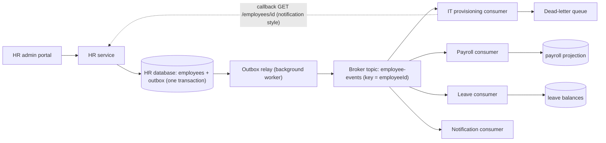
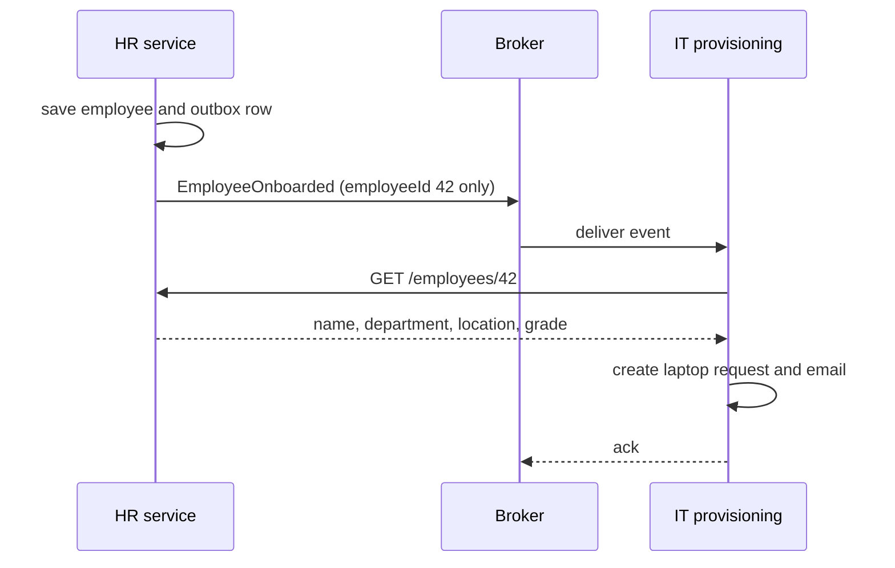
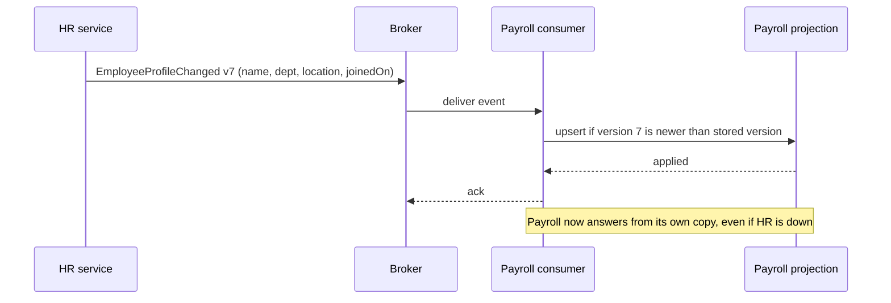

In a request-driven system, one component tells another what to do and waits. In an event-driven system, a component announces **what has happened** and carries on, and any number of other components decide for themselves how to react. This one change in direction removes a lot of coupling, and it brings new problems: data that is briefly out of date, messages that arrive twice or in the wrong order, and flows that are harder to see. This lesson covers both sides, using an employee onboarding flow in an HR platform.

## Learning objectives

By the end of this lesson you will be able to:

1. Define events, producers, consumers and brokers, and tell an event from a command.
2. Explain publish-subscribe and how each consumer gets its own copy of an event.
3. Choose between **event notification** and **event-carried state transfer**, and explain the trade-offs of each.
4. Explain eventual consistency with concrete lag numbers, and design user experiences that tolerate it.
5. Make consumers safe against duplicates, out-of-order delivery and schema changes.
6. Publish events reliably with a transactional outbox in ASP.NET Core.
7. Decide when events are the wrong tool and a direct call is simpler.

## Prerequisites

- [Microservices architecture](#/lesson/m02-microservices): data ownership and why services avoid synchronous chains.
- [Modular monolith architecture](#/lesson/m02-modular-monolith): in-process events between modules.
- [Background services and hosted workers](#/lesson/m03-background-services): consumers and relays run as `BackgroundService`.

## Explain it like I'm a beginner

Think of a housing society WhatsApp group in Pune.

The secretary posts: **"Water supply will be off tomorrow from 10 am to 2 pm."** That's it. The secretary does not phone each flat. Then, independently:

- Flat 204 fills buckets tonight.
- The gym moves the morning shower slots.
- The building office pins the message.
- Flat 512 is on holiday and reads it next week. Nothing breaks.

The secretary didn't need to know who would react or how. New residents who join the group start receiving announcements without the secretary changing anything. That is event-driven architecture.

Some vocabulary:

- The announcement is an **event**: a fact that already happened, written in past tense ("SupplyScheduledOff", "EmployeeOnboarded").
- The secretary is the **producer** (publisher).
- The residents who react are **consumers** (subscribers).
- The WhatsApp group is the **broker**: the system that carries events from producers to consumers.

Now compare two ways to write the announcement:

1. "There is news about the water supply. Call the office for details." Everyone who cares must phone the office. That is **event notification**: the event says *something happened*, and consumers ask for the details.
2. "Water off tomorrow 10 am to 2 pm, Wing B only, tanker at gate 2." Everyone has what they need without calling. That is **event-carried state transfer**: the event *carries the data*.

And one honest downside: Flat 512 didn't see the message for a week. For that week, their picture of the world was out of date. That is **eventual consistency**: everyone gets the news, but not at the same moment.

## First-principles explanation

### What it is

An **event-driven architecture** is a style in which components communicate mainly by producing and consuming events. An event is an **immutable record of something that happened** in the domain, such as `EmployeeOnboarded`, `LeaveApproved` or `SalaryRevised`.

Three kinds of messages are often confused:

| Message | Meaning | Example | Who decides what happens? |
|---|---|---|---|
| **Event** | "This happened." Past tense. | `EmployeeOnboarded` | Each consumer |
| **Command** | "Please do this." Imperative. | `CreateLaptopRequest` | The sender, and one receiver acts |
| **Query** | "Tell me this." | `GetEmployee(42)` | The receiver answers |

A producer of an event does not know or care who consumes it. A sender of a command expects one specific receiver to act. Mixing them up, for example publishing "events" named `SendWelcomeEmail`, brings back the coupling events were meant to remove.

### Why it exists — the problem

Consider onboarding without events. When HR saves a new joiner, the HR service must call:

1. IT, to create a laptop request and an email account,
2. Payroll, to set up a salary record,
3. Leave, to create a leave balance,
4. Facilities, to issue an access card,
5. Notifications, to send a welcome email.

That's five synchronous calls. The HR service must know all five, handle each one failing, and change whenever a sixth team (say, Insurance) needs to know. With 5 dependencies at 99.9 % each, saving a joiner is available at best `0.999^5 ≈ 99.5 %` of the time. The HR team becomes a bottleneck for every other team's needs.

With events, HR saves the employee and publishes one `EmployeeOnboarded` event. Each team subscribes and reacts. Insurance joins later by subscribing, and HR changes nothing.

### How it works internally

**Producers** write events to a **broker** after their own state change. Two broker families are common:

- **Message brokers** such as RabbitMQ or Azure Service Bus. A producer publishes to an exchange or topic, the broker routes copies into **one queue per subscribing consumer**, and a message is removed once its consumer acknowledges it.
- **Event logs** such as Apache Kafka or Azure Event Hubs. Events are appended to a partitioned, durable log and kept for a retention period (for example 7 days). Each consumer group tracks its own position (offset), so a new consumer can replay history.

**Publish-subscribe.** Every subscribing consumer (or consumer group) gets **its own copy** of every event. Within one consumer, several instances can share the work (competing consumers), so IT provisioning can run 3 instances that split the events between them.

**Delivery guarantees.** Most production setups give **at-least-once** delivery: an event is never lost once accepted, but it may arrive more than once (for example when a consumer crashes after processing but before acknowledging). So consumers must be **idempotent**: processing the same event twice must have the same effect as processing it once. See [Delivery guarantees](#/lesson/m12-delivery-guarantees).

**Ordering.** Kafka guarantees order only **within a partition**, so events for one employee should use the employee id as the partition key. RabbitMQ preserves order within a queue for a single consumer, but redeliveries and multiple consumers can reorder. Design for "mostly ordered" and use version numbers when order matters.

**Reliable publishing.** If the HR service saves the employee and then publishes to the broker, a crash between the two steps loses the event, and publishing first risks an event for an employee that was never saved. The **transactional outbox** fixes this: write the employee row and an `outbox` row in the **same database transaction**, then a background relay publishes outbox rows to the broker and marks them sent. See [Transactional outbox](#/lesson/m12-outbox).

### Event notification versus event-carried state transfer

This is the most important design choice for each event.

**Event notification.** The event is small: "employee 42 was onboarded" plus ids. Consumers that need details call back the producer's API.

- Small events, no sensitive data on the wire.
- Consumers always read the latest data.
- But each consumer makes a callback, so the producer gets extra load, and **consumers depend on the producer being up** when they process the event. With 6 consumers, one event becomes 6 API calls.

**Event-carried state transfer (ECST).** The event carries the data consumers need: name, department, joining date, work location, grade.

- Consumers need no callback. They can keep a local copy and work even when the producer is down.
- But events are bigger, the data is **duplicated** in every consumer, and the event schema becomes a contract that is harder to change.
- **Sensitive data** spreads. Put salary in an event and every subscriber, every log and every replay tool can see it. Under India's Digital Personal Data Protection Act 2023, as under GDPR elsewhere, spreading personal data widely makes access control, retention and deletion requests much harder.

A useful rule: **carry the data consumers commonly need and that is safe to share widely. Notify, and let authorised consumers call back, for sensitive or large data.**

A third pattern, **event sourcing**, stores the events themselves as the source of truth and rebuilds state by replaying them. It is a persistence choice inside one service, not a communication style. See [Event sourcing](#/lesson/m16-event-sourcing).

### Eventual consistency, with numbers

After HR saves Asha's record, how long until Payroll knows? An estimate for a typical setup:

- Outbox relay polls every 1 s: up to 1 s, about 0.5 s on average.
- Broker delivery: a few milliseconds.
- Consumer processing: about 50 ms.

So the typical lag is around 0.5–1 s. That's fine for payroll, which runs monthly.

Now say the Payroll consumer is down for 10 minutes while HR produces 20 events/s. The backlog is `20 × 600 s = 12,000 events`. If the consumer can process 200 events/s when it comes back, it gains `200 − 20 = 180` events/s on the backlog, so it catches up in `12,000 ÷ 180 ≈ 67 s`. For those 11 minutes, Payroll's view is stale. Your design must say whether that is acceptable, and monitoring must alert on **consumer lag** (events waiting) and not only on errors.

User-experience techniques for eventual consistency:

- Show the state the user just changed from the response, not from a stale read model ("read your own writes").
- Use honest wording: "Onboarding started. IT account will be ready within a few minutes."
- Show progress per step ("Laptop: requested. Email: created. Access card: pending").

### When it is useful

- **One fact, many reactions**, especially when the list of reactions grows over time (onboarding, order placed, payment received).
- **Decoupling teams**, so producers don't need to change when consumers are added.
- **Absorbing load spikes**: a broker buffers 50,000 events during a sale, and consumers work through them at their own pace.
- **Integrating systems with different availability**: the producer keeps working when a consumer is down.
- **Building read models, audit trails and analytics** from a stream of changes.

### When it is wrong or unnecessary

- **The caller needs an answer now.** "Is this UPI PIN correct?" is a query. Use a synchronous call.
- **One sender, one receiver, and a simple flow.** A direct call or a command on a queue is clearer than a pub-sub event nobody else will use.
- **Strong consistency is required** between the producer and consumer (moving money between two accounts in one ledger). Keep that inside one transaction in one service.
- **Small teams without operational tooling.** A broker, outbox, dead-letter queues, lag monitoring and tracing are real work. Inside one modular monolith, in-process events are usually enough.

### Trade-offs it introduces

| You gain | You pay |
|---|---|
| Producers don't know consumers, so adding a reaction needs no producer change | The overall flow is not visible in any one place. You need tracing and documentation |
| Producer stays available when consumers are down | Eventual consistency: consumers lag, sometimes by minutes |
| Load spikes are buffered | Duplicates and reordering: every consumer must be idempotent |
| Easy to add audit, analytics and read models | Event schemas become long-lived contracts that are hard to change |
| Fewer synchronous dependencies | A broker to run, secure and monitor, plus outbox relays and dead-letter handling |

:::callout type=tradeoff title="Choreography can hide the process"
When five consumers each react to events and publish their own events, the business process ("onboarding is complete when laptop, email, card and payroll are done") exists only as an emergent behaviour. Nobody can answer "where is Asha's onboarding stuck?". When a process has a clear end state and deadlines, consider an orchestrator that tracks it explicitly. See [Saga orchestration and choreography](#/lesson/m16-saga-orchestration-choreography).
:::

## Visual explanation

### Onboarding as an event-driven flow



How to read it: the HR service writes the employee and an outbox row in one transaction, so either both exist or neither does. The relay publishes outbox rows to the `employee-events` topic, keyed by employee id so all events for one employee stay in order. Each consumer gets its own copy. Payroll and Leave keep local data built from the event's contents (event-carried state transfer). The IT consumer receives a thin notification and calls back the HR API for the details it needs (dotted arrow), so it depends on HR being up while it processes. Events a consumer can't process after retries go to a dead-letter queue for inspection.

### Event notification: the consumer calls back



With notification, the event is tiny and contains no personal data. The cost is the callback: IT must call HR to get the details, so if HR is down, IT can't finish and must retry later. Each consumer that needs details adds one more call to HR per event.

### Event-carried state transfer: the data travels with the event



With event-carried state transfer, Payroll gets everything in the event and updates its local projection, applying the change only if the version is newer than what it already has. It never calls HR. The trade-off is that the employee's details now live in two places, and the event schema is a contract that both teams must evolve carefully.

## Step-by-step example

### Step 1 — the synchronous starting point

```csharp
public async Task<Guid> Onboard(NewJoiner j)
{
    var id = await _employees.SaveAsync(j);
    await _it.CreateAccountAsync(id, j.Email);       // if this throws, the rest never runs
    await _payroll.SetupAsync(id, j.Ctc);
    await _leave.CreateBalanceAsync(id, j.JoinedOn);
    await _notifications.SendWelcomeAsync(j.Email);
    return id;
}
```

Four remote calls in series, and partial failure leaves the joiner half set up with no record of what's missing.

### Step 2 — name the fact

What actually happened? "An employee was onboarded." Define the event with the data most consumers need and that is safe to share:

```json
{
  "type": "hr.employee.onboarded",
  "schemaVersion": 1,
  "eventId": "6f1c...",
  "occurredAt": "2026-10-20T09:15:02Z",
  "data": { "employeeId": "42", "fullName": "Asha Rao", "departmentCode": "FIN", "location": "Gurgaon", "joinedOn": "2026-11-02" }
}
```

Salary (CTC) is **not** in the event. Payroll gets it through an authorised API call or a separate restricted topic.

### Step 3 — publish reliably

Save the employee and the outbox row in one transaction. A relay publishes it.

### Step 4 — move reactions to consumers

Each team owns a consumer: IT, Payroll, Leave, Notifications. Each is idempotent and has a dead-letter queue.

### Step 5 — make the process visible

Add a correlation id to every event, trace consumer processing, alert on consumer lag, and (if needed) build an "onboarding status" read model from the consumers' own completion events (`LaptopRequested`, `PayrollProfileCreated`).

## Production-style C# implementation

The implementation below uses in-memory stand-ins for the database and broker so it compiles anywhere. The shapes are the same as with PostgreSQL plus RabbitMQ or Kafka.

```text
Hr.Events/
  Program.cs
  Events/EventEnvelope.cs
  Messaging/InMemoryBroker.cs
  Messaging/Outbox.cs
  Consumers/EventConsumerService.cs
  Consumers/Handlers.cs
```

### Event envelope and event types

```csharp file=Events/EventEnvelope.cs
using System.Text.Json;

namespace Hr.Events.Events;

/// <summary>Transport envelope, close to the CloudEvents attributes (id, type, source, time).</summary>
public sealed record EventEnvelope(
    Guid EventId,
    string Type,
    int SchemaVersion,
    string Source,
    string PartitionKey,
    DateTimeOffset OccurredAt,
    string CorrelationId,
    string Data)
{
    private static readonly JsonSerializerOptions Json = new(JsonSerializerDefaults.Web);

    public static EventEnvelope Create<T>(string type, int schemaVersion, string partitionKey, T data, DateTimeOffset at, string correlationId) =>
        new(Guid.NewGuid(), type, schemaVersion, "hr-service", partitionKey, at, correlationId, JsonSerializer.Serialize(data, Json));

    public T Read<T>() => JsonSerializer.Deserialize<T>(Data, Json) ?? throw new InvalidOperationException($"Empty payload in {EventId}.");
}

public static class EventTypes
{
    public const string EmployeeOnboarded = "hr.employee.onboarded";            // notification
    public const string EmployeeProfileChanged = "hr.employee.profile-changed"; // event-carried state
}

/// <summary>Notification: ids only. Consumers call back for details they are authorised to see.</summary>
public sealed record EmployeeOnboarded(Guid EmployeeId);

/// <summary>Event-carried state transfer: the non-sensitive fields most consumers need, plus a version.</summary>
public sealed record EmployeeProfileChanged(Guid EmployeeId, long Version, string FullName, string DepartmentCode, string Location, DateOnly JoinedOn);
```

### A broker stand-in with publish-subscribe

```csharp file=Messaging/InMemoryBroker.cs
using System.Collections.Concurrent;
using System.Threading.Channels;
using Hr.Events.Events;

namespace Hr.Events.Messaging;

public interface IEventPublisher
{
    Task PublishAsync(string topic, EventEnvelope envelope, CancellationToken ct);
}

/// <summary>Each subscription gets its own queue (its own copy of every event), like a RabbitMQ queue bound to a
/// fan-out exchange or a Kafka consumer group.</summary>
public sealed class InMemoryBroker : IEventPublisher
{
    private readonly ConcurrentDictionary<string, ConcurrentDictionary<string, Channel<EventEnvelope>>> _topics = new();

    public ChannelReader<EventEnvelope> Subscribe(string topic, string subscription) =>
        _topics.GetOrAdd(topic, _ => new())
               .GetOrAdd(subscription, _ => Channel.CreateBounded<EventEnvelope>(new BoundedChannelOptions(10_000)
               {
                   FullMode = BoundedChannelFullMode.Wait,   // backpressure instead of dropping events
               })).Reader;

    public async Task PublishAsync(string topic, EventEnvelope envelope, CancellationToken ct)
    {
        if (!_topics.TryGetValue(topic, out var subscriptions)) return;   // no subscribers yet
        foreach (var queue in subscriptions.Values)
            await queue.Writer.WriteAsync(envelope, ct);
    }
}
```

### The transactional outbox and its relay

```csharp file=Messaging/Outbox.cs
using Hr.Events.Events;

namespace Hr.Events.Messaging;

public sealed record OutboxRow(long Id, string Topic, EventEnvelope Envelope)
{
    public DateTimeOffset? SentAt { get; set; }
}

public sealed record EmployeeRow(Guid Id, string FullName, string DepartmentCode, string Location, DateOnly JoinedOn, long Version);

/// <summary>Stands in for PostgreSQL. Save writes the employee and the outbox rows atomically,
/// which in production is one transaction over two tables.</summary>
public sealed class HrDatabase
{
    private readonly object _tx = new();
    private readonly Dictionary<Guid, EmployeeRow> _employees = new();
    private readonly List<OutboxRow> _outbox = new();
    private long _nextOutboxId = 1;

    public void Save(EmployeeRow employee, params (string Topic, EventEnvelope Envelope)[] events)
    {
        lock (_tx)
        {
            _employees[employee.Id] = employee;
            foreach (var (topic, envelope) in events) _outbox.Add(new OutboxRow(_nextOutboxId++, topic, envelope));
        }
    }

    public EmployeeRow? FindEmployee(Guid id) { lock (_tx) return _employees.GetValueOrDefault(id); }

    /// <summary>SELECT ... FROM outbox WHERE sent_at IS NULL ORDER BY id LIMIT @batch FOR UPDATE SKIP LOCKED</summary>
    public IReadOnlyList<OutboxRow> PendingOutbox(int batch) { lock (_tx) return _outbox.Where(r => r.SentAt is null).OrderBy(r => r.Id).Take(batch).ToList(); }

    public void MarkSent(long id, DateTimeOffset at) { lock (_tx) _outbox.First(r => r.Id == id).SentAt = at; }
}

public sealed class OutboxRelay(HrDatabase db, IEventPublisher publisher, TimeProvider clock, ILogger<OutboxRelay> logger) : BackgroundService
{
    private static readonly TimeSpan PollInterval = TimeSpan.FromSeconds(1);

    protected override async Task ExecuteAsync(CancellationToken stoppingToken)
    {
        while (!stoppingToken.IsCancellationRequested)
        {
            foreach (var row in db.PendingOutbox(batch: 100))
            {
                try
                {
                    await publisher.PublishAsync(row.Topic, row.Envelope, stoppingToken);
                    db.MarkSent(row.Id, clock.GetUtcNow());   // a crash before this line causes a duplicate, never a loss
                }
                catch (Exception ex) when (ex is not OperationCanceledException)
                {
                    logger.LogWarning(ex, "Publishing outbox row {Id} failed; will retry", row.Id);
                    break;   // keep order: do not publish later rows before this one
                }
            }
            await Task.Delay(PollInterval, clock, stoppingToken);
        }
    }
}
```

The comment on `MarkSent` is the heart of it: the outbox gives **at-least-once** publishing. If the relay crashes after publishing but before marking, the row is published again. That is why consumers must handle duplicates.

### A generic consumer with idempotency and dead-lettering

```csharp file=Consumers/EventConsumerService.cs
using System.Collections.Concurrent;
using Hr.Events.Events;
using Hr.Events.Messaging;

namespace Hr.Events.Consumers;

public interface IEventHandler
{
    string EventType { get; }
    Task HandleAsync(EventEnvelope envelope, CancellationToken ct);
}

/// <summary>Inbox table in production: processed_event(subscription, event_id) primary key.</summary>
public sealed class ProcessedEvents
{
    private readonly ConcurrentDictionary<(string, Guid), byte> _seen = new();
    public bool AlreadyProcessed(string subscription, Guid eventId) => _seen.ContainsKey((subscription, eventId));
    public void MarkProcessed(string subscription, Guid eventId) => _seen.TryAdd((subscription, eventId), 0);
}

public sealed class DeadLetters
{
    public ConcurrentQueue<(string Subscription, EventEnvelope Envelope, string Error)> Items { get; } = new();
}

/// <summary>One instance per subscription. Dispatches by event type, skips duplicates, retries, then dead-letters.</summary>
public sealed class EventConsumerService(
    string topic,
    string subscription,
    InMemoryBroker broker,
    IEnumerable<IEventHandler> handlers,
    ProcessedEvents processed,
    DeadLetters deadLetters,
    ILogger<EventConsumerService> logger) : BackgroundService
{
    private const int MaxAttempts = 3;
    private readonly Dictionary<string, IEventHandler> _byType = handlers.ToDictionary(h => h.EventType);

    protected override async Task ExecuteAsync(CancellationToken stoppingToken)
    {
        var reader = broker.Subscribe(topic, subscription);
        await foreach (var envelope in reader.ReadAllAsync(stoppingToken))
        {
            if (!_byType.TryGetValue(envelope.Type, out var handler)) continue;            // not interested
            if (processed.AlreadyProcessed(subscription, envelope.EventId)) continue;        // duplicate

            using var scope = logger.BeginScope(new Dictionary<string, object>
            {
                ["CorrelationId"] = envelope.CorrelationId,
                ["EventId"] = envelope.EventId,
            });

            for (var attempt = 1; ; attempt++)
            {
                try
                {
                    await handler.HandleAsync(envelope, stoppingToken);
                    processed.MarkProcessed(subscription, envelope.EventId);   // same transaction as the handler's writes in production
                    break;
                }
                catch (Exception ex) when (ex is not OperationCanceledException)
                {
                    if (attempt >= MaxAttempts)
                    {
                        deadLetters.Items.Enqueue((subscription, envelope, ex.Message));
                        logger.LogError(ex, "{Subscription} dead-lettered {Type}", subscription, envelope.Type);
                        break;
                    }
                    await Task.Delay(TimeSpan.FromMilliseconds(200 * Math.Pow(2, attempt)), stoppingToken);
                }
            }
        }
    }
}
```

### Two consumers, two styles

```csharp file=Consumers/Handlers.cs
using System.Collections.Concurrent;
using Hr.Events.Events;
using Hr.Events.Messaging;

namespace Hr.Events.Consumers;

/// <summary>Notification style: the event has only an id, so the consumer calls back for details.</summary>
public interface IEmployeeQueryApi
{
    Task<EmployeeRow?> GetAsync(Guid employeeId, CancellationToken ct);
}

/// <summary>In the real system this is an HTTP client for GET /employees/{id}; here it reads the HR store.</summary>
public sealed class InProcessEmployeeQueryApi(HrDatabase db) : IEmployeeQueryApi
{
    public Task<EmployeeRow?> GetAsync(Guid employeeId, CancellationToken ct) => Task.FromResult(db.FindEmployee(employeeId));
}

public sealed class LaptopRequests
{
    public ConcurrentDictionary<Guid, string> ByEmployee { get; } = new();
}

public sealed class ItProvisioningHandler(IEmployeeQueryApi employees, LaptopRequests requests) : IEventHandler
{
    public string EventType => EventTypes.EmployeeOnboarded;

    public async Task HandleAsync(EventEnvelope envelope, CancellationToken ct)
    {
        var evt = envelope.Read<EmployeeOnboarded>();
        var employee = await employees.GetAsync(evt.EmployeeId, ct)
            ?? throw new InvalidOperationException($"Employee {evt.EmployeeId} not found yet");   // retried, then dead-lettered
        requests.ByEmployee.TryAdd(employee.Id, $"Laptop for {employee.FullName} at {employee.Location}");
    }
}

/// <summary>Event-carried state transfer: the consumer keeps its own projection, no callback needed.</summary>
public sealed record PayrollEmployee(Guid EmployeeId, string FullName, string DepartmentCode, DateOnly JoinedOn, long Version);

public sealed class PayrollProjection
{
    public ConcurrentDictionary<Guid, PayrollEmployee> Rows { get; } = new();
}

public sealed class PayrollProfileHandler(PayrollProjection projection) : IEventHandler
{
    public string EventType => EventTypes.EmployeeProfileChanged;

    public Task HandleAsync(EventEnvelope envelope, CancellationToken ct)
    {
        var e = envelope.Read<EmployeeProfileChanged>();
        var incoming = new PayrollEmployee(e.EmployeeId, e.FullName, e.DepartmentCode, e.JoinedOn, e.Version);
        // Apply only newer versions: duplicates and late, out-of-order events become no-ops.
        projection.Rows.AddOrUpdate(e.EmployeeId, incoming, (_, current) => e.Version > current.Version ? incoming : current);
        return Task.CompletedTask;
    }
}
```

### The host

```csharp file=Program.cs
using Hr.Events.Consumers;
using Hr.Events.Events;
using Hr.Events.Messaging;

var builder = WebApplication.CreateBuilder(args);

builder.Services.AddSingleton(TimeProvider.System);
builder.Services.AddSingleton<HrDatabase>();
builder.Services.AddSingleton<InMemoryBroker>();
builder.Services.AddSingleton<IEventPublisher>(sp => sp.GetRequiredService<InMemoryBroker>());
builder.Services.AddHostedService<OutboxRelay>();

builder.Services.AddSingleton<ProcessedEvents>();
builder.Services.AddSingleton<DeadLetters>();
builder.Services.AddSingleton<LaptopRequests>();
builder.Services.AddSingleton<PayrollProjection>();
builder.Services.AddSingleton<IEmployeeQueryApi, InProcessEmployeeQueryApi>();

// One consumer per subscription. In separate services, each would live in its own deployable.
// AddSingleton<IHostedService>, not AddHostedService: AddHostedService de-duplicates by implementation type,
// so a second factory registration of the same class would be silently ignored.
builder.Services.AddSingleton<IHostedService>(sp => new EventConsumerService("employee-events", "it-provisioning",
    sp.GetRequiredService<InMemoryBroker>(),
    [new ItProvisioningHandler(sp.GetRequiredService<IEmployeeQueryApi>(), sp.GetRequiredService<LaptopRequests>())],
    sp.GetRequiredService<ProcessedEvents>(), sp.GetRequiredService<DeadLetters>(),
    sp.GetRequiredService<ILogger<EventConsumerService>>()));
builder.Services.AddSingleton<IHostedService>(sp => new EventConsumerService("employee-events", "payroll",
    sp.GetRequiredService<InMemoryBroker>(),
    [new PayrollProfileHandler(sp.GetRequiredService<PayrollProjection>())],
    sp.GetRequiredService<ProcessedEvents>(), sp.GetRequiredService<DeadLetters>(),
    sp.GetRequiredService<ILogger<EventConsumerService>>()));

var app = builder.Build();

app.MapPost("/employees", (NewJoiner joiner, HrDatabase db, TimeProvider clock, HttpContext http) =>
{
    var id = Guid.NewGuid();
    var correlationId = http.TraceIdentifier;
    var now = clock.GetUtcNow();
    var row = new EmployeeRow(id, joiner.FullName, joiner.DepartmentCode, joiner.Location, joiner.JoinedOn, Version: 1);

    db.Save(row,
        ("employee-events", EventEnvelope.Create(EventTypes.EmployeeOnboarded, 1, id.ToString(), new EmployeeOnboarded(id), now, correlationId)),
        ("employee-events", EventEnvelope.Create(EventTypes.EmployeeProfileChanged, 1, id.ToString(),
            new EmployeeProfileChanged(id, 1, row.FullName, row.DepartmentCode, row.Location, row.JoinedOn), now, correlationId)));

    // 202: the employee exists now; downstream setup completes within seconds.
    return Results.Accepted($"/employees/{id}", new { id, message = "Onboarding started. IT and payroll setup will follow shortly." });
});

app.MapGet("/payroll/employees/{id:guid}", (Guid id, PayrollProjection projection) =>
    projection.Rows.TryGetValue(id, out var e) ? Results.Ok(e) : Results.NotFound(new { message = "Not yet synchronised" }));

app.Run();

public sealed record NewJoiner(string FullName, string DepartmentCode, string Location, DateOnly JoinedOn);
```

Two details worth noticing. First, the POST returns `202 Accepted` with honest wording, because downstream work is not finished. Second, the payroll read endpoint returns "Not yet synchronised" for a brand-new employee: eventual consistency shows up in the API, and the client must handle it.

With RabbitMQ, the broker part becomes a fan-out (or topic) exchange with one durable queue per subscription. With Kafka, it becomes a topic with the employee id as the message key and one consumer group per subscription. The outbox, idempotency and versioning logic stay the same.

## Bad design vs good design

**Bad: events in name only.**

- The HR service publishes `SendWelcomeEmail`, `CreateLaptop` and `SetupPayroll` "events". These are commands, so HR still knows every consumer.
- It publishes directly after `SaveChanges()`, without an outbox. A broker hiccup silently loses onboarding events.
- The event carries the full employee record, including CTC, PAN and bank account, to 9 subscribers.
- Consumers assume exactly-once, in-order delivery. A duplicate creates two laptop requests.
- No consumer lag monitoring. The payroll consumer was stuck for two days before anyone noticed.

**Good: facts, reliably published, safely consumed.**

- One fact: `EmployeeOnboarded`, plus `EmployeeProfileChanged` with non-sensitive fields and a version.
- Outbox in the same transaction as the state change.
- Sensitive data stays behind an authorised API.
- Idempotent consumers (an inbox of processed event ids), version checks for projections, and dead-letter queues.
- Lag and dead-letter alerts, correlation ids and tracing.

**Is the improvement worth it?** If there are only two reactions and both teams sit together, a direct call or a command queue may be simpler. Event-driven design pays off as the number of independent reactions grows.

:::callout type=mistake title="Using events to ask questions"
A consumer that publishes `EmployeeDetailsRequested` and waits for `EmployeeDetailsProvided` has reinvented a slow, unreliable request-response call. If you need an answer to continue, make a synchronous query, or carry the data in the original event.
:::

## Practical playground

The program simulates a producer and two consumers in one process, with one consumer temporarily "down". Run it and watch the payroll projection catch up after the outage. Then try: deliver one event twice, or deliver version 2 before version 1, and check that the projection stays correct.

:::playground type=csharp title="Notification vs state transfer"
```csharp file=Program.cs
using System;
using System.Collections.Generic;
using System.Linq;

public sealed record ProfileChanged(Guid EventId, int EmployeeId, long Version, string Name, string Dept);

public static class Program
{
    public static void Main()
    {
        var hrDb = new Dictionary<int, (string Name, string Dept)>();
        var payrollProjection = new Dictionary<int, ProfileChanged>();
        var payrollQueue = new Queue<ProfileChanged>();
        var processed = new HashSet<Guid>();
        var itCallbacks = 0;

        void Publish(ProfileChanged e)
        {
            payrollQueue.Enqueue(e);       // payroll subscription (state transfer)
            itCallbacks++;                 // IT gets a notification and calls HR back
            _ = hrDb[e.EmployeeId];
        }

        void DrainPayroll()
        {
            while (payrollQueue.Count > 0)
            {
                var e = payrollQueue.Dequeue();
                if (!processed.Add(e.EventId)) { Console.WriteLine($"  duplicate {e.EventId:N} skipped"); continue; }
                if (payrollProjection.TryGetValue(e.EmployeeId, out var cur) && cur.Version >= e.Version)
                { Console.WriteLine($"  stale v{e.Version} ignored (have v{cur.Version})"); continue; }
                payrollProjection[e.EmployeeId] = e;
            }
        }

        hrDb[42] = ("Asha Rao", "FIN");
        var v1 = new ProfileChanged(Guid.NewGuid(), 42, 1, "Asha Rao", "FIN");
        Publish(v1);
        DrainPayroll();
        Console.WriteLine($"Payroll sees: {payrollProjection[42].Dept} (v{payrollProjection[42].Version})");

        Console.WriteLine("Payroll consumer goes down. HR moves Asha to PRJ.");
        hrDb[42] = ("Asha Rao", "PRJ");
        var v2 = new ProfileChanged(Guid.NewGuid(), 42, 2, "Asha Rao", "PRJ");
        Publish(v2);
        Console.WriteLine($"HR says PRJ, payroll still says {payrollProjection[42].Dept}  <- eventual consistency");

        Console.WriteLine("Consumer recovers. Broker redelivers v2 and a late copy of v1.");
        payrollQueue.Enqueue(v1 with { EventId = Guid.NewGuid() });   // try changing this to v1 itself (a duplicate)
        DrainPayroll();
        Console.WriteLine($"Payroll sees: {payrollProjection[42].Dept} (v{payrollProjection[42].Version})");
        Console.WriteLine($"IT made {itCallbacks} callbacks to HR (notification style).");
    }
}
```
:::

## Exercises

:::exercise id=m02-event-driven-ex1 difficulty=beginner kind=code title="Make a consumer idempotent"
The broker delivers at least once, so the Leave consumer sometimes gets the same `EmployeeOnboarded` event twice and creates two leave balances. Write `IdempotentConsumer`, which wraps a handler and processes each event id at most once.
::requirements
- `Task<bool> HandleAsync(IncomingEvent e)` returns `true` if the inner handler ran, `false` if the event was a duplicate.
- Mark the event as processed **only after** the inner handler succeeds.
- If the inner handler throws, let the exception propagate and do not mark the event, so a redelivery is processed.
- Processed ids are stored through `IProcessedStore`, so production code can use a database table.
::acceptance
- The first delivery runs the handler and returns `true`.
- A second delivery with the same id returns `false` and does not run the handler.
- After a failed attempt, a redelivery of the same id runs the handler again.
- Different event ids are processed independently.
::hint
Check the store first. If the id is there, return `false` immediately.
::hint
Call the inner handler. If it returns normally, mark the id.
::hint
Don't wrap the handler call in `try/catch` at all: an exception then propagates naturally and skips the "mark" line.
::hint
In production, the "mark processed" insert and the handler's own writes go in one database transaction. Then a crash between the two can't happen.
::starter
```csharp file=IdempotentConsumer.cs
using System;
using System.Collections.Generic;
using System.Threading.Tasks;

namespace Leave.Consumers
{
    public sealed record IncomingEvent(Guid EventId, string Type, Guid EmployeeId);

    public interface IProcessedStore
    {
        bool Contains(Guid eventId);
        void Add(Guid eventId);
    }

    public sealed class InMemoryProcessedStore : IProcessedStore
    {
        private readonly HashSet<Guid> _ids = new();
        public bool Contains(Guid eventId) => _ids.Contains(eventId);
        public void Add(Guid eventId) => _ids.Add(eventId);
    }

    public sealed class IdempotentConsumer
    {
        private readonly IProcessedStore _store;
        private readonly Func<IncomingEvent, Task> _inner;

        public IdempotentConsumer(IProcessedStore store, Func<IncomingEvent, Task> inner)
        {
            _store = store;
            _inner = inner;
        }

        public Task<bool> HandleAsync(IncomingEvent e) => throw new NotImplementedException();
    }
}
```
::tests
```csharp file=IdempotentConsumerTests.cs
using System;
using System.Threading.Tasks;
using Leave.Consumers;
using Xunit;

public class IdempotentConsumerTests
{
    private static IncomingEvent Evt(Guid? id = null) => new(id ?? Guid.NewGuid(), "hr.employee.onboarded", Guid.NewGuid());

    [Fact]
    public async Task First_delivery_runs_handler()
    {
        var calls = 0;
        var c = new IdempotentConsumer(new InMemoryProcessedStore(), e => { calls++; return Task.CompletedTask; });
        Assert.True(await c.HandleAsync(Evt()));
        Assert.Equal(1, calls);
    }

    [Fact]
    public async Task Duplicate_is_skipped()
    {
        var calls = 0;
        var c = new IdempotentConsumer(new InMemoryProcessedStore(), e => { calls++; return Task.CompletedTask; });
        var e = Evt();
        await c.HandleAsync(e);
        Assert.False(await c.HandleAsync(e));
        Assert.Equal(1, calls);
    }

    [Fact]
    public async Task Failure_is_not_marked_so_redelivery_retries()
    {
        var calls = 0;
        var c = new IdempotentConsumer(new InMemoryProcessedStore(), e =>
        {
            calls++;
            if (calls == 1) throw new InvalidOperationException("db timeout");
            return Task.CompletedTask;
        });
        var e = Evt();
        await Assert.ThrowsAsync<InvalidOperationException>(() => c.HandleAsync(e));
        Assert.True(await c.HandleAsync(e));
        Assert.Equal(2, calls);
    }

    [Fact]
    public async Task Different_ids_are_independent()
    {
        var calls = 0;
        var c = new IdempotentConsumer(new InMemoryProcessedStore(), e => { calls++; return Task.CompletedTask; });
        await c.HandleAsync(Evt());
        await c.HandleAsync(Evt());
        Assert.Equal(2, calls);
    }
}
```
::solution
```csharp file=IdempotentConsumer.cs
using System;
using System.Collections.Generic;
using System.Threading.Tasks;

namespace Leave.Consumers
{
    public sealed record IncomingEvent(Guid EventId, string Type, Guid EmployeeId);

    public interface IProcessedStore
    {
        bool Contains(Guid eventId);
        void Add(Guid eventId);
    }

    public sealed class InMemoryProcessedStore : IProcessedStore
    {
        private readonly HashSet<Guid> _ids = new();
        public bool Contains(Guid eventId) => _ids.Contains(eventId);
        public void Add(Guid eventId) => _ids.Add(eventId);
    }

    public sealed class IdempotentConsumer
    {
        private readonly IProcessedStore _store;
        private readonly Func<IncomingEvent, Task> _inner;

        public IdempotentConsumer(IProcessedStore store, Func<IncomingEvent, Task> inner)
        {
            _store = store;
            _inner = inner;
        }

        public async Task<bool> HandleAsync(IncomingEvent e)
        {
            if (_store.Contains(e.EventId)) return false;
            await _inner(e);          // throws on failure, so the id is not marked
            _store.Add(e.EventId);
            return true;
        }
    }
}
```

In PostgreSQL, the store is a table `processed_event(consumer text, event_id uuid, PRIMARY KEY (consumer, event_id))`. Insert into it in the same transaction as the leave balance. A duplicate then violates the primary key and the transaction rolls back, which also protects you when two consumer instances receive the same event at the same moment. This exact check-then-add code is not safe across concurrent instances on its own.
::mistakes
- Marking the id before running the handler: a crash in between loses the event for good.
- Swallowing the handler's exception and returning `false`, which makes the broker think the event was processed.
- Keeping processed ids only in memory in production: a restart forgets them all.
:::

:::exercise id=m02-event-driven-ex2 difficulty=beginner kind=written title="Event, command or query? Notification or state transfer?"
For each situation, say whether the message should be an **event**, a **command** or a **query**. For events, also say **notification** or **event-carried state transfer**, and why.

1. The attendance system must tell Payroll how many days each employee was present in October.
2. HR changes an employee's work location from Gurgaon to Bengaluru. Five services show the location.
3. The Leave service needs to check, while the user waits, whether a manager is currently on leave.
4. Payroll has revised an employee's salary. The employee's manager dashboard and the finance cost report need to know.
5. The onboarding process wants the IT service to issue a laptop of model X to employee 42.
::acceptance
- Every item is classified, with a reason.
- At least one answer discusses sensitive data in events.
- At least one answer explains why a synchronous query is better.
::hint
Is the sender reporting a fact, or asking someone to do something specific?
::hint
Does the receiver need an answer to continue right now?
::hint
For state transfer, ask: is the data safe for every subscriber to see?
::solution
1. **Event, state transfer**: `AttendanceMonthClosed(employeeId, month, presentDays)`. Payroll needs the numbers, and attendance counts are not highly sensitive. A callback per employee (12,000 calls at month-end) would be wasteful.
2. **Event, state transfer**: `EmployeeProfileChanged` with the new location and a version. Five consumers would otherwise each call HR back.
3. **Query**. The user is waiting and needs the current answer. Make a synchronous call with a timeout, or read a local replica if one exists.
4. **Event, notification**: `SalaryRevised(employeeId, effectiveFrom)` without amounts. Salary is sensitive, so authorised consumers (finance) call Payroll's secured API for amounts. The manager dashboard may only need "revised on" plus the band, not the figure.
5. **Command**: `IssueLaptop(employeeId, model)` sent to IT's queue. It is a request to one specific receiver, which may reject it (out of stock). Calling it an event hides that.
:::

:::exercise id=m02-event-driven-ex3 difficulty=intermediate kind=code title="Read two versions of an event schema"
Version 1 of `hr.employee.profile-changed` had `{"employeeId": "...", "name": "Asha Rao", "dept": "FIN"}`. Version 2 split the name and renamed the department: `{"employeeId": "...", "firstName": "Asha", "lastName": "Rao", "departmentCode": "FIN"}`. Old events stay in the log for 7 days, so consumers must read both. Write `ProfileEventReader.Read`, which turns either version into the v2 model (an upcaster).
::requirements
- `Read(int schemaVersion, string json)` returns `ProfileV2`.
- Version 1: split `name` on the **first** space. The first part is `FirstName`, the rest is `LastName` (empty if there is no space).
- Version 2: read the fields directly.
- Any other version: throw `NotSupportedException`.
- Property names are camelCase and must be matched case-insensitively.
::acceptance
- v1 `"Asha Rao"` gives `Asha` / `Rao`. v1 `"Sachin Ramesh Tendulkar"` gives `Sachin` / `Ramesh Tendulkar`. v1 `"Madonna"` gives `Madonna` / empty.
- v2 is read as is.
- Version 3 throws `NotSupportedException`.
::hint
Define a private `ProfileV1` record, deserialize with `JsonSerializer`, then convert.
::hint
`new JsonSerializerOptions(JsonSerializerDefaults.Web)` gives camelCase, case-insensitive matching.
::hint
`name.Split(' ', 2)` splits on the first space only and gives one or two parts.
::hint
A `switch` on `schemaVersion` with a discard arm that throws keeps the version handling in one obvious place.
::starter
```csharp file=ProfileEventReader.cs
using System;
using System.Text.Json;

namespace Payroll.Consumers
{
    public sealed record ProfileV2(Guid EmployeeId, string FirstName, string LastName, string DepartmentCode);

    public static class ProfileEventReader
    {
        public static ProfileV2 Read(int schemaVersion, string json) => throw new NotImplementedException();
    }
}
```
::tests
```csharp file=ProfileEventReaderTests.cs
using System;
using Payroll.Consumers;
using Xunit;

public class ProfileEventReaderTests
{
    private static readonly Guid Id = Guid.Parse("6f1c2b7e-0000-4000-8000-000000000042");

    [Fact]
    public void Reads_v1_and_splits_name()
    {
        var p = ProfileEventReader.Read(1, $$"""{"employeeId":"{{Id}}","name":"Asha Rao","dept":"FIN"}""");
        Assert.Equal(new ProfileV2(Id, "Asha", "Rao", "FIN"), p);
    }

    [Fact]
    public void V1_splits_on_first_space_only() =>
        Assert.Equal("Ramesh Tendulkar", ProfileEventReader.Read(1, $$"""{"employeeId":"{{Id}}","name":"Sachin Ramesh Tendulkar","dept":"PRJ"}""").LastName);

    [Fact]
    public void V1_single_name_has_empty_last_name()
    {
        var p = ProfileEventReader.Read(1, $$"""{"employeeId":"{{Id}}","name":"Madonna","dept":"MKT"}""");
        Assert.Equal("Madonna", p.FirstName);
        Assert.Equal("", p.LastName);
    }

    [Fact]
    public void Reads_v2_directly() =>
        Assert.Equal(new ProfileV2(Id, "Ravi", "Kumar", "FIN"),
            ProfileEventReader.Read(2, $$"""{"employeeId":"{{Id}}","firstName":"Ravi","lastName":"Kumar","departmentCode":"FIN"}"""));

    [Fact]
    public void Property_names_are_case_insensitive() =>
        Assert.Equal("FIN", ProfileEventReader.Read(2, $$"""{"EmployeeId":"{{Id}}","FirstName":"Ravi","LastName":"Kumar","DepartmentCode":"FIN"}""").DepartmentCode);

    [Fact]
    public void Unknown_version_throws() =>
        Assert.Throws<NotSupportedException>(() => ProfileEventReader.Read(3, "{}"));
}
```
::solution
```csharp file=ProfileEventReader.cs
using System;
using System.Text.Json;

namespace Payroll.Consumers
{
    public sealed record ProfileV2(Guid EmployeeId, string FirstName, string LastName, string DepartmentCode);

    public static class ProfileEventReader
    {
        private sealed record ProfileV1(Guid EmployeeId, string Name, string Dept);

        private static readonly JsonSerializerOptions Json = new(JsonSerializerDefaults.Web);

        public static ProfileV2 Read(int schemaVersion, string json) => schemaVersion switch
        {
            1 => Upcast(Deserialize<ProfileV1>(json)),
            2 => Deserialize<ProfileV2>(json),
            _ => throw new NotSupportedException($"profile-changed schema v{schemaVersion} is not supported."),
        };

        private static ProfileV2 Upcast(ProfileV1 v1)
        {
            var parts = v1.Name.Trim().Split(' ', 2);
            return new ProfileV2(v1.EmployeeId, parts[0], parts.Length > 1 ? parts[1] : "", v1.Dept);
        }

        private static T Deserialize<T>(string json) =>
            JsonSerializer.Deserialize<T>(json, Json) ?? throw new FormatException("Empty event payload.");
    }
}
```

The rest of the consumer only sees `ProfileV2`. All version knowledge is in one class. When the log no longer contains v1 events (after the retention period, and after any replays), delete the v1 branch.
::mistakes
- Splitting on every space, which turns "Sachin Ramesh Tendulkar" into a last name of "Ramesh".
- Defaulting unknown versions to v2, which silently produces empty fields.
- Breaking the schema in place without a version number, so consumers can't tell the shapes apart.
:::

:::exercise id=m02-event-driven-ex4 difficulty=intermediate kind=sql ordered=true title="Measure eventual consistency lag"
The HR database has `employee(employee_id, full_name, created_at)`. The payroll projection has `payroll_employee(employee_id, applied_at)`, written when the payroll consumer processes the employee's first event. At `2026-10-20 10:00:00+00`, list the employees that are a sync problem: either **missing** from the projection and created more than 5 minutes before that time, or **applied more than 60 seconds** after they were created. Return `employee_id`, `full_name`, `status` (`'missing'` or `'slow'`) and `lag_seconds` (whole seconds between `created_at` and `applied_at`, or `NULL` when missing). Order by `employee_id`.
::setup
```sql
CREATE TABLE employee (
  employee_id int PRIMARY KEY,
  full_name   text NOT NULL,
  created_at  timestamptz NOT NULL
);
CREATE TABLE payroll_employee (
  employee_id int PRIMARY KEY,
  applied_at  timestamptz NOT NULL
);
INSERT INTO employee VALUES
  (1, 'Asha Rao',     '2026-10-20 09:00:00+00'),
  (2, 'Ravi Kumar',   '2026-10-20 09:10:00+00'),
  (3, 'Meera Iyer',   '2026-10-20 09:20:00+00'),
  (4, 'Sunil Mehta',  '2026-10-20 09:40:00+00'),
  (5, 'Farah Khan',   '2026-10-20 09:57:00+00'),
  (6, 'Arjun Singh',  '2026-10-20 09:30:00+00');
INSERT INTO payroll_employee VALUES
  (1, '2026-10-20 09:00:01.4+00'),
  (2, '2026-10-20 09:13:20+00'),
  (3, '2026-10-20 09:21:00+00'),
  (6, '2026-10-20 09:30:00.8+00');
```
::check
```sql
SELECT e.employee_id,
       e.full_name,
       CASE WHEN p.employee_id IS NULL THEN 'missing' ELSE 'slow' END AS status,
       floor(EXTRACT(EPOCH FROM (p.applied_at - e.created_at)))::int AS lag_seconds
FROM employee e
LEFT JOIN payroll_employee p ON p.employee_id = e.employee_id
WHERE (p.employee_id IS NULL AND e.created_at < timestamptz '2026-10-20 10:00:00+00' - interval '5 minutes')
   OR (p.applied_at - e.created_at > interval '60 seconds')
ORDER BY e.employee_id;
```
::acceptance
- Ravi (2) is `slow` with 200 seconds.
- Sunil (4) is `missing` with `NULL` lag.
- Farah (5) is not listed: she is missing, but created only 3 minutes before the check, so she may still be in flight.
- Meera (3) is exactly 60 seconds and is not listed (more than 60 seconds counts as slow).
::hint
You need every employee, whether or not a projection row exists. Which join keeps rows with no match?
::hint
Subtracting two `timestamptz` values gives an `interval`. You can compare it directly with `interval '60 seconds'`.
::hint
`EXTRACT(EPOCH FROM some_interval)` gives seconds as a number. `floor(...)::int` makes it whole seconds.
::hint
The `WHERE` clause has two alternatives joined by `OR`: missing-and-old, or applied-and-slow.
::solution
```sql
SELECT e.employee_id,
       e.full_name,
       CASE WHEN p.employee_id IS NULL THEN 'missing' ELSE 'slow' END AS status,
       floor(EXTRACT(EPOCH FROM (p.applied_at - e.created_at)))::int AS lag_seconds
FROM employee e
LEFT JOIN payroll_employee p ON p.employee_id = e.employee_id
WHERE (p.employee_id IS NULL AND e.created_at < timestamptz '2026-10-20 10:00:00+00' - interval '5 minutes')
   OR (p.applied_at - e.created_at > interval '60 seconds')
ORDER BY e.employee_id;
```

This kind of **reconciliation query** is how teams check that eventual consistency actually becomes consistency. In production you run it on a schedule, using `now()` instead of a fixed time. The HR and payroll tables usually live in different databases, so the job compares exported id lists or uses a reporting store. Alert when the missing count is above zero for more than a few minutes. Keep a grace period (here 5 minutes) so in-flight events are not reported as failures.
::mistakes
- Using an inner join, which hides exactly the missing employees you want to find.
- Forgetting the grace period, which raises false alarms for events still in flight.
:::

:::exercise id=m02-event-driven-ex5 difficulty=advanced kind=code title="Keep order per employee, run employees in parallel"
Events for one employee must be processed in order (v1 before v2), but processing every event one at a time is too slow at month-end. Build `KeyedSequentialDispatcher`: work items with the same key run one after another in submission order, and items with different keys may run at the same time. This is what a Kafka partition key gives you, applied inside one consumer.
::requirements
- `Task EnqueueAsync(string key, Func<Task> work)` returns a task that completes when that item has run.
- Items with the same key never overlap and run in submission order.
- Items with different keys are not forced to wait for each other.
- If an item fails, its task is faulted, but the **next** item for that key still runs.
- `ActiveKeys` reports how many keys have unfinished work. It must drop to 0 when everything is done, so memory doesn't grow forever.
::acceptance
- Three items for `E42` with decreasing delays still complete in submission order.
- Items for `E1` and `E2` overlap in time (a test proves both started before either finished).
- A failing item doesn't block the next item for its key.
- `ActiveKeys` is 0 after all tasks complete.
::hint
For each key, remember the task of the last item submitted (the "tail"). A new item waits for the tail, then runs.
::hint
Guard the dictionary of tails with a `lock`. Do not hold the lock while running work.
::hint
To survive a failed predecessor, wrap `await previous` in `try { } catch { }` inside the new item.
::hint
Use a `TaskCompletionSource` per item. Before completing it, remove the key from the dictionary if this item is still the tail. Then `ActiveKeys` is already correct by the time the caller's `await` resumes.
::hint
```csharp
lock (_lock)
{
    previous = _tails.TryGetValue(key, out var t) ? t : Task.CompletedTask;
    _tails[key] = tcs.Task;
}
_ = RunAsync(key, previous, work, tcs);
return tcs.Task;
```
::starter
```csharp file=KeyedSequentialDispatcher.cs
using System;
using System.Collections.Generic;
using System.Threading.Tasks;

namespace Payroll.Consumers
{
    public sealed class KeyedSequentialDispatcher
    {
        public int ActiveKeys => throw new NotImplementedException();

        public Task EnqueueAsync(string key, Func<Task> work) => throw new NotImplementedException();
    }
}
```
::tests
```csharp file=KeyedSequentialDispatcherTests.cs
using System;
using System.Collections.Concurrent;
using System.Collections.Generic;
using System.Threading;
using System.Threading.Tasks;
using Payroll.Consumers;
using Xunit;

public class KeyedSequentialDispatcherTests
{
    [Fact]
    public async Task Same_key_runs_in_submission_order()
    {
        var d = new KeyedSequentialDispatcher();
        var order = new ConcurrentQueue<int>();
        var t1 = d.EnqueueAsync("E42", async () => { await Task.Delay(60); order.Enqueue(1); });
        var t2 = d.EnqueueAsync("E42", async () => { await Task.Delay(20); order.Enqueue(2); });
        var t3 = d.EnqueueAsync("E42", () => { order.Enqueue(3); return Task.CompletedTask; });
        await Task.WhenAll(t1, t2, t3);
        Assert.Equal(new[] { 1, 2, 3 }, order.ToArray());
    }

    [Fact]
    public async Task Different_keys_overlap()
    {
        var d = new KeyedSequentialDispatcher();
        var started = 0;
        var bothStarted = new TaskCompletionSource(TaskCreationOptions.RunContinuationsAsynchronously);
        async Task Work()
        {
            if (Interlocked.Increment(ref started) == 2) bothStarted.TrySetResult();
            await bothStarted.Task.WaitAsync(TimeSpan.FromSeconds(5));   // times out if the keys were serialised
        }
        await Task.WhenAll(d.EnqueueAsync("E1", Work), d.EnqueueAsync("E2", Work));
        Assert.Equal(2, started);
    }

    [Fact]
    public async Task Failure_does_not_block_the_key()
    {
        var d = new KeyedSequentialDispatcher();
        var ran = false;
        var failing = d.EnqueueAsync("E7", () => throw new InvalidOperationException("bad event"));
        var next = d.EnqueueAsync("E7", () => { ran = true; return Task.CompletedTask; });
        await Assert.ThrowsAsync<InvalidOperationException>(() => failing);
        await next;
        Assert.True(ran);
    }

    [Fact]
    public async Task Keys_are_cleaned_up()
    {
        var d = new KeyedSequentialDispatcher();
        var tasks = new List<Task>();
        for (var i = 0; i < 20; i++) tasks.Add(d.EnqueueAsync($"E{i % 5}", () => Task.Delay(5)));
        await Task.WhenAll(tasks);
        Assert.Equal(0, d.ActiveKeys);
    }
}
```
::solution
```csharp file=KeyedSequentialDispatcher.cs
using System;
using System.Collections.Generic;
using System.Threading.Tasks;

namespace Payroll.Consumers
{
    public sealed class KeyedSequentialDispatcher
    {
        private readonly object _lock = new();
        private readonly Dictionary<string, Task> _tails = new();

        public int ActiveKeys { get { lock (_lock) return _tails.Count; } }

        public Task EnqueueAsync(string key, Func<Task> work)
        {
            ArgumentNullException.ThrowIfNull(key);
            ArgumentNullException.ThrowIfNull(work);

            var tcs = new TaskCompletionSource(TaskCreationOptions.RunContinuationsAsynchronously);
            Task previous;
            lock (_lock)
            {
                previous = _tails.TryGetValue(key, out var tail) ? tail : Task.CompletedTask;
                _tails[key] = tcs.Task;
            }
            _ = RunAsync(key, previous, work, tcs);
            return tcs.Task;
        }

        private async Task RunAsync(string key, Task previous, Func<Task> work, TaskCompletionSource tcs)
        {
            try { await previous; } catch { /* the previous item's caller sees its failure; this item still runs */ }

            Exception? error = null;
            try { await work(); }
            catch (Exception ex) { error = ex; }

            // Clean up before completing, so callers observe an accurate ActiveKeys after their await.
            lock (_lock)
            {
                if (_tails.TryGetValue(key, out var tail) && tail == tcs.Task) _tails.Remove(key);
            }

            if (error is null) tcs.SetResult();
            else tcs.SetException(error);
        }
    }
}
```

Each key gets its own chain of tasks, so ordering holds per employee while 500 different employees can be processed concurrently. That mirrors Kafka's model: order within a partition (key), parallelism across partitions. In a real consumer you would also cap overall concurrency (for example with a `SemaphoreSlim`) and commit offsets only once all earlier items for a partition have finished.
::mistakes
- Using `Task.ContinueWith` without care: a faulted predecessor can cancel or skip the continuation, depending on options.
- Never removing keys, so the dictionary grows with every employee ever seen.
- Holding the lock while awaiting work, which serialises all keys.
:::

## Automated testing

Event-driven systems need tests at the edges where things go wrong: publishing, consuming and schema changes.

**1. Handlers as plain units.** Build an envelope, call `HandleAsync`, check the state. Include the awkward cases on purpose:

```csharp
[Fact]
public async Task Out_of_order_events_keep_the_newest_version()
{
    var projection = new PayrollProjection();
    var handler = new PayrollProfileHandler(projection);
    var id = Guid.NewGuid();
    var v2 = EventEnvelope.Create(EventTypes.EmployeeProfileChanged, 1, id.ToString(),
        new EmployeeProfileChanged(id, 2, "Asha Rao", "PRJ", "Gurgaon", new DateOnly(2026, 11, 2)), DateTimeOffset.UtcNow, "c1");
    var v1 = EventEnvelope.Create(EventTypes.EmployeeProfileChanged, 1, id.ToString(),
        new EmployeeProfileChanged(id, 1, "Asha Rao", "FIN", "Gurgaon", new DateOnly(2026, 11, 2)), DateTimeOffset.UtcNow, "c1");

    await handler.HandleAsync(v2, CancellationToken.None);
    await handler.HandleAsync(v1, CancellationToken.None);   // late arrival

    Assert.Equal("PRJ", projection.Rows[id].DepartmentCode);
}
```

**2. Outbox tests.** Assert that saving an employee always writes the matching outbox rows in the same transaction, and that the relay publishes in id order and retries after a failure.

**3. Consumer infrastructure tests.** Feed the same event twice (duplicate), a poison event that always throws (dead-letter after N attempts), and an unknown event type (ignored).

**4. Schema compatibility tests.** Keep sample payloads for every published version in the producer's repository. The consumer's tests deserialise each one (exercise 3). With a schema registry, also run its compatibility check in CI.

**5. Integration tests with a real broker.** Run RabbitMQ or Kafka in a container for a few tests that check bindings, acknowledgements and redelivery. Keep them few and focused.

**6. Reconciliation in production.** Tests can't prove a consumer never falls behind. A scheduled reconciliation job (exercise 4) and consumer-lag alerts close that gap.

## Real-world application

- **E-commerce order flows.** "Order placed" triggers payment capture, inventory reservation, invoice generation (with GST details), warehouse picking and customer notifications, each owned by a different team. Large retailers use event logs so analytics and fraud detection can subscribe without touching the order service.
- **Payments and UPI-style systems.** Payment status changes ("payment succeeded") are published so that merchants, ledgers and notification systems react independently. The authorisation itself (is this payment allowed?) stays a synchronous request, because the payer is waiting.
- **Food delivery and ride-hailing.** A delivery app publishes `OrderPickedUp` and `OrderDelivered` from the rider's phone. Customer tracking, restaurant payouts, rider incentives and ratings prompts react on their own, and a rider in a patchy-signal area is not blocked by slow back-office systems.
- **Change data capture** tools stream database changes as events, which is a way to make an existing system event-driven without changing its code. See [Change data capture](#/lesson/m16-cdc).

## Interview questions

:::interview
::q beginner
What is an event, and how does it differ from a command?
::a
An event is an immutable record of something that already happened, named in the past tense (`EmployeeOnboarded`). The producer doesn't know who consumes it, and each consumer decides how to react. A command is a request for one specific receiver to do something (`IssueLaptop`). It can be rejected, and the sender cares about the result. Confusing them puts producer knowledge back into "events" and recreates coupling.
::q beginner
What does eventual consistency mean in an event-driven system?
::a
After a change, other components learn about it a little later, through events. For a while, different parts of the system can show different values. Given no new changes, they all converge to the same state. The lag is usually sub-second to seconds, but can be minutes during consumer outages. The design must tolerate the lag (honest UI wording, read-your-own-writes) and monitoring must measure it.
::q intermediate
Compare event notification and event-carried state transfer.
::a
Notification events carry only identifiers. Consumers call back the producer for details, so events are small and safe and consumers read fresh data, but the producer gets extra load and consumers depend on it being up. State-transfer events carry the data consumers need, so consumers can keep local copies and work independently, but events are larger, data is duplicated, schemas are harder to change, and sensitive data spreads. Use state transfer for commonly needed, shareable fields. Use notification plus an authorised API for sensitive or large data.
::q intermediate
How do you publish an event reliably when the service also updates its database?
::a
With the transactional outbox. Write the business change and an outbox row in the same local transaction. A background relay reads unsent outbox rows in order, publishes them, and marks them sent. A crash can cause a duplicate publish but never a lost or phantom event, so consumers must be idempotent. Alternatives include change data capture on the outbox table (for example with Debezium) instead of polling.
::q advanced
Events for an employee sometimes arrive out of order and occasionally twice. How do you keep a consumer's projection correct?
::a
Combine three techniques. (1) Idempotency: record processed event ids in an inbox table, in the same transaction as the projection update, with a unique constraint. (2) Versioning: the producer stamps a per-entity version (or sequence). The consumer applies an update only if the incoming version is greater than the stored one, which makes late or duplicate events no-ops (`ON CONFLICT ... DO UPDATE ... WHERE stored.version < excluded.version`). (3) Ordering where possible: partition by entity id so most events arrive in order, and process each key sequentially within the consumer while running keys in parallel. Add reconciliation jobs to catch anything that slips through.
::q advanced
When would you not use an event-driven approach?
::a
When the caller needs an immediate answer (validation, authorisation, price quotes): use a synchronous query. When there is one sender and one receiver with a simple flow: a direct call or a command is clearer. When strong consistency across the change is required: keep it inside one service's transaction. When the team lacks the operational tooling (broker operations, lag monitoring, dead-letter handling, tracing) and the system is small: in-process events or direct calls are cheaper. Also be careful with long choreographed processes that need deadlines and status tracking, where an orchestrator is easier to reason about.
:::

## Summary and revision

**Key takeaways**

- Events are facts in the past tense. Producers don't know consumers, which removes coupling and adds flexibility.
- Each subscriber gets its own copy (publish-subscribe). Several instances of one consumer can share the load.
- Notification events are small and safe but require callbacks. State-transfer events let consumers work alone but duplicate data and spread it.
- Delivery is usually at-least-once and only partially ordered. Consumers need idempotency and version checks.
- Publish with a transactional outbox, so state changes and events can't diverge.
- Eventual consistency is a product decision: measure the lag, alert on it, and design the UI for it.

**Terminology**: event, command, query, producer, consumer, broker, topic, subscription, consumer group, partition key, at-least-once delivery, idempotent consumer, inbox, outbox, event notification, event-carried state transfer, event sourcing, eventual consistency, consumer lag, dead-letter queue, upcaster.

:::flashcards
Q: Event versus command in one line?
A: An event says "this happened" and anyone may react. A command says "do this" to one receiver.
Q: What is event-carried state transfer?
A: Events carry the data consumers need, so they can keep local copies without calling the producer.
Q: Main downside of event notification?
A: Every consumer calls back the producer, adding load and a runtime dependency on the producer.
Q: Why must consumers be idempotent?
A: At-least-once delivery means the same event can arrive more than once.
Q: What does the transactional outbox guarantee?
A: The state change and the event are committed together. Publishing may repeat but is never lost.
Q: How do you handle out-of-order events in a projection?
A: Store a per-entity version and apply an event only if its version is newer.
Q: Where does Kafka guarantee ordering?
A: Within a partition, so use the entity id as the message key.
Q: Backlog after a 10-minute outage at 20 events/s?
A: 12,000 events. At 200 events/s capacity, catch-up takes about 12,000 ÷ 180 ≈ 67 s.
Q: Should salary amounts go into a widely subscribed event?
A: Usually not. Publish a notification and let authorised consumers call a secured API.
:::

## Knowledge check

:::quiz pass=70
::q single
The HR service saves a new employee and then publishes `EmployeeOnboarded` directly to the broker. The broker is unreachable for 2 seconds at that moment. What is the risk, and the standard fix?
- [ ] No risk, because brokers are always available.
- [x] The employee is saved but the event is lost. Use a transactional outbox.
- [ ] The employee is saved twice. Use a distributed lock.
- [ ] The event is delivered twice. Use exactly-once delivery.
> Saving and publishing are two separate operations that can't be atomic. The outbox makes the event part of the database transaction.
::q single
Six services need an employee's name, department and location whenever it changes. Which event style fits best?
- [ ] Event notification, with each service calling HR back.
- [x] Event-carried state transfer with a version number.
- [ ] A command sent to each service.
- [ ] A synchronous query from each service every minute.
> These fields are widely needed and not highly sensitive. Carrying them avoids six callbacks per change and lets consumers work when HR is down.
::q single
The payroll consumer receives `EmployeeProfileChanged` v5 after it already applied v6. What should it do?
- [ ] Apply v5, because the latest event received wins.
- [x] Ignore v5, because the stored version is newer.
- [ ] Throw an error and dead-letter the event.
- [ ] Ask HR to resend all events.
> Version checks turn late arrivals into harmless no-ops. Dead-lettering would create noise for a normal situation.
::q multi
Which are correct statements about at-least-once delivery? (Select all that apply.)
- [x] An accepted event will not be lost.
- [x] The same event may be delivered more than once.
- [ ] Events always arrive in the order they were published.
- [x] Consumers should record processed event ids or otherwise be idempotent.
> At-least-once says nothing about ordering. Duplicates are expected, so idempotency is required.
::q single
A user approves a leave request and is taken to a dashboard built from an event-fed read model. The dashboard still shows the request as pending. What is the best fix?
- [ ] Make the whole system synchronous.
- [x] Show the result from the approval response ("read your own writes") and refresh the read model view shortly after.
- [ ] Tell users to wait and refresh.
- [ ] Remove the read model.
> Eventual consistency is normal. Design the UI so the user sees their own change immediately, while the read model catches up.
::q single
Which situation is the poorest fit for an event?
- [ ] Notifying five systems that an employee joined.
- [ ] Feeding a reporting store with every leave approval.
- [x] Checking whether a UPI payment is authorised while the payer waits.
- [ ] Telling analytics that a payslip was generated.
> The payer needs an answer now. That is a synchronous query or command, not a fire-and-forget event.
::q single
The payroll consumer is down for 10 minutes while 20 events/s are produced. When it restarts it can process 200 events/s. About how long until it has caught up?
- [ ] 10 seconds
- [x] About 67 seconds
- [ ] 10 minutes
- [ ] It will never catch up
> Backlog = 20 × 600 = 12,000. Net catch-up rate = 200 − 20 = 180/s. 12,000 ÷ 180 ≈ 67 s.
:::

## Completion criteria

You have finished this lesson when you can:

- [ ] Score at least 70 % on the knowledge check.
- [ ] Complete exercises 1 and 3 and see their tests pass.
- [ ] Explain, with a diagram, how an outbox and an idempotent consumer together give reliable processing.
- [ ] Choose notification or state transfer for a given event and justify it, including the data-protection angle.
- [ ] Calculate consumer catch-up time after an outage and say what you would alert on.
