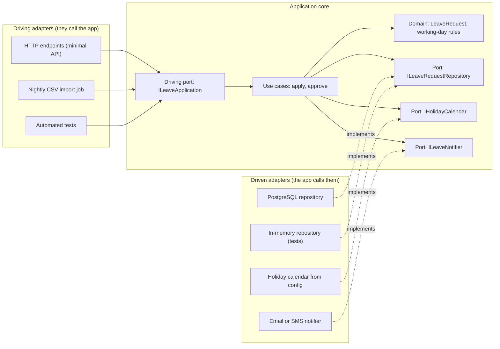
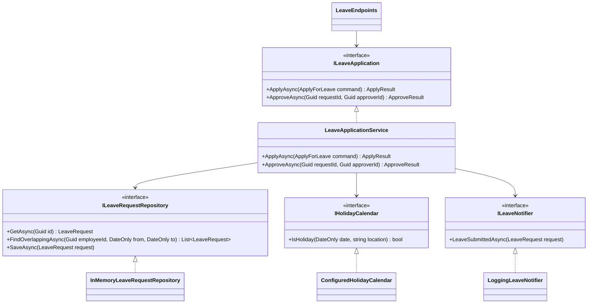
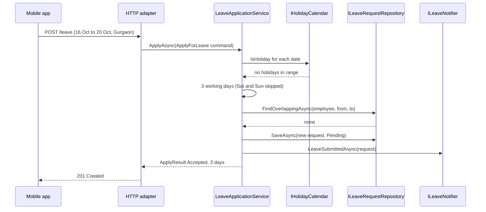
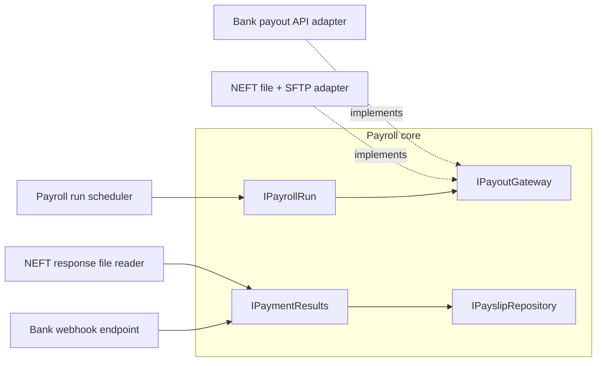

Hexagonal architecture, also called **ports and adapters**, was described by Alistair Cockburn in the mid-2000s. Its goal is simple: let an application be driven equally well by users, programs, automated tests or batch scripts, and let it be developed and tested in isolation from its databases and other external systems. In this lesson we build the leave module of an HR app as a hexagon, plug in HTTP, in-memory and logging adapters, and see why tests become fast and honest.

## Learning objectives

By the end of this lesson you will be able to:

1. Explain the hexagon: an application core surrounded by ports, with adapters on the outside.
2. Tell **driving** (primary) ports and adapters from **driven** (secondary) ones.
3. Design ports in the language of the business, owned by the core, not by the technology.
4. Implement a hexagonal leave module in ASP.NET Core, with a composition root in `Program.cs`.
5. Test the core through its driving port with in-memory driven adapters, and test adapters with shared contract tests.
6. Add a new adapter (a CSV import, a new database) without changing the core.
7. Judge when hexagonal architecture is worth it and when it is ceremony.

## Prerequisites

- [Layered architecture](#/lesson/m02-layered): hexagonal fixes a specific weakness of layers.
- [Dependency Inversion Principle](#/lesson/m04-dip): ports are DIP applied at the architecture level.
- [Dependency injection](#/lesson/m03-dependency-injection): adapters are wired in through the DI container.

## Explain it like I'm a beginner

Think of a laptop. Inside is the part that does the real work: the processor and memory. Around the edge are **ports**: USB-C, HDMI, a headphone jack. The laptop defines what each port expects, for example "USB-C, 20 volts, this pin layout". It doesn't care what you plug in.

Then there are **adapters** outside: a charger, a projector cable, a mouse, a pen drive, a test device in the factory. Each adapter fits a port on one side and some outside thing on the other side.

Two important points:

1. **The laptop decides the shape of its ports.** Projector makers build adapters to fit the laptop, not the other way round.
2. **You can swap adapters without opening the laptop.** Use a charger at home and a power bank on a train. The factory tests the laptop with special test adapters, before any real projector exists.

Hexagonal architecture applies this to software:

- The laptop's insides are the **application core**: business rules such as "leave can't overlap", "weekends and holidays don't count", "managers approve their own team's requests".
- The **ports** are interfaces the core defines: "something that stores leave requests", "something that knows public holidays", "something that notifies a manager".
- The **adapters** are outside: an ASP.NET Core endpoint, a PostgreSQL repository, an email sender, and, in tests, simple in-memory versions.

Some ports are for things that **use** the app (a user clicking "Apply", a nightly batch job). Others are for things the app **uses** (the database, email). Both kinds sit on the edge, and the core stays in the middle, not knowing whether it's talking to a real database or a test fake.

Why a hexagon? There is nothing special about six sides. Cockburn drew a hexagon so there was room to draw several ports and to break the habit of drawing apps as top-to-bottom layers with the database at the bottom.

## First-principles explanation

### What it is

An application built in the hexagonal style has three parts:

1. **The application core (inside)**: the domain model and the use cases. It has no references to web frameworks, ORMs, message brokers or SDKs.
2. **Ports (the boundary)**: interfaces owned by the core.
   - **Driving ports** (primary, inbound): what the outside world can ask the application to do, such as `ILeaveApplication.ApplyAsync(...)`. The core implements them.
   - **Driven ports** (secondary, outbound): what the application needs from the outside world, such as `ILeaveRequestRepository` and `IHolidayCalendar`. Adapters implement them.
3. **Adapters (outside)**: code that translates between a port and a specific technology.
   - **Driving adapters** call driving ports: an HTTP endpoint, a gRPC service, a CLI command, a message consumer, a test.
   - **Driven adapters** implement driven ports: a PostgreSQL repository, an SMTP or SMS notifier, an HTTP client for another service, an in-memory fake.

The **dependency rule** is that every source-code dependency points **inward**. Adapters depend on ports, and the core depends on nothing outside itself.

### Why it exists — the problem

In a classic layered app, the business layer calls the data layer directly:

```text
Controllers  ->  Services  ->  Repositories (EF Core)  ->  Database
```

That arrow from Services to EF Core repositories causes three problems:

1. **Business logic depends on infrastructure.** `LeaveService` references `HrDbContext`, so you can't compile, run or test it without EF Core and usually a database.
2. **Logic leaks into the edges.** The "weekends don't count" rule ends up half in the controller, half in a SQL query, and half in a stored procedure.
3. **The app has one way in.** Logic written inside controller actions can't be reused by a nightly import job or a message consumer without copying it.

Hexagonal architecture flips the arrow: the core declares `ILeaveRequestRepository`, and the EF Core class implements it. Now the core is a plain C# library that runs anywhere, including in a test, in milliseconds.

### How it works internally

There is no framework. It is interfaces plus dependency injection plus discipline:

1. **The core defines ports in business language.** `IHolidayCalendar.IsHoliday(DateOnly date, string location)` says what the core needs, not how to get it. Avoid ports shaped like technology (`IHolidayHttpClient`, `IDbConnection`).
2. **Use cases implement driving ports.** `LeaveApplicationService : ILeaveApplication` coordinates: load data through driven ports, ask domain objects to make decisions, save through driven ports.
3. **Adapters translate.** The HTTP adapter maps JSON to a command and results to status codes. The repository adapter maps entities to rows. Translation is all they do, so they stay thin.
4. **The composition root wires it.** `Program.cs` is the only place that knows which adapter implements which port: `services.AddScoped<ILeaveRequestRepository, PostgresLeaveRequestRepository>()`. Tests compose differently: in-memory adapters for everything.

In a .NET solution this often maps to projects:

```text
Leave.Core            (domain + use cases + port interfaces; no package references except abstractions)
Leave.Adapters.Http   (minimal API endpoints)          -> references Leave.Core
Leave.Adapters.Postgres (Npgsql/EF Core repository)    -> references Leave.Core
Leave.Adapters.Email  (SMTP or SMS notifier)           -> references Leave.Core
Leave.Host            (Program.cs, composition root)   -> references all of the above
Leave.Core.Tests      (use-case tests with in-memory adapters)
```

Because `Leave.Core` doesn't reference the adapter projects, the compiler itself enforces the inward dependency rule.

### What happens without it

Without ports, the database and frameworks shape the business logic. Tests need a database, so there are few of them and they're slow (a 200-test suite taking 4 minutes instead of 2 seconds). Switching from SMTP to an SMS gateway means editing business classes. Reusing a rule from a batch job means calling an HTTP endpoint on your own server, or copying code.

### When it is useful

- The business logic is **non-trivial** and worth protecting: rules, calculations, workflows.
- The app has **several ways in** (HTTP API, message consumer, scheduled job, CLI) or **several ways out** (database plus email plus external APIs).
- You want **fast, reliable tests** of business behaviour, independent of infrastructure.
- External systems are **likely to change**: a vendor SMS gateway, a government API, a database migration.

### When it is unnecessary

- **CRUD with little logic.** A form that saves 12 fields to a table gains nothing from ports. An endpoint plus EF Core is honest and short.
- **Very small or short-lived apps**, such as a one-off migration script or a prototype for a demo next week.
- **When the "core" would only forward calls.** If every use case is `return _repo.Get(id)`, you have built layers of indirection around nothing. Use hexagonal in the parts of a system that have real logic, and something simpler elsewhere.

### Trade-offs it introduces

| You gain | You pay |
|---|---|
| Core tests that need no database, network or web server | More interfaces and projects to navigate |
| Swap or add adapters without changing the core | Mapping code between domain objects and DTOs or rows |
| Business rules in one place, readable in business language | Discipline to keep ports business-shaped, not technology-shaped |
| Several driving adapters reuse the same use cases | Risk of "interface for everything", even where there is one implementation forever |
| Infrastructure decisions can be deferred | Some infrastructure features (transactions, database locks) need careful port design |

:::callout type=tradeoff title="Leaky ports"
A port named `ILeaveRequestRepository` that returns `IQueryable<LeaveRequestEntity>` has leaked EF Core into the core: every caller can now build SQL-shaped queries, and in-memory fakes behave differently from the database. Prefer specific methods (`FindOverlappingAsync(employeeId, from, to)`) that say what the core needs. They are also easier to implement in a test adapter.
:::

## Visual explanation

### The hexagon for the leave module



How to read it: on the left, three driving adapters (HTTP, a CSV import job and tests) all call the same driving port, `ILeaveApplication`. Inside the core, the use cases use the domain model and talk outward only through three driven ports. On the right, driven adapters **implement** those ports (dotted arrows). Notice that the dotted arrows point **from the adapters to the ports**: the PostgreSQL adapter depends on the core's interface, not the other way round. Two adapters implement the repository port, one for production and one for tests, and the core can't tell them apart.

### The port types in code



The class view shows the same structure precisely. `LeaveApplicationService` implements the driving port and depends only on the three driven-port interfaces. `LeaveEndpoints` (a driving adapter) depends on the driving port, not on the service class. Each driven adapter implements exactly one port.

### Applying for leave through the hexagon



The HTTP adapter turns JSON into an `ApplyForLeave` command and calls the driving port. The use case asks the calendar port about holidays, counts working days itself (16 October 2026 is a Friday, so Friday, Monday and Tuesday count, and the weekend doesn't), checks for overlaps through the repository port, saves, and notifies. The adapter turns the result into `201 Created`. In a test, the first participant is a test method instead of the mobile app, and the three driven participants are in-memory fakes, but the middle of the diagram is identical.

## Step-by-step example

### Step 1 — the starting point: logic in the controller

```csharp
[HttpPost("leave")]
public async Task<IActionResult> Apply(ApplyDto dto)
{
    var holidays = await _db.Holidays.Where(h => h.City == dto.City).Select(h => h.Date).ToListAsync();
    var days = 0;
    for (var d = dto.From; d <= dto.To; d = d.AddDays(1))
        if (d.DayOfWeek is not (DayOfWeek.Saturday or DayOfWeek.Sunday) && !holidays.Contains(d)) days++;
    if (await _db.LeaveRequests.AnyAsync(r => r.EmployeeId == dto.EmployeeId && r.From <= dto.To && r.To >= dto.From))
        return Conflict();
    _db.LeaveRequests.Add(new LeaveRequestEntity { /* ... */ Days = days });
    await _db.SaveChangesAsync();
    await new SmtpClient("mail.example.com").SendMailAsync(/* ... */);
    return Created(...);
}
```

Holiday logic, overlap logic, persistence and email are all in one action. Testing "weekends don't count" needs a database and an SMTP server, or a lot of mocking of EF Core.

### Step 2 — find what the app needs from outside

List the outside things the logic touches: holidays (data), existing requests (data), saving (data), email (notification). Each one becomes a **driven port**, named for what the core needs:

- `IHolidayCalendar.IsHoliday(date, location)`
- `ILeaveRequestRepository.FindOverlappingAsync(...)`, `SaveAsync(...)`
- `ILeaveNotifier.LeaveSubmittedAsync(...)`

### Step 3 — find what the outside asks the app to do

The controller wants "apply for leave" and "approve leave". That is the **driving port** `ILeaveApplication`, with command and result records that contain no HTTP types.

### Step 4 — move the logic into the core

Working-day counting goes into the domain. The use case coordinates the ports. Nothing in the core references ASP.NET Core or EF Core.

### Step 5 — write adapters and wire them

The controller becomes a thin HTTP adapter. EF Core code becomes a repository adapter. SMTP code becomes a notifier adapter. `Program.cs` registers them. Tests register in-memory adapters instead.

## Production-style C# implementation

All of the following compiles as one project for this lesson. Namespaces show which project each file would live in. The core namespaces (`Leave.Core.*`) use nothing from ASP.NET Core.

### The core: domain

```csharp file=Core/Domain/LeaveRequest.cs
namespace Leave.Core.Domain;

public enum LeaveStatus { Pending, Approved, Rejected }

public sealed class LeaveRequest
{
    public Guid Id { get; }
    public Guid EmployeeId { get; }
    public Guid ManagerId { get; }
    public DateOnly From { get; }
    public DateOnly To { get; }
    public int WorkingDays { get; }
    public LeaveStatus Status { get; private set; }

    public LeaveRequest(Guid id, Guid employeeId, Guid managerId, DateOnly from, DateOnly to, int workingDays, LeaveStatus status = LeaveStatus.Pending)
    {
        if (to < from) throw new ArgumentException("Leave cannot end before it starts.");
        if (workingDays <= 0) throw new ArgumentException("Leave must include at least one working day.");
        (Id, EmployeeId, ManagerId, From, To, WorkingDays, Status) = (id, employeeId, managerId, from, to, workingDays, status);
    }

    public bool Overlaps(DateOnly from, DateOnly to) => From <= to && To >= from;

    public void Approve(Guid approverId)
    {
        if (Status != LeaveStatus.Pending) throw new InvalidOperationException($"Cannot approve a {Status} request.");
        if (approverId != ManagerId) throw new UnauthorizedAccessException("Only the employee's manager can approve.");
        Status = LeaveStatus.Approved;
    }
}

/// <summary>Pure domain rule: weekends and holidays are not working days.</summary>
public static class WorkingDayRule
{
    public static int Count(DateOnly from, DateOnly to, Func<DateOnly, bool> isHoliday)
    {
        var days = 0;
        for (var d = from; d <= to; d = d.AddDays(1))
            if (d.DayOfWeek is not (DayOfWeek.Saturday or DayOfWeek.Sunday) && !isHoliday(d)) days++;
        return days;
    }
}
```

### The core: ports

```csharp file=Core/Ports/Ports.cs
using Leave.Core.Domain;

namespace Leave.Core.Ports;

// ---- Driving (primary) port: what the outside world can ask the application to do ----

public sealed record ApplyForLeave(Guid EmployeeId, Guid ManagerId, DateOnly From, DateOnly To, string Location);

public enum ApplyOutcome { Accepted, Overlap, NoWorkingDays, Invalid }

public sealed record ApplyResult(ApplyOutcome Outcome, Guid? RequestId, int WorkingDays, string? Message);

public enum ApproveOutcome { Approved, NotFound, NotAllowed, InvalidState }

public sealed record ApproveResult(ApproveOutcome Outcome, string? Message);

public interface ILeaveApplication
{
    Task<ApplyResult> ApplyAsync(ApplyForLeave command, CancellationToken ct);
    Task<ApproveResult> ApproveAsync(Guid requestId, Guid approverId, CancellationToken ct);
}

// ---- Driven (secondary) ports: what the application needs from the outside world ----

public interface ILeaveRequestRepository
{
    Task<LeaveRequest?> GetAsync(Guid id, CancellationToken ct);
    Task<IReadOnlyList<LeaveRequest>> FindOverlappingAsync(Guid employeeId, DateOnly from, DateOnly to, CancellationToken ct);
    Task SaveAsync(LeaveRequest request, CancellationToken ct);
}

public interface IHolidayCalendar
{
    bool IsHoliday(DateOnly date, string location);
}

public interface ILeaveNotifier
{
    Task LeaveSubmittedAsync(LeaveRequest request, CancellationToken ct);
    Task LeaveApprovedAsync(LeaveRequest request, CancellationToken ct);
}
```

The ports talk about leave, holidays and notifications. Nothing mentions SQL, HTTP, SMTP or JSON. That is what makes several very different adapters possible.

### The core: use cases

```csharp file=Core/Application/LeaveApplicationService.cs
using Leave.Core.Domain;
using Leave.Core.Ports;

namespace Leave.Core.Application;

public sealed class LeaveApplicationService(
    ILeaveRequestRepository requests,
    IHolidayCalendar calendar,
    ILeaveNotifier notifier) : ILeaveApplication
{
    public async Task<ApplyResult> ApplyAsync(ApplyForLeave command, CancellationToken ct)
    {
        if (command.To < command.From)
            return new(ApplyOutcome.Invalid, null, 0, "End date is before start date.");

        var days = WorkingDayRule.Count(command.From, command.To, d => calendar.IsHoliday(d, command.Location));
        if (days == 0)
            return new(ApplyOutcome.NoWorkingDays, null, 0, "The selected dates are all weekends or holidays.");

        var clashes = await requests.FindOverlappingAsync(command.EmployeeId, command.From, command.To, ct);
        if (clashes.Any(r => r.Status != LeaveStatus.Rejected))
            return new(ApplyOutcome.Overlap, null, days, "You already have leave in this period.");

        var request = new LeaveRequest(Guid.NewGuid(), command.EmployeeId, command.ManagerId, command.From, command.To, days);
        await requests.SaveAsync(request, ct);
        await notifier.LeaveSubmittedAsync(request, ct);
        return new(ApplyOutcome.Accepted, request.Id, days, null);
    }

    public async Task<ApproveResult> ApproveAsync(Guid requestId, Guid approverId, CancellationToken ct)
    {
        var request = await requests.GetAsync(requestId, ct);
        if (request is null) return new(ApproveOutcome.NotFound, "No such leave request.");
        try
        {
            request.Approve(approverId);
        }
        catch (UnauthorizedAccessException ex) { return new(ApproveOutcome.NotAllowed, ex.Message); }
        catch (InvalidOperationException ex) { return new(ApproveOutcome.InvalidState, ex.Message); }

        await requests.SaveAsync(request, ct);
        await notifier.LeaveApprovedAsync(request, ct);
        return new(ApproveOutcome.Approved, null);
    }
}
```

### Driven adapters

```csharp file=Adapters/Driven/DrivenAdapters.cs
using System.Collections.Concurrent;
using Leave.Core.Domain;
using Leave.Core.Ports;

namespace Leave.Adapters.Driven;

/// <summary>Used in tests and local development. Production uses a PostgreSQL adapter with the same port.</summary>
public sealed class InMemoryLeaveRequestRepository : ILeaveRequestRepository
{
    private readonly ConcurrentDictionary<Guid, LeaveRequest> _rows = new();

    public Task<LeaveRequest?> GetAsync(Guid id, CancellationToken ct) => Task.FromResult(_rows.GetValueOrDefault(id));

    public Task<IReadOnlyList<LeaveRequest>> FindOverlappingAsync(Guid employeeId, DateOnly from, DateOnly to, CancellationToken ct) =>
        Task.FromResult<IReadOnlyList<LeaveRequest>>(_rows.Values.Where(r => r.EmployeeId == employeeId && r.Overlaps(from, to)).ToList());

    public Task SaveAsync(LeaveRequest request, CancellationToken ct)
    {
        _rows[request.Id] = request;
        return Task.CompletedTask;
    }
}

public sealed class HolidayOptions
{
    /// <summary>Location -> dates. National holidays go under "*". Loaded from configuration managed by HR.</summary>
    public Dictionary<string, List<DateOnly>> Holidays { get; set; } = new(StringComparer.OrdinalIgnoreCase);
}

public sealed class ConfiguredHolidayCalendar(Microsoft.Extensions.Options.IOptions<HolidayOptions> options) : IHolidayCalendar
{
    private readonly HolidayOptions _o = options.Value;

    public bool IsHoliday(DateOnly date, string location) =>
        (_o.Holidays.TryGetValue("*", out var national) && national.Contains(date)) ||
        (_o.Holidays.TryGetValue(location, out var local) && local.Contains(date));
}

/// <summary>Stand-in for an email or SMS adapter. A real one would call SMTP or an SMS gateway's API.</summary>
public sealed class LoggingLeaveNotifier(ILogger<LoggingLeaveNotifier> logger) : ILeaveNotifier
{
    public Task LeaveSubmittedAsync(LeaveRequest request, CancellationToken ct)
    {
        logger.LogInformation("Notify manager {ManagerId}: leave {RequestId} for {Days} day(s) awaits approval",
            request.ManagerId, request.Id, request.WorkingDays);
        return Task.CompletedTask;
    }

    public Task LeaveApprovedAsync(LeaveRequest request, CancellationToken ct)
    {
        logger.LogInformation("Notify employee {EmployeeId}: leave {RequestId} approved", request.EmployeeId, request.Id);
        return Task.CompletedTask;
    }
}
```

A PostgreSQL adapter for the same port (shown as a sketch, because Npgsql is not available to the checker) keeps the SQL in the adapter, where it belongs:

```csharp
public sealed class PostgresLeaveRequestRepository(NpgsqlDataSource db) : ILeaveRequestRepository
{
    public async Task<IReadOnlyList<LeaveRequest>> FindOverlappingAsync(Guid employeeId, DateOnly from, DateOnly to, CancellationToken ct)
    {
        await using var cmd = db.CreateCommand("""
            SELECT id, employee_id, manager_id, from_date, to_date, working_days, status
            FROM leave.leave_request
            WHERE employee_id = $1 AND from_date <= $3 AND to_date >= $2
            """);
        cmd.Parameters.Add(new() { Value = employeeId });
        cmd.Parameters.Add(new() { Value = from });
        cmd.Parameters.Add(new() { Value = to });
        // ... map rows to LeaveRequest ...
    }
    // GetAsync and SaveAsync (INSERT ... ON CONFLICT (id) DO UPDATE) omitted
}
```

### Driving adapter: HTTP

```csharp file=Adapters/Driving/LeaveEndpoints.cs
using Leave.Core.Ports;

namespace Leave.Adapters.Driving;

public sealed record ApplyLeaveDto(Guid EmployeeId, Guid ManagerId, DateOnly From, DateOnly To, string Location);

/// <summary>HTTP driving adapter: JSON in, command to the driving port, status code out. No business rules here.</summary>
public static class LeaveEndpoints
{
    public static IEndpointRouteBuilder MapLeaveEndpoints(this IEndpointRouteBuilder app)
    {
        app.MapPost("/leave", async (ApplyLeaveDto dto, ILeaveApplication leave, CancellationToken ct) =>
        {
            var result = await leave.ApplyAsync(new ApplyForLeave(dto.EmployeeId, dto.ManagerId, dto.From, dto.To, dto.Location), ct);
            return result.Outcome switch
            {
                ApplyOutcome.Accepted => Results.Created($"/leave/{result.RequestId}", result),
                ApplyOutcome.Overlap => Results.Conflict(result),
                _ => Results.UnprocessableEntity(result),
            };
        });

        // Simplified for the lesson: in production, take the approver's id from the authenticated user's claims,
        // never from a query-string value the caller controls.
        app.MapPost("/leave/{id:guid}/approve", async (Guid id, Guid approverId, ILeaveApplication leave, CancellationToken ct) =>
        {
            var result = await leave.ApproveAsync(id, approverId, ct);
            return result.Outcome switch
            {
                ApproveOutcome.Approved => Results.NoContent(),
                ApproveOutcome.NotFound => Results.NotFound(result),
                ApproveOutcome.NotAllowed => Results.Problem(result.Message, statusCode: StatusCodes.Status403Forbidden),
                _ => Results.Conflict(result),
            };
        });
        return app;
    }
}
```

### The composition root

```csharp file=Program.cs
using Leave.Adapters.Driven;
using Leave.Adapters.Driving;
using Leave.Core.Application;
using Leave.Core.Ports;

var builder = WebApplication.CreateBuilder(args);

// Core: the driving port and its implementation.
builder.Services.AddScoped<ILeaveApplication, LeaveApplicationService>();

// Driven adapters: the only lines that change when infrastructure changes.
builder.Services.Configure<HolidayOptions>(builder.Configuration.GetSection("Leave"));
builder.Services.AddSingleton<IHolidayCalendar, ConfiguredHolidayCalendar>();
builder.Services.AddSingleton<ILeaveRequestRepository, InMemoryLeaveRequestRepository>();  // swap for PostgresLeaveRequestRepository
builder.Services.AddSingleton<ILeaveNotifier, LoggingLeaveNotifier>();                     // swap for an SMS or email adapter

var app = builder.Build();
app.MapLeaveEndpoints();   // driving adapter
app.Run();
```

With configuration such as `"Leave": { "Holidays": { "*": ["2026-01-26", "2026-08-15", "2026-10-02"], "Gurgaon": [] } }`, Republic Day, Independence Day and Gandhi Jayanti are national holidays. HR can add local holidays per location without a code change, and the core never learns where the data came from.

## Bad design vs good design

**Bad: hexagonal in name only.**

- `Leave.Core` has a package reference to EF Core because `ILeaveRequestRepository` returns `IQueryable<LeaveRequestEntity>`.
- The use case catches `NpgsqlException` and `SmtpException`.
- `ApplyForLeave` has an `IFormFile Attachment` property.
- There is a port `IHttpClientWrapper` with `GetAsync(string url)` that the core uses to call the holiday API.

Problems: technology leaks through every port, so the core can't be tested without infrastructure, and replacing any adapter still changes the core. The `IHttpClientWrapper` port is shaped like the technology, not the need, so a test adapter must pretend to be an HTTP server.

**Good: business-shaped ports.**

- Ports return domain objects or simple records: `FindOverlappingAsync` returns `IReadOnlyList<LeaveRequest>`.
- Adapters translate technology errors into port-level results or exceptions defined by the core (for example a `HolidayCalendarUnavailableException` declared next to the port).
- Commands carry plain values. File uploads are stored by an adapter, and the core gets a `DocumentId`.
- `IHolidayCalendar.IsHoliday(date, location)` expresses the need, and the HTTP details stay in the adapter.

**Is the improvement worth it?** For the leave module, which has real rules (working days, overlaps, approval authority), yes. For the "update my emergency contact" screen, no: a minimal API endpoint with EF Core directly is fine. Architecture is a per-area decision, not a religion.

:::callout type=mistake title="One interface per class, everywhere"
Hexagonal architecture asks for ports at the **boundary** between the core and the outside world. It doesn't ask for an interface in front of every class inside the core. `WorkingDayRule` is a pure function with no outside dependency, so it needs no interface. Test it directly.
:::

## Practical playground

The program wires the leave core twice: once with "production-like" adapters and once with test adapters that include a holiday on a working day. Run it, then add a new driven adapter, for example a notifier that collects messages in a list, and switch to it without touching `LeaveCore`.

:::playground type=csharp title="Swap adapters, keep the core"
```csharp file=Program.cs
using System;
using System.Collections.Generic;
using System.Linq;

public interface IHolidayCalendar { bool IsHoliday(DateOnly date); }
public interface INotifier { void Send(string message); }

// ---- Core: knows only its ports ----
public sealed class LeaveCore(IHolidayCalendar calendar, INotifier notifier)
{
    public int Apply(string employee, DateOnly from, DateOnly to)
    {
        var days = 0;
        for (var d = from; d <= to; d = d.AddDays(1))
            if (d.DayOfWeek is not (DayOfWeek.Saturday or DayOfWeek.Sunday) && !calendar.IsHoliday(d)) days++;
        notifier.Send($"{employee} applied for {days} working day(s) from {from:dd MMM} to {to:dd MMM}");
        return days;
    }
}

// ---- Adapters ----
public sealed class NationalHolidays : IHolidayCalendar
{
    private static readonly HashSet<DateOnly> Dates = new() { new(2026, 1, 26), new(2026, 8, 15), new(2026, 10, 2) };
    public bool IsHoliday(DateOnly date) => Dates.Contains(date);
}
public sealed class ConsoleNotifier : INotifier { public void Send(string message) => Console.WriteLine("[email] " + message); }
public sealed class FixedHolidays(params DateOnly[] dates) : IHolidayCalendar { public bool IsHoliday(DateOnly date) => dates.Contains(date); }

public static class Program
{
    public static void Main()
    {
        var from = new DateOnly(2026, 9, 28);   // Monday
        var to = new DateOnly(2026, 10, 4);     // Sunday; 2 Oct is Gandhi Jayanti (Friday)

        var production = new LeaveCore(new NationalHolidays(), new ConsoleNotifier());
        Console.WriteLine($"Production wiring: {production.Apply("Asha", from, to)} days");

        var test = new LeaveCore(new FixedHolidays(new DateOnly(2026, 9, 29), new DateOnly(2026, 10, 2)), new ConsoleNotifier());
        Console.WriteLine($"Test wiring:       {test.Apply("Asha", from, to)} days");
    }
}
```
:::

## Exercises

:::exercise id=m02-hexagonal-ex1 difficulty=beginner kind=code title="Count working days through a driven port"
Implement `WorkingDayCalculator.Count`. It uses the `IHolidayCalendar` driven port to skip holidays, and skips Saturdays and Sundays itself. Also implement the `FixedHolidayCalendar` test adapter.
::requirements
- `Count(from, to, location)` counts dates from `from` to `to` inclusive that are not Saturday, Sunday or a holiday at that location.
- If `to` is before `from`, throw `ArgumentException`.
- `FixedHolidayCalendar` takes a dictionary of location to dates. Dates under `"*"` apply everywhere.
::acceptance
- Monday 28 September 2026 to Sunday 4 October 2026 with 2 October as a national holiday gives 4.
- A Saturday-to-Sunday range gives 0.
- A local holiday only affects its own location.
- `to < from` throws.
::hint
Loop with `for (var d = from; d <= to; d = d.AddDays(1))`.
::hint
`d.DayOfWeek is DayOfWeek.Saturday or DayOfWeek.Sunday` checks the weekend in one pattern.
::hint
In the adapter, check the `"*"` list first, then the location's list, using `TryGetValue` for both.
::starter
```csharp file=WorkingDays.cs
using System;
using System.Collections.Generic;

namespace Leave.Core
{
    public interface IHolidayCalendar
    {
        bool IsHoliday(DateOnly date, string location);
    }

    public sealed class WorkingDayCalculator
    {
        private readonly IHolidayCalendar _calendar;
        public WorkingDayCalculator(IHolidayCalendar calendar) => _calendar = calendar;

        public int Count(DateOnly from, DateOnly to, string location) => throw new NotImplementedException();
    }
}

namespace Leave.Adapters
{
    using Leave.Core;

    public sealed class FixedHolidayCalendar : IHolidayCalendar
    {
        private readonly IReadOnlyDictionary<string, DateOnly[]> _byLocation;
        public FixedHolidayCalendar(IReadOnlyDictionary<string, DateOnly[]> byLocation) => _byLocation = byLocation;

        public bool IsHoliday(DateOnly date, string location) => throw new NotImplementedException();
    }
}
```
::tests
```csharp file=WorkingDaysTests.cs
using System;
using System.Collections.Generic;
using Leave.Adapters;
using Leave.Core;
using Xunit;

public class WorkingDaysTests
{
    private static WorkingDayCalculator Calc() => new(new FixedHolidayCalendar(new Dictionary<string, DateOnly[]>
    {
        ["*"] = new[] { new DateOnly(2026, 10, 2) },
        ["Kolkata"] = new[] { new DateOnly(2026, 10, 19) },
    }));

    [Fact]
    public void Week_with_national_holiday() =>
        Assert.Equal(4, Calc().Count(new DateOnly(2026, 9, 28), new DateOnly(2026, 10, 4), "Gurgaon"));

    [Fact]
    public void Weekend_only_is_zero() =>
        Assert.Equal(0, Calc().Count(new DateOnly(2026, 10, 17), new DateOnly(2026, 10, 18), "Gurgaon"));

    [Fact]
    public void Local_holiday_applies_only_to_its_location()
    {
        Assert.Equal(0, Calc().Count(new DateOnly(2026, 10, 19), new DateOnly(2026, 10, 19), "Kolkata"));
        Assert.Equal(1, Calc().Count(new DateOnly(2026, 10, 19), new DateOnly(2026, 10, 19), "Pune"));
    }

    [Fact]
    public void Reversed_range_throws() =>
        Assert.Throws<ArgumentException>(() => Calc().Count(new DateOnly(2026, 10, 5), new DateOnly(2026, 10, 1), "Pune"));
}
```
::solution
```csharp file=WorkingDays.cs
using System;
using System.Collections.Generic;

namespace Leave.Core
{
    public interface IHolidayCalendar
    {
        bool IsHoliday(DateOnly date, string location);
    }

    public sealed class WorkingDayCalculator
    {
        private readonly IHolidayCalendar _calendar;
        public WorkingDayCalculator(IHolidayCalendar calendar) => _calendar = calendar;

        public int Count(DateOnly from, DateOnly to, string location)
        {
            if (to < from) throw new ArgumentException("End date is before start date.", nameof(to));
            var days = 0;
            for (var d = from; d <= to; d = d.AddDays(1))
            {
                if (d.DayOfWeek is DayOfWeek.Saturday or DayOfWeek.Sunday) continue;
                if (_calendar.IsHoliday(d, location)) continue;
                days++;
            }
            return days;
        }
    }
}

namespace Leave.Adapters
{
    using Leave.Core;

    public sealed class FixedHolidayCalendar : IHolidayCalendar
    {
        private readonly IReadOnlyDictionary<string, DateOnly[]> _byLocation;
        public FixedHolidayCalendar(IReadOnlyDictionary<string, DateOnly[]> byLocation) => _byLocation = byLocation;

        public bool IsHoliday(DateOnly date, string location) =>
            (_byLocation.TryGetValue("*", out var all) && Array.IndexOf(all, date) >= 0) ||
            (_byLocation.TryGetValue(location, out var local) && Array.IndexOf(local, date) >= 0);
    }
}
```

The calculator is in the core and knows only the port. The same calculator works with a calendar loaded from configuration, a database table or a government holiday API. Only the adapter changes.
::mistakes
- Putting the weekend rule in the adapter. Which days are weekends is a business rule (some companies work on Saturdays), so it belongs in the core, possibly as configuration passed into it.
- Calling the calendar for weekend days too. It's harmless here, but wasteful if the adapter makes network calls.
:::

:::exercise id=m02-hexagonal-ex2 difficulty=beginner kind=written title="Label the ports and adapters"
An attendance module for a chain of schools works like this. Teachers mark class attendance in a **mobile app** that calls a **REST API**, and can excuse an absence when a parent sends a note. RFID card readers at the school gate push tap records to an **MQTT broker**, and a **consumer** reads them. Each night a **scheduled job** closes the day's attendance. The module stores data in **PostgreSQL**, sends an **SMS** to parents when a student is absent without an excuse, and asks the **Admissions service** (over HTTP) whether a student is enrolled in a class. A **test suite** checks the absence rules.

List the driving adapters, driven adapters, driving ports and driven ports you would design. Name each port in business language.
::acceptance
- At least three driving adapters and three driven adapters are identified correctly.
- Ports have business-shaped names, not technology-shaped ones.
- The test suite is recognised as a driving adapter.
::hint
Ask for each item: does it **call into** the module, or does the module **call out** to it?
::hint
The MQTT consumer receives messages, but what does it do with them? Which direction is that?
::hint
Name the port after the need ("check class enrolment"), not after the protocol ("Admissions HTTP client").
::solution
**Driving adapters** (they call the app): the REST API used by the mobile app, the MQTT gate-tap consumer (it receives taps and calls the app), the nightly scheduled job, and the test suite.

**Driving ports**: `IAttendanceMarking.MarkAsync(classId, studentId, date, status)`, `IGateTapIngestion.RecordTapAsync(readerId, studentId, timestamp, direction)`, `IDayClosing.CloseDayAsync(schoolId, date)`, and `IAbsenceExcusal.ExcuseAsync(studentId, date, reason)`.

**Driven ports** (the app needs them): `IAttendanceRepository`, `IParentNotifier.StudentAbsentAsync(studentId, date)`, `IClassRoster.IsEnrolledAsync(classId, studentId)`.

**Driven adapters**: a PostgreSQL repository, an SMS gateway notifier, and an HTTP client for the Admissions service implementing `IClassRoster`. Tests use in-memory versions of all three.

Note that the MQTT consumer is *driving*, even though it "consumes": direction is about who initiates a call into the application core.
:::

:::exercise id=m02-hexagonal-ex3 difficulty=intermediate kind=code title="Prove two adapters honour the same port"
Fakes are only useful if they behave like the real thing. Write a second adapter for the repository port, `JsonFileRepository`, that stores requests in a JSON file, and make it pass the **same contract tests** as the in-memory adapter. The contract tests live in an abstract base class that each adapter's test class inherits.
::requirements
- `JsonFileRepository(string path)` reads the file on every call and writes the whole file on save, creating it if it doesn't exist.
- `Save` inserts or replaces by `Id`.
- `Get` returns `null` for an unknown id.
- `FindOverlapping(employeeId, from, to)` returns that employee's requests whose dates overlap the range (inclusive), ordered by `From`.
- Both adapters must pass every test in `LeaveRepositoryContract`.
::acceptance
- All contract tests pass for `InMemoryRepository` and for `JsonFileRepository`.
- The JSON adapter's test class deletes its temporary file when disposed.
- No test is written twice: the contract is defined once.
::hint
Use `System.Text.Json` with a small serialisable record (`StoredRequest`) that mirrors `LeaveRequest`. Records with `DateOnly` and `Guid` serialise fine.
::hint
`File.Exists(path) ? JsonSerializer.Deserialize<List<StoredRequest>>(File.ReadAllText(path)) : new()` loads safely.
::hint
For save: load the list, `RemoveAll(r => r.Id == request.Id)`, add, write back.
::hint
Overlap of two inclusive ranges: `r.From <= to && r.To >= from`.
::starter
```csharp file=Repositories.cs
using System;
using System.Collections.Generic;
using System.IO;
using System.Linq;
using System.Text.Json;

namespace Leave.Core
{
    public sealed record LeaveRequest(Guid Id, Guid EmployeeId, DateOnly From, DateOnly To, string Status);

    public interface ILeaveRequestRepository
    {
        LeaveRequest? Get(Guid id);
        IReadOnlyList<LeaveRequest> FindOverlapping(Guid employeeId, DateOnly from, DateOnly to);
        void Save(LeaveRequest request);
    }
}

namespace Leave.Adapters
{
    using Leave.Core;

    public sealed class InMemoryRepository : ILeaveRequestRepository
    {
        private readonly Dictionary<Guid, LeaveRequest> _rows = new();
        public LeaveRequest? Get(Guid id) => _rows.TryGetValue(id, out var r) ? r : null;
        public IReadOnlyList<LeaveRequest> FindOverlapping(Guid employeeId, DateOnly from, DateOnly to) =>
            _rows.Values.Where(r => r.EmployeeId == employeeId && r.From <= to && r.To >= from).OrderBy(r => r.From).ToList();
        public void Save(LeaveRequest request) => _rows[request.Id] = request;
    }

    public sealed class JsonFileRepository : ILeaveRequestRepository
    {
        private readonly string _path;
        public JsonFileRepository(string path) => _path = path;

        public LeaveRequest? Get(Guid id) => throw new NotImplementedException();
        public IReadOnlyList<LeaveRequest> FindOverlapping(Guid employeeId, DateOnly from, DateOnly to) => throw new NotImplementedException();
        public void Save(LeaveRequest request) => throw new NotImplementedException();
    }
}
```
::tests
```csharp file=RepositoryContractTests.cs
using System;
using System.IO;
using System.Linq;
using Leave.Adapters;
using Leave.Core;
using Xunit;

public abstract class LeaveRepositoryContract
{
    protected abstract ILeaveRequestRepository Sut { get; }

    private static readonly Guid Asha = Guid.Parse("00000000-0000-0000-0000-000000000001");
    private static readonly Guid Ravi = Guid.Parse("00000000-0000-0000-0000-000000000002");

    private static LeaveRequest Req(Guid emp, int fromDay, int toDay, string status = "Pending") =>
        new(Guid.NewGuid(), emp, new DateOnly(2026, 10, fromDay), new DateOnly(2026, 10, toDay), status);

    [Fact]
    public void Unknown_id_returns_null() => Assert.Null(Sut.Get(Guid.NewGuid()));

    [Fact]
    public void Saved_request_can_be_read_back()
    {
        var r = Req(Asha, 5, 7);
        Sut.Save(r);
        Assert.Equal(r, Sut.Get(r.Id));
    }

    [Fact]
    public void Save_replaces_by_id()
    {
        var r = Req(Asha, 5, 7);
        Sut.Save(r);
        Sut.Save(r with { Status = "Approved" });
        Assert.Equal("Approved", Sut.Get(r.Id)!.Status);
        Assert.Single(Sut.FindOverlapping(Asha, new DateOnly(2026, 10, 1), new DateOnly(2026, 10, 31)));
    }

    [Fact]
    public void Overlap_is_inclusive_and_per_employee_and_ordered()
    {
        Sut.Save(Req(Asha, 20, 22));
        Sut.Save(Req(Asha, 5, 7));
        Sut.Save(Req(Asha, 10, 12));
        Sut.Save(Req(Ravi, 6, 6));
        var found = Sut.FindOverlapping(Asha, new DateOnly(2026, 10, 7), new DateOnly(2026, 10, 20));
        Assert.Equal(new[] { 5, 10, 20 }, found.Select(r => r.From.Day).ToArray());
    }

    [Fact]
    public void Non_overlapping_ranges_are_excluded() =>
        Assert.Empty(Sut.FindOverlapping(Ravi, new DateOnly(2026, 11, 1), new DateOnly(2026, 11, 5)));
}

public sealed class InMemoryRepositoryContractTests : LeaveRepositoryContract
{
    private readonly InMemoryRepository _sut = new();
    protected override ILeaveRequestRepository Sut => _sut;
}

public sealed class JsonFileRepositoryContractTests : LeaveRepositoryContract, IDisposable
{
    private readonly string _path = Path.Combine(Path.GetTempPath(), $"leave-{Guid.NewGuid():N}.json");
    private readonly JsonFileRepository _sut;
    public JsonFileRepositoryContractTests() => _sut = new JsonFileRepository(_path);
    protected override ILeaveRequestRepository Sut => _sut;
    public void Dispose() { if (File.Exists(_path)) File.Delete(_path); }
}
```
::solution
```csharp file=Repositories.cs
using System;
using System.Collections.Generic;
using System.IO;
using System.Linq;
using System.Text.Json;

namespace Leave.Core
{
    public sealed record LeaveRequest(Guid Id, Guid EmployeeId, DateOnly From, DateOnly To, string Status);

    public interface ILeaveRequestRepository
    {
        LeaveRequest? Get(Guid id);
        IReadOnlyList<LeaveRequest> FindOverlapping(Guid employeeId, DateOnly from, DateOnly to);
        void Save(LeaveRequest request);
    }
}

namespace Leave.Adapters
{
    using Leave.Core;

    public sealed class InMemoryRepository : ILeaveRequestRepository
    {
        private readonly Dictionary<Guid, LeaveRequest> _rows = new();
        public LeaveRequest? Get(Guid id) => _rows.TryGetValue(id, out var r) ? r : null;
        public IReadOnlyList<LeaveRequest> FindOverlapping(Guid employeeId, DateOnly from, DateOnly to) =>
            _rows.Values.Where(r => r.EmployeeId == employeeId && r.From <= to && r.To >= from).OrderBy(r => r.From).ToList();
        public void Save(LeaveRequest request) => _rows[request.Id] = request;
    }

    public sealed class JsonFileRepository : ILeaveRequestRepository
    {
        private static readonly JsonSerializerOptions Json = new(JsonSerializerDefaults.Web) { WriteIndented = true };
        private readonly string _path;
        public JsonFileRepository(string path) => _path = path;

        private List<LeaveRequest> Load() =>
            File.Exists(_path)
                ? JsonSerializer.Deserialize<List<LeaveRequest>>(File.ReadAllText(_path), Json) ?? new()
                : new();

        private void Store(List<LeaveRequest> rows)
        {
            var temp = _path + ".tmp";
            File.WriteAllText(temp, JsonSerializer.Serialize(rows, Json));
            File.Move(temp, _path, overwrite: true);   // replace in one step, so a crash never leaves half a file
        }

        public LeaveRequest? Get(Guid id) => Load().FirstOrDefault(r => r.Id == id);

        public IReadOnlyList<LeaveRequest> FindOverlapping(Guid employeeId, DateOnly from, DateOnly to) =>
            Load().Where(r => r.EmployeeId == employeeId && r.From <= to && r.To >= from).OrderBy(r => r.From).ToList();

        public void Save(LeaveRequest request)
        {
            var rows = Load();
            rows.RemoveAll(r => r.Id == request.Id);
            rows.Add(request);
            Store(rows);
        }
    }
}
```

The abstract contract class is the most valuable idea here. The in-memory adapter that all your use-case tests rely on is now **proven** to behave like the real adapter on the behaviours the core depends on (insert or replace, inclusive overlap, ordering). In a real project, the PostgreSQL adapter's test class inherits the same contract and runs against a test database.
::mistakes
- Writing separate, slightly different tests for each adapter, so the fake drifts from the real behaviour.
- Overlap with exclusive bounds in one adapter and inclusive in the other: the contract test catches exactly this.
- Writing the file in place, so a crash mid-write corrupts it. Write to a temporary file and move it.
:::

:::exercise id=m02-hexagonal-ex4 difficulty=intermediate kind=design title="A payroll hexagon with two bank adapters"
Payroll must pay salaries. Today the bank accepts a **NEFT bulk file** uploaded over SFTP once a day. Next quarter the company moves to the bank's **payout API**, which pays each employee individually and calls back a webhook with the result. Design the payroll core's ports and the adapters for both banking options so the move needs no change to the core.
::acceptance
- A driving port for running payroll and a driving port (or adapter) for receiving payment results.
- One driven port for payouts, shaped by the business need, which both bank adapters can implement.
- An explanation of how the asynchronous result (webhook or bank response file) re-enters the core.
- A class or component diagram.
::hint
What does the core really need: "send this file", or "pay these people these amounts and tell me what happened"?
::hint
Both banks are asynchronous in the end. The file is processed later, and the API calls back. Design the port as "submit a batch" plus a separate driving port for "a payment settled".
::hint
`IPayoutGateway.SubmitAsync(PayoutBatch batch)` returns a batch reference. `IPaymentResults.RecordAsync(paymentId, status, bankReference)` is the driving port that both the webhook adapter and the response-file reader call.
::solution
**Ports**

- Driving: `IPayrollRun.RunAsync(month)` computes payslips and submits payouts. `IPaymentResults.RecordAsync(paymentId, PaymentStatus, bankReference)` records a settled or failed payment.
- Driven: `IPayoutGateway.SubmitAsync(PayoutBatch batch)` returns a `BatchReference`. `IPayslipRepository`, `IEmployeeBankDetails` (masked account plus IFSC).

**Adapters**

- `NeftFilePayoutGateway` (driven): builds the bank's fixed-format file and uploads it over SFTP.
- `BankApiPayoutGateway` (driven): calls the payout API once per payment with an idempotency key (the payment id), so retries never pay twice.
- `NeftResponseFileReader` (driving, scheduled): reads the bank's response file and calls `IPaymentResults`.
- `BankWebhookEndpoint` (driving, HTTP): verifies the bank's signature and calls `IPaymentResults`.



Switching banks changes only the composition root: register `BankApiPayoutGateway` instead of `NeftFilePayoutGateway`, and enable the webhook endpoint. The core's rules (net pay, which payments to retry, when a month is "fully paid") don't change.
::alternatives
If the two banks differ a lot (per-payment versus batch), a port per payment (`PayAsync(Payment)`) can be simpler, with the NEFT adapter collecting payments into a file internally. Choose the shape the business thinks in.
::mistakes
- A port called `ISftpUploader`: it describes the technology, and the API bank can't implement it sensibly.
- Letting the webhook controller update payslip rows directly, which bypasses the core's rules.
:::

:::exercise id=m02-hexagonal-ex5 difficulty=advanced kind=code title="Add a CSV import driving adapter"
HR wants to upload a CSV of leave taken during a system outage. Write `LeaveCsvImporter`, a new **driving adapter** that parses lines and calls the existing driving port `ILeaveApplication`. The core must not change.
::requirements
- The input is text with a header line `employeeId,managerId,from,to,location`, then one request per line. Dates use `yyyy-MM-dd`.
- Blank lines are skipped and not counted.
- Malformed lines (wrong column count, bad GUID, bad date) are reported as failed **without** calling the core.
- For valid lines, call `ApplyAsync`. The line succeeds only if the outcome is `Accepted`. Otherwise report the outcome and message.
- Return an `ImportReport` with one `LineResult(lineNumber, success, message)` per data line. Line numbers are 1-based and count the header as line 1.
- Lines are processed in order, one at a time, so overlaps within the file are detected by the core.
::acceptance
- A file with 3 valid lines and 1 malformed line gives 3 calls to the core and 4 results.
- A line rejected by the core (overlap) is reported with the core's message.
- The header is not sent to the core.
- Line numbers match the file.
::hint
Split on `'\n'`, trim `'\r'`, and keep the index so you can compute line numbers.
::hint
Parse into a command in a helper that returns `bool` and an error message, using `Guid.TryParse` and `DateOnly.TryParseExact`.
::hint
Await each `ApplyAsync` before moving on. Parallel calls could let two overlapping requests both pass the overlap check.
::hint
Use a fake `ILeaveApplication` in tests that records commands and returns `Overlap` for a chosen employee.
::starter
```csharp file=LeaveCsvImporter.cs
using System;
using System.Collections.Generic;
using System.Globalization;
using System.Threading;
using System.Threading.Tasks;

namespace Leave.Core.Ports
{
    public sealed record ApplyForLeave(Guid EmployeeId, Guid ManagerId, DateOnly From, DateOnly To, string Location);
    public enum ApplyOutcome { Accepted, Overlap, NoWorkingDays, Invalid }
    public sealed record ApplyResult(ApplyOutcome Outcome, Guid? RequestId, int WorkingDays, string? Message);

    public interface ILeaveApplication
    {
        Task<ApplyResult> ApplyAsync(ApplyForLeave command, CancellationToken ct);
    }
}

namespace Leave.Adapters.Driving
{
    using Leave.Core.Ports;

    public sealed record LineResult(int LineNumber, bool Success, string Message);
    public sealed record ImportReport(IReadOnlyList<LineResult> Lines);

    public sealed class LeaveCsvImporter
    {
        private readonly ILeaveApplication _leave;
        public LeaveCsvImporter(ILeaveApplication leave) => _leave = leave;

        public Task<ImportReport> ImportAsync(string csv, CancellationToken ct) => throw new NotImplementedException();
    }
}
```
::tests
```csharp file=LeaveCsvImporterTests.cs
using System;
using System.Collections.Generic;
using System.Linq;
using System.Threading;
using System.Threading.Tasks;
using Leave.Adapters.Driving;
using Leave.Core.Ports;
using Xunit;

public class LeaveCsvImporterTests
{
    private static readonly Guid Asha = Guid.Parse("11111111-1111-1111-1111-111111111111");
    private static readonly Guid Ravi = Guid.Parse("22222222-2222-2222-2222-222222222222");
    private static readonly Guid Boss = Guid.Parse("99999999-9999-9999-9999-999999999999");

    private sealed class FakeLeave : ILeaveApplication
    {
        public readonly List<ApplyForLeave> Calls = new();
        public Guid RejectAsOverlap = Guid.Empty;
        public Task<ApplyResult> ApplyAsync(ApplyForLeave command, CancellationToken ct)
        {
            Calls.Add(command);
            return Task.FromResult(command.EmployeeId == RejectAsOverlap
                ? new ApplyResult(ApplyOutcome.Overlap, null, 0, "You already have leave in this period.")
                : new ApplyResult(ApplyOutcome.Accepted, Guid.NewGuid(), 2, null));
        }
    }

    private static string Csv(params string[] lines) => string.Join("\r\n", new[] { "employeeId,managerId,from,to,location" }.Concat(lines));

    [Fact]
    public async Task Valid_and_malformed_lines()
    {
        var fake = new FakeLeave();
        var report = await new LeaveCsvImporter(fake).ImportAsync(Csv(
            $"{Asha},{Boss},2026-10-05,2026-10-06,Gurgaon",
            $"{Ravi},{Boss},2026-10-07,2026-10-07,Pune",
            "not-a-guid,x,2026-10-07,2026-10-07,Pune",
            $"{Ravi},{Boss},2026-10-12,2026-10-13,Pune"), CancellationToken.None);

        Assert.Equal(3, fake.Calls.Count);
        Assert.Equal(4, report.Lines.Count);
        Assert.Equal(new[] { 2, 3, 4, 5 }, report.Lines.Select(l => l.LineNumber).ToArray());
        Assert.False(report.Lines[2].Success);
        Assert.True(report.Lines[0].Success);
    }

    [Fact]
    public async Task Core_rejection_is_reported_with_message()
    {
        var fake = new FakeLeave { RejectAsOverlap = Asha };
        var report = await new LeaveCsvImporter(fake).ImportAsync(Csv($"{Asha},{Boss},2026-10-05,2026-10-06,Gurgaon"), CancellationToken.None);
        var line = Assert.Single(report.Lines);
        Assert.False(line.Success);
        Assert.Contains("already have leave", line.Message);
    }

    [Fact]
    public async Task Bad_date_and_wrong_column_count_do_not_reach_core()
    {
        var fake = new FakeLeave();
        var report = await new LeaveCsvImporter(fake).ImportAsync(Csv(
            $"{Asha},{Boss},05-10-2026,2026-10-06,Gurgaon",
            $"{Asha},{Boss},2026-10-05"), CancellationToken.None);
        Assert.Empty(fake.Calls);
        Assert.All(report.Lines, l => Assert.False(l.Success));
    }

    [Fact]
    public async Task Blank_lines_are_skipped_and_numbers_still_match()
    {
        var fake = new FakeLeave();
        var report = await new LeaveCsvImporter(fake).ImportAsync(Csv("", $"{Asha},{Boss},2026-10-05,2026-10-06,Gurgaon", ""), CancellationToken.None);
        var line = Assert.Single(report.Lines);
        Assert.Equal(3, line.LineNumber);
        Assert.Equal("Gurgaon", fake.Calls[0].Location);
    }
}
```
::solution
```csharp file=LeaveCsvImporter.cs
using System;
using System.Collections.Generic;
using System.Globalization;
using System.Threading;
using System.Threading.Tasks;

namespace Leave.Core.Ports
{
    public sealed record ApplyForLeave(Guid EmployeeId, Guid ManagerId, DateOnly From, DateOnly To, string Location);
    public enum ApplyOutcome { Accepted, Overlap, NoWorkingDays, Invalid }
    public sealed record ApplyResult(ApplyOutcome Outcome, Guid? RequestId, int WorkingDays, string? Message);

    public interface ILeaveApplication
    {
        Task<ApplyResult> ApplyAsync(ApplyForLeave command, CancellationToken ct);
    }
}

namespace Leave.Adapters.Driving
{
    using Leave.Core.Ports;

    public sealed record LineResult(int LineNumber, bool Success, string Message);
    public sealed record ImportReport(IReadOnlyList<LineResult> Lines);

    public sealed class LeaveCsvImporter
    {
        private readonly ILeaveApplication _leave;
        public LeaveCsvImporter(ILeaveApplication leave) => _leave = leave;

        public async Task<ImportReport> ImportAsync(string csv, CancellationToken ct)
        {
            var results = new List<LineResult>();
            var lines = csv.Split('\n');
            for (var i = 1; i < lines.Length; i++)          // i = 0 is the header
            {
                var text = lines[i].TrimEnd('\r');
                if (string.IsNullOrWhiteSpace(text)) continue;
                var lineNumber = i + 1;

                if (!TryParse(text, out var command, out var error))
                {
                    results.Add(new LineResult(lineNumber, false, error));
                    continue;
                }

                var outcome = await _leave.ApplyAsync(command!, ct);   // sequential on purpose
                results.Add(outcome.Outcome == ApplyOutcome.Accepted
                    ? new LineResult(lineNumber, true, $"Accepted ({outcome.WorkingDays} working days)")
                    : new LineResult(lineNumber, false, $"{outcome.Outcome}: {outcome.Message}"));
            }
            return new ImportReport(results);
        }

        private static bool TryParse(string line, out ApplyForLeave? command, out string error)
        {
            command = null;
            var f = line.Split(',');
            if (f.Length != 5) { error = $"Expected 5 columns, found {f.Length}."; return false; }
            if (!Guid.TryParse(f[0].Trim(), out var employee)) { error = "Bad employeeId."; return false; }
            if (!Guid.TryParse(f[1].Trim(), out var manager)) { error = "Bad managerId."; return false; }
            if (!DateOnly.TryParseExact(f[2].Trim(), "yyyy-MM-dd", CultureInfo.InvariantCulture, DateTimeStyles.None, out var from))
            { error = "Bad 'from' date, expected yyyy-MM-dd."; return false; }
            if (!DateOnly.TryParseExact(f[3].Trim(), "yyyy-MM-dd", CultureInfo.InvariantCulture, DateTimeStyles.None, out var to))
            { error = "Bad 'to' date, expected yyyy-MM-dd."; return false; }

            command = new ApplyForLeave(employee, manager, from, to, f[4].Trim());
            error = "";
            return true;
        }
    }
}
```

The importer only translates CSV into commands and outcomes into a report. Every rule (working days, overlaps, approval) is still in the core, so a request imported from a file is treated exactly like one from the mobile app. That is the promise of the driving side of the hexagon: **new ways in, same behaviour**.
::alternatives
For large files (100,000 lines), stream the input with a `StreamReader` instead of loading it into a string, and write results as you go. Keep processing sequential per employee, but different employees could run in parallel.
::mistakes
- Re-implementing the overlap check in the importer "to fail fast", which duplicates a core rule that will drift.
- Calling the repository directly from the importer to save rows faster, which bypasses the core entirely.
- Stopping at the first bad line, so HR has to upload the file many times.
:::

## Automated testing

The hexagon gives you a clear test plan.

**1. Use-case tests through the driving port, with in-memory driven adapters.** These are the bulk of your tests: fast, deterministic and written in business language.

```csharp
public class ApplyForLeaveTests
{
    private readonly InMemoryLeaveRequestRepository _repo = new();
    private readonly RecordingNotifier _notifier = new();

    private ILeaveApplication Sut(params DateOnly[] holidays) =>
        new LeaveApplicationService(_repo, new FixedCalendar(holidays), _notifier);

    [Fact]
    public async Task Overlapping_request_is_rejected()
    {
        var emp = Guid.NewGuid();
        var mgr = Guid.NewGuid();
        var app = Sut();
        await app.ApplyAsync(new ApplyForLeave(emp, mgr, new(2026, 10, 12), new(2026, 10, 14), "Pune"), CancellationToken.None);

        var second = await app.ApplyAsync(new ApplyForLeave(emp, mgr, new(2026, 10, 14), new(2026, 10, 16), "Pune"), CancellationToken.None);

        Assert.Equal(ApplyOutcome.Overlap, second.Outcome);
        Assert.Single(_notifier.Submitted);
    }
}
```

`RecordingNotifier` and `FixedCalendar` are tiny hand-written adapters. There's no mocking library and no database, and hundreds of these tests run in about a second.

**2. Adapter contract tests.** One abstract test class per driven port, inherited by each adapter's test class (exercise 3). The PostgreSQL adapter's tests run against a real database, for example a container started for the test run. This proves the fakes are honest.

**3. Driving adapter tests.** Test the HTTP adapter's mapping (status codes, validation, JSON shape) with `WebApplicationFactory<Program>` and a fake `ILeaveApplication` registered in place of the real one. These tests check translation, not business rules.

**4. A few end-to-end tests.** Run the real composition (HTTP plus PostgreSQL) for the critical journeys only.

A useful health metric: if most of your tests need a database to run, the hexagon has leaked.

## Real-world application

- **Payment and banking integrations.** Payment providers, bank file formats and SMS gateways change often. Teams that keep them behind business-shaped ports (`IPayoutGateway`, `IOtpSender`) can switch providers, or run two in parallel during a migration, without touching core rules.
- **Government and regulatory APIs.** E-invoicing, GST or statutory filing portals change formats and endpoints. An adapter per external API isolates those changes, and the core rules (what must be filed when) stay stable and tested.
- **Insurance claims systems.** A claims core can be driven by a web portal, a mobile app where customers photograph damage while offline, and a nightly file import from partner hospitals and garages, all through the same driving ports. It can store data in PostgreSQL today and push to an ERP tomorrow through a driven adapter.
- **ASP.NET Core itself.** The framework is built around abstractions such as `ILogger`, `IDistributedCache`, `IOptions<T>` and `TimeProvider`, with swappable implementations. It isn't a hexagon in the strict sense, but it shows the same idea: depend on the need, plug in the technology.
- **Related styles.** [Clean Architecture and Onion Architecture](#/lesson/m02-clean-onion) build on the same inward-dependency idea and add more explicit rings for entities and use cases.

## Interview questions

:::interview
::q beginner
What is hexagonal architecture?
::a
An architecture where the application core (domain logic and use cases) sits in the middle and talks to the outside world only through interfaces it defines, called ports. Technology-specific adapters, such as HTTP endpoints, database repositories and email senders, plug into those ports from the outside. All dependencies point inward, so the core can be developed and tested without any infrastructure.
::q beginner
What is the difference between a driving and a driven port?
::a
A driving (primary) port is what the outside world can ask the application to do, such as `ApplyForLeave`. Driving adapters (HTTP endpoints, message consumers, CLI tools, tests) call it, and the core implements it. A driven (secondary) port is what the application needs from the outside, such as storing requests or sending notifications. The core calls it, and driven adapters (PostgreSQL repository, SMS sender, in-memory fake) implement it.
::q intermediate
How does hexagonal architecture make testing easier?
::a
Because the core depends only on port interfaces, tests can call the driving port and plug in simple in-memory driven adapters. Business behaviour is then tested in milliseconds with no database, network or web server, and the tests read like business scenarios. Contract tests shared between the in-memory and real adapters ensure the fakes behave like production. A few integration tests then check the real adapters and wiring.
::q intermediate
How is hexagonal architecture different from layered architecture?
::a
In a classic layered app, dependencies go top to bottom: UI → business → data access, so business logic depends on the data layer. In hexagonal, the business core is in the centre and the database is just another adapter on the outside, implementing an interface the core owns. That inversion (DIP at the architecture level) removes infrastructure from the core. Hexagonal also treats all inputs (UI, tests, batch jobs, consumers) symmetrically, while layers usually assume one UI on top.
::q advanced
How do you handle transactions in a hexagonal architecture when a use case must save to two repositories atomically?
::a
Options: (1) Design the aggregate so one use case saves one aggregate, which usually means one repository call, keeping the transaction inside one adapter. (2) Add a driven port such as `IUnitOfWork` with `CommitAsync`, implemented by the database adapter (for example around one `DbContext` or one `NpgsqlTransaction`) and by a trivial in-memory version in tests. (3) Wrap the use case in a transaction from the driving adapter or a decorator, keeping transaction mechanics out of the core. Avoid passing `DbTransaction` objects through ports. For changes that span services, use an outbox and eventual consistency instead.
::q advanced
When would you advise against hexagonal architecture?
::a
For CRUD-heavy areas with little logic, where every use case would just forward to a repository; for prototypes and short-lived tools; and for teams that would add interfaces mechanically without understanding why, creating indirection without benefit. Apply it where the business logic is valuable and where infrastructure is likely to change or has several variants. A system can mix styles: a hexagonal leave and payroll core alongside simple minimal-API CRUD endpoints for reference data.
:::

## Summary and revision

**Key takeaways**

- Hexagonal architecture puts the business core in the middle and everything else outside, connected through ports.
- Driving ports are how the world uses the app. Driven ports are what the app needs from the world.
- Ports belong to the core and speak business language. Adapters translate to and from technology.
- All dependencies point inward. `Program.cs` (the composition root) chooses the adapters.
- Most tests go through the driving port with in-memory adapters. Contract tests keep those fakes honest.
- Use it where the logic is worth protecting, not for simple CRUD.

**Terminology**: application core, port, adapter, driving (primary) port, driven (secondary) port, composition root, test double, contract test, dependency inversion.

:::flashcards
Q: Another name for hexagonal architecture?
A: Ports and adapters.
Q: Who owns a port's interface?
A: The application core. Adapters depend on it, not the other way round.
Q: Is a test suite a driving or a driven adapter?
A: Driving. It calls the application through its driving ports.
Q: Is a message consumer a driving or driven adapter?
A: Driving. It receives messages and calls into the core.
Q: Why avoid a port that returns IQueryable?
A: It leaks the ORM into the core, and fakes behave differently from the database.
Q: What is an adapter contract test?
A: One set of tests, defined once, that every adapter of a port must pass, real and fake alike.
Q: Where are adapters chosen?
A: In the composition root, typically Program.cs, through DI registrations.
Q: Main sign the hexagon has leaked?
A: Core tests need a database, web server or network to run.
:::

## Knowledge check

:::quiz pass=70
::q single
The leave core needs to know public holidays. Which port design is best?
- [ ] `IHolidayHttpClient.GetAsync(string url)`
- [x] `IHolidayCalendar.IsHoliday(DateOnly date, string location)`
- [ ] `IDbConnection` passed into the use case.
- [ ] A static `HolidayService.Load()` method.
> Ports describe the core's need in business language. The HTTP or database details belong to an adapter.
::q single
A Kafka consumer reads `TimesheetSubmitted` events and calls `ITimesheetApproval.ApproveAsync`. In hexagonal terms, the consumer is a...
- [x] Driving adapter.
- [ ] Driven adapter.
- [ ] Driven port.
- [ ] Domain entity.
> It initiates a call into the core through a driving port, so it is a driving adapter, even though it "consumes" messages.
::q multi
Which are signs that a hexagonal design has leaked? (Select all that apply.)
- [x] The core project references EF Core.
- [x] Use-case tests need a running PostgreSQL instance.
- [ ] There are two adapters for the same driven port.
- [x] A port method takes an `HttpContext` parameter.
> Several adapters per port is the intended outcome. Infrastructure types in the core or its ports are the leak.
::q single
Your use-case tests use an in-memory repository, and production uses PostgreSQL. A bug appears only in production because overlap checks use exclusive dates in SQL. What prevents this?
- [ ] More use-case tests with the in-memory repository.
- [x] Shared contract tests that both repository adapters must pass.
- [ ] Removing the in-memory repository.
- [ ] Mocking the PostgreSQL driver.
> Contract tests define the port's expected behaviour once and run it against every adapter, so the fake and the real one can't drift apart.
::q single
A screen lets users edit their emergency contact (3 fields, no rules). Should it go through ports and a use-case class?
- [ ] Yes, every feature must use the same architecture.
- [x] Probably not. A simple endpoint with direct data access is fine for logic-free CRUD.
- [ ] Yes, otherwise it can't be tested.
- [ ] No, because hexagonal architecture forbids CRUD.
> Apply the hexagon where business logic deserves protection. Elsewhere it adds indirection without benefit.
::q single
Where should the code that chooses `PostgresLeaveRequestRepository` over `InMemoryLeaveRequestRepository` live?
- [ ] Inside `LeaveApplicationService`.
- [ ] Inside the `LeaveRequest` entity.
- [x] In the composition root (`Program.cs` or the test setup).
- [ ] In the HTTP endpoint.
> The core must not know which adapter it gets. Only the composition root does.
::q single
Moving from a NEFT file to a bank payout API requires editing the payroll use cases. What went wrong?
- [ ] Nothing. Changing banks always changes business logic.
- [x] The driven port was shaped around the technology (files) rather than the business need (pay these people).
- [ ] The team used too few interfaces.
- [ ] The core should call the bank API directly.
> A business-shaped port such as `IPayoutGateway.SubmitAsync(batch)` can be implemented by both a file adapter and an API adapter.
:::

## Completion criteria

You have finished this lesson when you can:

- [ ] Score at least 70 % on the knowledge check.
- [ ] Complete exercises 1 and 3 and see their tests pass.
- [ ] Draw the hexagon for a feature you know, with driving and driven ports named in business language.
- [ ] Explain how contract tests keep fakes honest.
- [ ] Say in one minute where you would use hexagonal architecture in a real system, and where you would not.
