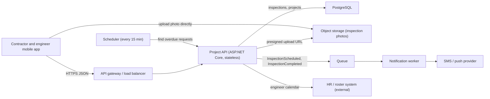
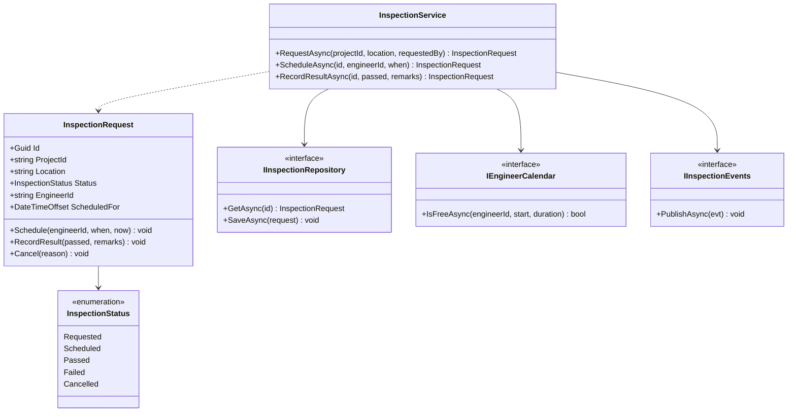
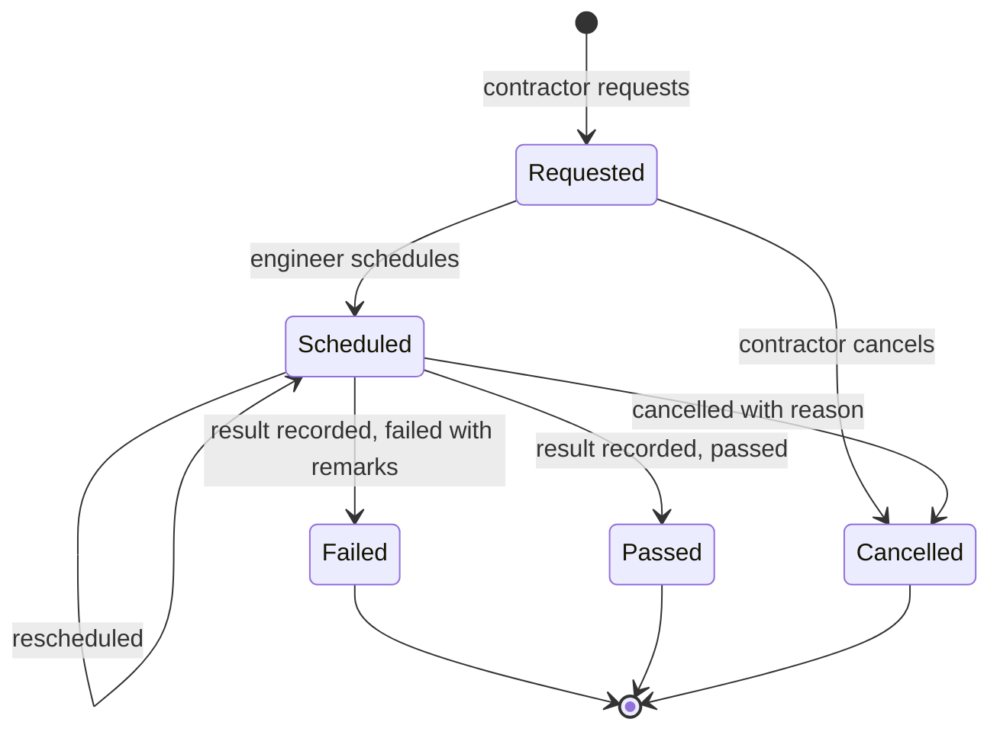
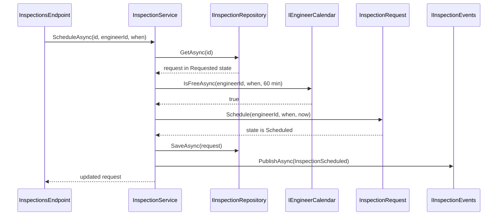
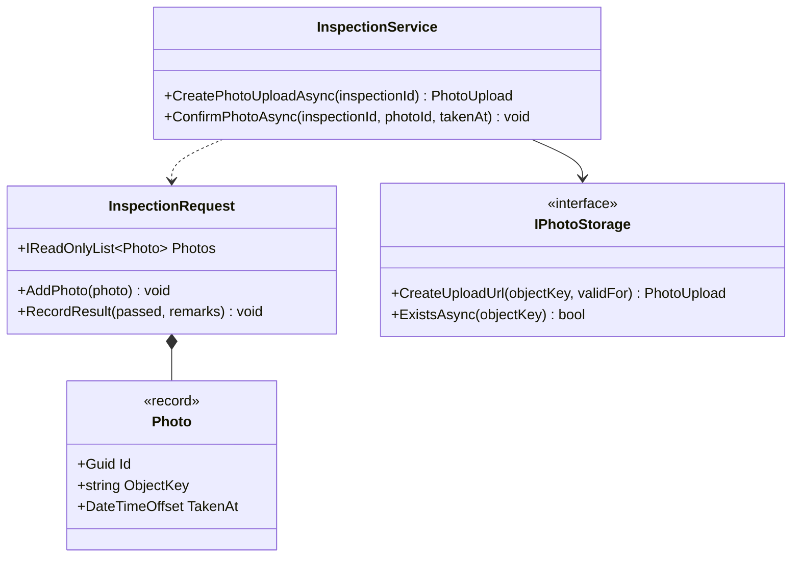

"Design" means two different things depending on how far you zoom in. **High-level design (HLD)** looks at the whole system from above: which big parts exist, what each one does and how they talk to each other. **Low-level design (LLD)** zooms into one part: which classes, methods, tables and rules make it work. Both are needed, they answer different questions, and they produce different documents. This lesson explains each, lists the artefacts each produces, and then designs the same feature at both levels so you can see exactly where one ends and the other begins.

## Learning objectives

By the end of this lesson you will be able to:

1. Explain the difference between high-level design (HLD) and low-level design (LLD) with an everyday analogy.
2. List the questions each level answers and the artefacts each produces.
3. Recognise whether a given decision belongs to HLD or LLD.
4. Design one feature at both levels: an architecture diagram and key flows for HLD; classes, states, tables and method contracts for LLD.
5. Explain how HLD decisions constrain LLD, and how LLD discoveries can send you back to change the HLD.
6. Translate an LLD into compilable C# with clear responsibilities.

## Prerequisites

- [What is system design?](#/lesson/m02-what-is-system-design): the building blocks used in HLD.
- [Classes and objects](#/lesson/m01-classes-objects) and [Interfaces and abstract classes](#/lesson/m01-interfaces-abstract): the building blocks used in LLD.

## Explain it like I'm a beginner

Think about building a hospital.

The **site plan** shows the buildings on the plot: the main block, the emergency wing, the car park, the water tank, the power substation, the roads between them and the gate where ambulances enter. It says that the emergency wing must be close to the gate, that the power has a backup generator, and that the car park holds 300 cars. It does not show where the light switches go. **That is high-level design.**

The **detailed drawings** for the emergency wing show each room, the width of each door so a stretcher fits, the wiring for each socket, the pipe sizes and the exact position of the oxygen outlets. They follow the site plan (the wing is where the site plan put it, and it uses the power supply the site plan provided). **That is low-level design.**

You cannot build from the site plan alone (no one knows where the doors go), and you should not start the detailed drawings without the site plan (you might design a beautiful wing that is on the wrong side of the plot). Software works the same way: HLD first places the big parts and their connections; LLD then designs the inside of each part.

## First-principles explanation

### High-level design (HLD)

HLD describes the **system as a set of major parts and the connections between them**. Its questions are about the whole:

- What are the main components (apps, services, databases, caches, queues, external systems)?
- What is each one responsible for?
- How does data flow between them for the important use cases?
- Which technologies will we use for each part (PostgreSQL or a document store? a queue or direct calls?)
- How will it meet the non-functional requirements: how many users, how fast, how available, how secure, how much it costs?
- What happens when a part fails?

HLD decisions are usually **expensive to change later**. Choosing PostgreSQL or a document database, a single service or several, one region or two: each of these shapes everything that comes after.

### Low-level design (LLD)

LLD describes **the inside of one component**. Its questions are about code and data:

- Which classes and interfaces exist, and what is each responsible for?
- What methods do they have, with which parameters, return values and errors?
- What are the business rules, and which class enforces each one?
- What states can an object be in, and which transitions are allowed?
- What are the exact tables, columns, keys and indexes?
- What are the exact API request and response shapes and status codes?
- Which design patterns help (Strategy, State, Repository)?

LLD decisions are usually **cheaper to change** than HLD ones, because they are contained within one component, especially when the component's public contract stays the same.

### Side by side

| | High-level design (HLD) | Low-level design (LLD) |
|---|---|---|
| Zoom level | The whole system | One component or feature inside it |
| Main question | What are the parts and how do they connect? | How does this part work inside? |
| Building blocks | Clients, services, databases, caches, queues, external systems | Classes, interfaces, methods, tables, states, algorithms |
| Typical concerns | Scale, availability, latency, cost, security boundaries, technology choice | Correctness of rules, readability, testability, error handling, patterns |
| Typical audience | Architects, tech leads, product owners, operations, security reviewers | Developers implementing and reviewing the code |
| Cost of changing later | High | Lower (if the component's contract is stable) |
| Typical interview | "Design a food-delivery system" | "Design a parking lot" or "design the classes for a booking service" |

### Artefacts of each level

An **artefact** is a document or diagram the design produces. You do not need all of them every time; pick what the audience needs.

**HLD artefacts**

| Artefact | What it shows |
|---|---|
| Requirements summary | Functional and non-functional requirements with numbers (see [Requirements](#/lesson/m02-requirements)) |
| Context diagram | The system as one box, with its users and the external systems it talks to |
| Architecture (container) diagram | The major deployable parts and how they connect |
| Key flow sequence diagrams | How a request travels across components for the most important use cases |
| Capacity estimate | Requests per second, storage, bandwidth |
| Data store choices | Which database or store holds which data, and why |
| API list | The main endpoints or messages between components (not every field yet) |
| Failure and scaling notes | What happens when each part fails; how each part scales |
| Decision records | The big decisions and their trade-offs (see [ADRs](#/lesson/m02-adr)) |

**LLD artefacts**

| Artefact | What it shows |
|---|---|
| Class diagram | Classes, interfaces, their members and relationships |
| Object-level sequence diagram | Which object calls which method, in order, for one use case |
| State diagram | The states an entity can be in and the allowed transitions |
| Database schema (DDL) | Tables, columns, types, keys, constraints, indexes |
| API contract | Exact request and response bodies, validation rules, status codes |
| Method contracts | Pre-conditions, post-conditions and errors for important methods |
| Pseudo-code or algorithm notes | For anything non-obvious (scheduling, pricing, matching) |

A popular way to organise diagrams by zoom level is the **C4 model**: **C**ontext (system and its users), **C**ontainers (apps, databases, queues), **C**omponents (major parts inside one container) and **C**ode (classes). The first two are HLD; components sit on the border; code is LLD.

### How the two levels connect

HLD and LLD are not separate worlds. They talk to each other:

- **HLD constrains LLD.** If the HLD says "notifications go through a queue", the LLD of the inspection service must publish an event rather than call the SMS provider directly. If the HLD says "app servers are stateless", the LLD cannot keep data in static fields.
- **HLD defines the contracts between components; LLD implements them.** The HLD says "the mobile app calls `POST /inspections`"; the LLD defines the exact JSON body and the class that handles it.
- **LLD can send you back to HLD.** While designing the scheduling rules, you discover that checking an engineer's free time needs data from the HR system, which the HLD did not include. That is a new connection between components, so the HLD must be updated.
- **Requirements trace through both.** "An inspection must be scheduled within 48 hours" appears as a non-functional requirement in HLD (and maybe a reminder job), and as a rule and a test in LLD.

### How much design is enough?

Neither level should become a 100-page document that nobody reads. A useful rule of thumb:

- For a **new system or a big change**, write a short HLD (a few pages and diagrams) and review it before coding. Mistakes here are expensive.
- For a **feature inside an existing system**, the HLD may be one paragraph ("no new components, adds one table and one queue message"), and the LLD a class diagram, a state diagram and the table definition.
- For a **small change**, the LLD may be a few lines in the pull request description, and the code itself is the design.

Design is a thinking tool first and a document second. Diagrams that are drawn, discussed and then kept up to date with the code are worth far more than perfect diagrams that go stale.

## Visual explanation

The feature used throughout this lesson: in a construction project management app, a **contractor requests an inspection** of finished work (for example "concrete slab at km 12+400 is ready for inspection"). A **site engineer** is assigned and schedules it, inspects, and records **passed** or **failed** with remarks and photos. The contractor gets notifications at each step.

### HLD view: the parts and their connections



At this zoom level you see **components**, not classes. The **mobile app** talks to the **Project API** through a **gateway** or load balancer. The API stores inspection data in **PostgreSQL** and hands the app a **presigned URL** so photos go **directly to object storage** without passing through the API. When an inspection is scheduled or completed, the API puts an event on a **queue**; a **notification worker** sends SMS or push messages, so a provider outage cannot block the engineer. A **scheduler** runs every 15 minutes to flag requests that have waited too long. The API reads engineers' availability from an external **HR roster system**. Every one of these is an HLD decision with a trade-off; none says anything about classes.

### LLD view: the classes inside the Project API



Now we have zoomed into one box from the HLD diagram. **`InspectionRequest`** is the entity: it holds the data and **enforces its own rules** (you cannot record a result for an inspection that was never scheduled). **`InspectionStatus`** lists the allowed states. **`InspectionService`** coordinates a use case: load the request, check the engineer's calendar, change the state, save, publish an event. It depends on three **interfaces**, each one matching an arrow in the HLD diagram: `IInspectionRepository` is the PostgreSQL arrow, `IEngineerCalendar` is the HR roster arrow, `IInspectionEvents` is the queue arrow. That is how HLD connections become LLD seams.

### LLD view: allowed state changes



The state diagram is a precise LLD artefact: it says which changes are legal. An inspection starts as **Requested**. It can be **Scheduled** (and rescheduled), or **Cancelled** before anyone visits. Once scheduled, the engineer records **Passed** or **Failed**; a failure must include remarks so the contractor knows what to fix (a new request is raised after the fix). **Passed**, **Failed** and **Cancelled** are final. Any other change, such as recording a result on a request that was never scheduled, is a bug or misuse and the code must reject it.

### LLD view: one use case, object by object



Compare this with an HLD sequence diagram, which would show the app, the API, the database and the queue as boxes. Here the participants are **objects and interfaces inside the API**. The **endpoint** calls the **service**, which **loads** the request through the repository, **checks** the engineer's calendar, asks the **entity** to change its own state (the entity validates the rule), **saves** it and **publishes** the event. If the calendar says the engineer is busy, the flow stops before any state changes. Reading this diagram, a developer knows exactly which methods to write.

## Step-by-step example

Design the site-inspection feature from requirements to code, and notice at each step which level you are working at.

### Step 1 — Requirements (input to both levels)

- Contractors request an inspection for a location on a project. (Functional.)
- Site engineers schedule it, then record passed or failed with remarks and up to 10 photos. (Functional.)
- Contractors are notified when an inspection is scheduled and when a result is recorded. (Functional.)
- Requests not scheduled within 48 hours are flagged to the project manager. (Functional, time-based.)
- About 400 projects, 3,000 inspections a day at peak season, 10 photos of about 3 MB each. (Scale.)
- The app must work on poor site networks: photo uploads must resume, and the API must respond in under 500 ms at p95 (excluding uploads). (Non-functional.)

### Step 2 — HLD decisions (the whole system)

| Decision | Choice | Why (and trade-off) |
|---|---|---|
| Where inspection data lives | PostgreSQL, existing project database | Relational data with clear links to projects; no new database to run |
| Where photos live | Object storage, uploaded with presigned URLs | 3,000 × 10 × 3 MB ≈ 90 GB a day is too much for the database and the API; trade-off: two-step upload flow |
| Notifications | Queue + worker | SMS provider outages must not block engineers; trade-off: a few seconds' delay |
| 48-hour rule | Scheduler job every 15 minutes | Simple and good enough; trade-off: a flag may appear up to 15 minutes late |
| Engineer availability | Read from the HR roster system | Single source of truth for leave and shifts; trade-off: a new dependency that can be slow or down |
| New service or existing API? | Add to the existing Project API | One team, modest load (3,000 a day is about 0.03 per second on average); a new service would add deployment and network work for no benefit |

Notice what is **not** decided yet: class names, table columns, the JSON field names, the exact rule for rescheduling. Those are LLD.

### Step 3 — LLD decisions (inside the Project API)

**Entity and rules.** `InspectionRequest` owns its state and enforces:

1. Only a `Requested` or `Scheduled` inspection can be (re)scheduled.
2. The scheduled time must be in the future.
3. A result can be recorded only for a `Scheduled` inspection.
4. A failed result requires non-empty remarks.
5. Final states (`Passed`, `Failed`, `Cancelled`) cannot change.

**Service.** `InspectionService` coordinates use cases and talks to the outside through interfaces (repository, calendar, events).

**Table.**

```sql
CREATE TABLE inspection_requests (
    id             uuid        PRIMARY KEY,
    project_id     text        NOT NULL REFERENCES projects (id),
    location       text        NOT NULL,              -- e.g. 'km 12+400, slab S3'
    requested_by   text        NOT NULL,
    status         text        NOT NULL CHECK (status IN ('Requested','Scheduled','Passed','Failed','Cancelled')),
    engineer_id    text,
    scheduled_for  timestamptz,
    remarks        text,
    requested_at   timestamptz NOT NULL DEFAULT now(),
    version        integer     NOT NULL DEFAULT 0     -- optimistic concurrency
);
CREATE INDEX ix_inspections_project_status ON inspection_requests (project_id, status);
CREATE INDEX ix_inspections_unscheduled ON inspection_requests (requested_at) WHERE status = 'Requested';
```

The partial index exists because of an HLD decision: the 15-minute scheduler job asks "which requests are still `Requested` after 48 hours?" Without it, that query scans the whole table. This is a small example of HLD driving LLD.

**API contract.**

```text
POST /projects/{projectId}/inspections        body { "location": "km 12+400, slab S3", "requestedBy": "contractor-17" }
     201 Created  { "id": "...", "status": "Requested", ... }
     400 Bad Request (ProblemDetails) if location is empty
POST /inspections/{id}/schedule                body { "engineerId": "eng-4", "when": "2026-10-22T10:00:00+05:30" }
     200 OK, 404 Not Found, 409 Conflict if the state does not allow it or the engineer is busy
POST /inspections/{id}/result                  body { "passed": false, "remarks": "Honeycombing near joint J4" }
     200 OK, 404 Not Found, 409 Conflict, 400 if failed without remarks
```

### Step 4 — An LLD discovery that changes the HLD

While writing `IEngineerCalendar`, the developer finds that the HR roster system only publishes a nightly file, not a live API. The HLD assumed a live call. Options: copy the roster nightly into a local table (stale by up to a day for last-minute leave), or ask the HR team for an API. The team chooses the nightly copy plus a manual "mark unavailable" button for engineers, and **updates the HLD diagram and decision record**. This feedback loop is normal and healthy.

## Production-style C# implementation

The LLD from the step-by-step example, as code. The interfaces match the HLD's arrows; the in-memory implementations stand in for PostgreSQL, the roster system and the queue.

```text
SiteSure.Api/
  Program.cs
  Inspections/InspectionRequest.cs
  Inspections/Ports.cs
  Inspections/InspectionService.cs
  Inspections/InMemoryAdapters.cs
```

```csharp file=Inspections/InspectionRequest.cs
namespace SiteSure.Inspections;

public enum InspectionStatus { Requested, Scheduled, Passed, Failed, Cancelled }

/// <summary>The entity. It owns its state and enforces the rules from the LLD state diagram.</summary>
public sealed class InspectionRequest
{
    public InspectionRequest(Guid id, string projectId, string location, string requestedBy, DateTimeOffset requestedAt)
    {
        if (string.IsNullOrWhiteSpace(projectId)) throw new ArgumentException("Project is required.", nameof(projectId));
        if (string.IsNullOrWhiteSpace(location)) throw new ArgumentException("Location is required.", nameof(location));
        if (string.IsNullOrWhiteSpace(requestedBy)) throw new ArgumentException("Requester is required.", nameof(requestedBy));
        Id = id;
        ProjectId = projectId;
        Location = location;
        RequestedBy = requestedBy;
        RequestedAt = requestedAt;
    }

    public Guid Id { get; }
    public string ProjectId { get; }
    public string Location { get; }
    public string RequestedBy { get; }
    public DateTimeOffset RequestedAt { get; }
    public InspectionStatus Status { get; private set; } = InspectionStatus.Requested;
    public string? EngineerId { get; private set; }
    public DateTimeOffset? ScheduledFor { get; private set; }
    public string? Remarks { get; private set; }

    public bool IsFinal => Status is InspectionStatus.Passed or InspectionStatus.Failed or InspectionStatus.Cancelled;

    public void Schedule(string engineerId, DateTimeOffset when, DateTimeOffset now)
    {
        if (Status is not (InspectionStatus.Requested or InspectionStatus.Scheduled))
            throw new InvalidOperationException($"Cannot schedule an inspection that is {Status}.");
        if (string.IsNullOrWhiteSpace(engineerId)) throw new ArgumentException("Engineer is required.", nameof(engineerId));
        if (when <= now) throw new ArgumentOutOfRangeException(nameof(when), "Inspection time must be in the future.");

        EngineerId = engineerId;
        ScheduledFor = when;
        Status = InspectionStatus.Scheduled;
    }

    public void RecordResult(bool passed, string? remarks)
    {
        if (Status != InspectionStatus.Scheduled)
            throw new InvalidOperationException($"Cannot record a result for an inspection that is {Status}.");
        if (!passed && string.IsNullOrWhiteSpace(remarks))
            throw new ArgumentException("A failed inspection needs remarks.", nameof(remarks));

        Remarks = remarks;
        Status = passed ? InspectionStatus.Passed : InspectionStatus.Failed;
    }

    public void Cancel(string reason)
    {
        if (IsFinal) throw new InvalidOperationException($"Cannot cancel an inspection that is {Status}.");
        if (string.IsNullOrWhiteSpace(reason)) throw new ArgumentException("A reason is required.", nameof(reason));
        Remarks = reason;
        Status = InspectionStatus.Cancelled;
    }
}
```

```csharp file=Inspections/Ports.cs
namespace SiteSure.Inspections;

/// <summary>HLD arrow: Project API to PostgreSQL.</summary>
public interface IInspectionRepository
{
    Task<InspectionRequest?> GetAsync(Guid id, CancellationToken ct);
    Task SaveAsync(InspectionRequest request, CancellationToken ct);
}

/// <summary>HLD arrow: Project API to the HR roster system.</summary>
public interface IEngineerCalendar
{
    Task<bool> IsFreeAsync(string engineerId, DateTimeOffset start, TimeSpan duration, CancellationToken ct);
}

/// <summary>HLD arrow: Project API to the queue.</summary>
public interface IInspectionEvents
{
    Task PublishAsync(InspectionEvent evt, CancellationToken ct);
}

public sealed record InspectionEvent(string Type, Guid InspectionId, string ProjectId, InspectionStatus Status);

public sealed class InspectionNotFoundException(Guid id) : Exception($"Inspection {id} was not found.");

public sealed class EngineerBusyException(string engineerId) : Exception($"Engineer {engineerId} is not free at that time.");
```

```csharp file=Inspections/InspectionService.cs
namespace SiteSure.Inspections;

/// <summary>Coordinates use cases. Rules live in the entity, infrastructure behind interfaces.</summary>
public sealed class InspectionService(
    IInspectionRepository repository,
    IEngineerCalendar calendar,
    IInspectionEvents events,
    TimeProvider clock)
{
    public static readonly TimeSpan InspectionDuration = TimeSpan.FromMinutes(60);

    public async Task<InspectionRequest> RequestAsync(string projectId, string location, string requestedBy, CancellationToken ct)
    {
        var request = new InspectionRequest(Guid.NewGuid(), projectId, location, requestedBy, clock.GetUtcNow());
        await repository.SaveAsync(request, ct);
        return request;
    }

    public async Task<InspectionRequest> ScheduleAsync(Guid id, string engineerId, DateTimeOffset when, CancellationToken ct)
    {
        var request = await repository.GetAsync(id, ct) ?? throw new InspectionNotFoundException(id);
        if (!await calendar.IsFreeAsync(engineerId, when, InspectionDuration, ct)) throw new EngineerBusyException(engineerId);

        request.Schedule(engineerId, when, clock.GetUtcNow());
        await repository.SaveAsync(request, ct);
        await events.PublishAsync(new InspectionEvent("InspectionScheduled", request.Id, request.ProjectId, request.Status), ct);
        return request;
    }

    public async Task<InspectionRequest> RecordResultAsync(Guid id, bool passed, string? remarks, CancellationToken ct)
    {
        var request = await repository.GetAsync(id, ct) ?? throw new InspectionNotFoundException(id);
        request.RecordResult(passed, remarks);
        await repository.SaveAsync(request, ct);
        await events.PublishAsync(new InspectionEvent("InspectionCompleted", request.Id, request.ProjectId, request.Status), ct);
        return request;
    }
}
```

```csharp file=Inspections/InMemoryAdapters.cs
using System.Collections.Concurrent;
using Microsoft.Extensions.Logging;

namespace SiteSure.Inspections;

public sealed class InMemoryInspectionRepository : IInspectionRepository
{
    private readonly ConcurrentDictionary<Guid, InspectionRequest> _items = new();

    public Task<InspectionRequest?> GetAsync(Guid id, CancellationToken ct) =>
        Task.FromResult(_items.TryGetValue(id, out var r) ? r : null);

    public Task SaveAsync(InspectionRequest request, CancellationToken ct)
    {
        _items[request.Id] = request;
        return Task.CompletedTask;
    }
}

/// <summary>Stand-in for the nightly roster copy. Engineers listed here are on leave all day.</summary>
public sealed class InMemoryEngineerCalendar : IEngineerCalendar
{
    private readonly ConcurrentDictionary<(string Engineer, DateOnly Day), bool> _leave = new();

    public void MarkOnLeave(string engineerId, DateOnly day) => _leave[(engineerId, day)] = true;

    public Task<bool> IsFreeAsync(string engineerId, DateTimeOffset start, TimeSpan duration, CancellationToken ct) =>
        Task.FromResult(!_leave.ContainsKey((engineerId, DateOnly.FromDateTime(start.UtcDateTime))));
}

public sealed class LoggingInspectionEvents(ILogger<LoggingInspectionEvents> logger) : IInspectionEvents
{
    public Task PublishAsync(InspectionEvent evt, CancellationToken ct)
    {
        logger.LogInformation("Event {Type} for inspection {Id} on project {Project}: {Status}", evt.Type, evt.InspectionId, evt.ProjectId, evt.Status);
        return Task.CompletedTask;
    }
}
```

```csharp file=Program.cs
using SiteSure.Inspections;

var builder = WebApplication.CreateBuilder(args);

builder.Services.AddSingleton(TimeProvider.System);
builder.Services.AddSingleton<IInspectionRepository, InMemoryInspectionRepository>();
builder.Services.AddSingleton<InMemoryEngineerCalendar>();
builder.Services.AddSingleton<IEngineerCalendar>(sp => sp.GetRequiredService<InMemoryEngineerCalendar>());
builder.Services.AddSingleton<IInspectionEvents, LoggingInspectionEvents>();
builder.Services.AddScoped<InspectionService>();
builder.Services.AddProblemDetails();

var app = builder.Build();

app.MapPost("/projects/{projectId}/inspections", (string projectId, NewInspection body, InspectionService service, CancellationToken ct) =>
    Handle(async () =>
    {
        var r = await service.RequestAsync(projectId, body.Location, body.RequestedBy, ct);
        return Results.Created($"/inspections/{r.Id}", r);
    }));

app.MapPost("/inspections/{id:guid}/schedule", (Guid id, ScheduleInspection body, InspectionService service, CancellationToken ct) =>
    Handle(async () => Results.Ok(await service.ScheduleAsync(id, body.EngineerId, body.When, ct))));

app.MapPost("/inspections/{id:guid}/result", (Guid id, InspectionResult body, InspectionService service, CancellationToken ct) =>
    Handle(async () => Results.Ok(await service.RecordResultAsync(id, body.Passed, body.Remarks, ct))));

app.MapGet("/inspections/{id:guid}", async (Guid id, IInspectionRepository repo, CancellationToken ct) =>
    await repo.GetAsync(id, ct) is { } r ? Results.Ok(r) : Results.NotFound());

app.Run();

// Maps domain errors to the status codes in the LLD API contract.
static async Task<IResult> Handle(Func<Task<IResult>> action)
{
    try { return await action(); }
    catch (InspectionNotFoundException ex) { return Results.Problem(ex.Message, statusCode: 404); }
    catch (EngineerBusyException ex) { return Results.Problem(ex.Message, statusCode: 409); }
    catch (InvalidOperationException ex) { return Results.Problem(ex.Message, statusCode: 409); }
    catch (ArgumentException ex) { return Results.Problem(ex.Message, statusCode: 400); }
}

public sealed record NewInspection(string Location, string RequestedBy);
public sealed record ScheduleInspection(string EngineerId, DateTimeOffset When);
public sealed record InspectionResult(bool Passed, string? Remarks);
```

How the code reflects both levels:

1. **HLD shows up as interfaces.** Each arrow leaving the Project API in the HLD diagram is an interface in `Ports.cs`. Swapping the in-memory version for PostgreSQL, the real roster copy or a message broker changes no business code.
2. **LLD rules live in one place.** All five rules from step 3 are in `InspectionRequest`. A reviewer checking "can a failed inspection have no remarks?" reads one method.
3. **The API contract is explicit.** `Handle` maps each domain error to the status code promised in the contract (404, 409, 400), so the contract and the code agree.
4. **Testable without infrastructure.** Every rule can be unit-tested by creating an `InspectionRequest` directly; use cases can be tested with the in-memory adapters.

## Bad design vs good design

**Bad: an HLD that is really an LLD.** The "architecture document" has 40 class diagrams and no picture of the components, so nobody can see that photos are stored in the database (90 GB a day) or that the SMS call is synchronous. The expensive mistakes hide among the cheap details.

**Bad: an LLD that ignores the HLD.** The HLD says notifications go through the queue, but the developer calls the SMS provider directly from `InspectionService` "because it was quicker". The first SMS outage blocks engineers on site.

**Bad: rules scattered across layers.**

```csharp
// Controller checks one rule, service another, SQL a third. Nobody knows the full set.
if (body.Passed == false && body.Remarks == null) return BadRequest();          // in the controller
if (request.Status == "Passed") throw new Exception("done");                     // in the service
// UPDATE inspections SET status = @s WHERE id = @id AND status <> 'Cancelled'   // in the repository
```

**Bad: the design that never changes.** The HLD was written once and never updated, so after the roster discovery in step 4 it describes a live API that does not exist. New team members trust it and are misled.

**Good:**

- HLD first for anything that adds or changes components, reviewed before coding.
- LLD for each significant feature: entity rules, states, tables and API contract.
- HLD connections appear as interfaces in LLD; LLD respects HLD decisions.
- Business rules in the entity or domain layer, in one place, with tests.
- Both documents kept short and updated when either level changes.

:::callout type=tip title="Ask 'which level am I at?'"
When a discussion gets stuck, ask whether it is about the parts and their connections (HLD) or about the inside of one part (LLD). Arguing about class names in an HLD review, or about database choice in a code review, usually means the discussion is at the wrong level.
:::

:::callout type=mistake title="Skipping HLD because 'it's just a feature'"
A feature that adds a new external dependency, a new kind of data (photos, video) or a new background job changes the HLD, even if it looks small. Write the one-paragraph HLD anyway; it takes ten minutes and catches the expensive mistakes.
:::

## Practical playground

The LLD canvas below holds the class model for the inspection feature. Try these changes and watch how responsibilities shift:

1. Add a `Photo` record (`Guid Id`, `string ObjectKey`, `DateTimeOffset TakenAt`) and decide which class owns the list of photos.
2. Add a rule: "an inspection cannot be passed without at least one photo". Which method enforces it?
3. Add an `IPhotoStorage` interface for creating presigned upload URLs. Which HLD arrow does it represent?

:::playground type=lld title="Inspection feature: low-level design"
```json
{
  "classes": [
    { "id": "Req", "name": "InspectionRequest", "kind": "class",
      "fields": ["+Guid Id", "+string ProjectId", "+string Location", "+InspectionStatus Status", "+string EngineerId"],
      "methods": ["+void Schedule(string engineerId, DateTimeOffset when, DateTimeOffset now)", "+void RecordResult(bool passed, string remarks)", "+void Cancel(string reason)"],
      "responsibility": "Holds inspection state and enforces transition rules" },
    { "id": "Status", "name": "InspectionStatus", "kind": "enum", "fields": ["Requested", "Scheduled", "Passed", "Failed", "Cancelled"], "methods": [] },
    { "id": "Svc", "name": "InspectionService", "kind": "class",
      "fields": ["-IInspectionRepository _repository", "-IEngineerCalendar _calendar", "-IInspectionEvents _events"],
      "methods": ["+Task ScheduleAsync(Guid id, string engineerId, DateTimeOffset when)", "+Task RecordResultAsync(Guid id, bool passed, string remarks)"],
      "responsibility": "Coordinates use cases: load, check, change, save, publish" },
    { "id": "Repo", "name": "IInspectionRepository", "kind": "interface", "fields": [], "methods": ["Task GetAsync(Guid id)", "Task SaveAsync(InspectionRequest request)"] },
    { "id": "Cal", "name": "IEngineerCalendar", "kind": "interface", "fields": [], "methods": ["Task IsFreeAsync(string engineerId, DateTimeOffset start, TimeSpan duration)"] },
    { "id": "Evt", "name": "IInspectionEvents", "kind": "interface", "fields": [], "methods": ["Task PublishAsync(InspectionEvent evt)"] }
  ],
  "relations": [
    { "from": "Req", "to": "Status", "kind": "association" },
    { "from": "Svc", "to": "Repo", "kind": "dependency" },
    { "from": "Svc", "to": "Cal", "kind": "dependency" },
    { "from": "Svc", "to": "Evt", "kind": "dependency" },
    { "from": "Svc", "to": "Req", "kind": "dependency" }
  ]
}
```
:::

## Exercises

:::exercise id=m02-hld-vs-lld-ex1 difficulty=beginner kind=written title="HLD or LLD?"
For each decision below, say whether it belongs to the high-level design or the low-level design, and give a one-line reason.

1. Use PostgreSQL for inspection data.
2. `InspectionRequest.RecordResult` throws if the inspection is not scheduled.
3. Photos are uploaded directly to object storage with presigned URLs.
4. The `inspection_requests` table has a partial index on `requested_at` where status is `Requested`.
5. Notifications are sent through a queue and a worker.
6. A failed inspection returns HTTP 400 if remarks are missing.
7. The system runs in one cloud region with two availability zones.
8. `InspectionService` depends on an `IEngineerCalendar` interface.
9. The API must answer in under 500 ms at p95.
10. Use the State pattern if inspection states grow beyond eight.
11. The mobile app talks to the Project API through an API gateway.
12. The JSON field for the scheduled time is called `when` and uses ISO 8601 with offset.
::acceptance
- All 12 items are classified.
- Each reason refers to the zoom level (whole system and connections versus the inside of one component).
- Item 9 is recognised as a requirement that HLD must satisfy, and item 8 as the LLD form of an HLD connection.
::hint
Ask: does this decision affect which components exist or how they connect? Then it is HLD.
::hint
Ask: could you change this decision without anyone outside the Project API noticing? Then it is probably LLD.
::hint
Some items are requirements rather than designs. Say which level is responsible for meeting them.
::hint
Interfaces are LLD artefacts, but they often exist because of an HLD arrow.
::solution
1. **HLD**: technology choice for a major component; expensive to change.
2. **LLD**: a rule inside one class.
3. **HLD**: a data flow between components (app, API, object storage).
4. **LLD**: table detail inside the database component (motivated by the HLD scheduler).
5. **HLD**: how components communicate (asynchronously through a queue).
6. **LLD**: exact API contract behaviour.
7. **HLD**: deployment topology for availability.
8. **LLD**: class dependency, but it is the code form of the HLD arrow "Project API → HR roster".
9. **Requirement** (non-functional). HLD must show how it is met (stateless API, photos not through the API); LLD must not break it (no slow calls in the request).
10. **LLD**: a design pattern inside one component.
11. **HLD**: a connection between components.
12. **LLD**: exact contract detail. (The HLD only says "the app calls the schedule endpoint".)
::mistakes
- Classifying the database index as HLD because it mentions the database. It is detail inside a component.
- Treating requirements as design decisions at either level.
:::

:::exercise id=m02-hld-vs-lld-ex2 difficulty=beginner kind=code title="Implement the inspection state rules"
Implement the LLD state machine for `InspectionRequest` exactly as in the state diagram.
::requirements
- New requests start in `Requested`.
- `Schedule(engineerId, when, now)`: allowed from `Requested` or `Scheduled` (reschedule). `when` must be after `now` (`ArgumentOutOfRangeException`). An empty engineer id throws `ArgumentException`. From any other state: `InvalidOperationException`.
- `RecordResult(passed, remarks)`: allowed only from `Scheduled`, otherwise `InvalidOperationException`. A failed result with empty remarks throws `ArgumentException`. Moves to `Passed` or `Failed`.
- `Cancel(reason)`: allowed from `Requested` or `Scheduled`; empty reason throws `ArgumentException`; from a final state throws `InvalidOperationException`.
::acceptance
- Requested → Scheduled → Passed works.
- Rescheduling a scheduled inspection updates the engineer and time.
- Recording a result on a requested (unscheduled) inspection throws `InvalidOperationException`.
- A failed result without remarks throws `ArgumentException` and the state stays `Scheduled`.
- Nothing can change a `Passed`, `Failed` or `Cancelled` inspection.
::hint
Store `Status` with a private setter so only the class's own methods can change it.
::hint
Check the state first, then validate arguments, then change fields. If a check fails, nothing must have changed.
::hint
A switch-like pattern helps: `if (Status is not (InspectionStatus.Requested or InspectionStatus.Scheduled)) throw ...`.
::hint
```csharp
public void RecordResult(bool passed, string? remarks)
{
    if (Status != InspectionStatus.Scheduled) throw new InvalidOperationException(...);
    if (!passed && string.IsNullOrWhiteSpace(remarks)) throw new ArgumentException(...);
    Remarks = remarks;
    Status = passed ? InspectionStatus.Passed : InspectionStatus.Failed;
}
```
::starter
```csharp file=Inspection.cs
using System;

public enum InspectionStatus { Requested, Scheduled, Passed, Failed, Cancelled }

public sealed class Inspection
{
    public InspectionStatus Status { get; private set; } = InspectionStatus.Requested;
    public string? EngineerId { get; private set; }
    public DateTimeOffset? ScheduledFor { get; private set; }
    public string? Remarks { get; private set; }

    public void Schedule(string engineerId, DateTimeOffset when, DateTimeOffset now) => throw new NotImplementedException();

    public void RecordResult(bool passed, string? remarks) => throw new NotImplementedException();

    public void Cancel(string reason) => throw new NotImplementedException();
}
```
::tests
```csharp file=InspectionTests.cs
using System;
using Xunit;

public class InspectionTests
{
    private static readonly DateTimeOffset Now = new(2026, 10, 20, 9, 0, 0, TimeSpan.FromHours(5.5));

    private static Inspection Scheduled()
    {
        var i = new Inspection();
        i.Schedule("eng-4", Now.AddDays(1), Now);
        return i;
    }

    [Fact]
    public void Happy_path_to_passed()
    {
        var i = Scheduled();
        Assert.Equal(InspectionStatus.Scheduled, i.Status);
        i.RecordResult(true, null);
        Assert.Equal(InspectionStatus.Passed, i.Status);
    }

    [Fact]
    public void Reschedule_updates_engineer_and_time()
    {
        var i = Scheduled();
        i.Schedule("eng-9", Now.AddDays(2), Now);
        Assert.Equal("eng-9", i.EngineerId);
        Assert.Equal(Now.AddDays(2), i.ScheduledFor);
    }

    [Fact]
    public void Cannot_schedule_in_the_past()
    {
        var i = new Inspection();
        Assert.Throws<ArgumentOutOfRangeException>(() => i.Schedule("eng-4", Now.AddMinutes(-5), Now));
        Assert.Equal(InspectionStatus.Requested, i.Status);
    }

    [Fact]
    public void Cannot_record_result_before_scheduling() =>
        Assert.Throws<InvalidOperationException>(() => new Inspection().RecordResult(true, null));

    [Fact]
    public void Failed_needs_remarks()
    {
        var i = Scheduled();
        Assert.Throws<ArgumentException>(() => i.RecordResult(false, " "));
        Assert.Equal(InspectionStatus.Scheduled, i.Status);
        i.RecordResult(false, "Honeycombing near joint J4");
        Assert.Equal(InspectionStatus.Failed, i.Status);
    }

    [Fact]
    public void Final_states_cannot_change()
    {
        var passed = Scheduled();
        passed.RecordResult(true, null);
        Assert.Throws<InvalidOperationException>(() => passed.Schedule("eng-4", Now.AddDays(3), Now));
        Assert.Throws<InvalidOperationException>(() => passed.Cancel("changed mind"));

        var cancelled = new Inspection();
        cancelled.Cancel("work not ready");
        Assert.Equal(InspectionStatus.Cancelled, cancelled.Status);
        Assert.Throws<InvalidOperationException>(() => cancelled.RecordResult(true, null));
    }

    [Fact]
    public void Cancel_needs_a_reason() =>
        Assert.Throws<ArgumentException>(() => new Inspection().Cancel(""));
}
```
::solution
```csharp file=Inspection.cs
using System;

public enum InspectionStatus { Requested, Scheduled, Passed, Failed, Cancelled }

public sealed class Inspection
{
    public InspectionStatus Status { get; private set; } = InspectionStatus.Requested;
    public string? EngineerId { get; private set; }
    public DateTimeOffset? ScheduledFor { get; private set; }
    public string? Remarks { get; private set; }

    private bool IsFinal => Status is InspectionStatus.Passed or InspectionStatus.Failed or InspectionStatus.Cancelled;

    public void Schedule(string engineerId, DateTimeOffset when, DateTimeOffset now)
    {
        if (Status is not (InspectionStatus.Requested or InspectionStatus.Scheduled))
            throw new InvalidOperationException($"Cannot schedule an inspection that is {Status}.");
        if (string.IsNullOrWhiteSpace(engineerId)) throw new ArgumentException("Engineer is required.", nameof(engineerId));
        if (when <= now) throw new ArgumentOutOfRangeException(nameof(when), "Inspection time must be in the future.");

        EngineerId = engineerId;
        ScheduledFor = when;
        Status = InspectionStatus.Scheduled;
    }

    public void RecordResult(bool passed, string? remarks)
    {
        if (Status != InspectionStatus.Scheduled)
            throw new InvalidOperationException($"Cannot record a result for an inspection that is {Status}.");
        if (!passed && string.IsNullOrWhiteSpace(remarks))
            throw new ArgumentException("A failed inspection needs remarks.", nameof(remarks));

        Remarks = remarks;
        Status = passed ? InspectionStatus.Passed : InspectionStatus.Failed;
    }

    public void Cancel(string reason)
    {
        if (IsFinal) throw new InvalidOperationException($"Cannot cancel an inspection that is {Status}.");
        if (string.IsNullOrWhiteSpace(reason)) throw new ArgumentException("A reason is required.", nameof(reason));
        Remarks = reason;
        Status = InspectionStatus.Cancelled;
    }
}
```

Each method follows the same order: **check the state, validate the arguments, then change fields**. Because nothing is changed until all checks pass, a rejected call leaves the object exactly as it was, which the tests verify. This is the state diagram turned directly into code; if the diagram changes, these methods and their tests are the only places to update.
::mistakes
- A public setter on `Status`, so other code can skip the rules.
- Changing `EngineerId` before checking the time, leaving a half-updated object when the check fails.
- Allowing `Cancel` on a passed inspection because "cancelling is always allowed".
:::

:::exercise id=m02-hld-vs-lld-ex3 difficulty=intermediate kind=design title="LLD for photo evidence"
Extend the inspection LLD with photo evidence. Requirements: an engineer can attach up to 10 photos to a **scheduled** inspection; each photo is uploaded directly to object storage using a presigned URL (an HLD decision); an inspection cannot be **passed** without at least one photo; photos cannot be added after a result is recorded.

Design the classes and interfaces. Say which class enforces each rule and which interface represents which HLD arrow.
::acceptance
- A `Photo` type exists and is owned by the inspection entity.
- The 10-photo limit, "only while scheduled" and "passed needs a photo" are enforced by the entity, not by the endpoint.
- An interface for creating upload URLs represents the API-to-object-storage arrow; the entity does not know about storage.
- The service coordinates: create upload URL, then confirm the photo after upload.
::hint
Who knows how many photos an inspection already has? That class should enforce the limit.
::hint
The upload is two steps: the API creates a presigned URL, the app uploads, then the app tells the API "photo uploaded" so it is recorded.
::hint
`RecordResult(true, ...)` needs to check the photo count, so it belongs on the same class as the photo list.
::starter
```json
{
  "classes": [
    { "id": "Req", "name": "InspectionRequest", "kind": "class",
      "fields": ["+Guid Id", "+InspectionStatus Status"],
      "methods": ["+void Schedule(string engineerId, DateTimeOffset when, DateTimeOffset now)", "+void RecordResult(bool passed, string remarks)"] },
    { "id": "Svc", "name": "InspectionService", "kind": "class", "fields": ["-IInspectionRepository _repository"], "methods": [] },
    { "id": "Repo", "name": "IInspectionRepository", "kind": "interface", "fields": [], "methods": ["Task GetAsync(Guid id)", "Task SaveAsync(InspectionRequest request)"] }
  ],
  "relations": [
    { "from": "Svc", "to": "Repo", "kind": "dependency" },
    { "from": "Svc", "to": "Req", "kind": "dependency" }
  ]
}
```
::solution
```json
{
  "classes": [
    { "id": "Req", "name": "InspectionRequest", "kind": "class",
      "fields": ["+Guid Id", "+InspectionStatus Status", "-List~Photo~ _photos", "+IReadOnlyList~Photo~ Photos"],
      "methods": ["+void Schedule(string engineerId, DateTimeOffset when, DateTimeOffset now)", "+void AddPhoto(Photo photo)", "+void RecordResult(bool passed, string remarks)"],
      "responsibility": "Enforces: max 10 photos, photos only while Scheduled, Passed needs at least one photo" },
    { "id": "Photo", "name": "Photo", "kind": "record", "fields": ["+Guid Id", "+string ObjectKey", "+DateTimeOffset TakenAt"], "methods": [] },
    { "id": "Svc", "name": "InspectionService", "kind": "class",
      "fields": ["-IInspectionRepository _repository", "-IPhotoStorage _storage"],
      "methods": ["+Task CreatePhotoUploadAsync(Guid inspectionId)", "+Task ConfirmPhotoAsync(Guid inspectionId, Guid photoId, DateTimeOffset takenAt)"],
      "responsibility": "Coordinates the two-step upload and saves the entity" },
    { "id": "Store", "name": "IPhotoStorage", "kind": "interface", "fields": [],
      "methods": ["PhotoUpload CreateUploadUrl(string objectKey, TimeSpan validFor)", "Task ExistsAsync(string objectKey)"] },
    { "id": "Up", "name": "PhotoUpload", "kind": "record", "fields": ["+Guid PhotoId", "+string ObjectKey", "+Uri UploadUrl", "+DateTimeOffset ExpiresAt"], "methods": [] },
    { "id": "Repo", "name": "IInspectionRepository", "kind": "interface", "fields": [], "methods": ["Task GetAsync(Guid id)", "Task SaveAsync(InspectionRequest request)"] }
  ],
  "relations": [
    { "from": "Req", "to": "Photo", "kind": "composition", "multiplicity": "0..10" },
    { "from": "Svc", "to": "Repo", "kind": "dependency" },
    { "from": "Svc", "to": "Store", "kind": "dependency" },
    { "from": "Svc", "to": "Req", "kind": "dependency" },
    { "from": "Store", "to": "Up", "kind": "dependency" }
  ]
}
```



**Who enforces what.** `InspectionRequest.AddPhoto` throws if the status is not `Scheduled` or if there are already 10 photos. `RecordResult(true, ...)` throws if `Photos.Count == 0`. The entity never touches storage: it only records that a photo with a given key exists.

**HLD arrows.** `IPhotoStorage` is the API-to-object-storage arrow (creating presigned URLs, checking an object exists). `IInspectionRepository` remains the database arrow.

**Flow.** `CreatePhotoUploadAsync` loads the inspection, checks it is scheduled and has fewer than 10 photos (fail early), and returns a presigned URL valid for 15 minutes. The app uploads directly. `ConfirmPhotoAsync` checks `ExistsAsync`, then calls `AddPhoto` and saves. A photo that was uploaded but never confirmed is cleaned up by an object-storage lifecycle rule (an HLD detail).
::mistakes
- Checking the 10-photo limit only in the endpoint, so a background import can bypass it.
- Letting the entity call object storage directly, which mixes infrastructure into domain rules.
- Recording the photo before the upload has actually happened.
:::

:::exercise id=m02-hld-vs-lld-ex4 difficulty=intermediate kind=hld title="Draw the HLD for the inspection feature"
Starting from a minimal graph (app, API, database), draw the HLD for the site-inspection feature using the requirements in step 1: 3,000 inspections a day at peak season, up to 10 photos of 3 MB each, notifications that must not block engineers, a 48-hour overdue check, and engineer availability from the HR roster.
::acceptance
- Photos go directly from the app to object storage; the API only issues upload URLs.
- Notifications go through a queue and a worker to an external provider.
- A scheduler handles the 48-hour check.
- The HR roster system appears as an external dependency.
- The answer states at least one decision that keeps the design simple (for example, no new service).
::hint
3,000 × 10 × 3 MB per day: compute it, then decide whether the API should carry those bytes.
::hint
Which part must keep working when the SMS provider is down?
::hint
Node types: `object-storage`, `queue`, `worker`, `scheduler`, `external`.
::starter
```json
{
  "nodes": [
    { "id": "app", "type": "client", "label": "Mobile app (contractors, engineers)", "props": { "rps": 5 } },
    { "id": "api", "type": "app-server", "label": "Project API", "props": { "instances": 2 } },
    { "id": "db", "type": "database", "label": "PostgreSQL" }
  ],
  "edges": [
    { "from": "app", "to": "api", "kind": "sync" },
    { "from": "api", "to": "db", "kind": "sync" }
  ]
}
```
::solution
```json
{
  "nodes": [
    { "id": "app", "type": "client", "label": "Mobile app (contractors, engineers)", "props": { "rps": 5 } },
    { "id": "lb", "type": "load-balancer", "label": "Load balancer" },
    { "id": "api", "type": "app-server", "label": "Project API (stateless)", "props": { "instances": 2 } },
    { "id": "db", "type": "database", "label": "PostgreSQL (inspections, projects)", "props": { "replicas": 1 } },
    { "id": "obj", "type": "object-storage", "label": "Inspection photos (~90 GB/day at peak)" },
    { "id": "q", "type": "queue", "label": "Inspection events" },
    { "id": "w", "type": "worker", "label": "Notification worker" },
    { "id": "sms", "type": "external", "label": "SMS / push provider" },
    { "id": "sch", "type": "scheduler", "label": "Overdue check every 15 min" },
    { "id": "hr", "type": "external", "label": "HR roster (nightly file)" }
  ],
  "edges": [
    { "from": "app", "to": "lb", "kind": "sync", "label": "JSON API" },
    { "from": "lb", "to": "api", "kind": "sync" },
    { "from": "api", "to": "db", "kind": "sync" },
    { "from": "api", "to": "obj", "kind": "sync", "label": "issue presigned URL" },
    { "from": "app", "to": "obj", "kind": "sync", "label": "upload photos directly" },
    { "from": "api", "to": "q", "kind": "async", "label": "Scheduled, Completed" },
    { "from": "q", "to": "w", "kind": "async" },
    { "from": "w", "to": "sms", "kind": "sync" },
    { "from": "sch", "to": "api", "kind": "sync", "label": "flag overdue" },
    { "from": "hr", "to": "db", "kind": "async", "label": "nightly roster import" }
  ]
}
```

**Reasoning.** 3,000 × 10 × 3 MB = 90 GB a day, far too much to push through the API or store in PostgreSQL, so photos go straight to object storage. Requests themselves are tiny (3,000 a day is well under 1 per second on average; even at a 10× site-morning peak it is a few per second), so two API instances are for availability, not load. Notifications are asynchronous so SMS outages never block engineers. The overdue check is a simple scheduled job. The roster arrives as a nightly import (the step 4 discovery). **Kept simple:** no new microservice, no cache, no read replicas for reads; the existing Project API and database handle this load easily.
::mistakes
- Uploading photos through the API.
- Drawing classes (InspectionService, repository) on the HLD canvas.
- Adding caches and replicas for a few requests per second.
:::

:::exercise id=m02-hld-vs-lld-ex5 difficulty=advanced kind=code title="Assign an engineer without double-booking"
Implement the LLD for engineer assignment: pick a free engineer who covers the inspection's zone, preferring the one with the fewest bookings that day, and record the booking.
::requirements
- `Booking(DateTime Start, TimeSpan Duration)` with `End` and `Overlaps(DateTime start, TimeSpan duration)`. Intervals are half-open: a booking 10:00–11:00 does **not** overlap one starting at 11:00.
- `Engineer(string id, params string[] zones)` with `Id`, `Zones` and a `Bookings` list.
- `EngineerScheduler(IEnumerable<Engineer> engineers)`.
- `Assign(string zone, DateTime start, TimeSpan duration)` returns the chosen `Engineer` or `null` if none is free:
  - Only engineers whose `Zones` contain `zone` (case-insensitive) and who have no overlapping booking.
  - Prefer the fewest bookings on the same calendar date as `start`; break ties by `Id` (ordinal).
  - Add the new booking to the chosen engineer.
- `duration <= TimeSpan.Zero` throws `ArgumentOutOfRangeException`.
::acceptance
- With E1 booked 10:00–11:00 and 14:00–15:00 and E2 booked 10:30–11:30 (both north), a north request at 11:00 for 60 minutes goes to E1.
- A north request at 16:00 goes to E2 (fewer bookings that day); a second 16:00 north request then goes to E1.
- A north request at 10:45 for 30 minutes returns `null`.
- A south request goes only to a south engineer.
::hint
Two intervals [a, b) and [c, d) overlap when `a < d && c < b`.
::hint
Filter first (zone, free), then order (bookings that day, then id), then take the first.
::hint
Count only bookings whose `Start.Date` equals `start.Date` for the "fewest bookings" rule.
::hint
```csharp
var chosen = _engineers
    .Where(e => e.Zones.Contains(zone) && !e.Bookings.Any(b => b.Overlaps(start, duration)))
    .OrderBy(e => e.Bookings.Count(b => b.Start.Date == start.Date))
    .ThenBy(e => e.Id, StringComparer.Ordinal)
    .FirstOrDefault();
```
::starter
```csharp file=EngineerScheduler.cs
using System;
using System.Collections.Generic;
using System.Linq;

public sealed record Booking(DateTime Start, TimeSpan Duration)
{
    public DateTime End => throw new NotImplementedException();
    public bool Overlaps(DateTime start, TimeSpan duration) => throw new NotImplementedException();
}

public sealed class Engineer
{
    public Engineer(string id, params string[] zones) => throw new NotImplementedException();

    public string Id { get; }
    public IReadOnlySet<string> Zones { get; }
    public List<Booking> Bookings { get; } = new();
}

public sealed class EngineerScheduler
{
    public EngineerScheduler(IEnumerable<Engineer> engineers) => throw new NotImplementedException();

    public Engineer? Assign(string zone, DateTime start, TimeSpan duration) => throw new NotImplementedException();
}
```
::tests
```csharp file=EngineerSchedulerTests.cs
using System;
using Xunit;

public class EngineerSchedulerTests
{
    private static readonly DateTime Day = new(2026, 10, 22);
    private static DateTime At(int h, int m = 0) => Day.AddHours(h).AddMinutes(m);
    private static readonly TimeSpan Hour = TimeSpan.FromMinutes(60);

    private static (EngineerScheduler Scheduler, Engineer E1, Engineer E2, Engineer E3) Create()
    {
        var e1 = new Engineer("E1", "north");
        e1.Bookings.Add(new Booking(At(10), Hour));
        e1.Bookings.Add(new Booking(At(14), Hour));
        var e2 = new Engineer("E2", "North");
        e2.Bookings.Add(new Booking(At(10, 30), Hour));
        var e3 = new Engineer("E3", "south");
        return (new EngineerScheduler(new[] { e1, e2, e3 }), e1, e2, e3);
    }

    [Fact]
    public void Half_open_intervals_do_not_overlap_at_the_boundary()
    {
        var b = new Booking(At(10), Hour);
        Assert.False(b.Overlaps(At(11), Hour));
        Assert.True(b.Overlaps(At(10, 59), Hour));
        Assert.Equal(At(11), b.End);
    }

    [Fact]
    public void Picks_the_free_engineer()
    {
        var (s, e1, _, _) = Create();
        Assert.Same(e1, s.Assign("north", At(11), Hour));
        Assert.Equal(3, e1.Bookings.Count);
    }

    [Fact]
    public void Prefers_fewest_bookings_then_records_the_booking()
    {
        var (s, e1, e2, _) = Create();
        Assert.Same(e2, s.Assign("north", At(16), Hour));
        Assert.Same(e1, s.Assign("north", At(16), Hour));
    }

    [Fact]
    public void Returns_null_when_everyone_is_busy()
    {
        var (s, _, _, _) = Create();
        Assert.Null(s.Assign("north", At(10, 45), TimeSpan.FromMinutes(30)));
    }

    [Fact]
    public void Respects_zones()
    {
        var (s, _, _, e3) = Create();
        Assert.Same(e3, s.Assign("SOUTH", At(10), Hour));
        Assert.Null(s.Assign("east", At(10), Hour));
    }

    [Fact]
    public void Invalid_duration_throws()
    {
        var (s, _, _, _) = Create();
        Assert.Throws<ArgumentOutOfRangeException>(() => s.Assign("north", At(9), TimeSpan.Zero));
    }
}
```
::solution
```csharp file=EngineerScheduler.cs
using System;
using System.Collections.Generic;
using System.Linq;

public sealed record Booking(DateTime Start, TimeSpan Duration)
{
    public DateTime End => Start + Duration;

    /// <summary>Half-open intervals: [Start, End) and [start, start + duration).</summary>
    public bool Overlaps(DateTime start, TimeSpan duration) => Start < start + duration && start < End;
}

public sealed class Engineer
{
    public Engineer(string id, params string[] zones)
    {
        if (string.IsNullOrWhiteSpace(id)) throw new ArgumentException("Id is required.", nameof(id));
        Id = id;
        Zones = new HashSet<string>(zones ?? Array.Empty<string>(), StringComparer.OrdinalIgnoreCase);
    }

    public string Id { get; }
    public IReadOnlySet<string> Zones { get; }
    public List<Booking> Bookings { get; } = new();
}

public sealed class EngineerScheduler
{
    private readonly IReadOnlyList<Engineer> _engineers;

    public EngineerScheduler(IEnumerable<Engineer> engineers) =>
        _engineers = (engineers ?? throw new ArgumentNullException(nameof(engineers))).ToList();

    public Engineer? Assign(string zone, DateTime start, TimeSpan duration)
    {
        if (duration <= TimeSpan.Zero) throw new ArgumentOutOfRangeException(nameof(duration));

        var chosen = _engineers
            .Where(e => e.Zones.Contains(zone))
            .Where(e => !e.Bookings.Any(b => b.Overlaps(start, duration)))
            .OrderBy(e => e.Bookings.Count(b => b.Start.Date == start.Date))
            .ThenBy(e => e.Id, StringComparer.Ordinal)
            .FirstOrDefault();

        chosen?.Bookings.Add(new Booking(start, duration));
        return chosen;
    }
}
```

**Where this sits.** This is pure LLD: an algorithm and its data structures inside the Project API. The HLD only said "the API checks engineer availability using roster data". The zone set uses a case-insensitive comparer because zone names come from user input and roster files. In production, two requests could choose the same engineer at the same moment; the HLD's database would prevent that with a unique constraint or an exclusion constraint on engineer bookings (PostgreSQL supports `EXCLUDE USING gist` on time ranges), which is where LLD and HLD meet again.
::alternatives
A round-robin pointer per zone spreads work evenly without counting bookings, but ignores how busy each engineer already is. A scoring function (bookings, distance to site, skills) generalises the ordering when more factors matter; at that point the Strategy pattern keeps scoring rules swappable.
::mistakes
- Closed intervals (`<=`), which make back-to-back inspections impossible.
- Counting all bookings ever, not just that day's, so a long-serving engineer is never chosen.
- Choosing an engineer but forgetting to record the booking, so the next request picks the same engineer for the same slot.
:::

## Automated testing

Each level is tested in its own way.

**LLD: unit tests for rules and algorithms.** The state rules (exercise 2) and the scheduler (exercise 5) are pure code and need nothing but xUnit. Write one test per rule; if the state diagram changes, the failing tests show exactly which rules moved.

**LLD: use-case tests with in-memory adapters.** Test `InspectionService` with the in-memory repository, calendar and events to check the coordination: when the engineer is busy, nothing is saved and no event is published.

```csharp
[Fact]
public async Task Busy_engineer_means_no_state_change_and_no_event()
{
    var repo = new InMemoryInspectionRepository();
    var calendar = new InMemoryEngineerCalendar();
    var events = new RecordingEvents();                     // a hand-rolled fake that stores published events
    var service = new InspectionService(repo, calendar, events, TimeProvider.System);
    var r = await service.RequestAsync("nh-48-pkg-3", "km 12+400, slab S3", "contractor-17", CancellationToken.None);

    var when = DateTimeOffset.UtcNow.AddDays(1);
    calendar.MarkOnLeave("eng-4", DateOnly.FromDateTime(when.UtcDateTime));

    await Assert.ThrowsAsync<EngineerBusyException>(() => service.ScheduleAsync(r.Id, "eng-4", when, CancellationToken.None));
    Assert.Equal(InspectionStatus.Requested, (await repo.GetAsync(r.Id, CancellationToken.None))!.Status);
    Assert.Empty(events.Published);
}
```

**API contract tests.** Use `WebApplicationFactory` (from the `Microsoft.AspNetCore.Mvc.Testing` package) to send real HTTP requests and check that each error maps to the status code in the contract: 404, 409, 400.

**HLD: tests across components.** Integration tests with real PostgreSQL and object storage (often in containers) check the arrows: photos really upload with the presigned URL, the event really reaches the queue. Load tests check the non-functional requirements (p95 under 500 ms). These are slower and fewer, but they test decisions that unit tests cannot.

## Real-world application

- **Design documents at many technology companies** follow the same split: a short design doc with context, goals, an architecture diagram and key flows (HLD), and per-component sections or follow-up docs with data models and APIs (LLD).
- **Government and infrastructure tenders** often ask for both: a solution architecture (HLD) in the technical proposal, and detailed design documents (LLD) after award, before development starts.
- **Interviews** are usually split the same way: "system design" rounds are HLD (design a food-delivery platform), "object-oriented design" or "machine coding" rounds are LLD (design a parking lot, implement a rate limiter class).
- **The C4 model** is widely used to keep diagrams at a consistent zoom level, so a single diagram does not mix servers and classes.
- **Code reviews** check LLD; **architecture reviews** check HLD. Knowing which review a change needs saves everyone time.

## Interview questions

:::interview
::q beginner
What is the difference between HLD and LLD?
::a
HLD is the whole-system view: the major components (apps, services, databases, caches, queues, external systems), what each does, how they connect and how the system meets scale, availability and cost requirements. LLD is the inside of one component: classes, interfaces, methods, business rules, states, tables and exact API contracts. Like a site plan versus the detailed drawings of one building: you need the first to place things correctly and the second to actually build.
::q beginner
Name three artefacts of HLD and three of LLD.
::a
HLD: an architecture (container) diagram, sequence diagrams for key flows across components, and a capacity estimate (also data store choices and decision records). LLD: a class diagram, a state diagram for important entities, and the database schema with keys and indexes (also exact API request and response shapes).
::q intermediate
How do HLD decisions show up in the LLD and the code?
::a
Each connection from a component to something else in the HLD usually becomes an interface in the LLD: the database becomes a repository interface, an external system becomes a client interface, a queue becomes an event publisher. HLD decisions also set rules for the code: "app servers are stateless" means no in-memory session state; "notifications are asynchronous" means the service publishes an event instead of calling the SMS provider. And HLD-level queries (an overdue check every 15 minutes) drive LLD details such as indexes.
::q intermediate
Can LLD change the HLD? Give an example.
::a
Yes, and it should when it reveals something the HLD missed. For example, while designing engineer scheduling we found the HR roster system only provides a nightly file, not a live API. That changes a connection in the HLD (a nightly import into our database instead of a live call) and adds a trade-off (leave taken on the day is not seen). The team updated the HLD diagram and recorded the decision. Treating the HLD as fixed would leave a design document that describes something that does not exist.
::q advanced
How much design would you do before coding a new feature?
::a
In proportion to the cost of getting it wrong. If the feature adds or changes components, adds a new kind of data (large files, high-volume events) or a new external dependency, I write a short HLD and get it reviewed, because those mistakes are expensive. Then LLD for the parts with real rules: entity states, table design, API contract. If the feature is a change inside one component with no new connections, the HLD is one sentence and the LLD may be a state diagram and a schema in the pull request. I avoid big up-front documents that go stale; the design should be just enough to catch expensive mistakes and align the team, then kept current as the code evolves.
::q advanced
In an interview you are asked to "design an inspection management system". How do you decide whether to go HLD or LLD?
::a
I ask. "Would you like the overall architecture, or the classes and data model for a part of it?" If it is HLD, I clarify requirements and scale, estimate load (3,000 inspections a day, 90 GB of photos), and draw components and data flows: API, PostgreSQL, object storage with presigned uploads, queue and worker for notifications, scheduler for overdue checks, and discuss failures and trade-offs. If it is LLD, I identify entities and their states, draw the class diagram and state diagram, define the repository and service interfaces, write the table schema and walk through one use case at the method level. I may sketch the HLD in one minute for context even in an LLD round, so the classes have a place to live.
:::

## Summary and revision

**Key takeaways**

- HLD is the whole system: components, responsibilities, connections, technology choices, and how scale, availability, security and cost requirements are met.
- LLD is the inside of one component: classes, interfaces, methods, rules, states, tables and exact API contracts.
- HLD artefacts: context and architecture diagrams, key-flow sequence diagrams, capacity estimates, data store choices, decision records.
- LLD artefacts: class diagrams, state diagrams, object-level sequence diagrams, database schema, API contracts, method contracts.
- HLD mistakes are expensive to fix; LLD mistakes are usually cheaper when the component's contract is stable.
- HLD constrains LLD (arrows become interfaces); LLD discoveries can and should update the HLD.
- Do just enough design at each level to catch expensive mistakes, and keep it up to date.

**Terminology**: high-level design (HLD), low-level design (LLD), component, container, artefact, context diagram, architecture diagram, class diagram, state diagram, sequence diagram, schema (DDL), API contract, C4 model, presigned URL, entity, service, repository, interface.

:::flashcards
Q: HLD in one sentence?
A: The whole-system view: which major components exist, what each does, how they connect and how the system meets its non-functional requirements.
Q: LLD in one sentence?
A: The inside of one component: classes, interfaces, methods, rules, states, tables and exact API contracts.
Q: Three HLD artefacts?
A: Architecture diagram, key-flow sequence diagrams across components, capacity estimate (also data store choices, decision records).
Q: Three LLD artefacts?
A: Class diagram, state diagram, database schema (also object-level sequence diagrams, API contracts).
Q: How does an HLD arrow usually appear in LLD?
A: As an interface the component depends on, such as a repository, an external client or an event publisher.
Q: Which level is "photos are uploaded directly to object storage"?
A: HLD: it is a data flow between components.
Q: Which level is "a failed inspection must have remarks"?
A: LLD: a business rule inside one entity.
Q: What are the four levels of the C4 model?
A: Context, Containers, Components, Code.
:::

## Knowledge check

:::quiz pass=70
::q single
Which decision belongs to the high-level design?
- [ ] `InspectionRequest.Schedule` throws if the time is in the past.
- [x] Notifications are sent through a queue and a worker instead of directly from the API.
- [ ] The `remarks` column is `text`.
- [ ] The service method is called `ScheduleAsync`.
> How components communicate is an HLD decision. The others are details inside one component.
::q single
A team's "design document" has 30 class diagrams and no architecture diagram. What is the main risk?
- [ ] The classes will not compile.
- [x] Expensive whole-system mistakes (such as storing 90 GB of photos a day in the database) are not visible or reviewed.
- [ ] The document is too short.
- [ ] Nothing, class diagrams are enough.
> Without HLD, the decisions that are hardest to change are never discussed.
::q single
The HLD says the Project API reads engineer availability from the HR roster system. In the LLD, this most naturally becomes:
- [ ] A static method in the controller that calls the HR system.
- [x] An `IEngineerCalendar` interface that the service depends on, with an implementation that talks to the roster data.
- [ ] A column on the inspections table.
- [ ] A new microservice.
> HLD connections become interfaces in LLD, so business code is independent of how the dependency is reached.
::q single
While writing the LLD you discover the HR system only provides a nightly file. What should you do?
- [ ] Ignore it and keep the HLD as written.
- [ ] Silently call the file from the controller.
- [x] Update the HLD (nightly import, new trade-off) and record the decision.
- [ ] Cancel the feature.
> LLD discoveries that change connections between components must flow back into the HLD.
::q multi
Which of these are LLD artefacts? (Select all that apply.)
- [x] A state diagram for inspection requests
- [x] The `CREATE TABLE` statement with indexes
- [ ] A diagram showing the app, API, database, queue and object storage
- [x] The exact JSON body and status codes of `POST /inspections/{id}/result`
> The component diagram is HLD. States, schema and exact contracts are LLD.
::q single
Which statement about the cost of change is usually true?
- [x] Changing the database technology after launch is far more expensive than renaming a method inside one service.
- [ ] LLD decisions are always more expensive to change than HLD decisions.
- [ ] Both levels cost the same to change.
- [ ] HLD decisions can be changed freely because they are only diagrams.
> HLD decisions shape everything built on them; LLD decisions are contained within a component when its contract is stable.
::q single
For a small change inside one component that adds no new connections, what is a sensible amount of design?
- [ ] A full HLD document with capacity estimates.
- [x] A one-line note that the HLD is unchanged, plus a short LLD (for example a state change and a schema change) in the pull request.
- [ ] No design at all, not even in the pull request.
- [ ] A new architecture review meeting.
> Design effort should match the cost of mistakes. Small internal changes need light LLD.
:::

## Completion criteria

You have finished this lesson when you can:

- [ ] Score at least 70 % on the knowledge check.
- [ ] Explain HLD and LLD with an analogy and list three artefacts of each.
- [ ] Classify any design decision as HLD or LLD and justify it.
- [ ] Complete exercises 2 and 5 with all tests passing.
- [ ] Complete exercise 3 in the LLD designer and exercise 4 in the HLD canvas.
