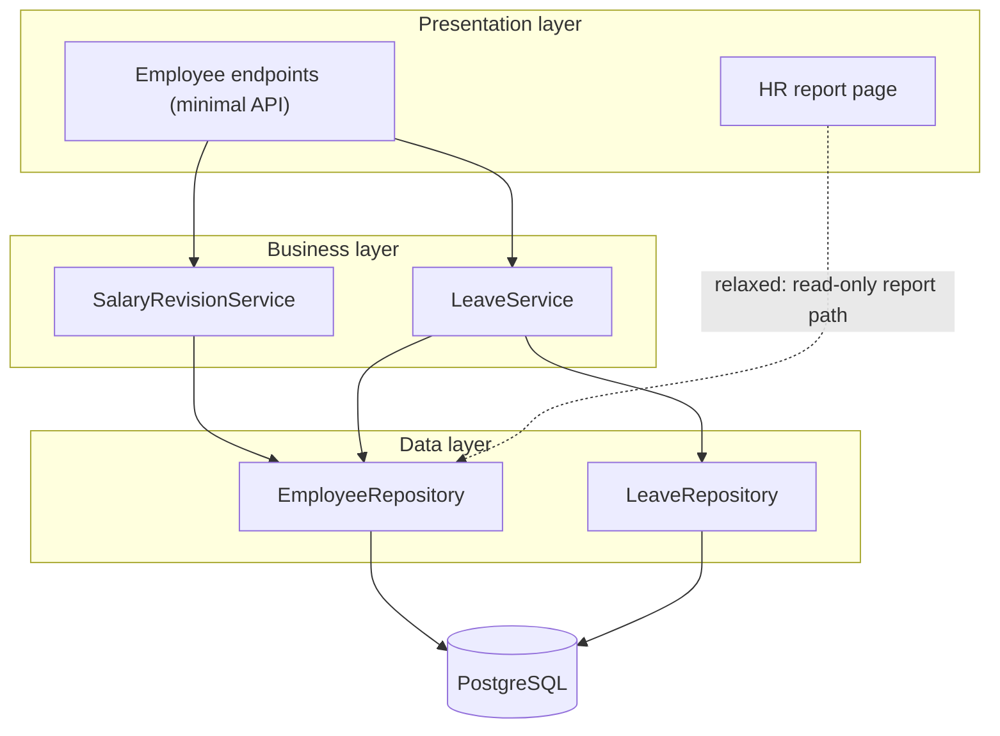
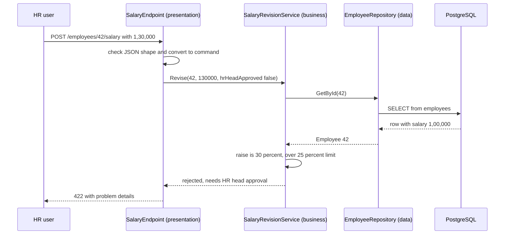
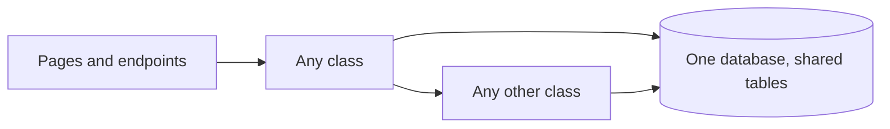
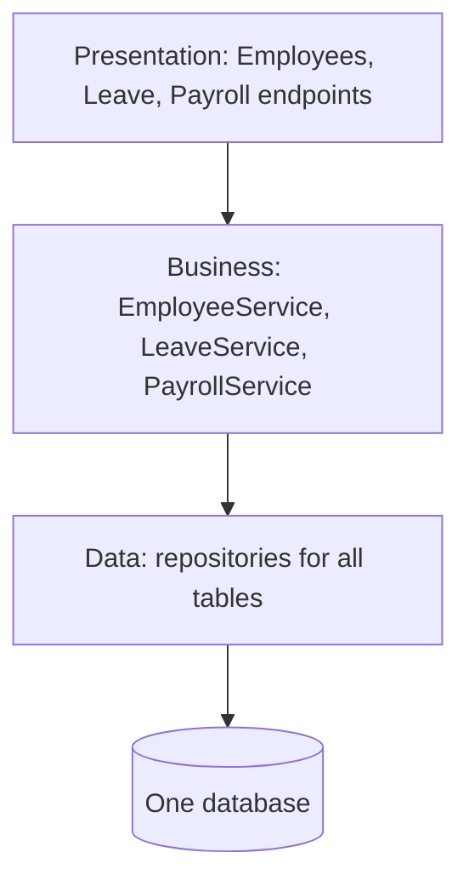
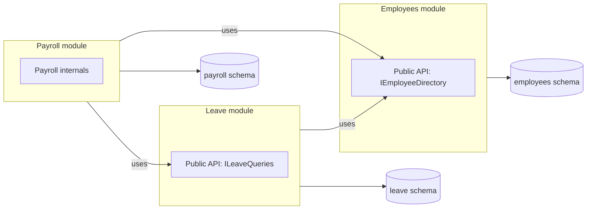

The layered architecture is the most widely used way to organise the inside of an application, and the one most developers meet first. It answers one simple question: **which code is allowed to call which?** This lesson covers the classic three layers, which way dependencies point, strict and relaxed layering, the ways layering goes wrong, and, as the module exercise, a side-by-side design of the **employee management application** (EMS) as a plain monolith, a layered app and a modular monolith.

## Learning objectives

By the end of this lesson you will be able to:

1. Name the three classic layers (presentation, business, data) and say what belongs in each.
2. Explain the dependency rule of layering: a layer may depend only on layers below it, never above.
3. Distinguish strict (closed) layering from relaxed (open) layering, and choose between them.
4. Spot the common failure modes: business rules leaking into controllers or SQL, the sinkhole anti-pattern, and features smeared across every layer.
5. Build a small layered EMS feature in ASP.NET Core and test the business layer without a database.
6. Compare a plain monolith, a layered monolith and a modular monolith on structure, dependencies, testing and deployment.

## Prerequisites

- [What is software architecture?](#/lesson/m02-what-is-architecture): quality attributes such as modifiability and testability.
- [Monolithic architecture](#/lesson/m02-monolith): one deployable unit. Layering is a way to organise the inside of that unit.

## Explain it like I'm a beginner

Think of a bank branch.

- At the **front counter**, a cashier talks to customers. They take your form, check that it is filled in, and give you a receipt. They do not decide whether you get a loan.
- In the **back office**, officers apply the bank's rules: Is your balance high enough? Is this withdrawal above the daily limit? Does this loan need a manager's approval?
- In the **vault and records room**, the money and ledgers are stored. The records clerk fetches and files records exactly as asked, without knowing why.

The cashier passes requests to the back office. The back office asks the records room for data. The records room never walks out to the counter to chat with customers, and the back office never asks the cashier what to do. Requests flow **down**, answers flow back **up**.

That is a **layered architecture**:

- The front counter is the **presentation layer** (screens, web pages, API endpoints).
- The back office is the **business layer** (rules and processes, sometimes called the domain or service layer).
- The records room is the **data layer** (also called data access or persistence: reading and writing the database).

Why bother? Because each layer can change for its own reasons. The bank can redesign the counter (a new mobile app) without changing the loan rules. It can move records from paper to a computer without retraining cashiers. And you can test the loan rules by handing the back office a fake records room, without opening a real vault.

## First-principles explanation

### The three classic layers

| Layer | Responsibility | In EMS | In ASP.NET Core |
|---|---|---|---|
| Presentation | Accept input, validate its shape, call the business layer, format the output. Knows HTTP, HTML, JSON. | `POST /employees/42/salary` endpoint, the HR web page | Controllers, minimal API endpoints, Razor Pages, request/response DTOs |
| Business (domain, application) | Business rules and workflows. Knows nothing about HTTP or SQL. | "A raise above 25 % needs HR head approval", "leave balance cannot go negative" | Service classes, domain entities, validators of business rules |
| Data (persistence) | Store and retrieve data. Knows the database, its tables and queries. | Read and update the `employees` and `salary_history` tables | Repositories, EF Core `DbContext`, SQL queries |

Some systems add more: a separate **application/service layer** above the domain (to orchestrate use cases and transactions), or an **integration layer** for external systems. The idea is the same: each layer has one kind of job.

### The dependency rule

**A layer may depend only on layers below it.** Presentation calls business. Business calls data. Never the other way.

Why the direction matters:

- **Change isolation.** The data layer can change its SQL without the presentation layer noticing. The presentation layer can add a mobile API without touching the rules.
- **Reuse.** The same business layer serves the web UI, the REST API and a nightly import job.
- **Understandability.** A new developer knows where to look: rules in business, queries in data, HTTP in presentation.

What breaks the rule:

- A business service that takes an `HttpContext` parameter (depends upward on presentation).
- A repository that throws an `IActionResult` or returns a view model (data knows about presentation).
- A database trigger that sends emails (business logic hidden in the data layer).

### Strict vs relaxed layering

In **strict** (closed) layering, each layer may call **only the layer directly below**. Presentation must go through business to reach data, even for a simple read.

In **relaxed** (open) layering, a layer may call **any layer below**. Presentation may read from the data layer directly for a simple list or report.

```text
Strict:   Presentation → Business → Data
Relaxed:  Presentation → Business → Data
          Presentation ───────────→ Data   (allowed for some calls)
```

| | Strict | Relaxed |
|---|---|---|
| Benefit | Every rule is applied, because every request passes through business | Less boilerplate for simple reads |
| Cost | "Pass-through" methods that only forward calls | Rules can be bypassed by accident (for example, salary visible in a report that skipped the access check) |
| Good for | Writes, anything with rules or security | Read-only reports and lookups with no rules |

A practical middle ground is to mark specific layers as **open**. For example, a shared "infrastructure" layer of logging and time helpers is open, so any layer may use it. Or allow a read-only query path for reports, while every write goes through business. Write the choice down, and check it with an architecture test.

### The sinkhole anti-pattern

If most requests pass through the business layer without any business logic (`GetEmployee(id) => _repo.GetEmployee(id)`), you have built a **sinkhole**: layers that cost code and indirection but add nothing. A rough rule of thumb (from Mark Richards' description of layered architecture): if around 20 % of requests are simple pass-throughs, that is normal. If 80 % are, the layering is not helping, and relaxed layering or a different structure (such as [vertical slices](#/lesson/m02-vertical-slice)) may fit better.

### Problems layering does not solve

- **Features are spread across layers.** Adding "paternity leave" touches the leave page (presentation), the leave rules (business) and the leave tables (data). Every feature cuts horizontally through every layer. In a large app, three teams editing all three layers step on each other.
- **The business layer still depends on the data layer.** Classic layering puts the database at the bottom, so business code references data-layer types. That makes business logic harder to test without a database, unless you put interfaces in between. Moving those interfaces *into* the business layer, so the data layer depends on business instead, is the key idea of [Clean and Onion architecture](#/lesson/m02-clean-onion) and [Hexagonal architecture](#/lesson/m02-hexagonal).
- **Layers are not modules.** A layered app can still be a big ball of mud *within* each layer: `LeaveService` calling `PayrollRepository` directly. Layers separate technical concerns, not business capabilities. That is what a [modular monolith](#/lesson/m02-modular-monolith) adds.

### Layers are not tiers

A **layer** is a logical grouping of code. A **tier** is a physical place where code runs (a browser, a server, a database server). All three EMS layers can run in one process on one server: three layers, one application tier, plus a database tier. We cover this distinction fully in [three-tier and n-tier architecture](#/lesson/m02-n-tier).

### When layering is the right choice

- Small to medium applications with mostly CRUD plus some rules.
- Teams that are new to the codebase: layers are easy to explain and find.
- As a starting point inside each module of a modular monolith.

When it is not enough: large domains with many independent business areas (add modules), complex rules that need heavy testing without infrastructure (invert the dependencies), or highly feature-driven teams (consider vertical slices).

## Visual explanation

### The layers of EMS and their dependencies



Solid arrows are the normal dependencies: endpoints call business services, business services call repositories, repositories talk to PostgreSQL. Every arrow points **down**. Nothing in the data layer knows the business layer exists, and nothing in the business layer knows about HTTP. The dotted arrow is a **relaxed** path: the HR report page reads directly from the employee repository because the report applies no business rules. That is a conscious exception. If the report ever needs a rule (for example "hide salaries from non-HR users"), the dotted arrow must go away and the request must pass through the business layer.

### One request through the layers



The request enters at the top and moves down one layer at a time. The presentation layer only checks that the input is well-formed (a number, not text) and translates it into a business call. The business layer loads the employee through the repository, computes the raise (1,30,000 ÷ 1,00,000 = 30 %) and applies the rule that raises above 25 % need HR head approval. It returns a business result, not an HTTP status code. The presentation layer decides that "rejected by rule" maps to `422 Unprocessable Entity`. Each layer has done exactly its own job, which is why the same `SalaryRevisionService` could also be called from a bulk-import job with no HTTP at all.

## Step-by-step example

### Step 1 — the unlayered version

```csharp
app.MapPost("/employees/{id}/salary", async (int id, decimal newSalary, NpgsqlConnection db) =>
{
    var current = await db.QuerySingleAsync<decimal>("select salary from employees where id = @id", new { id });
    if (newSalary > current * 1.25m) return Results.UnprocessableEntity("Needs HR head approval");
    await db.ExecuteAsync("update employees set salary = @newSalary where id = @id", new { id, newSalary });
    return Results.Ok();
});
```

Short and readable, but the 25 % rule lives inside an HTTP endpoint next to SQL. The bulk-import job needs the same rule and copies it. Six months later the two copies disagree.

### Step 2 — pull the rule into a business service

Create `SalaryRevisionService.Revise(employeeId, newSalary, hrHeadApproved)`. The endpoint now only parses input and calls the service. The rule exists once.

### Step 3 — pull the SQL into a repository

The service needs to load and save employees, so it depends on `IEmployeeRepository`. The SQL moves into `EmployeeRepository`. The service can now be tested with an in-memory fake.

### Step 4 — map results at the top

The service returns a `RevisionResult` (accepted, or rejected with a reason). Only the presentation layer turns that into `200` or `422`. The business layer stays free of HTTP.

### Step 5 — decide strict or relaxed, and enforce it

EMS chooses: **all writes go through business** (strict), **read-only reports may query the data layer directly** (relaxed). An architecture test checks that no presentation type except report pages references the data layer.

## Production-style C# implementation

One project, three namespaces as layers. (Larger systems often use three projects, which lets the compiler enforce the dependency direction through project references.)

```text
Ems.Layered/
  Program.cs
  Presentation/
    SalaryEndpoints.cs
  Business/
    Employee.cs
    SalaryRevisionService.cs
  Data/
    IEmployeeRepository.cs
    InMemoryEmployeeRepository.cs
```

```csharp file=Data/IEmployeeRepository.cs
namespace Ems.Layered.Data;

/// <summary>Row shape as stored. The data layer knows nothing about business rules or HTTP.</summary>
public sealed record EmployeeRow(int Id, string Name, string Department, decimal MonthlySalary);

public interface IEmployeeRepository
{
    Task<EmployeeRow?> GetByIdAsync(int id, CancellationToken ct);
    Task UpdateSalaryAsync(int id, decimal newSalary, CancellationToken ct);
    Task<IReadOnlyList<EmployeeRow>> ListByDepartmentAsync(string department, CancellationToken ct);
}
```

```csharp file=Data/InMemoryEmployeeRepository.cs
using System.Collections.Concurrent;

namespace Ems.Layered.Data;

/// <summary>Stand-in for an EF Core or Dapper repository against PostgreSQL.</summary>
public sealed class InMemoryEmployeeRepository : IEmployeeRepository
{
    private readonly ConcurrentDictionary<int, EmployeeRow> _rows = new()
    {
        [42] = new(42, "Vikram Rao", "Engineering", 100_000m),
        [43] = new(43, "Ananya Das", "Engineering", 85_000m),
        [51] = new(51, "Farhan Ali", "Finance", 92_000m),
    };

    public Task<EmployeeRow?> GetByIdAsync(int id, CancellationToken ct) =>
        Task.FromResult(_rows.GetValueOrDefault(id));

    public Task UpdateSalaryAsync(int id, decimal newSalary, CancellationToken ct)
    {
        _rows.AddOrUpdate(id, _ => throw new KeyNotFoundException($"Employee {id} not found."),
                          (_, row) => row with { MonthlySalary = newSalary });
        return Task.CompletedTask;
    }

    public Task<IReadOnlyList<EmployeeRow>> ListByDepartmentAsync(string department, CancellationToken ct) =>
        Task.FromResult<IReadOnlyList<EmployeeRow>>(
            _rows.Values.Where(r => r.Department.Equals(department, StringComparison.OrdinalIgnoreCase))
                        .OrderBy(r => r.Name).ToList());
}
```

```csharp file=Business/Employee.cs
namespace Ems.Layered.Business;

public sealed record RevisionCommand(int EmployeeId, decimal NewMonthlySalary, bool HrHeadApproved);

public enum RevisionOutcome { Accepted, NotFound, Invalid, NeedsHrHeadApproval }

public sealed record RevisionResult(RevisionOutcome Outcome, string Message, decimal? OldSalary = null, decimal? NewSalary = null)
{
    public static RevisionResult Accepted(decimal oldSalary, decimal newSalary) =>
        new(RevisionOutcome.Accepted, "Salary revised.", oldSalary, newSalary);
}
```

```csharp file=Business/SalaryRevisionService.cs
using Ems.Layered.Data;

namespace Ems.Layered.Business;

/// <summary>Business layer: owns the salary revision rules. Depends downward on the data layer only.</summary>
public sealed class SalaryRevisionService(IEmployeeRepository employees, ILogger<SalaryRevisionService> logger)
{
    public const decimal MaxRaiseWithoutApproval = 0.25m;   // 25 %

    public async Task<RevisionResult> ReviseAsync(RevisionCommand command, CancellationToken ct)
    {
        if (command.NewMonthlySalary <= 0)
            return new(RevisionOutcome.Invalid, "Salary must be positive.");

        var employee = await employees.GetByIdAsync(command.EmployeeId, ct);
        if (employee is null)
            return new(RevisionOutcome.NotFound, $"Employee {command.EmployeeId} not found.");

        if (command.NewMonthlySalary < employee.MonthlySalary)
            return new(RevisionOutcome.Invalid, "Salary reductions go through the separate HR process.");

        var raise = (command.NewMonthlySalary - employee.MonthlySalary) / employee.MonthlySalary;
        if (raise > MaxRaiseWithoutApproval && !command.HrHeadApproved)
            return new(RevisionOutcome.NeedsHrHeadApproval,
                $"A raise of {raise:P0} is above {MaxRaiseWithoutApproval:P0} and needs HR head approval.");

        await employees.UpdateSalaryAsync(employee.Id, command.NewMonthlySalary, ct);
        logger.LogInformation("Salary of employee {Id} revised from {Old} to {New}", employee.Id, employee.MonthlySalary, command.NewMonthlySalary);
        return RevisionResult.Accepted(employee.MonthlySalary, command.NewMonthlySalary);
    }
}
```

```csharp file=Presentation/SalaryEndpoints.cs
using Ems.Layered.Business;
using Ems.Layered.Data;

namespace Ems.Layered.Presentation;

public sealed record ReviseSalaryRequest(decimal NewMonthlySalary, bool HrHeadApproved);

/// <summary>Presentation layer: HTTP in, HTTP out. Translates between JSON and business commands and results.</summary>
public static class SalaryEndpoints
{
    public static IEndpointRouteBuilder MapSalaryEndpoints(this IEndpointRouteBuilder app)
    {
        app.MapPost("/employees/{id:int}/salary", async (int id, ReviseSalaryRequest body, SalaryRevisionService service, CancellationToken ct) =>
        {
            var result = await service.ReviseAsync(new RevisionCommand(id, body.NewMonthlySalary, body.HrHeadApproved), ct);
            return result.Outcome switch
            {
                RevisionOutcome.Accepted => Results.Ok(new { result.OldSalary, result.NewSalary }),
                RevisionOutcome.NotFound => Results.NotFound(),
                RevisionOutcome.Invalid => Results.Problem(result.Message, statusCode: StatusCodes.Status400BadRequest),
                RevisionOutcome.NeedsHrHeadApproval => Results.Problem(result.Message, statusCode: StatusCodes.Status422UnprocessableEntity),
                _ => Results.Problem("Unexpected outcome."),
            };
        });

        // Relaxed layering, on purpose: a read-only headcount report with no business rules
        // reads the data layer directly. Salaries are NOT exposed here.
        app.MapGet("/reports/departments/{name}/headcount", async (string name, IEmployeeRepository repo, CancellationToken ct) =>
        {
            var rows = await repo.ListByDepartmentAsync(name, ct);
            return Results.Ok(new { department = name, headcount = rows.Count, names = rows.Select(r => r.Name) });
        });

        return app;
    }
}
```

```csharp file=Program.cs
using Ems.Layered.Business;
using Ems.Layered.Data;
using Ems.Layered.Presentation;

var builder = WebApplication.CreateBuilder(args);

// Data layer
builder.Services.AddSingleton<IEmployeeRepository, InMemoryEmployeeRepository>();
// Business layer
builder.Services.AddScoped<SalaryRevisionService>();

var app = builder.Build();

// Presentation layer
app.MapSalaryEndpoints();

app.Run();
```

**What each layer may reference:** `Presentation` uses `Business` (and, for the one documented report, `Data`). `Business` uses `Data`. `Data` uses neither. With three separate projects, you would encode this as project references (`Ems.Presentation → Ems.Business → Ems.Data`), and the compiler would refuse an upward reference.

**Why the result type instead of exceptions?** "Raise needs approval" is a normal business outcome, not an error. Returning it as data keeps the business layer free of HTTP while letting the presentation layer pick the status code.

## Bad design vs good design

**Bad: rules leaking into the wrong layers.**

```csharp
// Presentation doing business work
app.MapPost("/employees/{id}/salary", async (int id, ReviseSalaryRequest body, IEmployeeRepository repo) =>
{
    var e = await repo.GetByIdAsync(id, default);
    if (body.NewMonthlySalary > e!.MonthlySalary * 1.25m && !body.HrHeadApproved) return Results.UnprocessableEntity();
    await repo.UpdateSalaryAsync(id, body.NewMonthlySalary, default);
    return Results.Ok();
});

// Business depending upward on presentation
public sealed class LeaveService(IHttpContextAccessor http) { /* reads http.HttpContext.User inside rules */ }

// Data layer making business decisions
// CREATE TRIGGER cap_raise BEFORE UPDATE ON employees ... RAISE EXCEPTION 'raise too large'
```

The 25 % rule is in an endpoint, so a bulk import bypasses it. `LeaveService` cannot run in a background job because there is no `HttpContext`. The trigger hides a business rule where no C# developer will look, and its error message reaches users as a database exception.

**Good:** the implementation above. Rules in one business service, the endpoint as a thin translator, the repository only storing and loading. The current user's identity, if a rule needs it, is passed into the business layer as a plain value (`approverId`), not as `HttpContext`.

**Is layering worth it for every endpoint?** No. For a read-only lookup with no rules, the business layer would be a sinkhole. Allow a relaxed read path for those, and document it.

:::callout type=tradeoff title="Strict layering protects rules, relaxed layering saves code"
Choose per kind of operation, not for the whole app. Writes and anything security-sensitive: strict. Simple, rule-free reads: relaxed is acceptable. Enforce the choice with an architecture test, or the relaxed path will spread to places that need rules.
:::

:::callout type=mistake title="Anaemic pass-through layers"
A business layer full of `GetX(id) => _repo.GetX(id)` adds files without adding value. If you find yourself writing these for most methods, either the app is mostly CRUD (relax the layering) or business logic is hiding somewhere else (go find it).
:::

## Practical playground

This single-file program models a strict three-layer EMS and prints which layer handles each step. Run it, then add a new rule to the business layer ("raises are not allowed in the first 6 months of employment") and notice that only one layer changes. Then try adding the same rule to the presentation layer instead and see why the import path skips it.

:::playground type=csharp title="Trace a request through three layers"
```csharp file=Program.cs
using System;
using System.Collections.Generic;

public sealed record EmployeeRow(int Id, string Name, decimal Salary, DateOnly JoinedOn);

// DATA LAYER
public sealed class EmployeeTable
{
    private readonly Dictionary<int, EmployeeRow> _rows = new()
    {
        [42] = new(42, "Vikram Rao", 100_000m, new DateOnly(2021, 4, 1)),
        [43] = new(43, "Ananya Das", 85_000m, new DateOnly(2026, 8, 1)),
    };
    public EmployeeRow? Get(int id) { Console.WriteLine($"  [data] SELECT employee {id}"); return _rows.GetValueOrDefault(id); }
    public void Save(EmployeeRow row) { Console.WriteLine($"  [data] UPDATE employee {row.Id} salary {row.Salary:N0}"); _rows[row.Id] = row; }
}

// BUSINESS LAYER
public sealed class SalaryRules(EmployeeTable table)
{
    public string Revise(int id, decimal newSalary, bool hrHeadApproved)
    {
        Console.WriteLine($"  [business] revise {id} to {newSalary:N0}");
        var e = table.Get(id);
        if (e is null) return "not found";
        var raise = (newSalary - e.Salary) / e.Salary;
        if (raise > 0.25m && !hrHeadApproved) return $"rejected: {raise:P0} raise needs HR head approval";
        // TODO: add "no raise in the first 6 months" here
        table.Save(e with { Salary = newSalary });
        return "accepted";
    }
}

// PRESENTATION LAYER (an HTTP endpoint and an import job both use the same business layer)
public static class Program
{
    public static void Main()
    {
        var rules = new SalaryRules(new EmployeeTable());

        Console.WriteLine("HTTP POST /employees/42/salary 1,30,000");
        Console.WriteLine("  [presentation] -> " + rules.Revise(42, 130_000m, hrHeadApproved: false));

        Console.WriteLine("HTTP POST /employees/42/salary 1,20,000");
        Console.WriteLine("  [presentation] -> " + rules.Revise(42, 120_000m, hrHeadApproved: false));

        Console.WriteLine("Bulk import row: employee 43 to 90,000");
        Console.WriteLine("  [import job] -> " + rules.Revise(43, 90_000m, hrHeadApproved: false));
    }
}
```
:::

## Exercises

:::exercise id=m02-layered-ex1 difficulty=beginner kind=code title="Put the transfer rule in the business layer"
HR wants to transfer employees between departments. Implement `TransferService.Transfer` in the business layer. It loads the employee through `IEmployeeStore` (the data layer) and applies the rules. No HTTP types allowed.
::requirements
- Unknown employee → `TransferOutcome.NotFound`.
- Target department not in the allowed list → `TransferOutcome.UnknownDepartment`.
- Transfer to the current department → `TransferOutcome.NoChange` (do not save).
- Employees on notice period (`OnNotice = true`) cannot transfer → `TransferOutcome.Blocked`.
- Otherwise save the employee with the new department and return `TransferOutcome.Done`.
- Department comparison ignores case.
::acceptance
- A valid transfer saves exactly once with the new department.
- Every rejected case saves nothing.
- Tests run with a fake store, no database.
::hint
The business layer only talks to the data layer through `IEmployeeStore`. Count `Save` calls in your fake to check "saves nothing".
::hint
Check rules before saving, in order: exists, department known, not the same, not on notice.
::hint
`string.Equals(a, b, StringComparison.OrdinalIgnoreCase)` and a `HashSet<string>` with `StringComparer.OrdinalIgnoreCase`.
::hint
```csharp
var e = _store.Find(id);
if (e is null) return TransferOutcome.NotFound;
if (!_departments.Contains(target)) return TransferOutcome.UnknownDepartment;
```
::starter
```csharp file=TransferService.cs
using System;
using System.Collections.Generic;

public sealed record StaffMember(int Id, string Name, string Department, bool OnNotice);

public interface IEmployeeStore
{
    StaffMember? Find(int id);
    void Save(StaffMember member);
}

public enum TransferOutcome { Done, NotFound, UnknownDepartment, NoChange, Blocked }

public sealed class TransferService
{
    private readonly IEmployeeStore _store;
    private readonly HashSet<string> _departments;

    public TransferService(IEmployeeStore store, IEnumerable<string> departments)
    {
        _store = store;
        _departments = new HashSet<string>(departments, StringComparer.OrdinalIgnoreCase);
    }

    public TransferOutcome Transfer(int employeeId, string targetDepartment)
    {
        throw new NotImplementedException();
    }
}
```
::tests
```csharp file=TransferServiceTests.cs
using System.Collections.Generic;
using Xunit;

public class TransferServiceTests
{
    private sealed class FakeStore : IEmployeeStore
    {
        public Dictionary<int, StaffMember> Rows { get; } = new()
        {
            [1] = new StaffMember(1, "Kavya Iyer", "Engineering", false),
            [2] = new StaffMember(2, "Rahul Verma", "Finance", true),
        };
        public int Saves { get; private set; }
        public StaffMember? Find(int id) => Rows.GetValueOrDefault(id);
        public void Save(StaffMember m) { Saves++; Rows[m.Id] = m; }
    }

    private static (TransferService svc, FakeStore store) Make()
    {
        var store = new FakeStore();
        return (new TransferService(store, new[] { "Engineering", "Finance", "HR" }), store);
    }

    [Fact]
    public void Valid_transfer_saves_once()
    {
        var (svc, store) = Make();
        Assert.Equal(TransferOutcome.Done, svc.Transfer(1, "hr"));
        Assert.Equal(1, store.Saves);
        Assert.Equal("hr", store.Rows[1].Department);
    }

    [Fact] public void Unknown_employee() => Assert.Equal(TransferOutcome.NotFound, Make().svc.Transfer(99, "HR"));

    [Fact]
    public void Unknown_department_saves_nothing()
    {
        var (svc, store) = Make();
        Assert.Equal(TransferOutcome.UnknownDepartment, svc.Transfer(1, "Marketing"));
        Assert.Equal(0, store.Saves);
    }

    [Fact]
    public void Same_department_is_no_change()
    {
        var (svc, store) = Make();
        Assert.Equal(TransferOutcome.NoChange, svc.Transfer(1, "ENGINEERING"));
        Assert.Equal(0, store.Saves);
    }

    [Fact]
    public void On_notice_is_blocked()
    {
        var (svc, store) = Make();
        Assert.Equal(TransferOutcome.Blocked, svc.Transfer(2, "HR"));
        Assert.Equal(0, store.Saves);
    }
}
```
::solution
```csharp file=TransferService.cs
using System;
using System.Collections.Generic;

public sealed record StaffMember(int Id, string Name, string Department, bool OnNotice);

public interface IEmployeeStore
{
    StaffMember? Find(int id);
    void Save(StaffMember member);
}

public enum TransferOutcome { Done, NotFound, UnknownDepartment, NoChange, Blocked }

public sealed class TransferService
{
    private readonly IEmployeeStore _store;
    private readonly HashSet<string> _departments;

    public TransferService(IEmployeeStore store, IEnumerable<string> departments)
    {
        _store = store;
        _departments = new HashSet<string>(departments, StringComparer.OrdinalIgnoreCase);
    }

    public TransferOutcome Transfer(int employeeId, string targetDepartment)
    {
        var employee = _store.Find(employeeId);
        if (employee is null) return TransferOutcome.NotFound;
        if (!_departments.Contains(targetDepartment)) return TransferOutcome.UnknownDepartment;
        if (string.Equals(employee.Department, targetDepartment, StringComparison.OrdinalIgnoreCase)) return TransferOutcome.NoChange;
        if (employee.OnNotice) return TransferOutcome.Blocked;

        _store.Save(employee with { Department = targetDepartment });
        return TransferOutcome.Done;
    }
}
```

The service has no idea whether it is called from an HTTP endpoint, a Razor page or a CSV import. The presentation layer maps `Blocked` to `409`, `UnknownDepartment` to `400`, and so on.
::mistakes
- Returning `IResult` or status codes from the service, which pulls presentation concerns down.
- Saving before checking the notice-period rule.
- Case-sensitive department checks that reject "hr" for "HR".
::extensions
Store the canonical department name (as defined in the allowed list) rather than the caller's spelling.
:::

:::exercise id=m02-layered-ex2 difficulty=beginner kind=written title="Which layer owns it?"
Assign each responsibility in EMS to **presentation**, **business** or **data**, with a one-line reason.

1. Return `404` when an employee id does not exist.
2. "Leave cannot overlap an already approved leave."
3. Convert the JSON body into a `ReviseSalaryRequest`.
4. Write the SQL that finds employees by department.
5. "A manager cannot approve their own leave."
6. Format dates as `dd-MM-yyyy` on the HR screen.
7. Map the `employees` table columns to `EmployeeRow`.
8. Decide that payroll for a mid-month joiner is prorated by calendar days.
9. Check that the request has a valid login cookie.
10. Retry a database call that hit a transient connection error.
::acceptance
- All ten assigned with reasons.
- Items 1 and 9 handled carefully: they are presentation concerns triggered by business or security facts.
::hint
Anything about HTTP, JSON, HTML or display formats is presentation.
::hint
Anything a business person would state as a rule is business.
::hint
Anything about tables, SQL or connections is data.
::solution
1. Presentation: mapping the business result "not found" to HTTP `404`.
2. Business: a leave rule.
3. Presentation: input deserialization.
4. Data: a query.
5. Business: an approval rule (the presentation layer passes the current user's id in).
6. Presentation: display format.
7. Data: persistence mapping.
8. Business: a payroll rule.
9. Presentation (authentication middleware), producing an identity the business layer can use for authorization rules.
10. Data (or infrastructure underneath it): transient retries are a persistence concern.
::mistakes
- Putting display formatting in the business layer, so payroll rules depend on culture settings.
- Putting overlap checks in a database constraint only, so the user gets a cryptic error.
:::

:::exercise id=m02-layered-ex3 difficulty=intermediate kind=code title="Check strict and relaxed layering automatically"
Write an architecture rule checker for layered code. Given the layers from top to bottom, a set of **open** layers, and a list of dependencies between layers, report every violation.
::requirements
- Dependencies within the same layer are always allowed.
- Upward dependencies (to a layer above) are always violations: `"upward"`.
- A dependency on an unknown layer is a violation: `"unknown-layer"`.
- **Relaxed** mode: any downward dependency is allowed.
- **Strict** mode: a layer may depend on the layer directly below, or skip layers only if **every skipped layer is open**. Otherwise `"skips-closed-layer"`.
- Return violations in input order.
::acceptance
- Presentation → Data in strict mode with Business closed is a violation, in relaxed mode it is not.
- Presentation → Data in strict mode is allowed if Business is marked open.
- Data → Business is `"upward"` in both modes.
::hint
Turn the layer list into a dictionary from name to index (0 = top). Downward means a larger index.
::hint
In strict mode, the skipped layers are the indices strictly between `from` and `to`.
::hint
```csharp
var skipped = layers.Skip(fromIdx + 1).Take(toIdx - fromIdx - 1);
if (skipped.Any(l => !open.Contains(l))) violations.Add(...);
```
::starter
```csharp file=LayerRules.cs
using System;
using System.Collections.Generic;
using System.Linq;

public sealed record LayerDependency(string From, string To);
public sealed record LayerViolation(LayerDependency Dependency, string Reason);

public static class LayerRules
{
    public static IReadOnlyList<LayerViolation> Check(
        IReadOnlyList<string> layersTopToBottom,
        IReadOnlySet<string> openLayers,
        IEnumerable<LayerDependency> dependencies,
        bool strict)
    {
        throw new NotImplementedException();
    }
}
```
::tests
```csharp file=LayerRulesTests.cs
using System.Collections.Generic;
using System.Linq;
using Xunit;

public class LayerRulesTests
{
    private static readonly string[] Layers = { "Presentation", "Business", "Data" };
    private static readonly HashSet<string> None = new();

    private static IReadOnlyList<LayerViolation> Run(bool strict, IReadOnlySet<string> open, params LayerDependency[] deps) =>
        LayerRules.Check(Layers, open, deps, strict);

    [Fact]
    public void Skip_closed_layer_in_strict_mode_is_violation()
    {
        var v = Assert.Single(Run(true, None, new LayerDependency("Presentation", "Data")));
        Assert.Equal("skips-closed-layer", v.Reason);
    }

    [Fact] public void Skip_allowed_in_relaxed_mode() => Assert.Empty(Run(false, None, new LayerDependency("Presentation", "Data")));

    [Fact] public void Skip_allowed_through_open_layer() =>
        Assert.Empty(Run(true, new HashSet<string> { "Business" }, new LayerDependency("Presentation", "Data")));

    [Fact]
    public void Upward_always_violation()
    {
        Assert.Equal("upward", Assert.Single(Run(true, None, new LayerDependency("Data", "Business"))).Reason);
        Assert.Equal("upward", Assert.Single(Run(false, None, new LayerDependency("Data", "Business"))).Reason);
    }

    [Fact] public void Same_layer_and_adjacent_allowed() =>
        Assert.Empty(Run(true, None, new LayerDependency("Business", "Business"), new LayerDependency("Business", "Data")));

    [Fact]
    public void Unknown_layer_and_order_preserved()
    {
        var result = Run(true, None, new LayerDependency("Data", "Presentation"), new LayerDependency("Business", "Cache"));
        Assert.Equal(new List<string> { "upward", "unknown-layer" }, result.Select(v => v.Reason).ToList());
    }
}
```
::solution
```csharp file=LayerRules.cs
using System;
using System.Collections.Generic;
using System.Linq;

public sealed record LayerDependency(string From, string To);
public sealed record LayerViolation(LayerDependency Dependency, string Reason);

public static class LayerRules
{
    public static IReadOnlyList<LayerViolation> Check(
        IReadOnlyList<string> layersTopToBottom,
        IReadOnlySet<string> openLayers,
        IEnumerable<LayerDependency> dependencies,
        bool strict)
    {
        var index = layersTopToBottom.Select((name, i) => (name, i)).ToDictionary(x => x.name, x => x.i);
        var violations = new List<LayerViolation>();

        foreach (var d in dependencies)
        {
            if (!index.TryGetValue(d.From, out var from) || !index.TryGetValue(d.To, out var to))
            {
                violations.Add(new(d, "unknown-layer"));
                continue;
            }
            if (to == from) continue;
            if (to < from) { violations.Add(new(d, "upward")); continue; }
            if (!strict || to == from + 1) continue;

            var skipped = layersTopToBottom.Skip(from + 1).Take(to - from - 1);
            if (skipped.Any(l => !openLayers.Contains(l))) violations.Add(new(d, "skips-closed-layer"));
        }
        return violations;
    }
}
```

In a real project, feed this from reflection (which namespaces each type's constructor parameters come from) or use NetArchTest's `ShouldNot().HaveDependencyOn(...)`. Run it in CI so a relaxed shortcut cannot appear silently.
::alternatives
With separate projects per layer, the compiler enforces "no upward references" for free through project references. You still need a check like this for the strict/relaxed rule, since a project reference to `Data` from `Presentation` is all-or-nothing.
::mistakes
- Treating "skip" as allowed if *any* skipped layer is open, instead of *all*.
- Forgetting same-layer dependencies, which are normal.
- Throwing on an unknown layer instead of reporting it.
:::

:::exercise id=m02-layered-ex4 difficulty=intermediate kind=design title="Fix the dependency directions in the leave feature"
The class model below for EMS leave approval has two dependencies pointing the wrong way and one layer doing another layer's job. Redesign it so that every dependency points down, and each class does only its own layer's work.
::acceptance
- No dependency from Data to Business or Presentation, or from Business to Presentation.
- The overlap rule lives in the business layer.
- The controller only translates between HTTP and business calls.
::hint
Look for any class that holds an `HttpContext`, a view model, or an `IActionResult` below the presentation layer.
::hint
Where is "leave must not overlap an approved leave" currently checked? Is that the right layer?
::hint
The business layer needs the current user's id, not the whole HTTP context. Pass it as a parameter.
::starter
```json
{
  "classes": [
    { "id": "Ctl", "name": "LeaveController", "kind": "class", "fields": ["-LeaveRepository _repo"], "methods": ["+IActionResult Approve(int id)"], "responsibility": "HTTP endpoint, also checks overlap rule" },
    { "id": "Svc", "name": "LeaveService", "kind": "class", "fields": ["-IHttpContextAccessor _http"], "methods": ["+void Approve(int id)"], "responsibility": "Reads current user from HttpContext" },
    { "id": "Repo", "name": "LeaveRepository", "kind": "class", "fields": ["-LeaveService _svc"], "methods": ["+LeaveViewModel Get(int id)"], "responsibility": "Loads leave and returns a view model" }
  ],
  "relations": [
    { "from": "Ctl", "to": "Repo", "kind": "dependency" },
    { "from": "Svc", "to": "Ctl", "kind": "dependency", "label": "via HttpContext" },
    { "from": "Repo", "to": "Svc", "kind": "dependency" }
  ]
}
```
::solution
```json
{
  "classes": [
    { "id": "Ctl", "name": "LeaveController", "kind": "class", "fields": ["-LeaveService _service"], "methods": ["+IActionResult Approve(int id)"], "responsibility": "Reads user id from the request, calls the service, maps the result to HTTP" },
    { "id": "Svc", "name": "LeaveService", "kind": "class", "fields": ["-ILeaveRepository _repo"], "methods": ["+ApprovalResult Approve(int requestId, int approverId)"], "responsibility": "Approval and overlap rules" },
    { "id": "IRepo", "name": "ILeaveRepository", "kind": "interface", "fields": [], "methods": ["LeaveRequest Get(int id)", "IReadOnlyList~LeaveRequest~ ApprovedFor(int employeeId)", "void Save(LeaveRequest r)"] },
    { "id": "Repo", "name": "LeaveRepository", "kind": "class", "fields": ["-string _connectionString"], "methods": ["+LeaveRequest Get(int id)"], "responsibility": "SQL only, returns entities" },
    { "id": "Req", "name": "LeaveRequest", "kind": "class", "fields": ["+int Id", "+int EmployeeId", "+DateOnly From", "+DateOnly To"], "methods": ["+bool Overlaps(LeaveRequest other)"] }
  ],
  "relations": [
    { "from": "Ctl", "to": "Svc", "kind": "dependency" },
    { "from": "Svc", "to": "IRepo", "kind": "dependency" },
    { "from": "Repo", "to": "IRepo", "kind": "implements" },
    { "from": "Svc", "to": "Req", "kind": "association" },
    { "from": "IRepo", "to": "Req", "kind": "dependency" }
  ]
}
```

Changes: the controller no longer touches the repository, it calls `LeaveService`. The service receives `approverId` as a parameter instead of reading `HttpContext`, which removes the upward dependency and makes it usable from jobs. The repository returns `LeaveRequest` entities, not view models, and no longer references the service. The overlap rule moves to the business layer (`LeaveRequest.Overlaps` plus the service checking approved leaves).
::mistakes
- Leaving the overlap check in the controller "because it already works".
- Fixing the repository-to-service cycle by merging the two classes.
:::

:::exercise id=m02-layered-ex5 difficulty=advanced kind=written title="Module exercise: design EMS three ways"
Design EMS (Employees, Leave, Payroll) three ways: as a **plain monolith**, as a **layered monolith**, and as a **modular monolith**. For each, give (1) a diagram, (2) the folder structure, (3) the allowed dependencies, (4) how you would test leave approval, and (5) how you deploy it. Finish with a comparison table and a recommendation for a team of 4 that expects to grow to 15.
::acceptance
- Three diagrams and three folder structures that are clearly different.
- Dependencies stated as rules a tool could check.
- Testing approach for the same use case in all three.
- Deployment described for all three, making clear that it is the same for all.
- A recommendation with reasons tied to team growth.
::hint
All three are a single deployable. What differs is how the code inside is grouped: not at all, by technical role, or by business capability.
::hint
In the modular version, each module can be layered inside. What is each module's public surface?
::hint
For testing, ask: what do I have to fake to test leave approval in each design?
::hint
For the modular monolith, ask: may Payroll read Leave's tables? What does it use instead?
::solution
**1. Plain monolith (unstructured).**



```text
Ems/
  Controllers/  EmployeesController.cs, LeaveController.cs, PayrollController.cs
  Helpers/      LeaveHelper.cs, PayrollHelper.cs, DbHelper.cs
  Models/       Employee.cs, Leave.cs, PayrollRow.cs
  Program.cs
```

Dependencies: none enforced. Controllers write SQL, helpers call each other, payroll reads the leave table. Testing leave approval: hard to isolate; usually tested through the UI or with a real database. Deployment: one app, one database.

**2. Layered monolith.**



```text
Ems/
  Presentation/  EmployeeEndpoints.cs, LeaveEndpoints.cs, PayrollEndpoints.cs
  Business/      EmployeeService.cs, LeaveService.cs, PayrollService.cs
  Data/          EmployeeRepository.cs, LeaveRepository.cs, PayrollRepository.cs
  Program.cs
```

Dependencies: Presentation → Business → Data, nothing upward, writes strict. Inside the business layer, `PayrollService` may call `LeaveRepository` directly: layers say nothing about features. Testing: unit-test `LeaveService` with a fake `ILeaveRepository` and `IEmployeeRepository`. Deployment: one app, one database.

**3. Modular monolith.**



```text
Ems/
  Host/                 Program.cs (composes modules)
  Modules/
    Employees/
      Contracts/        IEmployeeDirectory.cs, EmployeeSummary.cs   (public)
      Internal/         Endpoints/, Business/, Data/                 (internal)
    Leave/
      Contracts/        ILeaveQueries.cs, ApprovedLeave.cs
      Internal/         Endpoints/, Business/, Data/
    Payroll/
      Contracts/        IPayrollRuns.cs
      Internal/         Endpoints/, Business/, Data/
```

Dependencies: a module may use another module **only through its Contracts**. Each module owns its own schema; no cross-module table access. Inside each module, the code is layered. Testing: unit-test Leave's business layer with fakes, plus a module test that runs the Leave module with a fake `IEmployeeDirectory`; Payroll tests fake `ILeaveQueries`. Deployment: still one app, one database (separate schemas).

**Comparison.**

| | Plain monolith | Layered | Modular monolith |
|---|---|---|---|
| Grouping | None | Technical role | Business capability, layered inside |
| Enforced rules | None | Downward only | Downward inside modules, contracts-only between modules, schema per module |
| Change "add paternity leave" | Anywhere | Touches all three layer folders | Inside the Leave module only |
| Testing leave approval | Needs real DB or UI | Fake repositories | Fake repositories plus fake other modules' contracts |
| Team scaling | Poor | Moderate (shared layers) | Good (module owners) |
| Deployment | One unit | One unit | One unit |
| Effort to extract a service later | Very high | High | Moderate: module boundary already exists |

**Recommendation for 4 → 15 developers:** a modular monolith, layered inside each module. At 4 people the extra cost is a few folders and contract interfaces. At 15, three teams can own Employees, Leave and Payroll with few conflicts, and if Payroll later needs separate scaling, it can be extracted along an existing boundary. See [Modular monolith architecture](#/lesson/m02-modular-monolith) for the details of contracts and schema ownership.
::mistakes
- Describing different deployments for the three: all three are one deployable unit.
- Calling the layered version "modular" because it has folders.
- Letting modules share tables "just for reports", which quietly recreates the coupling.
:::

## Automated testing

Layering pays off most in tests: the business layer is where the rules live, and it can be tested without HTTP or a database.

**1. Business layer unit tests with a fake repository.**

```csharp
public class SalaryRevisionServiceTests
{
    private sealed class FakeRepo : IEmployeeRepository
    {
        public EmployeeRow? Row = new(42, "Vikram Rao", "Engineering", 100_000m);
        public decimal? Saved;
        public Task<EmployeeRow?> GetByIdAsync(int id, CancellationToken ct) => Task.FromResult(Row);
        public Task UpdateSalaryAsync(int id, decimal s, CancellationToken ct) { Saved = s; return Task.CompletedTask; }
        public Task<IReadOnlyList<EmployeeRow>> ListByDepartmentAsync(string d, CancellationToken ct) =>
            Task.FromResult<IReadOnlyList<EmployeeRow>>(new List<EmployeeRow>());
    }

    [Theory]
    [InlineData(125_000, false, RevisionOutcome.Accepted)]             // exactly 25 %
    [InlineData(125_001, false, RevisionOutcome.NeedsHrHeadApproval)]
    [InlineData(130_000, true, RevisionOutcome.Accepted)]
    [InlineData(90_000, false, RevisionOutcome.Invalid)]
    public async Task Applies_raise_rules(int newSalary, bool approved, RevisionOutcome expected)
    {
        var repo = new FakeRepo();
        var svc = new SalaryRevisionService(repo, NullLogger<SalaryRevisionService>.Instance);
        var result = await svc.ReviseAsync(new RevisionCommand(42, newSalary, approved), default);
        Assert.Equal(expected, result.Outcome);
        Assert.Equal(expected == RevisionOutcome.Accepted, repo.Saved is not null);
    }
}
```

**2. Data layer integration tests** against a real PostgreSQL (in a container) to check queries and mappings. Fewer, slower, but they catch the SQL mistakes fakes cannot.

**3. Presentation tests** with `WebApplicationFactory` that check only the translation: `NeedsHrHeadApproval` becomes `422`, a malformed body becomes `400`.

**4. Architecture tests** (exercise 3): no upward dependencies, strict for writes, and the relaxed report path limited to named types.

Edge cases worth testing: a raise of exactly 25 % (boundary), a zero or negative salary, an employee deleted between read and write, and decimal rounding (`100_000 × 1.25` is exact in `decimal`, not in `double`).

## Real-world application

- **The default ASP.NET Core template** for many teams is effectively layered: controllers or endpoints, a services folder, a data folder with EF Core. Microsoft's architecture guide calls it the "traditional N-layer" design.
- **Enterprise line-of-business apps** (HR, procurement, asset management, government grievance portals) are commonly layered monoliths. Layers make it easy for rotating contractors to find code.
- **Operating systems and network stacks** are layered in a stricter sense: the TCP/IP model's application, transport, internet and link layers each use only the layer below.
- **Clean, Onion and Hexagonal architectures** are refinements of layering that flip the dependency between business and data, so that business code depends on nothing.
- **Modular monoliths** typically use layering *inside* each module, so the skills transfer directly.

## Interview questions

:::interview
::q beginner
What are the layers in a classic layered architecture, and what does each do?
::a
Presentation handles user or API interaction (HTTP, JSON, HTML) and translates it into calls to the business layer. Business holds rules and workflows and knows nothing about HTTP or SQL. Data stores and retrieves data and knows the database. Each layer depends only on layers below it.
::q beginner
Why must dependencies point downward?
::a
So that lower layers can be reused and changed without knowing who uses them. The business layer can serve a web UI, an API and a batch job. The data layer can change its SQL without breaking screens. An upward dependency, such as a service reading `HttpContext`, ties lower layers to one particular caller and makes them harder to test and reuse.
::q intermediate
Explain strict versus relaxed layering and when you would use each.
::a
Strict (closed) layering lets a layer call only the layer directly below; relaxed (open) layering allows calls to any lower layer. Strict guarantees every request passes through business rules, which matters for writes and security. Relaxed avoids pass-through code for rule-free reads such as simple reports. A common approach is strict for writes, relaxed for documented read-only paths, enforced by architecture tests. Individual layers can also be marked open, like a shared utilities layer.
::q intermediate
What is the architecture sinkhole anti-pattern?
::a
Requests that pass through layers without any logic being applied, so each layer just forwards the call. A few such paths are normal. If most requests are sinkholes, the layering costs code and indirection without benefit, and you should relax it for those paths or reconsider the structure (for example vertical slices).
::q advanced
What are the main weaknesses of layered architecture in a large system, and what would you change?
::a
Features cut across all layers, so teams working on different features edit the same layer folders and conflict. Layers do not stop business areas from coupling to each other (Payroll using Leave's repository). And the business layer depends on the data layer, making pure unit tests harder. Changes: group code by module (business capability) first and layer inside each module; define module contracts and per-module schemas; invert the business-to-data dependency with interfaces owned by the business layer (Clean/Onion); consider vertical slices for very feature-driven teams.
::q advanced
A rule "salary is visible only to HR" is enforced in the business layer, but a relaxed report path reads salaries straight from the data layer. How do you prevent this class of bug?
::a
Make the rule impossible to bypass for sensitive data: route any query that touches salary through the business layer (strict for that data), or enforce access in the data layer too (for example PostgreSQL row-level security or views that exclude salary for non-HR roles) as defence in depth. Add an architecture test that only named report types may use the relaxed path, and a test that the report's output schema contains no salary fields. Review relaxed paths whenever the data they read changes.
:::

## Summary and revision

**Key takeaways**

- Layered architecture splits code into presentation, business and data, stacked so each layer only depends on layers below.
- The dependency rule gives change isolation, reuse of business logic and a predictable place for every kind of code.
- Strict layering protects rules. Relaxed layering saves code for rule-free reads. Choose per kind of operation and enforce it.
- Watch for rules in the wrong layer, upward dependencies, sinkholes and features smeared across layers.
- Layers are logical and say nothing about deployment. A layered app is still one monolith, and layers are not tiers.
- For growing systems, group by module first and layer inside each module.

**Terminology**: presentation layer, business (domain) layer, data (persistence) layer, dependency rule, strict (closed) layering, relaxed (open) layering, open layer, sinkhole anti-pattern, layer vs tier, modular monolith.

:::flashcards
Q: Name the three classic layers.
A: Presentation, business (domain), data (persistence).
Q: What is the dependency rule of layering?
A: A layer may depend only on layers below it, never above.
Q: Strict vs relaxed layering?
A: Strict: call only the layer directly below. Relaxed: call any lower layer.
Q: What is an open layer?
A: A layer that others may skip over even in strict mode, such as a shared utilities layer.
Q: What is the sinkhole anti-pattern?
A: Requests passing through layers that add no logic, just forwarding calls.
Q: Why should a business service not take HttpContext?
A: It creates an upward dependency on presentation and cannot run from jobs or tests without HTTP.
Q: Layer vs tier?
A: A layer is a logical grouping of code. A tier is a physical place where code runs.
Q: What does a modular monolith add to layering?
A: Grouping by business capability, with contracts between modules and per-module data ownership.
:::

## Knowledge check

:::quiz pass=70
::q single
A developer adds `IHttpContextAccessor` to `PayrollService` to read the current user. Which rule is broken?
- [ ] Strict layering, because payroll skips a layer.
- [x] The dependency rule, because the business layer now depends upward on presentation.
- [ ] None, this is the recommended approach.
- [ ] The sinkhole rule.
> Pass the user id or a small user context into the service as a value instead. Then payroll can run from a background job too.
::q single
EMS allows the HR headcount report to read the repository directly, skipping the business layer. What kind of layering is this?
- [ ] Strict layering.
- [x] Relaxed layering for a read-only path.
- [ ] Hexagonal architecture.
- [ ] A violation of the dependency rule.
> It still points downward, so the dependency rule holds. It just skips a layer, which is what relaxed layering allows.
::q single
Most business-layer methods in your app look like `GetX(id) => _repo.GetX(id)`. What does this suggest?
- [ ] The business layer is well designed.
- [x] A sinkhole: the layer adds no value for most requests, so relax layering for those reads or find where the real logic is hiding.
- [ ] You need another layer.
- [ ] You must switch to microservices.
> Pass-through layers cost code without benefit. A few are normal; most is a warning sign.
::q multi
Which of these belong in the business layer of EMS? (Select all that apply.)
- [x] Leave requests must not overlap an approved leave.
- [ ] Return 422 when a rule is broken.
- [x] Raises above 25 % need HR head approval.
- [ ] The SQL query that lists employees by department.
> Status codes are presentation, SQL is data. Rules a business person would state are business.
::q single
Your layered EMS has three layers in one ASP.NET Core process plus a PostgreSQL server. How many tiers is that?
- [ ] Three tiers, one per layer.
- [x] Typically described as two runtime tiers on the server side (application and database), plus the client. Layers do not equal tiers.
- [ ] One tier.
- [ ] Five tiers.
> Layers are logical code groupings. Tiers are physical places where code runs. All three layers share one application tier here.
::q single
"Add paternity leave" touches files in Presentation, Business and Data folders. Which design would keep this change in one place?
- [ ] Strict layering.
- [ ] Adding a fourth layer.
- [x] A modular monolith with a Leave module (layered inside), or vertical slices.
- [ ] Moving all code into the presentation layer.
> Layers group by technical role, so features cut across them. Grouping by business capability keeps a feature's changes together.
::q single
Which is the clearest way to enforce "Presentation may not depend on Data, except the report page" in CI?
- [ ] A comment in the README.
- [x] An architecture test that scans dependencies and allows only the named report type to reference the data layer.
- [ ] Code review alone.
- [ ] Make all data-layer classes `internal` without exceptions.
> Automated rules do not forget. Code review helps, but the test catches violations every time.
:::

## Completion criteria

You have finished this lesson when you can:

- [ ] Score at least 70 % on the knowledge check.
- [ ] Complete exercises 1 and 3 with all tests passing.
- [ ] Complete the module exercise (exercise 5) and compare your three designs with the solution.
- [ ] Explain strict vs relaxed layering, with one example of each from EMS, in under two minutes.
