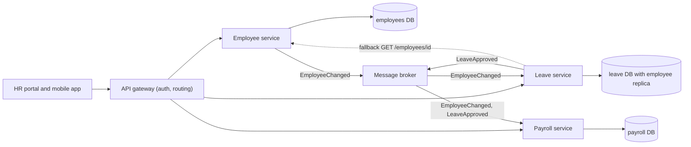
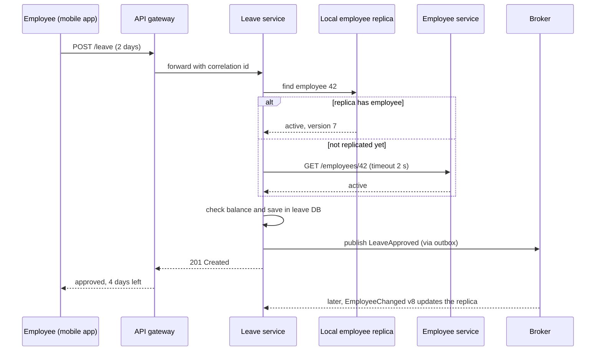

Microservices are the most talked-about architecture of the last decade, and the most often misapplied. The core idea is small: split a product into services that can each be **changed and deployed on their own** by the team that owns them. Everything else (separate databases, events, gateways, tracing) follows from protecting that independence. In this lesson we split the HR platform into services, count the costs with real arithmetic, and learn when a [modular monolith](#/lesson/m02-modular-monolith) is the better answer.

## Learning objectives

By the end of this lesson you will be able to:

1. Define a microservice by its properties: independently deployable, owns its data, organised around a business capability, owned by one team.
2. Explain why data ownership (database per service) is the rule that makes independent deployment possible.
3. Calculate the availability and latency cost of synchronous call chains.
4. Reduce runtime coupling with local data copies, asynchronous events and graceful degradation.
5. Implement an ASP.NET Core service that calls another service safely (timeouts, fallbacks) and keeps a local replica of the data it needs.
6. List the operational costs of microservices: pipelines, observability, testing and data consistency.
7. Recognise a distributed monolith and decide when not to use microservices.

## Prerequisites

- [Modular monolith architecture](#/lesson/m02-modular-monolith): microservices are modules separated by a network. Get the boundaries right there first.
- [Service-oriented architecture](#/lesson/m02-soa): we contrast the two.
- [Client-server architecture](#/lesson/m02-client-server): every inter-service call is a client-server call that can fail.

## Explain it like I'm a beginner

Think of a big wedding in Jaipur. One way to run it is with **one event company** that does everything: food, decoration, music, photography. One contract, one phone number, one bill. If the company is well organised inside (separate teams for food and decoration), this works very well. That is a modular monolith.

The other way is to hire **separate vendors**: a caterer, a decorator, a band, a photographer. Each vendor:

- has its own staff and works to its own schedule,
- owns its own equipment (the caterer's kitchen is not shared with the decorator),
- can be replaced without replacing the others,
- talks to the others only through agreed arrangements ("dinner is served at 9 pm").

That is microservices. The benefits are real: the caterer can change the menu without asking the band. A bad photographer can be swapped out. Each vendor can grow its team for a 2,000-guest wedding without the others growing.

But look at the costs. **Someone must coordinate** all the vendors. If the band is late, dinner is delayed. If the caterer's phone is switched off, nobody knows whether food is coming. Every vendor needs their own transport, their own insurance, their own invoice. For a 50-guest family function, hiring six vendors is silly. One good company is cheaper and simpler.

In software:

- Each vendor is a **service** (Employee service, Leave service, Payroll service).
- Each vendor's own kitchen is **its own database**. Nobody else cooks there.
- "Dinner is served at 9 pm" is an **API contract** or an **event**.
- The coordination cost is **network calls, monitoring, deployment pipelines and data consistency work**.

## First-principles explanation

### What it is

A microservice architecture builds one product as a set of small services, where each service:

1. **Is independently deployable.** You can release the Leave service on Tuesday without releasing or retesting anything else.
2. **Owns its data.** It has its own database (or schema with exclusive access). Other services get its data only through its API or its events.
3. **Is organised around a business capability** (leave management), not a technical layer (a "database service").
4. **Is owned by one team** that builds, deploys and runs it ("you build it, you run it").
5. **Communicates over the network** with lightweight mechanisms: HTTP/JSON, gRPC, or messages on a broker.

"Micro" is about **scope**, not lines of code. A service small enough for one team to understand completely and change confidently is the right size.

### Why it exists — the problem

As a product and its organisation grow, a single deployable starts to hurt in specific ways:

- **Release coupling.** 8 teams share one release train. One team's broken change blocks everyone's release, so releases slow from daily to fortnightly.
- **Scaling coupling.** The payslip PDF generator needs 16 CPU cores at month-end. In a monolith you scale the whole app, including parts that are idle.
- **Technology coupling.** Everything must use the same runtime and library versions. Upgrading a shared library is a company-wide project.
- **Fault coupling.** A memory leak in report generation crashes the process that also serves leave approvals.

Microservices remove those couplings by putting a process and network boundary between capabilities.

### How it works internally

**Independent deployment needs independent data.** If the Leave and Payroll services share a `leave_requests` table, a column change in that table forces both to deploy together. That is not independent. So each service gets its own database, and that single rule drives most of the architecture:

- **Queries across services** become API calls or local copies. Leave can't `JOIN employees`. It either asks the Employee service, or it keeps a **local read-only replica** of the few employee fields it needs, updated from `EmployeeChanged` events.
- **Transactions across services** become [sagas](#/lesson/m12-sagas): a sequence of local transactions with compensating actions, because there is no shared database transaction.
- **Consistency** becomes **eventual** for anything that crosses services: after Asha is marked as exited in the Employee service, the Leave service may still think she is active for a few seconds.

**Communication** comes in two styles:

- **Synchronous** (HTTP, gRPC): the caller waits. Simple to reason about, but it couples the caller's availability and latency to the callee's.
- **Asynchronous** (events or commands via RabbitMQ, Kafka or Azure Service Bus): the caller does not wait. More resilient, but harder to trace and reason about. See [Event-driven architecture](#/lesson/m02-event-driven).

**The supporting platform** every microservice system needs:

| Need | Typical solution |
|---|---|
| One entry point for clients | [API gateway or BFF](#/lesson/m16-gateway-bff) |
| Find service addresses | [Service discovery](#/lesson/m10-service-discovery), DNS in Kubernetes |
| Survive slow or failing dependencies | [Timeouts, retries](#/lesson/m10-timeouts-retries), [circuit breakers](#/lesson/m10-circuit-breaker) |
| Follow one request across services | [Correlation ids](#/lesson/m10-correlation) and distributed tracing (OpenTelemetry) |
| Deploy many services | One CI/CD pipeline per service, containers, an orchestrator |
| Keep data in sync | Events, [outbox](#/lesson/m12-outbox), [idempotent consumers](#/lesson/m12-idempotent-consumers) |

### The arithmetic of synchronous chains

**Availability multiplies.** If a request needs 5 services in series, each 99.9 % available, the request is available only when all five are up:

`0.999 × 0.999 × 0.999 × 0.999 × 0.999 = 0.999^5 ≈ 0.995`, so about 99.5 %.

In a 30-day month (43,200 minutes):

- 99.9 % means up to 43 minutes of downtime.
- 99.5 % means up to about 216 minutes, or 3.6 hours.

Five individually "good" services produce a noticeably worse product.

**Latency adds up.** A call between services in the same data centre often costs around 1–5 ms including serialisation (an estimate; measure your own). A chain of 5 sequential calls adds 5–25 ms before any real work. Worse, **tail latency compounds**: if each service is slower than 200 ms for 1 % of calls, a request that touches 5 services in series has roughly `1 − 0.99^5 ≈ 4.9 %` chance of hitting at least one slow call.

That is why good microservice designs minimise synchronous chains: local data copies, parallel calls, asynchronous events and fallbacks.

### What happens without the discipline

Teams split code into services but keep a shared database, call each other synchronously in long chains, and must deploy together. This is a **distributed monolith**: all the costs of microservices (network, ops, debugging) and none of the benefits (independent change). It is the most common outcome of microservices adopted for fashion rather than need.

### When it is useful

- **Several teams** (often 4 or more, an estimate) on one product, blocked by a shared release process.
- **Very different scaling or runtime needs** between parts: a payroll calculation engine that needs 20× the compute at month-end, or a document OCR service on GPUs.
- **Clear, stable domain boundaries**, ideally proven first as modules in a monolith.
- **Organisational maturity**: automated CI/CD, infrastructure as code, monitoring and on-call already working.

### When not to use it

- **Small teams.** With 1–8 developers, the coordination microservices remove barely exists, but the operational cost is fully paid.
- **New or unclear domains.** You will draw the boundaries wrong at first. Moving a boundary inside a monolith is a refactoring. Moving it between services means migrating data and APIs.
- **No DevOps foundation.** Without automated deployment and observability, 15 services means 15 times the manual work and blind debugging.
- **Strong cross-entity consistency.** If most operations must update many entities atomically (core ledger logic), splitting them makes everything harder.
- **Low scale.** A system serving 50 requests per second fits on two modest servers. Scaling independence brings little value there.

### Trade-offs it introduces

| You gain | You pay |
|---|---|
| Independent deployment per team | A pipeline, runtime config, dashboard and on-call for every service |
| Independent scaling | Network latency and more infrastructure (at least 2 instances per service for availability) |
| Fault isolation, if designed for it | New failure modes: timeouts, partial failure, retry storms |
| Technology freedom per service | Many stacks to secure, patch and staff |
| Smaller codebases per team | Cross-service queries need APIs or replicas; cross-service writes need sagas |
| Clear ownership | Eventual consistency that users and support teams must understand |

:::callout type=tradeoff title="The microservice premium"
Martin Fowler calls the extra cost the "microservice premium". It is paid every day in operations, not once. A rough minimum for 10 services: 10 pipelines, 20+ running instances, distributed tracing, a broker, contract tests and an on-call rota. Pay it only when release, scaling or fault coupling costs you more.
:::

## Visual explanation

### The HR platform as microservices



How to read it: clients enter through one gateway, which routes each call to the owning service. **Every service has its own database**, and no arrow goes from a service into another service's database. The Employee service publishes `EmployeeChanged` events to a broker. The Leave service consumes them to keep a small local copy (replica) of employee names and active status, so it can approve leave without calling the Employee service. Payroll consumes both employee and leave events to compute salaries and unpaid leave. The dotted arrow is a synchronous fallback, used only when the replica has no record yet (for example a joiner created a second ago).

### Applying for leave, with a replica and a fallback



The common path uses only the Leave service and its own database: no network call to the Employee service, so the Employee service can be down and leave still works. The `alt` block shows the rare fallback: when the replica does not have the employee yet, the Leave service calls the Employee service with a short timeout. After saving, Leave publishes `LeaveApproved` through an outbox, so the event is not lost if the broker is briefly unavailable. The last arrow shows eventual consistency in action: changes made in the Employee service reach the replica a little later.

## Step-by-step example

We will move the HR modular monolith toward microservices, one service at a time.

### Step 1 — decide if you should

The HR platform has 3 teams (Core HR, Leave and Attendance, Payroll). Payroll releases are blocked every month-end by freezes. The payroll engine needs 16 cores for 3 days a month and almost nothing otherwise. Those are concrete reasons to extract **Payroll** first. The Employee and Leave modules have no such pressure, so they stay in the monolith for now.

### Step 2 — make the module extraction-ready

Inside the monolith, check that Payroll uses only contracts (architecture tests pass) and that it has no cross-schema foreign keys. Make its events durable with an outbox. If this step is hard, extraction would be harder.

### Step 3 — give it its own data

Move the `payroll` schema to a separate database. Payroll keeps a local copy of the employee fields it needs (name, PAN, bank account reference, salary structure id), fed by `EmployeeChanged` events. Backfill the copy once from a snapshot.

### Step 4 — put it behind a network API

Deploy Payroll as its own ASP.NET Core service with its own pipeline. In the monolith, replace the in-process `IPayrollQueries` implementation with an HTTP client that implements the same interface. Callers do not change.

### Step 5 — design for failure

Add timeouts, retries with backoff for idempotent calls, a circuit breaker, health checks, dashboards, alerts and a runbook. Decide what the HR portal shows when Payroll is down: "Payslips are temporarily unavailable" rather than an error page.

### Step 6 — measure, then repeat or stop

After a quarter, measure: did Payroll release more often? Did month-end costs drop? If yes, and another module has a concrete reason, repeat. If not, stop. **A hybrid of a modular monolith plus a few services is a perfectly good end state.**

## Production-style C# implementation

This is the **Leave service** of the HR platform. It owns leave data, keeps a local replica of the employee fields it needs, calls the Employee service only as a fallback, and exposes health checks.

```text
Leave.Service/
  Program.cs
  Replica/EmployeeReplica.cs
  Clients/EmployeeApiClient.cs
  Application/ApplyLeaveHandler.cs
  Messaging/EmployeeChangedConsumer.cs
```

### The local employee replica

```csharp file=Replica/EmployeeReplica.cs
using System.Collections.Concurrent;

namespace Leave.Service.Replica;

/// <summary>The few employee fields the Leave service needs. Owned by the Employee service, copied here read-only.</summary>
public sealed record EmployeeSnapshot(Guid EmployeeId, string FullName, bool IsActive, long Version);

/// <summary>Event published by the Employee service. Version increases with every change to that employee.</summary>
public sealed record EmployeeChanged(Guid EventId, Guid EmployeeId, string FullName, bool IsActive, long Version);

public interface IEmployeeReplica
{
    EmployeeSnapshot? Find(Guid employeeId);
    /// <summary>Applies a change if it is newer than what we have. Returns false for stale or duplicate events.</summary>
    bool Apply(EmployeeChanged change);
}

/// <summary>In production this is a table in the Leave database: employee_replica(employee_id pk, full_name, is_active, version).</summary>
public sealed class InMemoryEmployeeReplica : IEmployeeReplica
{
    private readonly ConcurrentDictionary<Guid, EmployeeSnapshot> _rows = new();

    public EmployeeSnapshot? Find(Guid employeeId) => _rows.TryGetValue(employeeId, out var s) ? s : null;

    public bool Apply(EmployeeChanged change)
    {
        var applied = false;
        _rows.AddOrUpdate(change.EmployeeId,
            _ => { applied = true; return ToSnapshot(change); },
            (_, current) =>
            {
                if (change.Version <= current.Version) { applied = false; return current; }   // out of order or duplicate
                applied = true;
                return ToSnapshot(change);
            });
        return applied;
    }

    private static EmployeeSnapshot ToSnapshot(EmployeeChanged c) => new(c.EmployeeId, c.FullName, c.IsActive, c.Version);
}
```

The `Version <= current.Version` check is what makes the replica safe. Brokers can deliver duplicates and, across partitions or retries, out of order. With the check, an old `v6` event arriving after `v7` is ignored. In PostgreSQL the same rule is one statement: `INSERT ... ON CONFLICT (employee_id) DO UPDATE SET ... WHERE employee_replica.version < EXCLUDED.version`.

### Calling another service safely

```csharp file=Clients/EmployeeApiClient.cs
using System.Net;
using System.Net.Http.Json;

namespace Leave.Service.Clients;

public sealed record EmployeeDto(Guid Id, string FullName, bool IsActive, long Version);

public interface IEmployeeApi
{
    /// <summary>Returns null when the employee does not exist. Throws EmployeeServiceUnavailableException on failure.</summary>
    Task<EmployeeDto?> GetAsync(Guid employeeId, CancellationToken ct);
}

public sealed class EmployeeServiceUnavailableException(string message, Exception? inner = null) : Exception(message, inner);

/// <summary>Typed HttpClient. BaseAddress and Timeout are configured in Program.cs.</summary>
public sealed class EmployeeApiClient(HttpClient http, ILogger<EmployeeApiClient> logger) : IEmployeeApi
{
    public async Task<EmployeeDto?> GetAsync(Guid employeeId, CancellationToken ct)
    {
        try
        {
            using var response = await http.GetAsync($"/employees/{employeeId}", ct);
            if (response.StatusCode == HttpStatusCode.NotFound) return null;
            response.EnsureSuccessStatusCode();
            return await response.Content.ReadFromJsonAsync<EmployeeDto>(ct);
        }
        catch (Exception ex) when (ex is HttpRequestException or TaskCanceledException && !ct.IsCancellationRequested)
        {
            logger.LogWarning(ex, "Employee service call failed for {EmployeeId}", employeeId);
            throw new EmployeeServiceUnavailableException("Employee service is unavailable.", ex);
        }
    }
}
```

`HttpClient.Timeout` turns a hung call into a `TaskCanceledException` after 2 seconds, so a slow Employee service can't hold Leave's threads and connections forever. The `when` filter distinguishes "our caller cancelled" from "the dependency timed out". In production you would add a resilience pipeline (retry with jitter for this idempotent GET, plus a circuit breaker) with `Microsoft.Extensions.Http.Resilience`.

### The use case

```csharp file=Application/ApplyLeaveHandler.cs
using System.Collections.Concurrent;
using Leave.Service.Clients;
using Leave.Service.Replica;

namespace Leave.Service.Application;

public sealed record ApplyLeave(Guid EmployeeId, decimal Days);

public enum Outcome { Approved, Rejected, TryLater }

public sealed record ApplyLeaveResult(Outcome Outcome, string? Reason, decimal RemainingDays);

/// <summary>Leave data owned by this service. In production: the leave database.</summary>
public sealed class LeaveBalances
{
    private readonly ConcurrentDictionary<Guid, decimal> _days = new();
    public decimal Get(Guid id) => _days.GetValueOrDefault(id, 24m);
    public void Set(Guid id, decimal days) => _days[id] = days;
}

public sealed class ApplyLeaveHandler(IEmployeeReplica replica, IEmployeeApi employees, LeaveBalances balances, ILogger<ApplyLeaveHandler> logger)
{
    public async Task<ApplyLeaveResult> HandleAsync(ApplyLeave command, CancellationToken ct)
    {
        if (command.Days <= 0) return new(Outcome.Rejected, "Days must be positive", 0m);

        bool isActive;
        var local = replica.Find(command.EmployeeId);
        if (local is not null)
        {
            isActive = local.IsActive;                 // common path: no network call
        }
        else
        {
            try
            {
                var remote = await employees.GetAsync(command.EmployeeId, ct);
                if (remote is null) return new(Outcome.Rejected, "Unknown employee", 0m);
                replica.Apply(new EmployeeChanged(Guid.NewGuid(), remote.Id, remote.FullName, remote.IsActive, remote.Version));
                isActive = remote.IsActive;
            }
            catch (EmployeeServiceUnavailableException)
            {
                logger.LogWarning("Cannot verify employee {EmployeeId}; asking client to retry", command.EmployeeId);
                return new(Outcome.TryLater, "Employee details are temporarily unavailable", 0m);
            }
        }

        if (!isActive) return new(Outcome.Rejected, "Employee is not active", 0m);
        var balance = balances.Get(command.EmployeeId);
        if (balance < command.Days) return new(Outcome.Rejected, "Insufficient balance", balance);

        balances.Set(command.EmployeeId, balance - command.Days);
        // In production: save the request and an outbox row (LeaveApproved) in one local transaction.
        return new(Outcome.Approved, null, balance - command.Days);
    }
}
```

Notice the three outcomes. `TryLater` is a deliberate design decision: when the service can't verify the employee, it **fails safe** and says so, rather than approving leave for someone who might have left. A different business might choose differently ("approve and review later"). That decision belongs to the product owner, so make it explicit.

### Consuming events

```csharp file=Messaging/EmployeeChangedConsumer.cs
using System.Threading.Channels;
using Leave.Service.Replica;

namespace Leave.Service.Messaging;

/// <summary>Stand-in for a broker subscription (RabbitMQ queue or Kafka consumer group).</summary>
public sealed class EmployeeEventsInbox
{
    private readonly Channel<EmployeeChanged> _channel = Channel.CreateBounded<EmployeeChanged>(1_000);
    public ChannelWriter<EmployeeChanged> Writer => _channel.Writer;
    public ChannelReader<EmployeeChanged> Reader => _channel.Reader;
}

public sealed class EmployeeChangedConsumer(EmployeeEventsInbox inbox, IEmployeeReplica replica, ILogger<EmployeeChangedConsumer> logger)
    : BackgroundService
{
    protected override async Task ExecuteAsync(CancellationToken stoppingToken)
    {
        await foreach (var change in inbox.Reader.ReadAllAsync(stoppingToken))
        {
            var applied = replica.Apply(change);
            logger.LogDebug("EmployeeChanged {EmployeeId} v{Version} applied={Applied}", change.EmployeeId, change.Version, applied);
        }
    }
}
```

### The host

```csharp file=Program.cs
using Leave.Service.Application;
using Leave.Service.Clients;
using Leave.Service.Messaging;
using Leave.Service.Replica;

var builder = WebApplication.CreateBuilder(args);

builder.Services.AddSingleton<IEmployeeReplica, InMemoryEmployeeReplica>();
builder.Services.AddSingleton<LeaveBalances>();
builder.Services.AddSingleton<EmployeeEventsInbox>();
builder.Services.AddHostedService<EmployeeChangedConsumer>();
builder.Services.AddScoped<ApplyLeaveHandler>();

builder.Services.AddHttpClient<IEmployeeApi, EmployeeApiClient>(client =>
{
    client.BaseAddress = new Uri(builder.Configuration["Services:Employees"] ?? "http://employee-service");
    client.Timeout = TimeSpan.FromSeconds(2);
});

builder.Services.AddHealthChecks();

var app = builder.Build();

app.MapPost("/leave", async (ApplyLeave command, ApplyLeaveHandler handler, CancellationToken ct) =>
{
    var result = await handler.HandleAsync(command, ct);
    return result.Outcome switch
    {
        Outcome.Approved => Results.Created($"/leave/{command.EmployeeId}", result),
        Outcome.TryLater => Results.Problem(result.Reason, statusCode: StatusCodes.Status503ServiceUnavailable),
        _ => Results.UnprocessableEntity(result),
    };
});

// Liveness: the process is up. Readiness should also check the leave database and broker connection.
app.MapHealthChecks("/health/live");
app.MapHealthChecks("/health/ready");

app.Run();
```

Every service in the platform has this same skeleton: its own data, its own consumers, typed clients with timeouts for the few synchronous dependencies, and health endpoints for the orchestrator.

## Bad design vs good design

**Bad: the distributed monolith.**

- Employee, Leave and Payroll are separate services, but all three connect to one shared `hr` database.
- To approve leave, Leave calls Employee (is she active?), which calls Org (who is her manager?), which calls Payroll (is she on notice period?). Four services in a synchronous chain.
- A release of Employee requires releasing Leave too, because they share DTO libraries with breaking changes.
- No correlation ids. When approval fails, three teams spend an afternoon grepping logs.

Problems: availability is `0.999^4 ≈ 99.6 %` at best for every approval. Any schema change still needs coordinated deploys. The teams have more work than with the monolith, and no new freedom.

**Good: autonomous services.**

- Each service owns its database.
- Leave keeps a local replica of employee status and manager, fed by events, so approval needs **zero** synchronous calls in the common case.
- Contracts are versioned, and changes are backward compatible (add fields, don't rename). Each service deploys on its own.
- Every request carries a correlation id, and traces show the whole flow.

**Is the improvement worth it?** Only if you need microservices in the first place. If the honest answer to "why microservices?" is "everyone uses them", the best improvement is a modular monolith.

:::callout type=mistake title="Splitting by entity instead of capability"
"Employee service", "Department service", "Address service" and "Salary service" look tidy, but nearly every use case needs three of them, so you get long synchronous chains. Split by **business capability and change pattern** (Core HR, Leave, Payroll), so most requests are served by one service. See [Service boundaries](#/lesson/m16-service-boundaries).
:::

## Practical playground

Run the program to see how availability and tail latency degrade as a synchronous chain grows. Then change the design: make two of the five calls parallel and redundant, or remove them by using a local replica, and compare the numbers.

:::playground type=csharp title="The cost of a call chain"
```csharp file=Program.cs
using System;
using System.Linq;

public static class Program
{
    const double MinutesPerMonth = 30 * 24 * 60;

    static double Serial(params double[] availabilities) => availabilities.Aggregate(1.0, (acc, a) => acc * a);
    static double AnySlow(double pSlowEach, int calls) => 1 - Math.Pow(1 - pSlowEach, calls);

    public static void Main()
    {
        Console.WriteLine("calls  availability  downtime/month  P(at least one slow call)");
        for (var n = 1; n <= 8; n++)
        {
            var a = Serial(Enumerable.Repeat(0.999, n).ToArray());
            var downtime = (1 - a) * MinutesPerMonth;
            Console.WriteLine($"{n,5}  {a,12:P3}  {downtime,10:F0} min  {AnySlow(0.01, n),12:P1}");
        }

        // Try it: the leave approval needs Employee (99.9 %) and Org (99.9 %).
        // With a local replica, it needs neither in the common path. What is the availability then?
        var withCalls = Serial(0.9995, 0.999, 0.999);   // leave service itself, employee, org
        var withReplica = Serial(0.9995);
        Console.WriteLine($"Approval with sync calls: {withCalls:P3}, with replica: {withReplica:P3}");
    }
}
```
:::

## Exercises

:::exercise id=m02-microservices-ex1 difficulty=beginner kind=code title="Availability calculator"
Write the helper that architects use in design reviews to estimate the availability of a request path.
::requirements
- `Serial(params double[] a)`: all components are needed, so multiply.
- `Redundant(params double[] a)`: any one component is enough, so `1 − (1 − a1)(1 − a2)…`.
- `DowntimeMinutesPerMonth(double availability, int days = 30)`.
- Throw `ArgumentOutOfRangeException` if any availability is outside 0..1, and `ArgumentException` if no values are given.
::acceptance
- `Serial(0.999, 0.999, 0.999, 0.999, 0.999)` is about 0.995 (within 0.0001).
- `Redundant(0.99, 0.99)` is 0.9999.
- `DowntimeMinutesPerMonth(0.999)` is 43.2.
- Invalid inputs throw.
::hint
Serial availability is a product. LINQ's `Aggregate(1.0, (acc, x) => acc * x)` computes it.
::hint
For redundancy, compute the chance that **all** copies fail, then subtract from 1.
::hint
A 30-day month has 30 × 24 × 60 = 43,200 minutes.
::hint
Validate first in a shared helper so all three methods behave the same.
::starter
```csharp file=Availability.cs
using System;
using System.Linq;

namespace Architecture
{
    public static class Availability
    {
        public static double Serial(params double[] availabilities) => throw new NotImplementedException();
        public static double Redundant(params double[] availabilities) => throw new NotImplementedException();
        public static double DowntimeMinutesPerMonth(double availability, int days = 30) => throw new NotImplementedException();
    }
}
```
::tests
```csharp file=AvailabilityTests.cs
using System;
using Architecture;
using Xunit;

public class AvailabilityTests
{
    [Fact]
    public void Five_serial_three_nines() =>
        Assert.InRange(Availability.Serial(0.999, 0.999, 0.999, 0.999, 0.999), 0.9949, 0.9951);

    [Fact]
    public void Two_redundant_99s() =>
        Assert.Equal(0.9999, Availability.Redundant(0.99, 0.99), 6);

    [Fact]
    public void Downtime_for_three_nines() =>
        Assert.Equal(43.2, Availability.DowntimeMinutesPerMonth(0.999), 6);

    [Fact]
    public void Out_of_range_throws() =>
        Assert.Throws<ArgumentOutOfRangeException>(() => Availability.Serial(0.999, 1.2));

    [Fact]
    public void Empty_throws() =>
        Assert.Throws<ArgumentException>(() => Availability.Redundant());

    [Fact]
    public void Redundant_pair_in_series_with_database()
    {
        var api = Availability.Redundant(0.99, 0.99);
        Assert.Equal(0.9989, Availability.Serial(api, 0.999), 4);
    }
}
```
::solution
```csharp file=Availability.cs
using System;
using System.Linq;

namespace Architecture
{
    public static class Availability
    {
        private static void Validate(double[] a)
        {
            if (a is null || a.Length == 0) throw new ArgumentException("At least one availability is required.", nameof(a));
            foreach (var x in a)
                if (x is < 0 or > 1 || double.IsNaN(x)) throw new ArgumentOutOfRangeException(nameof(a), x, "Availability must be between 0 and 1.");
        }

        public static double Serial(params double[] availabilities)
        {
            Validate(availabilities);
            return availabilities.Aggregate(1.0, (acc, x) => acc * x);
        }

        public static double Redundant(params double[] availabilities)
        {
            Validate(availabilities);
            return 1 - availabilities.Aggregate(1.0, (acc, x) => acc * (1 - x));
        }

        public static double DowntimeMinutesPerMonth(double availability, int days = 30)
        {
            Validate(new[] { availability });
            return (1 - availability) * days * 24 * 60;
        }
    }
}
```

The last test shows the design lesson: two 99 % API instances behind a load balancer (99.99 %) in series with a 99.9 % database give about 99.89 %. **The weakest serial component dominates.** Redundancy helps only the part you make redundant.
::mistakes
- Adding availabilities or averaging them. Serial availability is always lower than the weakest part.
- Assuming independence where failures are correlated (two instances in the same rack, or the same bad deploy). The formulas are best-case estimates.
:::

:::exercise id=m02-microservices-ex2 difficulty=beginner kind=written title="Who owns this data?"
The HR platform has three services: **Employee** (core HR), **Leave** and **Payroll**. For each piece of data, name the owning service and say how the other services get it. Then find the design problem in the last statement.

1. Employee's legal name and date of joining.
2. Leave balance and approved leave days.
3. Monthly gross salary and TDS deducted.
4. Number of unpaid leave days in October, which Payroll needs to compute salary.
5. "To show an employee's leave history with their department name, the Leave service runs `SELECT ... FROM employee_db.employees JOIN leave_db.leave_requests`."
::acceptance
- An owner named for items 1–4, with an access method (API, event, local replica).
- Item 5 identified as a violation, with a fix.
::hint
Ask "who is allowed to change this fact?". That service owns it.
::hint
Payroll needs leave data once a month in bulk. Is a call per employee a good idea for 12,000 employees?
::hint
For item 5, where should the department name come from at read time?
::solution
1. **Employee** owns it. Others receive `EmployeeChanged` events and keep the fields they need, or call `GET /employees/{id}`.
2. **Leave** owns it. Others query Leave's API or consume `LeaveApproved` and `LeaveCancelled` events.
3. **Payroll** owns it. Salary data is sensitive, so expose it only through a narrow, authorised API (for the employee's own payslip) and not in broad events.
4. **Leave** owns the facts, and Payroll keeps its own record of unpaid days, built from `LeaveApproved` and `LeaveCancelled` events. At payroll cut-off it reads its local data instead of making 12,000 calls.
5. **Violation.** Leave reads another service's database, which couples it to Employee's schema and deployments. Fix: Leave keeps `department_name` in its local employee replica (updated from `EmployeeChanged`), or the UI composes the view by calling both APIs.
:::

:::exercise id=m02-microservices-ex3 difficulty=intermediate kind=code title="Compose a dashboard with partial failure"
The HR portal's "My overview" page shows profile (Employee service), leave balance (Leave service) and the last payslip (Payroll service). Implement `OverviewComposer.ComposeAsync`, which calls all three **in parallel**. Profile is required. Leave and payroll are optional: if they fail, show the page without them and list what is missing.
::requirements
- Start all three calls before awaiting any of them.
- If the profile call fails or returns `null`, throw `ProfileUnavailableException`.
- If the leave or payslip call throws, set that part to `null` and add `"leave"` or `"payroll"` to `Missing`.
- If everything works, `Missing` is empty.
::acceptance
- All three succeed: a full overview and `Missing` is empty.
- Payroll throws: the overview has profile and leave, and `Missing` is `["payroll"]`.
- Profile throws: `ProfileUnavailableException`.
- The three calls overlap in time (a test checks that all three started before any finished).
::hint
Call the three methods and keep the returned `Task` objects, without `await`ing yet.
::hint
Write a small helper `TryAwait<T>(Task<T> task)` that returns `(bool Ok, T? Value)` instead of throwing.
::hint
Await the profile task first, because it decides whether there is a page at all.
::hint
```csharp
var profileTask = _employees.GetProfileAsync(id, ct);
var leaveTask = _leave.GetBalanceAsync(id, ct);
var payTask = _payroll.GetLastPayslipAsync(id, ct);
```
::starter
```csharp file=OverviewComposer.cs
using System;
using System.Collections.Generic;
using System.Threading;
using System.Threading.Tasks;

namespace Portal
{
    public sealed record Profile(Guid Id, string FullName, string Department);
    public sealed record LeaveBalance(decimal Days);
    public sealed record Payslip(string Month, decimal NetPay);
    public sealed record Overview(Profile Profile, LeaveBalance? Leave, Payslip? LastPayslip, IReadOnlyList<string> Missing);

    public interface IEmployeeApi { Task<Profile?> GetProfileAsync(Guid id, CancellationToken ct); }
    public interface ILeaveApi { Task<LeaveBalance> GetBalanceAsync(Guid id, CancellationToken ct); }
    public interface IPayrollApi { Task<Payslip> GetLastPayslipAsync(Guid id, CancellationToken ct); }

    public sealed class ProfileUnavailableException(string message) : Exception(message);

    public sealed class OverviewComposer
    {
        private readonly IEmployeeApi _employees;
        private readonly ILeaveApi _leave;
        private readonly IPayrollApi _payroll;

        public OverviewComposer(IEmployeeApi employees, ILeaveApi leave, IPayrollApi payroll)
        {
            _employees = employees;
            _leave = leave;
            _payroll = payroll;
        }

        public Task<Overview> ComposeAsync(Guid employeeId, CancellationToken ct) => throw new NotImplementedException();
    }
}
```
::tests
```csharp file=OverviewComposerTests.cs
using System;
using System.Threading;
using System.Threading.Tasks;
using Portal;
using Xunit;

public class OverviewComposerTests
{
    // Each fake signals when it starts, then waits for the gate, so we can prove the calls overlap.
    private sealed class Gate
    {
        public readonly TaskCompletionSource Open = new(TaskCreationOptions.RunContinuationsAsynchronously);
        public int Started;
        public async Task Enter() { if (Interlocked.Increment(ref Started) == 3) Open.TrySetResult(); await Open.Task.WaitAsync(TimeSpan.FromSeconds(5)); }
    }

    private sealed class Emp(Gate g, bool fail = false) : IEmployeeApi
    {
        public async Task<Profile?> GetProfileAsync(Guid id, CancellationToken ct)
        { await g.Enter(); if (fail) throw new TimeoutException("employee slow"); return new Profile(id, "Asha Rao", "Finance"); }
    }
    private sealed class Lv(Gate g, bool fail = false) : ILeaveApi
    {
        public async Task<LeaveBalance> GetBalanceAsync(Guid id, CancellationToken ct)
        { await g.Enter(); if (fail) throw new InvalidOperationException("leave down"); return new LeaveBalance(6m); }
    }
    private sealed class Pay(Gate g, bool fail = false) : IPayrollApi
    {
        public async Task<Payslip> GetLastPayslipAsync(Guid id, CancellationToken ct)
        { await g.Enter(); if (fail) throw new InvalidOperationException("payroll down"); return new Payslip("2026-09", 54_250m); }
    }

    [Fact]
    public async Task All_parts_present_and_calls_run_in_parallel()
    {
        var g = new Gate();
        var o = await new OverviewComposer(new Emp(g), new Lv(g), new Pay(g)).ComposeAsync(Guid.NewGuid(), CancellationToken.None);
        Assert.Equal("Asha Rao", o.Profile.FullName);
        Assert.Equal(6m, o.Leave!.Days);
        Assert.Equal(54_250m, o.LastPayslip!.NetPay);
        Assert.Empty(o.Missing);
    }

    [Fact]
    public async Task Payroll_failure_degrades_gracefully()
    {
        var g = new Gate();
        var o = await new OverviewComposer(new Emp(g), new Lv(g), new Pay(g, fail: true)).ComposeAsync(Guid.NewGuid(), CancellationToken.None);
        Assert.Null(o.LastPayslip);
        Assert.NotNull(o.Leave);
        Assert.Equal(new[] { "payroll" }, o.Missing);
    }

    [Fact]
    public async Task Leave_and_payroll_failures_are_both_listed()
    {
        var g = new Gate();
        var o = await new OverviewComposer(new Emp(g), new Lv(g, fail: true), new Pay(g, fail: true)).ComposeAsync(Guid.NewGuid(), CancellationToken.None);
        Assert.Equal(new[] { "leave", "payroll" }, o.Missing);
    }

    [Fact]
    public async Task Profile_failure_throws()
    {
        var g = new Gate();
        await Assert.ThrowsAsync<ProfileUnavailableException>(() =>
            new OverviewComposer(new Emp(g, fail: true), new Lv(g), new Pay(g)).ComposeAsync(Guid.NewGuid(), CancellationToken.None));
    }
}
```
::solution
```csharp file=OverviewComposer.cs
using System;
using System.Collections.Generic;
using System.Threading;
using System.Threading.Tasks;

namespace Portal
{
    public sealed record Profile(Guid Id, string FullName, string Department);
    public sealed record LeaveBalance(decimal Days);
    public sealed record Payslip(string Month, decimal NetPay);
    public sealed record Overview(Profile Profile, LeaveBalance? Leave, Payslip? LastPayslip, IReadOnlyList<string> Missing);

    public interface IEmployeeApi { Task<Profile?> GetProfileAsync(Guid id, CancellationToken ct); }
    public interface ILeaveApi { Task<LeaveBalance> GetBalanceAsync(Guid id, CancellationToken ct); }
    public interface IPayrollApi { Task<Payslip> GetLastPayslipAsync(Guid id, CancellationToken ct); }

    public sealed class ProfileUnavailableException(string message) : Exception(message);

    public sealed class OverviewComposer
    {
        private readonly IEmployeeApi _employees;
        private readonly ILeaveApi _leave;
        private readonly IPayrollApi _payroll;

        public OverviewComposer(IEmployeeApi employees, ILeaveApi leave, IPayrollApi payroll)
        {
            _employees = employees;
            _leave = leave;
            _payroll = payroll;
        }

        public async Task<Overview> ComposeAsync(Guid employeeId, CancellationToken ct)
        {
            // Start all three before awaiting any: total latency is the slowest call, not the sum.
            var profileTask = _employees.GetProfileAsync(employeeId, ct);
            var leaveTask = _leave.GetBalanceAsync(employeeId, ct);
            var payTask = _payroll.GetLastPayslipAsync(employeeId, ct);

            var (profileOk, profile) = await TryAwait(profileTask);
            if (!profileOk || profile is null)
            {
                // Observe the other tasks so their exceptions are not left unobserved.
                await TryAwait(leaveTask);
                await TryAwait(payTask);
                throw new ProfileUnavailableException("Profile could not be loaded.");
            }

            var missing = new List<string>();
            var (leaveOk, leave) = await TryAwait(leaveTask);
            if (!leaveOk) missing.Add("leave");
            var (payOk, pay) = await TryAwait(payTask);
            if (!payOk) missing.Add("payroll");

            return new Overview(profile, leave, pay, missing);
        }

        private static async Task<(bool Ok, T? Value)> TryAwait<T>(Task<T> task)
        {
            try { return (true, await task); }
            catch (Exception ex) when (ex is not OperationCanceledException) { return (false, default); }
        }
    }
}
```

This is the **API composition** pattern. Parallel calls bound the latency to the slowest dependency. Optional parts degrade instead of failing the whole page. In production, give each call its own timeout (for example 800 ms) so one slow service can't hold the page, and log which parts were missing so you can alert on it.
::alternatives
If this overview is viewed very often, consider a **read model** owned by a "portal" service and fed by events from all three services. Then the page needs one query instead of three calls, at the cost of eventual consistency and another data store.
::mistakes
- `await`ing each call before starting the next, so latency is the sum.
- Using `Task.WhenAll` and a single `try/catch`: one failure throws and you lose the parts that succeeded.
- Catching `OperationCanceledException` too, which hides that the user cancelled the request.
:::

:::exercise id=m02-microservices-ex4 difficulty=intermediate kind=hld title="Extract Payroll from the HR monolith"
The HR monolith serves 12,000 employees. Month-end payroll runs for 3 days and needs about 16 cores. The rest of the month the whole app needs about 2 cores. Payroll changes are frozen for a week around each run, blocking other teams. Design the target architecture after extracting **only** Payroll. Show data ownership, how Payroll gets employee and leave data, and how the portal shows payslips.
::acceptance
- Payroll has its own database and its own deployable service that can scale for month-end on its own.
- No shared tables between the monolith and Payroll.
- Employee and leave data reach Payroll through events (with an outbox) or a bulk snapshot API, not through per-employee calls during the run.
- The portal shows payslips through the gateway, and degrades if Payroll is down.
::hint
Which data does Payroll need at cut-off time, and how fresh must it be?
::hint
A payroll run for 12,000 people making 2 calls each is 24,000 calls in a hurry. Avoid that with a local copy.
::hint
Month-end compute is bursty. Put the calculation on workers that can scale out, fed by a queue of per-employee jobs.
::hint
Shape: gateway → monolith (Employee and Leave modules) and gateway → payroll API. Monolith outbox → broker → payroll consumer → payroll DB. Scheduler → queue → payroll workers.
::starter
```json
{
  "nodes": [
    { "id": "portal", "type": "client", "label": "HR portal", "props": { "rps": 60 } },
    { "id": "lb", "type": "load-balancer", "label": "Load balancer" },
    { "id": "mono", "type": "app-server", "label": "HR monolith (Employee, Leave, Payroll)", "props": { "instances": 2 } },
    { "id": "db", "type": "database", "label": "HR database (all schemas)" }
  ],
  "edges": [
    { "from": "portal", "to": "lb", "kind": "sync" },
    { "from": "lb", "to": "mono", "kind": "sync" },
    { "from": "mono", "to": "db", "kind": "sync" }
  ]
}
```
::solution
```json
{
  "nodes": [
    { "id": "portal", "type": "client", "label": "HR portal", "props": { "rps": 60 } },
    { "id": "gw", "type": "api-gateway", "label": "API gateway" },
    { "id": "mono", "type": "app-server", "label": "HR modular monolith (Employee, Leave)", "props": { "instances": 2 } },
    { "id": "db", "type": "database", "label": "HR database (employees, leave schemas)", "props": { "replicas": 1 } },
    { "id": "broker", "type": "queue", "label": "Broker: EmployeeChanged, LeaveApproved" },
    { "id": "payapi", "type": "app-server", "label": "Payroll API (payslips)", "props": { "instances": 2 } },
    { "id": "paycons", "type": "worker", "label": "Payroll event consumer (local copies)", "props": { "instances": 1 } },
    { "id": "sched", "type": "scheduler", "label": "Payroll run scheduler" },
    { "id": "jobs", "type": "queue", "label": "Per-employee calculation jobs" },
    { "id": "workers", "type": "worker", "label": "Payroll calculation workers (scale 1 to 8)", "props": { "instances": 8 } },
    { "id": "paydb", "type": "database", "label": "Payroll database", "props": { "replicas": 1 } },
    { "id": "blob", "type": "object-storage", "label": "Payslip PDFs" },
    { "id": "mon", "type": "monitoring", "label": "Tracing, run dashboards, alerts" }
  ],
  "edges": [
    { "from": "portal", "to": "gw", "kind": "sync" },
    { "from": "gw", "to": "mono", "kind": "sync" },
    { "from": "gw", "to": "payapi", "kind": "sync", "label": "GET payslips" },
    { "from": "mono", "to": "db", "kind": "sync" },
    { "from": "mono", "to": "broker", "kind": "async", "label": "outbox relay" },
    { "from": "broker", "to": "paycons", "kind": "async" },
    { "from": "paycons", "to": "paydb", "kind": "sync" },
    { "from": "sched", "to": "jobs", "kind": "async", "label": "12,000 jobs at cut-off" },
    { "from": "jobs", "to": "workers", "kind": "async" },
    { "from": "workers", "to": "paydb", "kind": "sync" },
    { "from": "workers", "to": "blob", "kind": "sync" },
    { "from": "payapi", "to": "paydb", "kind": "sync" },
    { "from": "payapi", "to": "blob", "kind": "sync" },
    { "from": "workers", "to": "mon", "kind": "async" }
  ]
}
```

Reasoning:

- **Data ownership.** Payroll's database holds payroll data plus local copies of the employee and leave facts it needs. The monolith's database no longer has a payroll schema.
- **Inputs.** The monolith publishes `EmployeeChanged` and `LeaveApproved` through an outbox. Payroll's consumer updates local tables. At cut-off, the run reads only the payroll database, with 0 calls to the monolith. A "freeze point" event marks which data version the run used, for audit.
- **Bursty compute.** 12,000 jobs on a queue, processed by workers that scale from 1 to 8 for 3 days. If each payslip takes about 2 s of CPU (an estimate), 12,000 × 2 s = 24,000 CPU-seconds, under an hour on 8 single-core workers, leaving headroom for re-runs.
- **Portal.** Payslips come from the Payroll API through the gateway. If Payroll is down, the portal shows "Payslips temporarily unavailable" and everything else works.
- **Independence.** Payroll deploys on its own schedule. The month-end freeze applies only to Payroll.
::mistakes
- Letting the payroll run call the monolith for every employee, which recreates runtime coupling at the worst possible time.
- Extracting Employee and Leave at the same time "while we're at it", with no concrete reason.
:::

:::exercise id=m02-microservices-ex5 difficulty=advanced kind=code title="Serve stale data when a dependency fails"
The Leave service shows each employee's manager name, which comes from the Org service. Implement `ResilientManagerLookup`: on success, remember the value and its time. On failure, return the last known value if it is younger than `maxStale`, marked as stale. Otherwise throw `DependencyUnavailableException`.
::requirements
- Use the injected `TimeProvider` for all time checks.
- Success: return `ManagerResult(name, IsStale: false)` and cache it with the current time.
- Failure (the inner call throws anything except `OperationCanceledException`) with a cached value no older than `maxStale`: return it with `IsStale: true`.
- Failure without a usable cached value: throw `DependencyUnavailableException`, with the original exception as `InnerException`.
- `OperationCanceledException` must propagate unchanged.
::acceptance
- Call 1 succeeds. The Org service then fails. 30 minutes later, with `maxStale` = 1 hour, call 2 returns the cached name with `IsStale = true`.
- Two hours later, call 3 throws `DependencyUnavailableException`.
- A fresh success replaces the cached value and its timestamp.
- Cancellation is not converted into stale data.
::hint
Keep a `ConcurrentDictionary<Guid, (string Name, DateTimeOffset At)>`.
::hint
In tests, a tiny `ManualTime : TimeProvider` that overrides `GetUtcNow()` lets you move the clock forward.
::hint
Use `catch (Exception ex) when (ex is not OperationCanceledException)` so cancellation is not swallowed.
::hint
Age is `clock.GetUtcNow() - cached.At`. Compare it with `maxStale` using `<=`.
::starter
```csharp file=ResilientManagerLookup.cs
using System;
using System.Collections.Concurrent;
using System.Threading;
using System.Threading.Tasks;

namespace Leave.Service
{
    public interface IOrgApi { Task<string> GetManagerNameAsync(Guid employeeId, CancellationToken ct); }

    public sealed record ManagerResult(string Name, bool IsStale);

    public sealed class DependencyUnavailableException(string message, Exception inner) : Exception(message, inner);

    public sealed class ResilientManagerLookup
    {
        public ResilientManagerLookup(IOrgApi org, TimeProvider clock, TimeSpan maxStale) => throw new NotImplementedException();

        public Task<ManagerResult> GetAsync(Guid employeeId, CancellationToken ct) => throw new NotImplementedException();
    }
}
```
::tests
```csharp file=ResilientManagerLookupTests.cs
using System;
using System.Threading;
using System.Threading.Tasks;
using Leave.Service;
using Xunit;

public class ResilientManagerLookupTests
{
    private sealed class ManualTime : TimeProvider
    {
        public DateTimeOffset Now = new(2026, 10, 20, 9, 0, 0, TimeSpan.Zero);
        public override DateTimeOffset GetUtcNow() => Now;
    }

    private sealed class FakeOrg : IOrgApi
    {
        public string Name = "Priya Nair";
        public Exception? Failure;
        public Task<string> GetManagerNameAsync(Guid employeeId, CancellationToken ct) =>
            Failure is null ? Task.FromResult(Name) : Task.FromException<string>(Failure);
    }

    private static readonly Guid Asha = Guid.NewGuid();

    [Fact]
    public async Task Success_is_fresh()
    {
        var r = await new ResilientManagerLookup(new FakeOrg(), new ManualTime(), TimeSpan.FromHours(1)).GetAsync(Asha, CancellationToken.None);
        Assert.Equal(new ManagerResult("Priya Nair", false), r);
    }

    [Fact]
    public async Task Failure_within_window_serves_stale()
    {
        var org = new FakeOrg(); var time = new ManualTime();
        var sut = new ResilientManagerLookup(org, time, TimeSpan.FromHours(1));
        await sut.GetAsync(Asha, CancellationToken.None);
        org.Failure = new TimeoutException("org slow");
        time.Now = time.Now.AddMinutes(30);
        Assert.Equal(new ManagerResult("Priya Nair", true), await sut.GetAsync(Asha, CancellationToken.None));
    }

    [Fact]
    public async Task Failure_after_window_throws_with_inner()
    {
        var org = new FakeOrg(); var time = new ManualTime();
        var sut = new ResilientManagerLookup(org, time, TimeSpan.FromHours(1));
        await sut.GetAsync(Asha, CancellationToken.None);
        org.Failure = new TimeoutException("org slow");
        time.Now = time.Now.AddHours(2);
        var ex = await Assert.ThrowsAsync<DependencyUnavailableException>(() => sut.GetAsync(Asha, CancellationToken.None));
        Assert.IsType<TimeoutException>(ex.InnerException);
    }

    [Fact]
    public async Task Failure_with_no_cache_throws()
    {
        var org = new FakeOrg { Failure = new InvalidOperationException("down") };
        await Assert.ThrowsAsync<DependencyUnavailableException>(() =>
            new ResilientManagerLookup(org, new ManualTime(), TimeSpan.FromHours(1)).GetAsync(Asha, CancellationToken.None));
    }

    [Fact]
    public async Task New_success_refreshes_cache()
    {
        var org = new FakeOrg(); var time = new ManualTime();
        var sut = new ResilientManagerLookup(org, time, TimeSpan.FromHours(1));
        await sut.GetAsync(Asha, CancellationToken.None);
        time.Now = time.Now.AddMinutes(50);
        org.Name = "Karan Shah";
        await sut.GetAsync(Asha, CancellationToken.None);
        org.Failure = new TimeoutException("slow");
        time.Now = time.Now.AddMinutes(50);    // 100 min after first call, 50 after refresh
        Assert.Equal(new ManagerResult("Karan Shah", true), await sut.GetAsync(Asha, CancellationToken.None));
    }

    [Fact]
    public async Task Cancellation_propagates()
    {
        var org = new FakeOrg(); var time = new ManualTime();
        var sut = new ResilientManagerLookup(org, time, TimeSpan.FromHours(1));
        await sut.GetAsync(Asha, CancellationToken.None);
        org.Failure = new OperationCanceledException();
        await Assert.ThrowsAsync<OperationCanceledException>(() => sut.GetAsync(Asha, CancellationToken.None));
    }
}
```
::solution
```csharp file=ResilientManagerLookup.cs
using System;
using System.Collections.Concurrent;
using System.Threading;
using System.Threading.Tasks;

namespace Leave.Service
{
    public interface IOrgApi { Task<string> GetManagerNameAsync(Guid employeeId, CancellationToken ct); }

    public sealed record ManagerResult(string Name, bool IsStale);

    public sealed class DependencyUnavailableException(string message, Exception inner) : Exception(message, inner);

    public sealed class ResilientManagerLookup
    {
        private readonly IOrgApi _org;
        private readonly TimeProvider _clock;
        private readonly TimeSpan _maxStale;
        private readonly ConcurrentDictionary<Guid, (string Name, DateTimeOffset At)> _lastGood = new();

        public ResilientManagerLookup(IOrgApi org, TimeProvider clock, TimeSpan maxStale)
        {
            _org = org;
            _clock = clock;
            _maxStale = maxStale;
        }

        public async Task<ManagerResult> GetAsync(Guid employeeId, CancellationToken ct)
        {
            try
            {
                var name = await _org.GetManagerNameAsync(employeeId, ct);
                _lastGood[employeeId] = (name, _clock.GetUtcNow());
                return new ManagerResult(name, IsStale: false);
            }
            catch (Exception ex) when (ex is not OperationCanceledException)
            {
                if (_lastGood.TryGetValue(employeeId, out var cached) && _clock.GetUtcNow() - cached.At <= _maxStale)
                    return new ManagerResult(cached.Name, IsStale: true);
                throw new DependencyUnavailableException("Org service unavailable and no recent cached value.", ex);
            }
        }
    }
}
```

This is **stale-if-error**, a form of graceful degradation. The `IsStale` flag lets the UI show "manager name may be out of date" instead of hiding it. How long is "too stale" is a business decision: an hour is fine for a manager's display name. It is not fine for "is this employee still employed?", where the Leave service in this lesson returns `TryLater` instead.
::alternatives
`HybridCache` or `IDistributedCache` can hold last-known values across instances and restarts. A circuit breaker in front of the call avoids waiting for timeouts while the Org service is known to be down.
::mistakes
- Serving stale data forever, which hides a long outage from everyone.
- Turning cancellations into stale responses, so a user who closed the page still costs a fallback.
- Using `DateTime.UtcNow` directly, which makes the time window impossible to test.
:::

## Automated testing

Microservices move bugs from inside a process to between processes, so the test strategy shifts too.

**1. Unit tests inside each service.** Handlers tested with fakes for clients and the replica, as in the exercises.

**2. Component tests per service.** Run one service with its real database (for example a PostgreSQL container) and fake HTTP dependencies. A custom `HttpMessageHandler` returns canned responses:

```csharp
public sealed class StubHandler(HttpStatusCode status, string json) : HttpMessageHandler
{
    protected override Task<HttpResponseMessage> SendAsync(HttpRequestMessage request, CancellationToken ct) =>
        Task.FromResult(new HttpResponseMessage(status) { Content = new StringContent(json, Encoding.UTF8, "application/json") });
}

[Fact]
public async Task Not_found_maps_to_null()
{
    var http = new HttpClient(new StubHandler(HttpStatusCode.NotFound, "")) { BaseAddress = new Uri("http://employees") };
    var client = new EmployeeApiClient(http, NullLogger<EmployeeApiClient>.Instance);
    Assert.Null(await client.GetAsync(Guid.NewGuid(), CancellationToken.None));
}
```

**3. Contract tests.** The riskiest bugs are contract mismatches: Employee renames `isActive` to `active` and Leave silently reads `false`. Consumer-driven contract tests (for example with Pact) let Leave publish the exact fields it relies on, and Employee's pipeline verifies them before deploying. Also test event schemas: serialise an event with the producer's code and deserialise it with the consumer's.

**4. A few end-to-end tests.** In a test environment, hire an employee and apply for leave across all services. Keep these few, because they are slow and brittle. Rely on tracing in production instead.

**5. Resilience tests.** Make a dependency slow or return errors (fault injection) and check that timeouts, fallbacks and circuit breakers behave as designed.

## Real-world application

- **Large online platforms** such as Amazon and Netflix have described publicly how they moved from monoliths to services so that many teams could deploy independently. They also invested heavily in internal platforms (deployment, monitoring, resilience tooling) to make that sustainable. The tooling investment is part of the pattern, not an extra.
- **Indian fintech and e-commerce companies** at high scale commonly separate payments, orders, catalogue and notifications into services, because each has different load patterns (a sale day hits orders and payments hardest) and different compliance needs.
- **Infrastructure and project-management platforms** often benefit from a hybrid: a modular monolith for core project data, plus separate services for heavy, bursty or specialised work such as drone imagery processing, document OCR or BIM model conversion. These have very different compute needs and failure modes from the core app.
- **Teams moving back.** Some teams have publicly described merging services back into fewer deployables after the operational cost outweighed the benefit. This is a valid correction, not a failure. See [Architecture evolution](#/lesson/m16-architecture-evolution).

## Interview questions

:::interview
::q beginner
What is a microservice?
::a
A small, independently deployable service that owns one business capability and its data, is owned by one team, and communicates with other services over the network through APIs or events. "Small" refers to scope: one team can understand and change it confidently.
::q beginner
Why should each microservice have its own database?
::a
Because a shared database couples services through the schema. If two services read the same table, a schema change forces both to change and deploy together, which defeats independent deployment. With a database per service, each service can change its storage freely, and others depend only on its API and events.
::q intermediate
How does one service get data owned by another?
::a
Three options: (1) call the owner's API synchronously, which is simple and fresh but couples availability and latency; (2) keep a local read-only replica updated from the owner's events, which is fast and resilient but eventually consistent and needs version or idempotency handling; (3) API composition at the edge, where a gateway or BFF calls several services in parallel and merges the results. Choose by freshness needs, call volume and the cost of the dependency being down.
::q intermediate
What is a distributed monolith and how do you recognise one?
::a
A system split into services that still behave like one unit. Signs: services share a database; most releases need several services deployed together; long synchronous call chains where one failure fails everything; shared libraries with domain models that force lockstep upgrades; no team can change its service without coordinating. It has the costs of microservices without the benefits. Fixes include merging services that always change together, giving each service its own data, and replacing synchronous chains with events and local replicas.
::q advanced
A request passes through 6 services synchronously, each 99.9 % available with a p99 of 150 ms. What do you tell the team?
::a
Availability is at best `0.999^6 ≈ 99.4 %`, about 4.3 hours of downtime a month if failures are independent. Latency: the chance of hitting at least one p99 call is `1 − 0.99^6 ≈ 5.9 %`, so the end-to-end p95 is driven by tail latency, and in the worst case the latencies add up (6 × 150 ms = 900 ms). Recommendations: remove calls from the critical path with local replicas fed by events; run independent calls in parallel; set per-call timeouts within an overall budget; add fallbacks for optional data; use circuit breakers; and question whether some of these services should be merged.
::q advanced
Your company has 6 developers and one product. The CTO wants microservices "to be ready for scale". How do you respond?
::a
Agree on the goal and challenge the means with numbers. With 6 developers there is little release coupling to remove, while the costs (pipelines, tracing, on-call, data consistency, contract tests, more infrastructure) arrive on day one. Scale is usually solved first by a well-built monolith with horizontal scaling, caching and a read replica. Propose a modular monolith with enforced boundaries, a schema per module and an outbox for events, which keeps extraction cheap. Define concrete triggers for extracting a service (a team blocked by releases, a component needing 10× different scaling, a different runtime) and review them every quarter.
:::

## Summary and revision

**Key takeaways**

- A microservice is independently deployable, owns its data, serves one business capability, and is owned by one team.
- Database per service is the rule that makes independent deployment real. Everything else follows from it.
- Synchronous chains multiply unavailability and amplify tail latency. Prefer local replicas, events, parallel calls and fallbacks.
- Microservices cost a lot to run: pipelines, observability, contract testing, eventual consistency and on-call. That is the microservice premium.
- Extract services one at a time, for concrete reasons, from a well-modularised monolith.
- A distributed monolith is the worst of both worlds. A modular monolith is often the best of both.

**Terminology**: microservice, independent deployment, database per service, local replica (read model), API composition, eventual consistency, saga, distributed monolith, microservice premium, consumer-driven contract test.

:::flashcards
Q: The one property that defines a microservice?
A: It can be changed and deployed independently by its owning team.
Q: Why database per service?
A: A shared schema forces services to change and deploy together.
Q: Availability of 5 services in series at 99.9 % each?
A: About 99.5 %, which is roughly 3.6 hours of downtime in a 30-day month.
Q: Three ways to get another service's data?
A: Synchronous API call, local replica fed by events, or API composition at the edge.
Q: Why does a local replica need a version check?
A: Brokers may deliver events twice or out of order. Applying only newer versions keeps the replica correct.
Q: What is a distributed monolith?
A: Services that share data, chain synchronously and deploy together: microservice costs without the benefits.
Q: What is the "microservice premium"?
A: The ongoing operational and complexity cost of running many services.
Q: When is microservices a poor choice?
A: Small teams, unclear domains, no automated deployment or monitoring, low scale, or heavy cross-entity transactions.
:::

## Knowledge check

:::quiz pass=70
::q single
Three services share one PostgreSQL schema, and every schema migration requires releasing all three together. What is this?
- [ ] A healthy microservice architecture.
- [x] A distributed monolith: the shared schema couples their deployments.
- [ ] A modular monolith.
- [ ] Service-oriented architecture with a canonical model.
> Independent deployment is the point of microservices. Sharing a schema removes it while keeping the network costs.
::q single
Approving leave calls 4 services in series, each 99.9 % available. Roughly what is the best-case availability of approvals?
- [ ] 99.9 %
- [x] About 99.6 %
- [ ] About 96 %
- [ ] 99.99 %
> 0.999^4 ≈ 0.996. Serial dependencies multiply, so the whole is less available than any part.
::q single
The Leave service needs each employee's active status for every request. The Employee service owns it. Which design gives Leave the best availability?
- [ ] Call the Employee service on every request without a timeout.
- [ ] Read the Employee service's database directly.
- [x] Keep a local replica of the status, updated from `EmployeeChanged` events with version checks.
- [ ] Put both services in one database transaction.
> A local replica removes the synchronous dependency from the common path, at the cost of a short delay before changes arrive.
::q multi
Which are real ongoing costs of microservices? (Select all that apply.)
- [x] A deployment pipeline and monitoring for each service.
- [x] Handling eventual consistency between services.
- [x] Network latency and partial failures between services.
- [ ] You can no longer write unit tests.
> Unit tests still work inside each service. The costs are operational, consistency-related and network-related.
::q single
A 5-developer team is starting a new product in a domain they don't know well yet. Best starting architecture?
- [ ] Twelve microservices, one per entity.
- [x] A modular monolith with enforced boundaries, extracting services later if concrete needs appear.
- [ ] An ESB connecting several small apps.
- [ ] Serverless functions for every endpoint.
> Boundaries will move as the team learns. Moving them inside a monolith is cheap. Moving them between services is not.
::q single
The portal page calls Employee, Leave and Payroll. Payroll is down. What should a well-designed page do?
- [ ] Return HTTP 500 for the whole page.
- [ ] Retry Payroll forever until it succeeds.
- [x] Show profile and leave, and mark the payslip section as temporarily unavailable.
- [ ] Read payroll data directly from Payroll's database.
> Optional parts should degrade gracefully. The required part (profile) decides whether there is a page at all.
::q single
Which is the strongest reason to extract a service?
- [ ] The codebase has more than 100,000 lines.
- [x] One capability needs very different scaling and its team is blocked by the shared release process.
- [ ] Microservices look better on CVs.
- [ ] A new developer joined the team.
> Extraction should solve a concrete coupling problem (release, scaling, fault or technology), not a matter of size or taste.
:::

## Completion criteria

You have finished this lesson when you can:

- [ ] Score at least 70 % on the knowledge check.
- [ ] Complete exercises 1 and 3 and see their tests pass.
- [ ] Calculate the availability and tail-latency effect of a synchronous call chain from memory.
- [ ] Explain database per service and the three ways to get another service's data.
- [ ] Argue, with numbers, for or against microservices for a team and product you know.
