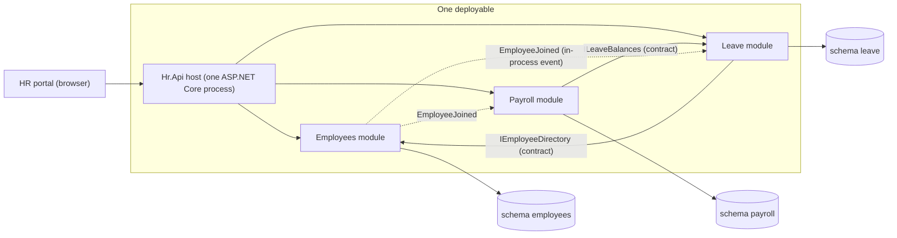
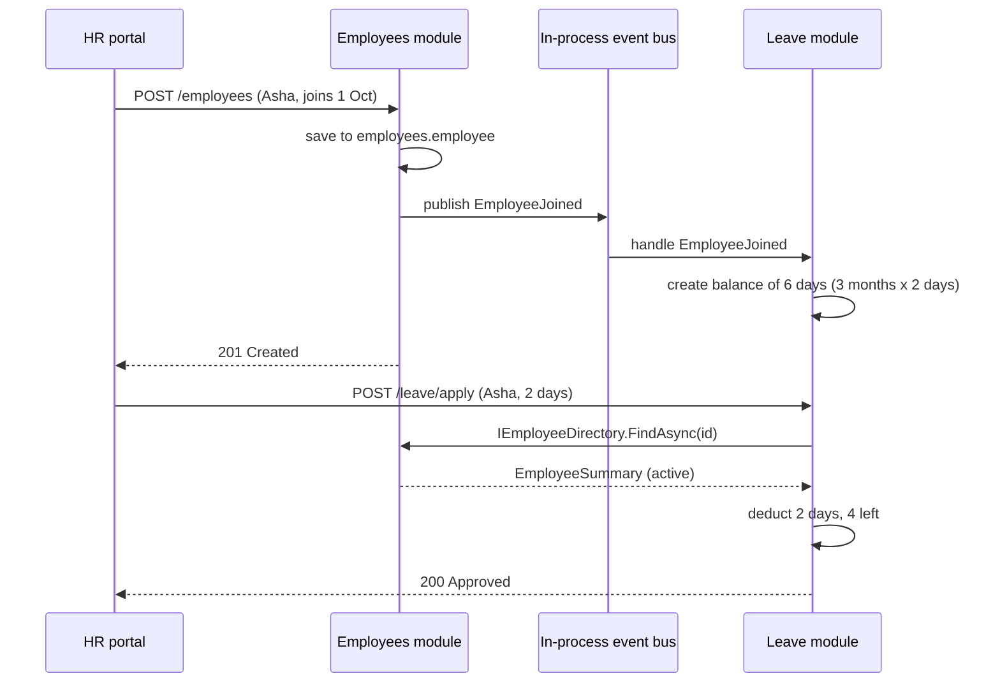
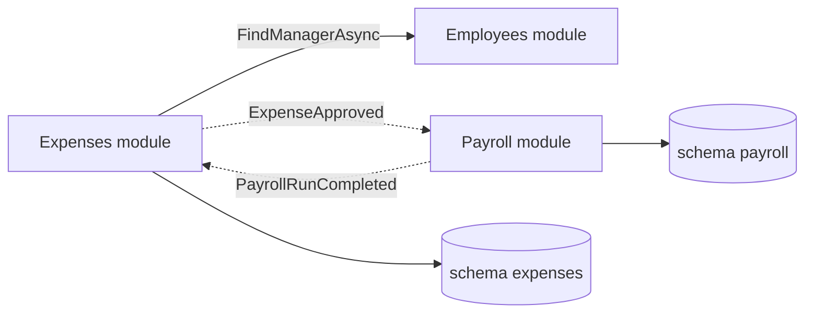

A modular monolith is the architecture many teams should have started with and many teams end up returning to. It keeps the simple operations of a single deployable application, but it organises the code inside into modules that can't reach into each other's private parts. In this lesson we turn an employee management app (HR system) into a modular monolith and make the computer, not code review, police the boundaries.

## Learning objectives

By the end of this lesson you will be able to:

1. Explain what a modular monolith is and how it differs from a plain monolith and from microservices.
2. Draw module boundaries around business capabilities (employees, leave, payroll), not around technical layers.
3. Design a module's public surface (internal API): contracts, events and nothing else.
4. Keep each module's data private, using one PostgreSQL schema per module.
5. Wire modules into one ASP.NET Core host with a small `IModule` interface.
6. Enforce boundaries with architecture tests, both hand-rolled with reflection and with libraries such as NetArchTest.
7. Decide when a modular monolith is enough and when (rarely) a module should become a separate service.

## Prerequisites

- [Monolithic architecture](#/lesson/m02-monolith): what "one deployable" means and why it is not a dirty word.
- [Layered architecture](#/lesson/m02-layered): we will see why layers alone do not stop tangling.
- [Coupling, cohesion, modularity and separation of concerns](#/lesson/m02-coupling-cohesion): the vocabulary we use to judge boundaries.

## Explain it like I'm a beginner

Think of a large apartment building in Gurgaon. It is **one building**: one address, one foundation, one lift system, one electricity connection. Moving in, maintaining it, and insuring it are all simpler than for twenty separate houses.

But inside, the building is split into **flats**. Each flat has a locked front door. If you want something from your neighbour, you ring the bell (a public entrance) and ask. You do not walk through their wall into their kitchen and take their milk.

Now picture two kinds of buildings:

- **A big open hall** where everyone's things are mixed together. That is a plain monolith that has grown without discipline (a "big ball of mud"). Anyone can grab anything. It works with 5 people. With 50 people, nobody knows whose chair is whose.
- **A building of flats with locked doors**. That is a **modular monolith**. Still one building, still one address, but each flat (module) owns its things, and the only way in is through the front door (the module's public contract).

In software terms:

- The building is **one deployable application**: one process, one deployment pipeline, usually one database server.
- Each flat is a **module**: Employees, Leave, Payroll, Attendance.
- The front door is the module's **public API inside the process** (an interface such as `IEmployeeDirectory`, plus events it publishes).
- The locked rooms are the module's **internals**: its entities, repositories, tables and helper classes.
- The building inspector who checks that nobody has knocked a hole in a wall is an **architecture test** that fails the build.

## First-principles explanation

### What it is

A modular monolith (also called a "modulith") is a single deployable unit whose code is divided into **modules aligned with business capabilities**. Each module:

1. **Owns its data.** No other module reads or writes its tables directly.
2. **Exposes a small public contract.** Interfaces, request and response records, and events. Everything else is private (`internal` in C#).
3. **Depends on other modules only through their contracts.** Never through their internals.
4. **Can be built, tested and reasoned about mostly on its own.**

Calls between modules are ordinary in-process method calls or in-process events. There is no network between them.

### Why it exists — the problem

Every successful monolith grows. A typical HR app starts with 20 tables and 3 developers. Three years later it has 180 tables, 15 developers and a `Utils` folder with 4,000 lines. The cost does not come from the monolith being "one deployable". It comes from **unlimited coupling**:

- The payroll code reads `leave_requests` directly to count unpaid leave days. The leave team renames a column and payroll breaks in production.
- A `EmployeeService` class with 60 methods is used by every feature, so nobody dares to change it.
- Layered architecture (controllers → services → repositories) does not help on its own. Layers slice the app **horizontally**. Every feature still touches every layer, and any service can call any repository.

Teams then often jump straight to microservices to "get boundaries". That trades a coupling problem for a distributed-systems problem (network failures, data consistency, deployment complexity). The modular monolith gives you the **boundaries first, without the network**.

### How it works internally

Nothing in .NET knows the word "module". A module is a **convention you enforce**:

- **Code boundary.** In a real solution each module is one or two C# projects: `Hr.Modules.Leave` (internals, mostly `internal` classes) and optionally `Hr.Modules.Leave.Contracts` (public interfaces, records and events). Other modules reference only the contracts project. The C# compiler then refuses to compile code that uses another module's `internal` types, because `internal` means "visible only inside this assembly".
- **Data boundary.** Each module gets its own PostgreSQL **schema** (a named folder of tables inside one database): `employees.employee`, `leave.leave_balance`, `payroll.payslip`. Optionally each module connects with its own database role that has rights only on its schema. Then a sneaky cross-module SQL join fails with "permission denied".
- **Runtime boundary.** One host (`Program.cs`) loads all modules. Each module registers its own services and endpoints through a small `IModule` interface.
- **Communication.** Two styles:
  - *Synchronous query through a contract*: Leave asks `IEmployeeDirectory.FindAsync(id)` whether an employee is active. It is a normal method call, measured in microseconds.
  - *In-process event*: Employees publishes `EmployeeJoined`. Leave reacts by creating a leave balance. Employees does not know or care who listens.
- **Enforcement.** Architecture tests run in CI and fail if, for example, any type in the Payroll module references a type in `Hr.Modules.Leave.Internal`.

### What happens without it

Without enforced boundaries, intentions decay. A deadline arrives, someone writes `_db.LeaveRequests.Where(...)` inside payroll "just this once", and six months later there are 40 such shortcuts. At that point you can't extract a module, can't give a team ownership of one, and can't test one without the whole database. Code review does not stop it reliably: reviewers are human and busy. **A boundary that is not checked by a machine is a suggestion.**

### When it is useful

- One team or a few teams (roughly 3–40 developers, an estimate) working on one product.
- The domain has clear sub-areas, but you are not sure yet where the final boundaries are. Moving code between modules in one repository is cheap. Moving it between services is expensive.
- You want one deployment, one database backup, simple transactions, and simple debugging.
- You may want to extract a service later and want to keep that option open.

### When it is unnecessary or wrong

- A small app (say, under 15 tables, 1–2 developers) with one real capability. Modules add ceremony for no benefit. A tidy plain monolith is fine.
- Parts of the system have **genuinely different runtime needs**: one part must scale to 50× the others, run on GPUs, or be deployed 20 times a day by a separate team. Those parts may deserve to be separate services ([Microservices](#/lesson/m02-microservices)).
- You need separate technology stacks per area (one module in Python for ML). One process implies one runtime.

### Trade-offs it introduces

| You gain | You pay |
|---|---|
| Clear ownership per module | Up-front design of boundaries and contracts |
| One deployable, one pipeline, easy local debugging | All modules deploy together, so one bad change can block the release |
| Fast in-process calls, simple local transactions when needed | One process: a memory leak or CPU spike in one module hurts all of them |
| Cheap to move boundaries while you learn the domain | Discipline: needs architecture tests and code ownership to stay modular |
| Easy later extraction of a module into a service | Cross-module reports need read models or explicit query contracts, not ad-hoc joins |

:::callout type=tradeoff title="Shared database server, separate schemas"
One PostgreSQL server with a schema per module is the sweet spot for most modular monoliths. You keep one backup, one connection string family and one place to tune. You lose the ability to do casual cross-module joins, and that is the point. If a report truly needs data from three modules, build a read model fed by events, or expose a query contract.
:::

## Visual explanation

### Module map



How to read it: the browser talks to one host process. Inside it there are three modules. **Solid arrows** are synchronous calls through a contract: Leave calls Employees only through `IEmployeeDirectory`, and Payroll calls Leave only through `ILeaveBalances`. **Dotted arrows** are in-process events: Employees announces "someone joined" and does not know who listens. Each module has its own schema in the same PostgreSQL database, and **no arrow crosses from one module to another module's schema**. If you ever need to draw such an arrow, the design is leaking.

### Hiring and applying for leave



This shows both communication styles. When Asha is hired, the Employees module saves her in its own schema and publishes `EmployeeJoined`. The Leave module's handler gives her a pro-rata balance: 24 days a year is 2 days a month, and joining on 1 October leaves 3 months, so 6 days. Later, when she applies for leave, the Leave module asks the Employees module "is this person active?" through the `IEmployeeDirectory` contract. It never queries `employees.employee` itself. Both arrows into Employees go through its front door.

## Step-by-step example

We will take a tangled HR app and modularise it in five steps.

### Step 1 — the tangled starting point

```csharp
public class LeaveController(HrDbContext db) : ControllerBase
{
    [HttpPost("leave/apply")]
    public IActionResult Apply(Guid employeeId, int days)
    {
        var emp = db.Employees.Single(e => e.Id == employeeId);      // reaches into "employee" data
        if (emp.ExitDate != null) return BadRequest("Inactive");
        var bal = db.LeaveBalances.Single(b => b.EmployeeId == employeeId);
        if (bal.Days < days) return BadRequest("Insufficient");
        bal.Days -= days;
        db.Payslips.Where(p => p.EmployeeId == employeeId && !p.Locked)  // and into payroll
          .ToList().ForEach(p => p.Recalculate());
        db.SaveChanges();
        return Ok();
    }
}
```

One `HrDbContext` holds all 180 tables, and the leave controller touches employee and payroll data. Every feature can reach everything.

### Step 2 — find the capabilities

List the business capabilities and who owns which data. A useful question is "who is allowed to change this fact?":

| Fact | Owner |
|---|---|
| Name, department, joining date, exit date | Employees |
| Leave balance, leave requests, approvals | Leave |
| Salary structure, payslips, TDS | Payroll |

Each owner becomes a module. A fact has exactly one owner. Other modules may *ask* about it or *keep a copy*, but only the owner changes it.

### Step 3 — define contracts

For each module, write down the smallest set of questions others need to ask and the events it announces:

- Employees: `IEmployeeDirectory.FindAsync(id)` returning `EmployeeSummary`, and the events `EmployeeJoined` and `EmployeeExited`.
- Leave: `ILeaveBalances.GetBalanceAsync(id)` and the event `LeaveApproved`.

Contracts use **their own small records**, not the internal entities. `EmployeeSummary` has 5 fields even though the internal `Employee` entity has 40. A small contract is easy to keep stable.

### Step 4 — move code and data behind the contracts

Move each module's classes into its own folder or project and make them `internal`. Split `HrDbContext` into one context per module, each mapped to its own schema (`modelBuilder.HasDefaultSchema("leave")` in EF Core). Payroll recalculation on leave approval becomes a reaction to a `LeaveApproved` event inside the Payroll module, instead of the leave controller editing payslips.

### Step 5 — lock the doors

Add architecture tests that fail when a module references another module's internals, and optionally give each module its own database role. From now on the boundary is checked on every pull request.

## Production-style C# implementation

Project structure. In a real solution each module is its own project, so `internal` is enforced by the compiler. In this lesson all files compile together as one project, so namespaces mark the boundary and the architecture test enforces it.

```text
Hr.sln
  src/Hr.Api/Program.cs                         -> references every module
  src/Modules/Shared/Hr.Modules.Shared          -> IModule, event bus abstractions
  src/Modules/Employees/Hr.Modules.Employees.Contracts
  src/Modules/Employees/Hr.Modules.Employees    -> internal entity, store, endpoints
  src/Modules/Leave/Hr.Modules.Leave.Contracts
  src/Modules/Leave/Hr.Modules.Leave
  tests/Hr.ArchitectureTests
```

### Shared kernel: the module interface and an in-process event bus

```csharp file=Modules/Shared/ModuleAbstractions.cs
using Microsoft.Extensions.DependencyInjection;

namespace Hr.Modules.Shared;

/// <summary>Every module plugs into the host through this interface.</summary>
public interface IModule
{
    string Name { get; }
    void Register(IServiceCollection services);
    void MapEndpoints(IEndpointRouteBuilder app);
}

/// <summary>Marker for events that cross module boundaries inside the process.</summary>
public interface IModuleEvent
{
    Guid EventId { get; }
    DateTimeOffset OccurredAt { get; }
}

public interface IModuleEventHandler<in TEvent> where TEvent : IModuleEvent
{
    Task HandleAsync(TEvent moduleEvent, CancellationToken ct);
}

public interface IModuleEventBus
{
    Task PublishAsync<TEvent>(TEvent moduleEvent, CancellationToken ct) where TEvent : IModuleEvent;
}

/// <summary>Synchronous, in-process dispatch. Handlers run in the publisher's scope, one after another.</summary>
public sealed class InProcessModuleEventBus(IServiceProvider services, ILogger<InProcessModuleEventBus> logger) : IModuleEventBus
{
    public async Task PublishAsync<TEvent>(TEvent moduleEvent, CancellationToken ct) where TEvent : IModuleEvent
    {
        foreach (var handler in services.GetServices<IModuleEventHandler<TEvent>>())
        {
            logger.LogDebug("Dispatching {Event} {EventId} to {Handler}",
                typeof(TEvent).Name, moduleEvent.EventId, handler.GetType().Name);
            await handler.HandleAsync(moduleEvent, ct);
        }
    }
}
```

The shared kernel is deliberately tiny: an interface for modules and three event abstractions. Resist adding business types here. A "Shared" project that grows a `Money`, an `Address`, a `Department` and a `Utils` class becomes the new big ball of mud.

### Employees module: contract and internals

```csharp file=Modules/Employees/Contracts/EmployeesContracts.cs
using Hr.Modules.Shared;

namespace Hr.Modules.Employees.Contracts;

/// <summary>The only shape of employee data other modules ever see.</summary>
public sealed record EmployeeSummary(Guid Id, string FullName, string DepartmentCode, DateOnly JoinedOn, bool IsActive);

public interface IEmployeeDirectory
{
    Task<EmployeeSummary?> FindAsync(Guid employeeId, CancellationToken ct);
}

public sealed record HireEmployeeRequest(string FullName, string DepartmentCode, DateOnly JoinedOn);

public sealed record EmployeeJoined(Guid EventId, DateTimeOffset OccurredAt, Guid EmployeeId, DateOnly JoinedOn) : IModuleEvent;
```

```csharp file=Modules/Employees/Internal/EmployeesInternals.cs
using System.Collections.Concurrent;
using Hr.Modules.Employees.Contracts;
using Hr.Modules.Shared;

namespace Hr.Modules.Employees.Internal;

internal sealed class Employee
{
    public Guid Id { get; init; }
    public required string FullName { get; set; }
    public required string DepartmentCode { get; set; }
    public DateOnly JoinedOn { get; init; }
    public DateOnly? ExitedOn { get; set; }
    public decimal MonthlyCtc { get; set; }          // private to this module: never in the contract
    public bool IsActive => ExitedOn is null;
}

/// <summary>Stands in for an EF Core DbContext mapped to the "employees" schema.</summary>
internal sealed class EmployeeStore
{
    private readonly ConcurrentDictionary<Guid, Employee> _rows = new();
    public void Add(Employee e) => _rows[e.Id] = e;
    public Employee? Find(Guid id) => _rows.TryGetValue(id, out var e) ? e : null;
}

internal sealed class EmployeeDirectory(EmployeeStore store) : IEmployeeDirectory
{
    public Task<EmployeeSummary?> FindAsync(Guid employeeId, CancellationToken ct)
    {
        var e = store.Find(employeeId);
        return Task.FromResult(e is null ? null : new EmployeeSummary(e.Id, e.FullName, e.DepartmentCode, e.JoinedOn, e.IsActive));
    }
}

internal sealed class HireEmployeeHandler(EmployeeStore store, IModuleEventBus bus, TimeProvider clock)
{
    public async Task<Guid> HandleAsync(HireEmployeeRequest request, CancellationToken ct)
    {
        if (string.IsNullOrWhiteSpace(request.FullName)) throw new ArgumentException("Name is required.", nameof(request));
        var employee = new Employee
        {
            Id = Guid.NewGuid(),
            FullName = request.FullName.Trim(),
            DepartmentCode = request.DepartmentCode.ToUpperInvariant(),
            JoinedOn = request.JoinedOn,
        };
        store.Add(employee);
        await bus.PublishAsync(new EmployeeJoined(Guid.NewGuid(), clock.GetUtcNow(), employee.Id, employee.JoinedOn), ct);
        return employee.Id;
    }
}
```

```csharp file=Modules/Employees/EmployeesModule.cs
using Hr.Modules.Employees.Contracts;
using Hr.Modules.Employees.Internal;
using Hr.Modules.Shared;

namespace Hr.Modules.Employees;

public sealed class EmployeesModule : IModule
{
    public string Name => "Employees";

    public void Register(IServiceCollection services)
    {
        services.AddSingleton<EmployeeStore>();
        services.AddScoped<IEmployeeDirectory, EmployeeDirectory>();   // the public front door
        services.AddScoped<HireEmployeeHandler>();
    }

    public void MapEndpoints(IEndpointRouteBuilder app)
    {
        var group = app.MapGroup("/employees").WithTags(Name);
        group.MapPost("/", async (HireEmployeeRequest request, HireEmployeeHandler handler, CancellationToken ct) =>
        {
            var id = await handler.HandleAsync(request, ct);
            return Results.Created($"/employees/{id}", new { id });
        });
        group.MapGet("/{id:guid}", async (Guid id, IEmployeeDirectory directory, CancellationToken ct) =>
            await directory.FindAsync(id, ct) is { } e ? Results.Ok(e) : Results.NotFound());
    }
}
```

`MonthlyCtc` lives on the internal entity and is never copied into `EmployeeSummary`. Salary is sensitive, and the Leave module has no reason to see it. A small contract is also a security boundary.

### Leave module: uses only the Employees contract

```csharp file=Modules/Leave/Contracts/LeaveContracts.cs
namespace Hr.Modules.Leave.Contracts;

public interface ILeaveBalances
{
    Task<decimal> GetBalanceAsync(Guid employeeId, CancellationToken ct);
}

public sealed record ApplyLeaveRequest(Guid EmployeeId, decimal Days);

public enum LeaveDecision { Approved, Rejected }

public sealed record ApplyLeaveResult(LeaveDecision Decision, string? Reason, decimal RemainingDays);
```

```csharp file=Modules/Leave/Internal/LeaveInternals.cs
using System.Collections.Concurrent;
using Hr.Modules.Employees.Contracts;
using Hr.Modules.Leave.Contracts;
using Hr.Modules.Shared;

namespace Hr.Modules.Leave.Internal;

/// <summary>Stands in for a DbContext mapped to the "leave" schema.</summary>
internal sealed class LeaveBalanceStore
{
    private readonly ConcurrentDictionary<Guid, decimal> _balances = new();
    public decimal Get(Guid employeeId) => _balances.GetValueOrDefault(employeeId);
    public void Set(Guid employeeId, decimal days) => _balances[employeeId] = days;
}

internal static class LeavePolicy
{
    public const decimal AnnualDays = 24m;   // 2 days per month

    /// <summary>Pro-rata for the rest of the calendar year, including the joining month.</summary>
    public static decimal ProRata(DateOnly joinedOn) => (12 - joinedOn.Month + 1) * (AnnualDays / 12m);
}

internal sealed class GrantInitialBalanceOnJoin(LeaveBalanceStore store) : IModuleEventHandler<EmployeeJoined>
{
    public Task HandleAsync(EmployeeJoined moduleEvent, CancellationToken ct)
    {
        store.Set(moduleEvent.EmployeeId, LeavePolicy.ProRata(moduleEvent.JoinedOn));
        return Task.CompletedTask;
    }
}

internal sealed class LeaveBalances(LeaveBalanceStore store) : ILeaveBalances
{
    public Task<decimal> GetBalanceAsync(Guid employeeId, CancellationToken ct) => Task.FromResult(store.Get(employeeId));
}

internal sealed class ApplyLeaveHandler(LeaveBalanceStore store, IEmployeeDirectory employees)
{
    public async Task<ApplyLeaveResult> HandleAsync(ApplyLeaveRequest request, CancellationToken ct)
    {
        if (request.Days <= 0) throw new ArgumentOutOfRangeException(nameof(request), "Days must be positive.");

        var employee = await employees.FindAsync(request.EmployeeId, ct);   // through the front door
        if (employee is null) return new(LeaveDecision.Rejected, "Unknown employee", 0m);
        if (!employee.IsActive) return new(LeaveDecision.Rejected, "Employee is not active", 0m);

        var balance = store.Get(request.EmployeeId);
        if (balance < request.Days) return new(LeaveDecision.Rejected, "Insufficient balance", balance);

        store.Set(request.EmployeeId, balance - request.Days);
        return new(LeaveDecision.Approved, null, balance - request.Days);
    }
}
```

```csharp file=Modules/Leave/LeaveModule.cs
using Hr.Modules.Employees.Contracts;
using Hr.Modules.Leave.Contracts;
using Hr.Modules.Leave.Internal;
using Hr.Modules.Shared;

namespace Hr.Modules.Leave;

public sealed class LeaveModule : IModule
{
    public string Name => "Leave";

    public void Register(IServiceCollection services)
    {
        services.AddSingleton<LeaveBalanceStore>();
        services.AddScoped<ILeaveBalances, LeaveBalances>();
        services.AddScoped<ApplyLeaveHandler>();
        services.AddScoped<IModuleEventHandler<EmployeeJoined>, GrantInitialBalanceOnJoin>();
    }

    public void MapEndpoints(IEndpointRouteBuilder app)
    {
        var group = app.MapGroup("/leave").WithTags(Name);
        group.MapPost("/apply", async (ApplyLeaveRequest request, ApplyLeaveHandler handler, CancellationToken ct) =>
        {
            try
            {
                var result = await handler.HandleAsync(request, ct);
                return result.Decision == LeaveDecision.Approved ? Results.Ok(result) : Results.UnprocessableEntity(result);
            }
            catch (ArgumentOutOfRangeException ex)
            {
                return Results.Problem(ex.Message, statusCode: StatusCodes.Status400BadRequest);
            }
        });
        group.MapGet("/balance/{employeeId:guid}", async (Guid employeeId, ILeaveBalances balances, CancellationToken ct) =>
            Results.Ok(new { employeeId, days = await balances.GetBalanceAsync(employeeId, ct) }));
    }
}
```

The Leave module references `Hr.Modules.Employees.Contracts` and nothing else from Employees. If someone adds `EmployeeStore` to `ApplyLeaveHandler`'s constructor, the architecture test below fails.

### The host

```csharp file=Program.cs
using Hr.Modules.Employees;
using Hr.Modules.Leave;
using Hr.Modules.Shared;

var builder = WebApplication.CreateBuilder(args);

IModule[] modules = [new EmployeesModule(), new LeaveModule()];

builder.Services.AddSingleton(TimeProvider.System);
builder.Services.AddScoped<IModuleEventBus, InProcessModuleEventBus>();
foreach (var module in modules) module.Register(builder.Services);

var app = builder.Build();
foreach (var module in modules) module.MapEndpoints(app);
app.Run();
```

The host knows the list of modules and nothing about their insides. Adding a Payroll module means one new project and one entry in the array.

### Enforcing boundaries with an architecture test

Libraries such as NetArchTest.Rules and ArchUnitNET make boundary rules one-liners. A typical NetArchTest rule looks like this (not compiled here, because the checker has no NuGet access):

```csharp
[Fact]
public void Leave_does_not_depend_on_employee_internals()
{
    var result = Types.InAssembly(typeof(LeaveModule).Assembly)
        .That().ResideInNamespace("Hr.Modules.Leave")
        .ShouldNot().HaveDependencyOnAny("Hr.Modules.Employees.Internal", "Hr.Modules.Payroll.Internal")
        .GetResult();

    Assert.True(result.IsSuccessful, string.Join(", ", result.FailingTypeNames ?? []));
}
```

NetArchTest inspects the compiled IL, so it also catches dependencies inside method bodies. The reflection-based version below needs only the BCL. It checks the dependencies visible in type signatures (constructor parameters, fields, properties, method signatures and base types), which catches the most common leak: injecting another module's internal class.

```csharp file=ArchitectureTests/ModuleBoundaryRules.cs
using System.Reflection;

namespace Hr.ArchitectureTests;

public sealed record BoundaryViolation(Type From, Type To, string Via)
{
    public override string ToString() => $"{From.FullName} -> {To.FullName} (via {Via})";
}

/// <summary>Convention: Hr.Modules.{Module}.{Contracts|Internal|...}. Only Contracts and Shared may be used across modules.</summary>
public static class ModuleBoundaryRules
{
    private const string Prefix = "Hr.Modules.";
    private const BindingFlags All = BindingFlags.Public | BindingFlags.NonPublic | BindingFlags.Instance |
                                     BindingFlags.Static | BindingFlags.DeclaredOnly;

    public static string? ModuleOf(Type t) =>
        t.Namespace is { } ns && ns.StartsWith(Prefix, StringComparison.Ordinal) ? ns.Split('.')[2] : null;

    public static bool IsPublicContract(Type t) =>
        ModuleOf(t) == "Shared" || (t.Namespace?.Split('.') is { Length: >= 4 } parts && parts[3] == "Contracts");

    public static IReadOnlyList<BoundaryViolation> FindViolations(IEnumerable<Type> types)
    {
        var violations = new List<BoundaryViolation>();
        foreach (var type in types)
        {
            var from = ModuleOf(type);
            if (from is null) continue;
            foreach (var (dependency, via) in SignatureDependencies(type))
            {
                var to = ModuleOf(dependency);
                if (to is null || to == from || IsPublicContract(dependency)) continue;
                violations.Add(new BoundaryViolation(type, dependency, via));
            }
        }
        return violations.Distinct().ToList();
    }

    private static IEnumerable<(Type Type, string Via)> SignatureDependencies(Type t)
    {
        if (t.BaseType is { } b) foreach (var x in Expand(b)) yield return (x, "base type");
        foreach (var i in t.GetInterfaces()) foreach (var x in Expand(i)) yield return (x, "interface");
        foreach (var c in t.GetConstructors(All))
            foreach (var p in c.GetParameters()) foreach (var x in Expand(p.ParameterType)) yield return (x, $"constructor parameter '{p.Name}'");
        foreach (var f in t.GetFields(All)) foreach (var x in Expand(f.FieldType)) yield return (x, $"field '{f.Name}'");
        foreach (var p in t.GetProperties(All)) foreach (var x in Expand(p.PropertyType)) yield return (x, $"property '{p.Name}'");
        foreach (var m in t.GetMethods(All))
        {
            foreach (var x in Expand(m.ReturnType)) yield return (x, $"return type of '{m.Name}'");
            foreach (var p in m.GetParameters()) foreach (var x in Expand(p.ParameterType)) yield return (x, $"parameter '{p.Name}' of '{m.Name}'");
        }
    }

    /// <summary>Unwraps arrays, by-ref types and generic arguments: List&lt;Foo&gt; depends on Foo.</summary>
    private static IEnumerable<Type> Expand(Type t)
    {
        if (t.HasElementType && t.GetElementType() is { } element) { foreach (var x in Expand(element)) yield return x; yield break; }
        yield return t;
        if (t.IsGenericType) foreach (var arg in t.GetGenericArguments()) foreach (var x in Expand(arg)) yield return x;
    }
}
```

In the test project the check is one line:

```csharp
[Fact]
public void No_module_uses_another_modules_internals() =>
    Assert.Empty(ModuleBoundaryRules.FindViolations(typeof(LeaveModule).Assembly.GetTypes()));
```

When every module is its own project, you scan each module assembly. Run the test on every pull request, and the boundary stops being a matter of opinion.

### Data boundaries in PostgreSQL

```sql
CREATE SCHEMA employees;
CREATE SCHEMA leave;

CREATE ROLE hr_leave LOGIN PASSWORD 'from-secret-store';
GRANT USAGE ON SCHEMA leave TO hr_leave;
GRANT SELECT, INSERT, UPDATE, DELETE ON ALL TABLES IN SCHEMA leave TO hr_leave;
-- No grant on schema employees: a sneaky join from the Leave module fails with "permission denied".
```

With EF Core, each module has its own `DbContext` with `modelBuilder.HasDefaultSchema("leave")` and its own migrations history table (`b.MigrationsHistoryTable("__ef_migrations", "leave")`). A leave balance stores `employee_id` as a plain `uuid` column **without a foreign key** to `employees.employee`. That feels uncomfortable at first. It is the price of independent modules, and it is what makes later extraction possible. The Leave module protects its own consistency by checking the employee through the contract and by reacting to `EmployeeExited`.

## Bad design vs good design

**Bad: modules in name only.** The solution has folders called `Employees`, `Leave` and `Payroll`, but:

- One shared `HrDbContext` with every table, injected everywhere.
- Every class is `public`.
- Payroll's `PayslipCalculator` takes `LeaveRequestRepository` in its constructor to count unpaid days.
- A `Common` project holds 70 classes, including `EmployeeEntity`.

Problems: the folders give a false sense of structure. A change to the leave tables can break payroll at runtime. Nobody can extract a module, because every module touches every table. Tests need the full database.

**Good: modules with locked doors.** The implementation above:

- One `DbContext` (or store) per module, one schema per module.
- Internals are `internal`. Only `Contracts` namespaces are public.
- Payroll asks Leave a question through `ILeaveBalances`, or keeps its own copy of unpaid days fed by `LeaveApproved` events.
- The shared kernel holds only the module plumbing.
- An architecture test fails the build on any violation.

**Is the improvement worth it?** For a 3-person team with one capability, no: a tidy plain monolith is simpler. Once you have 3 or more capabilities with separate rules, separate change rates or separate people, boundaries pay for themselves quickly. Moving a class between modules is a refactoring. Moving it between microservices is a project.

:::callout type=mistake title="The shared-kernel trap"
Every time two modules need the same type, it is tempting to put it in `Shared`. Do that ten times and every module depends on everything in `Shared`, so a change there rebuilds and retests the whole system. Duplicate small types (each module can have its own `EmployeeRef` record) unless they are genuinely universal, like `Money` with a currency.
:::

:::callout type=warning title="Synchronous in-process events run in the publisher's transaction"
With the simple bus above, if the Leave handler throws, the hire request fails too. That can be what you want (all or nothing), or it can couple modules more tightly than you intended. For reactions that may fail or are slow, write the event to an outbox table in the same transaction and dispatch it from a background worker. See [Transactional outbox](#/lesson/m12-outbox).
:::

## Practical playground

Run the program. It defines two modules, one of which leaks, and prints the boundary violations. Then fix the leak (make `PayslipCalculator` depend on the Leave contract instead of the internal store) and run it again until it prints "No violations".

:::playground type=csharp title="Find the boundary leak"
```csharp file=Program.cs
using System;
using System.Collections.Generic;
using System.Linq;
using System.Reflection;

namespace Demo.Modules.Leave.Contracts
{
    public interface ILeaveBalances { decimal UnpaidDays(Guid employeeId, int year, int month); }
}

namespace Demo.Modules.Leave.Internal
{
    public sealed class LeaveStore
    {
        public decimal UnpaidDays(Guid employeeId, int year, int month) => 2m;
    }
    public sealed class LeaveBalances(LeaveStore store) : Demo.Modules.Leave.Contracts.ILeaveBalances
    {
        public decimal UnpaidDays(Guid employeeId, int year, int month) => store.UnpaidDays(employeeId, year, month);
    }
}

namespace Demo.Modules.Payroll.Internal
{
    // LEAK: Payroll depends on Leave's internal store. Change the field and constructor to use ILeaveBalances.
    public sealed class PayslipCalculator
    {
        private readonly Demo.Modules.Leave.Internal.LeaveStore _leave;
        public PayslipCalculator(Demo.Modules.Leave.Internal.LeaveStore leave) => _leave = leave;

        public decimal NetPay(Guid employeeId, decimal monthlyGross, int year, int month)
        {
            var daysInMonth = DateTime.DaysInMonth(year, month);
            var unpaid = _leave.UnpaidDays(employeeId, year, month);
            return Math.Round(monthlyGross - monthlyGross / daysInMonth * unpaid, 2);
        }
    }
}

namespace Demo
{
    public static class Program
    {
        static string? ModuleOf(Type t) => t.Namespace is { } ns && ns.StartsWith("Demo.Modules.") ? ns.Split('.')[2] : null;
        static bool IsContract(Type t) => t.Namespace?.EndsWith(".Contracts") == true;

        public static void Main()
        {
            const BindingFlags all = BindingFlags.Public | BindingFlags.NonPublic | BindingFlags.Instance | BindingFlags.DeclaredOnly;
            var violations = new List<string>();
            foreach (var t in typeof(Program).Assembly.GetTypes())
            {
                var from = ModuleOf(t);
                if (from is null) continue;
                var deps = t.GetFields(all).Select(f => f.FieldType)
                    .Concat(t.GetConstructors().SelectMany(c => c.GetParameters()).Select(p => p.ParameterType));
                foreach (var d in deps.Distinct())
                {
                    var to = ModuleOf(d);
                    if (to is not null && to != from && !IsContract(d)) violations.Add($"{t.Name} ({from}) -> {d.FullName}");
                }
            }
            Console.WriteLine(violations.Count == 0 ? "No violations" : string.Join(Environment.NewLine, violations));

            var calc = new Demo.Modules.Payroll.Internal.PayslipCalculator(new Demo.Modules.Leave.Internal.LeaveStore());
            Console.WriteLine($"Net pay for October with 2 unpaid days on 62,000: {calc.NetPay(Guid.NewGuid(), 62000m, 2026, 10)}");
        }
    }
}
```
:::

## Exercises

:::exercise id=m02-modular-monolith-ex1 difficulty=beginner kind=code title="Approve leave through the Employees contract"
The Leave module must decide leave requests. It may use the Employees module only through `IEmployeeDirectory`. Implement `LeaveApplicationService.Apply`.
::requirements
- `days` must be positive, otherwise throw `ArgumentOutOfRangeException`.
- Unknown employee: rejected with reason `"Unknown employee"`.
- Inactive employee: rejected with reason `"Employee is not active"`.
- Not enough balance: rejected with reason `"Insufficient balance"` and the balance unchanged.
- Otherwise: approved, balance reduced, remaining days returned.
::acceptance
- An active employee with 6 days applying for 2 is approved with 4 remaining.
- An employee who exited is rejected even with a positive balance.
- A rejected request never changes the stored balance.
- `LeaveApplicationService` has no reference to any type outside `Hr.Modules.Employees.Contracts` from the Employees module.
::hint
Start with the guard clauses, in the order the requirements list them.
::hint
Ask the directory first. If it returns `null`, you can stop immediately.
::hint
Read the balance once into a local variable, compare, then write the new value only on the success path.
::hint
```csharp
var emp = _employees.Find(employeeId);
if (emp is null) return new LeaveResult(false, "Unknown employee", 0m);
```
::starter
```csharp file=LeaveApplication.cs
using System;
using System.Collections.Generic;

namespace Hr.Modules.Employees.Contracts
{
    public sealed record EmployeeSummary(Guid Id, string FullName, bool IsActive);
    public interface IEmployeeDirectory { EmployeeSummary? Find(Guid employeeId); }
}

namespace Hr.Modules.Leave
{
    using Hr.Modules.Employees.Contracts;

    public sealed record LeaveResult(bool Approved, string? Reason, decimal RemainingDays);

    public sealed class LeaveBalanceStore
    {
        private readonly Dictionary<Guid, decimal> _balances = new();
        public decimal Get(Guid employeeId) => _balances.GetValueOrDefault(employeeId);
        public void Set(Guid employeeId, decimal days) => _balances[employeeId] = days;
    }

    public sealed class LeaveApplicationService
    {
        private readonly IEmployeeDirectory _employees;
        private readonly LeaveBalanceStore _balances;

        public LeaveApplicationService(IEmployeeDirectory employees, LeaveBalanceStore balances)
        {
            _employees = employees;
            _balances = balances;
        }

        public LeaveResult Apply(Guid employeeId, decimal days) => throw new NotImplementedException();
    }
}
```
::tests
```csharp file=LeaveApplicationTests.cs
using System;
using System.Collections.Generic;
using Hr.Modules.Employees.Contracts;
using Hr.Modules.Leave;
using Xunit;

public class LeaveApplicationTests
{
    private sealed class FakeDirectory : IEmployeeDirectory
    {
        public readonly Dictionary<Guid, EmployeeSummary> People = new();
        public EmployeeSummary? Find(Guid employeeId) => People.TryGetValue(employeeId, out var e) ? e : null;
    }

    private static (LeaveApplicationService Svc, FakeDirectory Dir, LeaveBalanceStore Store) Create()
    {
        var dir = new FakeDirectory();
        var store = new LeaveBalanceStore();
        return (new LeaveApplicationService(dir, store), dir, store);
    }

    [Fact]
    public void Active_employee_with_balance_is_approved()
    {
        var (svc, dir, store) = Create();
        var id = Guid.NewGuid();
        dir.People[id] = new EmployeeSummary(id, "Asha Rao", true);
        store.Set(id, 6m);
        var r = svc.Apply(id, 2m);
        Assert.True(r.Approved);
        Assert.Equal(4m, r.RemainingDays);
        Assert.Equal(4m, store.Get(id));
    }

    [Fact]
    public void Unknown_employee_is_rejected()
    {
        var (svc, _, _) = Create();
        var r = svc.Apply(Guid.NewGuid(), 1m);
        Assert.False(r.Approved);
        Assert.Equal("Unknown employee", r.Reason);
    }

    [Fact]
    public void Inactive_employee_is_rejected_and_balance_kept()
    {
        var (svc, dir, store) = Create();
        var id = Guid.NewGuid();
        dir.People[id] = new EmployeeSummary(id, "Ravi Kumar", false);
        store.Set(id, 10m);
        var r = svc.Apply(id, 1m);
        Assert.False(r.Approved);
        Assert.Equal("Employee is not active", r.Reason);
        Assert.Equal(10m, store.Get(id));
    }

    [Fact]
    public void Insufficient_balance_is_rejected_and_balance_kept()
    {
        var (svc, dir, store) = Create();
        var id = Guid.NewGuid();
        dir.People[id] = new EmployeeSummary(id, "Meera Iyer", true);
        store.Set(id, 1.5m);
        var r = svc.Apply(id, 2m);
        Assert.False(r.Approved);
        Assert.Equal("Insufficient balance", r.Reason);
        Assert.Equal(1.5m, store.Get(id));
    }

    [Fact]
    public void Non_positive_days_throw()
    {
        var (svc, _, _) = Create();
        Assert.Throws<ArgumentOutOfRangeException>(() => svc.Apply(Guid.NewGuid(), 0m));
    }
}
```
::solution
Guard clauses in order, then a single write on the success path.

```csharp file=LeaveApplication.cs
using System;
using System.Collections.Generic;

namespace Hr.Modules.Employees.Contracts
{
    public sealed record EmployeeSummary(Guid Id, string FullName, bool IsActive);
    public interface IEmployeeDirectory { EmployeeSummary? Find(Guid employeeId); }
}

namespace Hr.Modules.Leave
{
    using Hr.Modules.Employees.Contracts;

    public sealed record LeaveResult(bool Approved, string? Reason, decimal RemainingDays);

    public sealed class LeaveBalanceStore
    {
        private readonly Dictionary<Guid, decimal> _balances = new();
        public decimal Get(Guid employeeId) => _balances.GetValueOrDefault(employeeId);
        public void Set(Guid employeeId, decimal days) => _balances[employeeId] = days;
    }

    public sealed class LeaveApplicationService
    {
        private readonly IEmployeeDirectory _employees;
        private readonly LeaveBalanceStore _balances;

        public LeaveApplicationService(IEmployeeDirectory employees, LeaveBalanceStore balances)
        {
            _employees = employees;
            _balances = balances;
        }

        public LeaveResult Apply(Guid employeeId, decimal days)
        {
            if (days <= 0) throw new ArgumentOutOfRangeException(nameof(days), "Days must be positive.");

            var employee = _employees.Find(employeeId);
            if (employee is null) return new LeaveResult(false, "Unknown employee", 0m);
            if (!employee.IsActive) return new LeaveResult(false, "Employee is not active", _balances.Get(employeeId));

            var balance = _balances.Get(employeeId);
            if (balance < days) return new LeaveResult(false, "Insufficient balance", balance);

            var remaining = balance - days;
            _balances.Set(employeeId, remaining);
            return new LeaveResult(true, null, remaining);
        }
    }
}
```

The service never sees the Employees module's entity or store. In tests, a 6-line fake directory replaces the whole Employees module, which shows how a narrow contract makes a module testable on its own.
::mistakes
- Checking the balance before checking that the employee exists, which returns a misleading "Insufficient balance" for a typo in the id.
- Writing the balance before all checks pass.
- Adding `IsActive` logic to the Leave module by looking at an exit date. Being active is a fact owned by Employees.
:::

:::exercise id=m02-modular-monolith-ex2 difficulty=beginner kind=written title="Spot the boundary violations"
Modules: Employees, Leave, Payroll. Only `*.Contracts` namespaces and in-process events may be used across modules. For each item, say **violation** or **fine**, and give a one-line reason.

1. `PayrollRunner` injects `Hr.Modules.Leave.Contracts.ILeaveBalances`.
2. The Leave module's SQL: `SELECT e.full_name FROM employees.employee e JOIN leave.leave_request r ON r.employee_id = e.id`.
3. Payroll handles the `EmployeeExited` event published by Employees and stops future payslips.
4. `Hr.Modules.Leave.Internal.LeaveRequest` has a property of type `Hr.Modules.Employees.Internal.Employee`.
5. The Employees module adds `MonthlyCtc` to `EmployeeSummary` because "Payroll might need it one day".
6. Two modules each define their own `record EmployeeRef(Guid Id, string Name)`.
::acceptance
- Each of the 6 items is classified with a reason.
- At least one answer mentions data ownership, and one mentions contract size or sensitive data.
::hint
For each item ask: "Does this touch another module's private code or private data?"
::hint
Item 5 does not cross a boundary today, but think about what a contract should contain and who can see it.
::hint
Duplication across modules is not automatically bad. Ask whether those two records will change for the same reason.
::solution
1. **Fine.** A contract interface is the front door.
2. **Violation.** Leave reads the Employees schema directly. A rename in `employees.employee` breaks Leave at runtime. Ask `IEmployeeDirectory`, or keep a local copy of names fed by events.
3. **Fine.** Events are part of the Employees module's public surface, and Payroll owns its reaction.
4. **Violation.** An internal entity of another module leaks into Leave's model. Use a `Guid EmployeeId` (and an `EmployeeSummary` if needed).
5. **Not a boundary violation, but bad contract design.** Contracts should contain what consumers need today. Salary is sensitive and widens exposure to every module that can see the contract. Add a separate, narrowly scoped contract for Payroll if it truly needs salary data.
6. **Fine.** Small duplicated records keep modules independent. Each can evolve separately. Moving them to `Shared` couples the modules.
:::

:::exercise id=m02-modular-monolith-ex3 difficulty=intermediate kind=code title="Write the architecture test helper"
Write `BoundaryChecker.FindViolations`, which scans types and reports each dependency from one module to another module's non-contract type. Modules follow the convention `Shop.Modules.{Module}.{Area}`. `Area == "Contracts"` is public. Module `"Shared"` is public to everyone.
::requirements
- Look at constructor parameters, fields (including private ones) and property types.
- Unwrap generic arguments and arrays: a `List<InvoiceRow>` field depends on `InvoiceRow`.
- Ignore dependencies on types outside `Shop.Modules.*` (for example `System.String`).
- Return each (from, to) pair at most once.
::acceptance
- A dependency on `Billing.Contracts.IInvoiceApi` from Orders is not a violation.
- A constructor parameter of type `Billing.Internal.InvoiceRepository` in an Orders type is a violation.
- A private `List<Billing.Internal.InvoiceRow>` field is a violation.
- Using a type from the same module, or from `Shared`, is not a violation.
::hint
Write two helpers first: `ModuleOf(Type)` and `IsPublic(Type)`.
::hint
Use `BindingFlags.Public | BindingFlags.NonPublic | BindingFlags.Instance | BindingFlags.DeclaredOnly` to see private fields.
::hint
For generics, `type.GetGenericArguments()` gives the `T` in `List<T>`. For arrays, `type.GetElementType()`.
::hint
Collect into a `HashSet<(Type From, Type To)>` to deduplicate, then convert to a list.
::hint
```csharp
IEnumerable<Type> Expand(Type t) {
    if (t.IsArray) return Expand(t.GetElementType()!);
    return new[] { t }.Concat(t.IsGenericType ? t.GetGenericArguments().SelectMany(Expand) : Enumerable.Empty<Type>());
}
```
::starter
```csharp file=BoundaryChecker.cs
using System;
using System.Collections.Generic;
using System.Linq;
using System.Reflection;

namespace ArchTests
{
    public sealed record Violation(Type From, Type To);

    public static class BoundaryChecker
    {
        public const string Prefix = "Shop.Modules.";

        public static string? ModuleOf(Type t) => throw new NotImplementedException();

        public static IReadOnlyList<Violation> FindViolations(IEnumerable<Type> types) => throw new NotImplementedException();
    }
}
```
::tests
```csharp file=BoundaryCheckerTests.cs
using System;
using System.Collections.Generic;
using System.Linq;
using ArchTests;
using Xunit;

namespace Shop.Modules.Billing.Contracts { public interface IInvoiceApi { } }
namespace Shop.Modules.Billing.Internal
{
    public sealed class InvoiceRepository { }
    public sealed class InvoiceRow { }
}
namespace Shop.Modules.Shared { public sealed record Money(decimal Amount, string Currency); }
namespace Shop.Modules.Orders.Internal
{
    public sealed class OrderRepository { }
    public sealed class GoodOrderService
    {
        private readonly Shop.Modules.Billing.Contracts.IInvoiceApi _api;
        private readonly OrderRepository _repo;
        public Shop.Modules.Shared.Money Total { get; set; } = new(0m, "INR");
        public GoodOrderService(Shop.Modules.Billing.Contracts.IInvoiceApi api, OrderRepository repo) { _api = api; _repo = repo; }
    }
    public sealed class CtorLeak
    {
        public CtorLeak(Shop.Modules.Billing.Internal.InvoiceRepository repo) { }
    }
    public sealed class GenericFieldLeak
    {
        private readonly List<Shop.Modules.Billing.Internal.InvoiceRow> _rows = new();
        private Shop.Modules.Billing.Internal.InvoiceRow[] _cache = Array.Empty<Shop.Modules.Billing.Internal.InvoiceRow>();
    }
}

public class BoundaryCheckerTests
{
    [Fact]
    public void Module_name_is_the_third_segment()
    {
        Assert.Equal("Orders", BoundaryChecker.ModuleOf(typeof(Shop.Modules.Orders.Internal.OrderRepository)));
        Assert.Null(BoundaryChecker.ModuleOf(typeof(string)));
    }

    [Fact]
    public void Contracts_same_module_and_shared_are_allowed() =>
        Assert.Empty(BoundaryChecker.FindViolations(new[] { typeof(Shop.Modules.Orders.Internal.GoodOrderService) }));

    [Fact]
    public void Constructor_parameter_leak_is_found()
    {
        var v = Assert.Single(BoundaryChecker.FindViolations(new[] { typeof(Shop.Modules.Orders.Internal.CtorLeak) }));
        Assert.Equal(typeof(Shop.Modules.Billing.Internal.InvoiceRepository), v.To);
    }

    [Fact]
    public void Generic_and_array_field_leaks_are_found_once()
    {
        var v = Assert.Single(BoundaryChecker.FindViolations(new[] { typeof(Shop.Modules.Orders.Internal.GenericFieldLeak) }));
        Assert.Equal(typeof(Shop.Modules.Billing.Internal.InvoiceRow), v.To);
    }

    [Fact]
    public void Types_outside_modules_are_ignored() =>
        Assert.Empty(BoundaryChecker.FindViolations(new[] { typeof(BoundaryCheckerTests), typeof(string) }));
}
```
::solution
```csharp file=BoundaryChecker.cs
using System;
using System.Collections.Generic;
using System.Linq;
using System.Reflection;

namespace ArchTests
{
    public sealed record Violation(Type From, Type To);

    public static class BoundaryChecker
    {
        public const string Prefix = "Shop.Modules.";
        private const BindingFlags All = BindingFlags.Public | BindingFlags.NonPublic | BindingFlags.Instance | BindingFlags.DeclaredOnly;

        public static string? ModuleOf(Type t) =>
            t.Namespace is { } ns && ns.StartsWith(Prefix, StringComparison.Ordinal) ? ns.Split('.')[2] : null;

        private static bool IsPublic(Type t)
        {
            if (ModuleOf(t) == "Shared") return true;
            var parts = t.Namespace!.Split('.');
            return parts.Length >= 4 && parts[3] == "Contracts";
        }

        private static IEnumerable<Type> Expand(Type t)
        {
            if (t.HasElementType) return Expand(t.GetElementType()!);
            var self = new[] { t };
            return t.IsGenericType ? self.Concat(t.GetGenericArguments().SelectMany(Expand)) : self;
        }

        private static IEnumerable<Type> Dependencies(Type t) =>
            t.GetConstructors(All).SelectMany(c => c.GetParameters()).Select(p => p.ParameterType)
             .Concat(t.GetFields(All).Select(f => f.FieldType))
             .Concat(t.GetProperties(All).Select(p => p.PropertyType))
             .SelectMany(Expand);

        public static IReadOnlyList<Violation> FindViolations(IEnumerable<Type> types)
        {
            var found = new HashSet<(Type, Type)>();
            foreach (var type in types)
            {
                var from = ModuleOf(type);
                if (from is null) continue;
                foreach (var dep in Dependencies(type))
                {
                    var to = ModuleOf(dep);
                    if (to is null || to == from || IsPublic(dep)) continue;
                    found.Add((type, dep));
                }
            }
            return found.Select(p => new Violation(p.Item1, p.Item2)).ToList();
        }
    }
}
```

Auto-property backing fields (`<Total>k__BackingField`) are private fields too, so properties are already covered by the field scan. The property scan still helps for computed properties that have no backing field.
::alternatives
NetArchTest.Rules or ArchUnitNET read the IL, so they also find dependencies inside method bodies (for example `new InvoiceRepository()` in a method). Use them in real projects. Separate projects per module plus `internal` give compile-time enforcement, which is stronger than any test.
::mistakes
- Forgetting `NonPublic`, so private fields are never scanned (the most common real leak).
- Comparing namespaces with `Contains("Contracts")`, which also matches `Shop.Modules.Orders.Internal.ContractsHelper`.
- Reporting the same pair once per member, which floods the test output.
:::

:::exercise id=m02-modular-monolith-ex4 difficulty=intermediate kind=sql title="Find foreign keys that cross module schemas"
Each module owns one PostgreSQL schema. A foreign key from one schema to another is a hidden coupling: it stops you from moving or migrating one module on its own. Write a query that lists every foreign-key constraint whose table and referenced table are in **different schemas**. Return `constraint_name`, `from_table` and `to_table` (each as `schema.table`), ordered by `constraint_name`.
::setup
```sql
CREATE SCHEMA employees;
CREATE SCHEMA leave;
CREATE SCHEMA payroll;
CREATE TABLE employees.employee (id uuid PRIMARY KEY, full_name text NOT NULL);
CREATE TABLE employees.department (code text PRIMARY KEY, name text NOT NULL);
ALTER TABLE employees.employee ADD COLUMN department_code text CONSTRAINT employee_department_fk REFERENCES employees.department(code);
CREATE TABLE leave.leave_balance (employee_id uuid PRIMARY KEY, days numeric(5,1) NOT NULL);
CREATE TABLE leave.leave_request (
  id uuid PRIMARY KEY,
  employee_id uuid NOT NULL CONSTRAINT leave_request_employee_fk REFERENCES employees.employee(id),
  days numeric(5,1) NOT NULL,
  status text NOT NULL
);
CREATE TABLE payroll.payslip (
  id uuid PRIMARY KEY,
  employee_id uuid NOT NULL CONSTRAINT payslip_employee_fk REFERENCES employees.employee(id),
  month date NOT NULL
);
CREATE TABLE payroll.payslip_line (
  payslip_id uuid NOT NULL CONSTRAINT payslip_line_payslip_fk REFERENCES payroll.payslip(id),
  code text NOT NULL,
  amount numeric(12,2) NOT NULL
);
```
::check
```sql
SELECT c.conname AS constraint_name,
       sn.nspname || '.' || s.relname AS from_table,
       tn.nspname || '.' || t.relname AS to_table
FROM pg_constraint c
JOIN pg_class s      ON s.oid = c.conrelid
JOIN pg_namespace sn ON sn.oid = s.relnamespace
JOIN pg_class t      ON t.oid = c.confrelid
JOIN pg_namespace tn ON tn.oid = t.relnamespace
WHERE c.contype = 'f'
  AND sn.nspname <> tn.nspname
ORDER BY constraint_name;
```
::acceptance
- Two rows: `leave_request_employee_fk` and `payslip_employee_fk`.
- Foreign keys inside one schema (`employee_department_fk`, `payslip_line_payslip_fk`) are not listed.
- Table names are qualified as `schema.table`.
::hint
PostgreSQL stores every constraint in the system catalog `pg_constraint`. Foreign keys have `contype = 'f'`.
::hint
`conrelid` is the table that owns the constraint. `confrelid` is the referenced table. Both are `pg_class` ids.
::hint
Join `pg_class` twice (source and target), and `pg_namespace` twice to get each schema name.
::hint
Filter on `source_schema <> target_schema`, and build names with `nspname || '.' || relname`.
::solution
```sql
SELECT c.conname AS constraint_name,
       sn.nspname || '.' || s.relname AS from_table,
       tn.nspname || '.' || t.relname AS to_table
FROM pg_constraint c
JOIN pg_class s      ON s.oid = c.conrelid
JOIN pg_namespace sn ON sn.oid = s.relnamespace
JOIN pg_class t      ON t.oid = c.confrelid
JOIN pg_namespace tn ON tn.oid = t.relnamespace
WHERE c.contype = 'f'
  AND sn.nspname <> tn.nspname
ORDER BY constraint_name;
```

Run this as a CI check against a migrated test database, and fail the build if it returns rows that are not on an agreed allow-list. To fix the two findings, drop the cross-schema foreign keys and keep `employee_id` as a plain `uuid`. Each module then protects its own consistency: it checks the employee through `IEmployeeDirectory` when writing, and reacts to `EmployeeExited`.
::mistakes
- Using `information_schema.referential_constraints` and joining on constraint name only: names are unique per table, not per database, so you can get wrong pairs.
- Filtering in the wrong direction and listing only foreign keys *into* `employees`.
:::

:::exercise id=m02-modular-monolith-ex5 difficulty=intermediate kind=design title="Add an Expense Claims module"
Employees submit travel and site-visit expense claims (for example ₹4,800 for a site visit from Gurgaon to Jaipur). A manager approves, and approved claims are paid with the next salary. Design the new **Expenses** module inside the existing modular monolith.
::acceptance
- A list of what Expenses owns (data) and what it asks others for.
- The public contract: interfaces, records and events, each justified.
- How the approved amount reaches the payslip without Payroll reading Expenses tables.
- A diagram showing modules, contracts and events.
::hint
Who owns "the employee's manager"? Who owns "amount paid in October's payslip"?
::hint
Payroll needs approved, unpaid claim amounts per employee per month. Is that a query or an event?
::hint
Consider an `ExpenseApproved` event that Payroll stores as a pending payslip line. Then a `ExpensePaid` reaction keeps Expenses up to date after payroll runs.
::hint
Expenses needs the manager to route approvals. Add a small query to the Employees contract instead of copying the org chart.
::solution
**Ownership.** Expenses owns claims, receipts (object-storage keys), approval status and audit trail. Employees owns who reports to whom. Payroll owns payslip lines and pay dates.

**Contracts.**
- Employees adds `IEmployeeDirectory.FindManagerAsync(employeeId)` returning `EmployeeSummary?`. It is narrow and answers exactly one question.
- Expenses publishes `ExpenseApproved(ClaimId, EmployeeId, Amount, Currency, ApprovedOn)`.
- Payroll publishes `PayrollRunCompleted(Month, IReadOnlyList<PaidLine>)`. Expenses reacts and marks the claims as paid.
- Expenses exposes `IExpenseQueries.GetClaimsAsync(employeeId)` for the employee's "My claims" page.



Payroll stores each approved claim as a pending reimbursement line in its own schema, so a payroll run reads only payroll tables. If the event handler fails, the outbox retries it. Expenses learns that a claim was paid from `PayrollRunCompleted`, so neither module reads the other's tables.
::mistakes
- Putting `ManagerId` lookups inside Expenses by reading `employees.employee`.
- Making Payroll update `expenses.claim.status = 'Paid'` directly.
:::

:::exercise id=m02-modular-monolith-ex6 difficulty=advanced kind=code title="An in-process event dispatcher that isolates failing handlers"
With the simple bus, one failing handler stops the others and fails the publisher. Build `ModuleEventDispatcher` that runs **every** handler for an event, retries a failing handler up to `maxAttempts` times, and records handlers that still fail in an `IFailedEventLog`, without throwing.
::requirements
- `Register<TEvent>(string handlerName, Func<TEvent, Task> handler)` adds a handler.
- `PublishAsync<TEvent>(TEvent e)` runs handlers in registration order and returns a `DispatchReport` with the names of succeeded and failed handlers.
- A handler is attempted at most `maxAttempts` times (constructor argument, at least 1).
- After the last failed attempt, call `IFailedEventLog.Record(handlerName, event, exception)` once.
- Handlers for other event types never run.
::acceptance
- Three handlers where the middle one always throws: handlers 1 and 3 succeed, handler 2 is recorded once, and nothing is thrown.
- A handler that fails once and then succeeds, with `maxAttempts = 3`, ends up in `Succeeded` and is not recorded.
- `maxAttempts = 0` throws `ArgumentOutOfRangeException`.
::hint
Store handlers in a `Dictionary<Type, List<(string Name, Func<object, Task> Run)>>`, wrapping each typed delegate into an `object` delegate.
::hint
For each handler, loop `attempt = 1..maxAttempts` and `try { await run(e); success = true; break; } catch (Exception ex) { last = ex; }`.
::hint
Record the failure after the loop, only when `success` is false.
::hint
```csharp
Func<object, Task> wrapped = o => handler((TEvent)o);
```
::starter
```csharp file=ModuleEventDispatcher.cs
using System;
using System.Collections.Generic;
using System.Threading.Tasks;

namespace Hr.Modules.Shared
{
    public interface IFailedEventLog
    {
        void Record(string handlerName, object moduleEvent, Exception error);
    }

    public sealed record DispatchReport(IReadOnlyList<string> Succeeded, IReadOnlyList<string> Failed);

    public sealed class ModuleEventDispatcher
    {
        public ModuleEventDispatcher(IFailedEventLog failedLog, int maxAttempts = 3) => throw new NotImplementedException();

        public void Register<TEvent>(string handlerName, Func<TEvent, Task> handler) => throw new NotImplementedException();

        public Task<DispatchReport> PublishAsync<TEvent>(TEvent moduleEvent) where TEvent : notnull => throw new NotImplementedException();
    }
}
```
::tests
```csharp file=ModuleEventDispatcherTests.cs
using System;
using System.Collections.Generic;
using System.Threading.Tasks;
using Hr.Modules.Shared;
using Xunit;

public sealed record EmployeeJoined(Guid EmployeeId);
public sealed record EmployeeExited(Guid EmployeeId);

public class ModuleEventDispatcherTests
{
    private sealed class FakeLog : IFailedEventLog
    {
        public readonly List<string> Entries = new();
        public void Record(string handlerName, object moduleEvent, Exception error) => Entries.Add($"{handlerName}:{error.Message}");
    }

    [Fact]
    public async Task Failing_handler_does_not_stop_others()
    {
        var log = new FakeLog();
        var d = new ModuleEventDispatcher(log, maxAttempts: 2);
        var ran = new List<string>();
        d.Register<EmployeeJoined>("leave", e => { ran.Add("leave"); return Task.CompletedTask; });
        d.Register<EmployeeJoined>("payroll", e => throw new InvalidOperationException("db down"));
        d.Register<EmployeeJoined>("it", e => { ran.Add("it"); return Task.CompletedTask; });

        var report = await d.PublishAsync(new EmployeeJoined(Guid.NewGuid()));

        Assert.Equal(new[] { "leave", "it" }, ran);
        Assert.Equal(new[] { "leave", "it" }, report.Succeeded);
        Assert.Equal(new[] { "payroll" }, report.Failed);
        Assert.Equal(new[] { "payroll:db down" }, log.Entries);
    }

    [Fact]
    public async Task Transient_failure_is_retried()
    {
        var log = new FakeLog();
        var d = new ModuleEventDispatcher(log, maxAttempts: 3);
        var calls = 0;
        d.Register<EmployeeJoined>("flaky", e => { calls++; if (calls == 1) throw new TimeoutException("slow"); return Task.CompletedTask; });

        var report = await d.PublishAsync(new EmployeeJoined(Guid.NewGuid()));

        Assert.Equal(2, calls);
        Assert.Equal(new[] { "flaky" }, report.Succeeded);
        Assert.Empty(log.Entries);
    }

    [Fact]
    public async Task Gives_up_after_max_attempts()
    {
        var log = new FakeLog();
        var d = new ModuleEventDispatcher(log, maxAttempts: 3);
        var calls = 0;
        d.Register<EmployeeJoined>("broken", e => { calls++; throw new InvalidOperationException("bug"); });
        await d.PublishAsync(new EmployeeJoined(Guid.NewGuid()));
        Assert.Equal(3, calls);
        Assert.Single(log.Entries);
    }

    [Fact]
    public async Task Only_handlers_for_the_event_type_run()
    {
        var d = new ModuleEventDispatcher(new FakeLog());
        var ran = false;
        d.Register<EmployeeExited>("exit", e => { ran = true; return Task.CompletedTask; });
        var report = await d.PublishAsync(new EmployeeJoined(Guid.NewGuid()));
        Assert.False(ran);
        Assert.Empty(report.Succeeded);
    }

    [Fact]
    public void Zero_attempts_is_invalid() =>
        Assert.Throws<ArgumentOutOfRangeException>(() => new ModuleEventDispatcher(new FakeLog(), 0));
}
```
::solution
```csharp file=ModuleEventDispatcher.cs
using System;
using System.Collections.Generic;
using System.Threading.Tasks;

namespace Hr.Modules.Shared
{
    public interface IFailedEventLog
    {
        void Record(string handlerName, object moduleEvent, Exception error);
    }

    public sealed record DispatchReport(IReadOnlyList<string> Succeeded, IReadOnlyList<string> Failed);

    public sealed class ModuleEventDispatcher
    {
        private readonly IFailedEventLog _failedLog;
        private readonly int _maxAttempts;
        private readonly Dictionary<Type, List<(string Name, Func<object, Task> Run)>> _handlers = new();

        public ModuleEventDispatcher(IFailedEventLog failedLog, int maxAttempts = 3)
        {
            ArgumentOutOfRangeException.ThrowIfLessThan(maxAttempts, 1);
            _failedLog = failedLog;
            _maxAttempts = maxAttempts;
        }

        public void Register<TEvent>(string handlerName, Func<TEvent, Task> handler)
        {
            if (!_handlers.TryGetValue(typeof(TEvent), out var list)) _handlers[typeof(TEvent)] = list = new();
            list.Add((handlerName, o => handler((TEvent)o)));
        }

        public async Task<DispatchReport> PublishAsync<TEvent>(TEvent moduleEvent) where TEvent : notnull
        {
            var ok = new List<string>();
            var failed = new List<string>();
            if (!_handlers.TryGetValue(typeof(TEvent), out var list)) return new DispatchReport(ok, failed);

            foreach (var (name, run) in list)
            {
                Exception? last = null;
                var success = false;
                for (var attempt = 1; attempt <= _maxAttempts && !success; attempt++)
                {
                    try { await run(moduleEvent); success = true; }
                    catch (Exception ex) { last = ex; }
                }
                if (success) ok.Add(name);
                else { failed.Add(name); _failedLog.Record(name, moduleEvent, last!); }
            }
            return new DispatchReport(ok, failed);
        }
    }
}
```

This is the in-process version of a dead-letter queue. In production, `IFailedEventLog` writes to a `failed_module_events` table that an admin screen can replay. Better still, write events to an outbox in the publisher's transaction and let a background worker run this dispatcher, so a crash between "saved employee" and "ran handlers" loses nothing.
::alternatives
Handlers could run in parallel with `Task.WhenAll`, which is faster but makes ordering and shared-scope services (such as one `DbContext`) unsafe. Keep sequential dispatch unless you measure a need.
::mistakes
- Catching exceptions around the whole loop, so one failure skips all later handlers.
- Recording every failed attempt instead of only the final one.
- Retrying non-transient errors (validation bugs) many times with no delay. In production, add backoff and classify exceptions.
:::

## Automated testing

A modular monolith needs four kinds of tests.

**1. Module unit tests.** Test each module's handlers with fakes for the *other modules' contracts*. Exercise 1 shows this: a 6-line `FakeDirectory` replaces the Employees module.

**2. Module integration tests.** Boot one module's services with a real database schema (for example a PostgreSQL container started by the test run) and fakes for other modules. These tests prove the module's own SQL and migrations work.

**3. Architecture tests.** The boundary rules, run on every build:

```csharp
public class ArchitectureTests
{
    [Fact]
    public void Modules_only_use_each_others_contracts()
    {
        var violations = ModuleBoundaryRules.FindViolations(typeof(LeaveModule).Assembly.GetTypes());
        Assert.True(violations.Count == 0, string.Join(Environment.NewLine, violations));
    }

    [Fact]
    public void Module_internals_are_not_public()
    {
        var leaks = typeof(LeaveModule).Assembly.GetTypes()
            .Where(t => t.IsPublic && t.Namespace?.Contains(".Internal") == true)
            .Select(t => t.FullName);
        Assert.Empty(leaks);
    }
}
```

The second test catches a quieter problem: someone marks an internal class `public` "to make the test compile". Use `InternalsVisibleTo` for the module's own test project instead.

**4. End-to-end tests through the host.** A few tests using `WebApplicationFactory<Program>` that hire an employee and apply for leave over HTTP. They prove the modules are wired together and the event reaches the Leave module.

Also check the database boundary (Exercise 4's query) against a migrated test database.

## Real-world application

- **Shopify** has publicly described running its core commerce application as a large Ruby on Rails modular monolith, with components and tooling (such as their open-source Packwerk) to enforce boundaries. This is a well-known example of choosing modularity over splitting into many services.
- **Infrastructure project platforms**, such as a construction-management system for road and bridge projects, often have modules for projects, contracts, billing (running account bills), quality inspections and documents. They share one deployment and one PostgreSQL server, and the billing module asks the contracts module for rates through a contract instead of joining its tables.
- **HR and payroll products** commonly split into employee master, leave, attendance, payroll and statutory compliance (PF, ESI, TDS) modules. Statutory rules change on government timelines, so isolating them in a module limits the blast radius of each change.

The modular monolith is also the usual first step of the [strangler fig migration](#/lesson/m16-strangler-acl): you can't cleanly extract a service until its module has clear boundaries. See [Modular monolith versus microservices](#/lesson/m16-monolith-vs-microservices) for the decision at scale.

## Interview questions

:::interview
::q beginner
What is a modular monolith?
::a
One deployable application whose code is divided into modules aligned with business capabilities. Each module owns its data and logic, exposes a small public contract (interfaces and events), and hides everything else. Modules call each other in-process, through contracts only. You get the boundaries of microservices without the network, the distributed data, or the deployment complexity.
::q beginner
How is it different from a layered monolith?
::a
Layers split code horizontally by technical role (UI, business, data). Every feature still crosses every layer, and any service can call any repository. Modules split code vertically by business capability. Within a module you may still use layers. The key difference is that a module's internals, including its tables, are off-limits to other modules.
::q intermediate
How do you enforce module boundaries in .NET?
::a
Several layers of defence: (1) one project per module, with internals marked `internal` and a separate contracts project, so the compiler blocks access; (2) architecture tests with NetArchTest or ArchUnitNET (or reflection) that fail CI when a module references another module's internals; (3) one database schema per module, optionally with separate database roles, so cross-module SQL fails; (4) code ownership (CODEOWNERS) on contract folders, so contract changes get the right reviewers. A rule not checked by a machine erodes over time.
::q intermediate
Module A needs data owned by module B for a report that joins five tables. What do you do?
::a
Don't join B's tables from A. Options: (1) add a query to B's contract that returns exactly what is needed; (2) have A keep a local read model updated from B's events, which is good for frequent, read-heavy reports; (3) for analytics, build a separate reporting store (a read replica or warehouse) fed from all modules, owned by a reporting module. Choose by freshness needs and query volume. A one-off admin report may be fine as a contract query. A dashboard hit 1,000 times a minute wants a read model.
::q advanced
When would you extract a module into a microservice, and how?
::a
Extract only for a concrete reason: very different scaling (one module needs 20 instances, the rest need 2), a separate team that needs its own release cadence, a different technology or runtime, or fault isolation (a crash-prone integration should not take down the core). How: confirm the module has no boundary violations and no cross-schema foreign keys; make its in-process events durable (outbox) and its contract calls tolerant of latency and failure; then move the module behind a network API while keeping the same contract interface, with an HTTP or gRPC client adapter implementing `IEmployeeDirectory` in the monolith. Move its schema to its own database last. Monitor latency and error budgets, because every in-process call is now a network call.
::q advanced
What are the failure modes of a modular monolith?
::a
(1) **Boundary erosion**: shortcuts across modules without enforcement. (2) **Shared-kernel bloat**: a "Common" project everyone depends on. (3) **Wrong boundaries**: modules split by technical role or by database table, so every feature changes three modules. (4) **Coupled release**: one module's broken migration blocks everyone's deploy, which you mitigate with backward-compatible migrations and feature flags. (5) **Noisy neighbour**: one module's CPU or memory use hurts all modules in the process, which you mitigate with background-job isolation, bulkheads and, if it persists, extraction. (6) **Synchronous event chains** where one failing handler fails unrelated requests, which you mitigate with an outbox and asynchronous dispatch.
:::

## Summary and revision

**Key takeaways**

- A modular monolith is one deployable split into business-capability modules with locked doors.
- Each module owns its data (one schema each), exposes a small contract, and hides its internals.
- Modules talk through contract interfaces (synchronous queries) and in-process events (notifications).
- Boundaries must be enforced by machines: separate projects with `internal`, architecture tests, and database permissions.
- Keep the shared kernel tiny. Duplicating small records is often better than sharing them.
- It is the right default for most teams, and the safest starting point if you may need microservices later.

**Terminology**: module, bounded context, public contract (internal API), shared kernel, schema-per-module, architecture test, in-process event, outbox, extraction.

:::flashcards
Q: What makes a monolith "modular"?
A: Modules aligned to business capabilities that own their data, expose small contracts, hide internals, and depend on each other only through those contracts.
Q: What is a module's public surface?
A: Its contract interfaces, request and response records, and the events it publishes. Nothing else.
Q: How do you keep module data private in PostgreSQL?
A: One schema per module, optionally a database role per module with grants only on its schema, and no cross-schema foreign keys.
Q: Why is a code-review-only boundary not enough?
A: People under deadline pressure take shortcuts and reviewers miss them. Architecture tests and `internal` make violations fail the build.
Q: What does NetArchTest check that a reflection-on-signatures test misses?
A: Dependencies inside method bodies, because it reads the IL.
Q: What is the shared-kernel trap?
A: Putting every common type in a Shared project until every module depends on it, recreating the big ball of mud.
Q: Two ways for module A to use module B's data?
A: Call a query on B's contract, or keep a local read model updated from B's events.
Q: Main risk of synchronous in-process event handlers?
A: A failing handler fails the publisher's request. Use an outbox and background dispatch for reactions that can fail.
:::

## Knowledge check

:::quiz pass=70
::q single
Your HR app has folders `Employees`, `Leave` and `Payroll`, one shared `HrDbContext`, and every class is public. Is it a modular monolith?
- [ ] Yes, because the code is organised into folders by capability.
- [x] No, because nothing stops any module from using another module's internals and tables.
- [ ] Yes, as long as it is deployed as one unit.
- [ ] No, because a modular monolith needs one database per module.
> Folders are not boundaries. Without private internals, owned data and enforcement, it is a monolith with tidy folder names. One database server with a schema per module is fine.
::q single
Payroll needs the number of unpaid leave days per employee for each monthly run. Which is the best option inside a modular monolith?
- [ ] Payroll queries `leave.leave_request` directly because it is faster.
- [x] Payroll calls a query on the Leave contract, or keeps its own copy updated from `LeaveApproved` events.
- [ ] Move leave tables into the payroll schema.
- [ ] Merge the Leave and Payroll modules.
> Either a contract query or an event-fed local copy keeps ownership clear. Direct table access couples Payroll to Leave's internal schema.
::q multi
Which measures actually enforce module boundaries? (Select all that apply.)
- [x] One project per module with internals marked `internal`.
- [x] Architecture tests that fail CI on cross-module internal dependencies.
- [x] A database role per module with grants only on its own schema.
- [ ] A wiki page describing the module rules.
> Documentation helps people understand the rules, but only compiler, test and database checks stop violations.
::q single
The Employees module's handler publishes `EmployeeJoined` through the synchronous in-process bus. The Leave handler throws because of a bug. What happens with the simple bus in this lesson?
- [ ] The Leave handler is retried automatically later.
- [x] The exception propagates and the hire request fails.
- [ ] The event is lost silently and the hire succeeds.
- [ ] The Employees module rolls back only the Leave changes.
> The simple bus calls handlers inline, so their exceptions surface in the publisher. Use an outbox with background dispatch, or an isolating dispatcher, when that coupling is unwanted.
::q single
A 2-developer team is building a small internal tool with one capability and about 10 tables. What should they choose?
- [ ] Microservices, to be ready for scale.
- [ ] A modular monolith with five modules and architecture tests.
- [x] A simple, tidy monolith, adding modules later if capabilities grow.
- [ ] SOA with an enterprise service bus.
> Modules pay off when there are several capabilities with different rules, change rates or owners. For one small capability they are ceremony.
::q single
Which is the strongest signal that a module should be extracted into a separate service?
- [ ] The module has more than 50 classes.
- [ ] Developers prefer smaller repositories.
- [x] It needs very different scaling and a separate team must release it independently several times a day.
- [ ] Its contract has more than three methods.
> Extraction is justified by concrete runtime or organisational needs, not by size or taste.
::q single
Where should the type `EmployeeSummary(Id, FullName, DepartmentCode, IsActive)` live?
- [ ] In the Shared project, so every module can use it.
- [x] In the Employees module's Contracts namespace or project.
- [ ] In the Leave module, since Leave uses it most.
- [ ] In the API host project.
> The owning module publishes its contract. Putting it in Shared starts the shared-kernel trap.
:::

## Completion criteria

You have finished this lesson when you can:

- [ ] Score at least 70 % on the knowledge check.
- [ ] Complete exercises 1 and 3 and see their tests pass.
- [ ] Run the cross-schema foreign-key query from exercise 4 and explain how to remove the coupling it finds.
- [ ] Draw module boundaries for a system you know, with each module's data, contract and events.
- [ ] Explain in under two minutes when you would choose a modular monolith over microservices, and when you would not.
