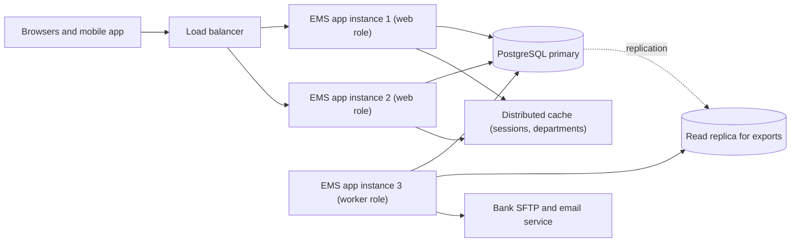
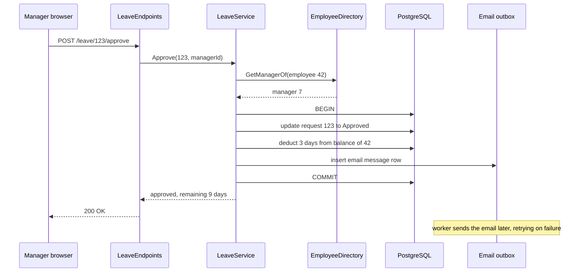

"Monolith" sounds like an insult in some conference talks. It should not. Most successful systems started as one application, and many very large ones still are. This lesson explains what a monolith really is, what it is genuinely good at, how it goes wrong, and how far you can scale it with ordinary techniques. The running example is the **employee management application** (EMS): employee records, leave and payroll.

## Learning objectives

By the end of this lesson you will be able to:

1. Define a monolith precisely: a single deployable unit, usually with one database, where features call each other in-process.
2. List its real strengths: simplicity, fast in-process calls, single transactions, easy debugging and refactoring.
3. Recognise its failure modes: the "big ball of mud", shared-fate crashes, noisy features, slow builds and coordination pain in large teams.
4. Scale a monolith vertically and horizontally, including stateless instances, a worker role, read replicas, caching and bulkheads.
5. Explain why "monolith first" is usually good advice, and which signals justify splitting later.

## Prerequisites

- [What is software architecture?](#/lesson/m02-what-is-architecture): quality attributes and hard-to-change decisions.
- [Business requirements and technical constraints](#/lesson/m02-constraints): why budget and team size often choose the architecture.

You should be able to read a small ASP.NET Core `Program.cs`.

## Explain it like I'm a beginner

Think of a busy neighbourhood restaurant in Pune. One building, one kitchen, one team. The cook shouts "two masala dosas ready!" and the waiter picks them up from the counter three steps away. The cashier, the kitchen and the store room are all under one roof. If the menu changes, the owner changes it for the whole restaurant in one go.

That restaurant is a **monolith**: everything the business needs runs in one place.

It has real advantages. Communication is instant (no phone calls between buildings). There is one set of keys, one electricity bill, one licence. When something goes wrong, the owner walks into the kitchen and sees it. A new waiter learns the whole place in a week.

It also has limits. If the kitchen catches fire, the whole restaurant closes, including the cashier who had nothing to do with the fire. If the restaurant gets famous, you cannot just make the kitchen bigger without making the whole building bigger. And if 60 people work in one kitchen, they start bumping into each other.

The alternative is a food court with separate stalls, each with its own kitchen and staff (that is closer to microservices). It handles more variety and more people, but now you need a manager for the food court, shared seating rules, and a way for stalls to talk to each other.

In software, a **monolithic architecture** means your whole application (all its features: employees, leave, payroll, reports) is built as **one program**, deployed as **one unit**, and usually stores data in **one database**. Inside, it can be very well organised, or a mess. "Monolith" describes how it is **deployed**, not how tidy it is.

## First-principles explanation

### What a monolith is

A monolith has three defining traits:

1. **One deployable unit.** You build one artifact (for .NET: one published web app, perhaps a container image) and deploy it. All features ship together.
2. **In-process communication.** When the leave feature needs an employee's manager, it calls a method: `directory.GetManager(employeeId)`. No network, no serialization. That call takes nanoseconds to microseconds, compared with roughly a millisecond or more for a network call inside a data centre (an order-of-magnitude estimate).
3. **Usually one database.** All features read and write the same PostgreSQL database, so a single transaction can update leave balances and the leave request together.

You can run many **copies** of a monolith behind a load balancer and it is still a monolith: every copy contains every feature.

### Three flavours worth naming

| Flavour | Inside the box | Typical outcome |
|---|---|---|
| Unstructured monolith ("big ball of mud") | Any class calls any class. SQL in controllers. Shared tables used by everyone. | Fast at first, then every change breaks something elsewhere. |
| [Layered](#/lesson/m02-layered) monolith | Code organised by technical role: presentation, business, data. | Clear for small apps. Features are spread across layers. |
| [Modular](#/lesson/m02-modular-monolith) monolith | Code organised by business capability (Employees, Leave, Payroll), each with a small public API and its own tables. | Keeps most monolith benefits while limiting coupling. Easiest to split later. |

All three are deployed the same way. The difference is internal structure, and that is what decides whether the monolith ages well.

### Strengths

- **Simple to build, run and reason about.** One repository, one build, one pipeline, one thing to monitor. A team of 3 can own it completely.
- **Fast internal calls.** No network latency between features, no partial failures between them, no serialization cost.
- **Real transactions.** "Approve leave and deduct the balance" is one database transaction. Either both happen or neither. In a distributed system the same rule needs sagas, outboxes and compensation logic.
- **Easy refactoring.** Rename a method used by five features and the compiler finds every caller. Across services, that is a versioned API change.
- **Easy debugging.** Set a breakpoint, follow the call stack from the HTTP endpoint to the SQL query. One log stream, one process.
- **Cheap.** One or two servers and one database. For EMS that might be ₹35,000–55,000 a month (an estimate) instead of several lakh for a cluster of services.
- **Consistent data.** No eventual consistency between features. A report reads the same data the leave screen just wrote.

### Failure modes

- **Big ball of mud.** Without boundaries, the payroll code queries leave tables directly, the leave code calls payroll helpers, and a "small" change ripples everywhere. This is a structure failure, not a deployment one, but monoliths make it easy because nothing stops it.
- **Shared fate.** A memory leak in the PDF payslip generator crashes the process, and with it employee search and leave approval. Every feature shares CPU, memory, thread pool and database connections.
- **Noisy neighbour features.** At month end, the payroll export runs a heavy query for 40 seconds and uses most database connections. Leave approvals start timing out though nothing is wrong with leave.
- **Scale together or not at all.** If only search is busy, you still scale the whole app, including payroll code that runs once a month. Usually a small cost, sometimes a large one (for example, a feature that needs a GPU).
- **Slow builds and tests.** At 500,000 lines, a full build plus test run can take 20–40 minutes (varies widely), and everyone waits for it.
- **Deployment coordination.** With 60 developers, every release bundles everyone's changes. One risky change delays all the others, so releases get rarer and bigger, which makes them riskier.
- **Technology lock-in.** The whole app shares one runtime version and one framework. Upgrading .NET means upgrading everything at once.
- **Long startup.** Large monoliths that warm many caches at startup can take a minute or more to become ready, which slows autoscaling and rolling deploys.

Notice that most failure modes appear with **size**: size of codebase, team or load. For EMS with 3 developers and a few thousand employees, almost none of them apply yet.

### Scaling a monolith

You can go a long way before splitting. In rough order of effort:

1. **Fix the obvious first.** Add the missing database index, remove the N+1 query, page large lists. These often give 10× improvements for an hour of work.
2. **Scale up (vertical scaling).** Move from 2 to 8 vCPUs. Simple and effective until you hit the largest machine or the price curve gets steep. Requires a restart, so pair it with a second instance.
3. **Scale out (horizontal scaling).** Run 2, 3 or 10 identical instances behind a load balancer. This only works if instances are **stateless**: no in-memory session, no files on local disk, no in-memory locks that must be global. Store sessions in a distributed cache or use tokens, files in object storage, and share ASP.NET Core Data Protection keys between instances so cookies issued by one instance are readable by another.
4. **Split roles, not code.** Run the same binary in two roles: `web` instances serve HTTP, a `worker` instance runs background jobs (payroll, emails, imports). Heavy jobs no longer compete with user requests, and you still deploy one artifact.
5. **Scale reads in the database.** Add a read replica for reports and exports, connection pooling (for example PgBouncer in front of PostgreSQL), and caching for hot, rarely changing data (departments, holiday calendars).
6. **Bulkheads.** Limit how many expensive operations can run at once (for example, at most 2 concurrent payroll exports), so one feature cannot use up shared resources. ASP.NET Core's built-in rate limiter has a concurrency limiter for exactly this.
7. **Static content to a CDN.** Images, scripts and downloadable payslip PDFs need not hit the app servers.

A rough capacity example for EMS after acquisitions grow it to 60,000 employees (estimates, to be confirmed by load testing):

- Requests: 60,000 employees × 30 requests per working day ≈ 1.8 million requests/day.
- Spread over a 10-hour working day: 1,800,000 ÷ 36,000 s ≈ **50 requests/second** average.
- Month-end peak at roughly 5× ≈ **250 requests/second**.
- If one 4-vCPU instance comfortably handles about 150 requests/second for this workload (a figure you must measure), 2 instances cover peak and a third gives headroom and failover.

That is still a small system. Three monolith instances, a worker, one primary database and a replica serve it. Splitting into services would add cost and complexity without solving a real problem.

### When a monolith is the wrong choice

- **Many teams need to release independently** and coordination has become the main bottleneck (often around 50+ developers, though structure matters more than headcount).
- **Parts have very different scaling or runtime needs**: one part needs GPUs, or must handle 100× the traffic of the rest.
- **Fault isolation is a hard requirement**: a crash in one feature must never take down another, and in-process isolation (bulkheads, separate worker processes) is not enough.
- **Different parts need different technologies** for good reasons (for example a Python machine-learning component).

Even then, the usual path is a [modular monolith](#/lesson/m02-modular-monolith) first, then extracting the one or two modules that actually need it.

## Visual explanation

### EMS as a horizontally scaled monolith



All three app boxes run **the same build** of EMS. The load balancer spreads user requests across the two web-role instances. Because sessions and hot reference data live in the shared cache, it does not matter which instance serves a user's next click. The third instance starts with a `worker` role setting, so it serves no web traffic and instead runs payroll calculations, the bank file export and email sending. Its heavy export queries go to a read replica, which PostgreSQL keeps up to date from the primary through replication (the dotted arrow). Writes from all instances still go to the primary, so there is one source of truth and ordinary transactions still work.

### Leave approval inside a monolith



Every arrow between `LeaveService`, `EmployeeDirectory` and the outbox is an **in-process method call**, not a network call. The approval check, the status change, the balance deduction and the email row all happen inside **one database transaction**: if the balance update fails, the request is not marked approved and no email is queued. The email is sent later by the worker role, which reads the outbox table and retries if the email service is down, so a slow email provider never blocks the manager's click. In a microservices design, the same flow would cross three services and need a saga or similar pattern to stay consistent.

## Step-by-step example

### Step 1 — one project, folders by feature

EMS starts as one ASP.NET Core project. The team chooses folders by business feature from day one, which costs nothing and makes later structure easier:

```text
Ems/
  Ems.sln
  src/Ems.Web/
    Program.cs
    Employees/   EmployeeDirectory.cs, EmployeeEndpoints.cs
    Leave/       LeaveRequest.cs, LeaveService.cs, LeaveEndpoints.cs
    Payroll/     PayrollRun.cs, PayrollExportJob.cs
    Shared/      Clock.cs, Outbox.cs
  tests/Ems.Tests/
    Leave/LeaveServiceTests.cs
```

### Step 2 — features call each other through small interfaces

`LeaveService` needs to know an employee's manager. It depends on `IEmployeeDirectory`, not on the employees table. Still an in-process call, but the dependency is explicit and fakeable in tests.

### Step 3 — keep the app stateless

No `static` dictionaries of logged-in users. No files written to the local disk. Sessions in a distributed cache. This costs little on day one and is what makes "add a second instance" a configuration change instead of a project.

### Step 4 — add a role switch

A configuration value `Ems:Role` (`web`, `worker` or `all`) decides whether this instance maps HTTP endpoints, runs hosted background services, or both. In development, `all` runs everything in one process. In production, you run 2 × `web` and 1 × `worker`.

### Step 5 — protect shared resources

The payroll export is limited to 2 concurrent runs with a concurrency limiter. Requests over the limit get `429 Too Many Requests` instead of starving the database pool.

## Production-style C# implementation

The code below is a cut-down EMS monolith: an employee directory, a leave service that approves leave atomically, an outbox, a worker role, a bulkhead on the export endpoint and health checks.

```csharp file=Employees/EmployeeDirectory.cs
namespace Ems.Web.Employees;

public sealed record EmployeeSummary(int Id, string Name, int? ManagerId);

public interface IEmployeeDirectory
{
    EmployeeSummary? Get(int id);
}

public sealed class InMemoryEmployeeDirectory : IEmployeeDirectory
{
    private readonly Dictionary<int, EmployeeSummary> _byId = new()
    {
        [7] = new(7, "Neha Kapoor", null),
        [42] = new(42, "Vikram Rao", 7),
        [43] = new(43, "Ananya Das", 7),
    };

    public EmployeeSummary? Get(int id) => _byId.GetValueOrDefault(id);
}
```

```csharp file=Leave/LeaveService.cs
using Ems.Web.Employees;
using Ems.Web.Shared;

namespace Ems.Web.Leave;

public enum LeaveStatus { Pending, Approved, Rejected }

public sealed class LeaveRequest(int id, int employeeId, int days)
{
    public int Id { get; } = id;
    public int EmployeeId { get; } = employeeId;
    public int Days { get; } = days;
    public LeaveStatus Status { get; set; } = LeaveStatus.Pending;
}

public sealed record ApprovalResult(bool Ok, string? Error, int RemainingDays);

/// <summary>Stands in for the database. The lock models a transaction: all changes or none.</summary>
public sealed class LeaveStore
{
    public readonly Lock Gate = new();
    public Dictionary<int, LeaveRequest> Requests { get; } = new() { [123] = new LeaveRequest(123, 42, 3) };
    public Dictionary<int, int> Balances { get; } = new() { [42] = 12, [43] = 2 };
}

public sealed class LeaveService(LeaveStore store, IEmployeeDirectory directory, IOutbox outbox)
{
    public ApprovalResult Approve(int requestId, int approverId)
    {
        lock (store.Gate)   // with EF Core: one DbContext, one SaveChanges, one transaction
        {
            if (!store.Requests.TryGetValue(requestId, out var request))
                return new(false, "Leave request not found.", 0);
            if (request.Status != LeaveStatus.Pending)
                return new(false, $"Request is already {request.Status}.", store.Balances[request.EmployeeId]);

            // In-process call to another feature. Nanoseconds, no network failure to handle.
            var employee = directory.Get(request.EmployeeId);
            if (employee?.ManagerId != approverId)
                return new(false, "Only the employee's manager can approve.", store.Balances[request.EmployeeId]);

            var balance = store.Balances[request.EmployeeId];
            if (balance < request.Days)
                return new(false, "Insufficient leave balance.", balance);

            request.Status = LeaveStatus.Approved;
            store.Balances[request.EmployeeId] = balance - request.Days;
            outbox.Enqueue(new OutboxMessage("leave-approved", $"Leave {requestId} approved for {employee.Name}"));
            return new(true, null, balance - request.Days);
        }
    }
}
```

```csharp file=Shared/Outbox.cs
using System.Collections.Concurrent;

namespace Ems.Web.Shared;

public sealed record OutboxMessage(string Type, string Body);

public interface IOutbox
{
    void Enqueue(OutboxMessage message);
    bool TryDequeue(out OutboxMessage? message);
}

/// <summary>In production this is a table written in the same transaction as the business change.</summary>
public sealed class InMemoryOutbox : IOutbox
{
    private readonly ConcurrentQueue<OutboxMessage> _queue = new();
    public void Enqueue(OutboxMessage message) => _queue.Enqueue(message);
    public bool TryDequeue(out OutboxMessage? message) => _queue.TryDequeue(out message);
}
```

```csharp file=Shared/OutboxWorker.cs
namespace Ems.Web.Shared;

/// <summary>Runs only in the worker role. Sends queued emails so user requests never wait on the email provider.</summary>
public sealed class OutboxWorker(IOutbox outbox, ILogger<OutboxWorker> logger) : BackgroundService
{
    protected override async Task ExecuteAsync(CancellationToken stoppingToken)
    {
        using var timer = new PeriodicTimer(TimeSpan.FromSeconds(2));
        while (await timer.WaitForNextTickAsync(stoppingToken))
        {
            while (outbox.TryDequeue(out var message) && message is not null)
                logger.LogInformation("Sending {Type}: {Body}", message.Type, message.Body);
        }
    }
}
```

```csharp file=Program.cs
using System.Threading.RateLimiting;
using Microsoft.AspNetCore.RateLimiting;
using Ems.Web.Employees;
using Ems.Web.Leave;
using Ems.Web.Shared;

var builder = WebApplication.CreateBuilder(args);

// One build, several roles: "web", "worker" or "all" (default, for local development).
var role = builder.Configuration["Ems:Role"] ?? "all";
var isWeb = role is "web" or "all";
var isWorker = role is "worker" or "all";

builder.Services.AddSingleton<IEmployeeDirectory, InMemoryEmployeeDirectory>();
builder.Services.AddSingleton<LeaveStore>();
builder.Services.AddSingleton<IOutbox, InMemoryOutbox>();
builder.Services.AddScoped<LeaveService>();
builder.Services.AddHealthChecks();

if (isWorker) builder.Services.AddHostedService<OutboxWorker>();

// Bulkhead: at most 2 payroll exports at once, 2 more may wait, the rest get 429.
builder.Services.AddRateLimiter(o =>
{
    o.RejectionStatusCode = StatusCodes.Status429TooManyRequests;
    o.AddConcurrencyLimiter("payroll-export", l =>
    {
        l.PermitLimit = 2;
        l.QueueLimit = 2;
        l.QueueProcessingOrder = QueueProcessingOrder.OldestFirst;
    });
});

var app = builder.Build();

app.MapHealthChecks("/health");

if (isWeb)
{
    app.UseRateLimiter();

    app.MapPost("/leave/{id:int}/approve", (int id, int approverId, LeaveService leave) =>
    {
        var result = leave.Approve(id, approverId);
        return result.Ok ? Results.Ok(result) : Results.Problem(result.Error, statusCode: StatusCodes.Status409Conflict);
    });

    app.MapGet("/payroll/{month}/export", async (string month, CancellationToken ct) =>
    {
        await Task.Delay(TimeSpan.FromSeconds(3), ct);   // stands in for a heavy query on the read replica
        return Results.Text($"bank file for {month}", "text/plain");
    }).RequireRateLimiting("payroll-export");
}

app.Run();
```

**Why one build with roles instead of two projects?** You keep the monolith's biggest advantage, one artifact and one version, while separating runtime behaviour. A bug fix ships to web and worker together, so they can never be on incompatible versions.

**Why the lock?** It makes the in-memory example behave like a transaction. In a real EMS, `LeaveService` would load the request and balance through one EF Core `DbContext` and call `SaveChangesAsync` once, which PostgreSQL runs as one transaction. The outbox row would be inserted in the same transaction.

## Bad design vs good design

**Bad: the monolith as a big ball of mud.**

```csharp
// LeaveController.cs: everything in one place
public IActionResult Approve(int id)
{
    var conn = new NpgsqlConnection(Config.Cs);
    var emp = conn.QuerySingle("select * from employees e join payroll_settings p on ...");   // reads payroll tables
    if (DateTime.Now.Day > 25) PayrollHelper.RecalculateForLeave(emp.Id);                       // calls into payroll internals
    conn.Execute("update leave_requests set status = 'A' where id = " + id);                     // SQL injection risk
    conn.Execute("update balances set days = days - 3 where employee_id = " + emp.Id);           // separate statement, no transaction
    SmtpClient.Send(...);                                                                        // user waits on email
    return Ok();
}
```

Problems: no transaction (the request can be approved without the balance changing), leave code reaching into payroll internals, a hidden date rule, SQL built from strings, and the manager's click waiting for the email server. Every one of these is possible in a monolith because nothing prevents it, and none of them is *caused* by being a monolith.

**Good: the monolith shown above.** Feature folders, small interfaces between features, one transaction per business operation, slow work moved to an outbox and a worker, a bulkhead around heavy endpoints, stateless instances.

**Is the good version much more work?** No. It is mostly the same amount of code arranged differently. The real cost is discipline: code review and a few [architecture tests](#/lesson/m02-what-is-architecture) to keep features from reaching into each other's tables.

:::callout type=mistake title="Splitting because the monolith is messy"
If the monolith is a big ball of mud, splitting it into services usually produces a *distributed* big ball of mud: the same tangled dependencies, now with network failures and no transactions. Fix the internal boundaries first. If services are still needed after that, extraction is far easier.
:::

:::callout type=tip title="A preview of the module exercise"
In the [layered architecture](#/lesson/m02-layered) lesson you will design EMS three ways (plain monolith, layered app, modular monolith) and compare diagrams, folder structures, dependencies, testing and deployment side by side. Keep this lesson's folder layout in mind.
:::

## Practical playground

This calculator turns business numbers into a monolith sizing estimate. Run it with the defaults (60,000 employees), then try 2,500 and 5,00,000 employees, and change `perInstanceRps` to see how sensitive the answer is. Every number here is an assumption to be replaced by measurements.

:::playground type=csharp title="How many monolith instances do we need?"
```csharp file=Program.cs
using System;

public static class Program
{
    public static void Main()
    {
        // Business inputs (assumptions)
        const int employees = 60_000;
        const int requestsPerEmployeePerDay = 30;
        const double workingHours = 10;
        const double peakFactor = 5;          // month-end vs average

        // Technical inputs (measure these with a load test)
        const double perInstanceRps = 150;    // one 4-vCPU instance, this workload
        const double targetUtilisation = 0.6; // keep 40 % headroom
        const int dbConnectionsPerInstance = 20;

        var perDay = (double)employees * requestsPerEmployeePerDay;
        var avgRps = perDay / (workingHours * 3600);
        var peakRps = avgRps * peakFactor;
        var instances = (int)Math.Ceiling(peakRps / (perInstanceRps * targetUtilisation));
        var withFailover = instances + 1;     // N+1: survive one instance failing

        Console.WriteLine($"Requests per day: {perDay:N0}");
        Console.WriteLine($"Average: {avgRps:F0} req/s, peak: {peakRps:F0} req/s");
        Console.WriteLine($"Web instances for peak: {instances}, with N+1 failover: {withFailover}");
        Console.WriteLine($"Database connections at peak (pool size x instances): {withFailover * dbConnectionsPerInstance}");
        Console.WriteLine(withFailover <= 6
            ? "Verdict: comfortably within what a scaled-out monolith handles."
            : "Verdict: still possible, but profile hot paths and consider caching and read replicas first.");
    }
}
```
:::

## Exercises

:::exercise id=m02-monolith-ex1 difficulty=beginner kind=code title="Approve leave atomically"
Implement `LeaveApprovals.Approve` for the EMS monolith. Everything runs in-process, so you can check the manager, the status and the balance, and change the status and balance together.
::requirements
- Unknown request id → result with `Ok = false` and error `"not-found"`.
- Request not `Pending` → `"not-pending"`.
- Approver is not the employee's manager (from `IManagerLookup`) → `"not-manager"`.
- Balance smaller than requested days → `"insufficient-balance"`, and nothing changes.
- On success: status becomes `Approved`, balance decreases by the requested days, result has `Ok = true` and the remaining balance.
::acceptance
- A valid approval of 3 days from a balance of 12 leaves 9.
- A failed approval leaves both status and balance unchanged.
- A second approval of the same request fails with `"not-pending"`.
::hint
Check every rule first, and only then change anything. That way a failure never leaves a half-done change.
::hint
Order the checks from cheapest and most basic: exists, pending, manager, balance.
::hint
```csharp
if (!_requests.TryGetValue(id, out var r)) return new(false, "not-found", 0);
if (r.Status != Status.Pending) return new(false, "not-pending", _balances[r.EmployeeId]);
// ... manager check, balance check, then mutate
```
::starter
```csharp file=LeaveApprovals.cs
using System;
using System.Collections.Generic;

public enum Status { Pending, Approved, Rejected }

public sealed class Request
{
    public int Id { get; init; }
    public int EmployeeId { get; init; }
    public int Days { get; init; }
    public Status Status { get; set; } = Status.Pending;
}

public sealed record Result(bool Ok, string? Error, int Remaining);

public interface IManagerLookup { int? ManagerOf(int employeeId); }

public sealed class LeaveApprovals
{
    private readonly Dictionary<int, Request> _requests;
    private readonly Dictionary<int, int> _balances;
    private readonly IManagerLookup _managers;

    public LeaveApprovals(Dictionary<int, Request> requests, Dictionary<int, int> balances, IManagerLookup managers)
    {
        _requests = requests;
        _balances = balances;
        _managers = managers;
    }

    public Result Approve(int requestId, int approverId)
    {
        throw new NotImplementedException();
    }
}
```
::tests
```csharp file=LeaveApprovalsTests.cs
using System.Collections.Generic;
using Xunit;

public class LeaveApprovalsTests
{
    private sealed class Managers : IManagerLookup
    {
        public int? ManagerOf(int employeeId) => employeeId == 42 ? 7 : null;
    }

    private static (LeaveApprovals svc, Dictionary<int, Request> reqs, Dictionary<int, int> bal) Make(int balance = 12, int days = 3)
    {
        var reqs = new Dictionary<int, Request> { [1] = new Request { Id = 1, EmployeeId = 42, Days = days } };
        var bal = new Dictionary<int, int> { [42] = balance };
        return (new LeaveApprovals(reqs, bal, new Managers()), reqs, bal);
    }

    [Fact]
    public void Approves_and_deducts()
    {
        var (svc, reqs, bal) = Make();
        var r = svc.Approve(1, 7);
        Assert.True(r.Ok);
        Assert.Equal(9, r.Remaining);
        Assert.Equal(9, bal[42]);
        Assert.Equal(Status.Approved, reqs[1].Status);
    }

    [Fact] public void Unknown_request() => Assert.Equal("not-found", Make().svc.Approve(99, 7).Error);

    [Fact]
    public void Wrong_manager_changes_nothing()
    {
        var (svc, reqs, bal) = Make();
        Assert.Equal("not-manager", svc.Approve(1, 8).Error);
        Assert.Equal(12, bal[42]);
        Assert.Equal(Status.Pending, reqs[1].Status);
    }

    [Fact]
    public void Insufficient_balance_changes_nothing()
    {
        var (svc, reqs, bal) = Make(balance: 2, days: 3);
        Assert.Equal("insufficient-balance", svc.Approve(1, 7).Error);
        Assert.Equal(2, bal[42]);
        Assert.Equal(Status.Pending, reqs[1].Status);
    }

    [Fact]
    public void Second_approval_fails()
    {
        var (svc, _, bal) = Make();
        svc.Approve(1, 7);
        Assert.Equal("not-pending", svc.Approve(1, 7).Error);
        Assert.Equal(9, bal[42]);
    }
}
```
::solution
```csharp file=LeaveApprovals.cs
using System;
using System.Collections.Generic;

public enum Status { Pending, Approved, Rejected }

public sealed class Request
{
    public int Id { get; init; }
    public int EmployeeId { get; init; }
    public int Days { get; init; }
    public Status Status { get; set; } = Status.Pending;
}

public sealed record Result(bool Ok, string? Error, int Remaining);

public interface IManagerLookup { int? ManagerOf(int employeeId); }

public sealed class LeaveApprovals
{
    private readonly Dictionary<int, Request> _requests;
    private readonly Dictionary<int, int> _balances;
    private readonly IManagerLookup _managers;

    public LeaveApprovals(Dictionary<int, Request> requests, Dictionary<int, int> balances, IManagerLookup managers)
    {
        _requests = requests;
        _balances = balances;
        _managers = managers;
    }

    public Result Approve(int requestId, int approverId)
    {
        if (!_requests.TryGetValue(requestId, out var request)) return new(false, "not-found", 0);

        var balance = _balances.GetValueOrDefault(request.EmployeeId);
        if (request.Status != Status.Pending) return new(false, "not-pending", balance);
        if (_managers.ManagerOf(request.EmployeeId) != approverId) return new(false, "not-manager", balance);
        if (balance < request.Days) return new(false, "insufficient-balance", balance);

        // All checks passed: now change both pieces of state together.
        request.Status = Status.Approved;
        _balances[request.EmployeeId] = balance - request.Days;
        return new(true, null, balance - request.Days);
    }
}
```

"Check everything, then mutate" is the in-memory version of a transaction. In the real monolith the same method would run inside one database transaction, so even an exception between the two writes could not leave the data half-changed.
::mistakes
- Changing the status before checking the balance, which leaves an approved request with an unchanged balance on failure.
- Letting one manager approve their own leave because `ManagerOf` returned null and the approver id was not compared carefully.
- Treating "not found" as an exception in a normal business flow.
::extensions
Add thread safety with a lock and write a test that runs 20 parallel approvals of different requests for the same employee with a balance of only 10 days.
:::

:::exercise id=m02-monolith-ex2 difficulty=beginner kind=written title="Monolith or not, for three companies"
For each company, say whether a monolith is a good starting architecture and list the two biggest risks to watch.

1. A 300-person manufacturing firm in Chennai wants EMS for leave and payroll. IT team of 2.
2. A national retailer with 1,20,000 staff and 6 development teams (45 developers). Payroll, scheduling and attendance change on different schedules.
3. A start-up building an HR product for small businesses, 4 developers, unsure which features customers will pay for.
::acceptance
- A clear yes or no (or "yes, but") for each with reasons tied to team size, load, and change patterns.
- Two concrete risks per company, not generic ones.
::hint
Which failure modes of a monolith grow with team size, and which with load?
::hint
For the start-up, how expensive would wrong service boundaries be when you do not yet know the product?
::hint
For the retailer, is a modular monolith or a few services a better fit than one undivided app?
::solution
1. **Yes.** Load is tiny and the team is 2. Risks: a big ball of mud if features are not separated (use feature folders and interfaces); a single server as a single point of failure during the payroll window (add a second instance or a tested restore plan).
2. **Yes, but modular**, and consider extracting one or two modules later. Risks: deployment coordination across 6 teams (every release bundles everyone's work); noisy-neighbour load from attendance (1,20,000 punches at shift change) affecting payroll. Mitigations: module ownership per team, worker roles, bulkheads, and extraction of attendance if its scaling profile really differs.
3. **Yes.** Boundaries are unknown, and wrong service boundaries are very expensive to fix. Risks: rushed code quality as features are tried and dropped (keep tests and feature folders); multi-tenancy designed late (decide tenant isolation early, as it is a one-way door).
::mistakes
- Saying "microservices" for the retailer because it is big, without addressing why.
- Generic risks ("might not scale") without a concrete scenario.
:::

:::exercise id=m02-monolith-ex3 difficulty=intermediate kind=code title="Build a simple bulkhead"
The month-end payroll export uses so many database connections that leave approvals time out. Implement a `Bulkhead` that allows at most N concurrent operations and **rejects immediately** when full, so one feature cannot exhaust shared resources.
::requirements
- `TryRunAsync<T>(Func<Task<T>> work)` returns `(true, result)` when a slot was free, or `(false, default)` immediately when all slots are busy.
- The slot is released when the work finishes, **even if it throws** (the exception must still reach the caller).
- `InFlight` reports the number of operations currently running.
- Constructor rejects `maxConcurrent < 1` with `ArgumentOutOfRangeException`.
::acceptance
- With `maxConcurrent = 2`, a third call while two are running is rejected without waiting.
- After one finishes, a new call is accepted.
- A throwing operation frees its slot.
::hint
`SemaphoreSlim` counts available slots. `Wait(0)` tries to take one without waiting and returns false if none are free.
::hint
Release in a `finally` block so exceptions cannot leak a slot.
::hint
`InFlight` is `max - semaphore.CurrentCount`.
::hint
```csharp
if (!_slots.Wait(0)) return (false, default);
try { return (true, await work()); }
finally { _slots.Release(); }
```
::starter
```csharp file=Bulkhead.cs
using System;
using System.Threading;
using System.Threading.Tasks;

public sealed class Bulkhead
{
    public Bulkhead(int maxConcurrent)
    {
        throw new NotImplementedException();
    }

    public int InFlight => throw new NotImplementedException();

    public Task<(bool Accepted, T? Result)> TryRunAsync<T>(Func<Task<T>> work)
    {
        throw new NotImplementedException();
    }
}
```
::tests
```csharp file=BulkheadTests.cs
using System;
using System.Threading.Tasks;
using Xunit;

public class BulkheadTests
{
    [Fact]
    public async Task Third_call_rejected_while_two_run()
    {
        var b = new Bulkhead(2);
        var gate = new TaskCompletionSource<int>();
        var t1 = b.TryRunAsync(() => gate.Task);
        var t2 = b.TryRunAsync(() => gate.Task);
        Assert.Equal(2, b.InFlight);

        var third = await b.TryRunAsync(() => Task.FromResult(99));
        Assert.False(third.Accepted);

        gate.SetResult(5);
        var r1 = await t1;
        await t2;
        Assert.True(r1.Accepted);
        Assert.Equal(5, r1.Result);
        Assert.Equal(0, b.InFlight);
    }

    [Fact]
    public async Task Slot_freed_after_completion()
    {
        var b = new Bulkhead(1);
        await b.TryRunAsync(() => Task.FromResult(1));
        var again = await b.TryRunAsync(() => Task.FromResult(2));
        Assert.True(again.Accepted);
        Assert.Equal(2, again.Result);
    }

    [Fact]
    public async Task Exception_frees_slot_and_propagates()
    {
        var b = new Bulkhead(1);
        await Assert.ThrowsAsync<InvalidOperationException>(() =>
            b.TryRunAsync<int>(() => throw new InvalidOperationException("boom")));
        Assert.Equal(0, b.InFlight);
        Assert.True((await b.TryRunAsync(() => Task.FromResult(3))).Accepted);
    }

    [Fact]
    public void Zero_capacity_rejected() => Assert.Throws<ArgumentOutOfRangeException>(() => new Bulkhead(0));
}
```
::solution
```csharp file=Bulkhead.cs
using System;
using System.Threading;
using System.Threading.Tasks;

public sealed class Bulkhead
{
    private readonly SemaphoreSlim _slots;
    private readonly int _max;

    public Bulkhead(int maxConcurrent)
    {
        ArgumentOutOfRangeException.ThrowIfLessThan(maxConcurrent, 1);
        _max = maxConcurrent;
        _slots = new SemaphoreSlim(maxConcurrent, maxConcurrent);
    }

    public int InFlight => _max - _slots.CurrentCount;

    public async Task<(bool Accepted, T? Result)> TryRunAsync<T>(Func<Task<T>> work)
    {
        if (!_slots.Wait(0)) return (false, default);
        try
        {
            return (true, await work());
        }
        finally
        {
            _slots.Release();
        }
    }
}
```

Rejecting immediately (rather than queueing forever) is deliberate: the caller gets a fast `429` and can retry later, instead of holding a thread and a request open. ASP.NET Core's `AddConcurrencyLimiter` gives you the same behaviour, plus a bounded queue, without writing this class. Write your own only when you need it outside HTTP endpoints, for example around a specific database-heavy call inside a background job.
::alternatives
A bounded queue (allow 2 running and 5 waiting) smooths short bursts. Use `WaitAsync(timeout)` instead of `Wait(0)`. Keep the queue small: a long queue just moves the timeout somewhere else.
::mistakes
- Releasing the semaphore outside `finally`, so one exception permanently loses a slot.
- Using `await _slots.WaitAsync()` without a timeout, which turns the bulkhead into an unbounded queue.
- Creating a new `Bulkhead` per request, so the limit never applies across requests. It must be a singleton.
:::

:::exercise id=m02-monolith-ex4 difficulty=intermediate kind=hld title="Scale the EMS monolith for 60,000 employees"
After two acquisitions, EMS grows from 2,500 to 60,000 employees. Today it runs on one server with one PostgreSQL database. Month-end peak is about 250 requests per second, and the payroll export must not slow down leave approvals. Redesign the deployment **without** splitting the code into services.
::acceptance
- At least two web instances behind a load balancer, with no single app server as a single point of failure.
- Background work (payroll, emails, bank export) separated from web traffic.
- Heavy reads moved off the primary database.
- Session or hot data handled so instances are stateless.
- A short justification of why services are not needed yet.
::hint
Start with the capacity numbers: how many instances for 250 req/s if one handles about 150 with headroom?
::hint
Same binary, different roles: what should the worker instance do?
::hint
Which node type takes the payroll export queries so they do not compete with writes?
::hint
Where do sessions go if any instance can serve any request?
::starter
```json
{
  "nodes": [
    { "id": "c", "type": "client", "label": "Browsers and mobile app", "props": { "rps": 250 } },
    { "id": "app", "type": "app-server", "label": "EMS monolith", "props": { "instances": 1 } },
    { "id": "db", "type": "database", "label": "PostgreSQL", "props": { "replicas": 0 } }
  ],
  "edges": [
    { "from": "c", "to": "app", "kind": "sync" },
    { "from": "app", "to": "db", "kind": "sync", "label": "SQL" }
  ]
}
```
::solution
```json
{
  "nodes": [
    { "id": "c", "type": "client", "label": "Browsers and mobile app", "props": { "rps": 250 } },
    { "id": "cdn", "type": "cdn", "label": "CDN for static files" },
    { "id": "lb", "type": "load-balancer", "label": "Load balancer", "props": { "multiAz": true } },
    { "id": "web", "type": "app-server", "label": "EMS monolith (web role)", "props": { "instances": 3 } },
    { "id": "worker", "type": "worker", "label": "EMS monolith (worker role)", "props": { "instances": 1 } },
    { "id": "cache", "type": "cache", "label": "Distributed cache (sessions, reference data)", "props": { "ttlSeconds": 600 } },
    { "id": "db", "type": "database", "label": "PostgreSQL primary", "props": { "multiAz": true } },
    { "id": "replica", "type": "read-replica", "label": "Read replica for exports and reports", "props": { "replicas": 1 } },
    { "id": "bank", "type": "external", "label": "Bank SFTP and email provider" },
    { "id": "mon", "type": "monitoring", "label": "Metrics and logs" }
  ],
  "edges": [
    { "from": "c", "to": "cdn", "kind": "sync" },
    { "from": "c", "to": "lb", "kind": "sync" },
    { "from": "lb", "to": "web", "kind": "sync" },
    { "from": "web", "to": "cache", "kind": "sync" },
    { "from": "web", "to": "db", "kind": "sync", "label": "reads and writes" },
    { "from": "worker", "to": "db", "kind": "sync", "label": "outbox, payroll writes" },
    { "from": "worker", "to": "replica", "kind": "sync", "label": "export queries" },
    { "from": "db", "to": "replica", "kind": "async", "label": "replication" },
    { "from": "worker", "to": "bank", "kind": "async" },
    { "from": "web", "to": "mon", "kind": "async" },
    { "from": "worker", "to": "mon", "kind": "async" }
  ]
}
```

**Reasoning.** 250 req/s ÷ (150 × 0.6 utilisation) ≈ 2.8, so 3 web instances, which also survive one failure at normal load. The worker runs the same build with the worker role, so payroll and emails never take web threads. Export queries go to the read replica, which may lag by a second or two, acceptable for a monthly file. Sessions and reference data in the distributed cache make the web tier stateless. The primary database runs with a standby in another zone for failover during the payroll window.

**Why not services?** The load is moderate, data is strongly related (leave affects payroll), and the team is small. Every problem here is solved by deployment changes, not code splits. Revisit if a module develops a very different scaling profile or a separate team needs independent releases.
::mistakes
- Adding instances without making them stateless, so users are logged out when the load balancer switches instance.
- Running payroll inside web instances "because they have spare CPU", which brings back the noisy neighbour.
- Sending writes to the read replica.
:::

:::exercise id=m02-monolith-ex5 difficulty=advanced kind=written title="Rescue a struggling monolith"
A five-year-old EMS monolith (350,000 lines, 22 developers) has these symptoms: releases happen once a month and often roll back; a CI run takes 45 minutes; at month end the whole app slows down and the leave screen times out; developers say "touching payroll breaks leave". Management proposes rewriting it as microservices over 18 months.

Write a counter-proposal: a prioritised 6-month plan that addresses each symptom, the metrics you would track, and the conditions under which you would extract a service.
::acceptance
- Each symptom mapped to a specific cause and a specific action.
- The plan is incremental: value delivered every few weeks, not only at the end.
- At least four measurable metrics with targets.
- Clear, testable criteria for extracting a service later.
- Addresses the risk of a big-bang rewrite.
::hint
Which symptoms are deployment problems and which are structure problems?
::hint
"Touching payroll breaks leave" points to coupling. How do you make the coupling visible and then reduce it?
::hint
The month-end slowdown is a runtime isolation problem. You already know three tools for that from this lesson.
::hint
Track DORA-style metrics: deployment frequency, change failure rate, lead time, time to restore.
::solution
**Diagnosis.** Monthly releases and rollbacks: big batches and weak automated tests. 45-minute CI: one huge test project, slow integration tests, no build caching. Month-end slowdown: payroll and leave share threads, connections and the primary database. "Payroll breaks leave": direct table access and shared classes between features.

**Months 1–2 (runtime isolation, quick wins).** Introduce web and worker roles from the same build, move payroll and exports to the worker. Add a read replica for exports. Add a concurrency limiter on heavy endpoints. Fix the top 10 slow queries found in `pg_stat_statements`. Expected: leave screen p95 under 500 ms at month end.

**Months 2–4 (delivery).** Split tests into fast unit tests and a smaller set of integration tests run in parallel; target CI under 15 minutes. Move to weekly then twice-weekly releases behind feature flags. Add automated smoke tests after deployment and one-click rollback.

**Months 3–6 (structure).** Define modules (Employees, Leave, Payroll, Reporting) with owners. Add architecture tests that forbid cross-module table access, initially as warnings, then as failures once each violation is fixed. Replace direct table access with small module interfaces. This is the move to a [modular monolith](#/lesson/m02-modular-monolith).

**Metrics.** Deployment frequency (monthly → 2 per week). Change failure rate (target under 15 %). CI duration (45 → 15 minutes). Leave p95 at month end (target 500 ms). Count of cross-module violations (trend to zero).

**Extraction criteria.** Extract a module only if, after modularisation, it has (a) a clean interface with no shared tables, (b) a clear owning team that wants independent releases, and (c) a measurable need such as a very different scaling profile or release cadence. Payroll is the likely first candidate.

**Why not a rewrite.** An 18-month rewrite delivers no value until the end, must chase a moving target as the old system keeps changing, and tends to reproduce the same coupling in a distributed form. The incremental plan fixes the actual symptoms within weeks and keeps extraction possible.
::mistakes
- Treating all symptoms as "the monolith is the problem" instead of separate causes.
- Proposing services before fixing coupling, which spreads the coupling across the network.
- No metrics, so nobody can tell if the plan works.
:::

## Automated testing

A monolith is one of the easiest architectures to test, because you can run the whole thing in one process.

**1. Unit tests per feature** with fakes for other features' interfaces (exercise 1 is an example). These run in milliseconds and should be the majority.

**2. Whole-application tests in memory.** `Microsoft.AspNetCore.Mvc.Testing`'s `WebApplicationFactory<Program>` starts the entire monolith in-process with a test server, so you can send real HTTP requests:

```csharp
public class LeaveApiTests(WebApplicationFactory<Program> factory) : IClassFixture<WebApplicationFactory<Program>>
{
    [Fact]
    public async Task Manager_can_approve_leave()
    {
        var client = factory.CreateClient();
        var response = await client.PostAsync("/leave/123/approve?approverId=7", null);
        Assert.Equal(HttpStatusCode.OK, response.StatusCode);
    }
}
```

With a real database, run PostgreSQL in a container per test run (for example with Testcontainers) and reset data between tests.

**3. Architecture tests** that stop the monolith turning into a ball of mud: "types in `Ems.Web.Leave` must not reference `Ems.Web.Payroll` internals". See the fitness function in [What is software architecture?](#/lesson/m02-what-is-architecture).

**4. Role tests.** Start the host with `Ems:Role=web` and assert that `OutboxWorker` is not registered. Start with `worker` and assert no endpoints respond. This catches the "worker accidentally serves traffic" bug.

**5. Load tests** before month end: replay a realistic mix (searches, approvals, one export) and check that leave p95 stays within budget while exports run.

## Real-world application

- **Many well-known products began as monoliths.** Public engineering blogs from companies such as Shopify and Basecamp describe large, long-lived monolithic applications, with Shopify writing extensively about modularising its Rails monolith rather than splitting it.
- **Stack Overflow** has publicly described serving very high traffic from a small number of servers running a largely monolithic .NET application, a frequently cited example that a well-tuned monolith scales a long way.
- **Government and infrastructure project portals** are commonly single ASP.NET or Java applications with one database. Their main scaling events are predictable deadlines (bill submissions, tender closings), handled with scaled-out instances, read replicas and queues.
- **Internal enterprise tools** (EMS, asset tracking, procurement) are monoliths in most organisations, and should be, given their team sizes and load.

## Interview questions

:::interview
::q beginner
What is a monolithic architecture?
::a
An application where all features are built, deployed and run as a single unit, usually sharing one database. Features call each other in-process. You can run several identical copies behind a load balancer, and it is still a monolith because each copy contains everything.
::q beginner
Give three advantages of a monolith.
::a
Simplicity (one codebase, build, deployment and monitoring target), fast and reliable in-process calls with no network failures between features, and real ACID transactions across features in one database. Also: easier debugging, easier refactoring with compiler support, and lower hosting cost.
::q intermediate
How would you scale a monolith horizontally? What must be true first?
::a
Run multiple identical instances behind a load balancer. First, instances must be stateless: sessions in a distributed cache or tokens, files in object storage, Data Protection keys shared, no in-memory global locks or static caches that must be consistent. Then add a worker role for background jobs, read replicas and connection pooling for the database, caching for hot data, and bulkheads around expensive operations.
::q intermediate
What is the difference between a monolith and a big ball of mud?
::a
A monolith is a deployment style: one deployable unit. A big ball of mud is a structural failure: no meaningful boundaries, everything depends on everything. A monolith can be cleanly layered or modular. A set of microservices can also be a ball of mud if services share databases and call each other in tangled ways.
::q advanced
When would you split a monolith, and how?
::a
When there is a specific, measured need that in-process structure and deployment changes cannot meet: teams blocked by shared releases, a module with a very different scaling or technology need, or a hard fault-isolation requirement. First make the monolith modular with enforced boundaries and no shared tables. Then extract one module at a time behind its existing interface (the strangler fig approach): route traffic for that capability to the new service, migrate its data, and remove the old code. Measure before and after, and stop when the remaining monolith is healthy.
::q advanced
Month-end payroll slows the entire monolith. Walk through your diagnosis and fixes.
::a
Measure first: which resource is exhausted (CPU, thread pool, database connections, locks, I/O) and which queries dominate (`pg_stat_statements`, APM traces). Typical fixes in order: optimise the worst queries and add indexes; move payroll to a worker role so web threads are untouched; route export reads to a read replica; limit concurrent exports with a bulkhead; process payroll in batches with checkpoints; schedule heavy work outside peak hours. Only if a module still dominates resources after all this would extraction be on the table.
:::

## Summary and revision

**Key takeaways**

- A monolith is one deployable unit with in-process calls and usually one database. It is a deployment style, not a code-quality verdict.
- Strengths: simplicity, speed of internal calls, real transactions, easy debugging and refactoring, low cost.
- Failure modes grow with size: big ball of mud, shared fate, noisy neighbours, slow builds, release coordination, scaling everything together.
- Scale a monolith with indexes and query fixes, vertical scaling, stateless horizontal scaling, worker roles, read replicas, caching and bulkheads.
- Start with a well-structured monolith, and split only for specific, measured reasons, after making it modular.

**Terminology**: monolith, deployable unit, in-process call, big ball of mud, shared fate, noisy neighbour, vertical and horizontal scaling, stateless instance, worker role, read replica, bulkhead, outbox, strangler fig.

:::flashcards
Q: What makes an application a monolith?
A: It is built and deployed as one unit, features call each other in-process, and it usually shares one database.
Q: Are three copies of the same app behind a load balancer still a monolith?
A: Yes. Every copy contains every feature, and they deploy together.
Q: What must be true before you can scale a monolith horizontally?
A: Instances must be stateless: no in-memory sessions, local files or global in-memory locks.
Q: What is a worker role?
A: The same build started with a setting that runs background jobs instead of serving web traffic.
Q: What does a bulkhead do?
A: Limits how many expensive operations run at once, so one feature cannot exhaust shared resources.
Q: Name four failure modes of a large monolith.
A: Big ball of mud, shared-fate crashes, noisy-neighbour features, slow builds and coordinated releases.
Q: What does "monolith first" mean?
A: Start with a well-structured monolith and extract services later, when real boundaries and needs are known.
Q: Why is splitting a messy monolith risky?
A: You get a distributed ball of mud: the same coupling plus network failures and no shared transactions.
:::

## Knowledge check

:::quiz pass=70
::q single
EMS runs as 3 identical instances behind a load balancer, all sharing one PostgreSQL database. Which architecture is it?
- [x] A monolith, horizontally scaled.
- [ ] Microservices, because there are three instances.
- [ ] Serverless.
- [ ] A distributed system with three services.
> Each instance contains every feature and they deploy together. Instance count does not change the architecture style.
::q single
Users are randomly logged out after you add a second instance. What is the most likely cause?
- [ ] The database cannot handle two instances.
- [x] Session state or Data Protection keys are stored per instance, so the other instance cannot read the user's session or cookie.
- [ ] Load balancers do not support ASP.NET Core.
- [ ] The second instance runs a different version.
> Horizontal scaling requires stateless instances. Move sessions to a distributed cache and share Data Protection keys.
::q single
At month end, the payroll export uses most database connections and leave approvals time out. What is the best first fix within a monolith?
- [ ] Split payroll into a microservice immediately.
- [x] Run payroll in a worker role, send its reads to a read replica, and limit concurrent exports.
- [ ] Double the size of the web servers.
- [ ] Ask HR to export payroll at night.
> This isolates the noisy feature at runtime without changing deployment style. Bigger web servers do not fix connection exhaustion on the database.
::q multi
Which are genuine strengths of a monolith? (Select all that apply.)
- [x] ACID transactions across features.
- [x] In-process calls with no network failures between features.
- [ ] Each feature can be deployed independently.
- [x] Simple debugging with one process and one log stream.
> Independent deployment is a strength of service-based architectures, not monoliths.
::q single
A 4-developer start-up is unsure which HR features customers will pay for. Which starting architecture fits best?
- [ ] Ten microservices so each feature can evolve.
- [x] A monolith with feature folders and clear internal interfaces.
- [ ] One service per developer.
- [ ] A separate database per feature, accessed over HTTP.
> Unknown boundaries make service splits expensive to get wrong. A structured monolith keeps options open.
::q single
Why is the email sent from an outbox by a worker instead of directly inside the leave approval request?
- [ ] Emails cannot be sent from ASP.NET Core.
- [x] The approval stays fast and atomic, and email failures are retried without affecting the user's action.
- [ ] It is required for microservices.
- [ ] It reduces database size.
> The outbox row is written in the same transaction as the approval, and the worker delivers it later with retries.
::q single
Which statement about the "big ball of mud" is correct?
- [ ] It only happens in monoliths.
- [x] It is a lack of internal structure and can occur in monoliths or in distributed systems.
- [ ] It is solved automatically by microservices.
- [ ] It means the codebase is over 100,000 lines.
> Structure and deployment are separate concerns. Services that share databases and call each other freely form a distributed ball of mud.
:::

## Completion criteria

You have finished this lesson when you can:

- [ ] Score at least 70 % on the knowledge check.
- [ ] Complete exercises 1 and 3 with all tests passing.
- [ ] Sketch a scaled-out monolith deployment (web role, worker role, replica, cache) and explain each arrow.
- [ ] Argue, with numbers, why a monolith is or is not right for a system you know.
