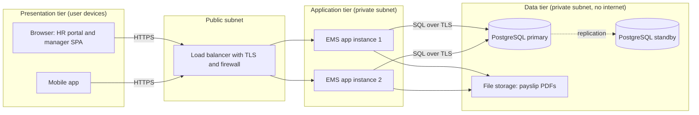
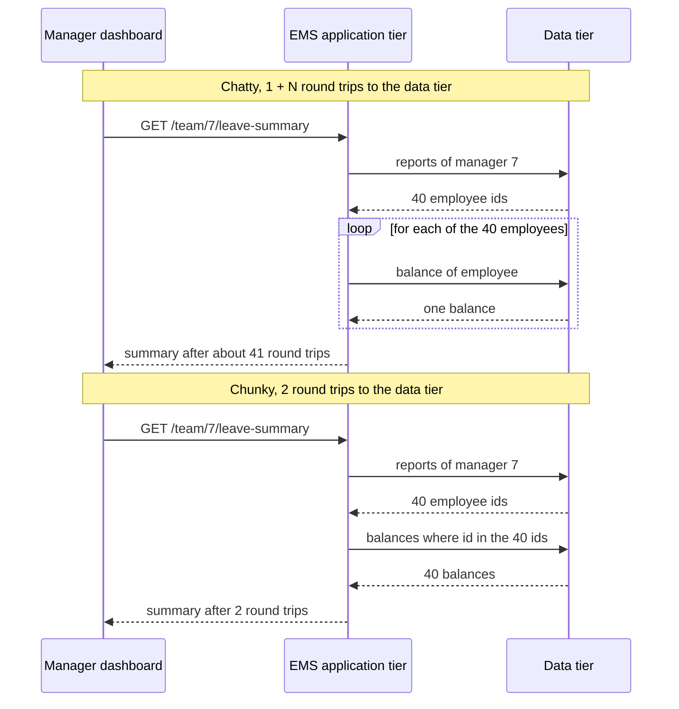

In the [layered architecture](#/lesson/m02-layered) lesson we split code into presentation, business and data. That was about **how code is organised**. This lesson is about **where code runs**: on which machines, separated by which networks. Those physical separations are called **tiers**. Confusing layers with tiers is one of the most common mistakes in architecture discussions, and it leads to systems with too many network hops. We continue with the **employee management application** (EMS).

## Learning objectives

By the end of this lesson you will be able to:

1. Explain the difference between a logical layer and a physical tier, and map one onto the other.
2. Describe two-tier, three-tier and n-tier designs, with an EMS example of each.
3. Give the real reasons for adding a tier: independent scaling, security isolation, different hardware, or team ownership.
4. Calculate what each extra tier costs in latency and availability, with back-of-the-envelope arithmetic.
5. Avoid chatty cross-tier communication (the N+1 problem across a network) in ASP.NET Core code.
6. Decide when fewer tiers are the better design.

## Prerequisites

- [Layered architecture](#/lesson/m02-layered): presentation, business and data layers.
- [Client-server architecture](#/lesson/m02-client-server): requests, responses and what a network hop costs.

## Explain it like I'm a beginner

Think of a large hospital.

Inside one building, work is organised by **department**: reception, doctors, pharmacy, records. That is like **layers**: different kinds of work, organised so each team knows its job.

Now think about **buildings**. A small clinic has everything in one building. A big hospital might put the pharmacy warehouse in a separate building across the road, and keep patient records in a secure archive building in another part of the city. Those separate buildings are like **tiers**: physically separate places.

Separate buildings have real benefits. The records archive can have its own security guards and only one locked entrance. The warehouse can be built for heavy shelving. Each building can be expanded on its own.

But every trip between buildings costs something. A doctor who needs a patient's file must send a runner across the city. If they need ten files, and send ten separate runners one after another, the patient waits a long time. If the road is blocked, the doctor cannot work at all.

So the lesson has two halves:

- **Layers** (departments) are almost always worth having. They cost little.
- **Tiers** (buildings) are worth having only when you need what a separate building gives you, and each one adds travel time and another thing that can fail. When you do have them, send one runner with a list, not ten runners one at a time.

In EMS terms: the browser, the EMS application server and the PostgreSQL server are three tiers. The presentation, business and data layers are three layers, and all three run inside the one application tier.

## First-principles explanation

### Layer vs tier

| | Layer | Tier |
|---|---|---|
| What it is | A logical grouping of code by responsibility | A physical deployment unit: a process, machine, container or managed service |
| Boundary crossed by | A method call (nanoseconds) | A network call (microseconds to tens of milliseconds) |
| Failure between them | Exceptions, same process | Timeouts, lost messages, partial failure |
| Main purpose | Separation of concerns, testability | Scaling, security isolation, hardware, ownership |
| Cost of adding one | A few classes and interfaces | Latency, more failure points, deployment and hosting cost |

Layers and tiers are independent choices. You can run three layers in one tier, or (rarely sensible) split one layer across several tiers.

### Two-tier

The **client** talks directly to the **database**. Classic examples: desktop applications from the 1990s and 2000s (Visual Basic, Delphi, Access front ends) connecting straight to a shared SQL database. An old EMS might have been a Windows app on each HR PC with a connection string to the company database.

- Strengths: simple, fast to build, few moving parts.
- Weaknesses: every client holds database credentials; business rules are duplicated in every client or hidden in stored procedures; updating the client means reinstalling on every PC; the database is exposed to every desktop on the network.

Two-tier is still fine for a small internal tool on a trusted network, or for reporting tools (Power BI, Excel) reading a dedicated read-only database.

### Three-tier

The most common design for web applications:

1. **Presentation tier**: where the user interface runs. For a single-page app or mobile app, that is the user's device. For server-rendered pages, the HTML is produced on a web server and displayed by the browser.
2. **Application tier** (logic tier, middle tier): the EMS ASP.NET Core application, containing the presentation endpoints, business layer and data access layer. Usually several identical instances behind a load balancer.
3. **Data tier**: PostgreSQL, and possibly file storage.

The key rule: **the presentation tier never talks to the data tier directly.** The browser cannot reach PostgreSQL. Only the application tier can.

Why three tiers is the sweet spot for so many systems:

- **Security**: the database sits in a private network with no internet access. Only the application tier holds its credentials.
- **Scaling**: the application tier is stateless, so you add instances. The data tier scales differently (bigger machine, replicas).
- **One place for rules**: business logic lives in the application tier, not copied into clients.
- **Simple deployments**: update the application tier and every client gets new behaviour.

### N-tier

N-tier means "more than three". Common extra tiers:

- **Edge tier**: a CDN and web application firewall in front of everything.
- **Separate web tier**: a server that renders pages or acts as a backend-for-frontend (BFF), calling an internal API tier.
- **Cache tier**: Redis between the application and the database.
- **Messaging tier**: a queue or broker between the application and background workers.
- **Search tier**: Elasticsearch or OpenSearch for full-text employee search.
- **Integration tier**: a gateway to external systems such as the bank or the accounting system.

Each extra tier should exist for a reason you can name. "It's best practice to have a separate service tier" is not a reason.

### Good reasons to add a tier

1. **Independent scaling**: the work has a very different load profile (search queries vs payroll writes).
2. **Security isolation**: a boundary you can protect with a firewall or private network (internet-facing web servers in one subnet, the database in another).
3. **Different hardware or platform**: the database needs fast disks and lots of memory; a report renderer needs lots of CPU; a machine-learning model needs a GPU.
4. **Ownership**: a separate team runs it on its own release schedule.
5. **Reuse by many clients**: a single API tier serving the web app, the mobile app and partners.

### What every tier costs

**Latency.** Each hop adds a network round trip plus serialization. Rough orders of magnitude (estimates; measure your own environment): within one data centre or availability zone, well under a millisecond to about a millisecond per round trip; across availability zones in one region, often around 1–2 ms; across regions, tens of milliseconds. Serialising and deserialising a large JSON payload can cost more than the network itself.

A worked example for one EMS screen:

- 3-tier: browser → app (1 round trip over the internet, about 40 ms from Chennai to Mumbai, estimate) + app → database (3 queries × 1 ms) + processing 15 ms ≈ **58 ms**.
- 5-tier (browser → BFF → API → "data service" → database): 40 ms + BFF → API 1 ms + API → data service (3 calls × 1 ms) + data service → database (3 × 1 ms) + extra serialization at two boundaries (about 2 × 3 ms) + processing 15 ms ≈ **68 ms**, before anything goes wrong.

Ten milliseconds sounds small. Now make the API call the data service **once per employee** for a team of 40 (the N+1 problem): 40 × 1 ms extra, plus 40 × 1 ms on the next hop, and the screen is 80 ms slower, more under load as queues build up.

**Availability.** Tiers in series multiply. If each tier is available 99.9 % of the time independently:

- 3 tiers: 0.999 × 0.999 × 0.999 ≈ **99.70 %**, about 130 minutes of downtime in a 30-day month (0.3 % of 43,200 minutes).
- 5 tiers: 0.999⁵ ≈ **99.50 %**, about 216 minutes a month.

Replicas in **parallel** improve it: two independent instances each at 99.9 % give 1 − (0.001)² = 99.9999 % for that tier, provided a failure in one does not take down the other. This is why each tier usually runs at least two instances.

**Operations and cost.** Each tier means another thing to deploy, monitor, patch, secure and pay for. Another set of credentials, another TLS certificate, another dashboard.

**Consistency.** A cache tier or a replica tier can return slightly old data. You must decide how stale is acceptable.

### Chatty vs chunky communication

Inside one process, calling a method 40 times in a loop is nearly free. Across a tier, each call is a network round trip. Design cross-tier interfaces to be **chunky**: one call that returns everything a use case needs ("balances for these 40 employees"), rather than **chatty** (40 calls of "balance for employee X"). Martin Fowler's well-known advice on distributed objects is essentially this: don't distribute objects whose interfaces were designed for in-process calls.

### When fewer tiers are better

- Small and medium systems with one team: three tiers is plenty. EMS for 2,500 or even 60,000 employees fits comfortably.
- When every request needs data from every tier anyway, extra tiers add hops without adding value.
- When a "data access tier" exists only to wrap the database in an HTTP API for one caller. Put that code back in the application tier as a layer.
- When you are tempted to add a tier to "separate concerns". Use a layer for that; it is free.

## Visual explanation

### EMS as a three-tier system with network zones



The presentation tier is the user's browser or phone. It reaches the system only through the load balancer, which terminates TLS and filters traffic in the public subnet. The application tier runs two identical EMS instances in a private subnet: they cannot be reached from the internet directly, only through the load balancer. Each instance contains all three code layers (endpoints, business rules, data access). The data tier, in its own private subnet with no internet route, holds PostgreSQL and the file storage for payslips. Only the application tier's network is allowed to connect to the database port. The standby database receives changes through replication and takes over if the primary fails. Every arrow crossing a tier boundary is a network hop with its own latency and failure mode, which is why there are only two such hops per request.

### Chatty vs chunky calls across a tier boundary



Both halves produce the same screen. In the chatty version, the application tier asks the data tier for each employee's balance separately: 1 + 40 = 41 network round trips. At about 1 ms per round trip that is roughly 41 ms of pure waiting, and much worse when the database is busy, because each query also queues for a connection. In the chunky version, the application asks once for the team and once for all balances using a single query with an `IN` list (or `= ANY(@ids)` in PostgreSQL). Two round trips, whatever the team size. The fix is a matter of interface design: the data access method takes a list of ids rather than one id.

## Step-by-step example

### Step 1 — start from the old two-tier EMS

HR PCs run a desktop app that connects straight to the database with a shared login. Rules about salary visibility are coded in the desktop app, so anyone with the connection string (found in a config file) can read every salary with a SQL client.

### Step 2 — move to three tiers

Introduce an EMS web application as the middle tier. The database moves to a private subnet and accepts connections only from the application servers. The desktop app is replaced by a browser-based portal. Salary rules now live in one place, in the application tier's business layer.

### Step 3 — map layers to tiers

All three code layers run in the application tier. Nobody proposes a separate "business tier" server, because it would add a hop to every request without any of the five good reasons for a tier.

### Step 4 — add a tier only when a reason appears

Two years later, HR wants fast fuzzy search across 60,000 employees, with typo tolerance. PostgreSQL full-text search with a trigram index is tried first and is good enough. If it had not been, a search tier would have been justified by a genuinely different workload and hardware profile.

### Step 5 — design chunky interfaces at every tier boundary

The team dashboard loads in two data-tier round trips, as in the diagram. A middleware counts database round trips per request in development and logs a warning above 10, so N+1 patterns are caught before production.

## Production-style C# implementation

The application tier for the manager's team leave dashboard: chunky data-tier calls, a time budget for data-tier work, and a per-request round-trip counter that makes hops visible.

```csharp file=DataTier/IDataTier.cs
namespace Ems.Tiers.DataTier;

public sealed record ReportRow(int EmployeeId, string Name);
public sealed record BalanceRow(int EmployeeId, int DaysLeft);

/// <summary>The application tier's view of the data tier. Every method is one network round trip,
/// so methods take sets of ids instead of single ids.</summary>
public interface IDataTier
{
    Task<IReadOnlyList<ReportRow>> GetDirectReportsAsync(int managerId, CancellationToken ct);
    Task<IReadOnlyList<BalanceRow>> GetBalancesAsync(IReadOnlyCollection<int> employeeIds, CancellationToken ct);
}
```

```csharp file=DataTier/RoundTripCounter.cs
namespace Ems.Tiers.DataTier;

/// <summary>Scoped per request: counts calls that cross into the data tier.</summary>
public sealed class RoundTripCounter
{
    private int _count;
    public int Count => _count;
    public void Increment() => Interlocked.Increment(ref _count);
}
```

```csharp file=DataTier/InMemoryDataTier.cs
namespace Ems.Tiers.DataTier;

/// <summary>Stands in for PostgreSQL. A real version would run, for example:
///   SELECT employee_id, days_left FROM leave_balances WHERE employee_id = ANY(@ids)
/// The delay simulates a network round trip to the data tier.</summary>
public sealed class InMemoryDataTier(RoundTripCounter counter) : IDataTier
{
    private static readonly TimeSpan SimulatedRoundTrip = TimeSpan.FromMilliseconds(1);

    private static readonly Dictionary<int, List<ReportRow>> Reports = new()
    {
        [7] = [new(42, "Vikram Rao"), new(43, "Ananya Das"), new(44, "Kavya Iyer")],
    };

    private static readonly Dictionary<int, int> Balances = new() { [42] = 9, [43] = 2, [44] = 14 };

    public async Task<IReadOnlyList<ReportRow>> GetDirectReportsAsync(int managerId, CancellationToken ct)
    {
        counter.Increment();
        await Task.Delay(SimulatedRoundTrip, ct);
        return Reports.GetValueOrDefault(managerId) ?? [];
    }

    public async Task<IReadOnlyList<BalanceRow>> GetBalancesAsync(IReadOnlyCollection<int> employeeIds, CancellationToken ct)
    {
        counter.Increment();
        await Task.Delay(SimulatedRoundTrip, ct);
        return employeeIds.Where(Balances.ContainsKey).Select(id => new BalanceRow(id, Balances[id])).ToList();
    }
}
```

```csharp file=AppTier/TeamLeaveService.cs
using Ems.Tiers.DataTier;
using Microsoft.Extensions.Options;

namespace Ems.Tiers.AppTier;

public sealed record TeamMemberLeave(int EmployeeId, string Name, int DaysLeft, bool LowBalance);
public sealed record TeamLeaveSummary(int ManagerId, IReadOnlyList<TeamMemberLeave> Members);

public sealed class DataTierOptions
{
    /// <summary>Total time this request may spend waiting on the data tier.</summary>
    public TimeSpan Budget { get; set; } = TimeSpan.FromSeconds(2);
}

public sealed class TeamLeaveService(IDataTier data, IOptions<DataTierOptions> options)
{
    private const int LowBalanceThreshold = 3;

    public async Task<TeamLeaveSummary> GetSummaryAsync(int managerId, CancellationToken requestAborted)
    {
        // One time budget shared by all data-tier calls in this use case.
        using var budget = CancellationTokenSource.CreateLinkedTokenSource(requestAborted);
        budget.CancelAfter(options.Value.Budget);

        var reports = await data.GetDirectReportsAsync(managerId, budget.Token);       // round trip 1
        if (reports.Count == 0) return new TeamLeaveSummary(managerId, []);

        var ids = reports.Select(r => r.EmployeeId).ToArray();
        var balances = (await data.GetBalancesAsync(ids, budget.Token))                // round trip 2, whatever the team size
            .ToDictionary(b => b.EmployeeId, b => b.DaysLeft);

        var members = reports
            .Select(r =>
            {
                var days = balances.GetValueOrDefault(r.EmployeeId);
                return new TeamMemberLeave(r.EmployeeId, r.Name, days, days <= LowBalanceThreshold);
            })
            .OrderBy(m => m.Name)
            .ToList();

        return new TeamLeaveSummary(managerId, members);
    }
}
```

```csharp file=AppTier/RoundTripHeaderMiddleware.cs
using Ems.Tiers.DataTier;

namespace Ems.Tiers.AppTier;

/// <summary>Adds X-Data-Tier-Round-Trips to every response and warns on chatty requests.</summary>
public sealed class RoundTripHeaderMiddleware(RequestDelegate next, ILogger<RoundTripHeaderMiddleware> logger)
{
    private const int WarnAbove = 10;

    public async Task InvokeAsync(HttpContext context, RoundTripCounter counter)
    {
        context.Response.OnStarting(() =>
        {
            context.Response.Headers["X-Data-Tier-Round-Trips"] = counter.Count.ToString();
            return Task.CompletedTask;
        });

        await next(context);

        if (counter.Count > WarnAbove)
            logger.LogWarning("{Path} made {Count} data-tier round trips. Possible N+1 across tiers.",
                context.Request.Path, counter.Count);
    }
}
```

```csharp file=Program.cs
using Ems.Tiers.AppTier;
using Ems.Tiers.DataTier;

var builder = WebApplication.CreateBuilder(args);

builder.Services.Configure<DataTierOptions>(builder.Configuration.GetSection("DataTier"));
builder.Services.AddScoped<RoundTripCounter>();
builder.Services.AddScoped<IDataTier, InMemoryDataTier>();
builder.Services.AddScoped<TeamLeaveService>();

var app = builder.Build();

app.UseMiddleware<RoundTripHeaderMiddleware>();

app.MapGet("/team/{managerId:int}/leave-summary", async (int managerId, TeamLeaveService service, CancellationToken ct) =>
{
    try
    {
        return Results.Ok(await service.GetSummaryAsync(managerId, ct));
    }
    catch (OperationCanceledException) when (!ct.IsCancellationRequested)
    {
        // The budget expired, not the client: the data tier is too slow right now.
        return Results.Problem("The data tier did not respond in time.", statusCode: StatusCodes.Status503ServiceUnavailable);
    }
});

app.Run();
```

**Why a shared time budget?** Without one, each data-tier call might get its own 30-second default timeout, and a slow database turns into minute-long requests that pile up and exhaust the application tier's threads and connections. One budget per use case means the user gets a clear `503` within 2 seconds, and the application tier stays healthy.

**Why count round trips?** Network hops are invisible in code: `await data.GetBalanceAsync(id)` inside a loop looks harmless. A header in development and a warning log in production make the cost of tier boundaries visible. With EF Core, the equivalent is logging the number of commands per request, or using an interceptor.

**What about PostgreSQL itself?** In real code, `GetBalancesAsync` would be one parameterised query using `= ANY(@ids)` with an array parameter, which keeps the round trip count at one even for hundreds of ids.

## Bad design vs good design

**Bad: tiers for the sake of tiers, with chatty calls.**

- EMS deployed as: browser → web server (renders pages) → business tier (HTTP API) → data access tier (another HTTP API that wraps SQL) → PostgreSQL. Five tiers, three of them written by the same team and always deployed together.
- The data access tier exposes `GET /employees/{id}` and `GET /balances/{id}`, mirroring the database tables.
- The business tier builds the team dashboard with a loop: 1 + 40 calls to the data access tier, each of which makes its own database query.

Result: every screen pays four network hops, the team dashboard makes 41 HTTP calls plus 41 queries, a hiccup in any tier breaks everything, and the hosting bill covers three app tiers instead of one.

**Good: three tiers, layers inside, chunky boundaries.**

- Browser → EMS application (all layers) → PostgreSQL.
- Data access is a layer inside the application, with set-based methods.
- Extra tiers (cache, search, worker) are added only when a named reason appears, each with at least two instances or a managed service.

**When is a fourth tier justified for EMS?** For example a **worker tier** for payroll processing (different load profile, must not slow the web), or a **cache tier** if reference data reads dominate the database. Each passes the "name the reason" test.

:::callout type=mistake title="Layer = tier"
"We have a three-layer architecture, so we need three servers." No. Layers are code organisation and cost nothing at runtime. Tiers are deployment boundaries and cost a network hop each. Most well-designed web apps have three or more layers inside a single application tier.
:::

:::callout type=tradeoff title="Isolation vs hops"
Each tier boundary is a place to put a firewall, scale independently and assign an owner. It is also a place where latency is added and failures happen. Add a tier when you need what the boundary gives you, and then design the interface across it to be chunky.
:::

## Practical playground

Open this three-tier EMS graph in the HLD canvas. Try the following and watch how the estimated latency and availability change: add a separate "business tier" app server between the API and the database; add a cache between the API and the database; increase the API instances from 2 to 4; set the database replicas to 1.

:::playground type=hld title="Three-tier EMS: add and remove tiers"
```json
{
  "nodes": [
    { "id": "c", "type": "client", "label": "Browsers and mobile app", "props": { "rps": 250 } },
    { "id": "lb", "type": "load-balancer", "label": "Load balancer (TLS, firewall)" },
    { "id": "app", "type": "app-server", "label": "EMS application tier", "props": { "instances": 2, "latencyMs": 15 } },
    { "id": "db", "type": "database", "label": "PostgreSQL data tier", "props": { "replicas": 0, "latencyMs": 2 } }
  ],
  "edges": [
    { "from": "c", "to": "lb", "kind": "sync" },
    { "from": "lb", "to": "app", "kind": "sync" },
    { "from": "app", "to": "db", "kind": "sync", "label": "SQL" }
  ]
}
```
:::

## Exercises

:::exercise id=m02-n-tier-ex1 difficulty=beginner kind=code title="Calculate the cost of tiers"
Implement `TierMath` so architects can quickly estimate what a design costs in latency and availability.
::requirements
- `SequentialLatencyMs(IEnumerable<Hop> hops, double processingMs)`: processing time plus, for each hop, `RoundTripMs × Calls`.
- `SerialAvailability(IEnumerable<double> tiers)`: the product of the tier availabilities (each between 0 and 1). An empty list returns 1.
- `ParallelAvailability(double single, int replicas)`: `1 − (1 − single)^replicas`. `replicas < 1` throws `ArgumentOutOfRangeException`.
- `MonthlyDowntimeMinutes(double availability)`: `(1 − availability) × 43,200` (a 30-day month).
- Availability inputs outside 0–1 throw `ArgumentOutOfRangeException`.
::acceptance
- Three tiers at 0.999 give about 0.997003.
- Two replicas at 0.99 give 0.9999.
- 99.9 % gives 43.2 minutes of downtime a month.
- A hop of 1 ms called 40 times plus 15 ms processing gives 55 ms.
::hint
Each function is one or two lines. Validation is most of the work.
::hint
`Math.Pow(1 - single, replicas)` for the parallel case.
::hint
LINQ's `Aggregate(1.0, (acc, a) => acc * a)` multiplies a list.
::starter
```csharp file=TierMath.cs
using System;
using System.Collections.Generic;
using System.Linq;

public sealed record Hop(string From, string To, double RoundTripMs, int Calls);

public static class TierMath
{
    public static double SequentialLatencyMs(IEnumerable<Hop> hops, double processingMs) => throw new NotImplementedException();

    public static double SerialAvailability(IEnumerable<double> tiers) => throw new NotImplementedException();

    public static double ParallelAvailability(double single, int replicas) => throw new NotImplementedException();

    public static double MonthlyDowntimeMinutes(double availability) => throw new NotImplementedException();
}
```
::tests
```csharp file=TierMathTests.cs
using System;
using Xunit;

public class TierMathTests
{
    [Fact]
    public void Latency_sums_hops_times_calls()
    {
        var hops = new[] { new Hop("browser", "app", 40, 1), new Hop("app", "db", 1, 40) };
        Assert.Equal(95.0, TierMath.SequentialLatencyMs(hops, 15), 6);
    }

    [Fact] public void Chatty_hop_example() => Assert.Equal(55.0, TierMath.SequentialLatencyMs(new[] { new Hop("app", "db", 1, 40) }, 15), 6);

    [Fact] public void Three_tiers_in_series() => Assert.Equal(0.997003, TierMath.SerialAvailability(new[] { 0.999, 0.999, 0.999 }), 6);

    [Fact] public void Empty_series_is_one() => Assert.Equal(1.0, TierMath.SerialAvailability(Array.Empty<double>()), 6);

    [Fact] public void Two_replicas_in_parallel() => Assert.Equal(0.9999, TierMath.ParallelAvailability(0.99, 2), 6);

    [Fact] public void Downtime_for_three_nines() => Assert.Equal(43.2, TierMath.MonthlyDowntimeMinutes(0.999), 6);

    [Fact] public void Bad_availability_throws() => Assert.Throws<ArgumentOutOfRangeException>(() => TierMath.SerialAvailability(new[] { 1.5 }));

    [Fact] public void Zero_replicas_throws() => Assert.Throws<ArgumentOutOfRangeException>(() => TierMath.ParallelAvailability(0.99, 0));
}
```
::solution
```csharp file=TierMath.cs
using System;
using System.Collections.Generic;
using System.Linq;

public sealed record Hop(string From, string To, double RoundTripMs, int Calls);

public static class TierMath
{
    public static double SequentialLatencyMs(IEnumerable<Hop> hops, double processingMs) =>
        processingMs + hops.Sum(h => h.RoundTripMs * h.Calls);

    public static double SerialAvailability(IEnumerable<double> tiers) =>
        tiers.Aggregate(1.0, (acc, a) => acc * Check(a));

    public static double ParallelAvailability(double single, int replicas)
    {
        ArgumentOutOfRangeException.ThrowIfLessThan(replicas, 1);
        return 1 - Math.Pow(1 - Check(single), replicas);
    }

    public static double MonthlyDowntimeMinutes(double availability) => (1 - Check(availability)) * 43_200;

    private static double Check(double a) =>
        a is >= 0 and <= 1 ? a : throw new ArgumentOutOfRangeException(nameof(a), a, "Availability must be between 0 and 1.");
}
```

Use these numbers to argue about designs, not to promise SLAs. The parallel formula assumes failures are independent; two replicas in the same rack, or sharing a bad deployment, fail together, so real availability is lower.
::mistakes
- Adding availabilities instead of multiplying them.
- Using the parallel formula for tiers in series, which makes extra tiers look like they improve availability.
- Forgetting that the latency of sequential calls adds up, while parallel calls cost roughly the slowest one.
::extensions
Add `ParallelLatencyMs` for calls made concurrently with `Task.WhenAll`, and compare 40 sequential calls with 40 parallel calls with a concurrency limit of 8.
:::

:::exercise id=m02-n-tier-ex2 difficulty=beginner kind=written title="Count the layers and the tiers"
For each deployment, state how many **tiers** there are (counting the client) and how many **layers** the server code has. Explain any case where people commonly mix them up.

1. A Razor Pages EMS with folders `Pages/`, `Services/`, `Data/`, deployed as one app on one VM, with PostgreSQL on a second VM.
2. A desktop payroll tool that connects directly to SQL Server, with all logic in the form code.
3. A React SPA calling an ASP.NET Core API (endpoints, services, repositories) on 3 instances, with PostgreSQL and Redis.
4. A web server rendering pages that calls a separate internal API server, which calls PostgreSQL. Both servers are deployed together by the same team every time.
::acceptance
- Tier and layer counts for all four with a short justification.
- Case 3: instances are not counted as separate tiers.
- Case 4: discusses whether the extra tier is justified.
::hint
Tiers: where does code run, separated by a network?
::hint
Layers: how is the code inside one application organised?
::hint
Three identical instances of the same app are one tier, scaled out.
::solution
1. **3 tiers** (browser, app VM, database VM). **3 layers** (pages, services, data) all in the app tier. A common mistake is to think the three folders need three servers.
2. **2 tiers** (desktop client, database). **1 layer** effectively: everything in form code. Classic two-tier.
3. **4 tiers** (browser running the SPA, API tier, PostgreSQL, Redis cache). The API has **3 layers**. Three instances are one tier scaled horizontally.
4. **4 tiers** (browser, web server, API server, database). The web/API split adds a hop to every request. It is justified only if a reason exists (for example the API also serves the mobile app and partners, or the web tier must sit in a DMZ for security). If both are always deployed together by one team for one client, merging them is simpler.
::mistakes
- Counting instances or containers of the same app as separate tiers.
- Counting folders as tiers.
:::

:::exercise id=m02-n-tier-ex3 difficulty=intermediate kind=code title="Remove the N+1 across the tier boundary"
The current team dashboard calls the data tier once per employee. Implement `TeamDashboard.BuildAsync` so it makes **at most two** data-tier calls, whatever the team size.
::requirements
- Call `GetTeamAsync(managerId)` once. If the team is empty, return an empty list without a second call.
- Call `GetBalancesAsync(ids)` **once** with all team ids.
- An employee missing from the balances result gets `0` days.
- Return rows ordered by name, with `Low = true` when days ≤ 3.
- Pass the cancellation token through to both calls.
::acceptance
- A team of 40 causes exactly 2 data-tier calls.
- An empty team causes exactly 1 call.
- Missing balances become 0 and are marked low.
::hint
The fake data tier in the tests counts calls. That count is your acceptance test.
::hint
Collect the ids into an array first, then make one call.
::hint
Turn the balances list into a dictionary for O(1) lookups.
::hint
```csharp
var team = await _data.GetTeamAsync(managerId, ct);
if (team.Count == 0) return Array.Empty<DashboardRow>();
var balances = (await _data.GetBalancesAsync(team.Select(t => t.Id).ToArray(), ct)).ToDictionary(b => b.Id, b => b.Days);
```
::starter
```csharp file=TeamDashboard.cs
using System;
using System.Collections.Generic;
using System.Linq;
using System.Threading;
using System.Threading.Tasks;

public sealed record TeamMember(int Id, string Name);
public sealed record Balance(int Id, int Days);
public sealed record DashboardRow(int Id, string Name, int Days, bool Low);

public interface ITeamDataTier
{
    Task<IReadOnlyList<TeamMember>> GetTeamAsync(int managerId, CancellationToken ct);
    Task<IReadOnlyList<Balance>> GetBalancesAsync(IReadOnlyCollection<int> ids, CancellationToken ct);
}

public sealed class TeamDashboard
{
    private readonly ITeamDataTier _data;
    public TeamDashboard(ITeamDataTier data) => _data = data;

    public Task<IReadOnlyList<DashboardRow>> BuildAsync(int managerId, CancellationToken ct)
    {
        throw new NotImplementedException();
    }
}
```
::tests
```csharp file=TeamDashboardTests.cs
using System.Collections.Generic;
using System.Linq;
using System.Threading;
using System.Threading.Tasks;
using Xunit;

public class TeamDashboardTests
{
    private sealed class CountingTier(int teamSize, bool dropLast = false) : ITeamDataTier
    {
        public int Calls { get; private set; }
        public Task<IReadOnlyList<TeamMember>> GetTeamAsync(int managerId, CancellationToken ct)
        {
            Calls++;
            IReadOnlyList<TeamMember> team = Enumerable.Range(1, teamSize).Select(i => new TeamMember(i, $"Emp{i:D2}")).ToList();
            return Task.FromResult(team);
        }
        public Task<IReadOnlyList<Balance>> GetBalancesAsync(IReadOnlyCollection<int> ids, CancellationToken ct)
        {
            Calls++;
            var list = ids.Select(id => new Balance(id, id % 10)).ToList();
            if (dropLast) list.RemoveAt(list.Count - 1);
            return Task.FromResult<IReadOnlyList<Balance>>(list);
        }
    }

    [Fact]
    public async Task Forty_people_two_calls()
    {
        var tier = new CountingTier(40);
        var rows = await new TeamDashboard(tier).BuildAsync(7, CancellationToken.None);
        Assert.Equal(40, rows.Count);
        Assert.Equal(2, tier.Calls);
    }

    [Fact]
    public async Task Empty_team_one_call()
    {
        var tier = new CountingTier(0);
        Assert.Empty(await new TeamDashboard(tier).BuildAsync(7, CancellationToken.None));
        Assert.Equal(1, tier.Calls);
    }

    [Fact]
    public async Task Missing_balance_is_zero_and_low()
    {
        var rows = await new TeamDashboard(new CountingTier(3, dropLast: true)).BuildAsync(7, CancellationToken.None);
        var last = rows.Single(r => r.Id == 3);
        Assert.Equal(0, last.Days);
        Assert.True(last.Low);
    }

    [Fact]
    public async Task Ordered_by_name_and_low_flag()
    {
        var rows = await new TeamDashboard(new CountingTier(5)).BuildAsync(7, CancellationToken.None);
        Assert.Equal(new List<string> { "Emp01", "Emp02", "Emp03", "Emp04", "Emp05" }, rows.Select(r => r.Name).ToList());
        Assert.True(rows[2].Low);    // 3 days
        Assert.False(rows[3].Low);   // 4 days
    }
}
```
::solution
```csharp file=TeamDashboard.cs
using System;
using System.Collections.Generic;
using System.Linq;
using System.Threading;
using System.Threading.Tasks;

public sealed record TeamMember(int Id, string Name);
public sealed record Balance(int Id, int Days);
public sealed record DashboardRow(int Id, string Name, int Days, bool Low);

public interface ITeamDataTier
{
    Task<IReadOnlyList<TeamMember>> GetTeamAsync(int managerId, CancellationToken ct);
    Task<IReadOnlyList<Balance>> GetBalancesAsync(IReadOnlyCollection<int> ids, CancellationToken ct);
}

public sealed class TeamDashboard
{
    private readonly ITeamDataTier _data;
    public TeamDashboard(ITeamDataTier data) => _data = data;

    public async Task<IReadOnlyList<DashboardRow>> BuildAsync(int managerId, CancellationToken ct)
    {
        var team = await _data.GetTeamAsync(managerId, ct);
        if (team.Count == 0) return Array.Empty<DashboardRow>();

        var ids = team.Select(t => t.Id).ToArray();
        var balances = (await _data.GetBalancesAsync(ids, ct)).ToDictionary(b => b.Id, b => b.Days);

        return team
            .Select(t =>
            {
                var days = balances.GetValueOrDefault(t.Id);
                return new DashboardRow(t.Id, t.Name, days, days <= 3);
            })
            .OrderBy(r => r.Name, StringComparer.Ordinal)
            .ToList();
    }
}
```

Two round trips for any team size. Against PostgreSQL, `GetBalancesAsync` becomes `WHERE employee_id = ANY(@ids)`. For very large id lists (thousands), split into chunks of a few hundred, or join on the manager id in a single query instead.
::alternatives
A single query that joins the team and balances (`... JOIN leave_balances ... WHERE manager_id = @m`) makes it **one** round trip. That is often best when both live in the same database. The two-call version is the general pattern when the data comes from different stores or tiers.
::mistakes
- Using `Task.WhenAll` over 40 per-employee calls. It reduces waiting time but still sends 40 requests and uses 40 connections.
- Calling `GetBalancesAsync` with an empty list for an empty team, an unnecessary round trip.
:::

:::exercise id=m02-n-tier-ex4 difficulty=intermediate kind=hld title="Design EMS's three-tier deployment with network zones"
Design a production deployment of EMS for 60,000 employees with about 250 requests per second at peak. Requirements: the database must not be reachable from the internet; the app tier must survive one instance failing; payslip PDFs (about 60,000 per month, roughly 200 KB each) must be downloadable without loading the app tier; payroll processing must not slow the web.
::acceptance
- Clear presentation, application and data tiers, with the database only reachable from the application tier.
- At least two application instances.
- Payslip downloads served from object storage or a CDN rather than streamed through the app tier.
- Payroll processing in a separate worker tier, with the reason stated.
- Each tier boundary crossing explained, with the count of hops for a typical page view.
::hint
Payslips: 60,000 × 200 KB ≈ 12 GB per month. Where should those bytes flow?
::hint
A worker is a fourth tier. Name the reason it passes the "justified tier" test.
::hint
Count the network hops for "manager opens team dashboard". Keep it to two server-side hops.
::starter
```json
{
  "nodes": [
    { "id": "c", "type": "client", "label": "Browsers and mobile app", "props": { "rps": 250 } },
    { "id": "app", "type": "app-server", "label": "EMS app", "props": { "instances": 1 } },
    { "id": "db", "type": "database", "label": "PostgreSQL" }
  ],
  "edges": [
    { "from": "c", "to": "app", "kind": "sync" },
    { "from": "app", "to": "db", "kind": "sync" }
  ]
}
```
::solution
```json
{
  "nodes": [
    { "id": "c", "type": "client", "label": "Browsers and mobile app", "props": { "rps": 250 } },
    { "id": "cdn", "type": "cdn", "label": "CDN for static files and signed payslip links" },
    { "id": "lb", "type": "load-balancer", "label": "Load balancer with firewall (public subnet)", "props": { "multiAz": true } },
    { "id": "app", "type": "app-server", "label": "EMS application tier (private subnet)", "props": { "instances": 3 } },
    { "id": "worker", "type": "worker", "label": "Payroll worker tier (private subnet)", "props": { "instances": 1 } },
    { "id": "db", "type": "database", "label": "PostgreSQL primary and standby (data subnet)", "props": { "multiAz": true, "replicas": 1 } },
    { "id": "obj", "type": "object-storage", "label": "Payslip PDF storage (data subnet)" },
    { "id": "mon", "type": "monitoring", "label": "Logs and metrics" }
  ],
  "edges": [
    { "from": "c", "to": "cdn", "kind": "sync", "label": "static files and payslip downloads" },
    { "from": "c", "to": "lb", "kind": "sync", "label": "HTTPS" },
    { "from": "lb", "to": "app", "kind": "sync" },
    { "from": "app", "to": "db", "kind": "sync", "label": "SQL over TLS" },
    { "from": "app", "to": "obj", "kind": "sync", "label": "issue short-lived signed URLs" },
    { "from": "cdn", "to": "obj", "kind": "sync", "label": "origin fetch" },
    { "from": "worker", "to": "db", "kind": "sync" },
    { "from": "worker", "to": "obj", "kind": "async", "label": "write generated PDFs" },
    { "from": "app", "to": "mon", "kind": "async" },
    { "from": "worker", "to": "mon", "kind": "async" }
  ]
}
```

**Tiers.** Presentation (devices), edge (CDN, load balancer), application (3 instances: 250 ÷ (150 × 0.6) ≈ 2.8, using an estimated 150 req/s per instance to be confirmed by load test), worker, data (PostgreSQL and object storage). Only the application and worker subnets may connect to the database port.

**Payslips.** About 12 GB a month flows from object storage through the CDN. The app tier only creates a short-lived signed URL after checking that the user may see that payslip, so PDF bytes never pass through the app tier.

**Worker tier justification.** Different load profile (a heavy monthly batch) and it must not compete with web requests for CPU and connections. It runs the same codebase in a worker role.

**Hops for "open team dashboard".** Browser → load balancer → app (one internet round trip), app → PostgreSQL (two round trips with chunky queries). No other tier is involved.
::mistakes
- Streaming PDFs through the app servers, which ties up threads and bandwidth.
- Putting the database in the public subnet "for the admin tool".
- Adding a separate business-logic tier between the app and the database.
:::

:::exercise id=m02-n-tier-ex5 difficulty=advanced kind=written title="Challenge a five-tier proposal"
A consultant proposes this EMS design: browser → web tier (Razor Pages) → business tier (REST API) → data access tier (REST API wrapping SQL) → PostgreSQL. All three server tiers are built and deployed by the same 5-person team, always released together. Each tier is said to have 99.9 % availability and runs as one instance. Each internal hop costs about 1 ms plus about 3 ms of serialization (estimates).

Analyse the proposal: compute end-to-end availability, the extra latency per request compared with three tiers, and the effect on the team dashboard (1 + 40 calls through the data access tier). Then propose a better design and say which concerns the consultant raised (security, separation of concerns, scaling) are better met in other ways.
::acceptance
- Availability arithmetic for both designs.
- Latency arithmetic per request and for the dashboard.
- A recommended design with reasons.
- Each concern of the consultant addressed with a cheaper mechanism.
::hint
Count tiers in series, including the database, for availability.
::hint
For latency, compare the server-side hops in each design: how many extra boundaries does a request cross?
::hint
For the dashboard, multiply the per-hop cost by the number of calls that cross the data access tier.
::hint
Separation of concerns is a layer concern. Security isolation is a network-zone concern. Scaling is solved by more instances.
::solution
**Availability (server tiers in series, single instances).** Five-tier: web × business × data access × database = 0.999⁴ ≈ **99.60 %**, about 173 minutes of downtime a month. Three-tier: app × database = 0.999² ≈ **99.80 %**, about 86 minutes. With two app instances in parallel (1 − 0.001² ≈ 0.999999), the three-tier design becomes ≈ 0.999999 × 0.999 ≈ **99.90 %**.

**Latency per request.** Five-tier adds two extra internal boundaries (web → business, business → data access), each about 1 ms network + 3 ms serialization = 4 ms, so about **8 ms** extra on a simple request, plus slower failure handling (each tier needs its own timeouts and retries).

**Team dashboard.** If the business tier calls the data access tier 41 times (1 + 40), each call costs about 4 ms extra just for the business → data access boundary: about **164 ms** extra, plus 41 HTTP connections per page view. In the three-tier design with chunky queries, the dashboard makes 2 database round trips (about 2 ms).

**Recommended design.** Three tiers: browser → EMS application (Razor Pages, business layer and data layer in one process, at least two instances) → PostgreSQL with a standby. Add a worker tier for payroll. Keep layers with architecture tests.

**Consultant's concerns, met more cheaply.**
- *Separation of concerns*: layers (and modules) inside the application, enforced by architecture tests. No runtime cost.
- *Security*: network zones: the app tier in a private subnet, the database in a data subnet that accepts connections only from the app tier, least-privilege database roles. A REST wrapper around SQL adds no security the database's own access controls cannot provide.
- *Scaling*: the stateless application tier scales by adding instances; the database scales with a bigger machine, read replicas and caching. Separate tiers only help if they have different scaling needs, and here they do not.

**When would extra tiers be right?** If the business API must also serve mobile apps and partners with independent releases, or if a separate team owns it, a separate API tier could be justified. Even then, the "data access tier as a REST API" rarely is.
::mistakes
- Adding availabilities or ignoring that tiers in series multiply.
- Accepting "separation of concerns" as a reason for a tier.
- Forgetting serialization cost, which can exceed the network cost inside a data centre.
:::

## Automated testing

Tier boundaries are where performance and failure problems hide, so test them directly.

**1. Round-trip budget tests.** Use a counting fake of the data tier (as in exercise 3) and assert the number of calls per use case. These tests catch N+1 regressions immediately:

```csharp
[Fact]
public async Task Team_summary_uses_two_round_trips_for_any_team_size()
{
    var counter = new RoundTripCounter();
    var service = new TeamLeaveService(new InMemoryDataTier(counter), Options.Create(new DataTierOptions()));
    await service.GetSummaryAsync(7, CancellationToken.None);
    Assert.Equal(2, counter.Count);
}
```

**2. Timeout budget tests.** Give the service a fake data tier that delays for 5 seconds and a budget of 100 ms, and assert it throws `OperationCanceledException` quickly. Then test that the endpoint maps that to `503`.

**3. Integration tests across real tiers.** Run PostgreSQL in a container and the app with `WebApplicationFactory`. Check the `X-Data-Tier-Round-Trips` header on key endpoints in CI.

**4. Network zone tests.** Infrastructure checks in the deployment pipeline: the database has no public IP, its firewall allows only the application subnet, and the storage bucket is not publicly listable.

**5. Failure tests.** Stop the database standby, or one app instance, in a test environment and confirm the system keeps serving. Availability math is a hypothesis until you test it.

## Real-world application

- **Most web applications** are three-tier: browser, application servers, database. ASP.NET Core apps on Azure App Service or AWS with a managed PostgreSQL follow this shape.
- **Cloud reference architectures** (the Azure Architecture Center's n-tier style, AWS's three-tier web architecture) recommend placing each tier in its own subnet with security groups between them. This is the main security benefit of tiers.
- **Banks and government systems** often require a DMZ: internet-facing web servers in one zone, application servers in another, databases in a third, with firewalls between them. Here the extra tier is driven by regulation and security policy, a valid reason.
- **Large e-commerce systems** add tiers for cache (Redis), search (Elasticsearch/OpenSearch) and CDN, each because it serves a workload the database handles poorly.
- **Legacy enterprise systems** often show the cost of too many tiers: web → middleware → service bus → database adapters, where a simple lookup crosses five boundaries. Modernisation projects frequently start by removing unnecessary hops.

## Interview questions

:::interview
::q beginner
What is the difference between a layer and a tier?
::a
A layer is a logical grouping of code by responsibility (presentation, business, data) and is crossed by an in-process method call. A tier is a physical deployment unit (a separate process, machine or service) and is crossed by a network call. You can have three layers in one tier. Tiers add latency and failure points; layers add almost nothing at runtime.
::q beginner
Describe a three-tier architecture for a web application.
::a
Presentation tier: the browser or mobile app (and possibly a web server that renders pages). Application tier: the stateless application servers containing business logic and data access, behind a load balancer. Data tier: the database and file storage, in a private network reachable only from the application tier. The presentation tier never talks to the data tier directly.
::q intermediate
What are good reasons to add another tier?
::a
Independent scaling for a very different workload, security isolation (network zones and firewalls), different hardware or platform needs (fast storage, GPUs), separate team ownership with independent releases, and reuse by many different clients. "Separation of concerns" alone is not a reason, since layers achieve that without a network hop.
::q intermediate
How do tiers affect availability? Give numbers.
::a
Tiers in series multiply their availabilities. Three tiers at 99.9 % each give about 99.7 %, or roughly 130 minutes of downtime in a 30-day month, versus 43 minutes for one tier. Redundancy within a tier works in parallel: two independent instances at 99.9 % give about 99.9999 % for that tier. So each tier should have redundancy, and unnecessary tiers should be avoided.
::q advanced
A dashboard is slow and you see hundreds of calls between the application tier and the data tier per page view. How do you fix and prevent it?
::a
It is the N+1 problem across a tier boundary. Fix it by making the interface chunky: fetch the parent list once, then fetch related data for all ids in one call (`WHERE id = ANY(@ids)`), or use a single join. With EF Core, use projections or `Include` rather than lazy loading in loops. Prevent regressions by counting round trips per request (middleware or EF interceptors), alerting above a threshold, and adding tests that assert the call count for key use cases.
::q advanced
When would you collapse tiers in an existing system?
::a
When tiers are always deployed together by one team, have the same scaling profile, and provide no security or hardware benefit, so each boundary only adds latency, failure points and cost. A typical example is a "data access tier" that is a REST wrapper around SQL for a single caller. Collapse it into a layer inside the application, keep the interface (now in-process) and its tests, and enforce the separation with architecture tests instead of network calls. Measure latency and error rates before and after.
:::

## Summary and revision

**Key takeaways**

- Layers organise code. Tiers are physical deployment boundaries crossed by network calls.
- Two-tier: client to database. Three-tier: presentation, application, data. N-tier: more tiers such as edge, cache, search, messaging or workers.
- Add a tier only for a named reason: independent scaling, security isolation, hardware, ownership or reuse.
- Every tier costs latency (round trips plus serialization), availability (tiers in series multiply), operations effort and money.
- Design cross-tier interfaces to be chunky, and watch for N+1 calls across tiers.
- Three tiers, with several layers inside the application tier, is the right default for most business applications.

**Terminology**: layer, tier, two-tier, three-tier, n-tier, presentation tier, application (logic) tier, data tier, network zone, DMZ, round trip, serialization cost, serial and parallel availability, chatty vs chunky interface, N+1 problem.

:::flashcards
Q: Layer vs tier in one line?
A: A layer is a logical grouping of code. A tier is a physical place where code runs, separated by a network.
Q: What are the three tiers of a typical web app?
A: Presentation (browser or app), application (app servers), data (database and storage).
Q: Three tiers at 99.9 % each in series give what availability?
A: About 99.7 %, roughly 130 minutes of downtime per 30-day month.
Q: Two instances at 99.9 % in parallel give what availability for that tier?
A: About 99.9999 %, if failures are independent.
Q: What is a chatty interface across tiers?
A: One that needs many small calls per use case, paying a round trip each time.
Q: Name four valid reasons to add a tier.
A: Independent scaling, security isolation, different hardware, separate team ownership (also reuse by many clients).
Q: Is "separation of concerns" a reason for a new tier?
A: No. Layers give separation of concerns without a network hop.
Q: What is two-tier architecture?
A: A client connecting directly to the database, with no application tier in between.
:::

## Knowledge check

:::quiz pass=70
::q single
EMS has `Pages/`, `Services/` and `Data/` folders in one ASP.NET Core app on one server, plus PostgreSQL on another server. How many layers and tiers on the server side?
- [ ] 3 layers and 3 server tiers.
- [x] 3 layers in 1 application tier, plus 1 data tier.
- [ ] 1 layer and 2 tiers.
- [ ] 4 tiers.
> Folders are layers. Only the network boundaries count as tiers.
::q single
Each of four server-side tiers in series has 99.9 % availability and runs as a single instance. What is the approximate availability of the whole path?
- [ ] 99.9 %
- [x] 99.6 %
- [ ] 99.99 %
- [ ] 96 %
> 0.999⁴ ≈ 0.996. Tiers in series multiply, so each extra tier lowers availability.
::q single
A manager dashboard makes 1 + 40 calls from the application tier to the data tier. Each round trip is about 1 ms. What is the best fix?
- [ ] Run the 40 calls in parallel with Task.WhenAll.
- [x] Fetch all 40 balances in one set-based call, or join them in a single query.
- [ ] Add a cache tier in front of every call.
- [ ] Move the database closer.
> Parallel calls reduce waiting but still make 40 requests. A chunky call removes them.
::q multi
Which are valid reasons to put a component in its own tier? (Select all that apply.)
- [x] It needs a GPU while the rest of the app does not.
- [x] It must sit in a separate network zone for security policy.
- [ ] To separate business logic from data access code.
- [x] It has a very different load profile, such as a heavy monthly batch.
> Separating business from data access is what layers are for. It needs no network boundary.
::q single
In a three-tier design, which statement is correct?
- [ ] The browser connects to PostgreSQL for fast reads.
- [x] Only the application tier can reach the database, which sits in a private network.
- [ ] Each layer runs on its own server.
- [ ] The data tier holds business rules.
> The presentation tier never talks to the data tier directly, which is a key security property.
::q single
Where should 12 GB a month of payslip PDF downloads flow in a well-designed three-tier EMS?
- [ ] Through the application tier, which streams each file from the database.
- [x] From object storage through a CDN, using short-lived signed URLs issued by the application tier after an access check.
- [ ] From the database directly to the browser.
- [ ] Emailed as attachments.
> The app tier checks permission and issues a link. The bytes never tie up application threads.
::q single
A consultant proposes a separate "data access tier" REST API used only by your own application and always deployed with it. What is the most likely outcome?
- [ ] Better security and lower latency.
- [x] Extra latency, an extra failure point and more operations work, with no benefit a data access layer would not give.
- [ ] Automatic horizontal scaling.
- [ ] Simpler debugging.
> A tier must buy something: scaling, isolation, hardware or ownership. This one buys none of them.
:::

## Completion criteria

You have finished this lesson when you can:

- [ ] Score at least 70 % on the knowledge check.
- [ ] Complete exercises 1 and 3 with all tests passing.
- [ ] Draw EMS as a three-tier deployment with network zones and explain every arrow.
- [ ] Calculate the availability and latency cost of adding a tier, and argue for or against it.
