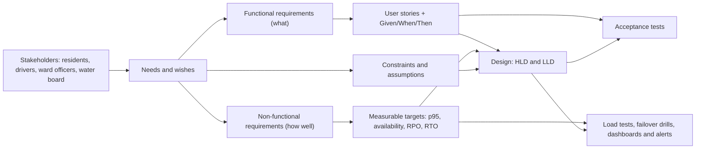
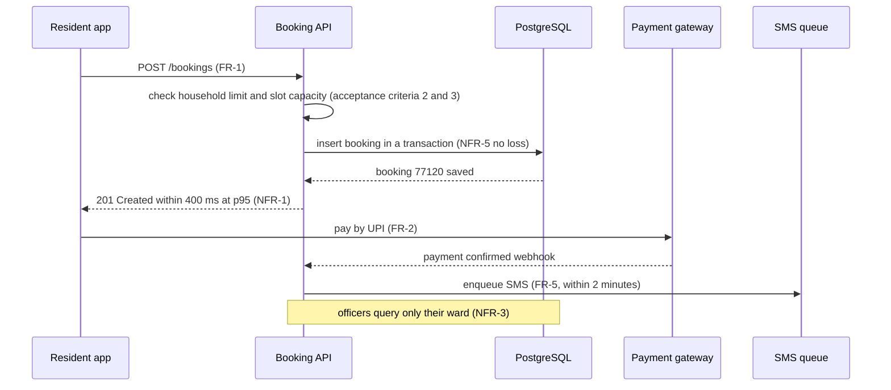

Every design decision you make later, from "one server or ten?" to "cache or no cache?", depends on one thing: **what the system needs to do, and how well**. Those are the requirements. **Functional requirements** describe *what* the system does: book a tanker, pay a bill, upload a photo. **Non-functional requirements** describe *how well* it does it: how fast, how often available, how secure, how cheap. This lesson teaches you to tell them apart, to turn vague wishes like "fast and reliable" into numbers you can test, and to write user stories with acceptance criteria that developers and testers can both use.

## Learning objectives

By the end of this lesson you will be able to:

1. Explain the difference between functional and non-functional requirements, with examples.
2. Name the common quality attributes (performance, scalability, availability, reliability, durability, security, privacy, usability, accessibility, maintainability, observability, cost, compliance).
3. Rewrite a vague requirement as a measurable target (for example, "fast" → "p95 under 400 ms at 50 requests per second").
4. Convert availability percentages into allowed downtime, and explain percentiles such as p95.
5. Write user stories with Given/When/Then acceptance criteria.
6. Trace a requirement through design to an automated test in C#.

## Prerequisites

- [What is system design?](#/lesson/m02-what-is-system-design): the building blocks requirements will drive.
- [HLD versus LLD](#/lesson/m02-hld-vs-lld): requirements feed both levels.
- Basic C# and the idea of a unit test.

## Explain it like I'm a beginner

Imagine ordering a birthday cake from a bakery.

Some things you say describe **what the cake is**:

- Chocolate, 2 kg.
- "Happy Birthday Asha" written on top.
- A candle shaped like the number 8.

Other things describe **qualities the cake and the service must have**:

- Delivered by 6 p.m. on Saturday. (Speed and timing.)
- Eggless, because a guest is allergic. (Safety.)
- Survives a 30-minute car ride without the cream sliding. (Reliability.)
- Costs under ₹2,000. (Cost.)

If the bakery gets the first list right but delivers at 9 p.m., the party is ruined anyway. And notice: "delivered on time" is useless unless you say **what time**. "Eggless" is a clear yes-or-no. "Tasty" is hard to check; "uses real chocolate, not compound" is checkable.

Software is the same. The **first list** is the functional requirements: what the system does. The **second list** is the non-functional requirements: how well it must do it. Good requirements are specific enough that everyone can agree, afterwards, whether they were met.

## First-principles explanation

### Functional requirements (FRs)

A **functional requirement** describes a behaviour: an input, what the system does with it, and the output or change it produces. It usually starts with "the system shall…" or "a user can…".

Examples for a city water board's **tanker booking system** (called JalSeva in this lesson):

- FR-1: A resident can book a water tanker of 5,000 or 10,000 litres for a one-hour delivery slot.
- FR-2: A resident can pay by UPI or card when booking.
- FR-3: A driver can mark a booking as delivered by entering an OTP given by the resident.
- FR-4: A ward officer can see all pending deliveries in their ward.
- FR-5: The resident receives an SMS when the tanker is dispatched and when it is delivered.

Functional requirements answer "does it work?" They are tested with **acceptance tests**: given this situation, when the user does this, then that happens.

### Non-functional requirements (NFRs)

A **non-functional requirement** describes a quality or a limit that applies to the behaviour: how fast, how available, how secure, how much. NFRs are also called **quality attributes**. They rarely appear as a button on the screen, but they decide most of the architecture.

| Quality attribute | Plain-English question | Measurable example for JalSeva |
|---|---|---|
| **Performance (latency)** | How fast does it respond? | Booking API p95 under 400 ms |
| **Throughput / scalability** | How much load must it handle, now and later? | 50 requests per second at peak, 3× within two years |
| **Availability** | How often is it usable? | 99.5 % between 06:00 and 22:00 each month |
| **Reliability** | Does it do the right thing consistently? | Fewer than 0.1 % of bookings fail for system reasons |
| **Durability** | Is data ever lost? | No confirmed booking or payment lost (RPO 5 minutes for other data) |
| **Recoverability** | How fast can it come back after a disaster? | Restored within 1 hour (RTO) |
| **Security** | Who can do what, and is it protected? | Officers see only their own ward; all traffic over TLS |
| **Privacy and compliance** | What laws and policies apply? | Personal data handled per applicable law (for example India's DPDP Act, 2023); payment card data never stored by us |
| **Usability** | Can users succeed easily? | 90 % of first-time residents complete a booking in under 3 minutes |
| **Accessibility** | Can everyone use it? | Web app meets WCAG 2.2 level AA |
| **Localisation** | Does it speak the users' languages? | Marathi, Hindi and English |
| **Maintainability** | How easily can it change? | A new tanker size can be added by configuration, without a code release |
| **Observability** | Can we see what is happening? | Every request has a correlation id; dashboards for latency, errors and bookings |
| **Cost** | How much may it cost to run? | Infrastructure under an agreed monthly budget |
| **Portability** | Where must it run? | On the state data centre or a government-empanelled cloud |

Quality models such as **ISO/IEC 25010** organise these into groups (performance efficiency, reliability, security, maintainability and so on). You do not need to memorise the standard; use it as a checklist so you do not forget a whole category.

### Why NFRs drive the architecture

Two systems with exactly the same functional requirements can look completely different:

- A tanker booking app for **one small town** (200 bookings a day, office hours only): one server, one database, daily backup.
- The same app for a **metropolitan city** in summer (50,000 bookings a day, peaks when water supply is cut, 99.5 % availability, 1-hour recovery): load balancer, several app servers, a database with a standby, a queue for SMS, monitoring and alerting.

The functions are identical. The non-functional requirements made the difference. That is why system design starts by pinning them down.

### Making requirements measurable

A requirement you cannot measure is a wish. Turn every vague word into a number with a unit and a condition:

| Vague | Measurable |
|---|---|
| "The app should be fast." | "Booking API responds in under 400 ms for 95 % of requests (p95), at 50 requests per second." |
| "The system must always be available." | "99.5 % availability per month between 06:00 and 22:00 IST, excluding announced maintenance." |
| "It must be secure." | "Only authenticated officers can view bookings, and only for their own ward. All access is logged and kept 1 year." |
| "It must handle a lot of users." | "Handles 50 requests per second at peak today and 150 per second within two years without redesign." |
| "Data must never be lost." | "Confirmed bookings and payments are never lost (RPO zero). Other data: at most 5 minutes lost (RPO 5 min)." |
| "Easy to use." | "In a test with 20 first-time residents, at least 18 complete a booking without help in under 3 minutes." |

A useful check is **SMART**: specific, measurable, achievable, relevant, time-bound. Another is simply: "How would a tester prove this was met or not?"

### Percentiles: why "average" is not enough

Response times are spread out: most requests are quick, a few are slow. The **average** hides the slow ones. **Percentiles** do not:

- **p50 (median)**: half of requests are faster than this.
- **p95**: 95 % are faster; 1 in 20 is slower.
- **p99**: 99 % are faster; 1 in 100 is slower.

Example: 100 requests, 95 of them take 100 ms and 5 take 3,000 ms. The average is (95 × 100 + 5 × 3,000) ÷ 100 = **245 ms**, which looks fine. The p99 is **3,000 ms**: one in a hundred residents waits 3 seconds. If a resident makes 20 requests during a booking, the chance that at least one is slow is about 1 − 0.95²⁰ ≈ 64 % when 5 % of requests are slow. That is why latency targets are written as percentiles.

### Availability: from nines to minutes

Availability is the share of time the system is usable. Convert it into allowed downtime so everyone understands what it means (using a 730-hour month):

| Availability | Allowed downtime per month | Per year |
|---|---|---|
| 99 % | about 7.3 hours | about 3.65 days |
| 99.5 % | about 3.65 hours | about 1.8 days |
| 99.9 % | about 43.8 minutes | about 8.8 hours |
| 99.95 % | about 21.9 minutes | about 4.4 hours |
| 99.99 % | about 4.4 minutes | about 53 minutes |

Each extra nine usually costs much more: more servers, more zones, automated failover, more on-call effort. Ask what the business actually loses per hour of downtime before asking for 99.99 %. The [availability lesson](#/lesson/m11-availability) goes deeper.

### Requirements, constraints and assumptions

Three kinds of statements often get mixed up:

- **Requirement**: something the system must do or achieve. "Book a tanker." "p95 under 400 ms."
- **Constraint**: a limit on *how* you may build it, decided by someone else. "Must run in the state data centre." "Must use the existing citizen login." "Go live before 1 April." See [Business requirements and technical constraints](#/lesson/m02-constraints).
- **Assumption**: something you believe but have not confirmed. "Most residents have a smartphone." "Peak load is on Monday mornings after supply cuts." Write assumptions down so they can be checked; a wrong assumption is a common cause of failed projects.

### User stories and acceptance criteria

Functional requirements are often written as **user stories**, short descriptions from the user's point of view:

```text
As a <type of user>,
I want <some goal>,
so that <some reason>.
```

Example: "As a **resident**, I want to **book a tanker for a specific hour**, so that **someone is home to receive it**."

A story alone is too vague to build or test. Each story needs **acceptance criteria**: concrete conditions that must be true for the story to be done. The **Given / When / Then** format makes them precise:

```text
Given  <the starting situation>
When   <the user or system does something>
Then   <the expected result>
```

Acceptance criteria for the booking story:

1. **Given** a resident with no bookings today, **when** they book a 5,000-litre tanker for 10:00 tomorrow, **then** the booking is confirmed and they receive a booking number.
2. **Given** a resident who already has 2 bookings for a date, **when** they try to book a third for the same date, **then** the booking is refused with the message "Maximum 2 tankers per household per day".
3. **Given** 4 tankers are already booked in a ward for a slot, **when** another resident in that ward books the same slot, **then** the booking is refused and the next free slots are suggested.
4. **Given** the current time is 08:30, **when** a resident tries to book a slot at 08:00 today or at 21:00, **then** the booking is refused (slots run from 06:00 to 20:00 and must be in the future).

Good stories follow **INVEST**: Independent, Negotiable, Valuable, Estimable, Small, Testable. "Testable" is the one that matters most here: if you cannot write Given/When/Then for it, the story is not ready.

NFRs can be attached to stories too ("this endpoint must meet the p95 target"), but most NFRs apply across the whole system, so they are usually kept in a separate list that every story must respect.

### Prioritising: not everything is a must

Stakeholders will ask for more than you can build. **MoSCoW** is a simple way to agree on priorities:

- **Must have**: without it, the release is pointless (book a tanker, pay, mark delivered).
- **Should have**: important, but there is a workaround (SMS on dispatch; for now, residents can check the app).
- **Could have**: nice to have (rate the driver).
- **Won't have this time**: agreed and written down as out of scope (live GPS tracking of tankers).

The same applies to NFRs: 99.5 % availability might be a must, 99.9 % a "could" for next year.

### Traceability: from requirement to test

Give each requirement an id and keep a simple table that links it to the design and the tests. When a requirement changes, you know exactly what to update; when a test fails, you know which requirement is at risk.

| Requirement | Design element | Test |
|---|---|---|
| FR-1 Book a tanker for a slot | `TankerBookingService.Book`, `bookings` table | Acceptance tests 1–4 above |
| NFR-1 Booking p95 under 400 ms at 50 RPS | Stateless API, indexed slot lookup | Load test in CI before release; production latency dashboard |
| NFR-3 Officers see only their ward | Ward claim in the token, policy check | Authorization tests per role |
| NFR-5 No confirmed booking lost | Database with synchronous standby, backups | Failover drill every quarter |

### When requirements are "enough"

You will never have perfect requirements before starting. Aim for: every must-have function has a story with acceptance criteria; every NFR that could change the architecture (load, availability, data size, security boundaries, compliance) has a number; and every assumption is written down. Then start, and refine as you learn. Requirements gathering for HLD interviews is covered in [Clarifying requirements](#/lesson/m11-clarifying-requirements) and [Non-functional requirements](#/lesson/m11-nfrs).

## Visual explanation

### From stakeholder needs to tests



Read it from left to right. **Stakeholders** (everyone who uses or pays for the system) express **needs**, often vaguely. You sort those into **functional requirements**, **non-functional requirements** and **constraints and assumptions**. Functional requirements become **user stories** with Given/When/Then criteria; non-functional ones become **measurable targets**. Both, together with the constraints, shape the **design**. Finally, each kind is checked differently: stories by **acceptance tests**, targets by **load tests, drills and production dashboards**. If a requirement has no path to a test on this diagram, it is not finished.

### One booking, annotated with its requirements



This is the same booking flow from the system's point of view, with each step labelled with the requirement it serves. The **resident app** sends the booking (**FR-1**). The **API** applies the rules from the acceptance criteria before touching anything, then **saves** the booking in a transaction so a confirmed booking cannot be lost (**NFR-5**), and replies within the latency target (**NFR-1**). Payment happens with the **gateway** (**FR-2**), which notifies the API by webhook. The SMS is queued (**FR-5**) so it never slows the booking. Drawing a flow like this shows quickly whether every requirement has a place in the design, and whether any step (for example a slow external call before the reply) would break an NFR.

## Step-by-step example

The water board's brief for JalSeva arrives as an email. Turn it into requirements.

### Step 1 — Read the brief and underline the wishes

> "We need a modern, user-friendly app so residents can book tankers easily. It must be fast and always available, especially in summer when demand is very high. Drivers should be able to update deliveries. Ward officers need to monitor everything. The system must be secure and comply with all government norms. Budget is limited."

### Step 2 — Separate what from how well

| Phrase | Type | Becomes |
|---|---|---|
| "book tankers" | FR | FR-1 book a tanker for a slot; FR-2 pay |
| "drivers update deliveries" | FR | FR-3 mark delivered with OTP |
| "ward officers monitor everything" | FR (with a security NFR hidden inside) | FR-4 view pending deliveries for their ward; NFR-3 ward-level access |
| "user-friendly", "easily" | NFR (usability) | NFR-6 90 % of first-time residents book in under 3 minutes |
| "fast" | NFR (performance) | NFR-1 p95 under 400 ms |
| "always available" | NFR (availability) | NFR-2 99.5 % during 06:00–22:00 |
| "very high demand in summer" | NFR (scalability) | NFR-4 50 RPS peak, 3× in two years |
| "secure", "government norms" | NFR (security, compliance) + constraints | NFR-3, NFR-7; constraint C-1 hosting location |
| "budget is limited" | Constraint | C-2 monthly infrastructure budget (ask for the number) |

### Step 3 — Ask for the numbers you do not have

You cannot make "fast" or "high demand" measurable alone. Ask the water board:

- How many bookings a day in a normal month, and in the worst summer week? (Answer: 8,000 normal, 50,000 peak, mostly 07:00–11:00.)
- What happens if the app is down for an hour? (Answer: residents queue at ward offices; one hour in the morning peak is very bad, one hour at night is acceptable.)
- Which laws and policies apply? Where must data be hosted? (Answer: state data-centre or empanelled cloud; personal data protection rules apply.)
- What languages? (Answer: Marathi, Hindi, English.)

### Step 4 — Write the targets with arithmetic

```text
Peak bookings:      50,000 a day, 70 % between 07:00 and 11:00 (4 hours)
Peak booking rate:  50,000 × 0.7 ÷ 14,400 s           ≈ 2.4 bookings per second
Requests per booking (search slots, book, pay, status) ≈ 20
Peak request rate:  2.4 × 20                            ≈ 49 ≈ 50 requests per second  → NFR-4
Availability:       99.5 % in 16 operating hours × 30 days = 480 hours → about 2.4 hours of downtime a month allowed → NFR-2
```

Notice how the availability target is scoped to operating hours. That single phrase lets the team do maintenance at night without breaking the target, which keeps cost down: a direct link between a requirement and the budget constraint.

### Step 5 — Write stories and acceptance criteria

The booking story and its four criteria are in the first-principles section. A second example, for drivers:

"As a **driver**, I want to **mark a booking as delivered using the resident's OTP**, so that **the board knows the water reached the right household**."

1. **Given** a dispatched booking with OTP 4821, **when** the driver enters 4821, **then** the booking becomes Delivered and the resident gets an SMS.
2. **Given** a dispatched booking, **when** the driver enters a wrong OTP 3 times, **then** the booking is locked for 15 minutes and the ward officer is alerted.
3. **Given** the driver's phone has no network, **when** they enter the OTP, **then** the app stores the confirmation and sends it when the network returns, with the original time.

The third criterion hides a big non-functional requirement (offline support) that changes the mobile app's design. Writing acceptance criteria early is how you find these.

### Step 6 — Prioritise and record what is out of scope

Must: FR-1 to FR-4, NFR-1 to NFR-5. Should: FR-5 (SMS), NFR-6 usability test. Could: driver ratings. Won't (this release): live GPS tracking. Writing the "won't" list down avoids arguments later.

## Production-style C# implementation

Requirements become code in two ways: **functional rules** (acceptance criteria) become domain logic with tests, and **non-functional targets** become measurements the system reports about itself. The JalSeva API below does both: it enforces the booking criteria and records latency per endpoint so anyone can check NFR-1.

```text
JalSeva.Api/
  Program.cs
  Requirements/QualityTargets.cs
  Requirements/LatencyRecorder.cs
  Tankers/BookingPolicy.cs
  Tankers/TankerBookingService.cs
```

```csharp file=Requirements/QualityTargets.cs
namespace JalSeva.Requirements;

/// <summary>NFR-1 style target: "p95 of endpoint X under N ms".</summary>
public sealed record LatencyTarget(string Endpoint, double Percentile, double MaxMilliseconds);

public static class Quality
{
    /// <summary>Nearest-rank percentile: the smallest value with at least p % of samples at or below it.</summary>
    public static double Percentile(IReadOnlyList<double> samples, double percentile)
    {
        ArgumentNullException.ThrowIfNull(samples);
        if (samples.Count == 0) throw new ArgumentException("No samples.", nameof(samples));
        if (percentile is <= 0 or > 100) throw new ArgumentOutOfRangeException(nameof(percentile));

        var sorted = samples.Order().ToArray();
        int rank = (int)Math.Ceiling(percentile / 100 * sorted.Length);
        return sorted[Math.Max(rank, 1) - 1];
    }

    /// <summary>Turns "99.5 %" into the downtime it allows over a period.</summary>
    public static TimeSpan AllowedDowntime(double availabilityPercent, TimeSpan period)
    {
        if (availabilityPercent is < 0 or > 100) throw new ArgumentOutOfRangeException(nameof(availabilityPercent));
        return TimeSpan.FromTicks((long)(period.Ticks * (100 - availabilityPercent) / 100));
    }
}
```

```csharp file=Requirements/LatencyRecorder.cs
using System.Collections.Concurrent;
using System.Diagnostics;
using Microsoft.AspNetCore.Http;
using Microsoft.AspNetCore.Routing;

namespace JalSeva.Requirements;

/// <summary>
/// Keeps the most recent request durations per endpoint so the service can report on its own NFRs.
/// In production you would export these as metrics (OpenTelemetry histograms) instead.
/// </summary>
public sealed class LatencyRecorder
{
    private const int MaxSamplesPerEndpoint = 10_000;
    private readonly ConcurrentDictionary<string, ConcurrentQueue<double>> _samples = new();

    public void Record(string endpoint, double milliseconds)
    {
        var queue = _samples.GetOrAdd(endpoint, _ => new ConcurrentQueue<double>());
        queue.Enqueue(milliseconds);
        while (queue.Count > MaxSamplesPerEndpoint && queue.TryDequeue(out _)) { }
    }

    public IReadOnlyList<double> Samples(string endpoint) =>
        _samples.TryGetValue(endpoint, out var q) ? q.ToArray() : Array.Empty<double>();

    public object Report(LatencyTarget target)
    {
        var samples = Samples(target.Endpoint);
        if (samples.Count == 0) return new { target.Endpoint, status = "no data yet" };
        double observed = Quality.Percentile(samples, target.Percentile);
        return new
        {
            target.Endpoint,
            percentile = $"p{target.Percentile:0}",
            observedMs = Math.Round(observed, 1),
            targetMs = target.MaxMilliseconds,
            met = observed <= target.MaxMilliseconds,
            samples = samples.Count,
        };
    }

    /// <summary>Middleware that times every request and records it under "METHOD route".</summary>
    public static Func<HttpContext, RequestDelegate, Task> Middleware(LatencyRecorder recorder) => async (context, next) =>
    {
        long start = Stopwatch.GetTimestamp();
        try
        {
            await next(context);
        }
        finally
        {
            string route = (context.GetEndpoint() as RouteEndpoint)?.RoutePattern.RawText ?? context.Request.Path.Value ?? "";
            recorder.Record($"{context.Request.Method} {route}", Stopwatch.GetElapsedTime(start).TotalMilliseconds);
        }
    };
}
```

```csharp file=Tankers/BookingPolicy.cs
namespace JalSeva.Tankers;

/// <summary>
/// The numbers from the acceptance criteria, as configuration. Changing a rule (for example 3 tankers per day
/// in a drought) is a configuration change that a reviewer can see, not a code hunt.
/// </summary>
public sealed class BookingPolicy
{
    public int[] AllowedSizesLitres { get; set; } = [5_000, 10_000];
    public int MaxBookingsPerHouseholdPerDay { get; set; } = 2;
    public int FirstSlotHour { get; set; } = 6;     // first slot starts 06:00
    public int LastSlotEndHour { get; set; } = 20;  // last slot ends 20:00, so the last start is 19:00
    public int MaxDaysAhead { get; set; } = 3;
    public int TankersPerWardPerSlot { get; set; } = 4;
    public string TimeZoneId { get; set; } = "Asia/Kolkata"; // slot times are IST, whatever the server's clock zone
}
```

```csharp file=Tankers/TankerBookingService.cs
using Microsoft.Extensions.Options;

namespace JalSeva.Tankers;

public sealed record TankerBooking(int Id, string HouseholdId, string Ward, DateTime SlotStart, int Litres);

public sealed record BookingOutcome(bool Accepted, string? Reason, TankerBooking? Booking)
{
    public static BookingOutcome Rejected(string reason) => new(false, reason, null);
}

/// <summary>FR-1 with acceptance criteria 1 to 4. Times are local (IST) slot times.</summary>
public sealed class TankerBookingService(IOptions<BookingPolicy> policy, TimeProvider clock)
{
    private readonly BookingPolicy _policy = policy.Value;
    private readonly TimeZoneInfo _zone = TimeZoneInfo.FindSystemTimeZoneById(policy.Value.TimeZoneId);
    private readonly List<TankerBooking> _bookings = new();
    private readonly object _gate = new();
    private int _nextId = 77_000;

    public BookingOutcome Book(string householdId, string ward, DateTime slotStart, int litres)
    {
        if (string.IsNullOrWhiteSpace(householdId) || string.IsNullOrWhiteSpace(ward))
            return BookingOutcome.Rejected("Household and ward are required.");
        if (!_policy.AllowedSizesLitres.Contains(litres))
            return BookingOutcome.Rejected($"Tanker size must be one of {string.Join(", ", _policy.AllowedSizesLitres)} litres.");
        if (slotStart.Minute != 0 || slotStart.Second != 0)
            return BookingOutcome.Rejected("Slots start on the hour.");
        if (slotStart.Hour < _policy.FirstSlotHour || slotStart.Hour >= _policy.LastSlotEndHour)
            return BookingOutcome.Rejected($"Slots run from {_policy.FirstSlotHour:00}:00 to {_policy.LastSlotEndHour:00}:00.");

        // Cloud servers usually run in UTC, so convert explicitly instead of trusting the machine's local zone.
        DateTime now = TimeZoneInfo.ConvertTime(clock.GetUtcNow(), _zone).DateTime;
        if (slotStart <= now) return BookingOutcome.Rejected("The slot must be in the future.");
        if ((slotStart.Date - now.Date).TotalDays > _policy.MaxDaysAhead)
            return BookingOutcome.Rejected($"Bookings open {_policy.MaxDaysAhead} days ahead.");

        lock (_gate)
        {
            int householdToday = _bookings.Count(b => b.HouseholdId == householdId && b.SlotStart.Date == slotStart.Date);
            if (householdToday >= _policy.MaxBookingsPerHouseholdPerDay)
                return BookingOutcome.Rejected($"Maximum {_policy.MaxBookingsPerHouseholdPerDay} tankers per household per day.");

            int inSlot = _bookings.Count(b => b.Ward == ward && b.SlotStart == slotStart);
            if (inSlot >= _policy.TankersPerWardPerSlot)
                return BookingOutcome.Rejected("This slot is full in your ward. Please choose another slot.");

            var booking = new TankerBooking(++_nextId, householdId, ward, slotStart, litres);
            _bookings.Add(booking);
            return new BookingOutcome(true, null, booking);
        }
    }
}
```

```csharp file=Program.cs
using JalSeva.Requirements;
using JalSeva.Tankers;

var builder = WebApplication.CreateBuilder(args);

builder.Services.AddSingleton(TimeProvider.System);
builder.Services.AddOptions<BookingPolicy>().BindConfiguration("Booking");
builder.Services.AddSingleton<TankerBookingService>();
builder.Services.AddSingleton<LatencyRecorder>();

var app = builder.Build();

var recorder = app.Services.GetRequiredService<LatencyRecorder>();
app.Use(LatencyRecorder.Middleware(recorder));

// FR-1: book a tanker.
app.MapPost("/bookings", (BookingRequest request, TankerBookingService service) =>
{
    var outcome = service.Book(request.HouseholdId, request.Ward, request.SlotStart, request.Litres);
    return outcome.Accepted
        ? Results.Created($"/bookings/{outcome.Booking!.Id}", outcome.Booking)
        : Results.UnprocessableEntity(new { error = outcome.Reason });
});

// NFR-1: the service reports whether it meets its own latency target.
var targets = new[] { new LatencyTarget("POST /bookings", 95, 400) };
app.MapGet("/nfr/report", () => Results.Ok(targets.Select(recorder.Report)));

app.Run();

public sealed record BookingRequest(string HouseholdId, string Ward, DateTime SlotStart, int Litres);
```

How the code traces to the requirements:

1. **Acceptance criteria are visible in one method.** Each `Rejected(...)` line in `Book` corresponds to a Given/When/Then criterion, and the messages are the ones the stories promised to users.
2. **Numbers live in configuration.** `BookingPolicy` holds 2 tankers per day, 06:00–20:00, 3 days ahead and 4 per ward per slot. The water board can change them in a drought without a code release, which is itself a maintainability requirement.
3. **NFRs are measured, not assumed.** `LatencyRecorder` times every request; `/nfr/report` shows whether p95 meets the 400 ms target. A real deployment exports the same data as metrics to dashboards and alerts.
4. **Time is injected, and the time zone is explicit.** `TimeProvider` lets tests fix "now" at 08:30, so the "slot in the past" criterion is testable. The service converts UTC to IST itself, because a cloud server's local zone is usually UTC and "08:30" would otherwise be wrong by five and a half hours.
5. **The `lock` is a single-server shortcut.** It stops two requests on one server from both taking the last slot. With two app servers behind a load balancer it protects nothing, so in production the limits are enforced in PostgreSQL: lock the ward-slot row (`SELECT ... FOR UPDATE`) inside the booking transaction, or keep a capacity counter and update it with `UPDATE ... SET booked = booked + 1 WHERE booked < capacity`. A requirement such as "maximum 4 per slot" is only met if it holds under concurrent load.

## Bad design vs good design

**Bad: requirements as adjectives.** "The system shall be fast, secure, scalable and user-friendly." Nobody can design for it or test it, and everyone will later disagree about whether it was met.

**Bad: functional requirements only.** The team builds every screen perfectly. On the first summer morning, 50 requests per second arrive, the single server reaches 100 % CPU, and residents queue at ward offices. Nobody had written down the load.

**Bad: rules buried in the UI.** "Maximum 2 tankers per day" is checked only in the mobile app. A resident using the website, or a script calling the API, books ten.

**Bad: gold-plated targets.** "99.99 % availability, 50 ms p99, multi-region" for a ward-level service used in office hours. The cost of meeting them dwarfs the value, and the budget constraint is broken before a line of code is written.

**Good:**

- Every requirement has an id, a type (FR or NFR) and an owner.
- FRs are written as stories with Given/When/Then acceptance criteria.
- NFRs have a number, a unit, a condition (load, time window) and a way to measure them.
- Constraints and assumptions are listed separately and checked.
- Rules are enforced on the server, in one place, with tests that mirror the acceptance criteria.
- Targets are matched to the business value: ask what an hour of downtime or a slow page actually costs.

:::callout type=tip title="The tester's question"
For every requirement, ask: "How would a tester prove this was met, or not?" If the answer is "they'd have to judge", rewrite it with a number or a concrete example.
:::

:::callout type=mistake title="Average latency targets"
"Average response time under 300 ms" can be met while 1 in 20 users waits 5 seconds. Write latency targets as percentiles (p95 or p99) at a stated load.
:::

## Practical playground

The playground computes the NFR numbers from this lesson: percentiles from a list of response times, and allowed downtime from availability targets. Run it, then try:

1. Add five 3,000 ms samples and see how the average and p99 move differently.
2. Change the availability to 99.9 % and see the allowed downtime for the 480 operating hours a month.
3. Change the percentile to 99 and check whether the target is still met.

:::playground type=csharp title="Percentiles and downtime"
```csharp file=Program.cs
using System;
using System.Collections.Generic;
using System.Linq;

public static class NfrMath
{
    public static double Percentile(IReadOnlyList<double> samples, double p)
    {
        var sorted = samples.OrderBy(x => x).ToArray();
        int rank = (int)Math.Ceiling(p / 100 * sorted.Length);
        return sorted[Math.Max(rank, 1) - 1];
    }

    public static TimeSpan AllowedDowntime(double availabilityPercent, TimeSpan period) =>
        TimeSpan.FromTicks((long)(period.Ticks * (100 - availabilityPercent) / 100));
}

public static class Program
{
    public static void Main()
    {
        var samples = new List<double>();
        for (int i = 0; i < 95; i++) samples.Add(100);       // 95 quick requests
        for (int i = 0; i < 5; i++) samples.Add(3_000);      // 5 slow ones

        Console.WriteLine($"Average: {samples.Average():0} ms");
        Console.WriteLine($"p50:     {NfrMath.Percentile(samples, 50):0} ms");
        Console.WriteLine($"p95:     {NfrMath.Percentile(samples, 95):0} ms");
        Console.WriteLine($"p99:     {NfrMath.Percentile(samples, 99):0} ms");
        Console.WriteLine($"Meets 'p95 under 400 ms'? {NfrMath.Percentile(samples, 95) <= 400}");

        var operatingHours = TimeSpan.FromHours(16 * 30);    // 06:00-22:00 for 30 days
        foreach (var a in new[] { 99.0, 99.5, 99.9, 99.95 })
            Console.WriteLine($"{a}% of {operatingHours.TotalHours} h allows {NfrMath.AllowedDowntime(a, operatingHours).TotalMinutes:0} minutes down");
    }
}
```
:::

## Exercises

:::exercise id=m02-requirements-ex1 difficulty=beginner kind=written title="Sort and sharpen the requirements"
A district hospital wants an OPD (outpatient) token system. For each statement, say whether it is a functional requirement, a non-functional requirement or a constraint. Then rewrite every vague one as a measurable statement (invent reasonable numbers and say they are assumptions).

1. Patients can book an OPD token online for a department and date.
2. The system should be fast.
3. The token display board in the waiting hall shows the current token number.
4. The system must be highly available.
5. It must be built with the hospital's existing ASP.NET and PostgreSQL skills.
6. Patient data must be secure.
7. A doctor can mark a token as "seen".
8. It should be easy to use for elderly patients.
9. The system must handle the morning rush.
10. Go-live before the next financial year.
::acceptance
- Each statement is classified correctly.
- Every vague NFR is rewritten with a number, a unit and a condition.
- Assumed numbers are labelled as assumptions.
- At least one rewritten statement says how it would be tested.
::hint
Ask "is this something the system does, or how well it does it, or a limit on how we build it?"
::hint
"Fast", "highly available", "secure", "easy to use" and "morning rush" all need numbers.
::hint
For "elderly patients", think about a usability test with a target and an accessibility standard.
::hint
For the morning rush, estimate: how many patients arrive between 08:00 and 10:00, and how many requests each makes?
::solution
1. **FR.**
2. **NFR (performance).** "Booking and status pages respond in under 500 ms at p95 at 30 requests per second (assumed peak)." Tested by a load test before go-live.
3. **FR** (with an NFR inside it: "the board updates within 5 seconds of a token being called").
4. **NFR (availability).** "99.5 % availability between 07:00 and 17:00 on working days, measured monthly (allowing about 1.3 hours of downtime a month in that window); if the system is down, reception can issue paper tokens and enter them later."
5. **Constraint** (technology and team).
6. **NFR (security and privacy).** "Only logged-in hospital staff can see patient details; each staff role sees only what it needs; all access to patient records is logged and kept 1 year; data is encrypted in transit (TLS) and at rest; personal data is handled per applicable law." Tested by authorization tests per role and a security review.
7. **FR.**
8. **NFR (usability and accessibility).** "In a test with 15 patients aged over 60 (assumption), at least 12 book a token without help in under 4 minutes; text can be enlarged to 200 % without breaking the layout; available in the local language and English."
9. **NFR (scalability).** "Assumed 1,500 patients between 08:00 and 10:00, about 8 requests each: 12,000 requests in 7,200 s ≈ 1.7 per second on average, design for 10 per second to cover bursts; p95 targets above must hold at that rate."
10. **Constraint** (deadline).
::mistakes
- Treating the technology stack or the deadline as requirements rather than constraints.
- Rewriting "fast" as "very fast" or "under a few seconds" without a percentile and load.
- Forgetting the hidden NFR inside an FR (the display board update time).
:::

:::exercise id=m02-requirements-ex2 difficulty=beginner kind=code title="Percentiles and allowed downtime"
Implement the two calculations every NFR discussion needs.
::requirements
- `Nfr.Percentile(IEnumerable<double> samples, double percentile)` uses the **nearest-rank** method: sort ascending, `rank = ceil(percentile ÷ 100 × n)`, return the value at position `rank` (1-based). Empty or null samples throw `ArgumentException` (or `ArgumentNullException` for null). `percentile` must be greater than 0 and at most 100, otherwise `ArgumentOutOfRangeException`.
- `Nfr.MeetsLatencyTarget(IEnumerable<double> samples, double percentile, double maxMs)` returns whether that percentile is at most `maxMs`.
- `Nfr.AllowedDowntime(double availabilityPercent, TimeSpan period)` returns `period × (100 − availability) ÷ 100`. Availability outside `[0, 100]` throws `ArgumentOutOfRangeException`.
::acceptance
- For samples 1 to 100, p50 is 50, p95 is 95 and p100 is 100.
- For `[120, 80, 300, 95, 110]`, p50 is 110 and p95 is 300.
- 99.9 % over 30 days allows 43.2 minutes; 99.5 % over 7 days allows 50.4 minutes; 100 % allows zero.
::hint
Sort a copy of the samples; do not change the caller's list.
::hint
`(int)Math.Ceiling(percentile / 100.0 * n)` gives the 1-based rank. Subtract 1 for the array index.
::hint
For downtime, work in ticks or minutes: 30 days = 43,200 minutes, × 0.1 % = 43.2 minutes.
::hint
```csharp
var sorted = samples.OrderBy(x => x).ToArray();
int rank = (int)Math.Ceiling(percentile / 100.0 * sorted.Length);
return sorted[rank - 1];
```
::starter
```csharp file=Nfr.cs
using System;
using System.Collections.Generic;
using System.Linq;

public static class Nfr
{
    public static double Percentile(IEnumerable<double> samples, double percentile) => throw new NotImplementedException();

    public static bool MeetsLatencyTarget(IEnumerable<double> samples, double percentile, double maxMs) => throw new NotImplementedException();

    public static TimeSpan AllowedDowntime(double availabilityPercent, TimeSpan period) => throw new NotImplementedException();
}
```
::tests
```csharp file=NfrTests.cs
using System;
using System.Linq;
using Xunit;

public class NfrTests
{
    private static readonly double[] OneToHundred = Enumerable.Range(1, 100).Select(i => (double)i).ToArray();

    [Theory]
    [InlineData(50, 50)]
    [InlineData(95, 95)]
    [InlineData(99, 99)]
    [InlineData(100, 100)]
    public void Percentiles_of_one_to_hundred(double p, double expected) => Assert.Equal(expected, Nfr.Percentile(OneToHundred, p));

    [Fact]
    public void Percentiles_of_unsorted_samples()
    {
        var samples = new double[] { 120, 80, 300, 95, 110 };
        Assert.Equal(110, Nfr.Percentile(samples, 50));
        Assert.Equal(300, Nfr.Percentile(samples, 95));
        Assert.Equal(120, samples[0]); // caller's data is not reordered
    }

    [Fact]
    public void Latency_target_check()
    {
        Assert.True(Nfr.MeetsLatencyTarget(OneToHundred, 95, 95));
        Assert.False(Nfr.MeetsLatencyTarget(OneToHundred, 95, 94.9));
    }

    [Fact]
    public void Allowed_downtime()
    {
        Assert.Equal(43.2, Nfr.AllowedDowntime(99.9, TimeSpan.FromDays(30)).TotalMinutes, 6);
        Assert.Equal(50.4, Nfr.AllowedDowntime(99.5, TimeSpan.FromDays(7)).TotalMinutes, 6);
        Assert.Equal(TimeSpan.Zero, Nfr.AllowedDowntime(100, TimeSpan.FromDays(30)));
    }

    [Fact]
    public void Invalid_inputs_throw()
    {
        Assert.Throws<ArgumentException>(() => Nfr.Percentile(Array.Empty<double>(), 95));
        Assert.Throws<ArgumentOutOfRangeException>(() => Nfr.Percentile(OneToHundred, 0));
        Assert.Throws<ArgumentOutOfRangeException>(() => Nfr.Percentile(OneToHundred, 101));
        Assert.Throws<ArgumentOutOfRangeException>(() => Nfr.AllowedDowntime(100.5, TimeSpan.FromDays(1)));
    }
}
```
::solution
```csharp file=Nfr.cs
using System;
using System.Collections.Generic;
using System.Linq;

public static class Nfr
{
    public static double Percentile(IEnumerable<double> samples, double percentile)
    {
        if (samples is null) throw new ArgumentNullException(nameof(samples));
        if (percentile is <= 0 or > 100) throw new ArgumentOutOfRangeException(nameof(percentile), "Percentile must be in (0, 100].");

        var sorted = samples.OrderBy(x => x).ToArray();
        if (sorted.Length == 0) throw new ArgumentException("At least one sample is required.", nameof(samples));

        int rank = (int)Math.Ceiling(percentile / 100.0 * sorted.Length);
        return sorted[Math.Max(rank, 1) - 1];
    }

    public static bool MeetsLatencyTarget(IEnumerable<double> samples, double percentile, double maxMs) =>
        Percentile(samples, percentile) <= maxMs;

    public static TimeSpan AllowedDowntime(double availabilityPercent, TimeSpan period)
    {
        if (availabilityPercent is < 0 or > 100) throw new ArgumentOutOfRangeException(nameof(availabilityPercent));
        return TimeSpan.FromTicks((long)Math.Round(period.Ticks * (100 - availabilityPercent) / 100));
    }
}
```

**Worked numbers.** 30 days is 43,200 minutes; 0.1 % of that is 43.2 minutes. 7 days is 10,080 minutes; 0.5 % is 50.4 minutes. For `[120, 80, 300, 95, 110]` sorted to `[80, 95, 110, 120, 300]`: p50 rank = ceil(2.5) = 3 → 110; p95 rank = ceil(4.75) = 5 → 300. With only five samples, p95 is simply the slowest one, which is a reminder that percentiles need enough data to mean anything.
::mistakes
- Sorting the caller's array in place.
- Using `Math.Floor` or `Math.Round` for the rank, which gives p95 = 94 for 1..100.
- Computing downtime from 99.9 as "0.9 %" instead of "0.1 %".
::extensions
Add `Percentile` with linear interpolation (as many monitoring tools use) and compare the two methods on small and large sample sets.
:::

:::exercise id=m02-requirements-ex3 difficulty=intermediate kind=written title="Write stories and acceptance criteria"
Write user stories, each with at least three Given/When/Then acceptance criteria, for these JalSeva features:

1. A resident cancels a booking.
2. A ward officer reassigns a delayed tanker to another driver.
3. A resident gets a refund for a cancelled or undelivered booking.

Then list one non-functional requirement that each story depends on, with a number.
::acceptance
- Each story uses "As a… I want… so that…".
- Each story has at least three criteria, including at least one failure or edge case.
- Criteria are concrete (times, amounts, states), not "works correctly".
- Each story has a related NFR with a number.
::hint
For cancellation, think about deadlines: can a resident cancel 10 minutes before the slot? After dispatch?
::hint
For reassignment, think about permissions (which officer?) and notifications.
::hint
For refunds, think about timing ("within 5 working days") and duplicates (what if the refund request is sent twice?).
::hint
Edge cases often hide NFRs: duplicate refunds point to idempotency; "within 2 minutes" points to a queue and monitoring.
::solution
**1. Cancel a booking.** "As a **resident**, I want to **cancel a booking I no longer need**, so that **the tanker can go to someone else and I get my money back**."

- Given a confirmed booking for 10:00 tomorrow, when the resident cancels it now, then it becomes Cancelled, the slot capacity is released and a full refund is started.
- Given a booking whose slot starts in less than 2 hours, when the resident cancels, then it is cancelled with a 50 % refund and the app shows the reduced amount before the resident confirms.
- Given a booking that has already been dispatched, when the resident tries to cancel, then the app refuses and offers to call the ward helpline.
- *NFR:* cancellation is reflected in slot availability within 5 seconds, so another resident can book the released slot.

**2. Reassign a delayed tanker.** "As a **ward officer**, I want to **reassign a delayed booking to another driver**, so that **residents still get water in their slot**."

- Given a booking in my ward that is 30 minutes past its slot start without dispatch, when I reassign it to a free driver, then the new driver sees it immediately and the old driver's assignment is removed.
- Given a booking in another ward, when I try to reassign it, then the action is refused with 403 Forbidden and the attempt is logged.
- Given I reassign a booking, when the reassignment is saved, then the resident gets an SMS with the new driver's name and estimated time.
- *NFR:* officers can only act on their own ward (security), and every reassignment is in the audit log, kept 3 years.

**3. Refund.** "As a **resident**, I want **my money returned automatically for a cancelled or undelivered booking**, so that **I don't have to visit an office**."

- Given a booking cancelled with full refund, when the cancellation is saved, then a refund for the full amount is requested from the payment gateway and the resident sees "Refund initiated".
- Given a refund request is sent twice for the same booking (for example after a network retry), when the second request arrives, then no second refund is made.
- Given a booking still marked undelivered 24 hours after its slot, when the nightly check runs, then a full refund is started and the ward officer is notified.
- *NFR:* refunds reach the resident's account within 5 working days for 99 % of cases, and duplicate refunds are impossible (idempotent refund requests).
::mistakes
- Criteria such as "the cancellation works" or "the refund is processed correctly".
- Only happy paths, which hide the most important rules.
- Forgetting permissions in officer stories.
:::

:::exercise id=m02-requirements-ex4 difficulty=intermediate kind=code title="Acceptance criteria as code"
Implement the JalSeva booking rules so that the tests (which are the acceptance criteria) pass.
::requirements
- `BookingPolicy` (record, defaults shown): `MaxPerHouseholdPerDay = 2`, `FirstSlotHour = 6`, `LastSlotEndHour = 20`, `MaxDaysAhead = 3`, `TankersPerWardPerSlot = 4`. Allowed sizes are 5,000 and 10,000 litres.
- `TankerBookings(BookingPolicy policy)` with `Book(string household, string ward, DateTime slotStart, int litres, DateTime now)` returning `BookingResult(bool Accepted, string? Reason)`.
- Check in this order and return the first failing reason (use the constants in `Reasons`): `InvalidSize`, `InvalidSlot` (not on the hour), `OutsideHours` (start hour before `FirstSlotHour` or at/after `LastSlotEndHour`), `InPast` (`slotStart <= now`), `TooFarAhead` (more than `MaxDaysAhead` calendar days after `now`'s date), `HouseholdLimit`, `SlotFull` (per ward and slot).
- Accepted bookings are stored and count towards later limits.
::acceptance
- At 08:30 on 20 October, a 5,000-litre booking at 10:00 the same day is accepted.
- 7,000 litres is `InvalidSize`; 10:30 is `InvalidSlot`; 20:00 and 05:00 are `OutsideHours`; 08:00 the same day is `InPast`.
- 23 October 19:00 is accepted, 24 October is `TooFarAhead`.
- A third booking for the same household and date is `HouseholdLimit`.
- A fifth booking in the same ward and slot is `SlotFull`, but another ward's same slot is fine.
::hint
Each acceptance criterion becomes one `if` that returns early. Keep them in the order given so the reason is predictable.
::hint
"On the hour" means `slotStart.Minute == 0 && slotStart.Second == 0`.
::hint
Days ahead: `(slotStart.Date - now.Date).TotalDays > MaxDaysAhead`.
::hint
Count existing bookings with LINQ: same household and same date for the household limit, same ward and same `slotStart` for capacity.
::starter
```csharp file=TankerBookings.cs
using System;
using System.Collections.Generic;
using System.Linq;

public sealed record BookingPolicy(
    int MaxPerHouseholdPerDay = 2,
    int FirstSlotHour = 6,
    int LastSlotEndHour = 20,
    int MaxDaysAhead = 3,
    int TankersPerWardPerSlot = 4);

public sealed record BookingResult(bool Accepted, string? Reason);

public static class Reasons
{
    public const string InvalidSize = "InvalidSize";
    public const string InvalidSlot = "InvalidSlot";
    public const string OutsideHours = "OutsideHours";
    public const string InPast = "InPast";
    public const string TooFarAhead = "TooFarAhead";
    public const string HouseholdLimit = "HouseholdLimit";
    public const string SlotFull = "SlotFull";
}

public sealed class TankerBookings
{
    public TankerBookings(BookingPolicy policy) => throw new NotImplementedException();

    public BookingResult Book(string household, string ward, DateTime slotStart, int litres, DateTime now)
        => throw new NotImplementedException();
}
```
::tests
```csharp file=TankerBookingsTests.cs
using System;
using Xunit;

public class TankerBookingsTests
{
    private static readonly DateTime Now = new(2026, 10, 20, 8, 30, 0);
    private static DateTime On(int day, int hour, int minute = 0) => new(2026, 10, day, hour, minute, 0);
    private static TankerBookings Create() => new(new BookingPolicy());

    [Fact]
    public void Criterion_1_a_valid_booking_is_accepted()
    {
        var r = Create().Book("H1", "W5", On(20, 10), 5_000, Now);
        Assert.True(r.Accepted);
        Assert.Null(r.Reason);
    }

    [Theory]
    [InlineData(20, 10, 0, 7_000, "InvalidSize")]
    [InlineData(20, 10, 30, 5_000, "InvalidSlot")]
    [InlineData(20, 20, 0, 5_000, "OutsideHours")]
    [InlineData(21, 5, 0, 10_000, "OutsideHours")]
    [InlineData(20, 8, 0, 5_000, "InPast")]
    [InlineData(24, 10, 0, 5_000, "TooFarAhead")]
    public void Criterion_4_invalid_requests_are_refused(int day, int hour, int minute, int litres, string reason)
    {
        var r = Create().Book("H1", "W5", On(day, hour, minute), litres, Now);
        Assert.False(r.Accepted);
        Assert.Equal(reason, r.Reason);
    }

    [Fact]
    public void Last_slot_and_last_day_are_allowed()
    {
        var b = Create();
        Assert.True(b.Book("H1", "W5", On(23, 19), 10_000, Now).Accepted);
        Assert.True(b.Book("H2", "W5", On(21, 6), 5_000, Now).Accepted);
    }

    [Fact]
    public void Criterion_2_household_limit_per_day()
    {
        var b = Create();
        Assert.True(b.Book("H1", "W5", On(21, 7), 5_000, Now).Accepted);
        Assert.True(b.Book("H1", "W5", On(21, 15), 5_000, Now).Accepted);
        Assert.Equal(Reasons.HouseholdLimit, b.Book("H1", "W5", On(21, 18), 5_000, Now).Reason);
        Assert.True(b.Book("H1", "W5", On(22, 7), 5_000, Now).Accepted);
    }

    [Fact]
    public void Criterion_3_ward_slot_capacity()
    {
        var b = Create();
        for (int i = 2; i <= 5; i++)
            Assert.True(b.Book($"H{i}", "W5", On(22, 7), 5_000, Now).Accepted);

        Assert.Equal(Reasons.SlotFull, b.Book("H6", "W5", On(22, 7), 5_000, Now).Reason);
        Assert.True(b.Book("H6", "W6", On(22, 7), 5_000, Now).Accepted);
    }
}
```
::solution
```csharp file=TankerBookings.cs
using System;
using System.Collections.Generic;
using System.Linq;

public sealed record BookingPolicy(
    int MaxPerHouseholdPerDay = 2,
    int FirstSlotHour = 6,
    int LastSlotEndHour = 20,
    int MaxDaysAhead = 3,
    int TankersPerWardPerSlot = 4);

public sealed record BookingResult(bool Accepted, string? Reason);

public static class Reasons
{
    public const string InvalidSize = "InvalidSize";
    public const string InvalidSlot = "InvalidSlot";
    public const string OutsideHours = "OutsideHours";
    public const string InPast = "InPast";
    public const string TooFarAhead = "TooFarAhead";
    public const string HouseholdLimit = "HouseholdLimit";
    public const string SlotFull = "SlotFull";
}

public sealed class TankerBookings
{
    private static readonly int[] AllowedSizes = { 5_000, 10_000 };
    private readonly BookingPolicy _policy;
    private readonly List<(string Household, string Ward, DateTime Slot)> _bookings = new();

    public TankerBookings(BookingPolicy policy) => _policy = policy ?? throw new ArgumentNullException(nameof(policy));

    public BookingResult Book(string household, string ward, DateTime slotStart, int litres, DateTime now)
    {
        if (!AllowedSizes.Contains(litres)) return Refuse(Reasons.InvalidSize);
        if (slotStart.Minute != 0 || slotStart.Second != 0) return Refuse(Reasons.InvalidSlot);
        if (slotStart.Hour < _policy.FirstSlotHour || slotStart.Hour >= _policy.LastSlotEndHour) return Refuse(Reasons.OutsideHours);
        if (slotStart <= now) return Refuse(Reasons.InPast);
        if ((slotStart.Date - now.Date).TotalDays > _policy.MaxDaysAhead) return Refuse(Reasons.TooFarAhead);

        int householdThatDay = _bookings.Count(b => b.Household == household && b.Slot.Date == slotStart.Date);
        if (householdThatDay >= _policy.MaxPerHouseholdPerDay) return Refuse(Reasons.HouseholdLimit);

        int inWardSlot = _bookings.Count(b => b.Ward == ward && b.Slot == slotStart);
        if (inWardSlot >= _policy.TankersPerWardPerSlot) return Refuse(Reasons.SlotFull);

        _bookings.Add((household, ward, slotStart));
        return new BookingResult(true, null);
    }

    private static BookingResult Refuse(string reason) => new(false, reason);
}
```

**Why the tests are named after the criteria.** When the water board changes "2 tankers per day" to 3 during a drought, the product owner, the developer and the tester can all find `Criterion_2_household_limit_per_day` and agree on the new expected behaviour. The test file becomes living documentation of the acceptance criteria. Notice also that `now` is a parameter: the "slot in the past" rule depends on time, and passing it in makes the rule testable without waiting for a real clock.
::mistakes
- Checking capacity across all wards instead of per ward.
- Comparing `slotStart.Day` instead of `slotStart.Date`, which breaks across months.
- Reading `DateTime.Now` inside the method, which makes `InPast` and `TooFarAhead` untestable.
::extensions
Add cancellation (criteria from exercise 3) so that cancelling releases both the household count and the ward slot.
:::

:::exercise id=m02-requirements-ex5 difficulty=advanced kind=code title="Check service-level objectives from real samples"
Turn non-functional requirements into an automated check. Given request samples from production or a load test, and a list of targets (service-level objectives, SLOs), report which targets are met.
::requirements
- `RequestSample(string Endpoint, double LatencyMs, bool Succeeded)`.
- `SloTarget(string Endpoint, double Percentile, double MaxLatencyMs, double MinSuccessPercent)`.
- `SloEvaluator.Evaluate(IEnumerable<RequestSample> samples, IEnumerable<SloTarget> targets, int minSamples = 1)` returns one `SloResult` per target, in the order of `targets`:
  - `SampleCount`: samples for that endpoint (exact, ordinal match).
  - `HasEnoughData`: `SampleCount >= minSamples`.
  - `ObservedLatencyMs`: nearest-rank percentile over **all** samples for the endpoint (successful and failed), or 0 when there are none.
  - `ObservedSuccessPercent`: successful ÷ total × 100, or 0 when there are none.
  - `LatencyMet`: `ObservedLatencyMs <= MaxLatencyMs`; `SuccessMet`: `ObservedSuccessPercent >= MinSuccessPercent`.
  - `Met`: `HasEnoughData && LatencyMet && SuccessMet`.
- `minSamples < 1` throws `ArgumentOutOfRangeException`.
::acceptance
- `POST /bookings` with 100 samples at 4, 8, …, 400 ms and 2 failures: p95 380 ms meets a 400 ms target, but 98 % success misses a 99 % target, so the SLO is not met.
- `GET /status` with 20 samples at 50 ms, all successful, meets a p99 100 ms and 99.9 % target.
- An endpoint with no samples and `minSamples = 10` has `HasEnoughData = false` and is not met.
::hint
Group samples by endpoint once (`ToLookup`) and look each target up.
::hint
Reuse the nearest-rank percentile from exercise 2.
::hint
Decide up front what "no data" means; here it is "not met", because an untested target is not a passed target.
::hint
```csharp
var byEndpoint = samples.ToLookup(s => s.Endpoint, StringComparer.Ordinal);
foreach (var t in targets)
{
    var list = byEndpoint[t.Endpoint].ToList();
    // count, percentile, success rate, flags
}
```
::starter
```csharp file=SloEvaluator.cs
using System;
using System.Collections.Generic;
using System.Linq;

public sealed record RequestSample(string Endpoint, double LatencyMs, bool Succeeded);

public sealed record SloTarget(string Endpoint, double Percentile, double MaxLatencyMs, double MinSuccessPercent);

public sealed record SloResult(
    string Endpoint,
    int SampleCount,
    bool HasEnoughData,
    double ObservedLatencyMs,
    double ObservedSuccessPercent,
    bool LatencyMet,
    bool SuccessMet)
{
    public bool Met => HasEnoughData && LatencyMet && SuccessMet;
}

public static class SloEvaluator
{
    public static IReadOnlyList<SloResult> Evaluate(IEnumerable<RequestSample> samples, IEnumerable<SloTarget> targets, int minSamples = 1)
        => throw new NotImplementedException();
}
```
::tests
```csharp file=SloEvaluatorTests.cs
using System;
using System.Collections.Generic;
using System.Linq;
using Xunit;

public class SloEvaluatorTests
{
    private static List<RequestSample> Samples()
    {
        var list = new List<RequestSample>();
        for (int i = 1; i <= 100; i++)
            list.Add(new RequestSample("POST /bookings", i * 4, Succeeded: i is not (17 or 63)));
        for (int i = 0; i < 20; i++)
            list.Add(new RequestSample("GET /status", 50, true));
        return list;
    }

    private static readonly SloTarget[] Targets =
    {
        new SloTarget("POST /bookings", 95, 400, 99),
        new SloTarget("GET /status", 99, 100, 99.9),
        new SloTarget("GET /reports", 95, 2_000, 99),
    };

    [Fact]
    public void Bookings_meets_latency_but_misses_success_rate()
    {
        var r = SloEvaluator.Evaluate(Samples(), Targets)[0];
        Assert.Equal(100, r.SampleCount);
        Assert.Equal(380, r.ObservedLatencyMs);
        Assert.Equal(98, r.ObservedSuccessPercent, 6);
        Assert.True(r.LatencyMet);
        Assert.False(r.SuccessMet);
        Assert.False(r.Met);
    }

    [Fact]
    public void Status_meets_everything()
    {
        var r = SloEvaluator.Evaluate(Samples(), Targets)[1];
        Assert.True(r.Met);
        Assert.Equal(50, r.ObservedLatencyMs);
        Assert.Equal(100, r.ObservedSuccessPercent, 6);
    }

    [Fact]
    public void No_data_is_not_a_pass()
    {
        var r = SloEvaluator.Evaluate(Samples(), Targets, minSamples: 10)[2];
        Assert.Equal(0, r.SampleCount);
        Assert.False(r.HasEnoughData);
        Assert.False(r.Met);
    }

    [Fact]
    public void Too_few_samples_is_not_a_pass()
    {
        var r = SloEvaluator.Evaluate(Samples(), Targets, minSamples: 50)[1];
        Assert.False(r.HasEnoughData);
        Assert.False(r.Met);
    }

    [Fact]
    public void Results_follow_target_order() =>
        Assert.Equal(new[] { "POST /bookings", "GET /status", "GET /reports" },
            SloEvaluator.Evaluate(Samples(), Targets).Select(r => r.Endpoint).ToArray());

    [Fact]
    public void Invalid_min_samples_throws() =>
        Assert.Throws<ArgumentOutOfRangeException>(() => SloEvaluator.Evaluate(Samples(), Targets, minSamples: 0));
}
```
::solution
```csharp file=SloEvaluator.cs
using System;
using System.Collections.Generic;
using System.Linq;

public sealed record RequestSample(string Endpoint, double LatencyMs, bool Succeeded);

public sealed record SloTarget(string Endpoint, double Percentile, double MaxLatencyMs, double MinSuccessPercent);

public sealed record SloResult(
    string Endpoint,
    int SampleCount,
    bool HasEnoughData,
    double ObservedLatencyMs,
    double ObservedSuccessPercent,
    bool LatencyMet,
    bool SuccessMet)
{
    public bool Met => HasEnoughData && LatencyMet && SuccessMet;
}

public static class SloEvaluator
{
    public static IReadOnlyList<SloResult> Evaluate(IEnumerable<RequestSample> samples, IEnumerable<SloTarget> targets, int minSamples = 1)
    {
        ArgumentNullException.ThrowIfNull(samples);
        ArgumentNullException.ThrowIfNull(targets);
        if (minSamples < 1) throw new ArgumentOutOfRangeException(nameof(minSamples));

        var byEndpoint = samples.ToLookup(s => s.Endpoint, StringComparer.Ordinal);
        var results = new List<SloResult>();

        foreach (var t in targets)
        {
            var list = byEndpoint[t.Endpoint].ToList();
            int n = list.Count;
            double latency = n == 0 ? 0 : NearestRank(list.Select(s => s.LatencyMs), t.Percentile);
            double success = n == 0 ? 0 : list.Count(s => s.Succeeded) * 100.0 / n;

            results.Add(new SloResult(
                t.Endpoint,
                n,
                HasEnoughData: n >= minSamples,
                ObservedLatencyMs: latency,
                ObservedSuccessPercent: success,
                LatencyMet: n > 0 && latency <= t.MaxLatencyMs,
                SuccessMet: n > 0 && success >= t.MinSuccessPercent));
        }
        return results;
    }

    private static double NearestRank(IEnumerable<double> values, double percentile)
    {
        if (percentile is <= 0 or > 100) throw new ArgumentOutOfRangeException(nameof(percentile));
        var sorted = values.OrderBy(v => v).ToArray();
        int rank = (int)Math.Ceiling(percentile / 100.0 * sorted.Length);
        return sorted[Math.Max(rank, 1) - 1];
    }
}
```

**Reading the result.** The booking endpoint is fast enough (p95 = 95th value = 95 × 4 = 380 ms) but fails 2 % of requests against a 1 % allowance, so the SLO is missed even though "it's fast". Both halves of an NFR matter. The "no data is not a pass" rule is deliberate: a report that shows green for an endpoint nobody measured gives false confidence. Teams run checks like this against load-test results in CI before a release, and against production metrics continuously.

Including failed requests in the latency percentile is a choice; some teams measure latency of successful requests only, which can hide fast failures making latency look better. Whichever you choose, write it into the NFR definition.
::alternatives
In production, the same evaluation is usually done by the monitoring system over a rolling window (for example 28 days) using histograms rather than raw samples, and expressed as an **error budget**: how much of the allowed failure has been used.
::mistakes
- Treating "no samples" as met.
- Averaging latencies instead of using the percentile.
- Matching endpoints loosely (prefix or case-insensitive) so `GET /status` and `GET /status/details` mix.
:::

## Automated testing

Requirements are only real when something checks them.

**Functional requirements: acceptance tests.** Write one test per Given/When/Then criterion and name it after the criterion (as in exercise 4). Domain rules can be tested directly; whole stories can be tested through the API with `WebApplicationFactory`:

```csharp
[Fact]
public async Task Criterion_2_third_booking_same_day_is_refused()
{
    await using var app = new WebApplicationFactory<Program>();
    var client = app.CreateClient();
    var day = DateTime.Today.AddDays(1);

    await client.PostAsJsonAsync("/bookings", new BookingRequest("H1", "W5", day.AddHours(7), 5_000));
    await client.PostAsJsonAsync("/bookings", new BookingRequest("H1", "W5", day.AddHours(9), 5_000));
    var third = await client.PostAsJsonAsync("/bookings", new BookingRequest("H1", "W5", day.AddHours(11), 5_000));

    Assert.Equal(HttpStatusCode.UnprocessableEntity, third.StatusCode);
}
```

**Non-functional requirements: measure them.**

- *Performance and scalability*: load tests (k6, JMeter, Azure Load Testing) at the stated peak (50 requests per second) for long enough to be meaningful; fail the build if p95 exceeds the target, using a check like exercise 5.
- *Availability and recoverability*: failover drills and backup restores on a schedule; measure how long recovery really takes against the RTO.
- *Security*: authorization tests per role ("an officer of ward 5 gets 403 for ward 6"), dependency scanning and periodic security reviews.
- *Usability and accessibility*: usability sessions with real users against the stated target, and automated accessibility checks for the WCAG level.
- *In production*: dashboards and alerts on the same targets (the `/nfr/report` endpoint is a small version of this), so you know when a requirement stops being met.

**Traceability.** Tag tests with requirement ids (for example `[Trait("Requirement", "FR-1")]`) so a report can show which requirements have tests and which do not.

## Real-world application

- **Government and enterprise RFPs** (requests for proposal) in India and elsewhere typically list functional requirements and "technical requirements" (uptime, response time, security certifications, hosting location) separately; the second list usually decides the architecture and the cost.
- **Service-level agreements (SLAs)** between a vendor and a client are non-functional requirements with penalties attached, such as "99.5 % monthly availability, with a service credit below that".
- **Agile teams** write user stories with acceptance criteria in their backlog tool; behaviour-driven development (BDD) tools can run Given/When/Then text directly as tests.
- **Site reliability engineering (SRE)** practice expresses NFRs as service-level objectives (SLOs) with error budgets, and treats them as product decisions made with the business.
- **Payments, healthcare and public services** add compliance requirements (data protection, audit trails, data residency) that are non-negotiable and must be designed in from the start.

## Interview questions

:::interview
::q beginner
What is the difference between a functional and a non-functional requirement?
::a
A functional requirement says what the system does: "a resident can book a tanker for a one-hour slot". A non-functional requirement says how well it must do it, or a quality it must have: "booking responds in under 400 ms at p95 at 50 requests per second", "99.5 % availability during operating hours", "officers see only their own ward". Functional requirements are checked by acceptance tests; non-functional ones by measurements such as load tests, drills and monitoring.
::q beginner
How would you make "the system must be fast" a good requirement?
::a
Add a metric, a number, a percentile and a condition: "the booking API responds in under 400 ms for 95 % of requests (p95) at 50 requests per second, measured at the load balancer". Then say how it will be checked: a load test before release and a production dashboard with an alert. Percentiles matter because an average can look fine while a meaningful share of users waits seconds.
::q intermediate
What are acceptance criteria, and how do you write good ones?
::a
They are the conditions that must be true for a user story to be accepted as done. I write them as Given/When/Then: the starting situation, the action, the expected result, with concrete values. Good criteria cover the main path and the important edge cases and failures (limits, permissions, duplicates, time windows), are testable without judgement, and are agreed with the product owner before development. Each criterion usually becomes one automated test.
::q intermediate
What is the difference between a requirement, a constraint and an assumption?
::a
A requirement is something the system must do or achieve (book a tanker, p95 under 400 ms). A constraint limits how we may build it and is set by someone else (must run in the state data centre, must use the existing login, must go live by April). An assumption is something we believe but have not confirmed (most residents have smartphones, peak load is 50 requests per second). I list all three separately, because constraints narrow the design options and wrong assumptions are a common cause of failure, so they need to be checked.
::q advanced
A stakeholder asks for 99.99 % availability. How do you respond?
::a
I translate it into minutes: about 4.4 minutes of downtime a month, including deployments, database failovers and provider incidents. Then I ask what an hour of downtime actually costs the business and when users need the system (operating hours or 24×7). 99.99 % usually needs multiple zones or regions, automated failover, zero-downtime deployments and serious on-call, which multiplies cost. Often the real need is "highly available during operating hours with a manual fallback", which 99.5 % or 99.9 % in a defined window meets at a fraction of the cost. I present the options with cost and risk so the business chooses knowingly, and I write the chosen target with its measurement window.
::q advanced
How do you make sure non-functional requirements are still met after go-live?
::a
I turn each into a measured objective with an owner: latency and error-rate SLOs from request metrics, availability from synthetic probes, recovery from scheduled drills, security from authorization tests and periodic reviews. Load tests at the stated peak run before each major release with automatic pass or fail. Dashboards and alerts show the same targets in production, and a missed target becomes a work item, not just a graph. I also revisit the targets themselves when usage changes, because last year's 50 requests per second may be next summer's 150.
:::

## Summary and revision

**Key takeaways**

- Functional requirements say **what** the system does; non-functional requirements say **how well** (quality attributes).
- NFRs drive the architecture: the same features at different load, availability and security levels produce very different designs.
- Every NFR needs a number, a unit, a condition and a way to measure it. "Fast" becomes "p95 under 400 ms at 50 RPS".
- Use percentiles, not averages, for latency. Convert availability into allowed downtime.
- Keep requirements, constraints and assumptions in separate lists.
- Write FRs as user stories with Given/When/Then acceptance criteria, including edge cases and failures.
- Prioritise with MoSCoW and write down what is out of scope.
- Trace each requirement to design and to a test; acceptance tests for FRs, load tests, drills and monitoring for NFRs.

**Terminology**: functional requirement, non-functional requirement, quality attribute, ISO/IEC 25010, latency, throughput, percentile (p50, p95, p99), availability, reliability, durability, RPO, RTO, scalability, usability, accessibility (WCAG), maintainability, observability, constraint, assumption, user story, acceptance criteria, Given/When/Then, INVEST, MoSCoW, traceability, SLO, SLA.

:::flashcards
Q: Functional versus non-functional requirement?
A: Functional: what the system does. Non-functional: how well it does it (speed, availability, security, cost and other qualities).
Q: Rewrite "the app must be fast" as a measurable NFR.
A: For example: "The booking API responds in under 400 ms at p95 at 50 requests per second."
Q: Why use p95 or p99 instead of the average for latency?
A: The average hides slow requests; percentiles show how many users wait too long.
Q: How much downtime does 99.9 % availability allow per month?
A: About 43.8 minutes (730 hours × 0.1 %).
Q: The three parts of an acceptance criterion?
A: Given (starting situation), When (action), Then (expected result).
Q: User story template?
A: As a <user>, I want <goal>, so that <reason>.
Q: Requirement, constraint or assumption: "must run in the state data centre"?
A: A constraint: it limits how the system may be built.
Q: What does MoSCoW stand for?
A: Must have, Should have, Could have, Won't have (this time).
:::

## Knowledge check

:::quiz pass=70
::q single
Which of these is a non-functional requirement?
- [ ] A resident can book a tanker for a one-hour slot.
- [ ] A driver can mark a booking as delivered with an OTP.
- [x] The booking API responds in under 400 ms at p95 at 50 requests per second.
- [ ] A ward officer can see pending deliveries.
> The first, second and fourth describe behaviour. The third describes how well the system must perform.
::q single
A team reports "average response time 240 ms" and says the "fast" requirement is met. Users still complain. What is the most likely explanation?
- [ ] The average is calculated wrongly.
- [x] A small share of requests are very slow; the average hides them, and a p95 or p99 target would show the problem.
- [ ] Users are using old phones.
- [ ] 240 ms is too slow for any system.
> Averages mask the tail. Latency NFRs should be written as percentiles at a stated load.
::q single
A government RFP says "the system must be hosted in a government data centre". What is this?
- [ ] A functional requirement
- [ ] A non-functional requirement about performance
- [x] A constraint
- [ ] An assumption
> It limits how the system may be built, and it was decided outside the team.
::q single
Which acceptance criterion is the best?
- [ ] "Booking works correctly."
- [ ] "The system handles household limits."
- [x] "Given a household with 2 bookings on 21 October, when it books a third slot that day, then the booking is refused with 'Maximum 2 tankers per household per day'."
- [ ] "Booking should be user-friendly."
> It has a concrete starting situation, action and result, so it can be tested without judgement.
::q single
A service runs 16 hours a day. Its target is 99.5 % availability during operating hours over a 30-day month. Roughly how much downtime is allowed in those hours?
- [ ] About 3.6 minutes
- [ ] About 22 minutes
- [x] About 2.4 hours
- [ ] About 3.6 days
> 16 × 30 = 480 hours; 0.5 % of 480 hours = 2.4 hours.
::q multi
Which of these turn an NFR into something you can check? (Select all that apply.)
- [x] A load test at the stated peak with a pass or fail on p95
- [x] A production dashboard and alert on the same target
- [x] A scheduled failover drill measuring recovery time
- [ ] Adding the word "highly" to the requirement
> NFRs are checked by measurement: load tests, monitoring and drills.
::q single
The "maximum 2 tankers per household per day" rule is checked only in the mobile app. What is the problem?
- [ ] Nothing, as long as the app is correct.
- [x] Other clients (website, scripts, an old app version) can bypass it; business rules must be enforced on the server.
- [ ] The rule should be removed.
- [ ] It makes the app slower.
> Client checks are for convenience. The server is where requirements are enforced and tested.
:::

## Completion criteria

You have finished this lesson when you can:

- [ ] Score at least 70 % on the knowledge check.
- [ ] Classify statements as functional requirements, non-functional requirements, constraints or assumptions.
- [ ] Rewrite any vague NFR as a measurable target, including a percentile or an availability window.
- [ ] Write a user story with at least three Given/When/Then criteria, including an edge case.
- [ ] Complete exercises 2, 4 and 5 with all tests passing.
