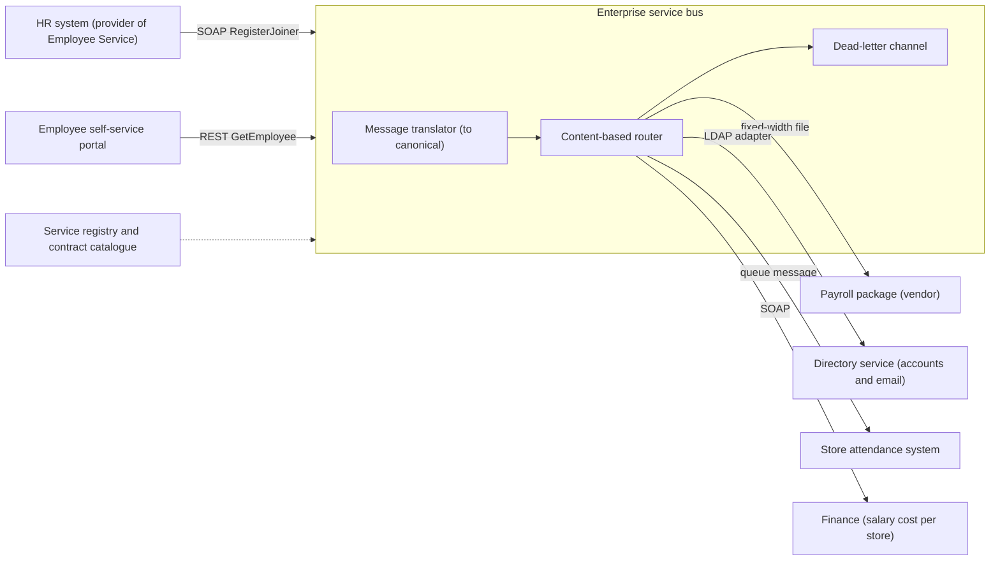
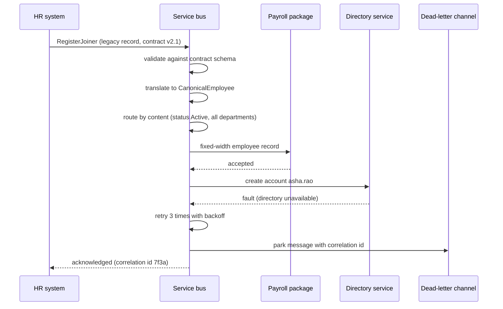

Service-oriented architecture (SOA) is how most large companies first tried to stop their systems from being islands. It is older than microservices, it is often misunderstood, and a lot of it is still running in banks, insurers, telecoms, airlines, retailers and governments. If you join such a company, you will integrate with SOA services in your first month. This lesson explains what SOA is, what an enterprise service bus does, why contracts matter so much, and how all of this differs from microservices.

## Learning objectives

By the end of this lesson you will be able to:

1. Explain SOA in plain words: reusable business services, formal contracts, and loose coupling between whole systems.
2. Describe what an enterprise service bus (ESB) does: routing, transformation, protocol bridging and orchestration.
3. Explain the canonical data model and why it helps and hurts.
4. Design service contracts and tell a compatible change from a breaking one.
5. Implement the core ESB ideas (message translator, content-based router, dead-letter channel) in C#.
6. Compare SOA with microservices on scope, data ownership, communication and governance.
7. Spot the classic SOA failure modes: the ESB bottleneck, business logic in the bus, and "everything goes through the bus".

## Prerequisites

- [Monolithic architecture](#/lesson/m02-monolith): each system in an SOA landscape is often a monolith of its own.
- [Client-server architecture](#/lesson/m02-client-server): request and response between a consumer and a provider.
- [Modular monolith architecture](#/lesson/m02-modular-monolith): contracts and boundaries, one level up.

## Explain it like I'm a beginner

Imagine a large retail group with 12,000 employees: supermarkets, warehouses and a head office. Over 20 years it has bought or built many separate systems:

- An HR system where employees are hired and their details are kept.
- A payroll package (bought from a vendor) that pays salaries.
- A directory (like Active Directory) that creates login accounts and email.
- An attendance system in the stores and warehouses that reads biometric devices.
- A finance system that books salary costs to each store.

When someone joins, **all five** need to know. In the early days, each pair of systems was connected by its own custom script: HR exported a CSV every night for payroll, someone emailed a spreadsheet to IT, attendance copied data from a shared folder. With 5 systems that can be 10 point-to-point links. With 20 systems it can be 190. Each link has its own format, its own bugs and its own owner, who left the company in 2014.

SOA says: **treat each system's useful abilities as a "service" with a published menu, and connect them through a common switchboard.**

- The **service** is like a government office counter: "Employee Service, counter 3: register a joiner, look up an employee, mark an exit". You don't need to know how the office works inside.
- The **contract** is the printed form at the counter. It lists exactly which fields you must fill in, in which format. Everyone uses the same form.
- The **enterprise service bus** is like a central post office. You hand it one letter addressed to "everyone who cares about new joiners". The post office translates it into the language each recipient understands, finds the right addresses, delivers it and keeps a record.

So the HR system publishes "new joiner" once, and the bus takes care of payroll, IT, attendance and finance. Adding a sixth system means connecting it to the bus, not writing five new scripts.

## First-principles explanation

### What it is

**Service-oriented architecture** is an architectural style in which an organisation's capabilities are exposed as **services**: coarse-grained, reusable, business-level functions such as "Customer Service", "Employee Service" or "Payment Service". Consumers use a service only through its **contract** (a formal description of operations, messages and rules), so the provider can change its insides without breaking consumers.

SOA usually works at **enterprise scope**. The services are often whole applications (an ERP module, a CRM, a mainframe) wrapped with a service interface. The goal is reuse and integration across the company.

Its main ideas, sometimes called service principles:

1. **Standardised contracts.** Each service publishes a contract, historically WSDL (Web Services Description Language) with XML Schema for SOAP services. Today it is often OpenAPI for REST.
2. **Loose coupling.** Consumers depend on the contract, not the implementation, location or technology.
3. **Abstraction.** The service hides how it works.
4. **Reusability.** "Get employee" is written once and used by 15 consumers.
5. **Discoverability.** Services are listed in a registry, so teams can find them (historically UDDI, now usually an API catalogue or portal).
6. **Composability.** Bigger business processes are built by combining services ("onboard employee" = create employee + create account + set up payroll).

### Why it exists — the problem

By the late 1990s, large organisations had dozens or hundreds of systems connected point to point. The number of possible links grows roughly as `n × (n − 1) / 2`: 10 systems give 45 possible pairs and 30 systems give 435. Each link had its own:

- **Format**: fixed-width files, CSV, proprietary XML, database dumps.
- **Protocol**: FTP, message queues, database links, HTTP.
- **Timing**: nightly batch, hourly, real time.
- **Semantics**: one system's "status A" means active, another's means approved.

Changing one system meant finding and fixing every script that touched it. SOA and the ESB were a response: standardise the contracts, and put integration logic in one managed place.

### How it works internally

A typical SOA landscape has these parts:

**1. Service providers.** Existing systems expose operations, often via SOAP over HTTP, sometimes via queues (IBM MQ, JMS), sometimes via REST today. A "service" may be a thin wrapper (an adapter) around a 20-year-old system.

**2. Service contracts.** A contract defines:
- operations (`RegisterJoiner`, `GetEmployee`),
- message schemas (fields, types, required or optional),
- error faults,
- policies (security, reliability, transactions; the WS-* family such as WS-Security),
- non-functional promises (a service-level agreement such as "99.5 % availability, 95th percentile under 800 ms").

**3. The enterprise service bus (ESB).** A middleware product that sits between consumers and providers and offers:
- **Routing**: decide where a message goes, by content (content-based router), by type or by subscription.
- **Transformation**: convert between formats (message translator), for example a legacy fixed-width record to XML.
- **Protocol bridging**: receive SOAP over HTTP, deliver to a queue or a file drop.
- **Orchestration**: run a multi-step process ("onboard employee": call HR, then directory, then payroll, compensate on failure).
- **Cross-cutting concerns**: security, logging, monitoring, retries, dead-letter handling.

Examples of ESB-style products include MuleSoft, IBM App Connect (formerly Integration Bus), Oracle Service Bus, WSO2 and Microsoft BizTalk Server (whose 2020 release is the last; Microsoft points new work to Azure Logic Apps). Cloud integration platforms (iPaaS) such as Azure Integration Services (Logic Apps, Service Bus, API Management) now fill much of the same role without a server to run. Their capabilities overlap. Pick by organisational fit, not by brand.

**4. The canonical data model.** Instead of translating every format to every other format (n × n translators), each system translates **to and from one shared enterprise format** (2 × n translators). For 10 systems that is 20 translators instead of up to 90.

**5. Governance.** A central architecture group approves contracts, versions, naming and reuse. SOA without governance quickly becomes a mess of near-duplicate services.

### What happens without it

Without a service layer and contracts, an enterprise lives with "spaghetti integration": hundreds of undocumented scripts, nightly jobs that silently fail, and no one able to answer "which systems will break if we replace payroll?". Mergers and system replacements become multi-year projects.

### When it is useful

- **Enterprise integration** of many existing systems, especially bought packages you can't change (ERP, payroll, CRM).
- **Heterogeneous technology**: mainframes, Java, .NET, vendor products and file-based systems that must interoperate.
- **Regulated domains** that need strong contracts, auditing and central control (banks, insurers, government).
- **Reusable business capabilities** used by many channels (branch, web, mobile, partner).

### When it is unnecessary or wrong

- A single product built by one organisation from scratch. A [modular monolith](#/lesson/m02-modular-monolith) or [microservices](#/lesson/m02-microservices) fit better.
- A small set of systems (two or three) with simple, stable integrations. A direct REST call or a shared queue is enough. An ESB is expensive to license, run and staff.
- Teams that need to release independently many times a day. Central governance and a shared bus slow them down.

### Trade-offs it introduces

| You gain | You pay |
|---|---|
| One place for routing, transformation and monitoring of integrations | The ESB becomes a critical shared dependency, and a bottleneck if overused |
| Fewer point-to-point links (2 × n translators with a canonical model) | The canonical model becomes a huge, slow-changing compromise |
| Reuse of business services across many consumers | Shared services must serve everyone, so changes need coordination |
| Strong contracts and governance | Slower delivery: contract changes go through a central board |
| Integrate systems you cannot change | Specialist skills, licence costs, and hard-to-test bus configurations |

:::callout type=warning title="Smart pipes, dumb endpoints"
The most common SOA failure is putting business logic in the bus: "if the employee is in the Mumbai office and grade is above M3, also notify the regional head". Now nobody can find that rule, it is not unit tested, and only the integration team can change it. Microservices deliberately reversed this into "smart endpoints and dumb pipes". Keep the bus for routing, translation and delivery, and keep business rules in services.
:::

## Visual explanation

### An SOA landscape with an ESB



How to read it: providers and consumers (left) never call each other directly. Every message enters the ESB, is **translated** into the canonical employee format, and is **routed** by its content to the right destinations (right). Each arrow on the right carries a different protocol and format: payroll still wants a fixed-width file, the directory wants an LDAP call, and attendance wants a queue message. The bus bridges all of them. Messages that can't be routed or delivered go to the dead-letter channel, where operators can inspect and replay them. The registry (dotted) tells teams which services and contract versions exist.

### Onboarding a joiner through the bus



The HR system sends one message. The bus validates it against the contract, translates it, and fans it out. Payroll accepts its copy. The directory is down, so the bus retries and then parks the message in the dead-letter channel with a correlation id. The HR system gets an acknowledgement that the bus has taken responsibility, not a promise that every destination succeeded. That distinction matters: an operator must monitor the dead-letter channel, or the new joiner turns up on day one without a login.

## Step-by-step example

We will connect a new HR system to payroll and the directory in five steps.

### Step 1 — the point-to-point starting point

The HR system writes a nightly file `joiners_YYYYMMDD.txt` to a shared folder:

```text
EMP|E1023|ASHA RAO|asha.rao@example.com|FIN|01-10-2026|A
EMP|E1024|RAVI KUMAR|ravi.kumar@example.com|STR|01-10-2026|A
```

A payroll script reads it at 2 a.m. An IT script reads the same file at 3 a.m. and creates accounts. A third script built by the finance team reads it at 4 a.m. If the HR team adds a column, all three break, and nobody notices until salaries are wrong.

### Step 2 — define the service contract

Write the contract that the HR system's Employee Service promises:

| Field | Type | Required | Notes |
|---|---|---|---|
| employeeNumber | string, pattern `E[0-9]{4,6}` | yes | Unique across the group |
| fullName | string, 1–200 chars | yes | Title case |
| email | string, email format | yes | |
| departmentCode | string, 2–5 chars | yes | Must exist in the department list |
| joinedOn | date (ISO 8601) | yes | |
| status | enum Active, Exited | yes | |

Give it a name and version: `EmployeeSync v2.1`. Publish it in the catalogue. Now every consumer depends on this contract, not on the file layout.

### Step 3 — define the canonical model

The canonical `Employee` is the enterprise-wide shape of an employee as it travels through the bus. It is close to the contract above, but owned by the integration architecture group rather than by the HR system.

### Step 4 — translators and routes

- One **inbound translator**: legacy pipe-delimited record → canonical employee.
- One **outbound translator per destination**: canonical → payroll fixed-width, canonical → directory call.
- **Routes**: "status Active → payroll, directory, attendance". "Department STR (store staff) → also store attendance". "No route matched → dead-letter".

### Step 5 — operate it

Add monitoring for dead-lettered messages, an end-to-end correlation id, and a runbook ("directory down: messages are parked, replay after recovery"). Integration is now a managed product, not a set of scripts.

## Production-style C# implementation

Real ESBs are configured products, but their core ideas are small. Here they are as a .NET service that could sit at the edge of an HR system and act as a lightweight integration layer. The patterns are named after Hohpe and Woolf's *Enterprise Integration Patterns*.

```text
Hr.Integration/
  Program.cs
  Canonical/CanonicalEmployee.cs
  Contracts/ServiceContract.cs
  Bus/IntegrationBus.cs
  Bus/LegacyHrRecordTranslator.cs
  Endpoints/FakeEndpoints.cs
```

### The canonical model and envelope

```csharp file=Canonical/CanonicalEmployee.cs
namespace Hr.Integration.Canonical;

public enum EmploymentStatus { Active, Exited }

/// <summary>Enterprise-wide shape of an employee on the bus. Owned by the integration team, not by any one system.</summary>
public sealed record CanonicalEmployee(
    string EmployeeNumber,
    string FullName,
    string Email,
    string DepartmentCode,
    DateOnly JoinedOn,
    EmploymentStatus Status);

/// <summary>Every message travels in an envelope with metadata used for routing, tracing and replay.</summary>
public sealed record Envelope<T>(
    string MessageType,
    string ContractVersion,
    string Source,
    string CorrelationId,
    DateTimeOffset ReceivedAt,
    T Body);
```

### Contracts with versions

```csharp file=Contracts/ServiceContract.cs
namespace Hr.Integration.Contracts;

public sealed record FieldSpec(string Name, string Type, bool Required);

/// <summary>A minimal, machine-readable contract: name, semantic version and fields.
/// Real systems publish this as WSDL/XSD or OpenAPI.</summary>
public sealed record ServiceContract(string Name, int Major, int Minor, IReadOnlyList<FieldSpec> Fields)
{
    public string Version => $"{Major}.{Minor}";

    /// <summary>A consumer built for version X.Y can use any provider with the same major and a minor of at least Y.</summary>
    public bool CanServe(int consumerMajor, int consumerMinor) => Major == consumerMajor && Minor >= consumerMinor;
}

public static class KnownContracts
{
    public static readonly ServiceContract EmployeeSync = new("EmployeeSync", 2, 1,
    [
        new FieldSpec("employeeNumber", "string", Required: true),
        new FieldSpec("fullName", "string", Required: true),
        new FieldSpec("email", "string", Required: true),
        new FieldSpec("departmentCode", "string", Required: true),
        new FieldSpec("joinedOn", "date", Required: true),
        new FieldSpec("status", "enum:Active|Exited", Required: true),
        new FieldSpec("costCentre", "string", Required: false),     // added in 2.1, optional, so not breaking
    ]);
}
```

### The message translator

```csharp file=Bus/LegacyHrRecordTranslator.cs
using System.Globalization;
using Hr.Integration.Canonical;

namespace Hr.Integration.Bus;

public interface IMessageTranslator<in TIn, out TOut>
{
    TOut Translate(TIn input);
}

/// <summary>Message Translator: legacy "EMP|E1023|ASHA RAO|asha.rao@example.com|FIN|01-10-2026|A" to the canonical model.</summary>
public sealed class LegacyHrRecordTranslator : IMessageTranslator<string, CanonicalEmployee>
{
    private static readonly TextInfo Text = CultureInfo.InvariantCulture.TextInfo;

    public CanonicalEmployee Translate(string input)
    {
        ArgumentNullException.ThrowIfNull(input);
        var f = input.Trim().Split('|');
        if (f.Length != 7 || f[0] != "EMP") throw new FormatException($"Expected 7 fields starting with EMP, got {f.Length}.");

        if (!DateOnly.TryParseExact(f[5], "dd-MM-yyyy", CultureInfo.InvariantCulture, DateTimeStyles.None, out var joined))
            throw new FormatException($"Bad joining date '{f[5]}'.");

        var status = f[6] switch
        {
            "A" => EmploymentStatus.Active,
            "X" => EmploymentStatus.Exited,
            _ => throw new FormatException($"Unknown status code '{f[6]}'."),
        };

        return new CanonicalEmployee(
            EmployeeNumber: f[1].Trim(),
            FullName: Text.ToTitleCase(f[2].Trim().ToLowerInvariant()),
            Email: f[3].Trim().ToLowerInvariant(),
            DepartmentCode: f[4].Trim().ToUpperInvariant(),
            JoinedOn: joined,
            Status: status);
    }
}
```

### The bus: routing, delivery, retries and dead-lettering

```csharp file=Bus/IntegrationBus.cs
using System.Collections.Concurrent;
using Hr.Integration.Canonical;

namespace Hr.Integration.Bus;

/// <summary>A destination system behind an adapter (file drop, SOAP client, queue producer...).</summary>
public interface IServiceEndpoint
{
    string Name { get; }
    Task DeliverAsync(Envelope<CanonicalEmployee> message, CancellationToken ct);
}

public sealed record MessageRoute(string Name, Func<Envelope<CanonicalEmployee>, bool> Matches, string EndpointName);

public sealed record DeadLetter(string CorrelationId, string? EndpointName, string Reason, DateTimeOffset At);

public interface IDeadLetterChannel
{
    void Park(DeadLetter letter);
    IReadOnlyCollection<DeadLetter> All { get; }
}

public sealed class InMemoryDeadLetterChannel : IDeadLetterChannel
{
    private readonly ConcurrentQueue<DeadLetter> _letters = new();
    public void Park(DeadLetter letter) => _letters.Enqueue(letter);
    public IReadOnlyCollection<DeadLetter> All => _letters.ToArray();
}

public sealed record DeliveryReport(string CorrelationId, IReadOnlyList<string> Delivered, IReadOnlyList<string> Parked);

/// <summary>Content-Based Router plus guaranteed-delivery basics. No business rules live here.</summary>
public sealed class IntegrationBus(
    IEnumerable<IServiceEndpoint> endpoints,
    IReadOnlyList<MessageRoute> routes,
    IDeadLetterChannel deadLetters,
    TimeProvider clock,
    ILogger<IntegrationBus> logger,
    int maxAttempts = 3)
{
    private readonly Dictionary<string, IServiceEndpoint> _endpoints = endpoints.ToDictionary(e => e.Name, StringComparer.OrdinalIgnoreCase);

    public async Task<DeliveryReport> PublishAsync(Envelope<CanonicalEmployee> message, CancellationToken ct)
    {
        var targets = routes.Where(r => r.Matches(message)).Select(r => r.EndpointName)
                            .Distinct(StringComparer.OrdinalIgnoreCase).ToList();
        var delivered = new List<string>();
        var parked = new List<string>();

        if (targets.Count == 0)
        {
            deadLetters.Park(new DeadLetter(message.CorrelationId, null, "No route matched", clock.GetUtcNow()));
            logger.LogWarning("No route for {MessageType} {CorrelationId}", message.MessageType, message.CorrelationId);
            return new DeliveryReport(message.CorrelationId, delivered, parked);
        }

        foreach (var name in targets)
        {
            if (!_endpoints.TryGetValue(name, out var endpoint))
            {
                deadLetters.Park(new DeadLetter(message.CorrelationId, name, "Unknown endpoint", clock.GetUtcNow()));
                parked.Add(name);
                continue;
            }

            Exception? last = null;
            for (var attempt = 1; attempt <= maxAttempts; attempt++)
            {
                try
                {
                    await endpoint.DeliverAsync(message, ct);
                    last = null;
                    break;
                }
                catch (Exception ex) when (ex is not OperationCanceledException)
                {
                    last = ex;
                    logger.LogWarning(ex, "Delivery to {Endpoint} failed (attempt {Attempt}/{Max}) for {CorrelationId}",
                        name, attempt, maxAttempts, message.CorrelationId);
                }
            }

            if (last is null) delivered.Add(name);
            else
            {
                deadLetters.Park(new DeadLetter(message.CorrelationId, name, last.Message, clock.GetUtcNow()));
                parked.Add(name);
            }
        }
        return new DeliveryReport(message.CorrelationId, delivered, parked);
    }
}
```

The bus knows **where** messages go and **how** to deliver them. It does not know payroll rules or who approves what. A real deployment would also wait between retries (exponential backoff with jitter) and persist the message before acknowledging, so a crash does not lose it. Retries also mean a destination can receive the same message twice (the first attempt may have succeeded but timed out on the way back), so every adapter must be **idempotent**: remember the correlation id and message type it has already applied, and ignore repeats.

### Destination adapters and the host

```csharp file=Endpoints/FakeEndpoints.cs
using System.Collections.Concurrent;
using Hr.Integration.Bus;
using Hr.Integration.Canonical;

namespace Hr.Integration.Endpoints;

/// <summary>Stands in for an adapter that writes the payroll package's fixed-width import file.</summary>
public sealed class PayrollFileEndpoint : IServiceEndpoint
{
    public ConcurrentQueue<string> Lines { get; } = new();
    public string Name => "payroll";

    public Task DeliverAsync(Envelope<CanonicalEmployee> message, CancellationToken ct)
    {
        var e = message.Body;
        // Outbound translator: canonical -> fixed width (number 8, name 30, dept 5, date yyyyMMdd).
        Lines.Enqueue($"{e.EmployeeNumber,-8}{e.FullName,-30}{e.DepartmentCode,-5}{e.JoinedOn:yyyyMMdd}");
        return Task.CompletedTask;
    }
}

/// <summary>Stands in for an adapter that calls the directory to create accounts.</summary>
public sealed class DirectoryEndpoint : IServiceEndpoint
{
    public ConcurrentBag<string> Accounts { get; } = new();
    public string Name => "directory";

    public Task DeliverAsync(Envelope<CanonicalEmployee> message, CancellationToken ct)
    {
        Accounts.Add(message.Body.Email.Split('@')[0]);
        return Task.CompletedTask;
    }
}
```

```csharp file=Program.cs
using Hr.Integration.Bus;
using Hr.Integration.Canonical;
using Hr.Integration.Contracts;
using Hr.Integration.Endpoints;

var builder = WebApplication.CreateBuilder(args);

builder.Services.AddSingleton(TimeProvider.System);
builder.Services.AddSingleton<IDeadLetterChannel, InMemoryDeadLetterChannel>();
builder.Services.AddSingleton<IServiceEndpoint, PayrollFileEndpoint>();
builder.Services.AddSingleton<IServiceEndpoint, DirectoryEndpoint>();
builder.Services.AddSingleton<IMessageTranslator<string, CanonicalEmployee>, LegacyHrRecordTranslator>();
builder.Services.AddSingleton<IReadOnlyList<MessageRoute>>(
[
    new MessageRoute("active-to-payroll", m => m.Body.Status == EmploymentStatus.Active, "payroll"),
    new MessageRoute("active-to-directory", m => m.Body.Status == EmploymentStatus.Active, "directory"),
    new MessageRoute("exits-to-payroll", m => m.Body.Status == EmploymentStatus.Exited, "payroll"),
]);
builder.Services.AddSingleton<IntegrationBus>();

var app = builder.Build();

// The published contract: consumers and providers read this, like a WSDL or OpenAPI document.
app.MapGet("/contracts/employee-sync", () => Results.Ok(KnownContracts.EmployeeSync));

// Inbound channel: the legacy HR system posts its record lines here.
app.MapPost("/channels/employee-sync", async (HttpRequest request, IMessageTranslator<string, CanonicalEmployee> translator,
    IntegrationBus bus, TimeProvider clock, CancellationToken ct) =>
{
    using var reader = new StreamReader(request.Body);
    var raw = await reader.ReadToEndAsync(ct);
    CanonicalEmployee employee;
    try { employee = translator.Translate(raw); }
    catch (FormatException ex) { return Results.Problem(ex.Message, statusCode: StatusCodes.Status400BadRequest); }

    var correlationId = request.Headers["X-Correlation-Id"].FirstOrDefault() ?? Guid.NewGuid().ToString("N");
    var envelope = new Envelope<CanonicalEmployee>("EmployeeChanged", KnownContracts.EmployeeSync.Version,
        "hrms", correlationId, clock.GetUtcNow(), employee);
    var report = await bus.PublishAsync(envelope, ct);
    return Results.Accepted($"/messages/{correlationId}", report);
});

app.Run();
```

`IntegrationBus` has an optional `int maxAttempts` constructor parameter, which the DI container fills with its default value because `int` is not registered. In a real system, bind it from configuration through an options class.

### Classic SOAP in .NET today

Many SOA services are SOAP services with a WSDL. On .NET Framework they were built with WCF. On modern .NET you have two options: host SOAP endpoints with the community-supported **CoreWCF** project, or call existing SOAP services with a generated client (`dotnet-svcutil`). A CoreWCF service contract looks like this (not compiled here because CoreWCF is a NuGet package):

```csharp
[ServiceContract(Namespace = "urn:example:hr:employee-sync:v2")]
public interface IEmployeeSyncService
{
    [OperationContract]
    RegisterJoinerResponse RegisterJoiner(RegisterJoinerRequest request);
}

[DataContract(Namespace = "urn:example:hr:employee-sync:v2")]
public sealed class RegisterJoinerRequest
{
    [DataMember(IsRequired = true)] public string EmployeeNumber { get; set; } = "";
    [DataMember(IsRequired = true)] public string FullName { get; set; } = "";
    [DataMember(IsRequired = false)] public string? CostCentre { get; set; }   // optional in v2.1
}
```

Notice the version in the XML namespace. Changing it signals a breaking change, so consumers on `v2` keep working until they migrate.

## Bad design vs good design

**Bad: the bus that knows everything.** The ESB contains:

- A 600-line orchestration with rules like "if grade ≥ M3 and location = Mumbai, also send to regional head".
- Direct database adapters that read the HR system's tables, bypassing its service.
- A canonical `Employee` with 140 fields, half of them optional and used by one consumer each.
- One shared bus deployment, where a change for finance requires regression testing for 40 integrations.

Problems: business logic hides in configuration that only 2 specialists understand. Reading another system's tables destroys loose coupling. The canonical model changes every month, so every translator changes too. Releases are slow and risky, and the bus is a single point of failure for the whole company.

**Good: a thin bus and owned services.**

- The bus routes, translates, delivers, retries and dead-letters. Nothing else.
- Business rules live in the owning services. The "notify regional head" rule belongs in the HR service, which publishes an event that the bus routes.
- Systems are reached only through their service interfaces or adapters.
- The canonical model is small and versioned. Consumer-specific fields travel in consumer-specific contracts.
- High-volume, latency-sensitive flows can bypass the bus with direct, contract-governed calls.

**Is the improvement worth it?** If you integrate 3 systems, an ESB may itself be over-engineering: a queue and two small adapters are enough. The "good" design matters when there are 10+ systems and several teams.

:::callout type=tradeoff title="The canonical model: help or harm?"
A canonical model cuts translators from up to n × (n − 1) to 2 × n. But it forces every team to agree on one meaning of "employee", and agreement gets slower as the model grows. Keep it small, version it, and allow bounded, consumer-specific contracts where meanings genuinely differ. Domain-driven design calls those different meanings [bounded contexts](#/lesson/m08-bounded-contexts).
:::

### SOA versus microservices

| Aspect | SOA (classic) | Microservices |
|---|---|---|
| Scope | Enterprise-wide integration of many applications | Architecture of one application or product |
| Service size | Coarse: often a whole system or business area | Smaller: one business capability per service |
| Communication | Often through a central ESB ("smart pipes") | Direct HTTP/gRPC or a simple broker ("dumb pipes, smart endpoints") |
| Data | Systems may share databases or a canonical model | Each service owns its data, no shared database |
| Contracts | Formal, centrally governed (WSDL/XSD, WS-*) | Team-owned (OpenAPI, protobuf), consumer-driven tests |
| Governance | Central architecture board | Decentralised, team autonomy with guardrails |
| Deployment | Services often released with their host systems, bus changes centrally | Each service deployed independently, often many times a day |
| Main goal | Reuse and integration | Independent change and deployment |

They share ideas: services, contracts, loose coupling. You can think of microservices as SOA principles applied **inside one product**, with the integration logic moved out of the bus and into the services. Many enterprises run both: microservices inside new products, and an SOA or integration platform connecting those products to ERP, payroll and finance.

## Practical playground

Run the program: it translates two legacy records and routes them. Then add a route that sends employees in department `STR` to a new `attendance` endpoint, and a third record whose status is `Z`. Watch what happens to each message.

:::playground type=csharp title="A tiny service bus"
```csharp file=Program.cs
using System;
using System.Collections.Generic;
using System.Linq;

public sealed record Employee(string Number, string Name, string Dept, string Status);
public sealed record Route(string Name, Func<Employee, bool> Matches, string Endpoint);

public static class Program
{
    static Employee Translate(string line)
    {
        var f = line.Split('|');
        if (f.Length != 7) throw new FormatException("expected 7 fields");
        var status = f[6] switch { "A" => "Active", "X" => "Exited", _ => throw new FormatException($"status {f[6]}") };
        return new Employee(f[1], f[2], f[4], status);
    }

    public static void Main()
    {
        var routes = new List<Route>
        {
            new("active-to-payroll", e => e.Status == "Active", "payroll"),
            new("active-to-directory", e => e.Status == "Active", "directory"),
            new("exits-to-payroll", e => e.Status == "Exited", "payroll"),
        };
        var deadLetters = new List<string>();
        string[] inbound =
        {
            "EMP|E1023|ASHA RAO|asha.rao@example.com|FIN|01-10-2026|A",
            "EMP|E0871|SUNIL MEHTA|sunil.mehta@example.com|STR|15-03-2019|X",
        };

        foreach (var line in inbound)
        {
            Employee e;
            try { e = Translate(line); }
            catch (FormatException ex) { deadLetters.Add($"{line} -> {ex.Message}"); continue; }

            var targets = routes.Where(r => r.Matches(e)).Select(r => r.Endpoint).Distinct().ToList();
            if (targets.Count == 0) { deadLetters.Add($"{e.Number} -> no route"); continue; }
            Console.WriteLine($"{e.Number} ({e.Status}, {e.Dept}) -> {string.Join(", ", targets)}");
        }
        Console.WriteLine($"Dead letters: {deadLetters.Count}");
        deadLetters.ForEach(d => Console.WriteLine("  " + d));
    }
}
```
:::

## Exercises

:::exercise id=m02-soa-ex1 difficulty=beginner kind=code title="Write the inbound message translator"
The legacy HR system sends records like `EMP|E1023|ASHA RAO|asha.rao@example.com|FIN|01-10-2026|A`. Implement `LegacyTranslator.Translate` to produce the canonical employee.
::requirements
- Exactly 7 `|`-separated fields, the first being `EMP`. Otherwise throw `FormatException`.
- Name in title case (`ASHA RAO` becomes `Asha Rao`), email in lower case, department in upper case.
- Date in `dd-MM-yyyy` format becomes a `DateOnly`. An invalid date throws `FormatException`.
- Status `A` is `Active`, `X` is `Exited`. Anything else throws `FormatException`.
- Trim spaces around every field.
::acceptance
- The sample record gives `E1023`, `Asha Rao`, `asha.rao@example.com`, `FIN`, 1 October 2026, `Active`.
- `"EMP|E1|X"` throws `FormatException`.
- A status of `Z` throws `FormatException`.
- A date of `31-02-2026` throws `FormatException`.
::hint
Split on `'|'` and check the field count before anything else.
::hint
`DateOnly.TryParseExact(text, "dd-MM-yyyy", CultureInfo.InvariantCulture, DateTimeStyles.None, out var d)` rejects 31 February.
::hint
`CultureInfo.InvariantCulture.TextInfo.ToTitleCase(name.ToLowerInvariant())` title-cases a name that arrives in capitals.
::hint
A `switch` expression with a discard arm that throws handles the status codes neatly.
::starter
```csharp file=LegacyTranslator.cs
using System;
using System.Globalization;

namespace Integration
{
    public enum EmploymentStatus { Active, Exited }

    public sealed record CanonicalEmployee(string EmployeeNumber, string FullName, string Email,
        string DepartmentCode, DateOnly JoinedOn, EmploymentStatus Status);

    public static class LegacyTranslator
    {
        public static CanonicalEmployee Translate(string record) => throw new NotImplementedException();
    }
}
```
::tests
```csharp file=LegacyTranslatorTests.cs
using System;
using Integration;
using Xunit;

public class LegacyTranslatorTests
{
    [Fact]
    public void Translates_sample_record()
    {
        var e = LegacyTranslator.Translate(" EMP|E1023|ASHA RAO| Asha.Rao@Example.com |fin|01-10-2026|A ");
        Assert.Equal("E1023", e.EmployeeNumber);
        Assert.Equal("Asha Rao", e.FullName);
        Assert.Equal("asha.rao@example.com", e.Email);
        Assert.Equal("FIN", e.DepartmentCode);
        Assert.Equal(new DateOnly(2026, 10, 1), e.JoinedOn);
        Assert.Equal(EmploymentStatus.Active, e.Status);
    }

    [Fact]
    public void Exited_status_is_mapped() =>
        Assert.Equal(EmploymentStatus.Exited, LegacyTranslator.Translate("EMP|E0871|SUNIL MEHTA|s@example.com|STR|15-03-2019|X").Status);

    [Fact]
    public void Wrong_field_count_throws() =>
        Assert.Throws<FormatException>(() => LegacyTranslator.Translate("EMP|E1|X"));

    [Fact]
    public void Wrong_record_type_throws() =>
        Assert.Throws<FormatException>(() => LegacyTranslator.Translate("DEP|E1023|ASHA RAO|a@example.com|FIN|01-10-2026|A"));

    [Fact]
    public void Unknown_status_throws() =>
        Assert.Throws<FormatException>(() => LegacyTranslator.Translate("EMP|E1023|ASHA RAO|a@example.com|FIN|01-10-2026|Z"));

    [Fact]
    public void Impossible_date_throws() =>
        Assert.Throws<FormatException>(() => LegacyTranslator.Translate("EMP|E1023|ASHA RAO|a@example.com|FIN|31-02-2026|A"));
}
```
::solution
```csharp file=LegacyTranslator.cs
using System;
using System.Globalization;

namespace Integration
{
    public enum EmploymentStatus { Active, Exited }

    public sealed record CanonicalEmployee(string EmployeeNumber, string FullName, string Email,
        string DepartmentCode, DateOnly JoinedOn, EmploymentStatus Status);

    public static class LegacyTranslator
    {
        public static CanonicalEmployee Translate(string record)
        {
            ArgumentNullException.ThrowIfNull(record);
            var f = record.Split('|');
            for (var i = 0; i < f.Length; i++) f[i] = f[i].Trim();
            if (f.Length != 7 || f[0] != "EMP") throw new FormatException($"Expected 7 fields starting with EMP, got {f.Length}.");

            if (!DateOnly.TryParseExact(f[5], "dd-MM-yyyy", CultureInfo.InvariantCulture, DateTimeStyles.None, out var joined))
                throw new FormatException($"Bad date '{f[5]}'.");

            var status = f[6] switch
            {
                "A" => EmploymentStatus.Active,
                "X" => EmploymentStatus.Exited,
                _ => throw new FormatException($"Unknown status '{f[6]}'."),
            };

            return new CanonicalEmployee(
                f[1],
                CultureInfo.InvariantCulture.TextInfo.ToTitleCase(f[2].ToLowerInvariant()),
                f[3].ToLowerInvariant(),
                f[4].ToUpperInvariant(),
                joined,
                status);
        }
    }
}
```

All the knowledge about the legacy format lives in this one class. When the HR system is replaced, you write a new inbound translator and every consumer keeps receiving the same canonical message.
::mistakes
- Using `DateTime.Parse` with the machine's culture: `01-10-2026` becomes 10 January on a US-culture server.
- Trimming the whole line but not individual fields.
- Mapping unknown status codes to a default instead of failing, which silently creates wrong data downstream.
:::

:::exercise id=m02-soa-ex2 difficulty=beginner kind=written title="SOA or microservices?"
For each statement, say whether it describes classic **SOA**, **microservices**, or **both**, with a one-line reason.

1. "The payroll package, the CRM and the mainframe each expose a service interface, and an integration platform connects them."
2. "Each service has its own database, and no other service may query it."
3. "Consumers depend on a published contract, not on the implementation."
4. "A central board approves every new field in the canonical customer model."
5. "The order service is deployed 15 times a day by its own team without coordinating with anyone."
6. "Routing and message transformation happen in a central bus."
::acceptance
- All 6 statements classified with a reason.
- At least one answer mentions "smart endpoints, dumb pipes" or the role of the bus.
::hint
Look for scope (enterprise versus one product), data ownership, and where integration logic lives.
::hint
Some ideas, like contracts and loose coupling, belong to both.
::hint
For statement 2, ask whether classic SOA services were required to own their databases. Many wrapped systems that shared one.
::solution
1. **SOA.** Wrapping existing applications as services and integrating them at enterprise scope is the core SOA use case.
2. **Microservices.** Strict per-service data ownership is a defining microservices rule. Classic SOA often tolerated shared databases.
3. **Both.** Contract-first loose coupling is shared.
4. **SOA.** Central governance and a canonical model are typical of SOA. Microservices prefer team-owned contracts.
5. **Microservices.** Independent deployment by an autonomous team is the main goal of microservices.
6. **SOA.** "Smart pipes". Microservices keep pipes dumb (simple brokers) and put logic in the services.
:::

:::exercise id=m02-soa-ex3 difficulty=intermediate kind=code title="Content-based router with a dead-letter channel"
Implement `ContentBasedRouter`. It holds an ordered list of routes (name, predicate, endpoint). `Route(message)` returns the distinct endpoints whose predicate matches, in route order. If nothing matches, or a predicate throws, the message goes to the dead-letter list with a reason.
::requirements
- `AddRoute(string name, Func<Message, bool> predicate, string endpoint)`.
- `IReadOnlyList<string> Route(Message message)` returns distinct endpoint names in the order of the routes.
- No match: record `DeadLetter(message.Id, "no route")` and return an empty list.
- A predicate that throws: record `DeadLetter(message.Id, "route '<name>' failed: <exception message>")`, skip that route, and continue with the others.
::acceptance
- An active employee in `STR` goes to `payroll`, `directory` and `attendance`.
- Two routes to the same endpoint produce it once.
- An unmatched message ends up in `DeadLetters` with reason `no route`.
- A throwing predicate does not stop the other routes.
::hint
Keep routes in a `List<(string Name, Func<Message, bool> Predicate, string Endpoint)>` to preserve order.
::hint
Use a `List<string>` plus a `HashSet<string>` to keep order and remove duplicates.
::hint
Wrap each predicate call in `try/catch`, record the dead letter in the catch, and `continue`.
::hint
Should a message that matched one route but had another route throw also be dead-lettered? Yes: the failed route is a defect someone must look at.
::starter
```csharp file=ContentBasedRouter.cs
using System;
using System.Collections.Generic;

namespace Integration
{
    public sealed record Message(string Id, string Type, string Department, string Status);
    public sealed record DeadLetter(string MessageId, string Reason);

    public sealed class ContentBasedRouter
    {
        public List<DeadLetter> DeadLetters { get; } = new();

        public void AddRoute(string name, Func<Message, bool> predicate, string endpoint) => throw new NotImplementedException();

        public IReadOnlyList<string> Route(Message message) => throw new NotImplementedException();
    }
}
```
::tests
```csharp file=ContentBasedRouterTests.cs
using System;
using Integration;
using Xunit;

public class ContentBasedRouterTests
{
    private static ContentBasedRouter Standard()
    {
        var r = new ContentBasedRouter();
        r.AddRoute("active-payroll", m => m.Status == "Active", "payroll");
        r.AddRoute("active-directory", m => m.Status == "Active", "directory");
        r.AddRoute("store-staff", m => m.Department == "STR", "attendance");
        r.AddRoute("exits", m => m.Status == "Exited", "payroll");
        return r;
    }

    [Fact]
    public void Active_store_employee_goes_to_three_endpoints() =>
        Assert.Equal(new[] { "payroll", "directory", "attendance" }, Standard().Route(new Message("m1", "EmployeeChanged", "STR", "Active")));

    [Fact]
    public void Duplicate_endpoints_are_removed()
    {
        var r = new ContentBasedRouter();
        r.AddRoute("a", m => true, "payroll");
        r.AddRoute("b", m => true, "payroll");
        Assert.Equal(new[] { "payroll" }, r.Route(new Message("m2", "T", "FIN", "Active")));
    }

    [Fact]
    public void Unmatched_message_is_dead_lettered()
    {
        var r = Standard();
        var result = r.Route(new Message("m3", "EmployeeChanged", "FIN", "Suspended"));
        Assert.Empty(result);
        var dl = Assert.Single(r.DeadLetters);
        Assert.Equal("m3", dl.MessageId);
        Assert.Equal("no route", dl.Reason);
    }

    [Fact]
    public void Throwing_predicate_is_isolated()
    {
        var r = new ContentBasedRouter();
        r.AddRoute("broken", m => throw new InvalidOperationException("boom"), "finance");
        r.AddRoute("ok", m => true, "payroll");
        Assert.Equal(new[] { "payroll" }, r.Route(new Message("m4", "T", "FIN", "Active")));
        var dl = Assert.Single(r.DeadLetters);
        Assert.Equal("route 'broken' failed: boom", dl.Reason);
    }
}
```
::solution
```csharp file=ContentBasedRouter.cs
using System;
using System.Collections.Generic;

namespace Integration
{
    public sealed record Message(string Id, string Type, string Department, string Status);
    public sealed record DeadLetter(string MessageId, string Reason);

    public sealed class ContentBasedRouter
    {
        private readonly List<(string Name, Func<Message, bool> Predicate, string Endpoint)> _routes = new();
        public List<DeadLetter> DeadLetters { get; } = new();

        public void AddRoute(string name, Func<Message, bool> predicate, string endpoint) =>
            _routes.Add((name, predicate, endpoint));

        public IReadOnlyList<string> Route(Message message)
        {
            var result = new List<string>();
            var seen = new HashSet<string>(StringComparer.OrdinalIgnoreCase);
            var anyFailure = false;

            foreach (var (name, predicate, endpoint) in _routes)
            {
                bool matches;
                try { matches = predicate(message); }
                catch (Exception ex)
                {
                    DeadLetters.Add(new DeadLetter(message.Id, $"route '{name}' failed: {ex.Message}"));
                    anyFailure = true;
                    continue;
                }
                if (matches && seen.Add(endpoint)) result.Add(endpoint);
            }

            if (result.Count == 0 && !anyFailure) DeadLetters.Add(new DeadLetter(message.Id, "no route"));
            return result;
        }
    }
}
```

The router decides only *where* a message goes. Notice that the predicates test simple message properties. Once a predicate starts calling other services or encoding business policy ("grade above M3 in Mumbai"), that logic belongs in a service, not in the router.
::mistakes
- Letting a single bad predicate throw out of `Route`, which blocks every message of that type.
- Silently dropping unmatched messages. Unroutable messages are usually configuration errors and must be visible.
- Using a `HashSet` alone, which loses route order.
:::

:::exercise id=m02-soa-ex4 difficulty=intermediate kind=code title="Is this contract change breaking?"
Contract owners want a tool that compares two versions of a contract and says whether the change is breaking for existing consumers. Implement `ContractDiff.Compare(old, next)`.
::requirements
Each contract is a list of `Field(Name, Type, Required)`. Report a `Change` for each of these, comparing names case-insensitively:
- Field removed: breaking.
- Field type changed: breaking.
- Optional field became required: breaking.
- New required field: breaking (old producers do not send it).
- New optional field: not breaking.
- Required field became optional: not breaking for this exercise.

`RequiredBump(changes)` returns `"major"` if any change is breaking, `"minor"` if there are only non-breaking changes, and `"none"` if there are no changes.
::acceptance
- Adding optional `costCentre` gives one non-breaking change and a `"minor"` bump.
- Removing `email` gives a breaking change and a `"major"` bump.
- Changing `joinedOn` from `date` to `string` is breaking.
- Identical contracts give no changes and `"none"`.
::hint
Build a dictionary of old fields by name and a dictionary of new fields by name, both with `StringComparer.OrdinalIgnoreCase`.
::hint
Loop over the old fields to find removals and modifications. Loop over the new fields to find additions.
::hint
A single field can have both a type change and an optional-to-required change. Reporting both is fine.
::starter
```csharp file=ContractDiff.cs
using System;
using System.Collections.Generic;
using System.Linq;

namespace Integration
{
    public sealed record Field(string Name, string Type, bool Required);
    public sealed record Change(string Field, string Description, bool Breaking);

    public static class ContractDiff
    {
        public static IReadOnlyList<Change> Compare(IReadOnlyList<Field> old, IReadOnlyList<Field> next) => throw new NotImplementedException();

        public static string RequiredBump(IReadOnlyList<Change> changes) => throw new NotImplementedException();
    }
}
```
::tests
```csharp file=ContractDiffTests.cs
using System.Linq;
using Integration;
using Xunit;

public class ContractDiffTests
{
    private static readonly Field[] V2 =
    {
        new("employeeNumber", "string", true),
        new("fullName", "string", true),
        new("email", "string", true),
        new("joinedOn", "date", true),
        new("nickname", "string", false),
    };

    [Fact]
    public void Identical_contracts_have_no_changes()
    {
        var changes = ContractDiff.Compare(V2, V2.ToArray());
        Assert.Empty(changes);
        Assert.Equal("none", ContractDiff.RequiredBump(changes));
    }

    [Fact]
    public void New_optional_field_is_minor()
    {
        var changes = ContractDiff.Compare(V2, V2.Append(new Field("costCentre", "string", false)).ToArray());
        var c = Assert.Single(changes);
        Assert.False(c.Breaking);
        Assert.Equal("minor", ContractDiff.RequiredBump(changes));
    }

    [Fact]
    public void Removed_field_is_major()
    {
        var changes = ContractDiff.Compare(V2, V2.Where(f => f.Name != "email").ToArray());
        Assert.True(Assert.Single(changes).Breaking);
        Assert.Equal("major", ContractDiff.RequiredBump(changes));
    }

    [Fact]
    public void Type_change_is_breaking()
    {
        var next = V2.Select(f => f.Name == "joinedOn" ? f with { Type = "string" } : f).ToArray();
        var c = Assert.Single(ContractDiff.Compare(V2, next));
        Assert.Equal("joinedOn", c.Field);
        Assert.True(c.Breaking);
    }

    [Fact]
    public void Optional_to_required_and_new_required_are_breaking()
    {
        var next = V2.Select(f => f.Name == "nickname" ? f with { Required = true } : f)
                     .Append(new Field("panNumber", "string", true)).ToArray();
        var changes = ContractDiff.Compare(V2, next);
        Assert.Equal(2, changes.Count);
        Assert.All(changes, c => Assert.True(c.Breaking));
    }

    [Fact]
    public void Names_are_compared_case_insensitively() =>
        Assert.Empty(ContractDiff.Compare(V2, V2.Select(f => f with { Name = f.Name.ToUpperInvariant() }).ToArray()));
}
```
::solution
```csharp file=ContractDiff.cs
using System;
using System.Collections.Generic;
using System.Linq;

namespace Integration
{
    public sealed record Field(string Name, string Type, bool Required);
    public sealed record Change(string Field, string Description, bool Breaking);

    public static class ContractDiff
    {
        public static IReadOnlyList<Change> Compare(IReadOnlyList<Field> old, IReadOnlyList<Field> next)
        {
            var before = old.ToDictionary(f => f.Name, StringComparer.OrdinalIgnoreCase);
            var after = next.ToDictionary(f => f.Name, StringComparer.OrdinalIgnoreCase);
            var changes = new List<Change>();

            foreach (var o in old)
            {
                if (!after.TryGetValue(o.Name, out var n)) { changes.Add(new(o.Name, "removed", true)); continue; }
                if (!string.Equals(o.Type, n.Type, StringComparison.OrdinalIgnoreCase))
                    changes.Add(new(o.Name, $"type {o.Type} -> {n.Type}", true));
                if (!o.Required && n.Required) changes.Add(new(o.Name, "optional -> required", true));
                if (o.Required && !n.Required) changes.Add(new(o.Name, "required -> optional", false));
            }

            foreach (var n in next.Where(n => !before.ContainsKey(n.Name)))
                changes.Add(new(n.Name, n.Required ? "added (required)" : "added (optional)", n.Required));

            return changes;
        }

        public static string RequiredBump(IReadOnlyList<Change> changes) =>
            changes.Count == 0 ? "none" : changes.Any(c => c.Breaking) ? "major" : "minor";
    }
}
```

Run this in the contract repository's CI. A pull request that changes a contract without the matching version bump fails. This is the same idea as OpenAPI diff tools and protobuf breaking-change checkers.
::alternatives
Whether "required → optional" breaks things depends on direction. For a **request** contract it is safe (the provider accepts more). For a **response** contract it can break consumers that assumed the field is always present. Production tools track direction for each message.
::mistakes
- Comparing lists by position instead of by name, so reordering looks like a change.
- Treating every added field as safe. A new **required** field breaks every existing producer.
:::

:::exercise id=m02-soa-ex5 difficulty=advanced kind=hld title="Rescue an overloaded ESB"
A large engineering group runs one ESB cluster for all integrations. The employee self-service portal reads employee profiles through the bus (about 400 requests/s at peak, an estimate from logs), and the bus also runs a nightly 2-hour payroll file transfer and 35 other flows. Peak latency for profile reads is 2.5 s, and during the payroll batch the portal times out. The bus also contains a 600-line onboarding orchestration with business rules. Redesign the landscape so the portal is fast, the batch can't hurt it, and business rules move out of the bus.
::acceptance
- Real-time reads no longer flow through the shared bus, or are isolated from batch traffic.
- Batch file transfers are separated from interactive traffic.
- Onboarding rules live in a service that the business team owns, with events driving downstream systems.
- The bus keeps the integrations that need translation for vendor systems.
- Notes explain what happens when the bus is down.
::hint
Which traffic actually needs translation or protocol bridging? Profile reads are plain JSON from the HR system.
::hint
Isolation can be physical: separate bus instances or worker pools for batch and real-time flows.
::hint
Think about a cache or read model for the portal, so 400 reads/s do not all hit the HR system.
::hint
For onboarding, the HR service can publish an `EmployeeJoined` event to a broker. The bus subscribes and translates for the vendor payroll package.
::hint
Shape: portal → API gateway → profile API (with cache) → HR DB replica. HR service → broker → bus adapters → payroll, directory. Batch on its own worker.
::starter
```json
{
  "nodes": [
    { "id": "portal", "type": "client", "label": "Self-service portal", "props": { "rps": 400 } },
    { "id": "esb", "type": "app-server", "label": "Shared ESB cluster (routing + orchestration + batch)", "props": { "instances": 2 } },
    { "id": "hr", "type": "app-server", "label": "HR system" },
    { "id": "hrdb", "type": "database", "label": "HR database" },
    { "id": "pay", "type": "external", "label": "Payroll package" },
    { "id": "dir", "type": "external", "label": "Directory" }
  ],
  "edges": [
    { "from": "portal", "to": "esb", "kind": "sync" },
    { "from": "esb", "to": "hr", "kind": "sync" },
    { "from": "hr", "to": "hrdb", "kind": "sync" },
    { "from": "esb", "to": "pay", "kind": "async", "label": "nightly file" },
    { "from": "esb", "to": "dir", "kind": "sync" }
  ]
}
```
::solution
Reference architecture:

```json
{
  "nodes": [
    { "id": "portal", "type": "client", "label": "Self-service portal", "props": { "rps": 400 } },
    { "id": "gw", "type": "api-gateway", "label": "API gateway (auth, rate limits)" },
    { "id": "profile", "type": "app-server", "label": "Employee profile API (owned by HR team)", "props": { "instances": 3 } },
    { "id": "cache", "type": "cache", "label": "Profile cache", "props": { "ttlSeconds": 300 } },
    { "id": "replica", "type": "read-replica", "label": "HR DB read replica", "props": { "replicas": 1 } },
    { "id": "hr", "type": "app-server", "label": "HR service (onboarding rules)", "props": { "instances": 2 } },
    { "id": "hrdb", "type": "database", "label": "HR database", "props": { "multiAz": true } },
    { "id": "broker", "type": "queue", "label": "Event broker (EmployeeJoined, EmployeeExited)" },
    { "id": "esbrt", "type": "app-server", "label": "Integration bus: real-time adapters", "props": { "instances": 2 } },
    { "id": "batch", "type": "worker", "label": "Batch integration workers (payroll files)", "props": { "instances": 1 } },
    { "id": "sched", "type": "scheduler", "label": "Batch scheduler" },
    { "id": "pay", "type": "external", "label": "Payroll package" },
    { "id": "dir", "type": "external", "label": "Directory" },
    { "id": "mon", "type": "monitoring", "label": "Dead-letter and flow monitoring" }
  ],
  "edges": [
    { "from": "portal", "to": "gw", "kind": "sync" },
    { "from": "gw", "to": "profile", "kind": "sync" },
    { "from": "profile", "to": "cache", "kind": "sync" },
    { "from": "profile", "to": "replica", "kind": "sync", "label": "on cache miss" },
    { "from": "hr", "to": "hrdb", "kind": "sync" },
    { "from": "hrdb", "to": "replica", "kind": "async", "label": "replication" },
    { "from": "hr", "to": "broker", "kind": "async", "label": "EmployeeJoined (outbox)" },
    { "from": "broker", "to": "esbrt", "kind": "async" },
    { "from": "esbrt", "to": "dir", "kind": "sync", "label": "LDAP adapter" },
    { "from": "esbrt", "to": "pay", "kind": "sync", "label": "joiner API" },
    { "from": "sched", "to": "batch", "kind": "async" },
    { "from": "batch", "to": "pay", "kind": "async", "label": "nightly file" },
    { "from": "esbrt", "to": "mon", "kind": "async" },
    { "from": "batch", "to": "mon", "kind": "async" }
  ]
}
```

Reasoning:

- **Profile reads leave the bus.** They need no translation, so a team-owned profile API behind the gateway serves them, with a 5-minute cache and a read replica. If 90 % of reads hit the cache (an assumption to verify), the replica sees about 40 reads/s.
- **Batch is isolated.** Payroll files run on their own workers and schedule, so a 2-hour batch can't starve interactive traffic.
- **Rules move to the HR service.** Onboarding logic becomes code owned and unit-tested by the HR team. The service writes `EmployeeJoined` to an outbox in the same transaction and publishes it to a broker.
- **The bus does what it is good at.** Real-time adapters translate events into the directory's LDAP calls and the payroll package's API. Failures go to a monitored dead-letter channel.
- **Bus down:** events wait in the broker, and the portal and HR service keep working. Joiners get accounts late, not never. Before the change, a bus outage stopped the portal entirely.
::mistakes
- Scaling the ESB cluster to 10 nodes and keeping all traffic on it: the batch still competes with reads, and the cost grows.
- Moving the orchestration into another central "process engine" without changing ownership. The rules are still owned by the integration team.
:::

## Automated testing

Integration layers are notoriously under-tested because the logic hides in configuration. Keep it in code and test it at four levels.

**1. Translators** are pure functions: fixture input in, canonical model out. Keep a folder of real (anonymised) sample messages from each system and run every one through the translator in a `[Theory]`.

**2. Routing rules** are tested with small envelopes: "an active STR employee goes to payroll, directory and attendance". Routing tables change often, so these tests catch accidental breakage.

**3. Contract tests.** Check every published contract change with a diff tool (exercise 4) and fail CI on an unversioned breaking change. For consumer-provider pairs, use **consumer-driven contract tests**: each consumer publishes the fields and examples it relies on, and the provider's build verifies them. Pact is a well-known tool for this.

**4. Delivery behaviour** with fake endpoints:

```csharp
public class IntegrationBusTests
{
    private sealed class FlakyEndpoint(int failuresBeforeSuccess) : IServiceEndpoint
    {
        public int Calls;
        public string Name => "directory";
        public Task DeliverAsync(Envelope<CanonicalEmployee> m, CancellationToken ct) =>
            ++Calls <= failuresBeforeSuccess ? throw new TimeoutException("slow") : Task.CompletedTask;
    }

    [Fact]
    public async Task Parks_message_after_three_failed_attempts()
    {
        var endpoint = new FlakyEndpoint(failuresBeforeSuccess: 10);
        var dlq = new InMemoryDeadLetterChannel();
        var bus = new IntegrationBus(new[] { endpoint }, new[] { new MessageRoute("all", _ => true, "directory") },
            dlq, TimeProvider.System, NullLogger<IntegrationBus>.Instance);

        var report = await bus.PublishAsync(SampleEnvelope(), CancellationToken.None);

        Assert.Equal(3, endpoint.Calls);
        Assert.Equal(new[] { "directory" }, report.Parked);
        Assert.Single(dlq.All);
    }
}
```

Also run a small number of end-to-end tests against test instances of the vendor systems, with correlation ids so you can trace a single message across every hop.

## Real-world application

- **Banking and insurance.** Core banking systems, often decades old, expose services such as "get account balance" or "post transaction" through a service layer, and channels (branch, internet banking, mobile, partner APIs) reuse them. Integration platforms translate between modern JSON APIs and older message formats.
- **Government platforms.** Many e-governance systems integrate departments (land records, tax, identity, payments) through service gateways with formal contracts, because each department runs its own system and changes on its own schedule.
- **Large retail and airline groups.** HR, payroll, finance, procurement and point-of-sale or crew-rostering systems are often bought packages. An integration platform keeps employee, supplier and store master data in sync and feeds salary costs from payroll to each store's or route's accounts.
- **Hybrid landscapes.** A company may build a new product as microservices and still use its SOA or integration platform to talk to ERP and payroll. An [anti-corruption layer](#/lesson/m16-strangler-acl) often sits between the two worlds.
- **Modern successors.** API gateways, event brokers (Kafka, RabbitMQ) and integration-platform-as-a-service products took over many ESB jobs. The patterns (translator, router, dead-letter channel, canonical model) are the same, which is why Enterprise Integration Patterns is still a standard reference.

## Interview questions

:::interview
::q beginner
What is service-oriented architecture?
::a
An architectural style where an organisation's capabilities are exposed as reusable business services with formal contracts. Consumers depend only on the contract, so providers can change their implementation. SOA is typically used to integrate many existing applications across an enterprise, often through an enterprise service bus that routes and transforms messages.
::q beginner
What does an enterprise service bus do?
::a
It is integration middleware between consumers and providers. Its main jobs are routing (by content or subscription), transformation between formats, protocol bridging (for example SOAP in, queue or file out), and cross-cutting concerns such as security, monitoring, retries and dead-lettering. Many ESBs also do orchestration, which is where business logic tends to creep in.
::q intermediate
How is SOA different from microservices?
::a
Scope: SOA integrates many applications across an enterprise, while microservices structure one product. Communication: SOA often uses a central smart bus, while microservices use smart endpoints and dumb pipes. Data: SOA often tolerates shared databases or a canonical model, while microservices require each service to own its data. Governance: SOA is central, microservices are team-owned with guardrails. Goal: SOA focuses on reuse and integration, microservices on independent deployment. They share contract-first loose coupling.
::q intermediate
What is a canonical data model, and what are its risks?
::a
A shared, enterprise-wide representation of key entities (employee, customer) that every system translates to and from. It reduces translators from up to n × (n − 1) to 2 × n. Risks: it becomes a huge compromise that serves no one well, every change needs agreement across many teams, it hides real differences in meaning between departments, and it changes slowly. Mitigations: keep it small, version it, and allow bounded, consumer-specific contracts.
::q advanced
Your ESB has become a bottleneck and a single point of failure. How do you fix it without a big-bang rewrite?
::a
First measure which flows go through it and why. Then: (1) move flows that need no translation (plain JSON reads between modern systems) to direct, contract-governed APIs behind a gateway; (2) isolate batch from real-time traffic with separate workers or clusters; (3) move business rules from bus orchestrations into owning services, which then publish events; (4) use a durable broker so outages delay rather than block; (5) keep the bus for vendor adapters and translation. Do it flow by flow, like a strangler fig migration, with monitoring and rollback for each flow.
::q advanced
A provider must rename a required field in a contract used by 12 consumers. How do you roll it out?
::a
Treat it as a breaking change and use expand-and-contract. Publish a new minor version that adds the new field (optional) and keeps the old one, filling both. Announce the deprecation with a date. Track consumers through the registry or traffic logs, and ask each one to move to the new field (consumer-driven contract tests show who still depends on the old one). When usage reaches zero, publish the next major version without the old field. Alternatively run v2 and v3 endpoints side by side, with the bus translating between them during migration. Never rename in place.
:::

## Summary and revision

**Key takeaways**

- SOA exposes business capabilities as reusable services with formal contracts, mainly to integrate many systems across an enterprise.
- The ESB routes, translates, bridges protocols and handles delivery problems. Keep business rules out of it.
- A canonical data model reduces translators but becomes a bottleneck if it grows without limits.
- Contracts need versions and a clear policy for breaking and non-breaking changes. Automate the check.
- Microservices share SOA's contract-first loose coupling, but apply it inside one product with team-owned data and dumb pipes.
- Watch for the classic failures: the bus as bottleneck, logic in the bus, shared databases behind services, and governance that blocks delivery.

**Terminology**: service, service contract, WSDL, SOAP, ESB, canonical data model, message translator, content-based router, dead-letter channel, orchestration, service registry, governance.

:::flashcards
Q: What is SOA's main goal?
A: Integrating and reusing business capabilities across an enterprise through services with formal contracts.
Q: Four core jobs of an ESB?
A: Routing, transformation, protocol bridging, and cross-cutting delivery concerns (security, monitoring, retries, dead-letters).
Q: "Smart pipes" versus "smart endpoints"?
A: Classic SOA puts logic in the bus (smart pipes). Microservices keep the transport simple and put logic in the services (smart endpoints).
Q: Translators needed for n systems with and without a canonical model?
A: About 2 × n with a canonical model, up to n × (n − 1) point to point.
Q: Name three breaking contract changes.
A: Removing a field, changing a field's type, and adding a required field (or making an optional field required).
Q: What does a dead-letter channel hold?
A: Messages that could not be routed or delivered after retries, kept for inspection and replay.
Q: How do you call an existing SOAP service from modern .NET?
A: Generate a client with dotnet-svcutil. To host SOAP services on modern .NET, use CoreWCF.
:::

## Knowledge check

:::quiz pass=70
::q single
A company has 14 systems connected point to point with nightly files. Replacing payroll is estimated at 18 months, mostly for rewriting integrations. Which SOA idea addresses this most directly?
- [ ] Deploying each system 10 times a day.
- [x] Published service contracts and a canonical model, so systems integrate through stable interfaces and translators.
- [ ] Moving all systems into one database.
- [ ] Rewriting every system as microservices.
> Contracts and translators isolate each system's format, so replacing one means writing new translators instead of changing every consumer.
::q single
Where should the rule "for grade M3 and above in the Mumbai office, also notify the regional head" live?
- [ ] In an ESB orchestration.
- [x] In the HR service that owns onboarding, which can publish an event for the bus to route.
- [ ] In the payroll package.
- [ ] In the canonical data model.
> Business rules belong in the owning service, where they can be tested and changed by the business team. The bus should only route and translate.
::q multi
Which contract changes are breaking for existing consumers or producers? (Select all that apply.)
- [x] Removing a field consumers read.
- [ ] Adding a new optional field.
- [x] Changing `joinedOn` from a date to a free-text string.
- [x] Adding a new required field to a request message.
> New optional fields are safe. Removals, type changes and new required fields break existing participants.
::q single
The ESB returns "acknowledged" to the HR system, but the directory service was down and the message was dead-lettered. What does the acknowledgement mean?
- [ ] Every destination has processed the message.
- [x] The bus has accepted responsibility for the message, and delivery problems must be handled through monitoring and replay.
- [ ] The HR system should resend the message.
- [ ] The message has been lost.
> An asynchronous acknowledgement transfers responsibility, not completion. Someone must watch the dead-letter channel.
::q single
Which statement best captures the difference between SOA and microservices?
- [ ] Microservices use HTTP and SOA never does.
- [ ] SOA services are always smaller than microservices.
- [x] SOA usually integrates many applications across an enterprise through a central bus, while microservices structure one product as independently deployable services that own their data.
- [ ] They are the same thing with different names.
> Protocol is not the difference. Scope, data ownership, governance and where integration logic lives are.
::q single
A startup with one product and two integrations (a payment gateway and an email provider) asks whether to buy an ESB. Best advice?
- [ ] Yes, an ESB is required for any integration.
- [x] No. Call the two providers directly through small adapters, with retries and a queue if needed.
- [ ] Yes, but only with a canonical data model.
- [ ] No, because SOAP is obsolete.
> An ESB earns its cost when many heterogeneous systems need integrating. Two well-defined APIs don't need one.
::q single
Your canonical `Customer` model has grown to 180 fields and every change needs approval from 9 teams. What is the best direction?
- [ ] Add more fields so every team is covered.
- [x] Shrink the canonical core and allow bounded, consumer-specific contracts for data whose meaning differs between departments.
- [ ] Remove versioning to move faster.
- [ ] Let each team edit the canonical model directly.
> A small, versioned core plus bounded contracts keeps agreement cheap. This is the same idea as bounded contexts in DDD.
:::

## Completion criteria

You have finished this lesson when you can:

- [ ] Score at least 70 % on the knowledge check.
- [ ] Complete exercises 1 and 3 and see their tests pass.
- [ ] Explain with a diagram what an ESB does in an onboarding flow, including failure handling.
- [ ] Classify a contract change as breaking or not, and say what version bump it needs.
- [ ] Compare SOA and microservices on at least five aspects in under two minutes.
