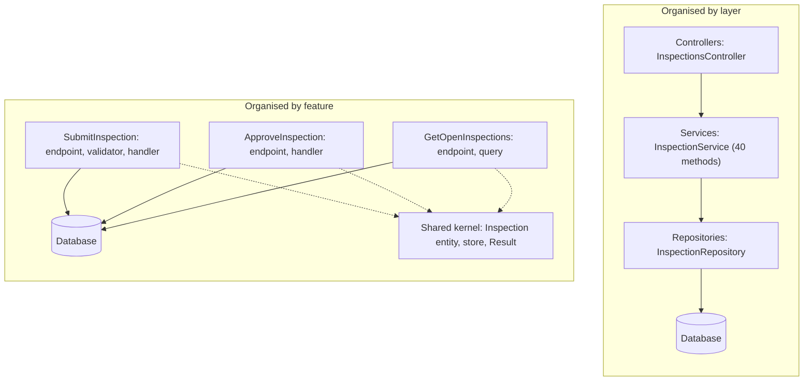
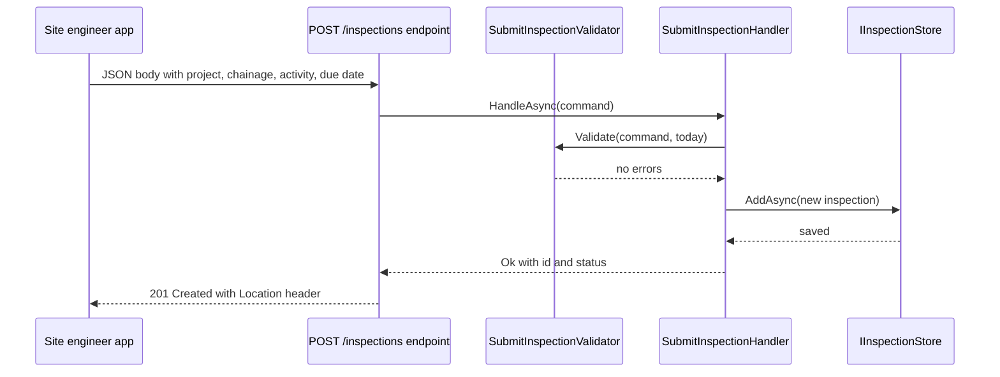
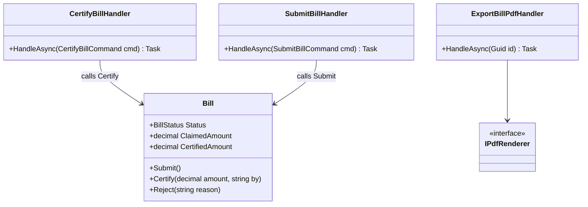

Most of us learn to build web apps in layers: controllers in one folder, services in another, repositories in a third. That works. But when you add one feature, you end up touching five folders and three shared classes. Vertical Slice Architecture flips the organisation: **one folder per feature, holding everything that feature needs.**

This is an introductory lesson. We build a small inspection-request API for a road project, compare it with the layered version, and learn when slices help and when they don't. The deeper DDD-flavoured version is in [Vertical slice architecture in practice](#/lesson/m08-vertical-slice).

## Learning objectives

By the end of this lesson you will be able to:

1. Explain the difference between organising code by technical layer and by feature (vertical slice).
2. Build an ASP.NET Core minimal API where each use case is one slice: request, validator, handler and endpoint mapping.
3. Decide what belongs in a slice and what belongs in a small shared kernel.
4. Add cross-cutting behaviour (validation, logging) once, without copying it into every slice.
5. Write tests per slice, and an architecture test that stops slices from reaching into each other.
6. Recognise when vertical slices are overkill and plain layers are the simpler choice.

## Prerequisites

- [Layered architecture](#/lesson/m02-layered): you should know what presentation, business and data layers are, because we compare against them.
- [Clean Architecture and Onion Architecture](#/lesson/m02-clean-onion): helpful for understanding what slices keep from those styles and what they drop.
- [Dependency injection](#/lesson/m03-dependency-injection): each handler is registered in the DI container.

You can still follow if you have only built one ASP.NET Core API. Read the beginner section first.

## Explain it like I'm a beginner

Think of a large hospital. One way to organise it is by **job type**: all the receptionists sit on floor 1, all the nurses on floor 2, all the doctors on floor 3, all the lab technicians on floor 4. A patient with a broken arm visits floor 1, then 3, then 4, then 2, then 3 again. Every patient walks through every floor.

Another way is by **department**: the orthopaedics wing has its own reception desk, nurses, doctors and X-ray room. The broken-arm patient stays in one wing. If orthopaedics changes how it books X-rays, cardiology doesn't notice.

Software can be organised the same two ways.

- **By technical layer (horizontal layers):** `Controllers/`, `Services/`, `Repositories/`, `Models/`. Every feature is spread across all of them.
- **By feature (vertical slices):** `Features/SubmitInspection/`, `Features/ApproveInspection/`, `Features/GetOpenInspections/`. Each folder has its own request type, rules and data access.

A "slice" is called *vertical* because, if you draw the layers as horizontal bands (UI on top, database at the bottom), one feature cuts straight down through all of them, like a slice of layered cake.

The core rule is short: **things that change together should live together.** When a site engineer asks "add a photo to the inspection request", you open one folder, not five.

## First-principles explanation

### What it is

Vertical Slice Architecture (VSA) is a way of organising an application around **use cases** (the things a user does, such as "submit an inspection request") instead of around technical roles. Each slice contains the code for one request from the edge of the system to the database and back. Slices share as little as possible. Each one is free to choose its own approach: one slice may use a rich domain object, another may run one SQL query and return a flat list.

The name and the modern popularity come mainly from Jimmy Bogard's writing, but the underlying idea is older: "package by feature" and the principle of **high cohesion, low coupling** (see [Coupling, cohesion, modularity and separation of concerns](#/lesson/m02-coupling-cohesion)).

### Why it exists — the problem with layers at scale

Layers are not wrong. They solve a real problem: keeping UI code out of database code. But in a growing business application, three costs appear.

1. **Changes are scattered.** A typical feature request ("let engineers reject an inspection with a reason") touches the controller, a DTO, the service interface, the service class, the repository interface, the repository class and a mapper. That is 7 files in 5 folders for one change.
2. **Shared services grow into god classes.** `InspectionService` starts with 3 methods. Two years later it has 40, injects 12 dependencies, and every feature's tests must construct all 12. A change for one feature can break another, because they share private helper methods.
3. **Abstractions that nobody needed.** Every repository method is one-to-one with a service method, which is one-to-one with a controller action. The layers pass data down and back up without adding logic. You pay for the indirection on every change.

Vertical slices attack all three: one change is in one folder, there is no shared service to grow, and each slice adds an abstraction only where it actually helps.

### How it works

A slice usually has four small parts. In C# they often sit in one file or one folder:

| Part | Job | Example |
|---|---|---|
| **Request** (command or query) | The input data for this use case | `SubmitInspectionCommand(ProjectCode, Chainage, Activity, DueBy)` |
| **Validator** | Rejects bad input before any work | Chainage must look like `12+400` |
| **Handler** | Does the work: loads data, applies rules, saves | Creates the inspection, saves it, returns its id |
| **Endpoint** | Maps HTTP to the handler | `POST /inspections` |

Requests that **change** data are commands; requests that only **read** are queries. This split is a light form of CQRS (separating reads from writes, covered in [CQRS fundamentals](#/lesson/m08-cqrs-fundamentals)). It matters because the two kinds have different needs. A command needs validation, business rules and a transaction. A query needs a fast projection, often straight from the database into a response record, with no domain object at all.

Not everything goes in slices. A small **shared kernel** holds things that are truly common: the database context or store, the domain entities that several slices change, a `Result` type, authentication setup. The test for "shared or not" is simple: *would a change to this code be correct for every slice that uses it?* If yes, share it. If it would only be correct for some, copy it or keep it in the slice.

### Coupling within a slice, not across slices

In a layered app, coupling runs **horizontally**: all controllers depend on all services through shared interfaces. In VSA, coupling runs **vertically**: the parts of one slice are tightly coupled to each other, on purpose, and loosely coupled to other slices. Slices should not call each other's handlers. If "approve inspection" needs to notify someone, it raises an event or calls a shared service, rather than calling the "send notification" slice's handler directly.

### What happens without it

Nothing breaks on day one. The cost shows up as the app grows. In a layered codebase with 60 use cases, adding use case 61 still touches 5 folders, and the shared service now has 60 methods. Code reviews get harder because each pull request is spread across the tree. New team members ask "where does the approval logic live?" and the answer is "partly in four places".

### When it is useful

- Business applications with **many use cases** that are mostly independent: forms, approvals, reports, dashboards.
- Teams where **different people own different features**.
- Apps where reads and writes have very different shapes (heavy reporting plus simple writes).
- A [modular monolith](#/lesson/m02-modular-monolith): slices live inside each module.

### When it is unnecessary

- A **small CRUD app** with 8 endpoints that map directly to 3 tables. Layers or even a single `Program.cs` are clearer.
- A **library or engine** whose core is one algorithm (a pricing engine, a scheduler). That code is organised around the algorithm, not around HTTP requests.
- Teams that don't yet agree on what a "feature" is. Slices need a shared understanding of use-case boundaries, or you get 200 tiny folders with copied code.

### Trade-offs it introduces

| You gain | You pay |
|---|---|
| One change, one folder | Some duplication between slices (two slices may map the same entity slightly differently) |
| No giant shared service | You must actively decide what goes into the shared kernel, or it becomes a dumping ground |
| Each slice can pick the simplest approach | Inconsistency risk: slice A uses a domain model, slice B writes raw SQL, and new people find it confusing |
| Easy to delete a feature (delete the folder) | Cross-cutting concerns need a deliberate mechanism (decorators, endpoint filters) |
| Tests per use case | Business rules shared by several slices must live in the domain model, or they get copied and drift |

The last row matters most. Vertical slices do **not** mean "no domain model". If the rule "an inspection can only be approved once" is checked in two slices, put it on the `Inspection` entity so there is one place to change it.

## Visual explanation

### Layers versus slices



How to read it: on the left, every request passes through the same three horizontal boxes. The middle box, `InspectionService`, is shared by every use case, so it grows with each new feature. On the right, each feature is its own box that goes straight to the database. The dotted arrows show that slices depend on a small shared kernel, but there are **no arrows between slices**. Adding a fourth feature means adding a fourth box, without editing the other three.

### One request through a slice



This is the full path for "submit an inspection". The endpoint does only HTTP work: it binds JSON into a command and turns the handler's result into a status code. The handler owns the use case: it asks the validator, builds the entity and saves it. If validation fails, the handler returns the errors and the endpoint replies `400` with a problem-details body. Notice that nothing here mentions approvals or reports. Those live in other slices.

## Step-by-step example

The scenario: a highway project's quality team raises **requests for inspection** (RFIs). A contractor's engineer says "the sub-base between chainage 12+400 and 12+600 is compacted, please inspect by Friday". A consultant's engineer approves or rejects it. The project manager wants a list of open, overdue requests.

### Step 1 — the layered starting point

```csharp
// Controllers/InspectionsController.cs
[HttpPost] public async Task<IActionResult> Submit(SubmitDto dto) => Ok(await _service.SubmitAsync(dto));
[HttpPost("{id}/approve")] public async Task<IActionResult> Approve(Guid id, ApproveDto dto) => ...;
[HttpGet("open")] public async Task<IActionResult> Open(string project) => ...;

// Services/InspectionService.cs — shared by all three, plus 20 more methods later
public async Task<Guid> SubmitAsync(SubmitDto dto) { Validate(dto); var e = _mapper.Map(dto); await _repo.AddAsync(e); return e.Id; }
public async Task ApproveAsync(Guid id, ApproveDto dto) { ... }
public async Task<List<OpenDto>> GetOpenAsync(string project) { var all = await _repo.GetAllAsync(); ... }
```

Three features, one service, one repository. `GetOpenAsync` loads **every** inspection and filters in memory, because the repository only offers `GetAllAsync`. Adding a better query means adding a repository method that only one service method uses.

### Step 2 — draw the use cases

List what users actually do. Here it is three: submit, approve, list open. Each becomes a folder under `Features/Inspections/`.

### Step 3 — move each method into its slice

For each service method, create a request record, a handler and an endpoint mapping. The validation logic used only by "submit" moves into the submit slice. The query for "open inspections" moves into its slice and filters at the source.

### Step 4 — keep the shared rules in the entity

"Only a submitted inspection can be approved" is a business rule about the `Inspection` itself. It goes on the entity as `Approve(...)`, so a future "bulk approve" slice gets the same rule for free.

### Step 5 — delete the service

Once all three methods have moved, `InspectionService` and its interface are empty. Delete them. That deletion is the moment you know the refactor worked.

## Production-style C# implementation

Project structure:

```text
SiteOps.Api/
  Program.cs
  Shared/
    Inspection.cs            (entity, shared by slices that change it)
    InspectionStore.cs       (storage abstraction and in-memory implementation)
    HandlerResult.cs
  Features/
    Inspections/
      SubmitInspection.cs    (command, validator, handler, endpoint)
      ApproveInspection.cs
      GetOpenInspections.cs  (query, handler, endpoint)
SiteOps.Tests/
  Features/Inspections/SubmitInspectionTests.cs
  Features/Inspections/ApproveInspectionTests.cs
  ArchitectureTests.cs
```

One file per slice is a common convention for small slices. When a slice grows past roughly 150–200 lines, give it a folder with one file per part. That threshold is a team habit, not a rule.

In production the store would be EF Core over PostgreSQL. Here it is an in-memory implementation behind an interface, so the code compiles and runs with no database.

```csharp file=Shared/Inspection.cs
namespace SiteOps.Shared;

public enum InspectionStatus { Submitted, Approved, Rejected }

/// <summary>A request for inspection (RFI) raised by the contractor for a stretch of road.</summary>
public sealed class Inspection
{
    public Guid Id { get; init; } = Guid.NewGuid();
    public required string ProjectCode { get; init; }
    public required string Chainage { get; init; }      // e.g. "12+400" = 12 km + 400 m
    public required string Activity { get; init; }      // e.g. "GSB compaction, layer 2"
    public required string SubmittedBy { get; init; }
    public DateTimeOffset SubmittedAt { get; init; }
    public DateOnly DueBy { get; init; }
    public InspectionStatus Status { get; private set; } = InspectionStatus.Submitted;
    public string? ReviewedBy { get; private set; }
    public string? Remarks { get; private set; }

    /// <summary>Shared business rule: only a submitted request can be approved, and only once.</summary>
    public void Approve(string engineer, string? remarks)
    {
        if (Status != InspectionStatus.Submitted)
            throw new InvalidOperationException($"Inspection {Id} is already {Status}.");
        if (string.IsNullOrWhiteSpace(engineer))
            throw new ArgumentException("Reviewer is required.", nameof(engineer));
        Status = InspectionStatus.Approved;
        ReviewedBy = engineer;
        Remarks = remarks;
    }
}
```

```csharp file=Shared/InspectionStore.cs
using System.Collections.Concurrent;

namespace SiteOps.Shared;

public interface IInspectionStore
{
    Task AddAsync(Inspection inspection, CancellationToken ct);
    Task<Inspection?> FindAsync(Guid id, CancellationToken ct);
    /// <summary>Read-side access. With EF Core this would be an IQueryable with AsNoTracking.</summary>
    IEnumerable<Inspection> Query();
    Task SaveChangesAsync(CancellationToken ct);
}

public sealed class InMemoryInspectionStore : IInspectionStore
{
    private readonly ConcurrentDictionary<Guid, Inspection> _items = new();

    public Task AddAsync(Inspection inspection, CancellationToken ct)
    {
        if (!_items.TryAdd(inspection.Id, inspection))
            throw new InvalidOperationException($"Duplicate inspection id {inspection.Id}.");
        return Task.CompletedTask;
    }

    public Task<Inspection?> FindAsync(Guid id, CancellationToken ct) =>
        Task.FromResult(_items.TryGetValue(id, out var i) ? i : null);

    public IEnumerable<Inspection> Query() => _items.Values;

    public Task SaveChangesAsync(CancellationToken ct) => Task.CompletedTask;
}
```

```csharp file=Shared/HandlerResult.cs
namespace SiteOps.Shared;

/// <summary>What a command handler returns: a value, validation errors, or a named failure.</summary>
public sealed record HandlerResult<T>(T? Value, IDictionary<string, string[]>? Errors, string? Failure)
{
    public static HandlerResult<T> Ok(T value) => new(value, null, null);
    public static HandlerResult<T> Invalid(IDictionary<string, string[]> errors) => new(default, errors, null);
    public static HandlerResult<T> Fail(string failure) => new(default, null, failure);
    public bool IsSuccess => Errors is null && Failure is null;
}
```

Now the three slices. Each file holds every part of one use case, in reading order: request, validator, handler, endpoint.

```csharp file=Features/Inspections/SubmitInspection.cs
using System.Text.RegularExpressions;
using SiteOps.Shared;

namespace SiteOps.Features.Inspections.Submit;

public sealed record SubmitInspectionCommand(string ProjectCode, string Chainage, string Activity, string SubmittedBy, DateOnly DueBy);
public sealed record SubmitInspectionResponse(Guid Id, string Status);

public static partial class SubmitInspectionValidator
{
    [GeneratedRegex(@"^\d{1,4}\+\d{3}$")]
    private static partial Regex ChainagePattern();

    public static Dictionary<string, string[]> Validate(SubmitInspectionCommand c, DateOnly today)
    {
        var errors = new Dictionary<string, string[]>();
        if (string.IsNullOrWhiteSpace(c.ProjectCode)) errors["ProjectCode"] = ["Project code is required."];
        if (string.IsNullOrWhiteSpace(c.Chainage) || !ChainagePattern().IsMatch(c.Chainage))
            errors["Chainage"] = ["Chainage must look like 12+400."];
        if (string.IsNullOrWhiteSpace(c.Activity) || c.Activity.Length > 200)
            errors["Activity"] = ["Activity is required and must be at most 200 characters."];
        if (string.IsNullOrWhiteSpace(c.SubmittedBy)) errors["SubmittedBy"] = ["Submitter is required."];
        if (c.DueBy < today) errors["DueBy"] = ["Due date cannot be in the past."];
        return errors;
    }
}

public sealed class SubmitInspectionHandler(IInspectionStore store, TimeProvider clock)
{
    public async Task<HandlerResult<SubmitInspectionResponse>> HandleAsync(SubmitInspectionCommand cmd, CancellationToken ct)
    {
        var now = clock.GetUtcNow();
        var errors = SubmitInspectionValidator.Validate(cmd, DateOnly.FromDateTime(now.UtcDateTime));
        if (errors.Count > 0) return HandlerResult<SubmitInspectionResponse>.Invalid(errors);

        var inspection = new Inspection
        {
            ProjectCode = cmd.ProjectCode.Trim().ToUpperInvariant(),
            Chainage = cmd.Chainage,
            Activity = cmd.Activity.Trim(),
            SubmittedBy = cmd.SubmittedBy,
            SubmittedAt = now,
            DueBy = cmd.DueBy,
        };
        await store.AddAsync(inspection, ct);
        await store.SaveChangesAsync(ct);
        return HandlerResult<SubmitInspectionResponse>.Ok(new(inspection.Id, inspection.Status.ToString()));
    }
}

public static class SubmitInspectionEndpoint
{
    public static RouteGroupBuilder MapSubmitInspection(this RouteGroupBuilder group)
    {
        group.MapPost("/", async (SubmitInspectionCommand cmd, SubmitInspectionHandler handler, CancellationToken ct) =>
        {
            var result = await handler.HandleAsync(cmd, ct);
            return result.IsSuccess
                ? Results.Created($"/inspections/{result.Value!.Id}", result.Value)
                : Results.ValidationProblem(result.Errors!);
        });
        return group;
    }
}
```

```csharp file=Features/Inspections/ApproveInspection.cs
using SiteOps.Shared;

namespace SiteOps.Features.Inspections.Approve;

public sealed record ApproveInspectionCommand(string Engineer, string? Remarks);

public sealed class ApproveInspectionHandler(IInspectionStore store, ILogger<ApproveInspectionHandler> logger)
{
    public const string NotFound = "not-found";
    public const string AlreadyReviewed = "already-reviewed";

    public async Task<HandlerResult<string>> HandleAsync(Guid id, ApproveInspectionCommand cmd, CancellationToken ct)
    {
        if (string.IsNullOrWhiteSpace(cmd.Engineer))
            return HandlerResult<string>.Invalid(new Dictionary<string, string[]> { ["Engineer"] = ["Engineer is required."] });

        var inspection = await store.FindAsync(id, ct);
        if (inspection is null) return HandlerResult<string>.Fail(NotFound);
        if (inspection.Status != InspectionStatus.Submitted) return HandlerResult<string>.Fail(AlreadyReviewed);

        inspection.Approve(cmd.Engineer, cmd.Remarks);   // the rule itself lives on the entity
        await store.SaveChangesAsync(ct);
        logger.LogInformation("Inspection {Id} at {Chainage} approved by {Engineer}", id, inspection.Chainage, cmd.Engineer);
        return HandlerResult<string>.Ok(inspection.Status.ToString());
    }
}

public static class ApproveInspectionEndpoint
{
    public static RouteGroupBuilder MapApproveInspection(this RouteGroupBuilder group)
    {
        group.MapPost("/{id:guid}/approve", async (Guid id, ApproveInspectionCommand cmd, ApproveInspectionHandler handler, CancellationToken ct) =>
        {
            var r = await handler.HandleAsync(id, cmd, ct);
            if (r.IsSuccess) return Results.Ok(new { id, status = r.Value });
            if (r.Errors is not null) return Results.ValidationProblem(r.Errors);
            return r.Failure == ApproveInspectionHandler.NotFound
                ? Results.NotFound()
                : Results.Problem("Inspection has already been reviewed.", statusCode: StatusCodes.Status409Conflict);
        });
        return group;
    }
}
```

```csharp file=Features/Inspections/GetOpenInspections.cs
using SiteOps.Shared;

namespace SiteOps.Features.Inspections.GetOpen;

public sealed record OpenInspectionItem(Guid Id, string Chainage, string Activity, DateOnly DueBy, int DaysOverdue);

/// <summary>A read-only slice: no entity behaviour, just a projection straight into the response shape.</summary>
public sealed class GetOpenInspectionsHandler(IInspectionStore store, TimeProvider clock)
{
    public IReadOnlyList<OpenInspectionItem> Handle(string projectCode)
    {
        var today = DateOnly.FromDateTime(clock.GetUtcNow().UtcDateTime);
        return store.Query()
            .Where(i => i.Status == InspectionStatus.Submitted
                     && string.Equals(i.ProjectCode, projectCode, StringComparison.OrdinalIgnoreCase))
            .Select(i => new OpenInspectionItem(i.Id, i.Chainage, i.Activity, i.DueBy,
                         Math.Max(0, today.DayNumber - i.DueBy.DayNumber)))
            .OrderByDescending(x => x.DaysOverdue)
            .ThenBy(x => x.DueBy)
            .ToList();
    }
}

public static class GetOpenInspectionsEndpoint
{
    public static RouteGroupBuilder MapGetOpenInspections(this RouteGroupBuilder group)
    {
        group.MapGet("/open", (string project, GetOpenInspectionsHandler handler) =>
            string.IsNullOrWhiteSpace(project)
                ? Results.Problem("Query parameter 'project' is required.", statusCode: StatusCodes.Status400BadRequest)
                : Results.Ok(handler.Handle(project)));
        return group;
    }
}
```

Finally, wiring. Each slice registers its handler and maps its endpoint. Some teams auto-discover slices with reflection. With only a handful of slices, explicit lines are easier to read and search.

```csharp file=Program.cs
using SiteOps.Features.Inspections.Approve;
using SiteOps.Features.Inspections.GetOpen;
using SiteOps.Features.Inspections.Submit;
using SiteOps.Shared;

var builder = WebApplication.CreateBuilder(args);

builder.Services.AddSingleton(TimeProvider.System);
builder.Services.AddSingleton<IInspectionStore, InMemoryInspectionStore>();   // EF Core DbContext (scoped) in production

// One line per slice. Handlers are scoped, matching the lifetime a DbContext would have.
builder.Services.AddScoped<SubmitInspectionHandler>();
builder.Services.AddScoped<ApproveInspectionHandler>();
builder.Services.AddScoped<GetOpenInspectionsHandler>();

var app = builder.Build();

var inspections = app.MapGroup("/inspections").WithTags("Inspections");
inspections.MapSubmitInspection()
           .MapApproveInspection()
           .MapGetOpenInspections();

app.Run();
```

**Why no mediator library?** Many VSA examples use MediatR, which sends a request object to its handler through a mediator. It adds pipeline behaviours (one place for logging and validation) and removes the need to inject handlers by type. It also adds a layer of indirection: "go to definition" on `Send(command)` doesn't take you to the handler. With minimal APIs, injecting the handler directly into the endpoint is often enough. Choose a mediator when you have dozens of slices and want a uniform pipeline. Note that MediatR moved to a commercial licence for some uses in 2025, so check its current terms before adopting it.

### Cross-cutting concerns without a mediator

Two built-in options keep validation and logging out of each handler:

- **Endpoint filters** (`IEndpointFilter`) run around a minimal API handler. You can add one to the whole `/inspections` group with `group.AddEndpointFilter<...>()`.
- **Decorators**: wrap a generic `IHandler<TRequest, TResponse>` in a `ValidationDecorator` or `LoggingDecorator`. Exercise 4 builds one.

## Bad design vs good design

**Bad: slices that call each other.**

```csharp
public sealed class ApproveInspectionHandler(SubmitInspectionHandler submit, GetOpenInspectionsHandler open)
{
    public async Task Handle(Guid id)
    {
        var stillOpen = open.Handle("NH-48").Any(x => x.Id == id);   // reusing another slice's query
        // ...
    }
}
```

Problems:

- Approve now breaks when someone changes the "open inspections" response for the dashboard, for example by adding paging.
- The coupling is hidden: nothing in the folder structure tells you the slices depend on each other.
- Each slice was meant to be deletable. Now neither can be deleted alone.

**Bad: the shared kernel as a dumping ground.** A `Shared/Helpers.cs` file with 30 static methods, each used by one slice "in case someone needs it later". That is the old god service under a new name.

**Good:** each slice reads what it needs from the store itself. Rules that several slices rely on live on the entity (`Inspection.Approve`). The shared folder holds only the entity, the store and the result type. If two slices need the same complex query, extract it into a named query object in the shared kernel, and only once the second slice actually exists.

**Is the improvement always worth it?** No. For a 6-endpoint internal tool with one developer, a single controller and a `DbContext` are simpler. Slices pay off when the number of use cases and people grows. A useful heuristic: once a shared service passes about 10 public methods, or more than two people regularly edit it in the same week, consider slicing.

:::callout type=tradeoff title="Duplication is cheaper than the wrong abstraction"
Two slices that map an `Inspection` to slightly different response records will look like duplication. Leave it. They serve different screens and will change for different reasons. Merge code only when the two copies must change together for the same reason.
:::

:::callout type=mistake title="Slices are not microservices"
A slice is a folder in one deployable app, sharing one database. Don't give each slice its own database or deploy it separately. That brings all the costs of [microservices](#/lesson/m02-microservices) with none of the planning.
:::

## Practical playground

Open the starter below. It has a tiny in-memory slice for submitting inspections and one for listing them. Run it, then add a third slice, "reject inspection with a reason", without editing the other two classes.

:::playground type=csharp title="Add a slice without touching the others"
```csharp file=Program.cs
using System;
using System.Collections.Generic;
using System.Linq;

public enum Status { Submitted, Approved, Rejected }

public sealed class Rfi
{
    public Guid Id { get; } = Guid.NewGuid();
    public required string Chainage { get; init; }
    public required string Activity { get; init; }
    public Status Status { get; set; } = Status.Submitted;
    public string? Reason { get; set; }
}

public sealed class Store { public List<Rfi> Items { get; } = new(); }

// Slice 1: submit
public sealed record SubmitRfi(string Chainage, string Activity);
public sealed class SubmitRfiHandler(Store store)
{
    public Guid Handle(SubmitRfi cmd)
    {
        var rfi = new Rfi { Chainage = cmd.Chainage, Activity = cmd.Activity };
        store.Items.Add(rfi);
        return rfi.Id;
    }
}

// Slice 2: list open
public sealed record OpenRfi(string Chainage, string Activity);
public sealed class ListOpenRfisHandler(Store store)
{
    public IReadOnlyList<OpenRfi> Handle() =>
        store.Items.Where(r => r.Status == Status.Submitted).Select(r => new OpenRfi(r.Chainage, r.Activity)).ToList();
}

// TODO Slice 3: RejectRfi(Guid Id, string Reason) with a RejectRfiHandler.
// Rules: reason is required, only a Submitted RFI can be rejected.

public static class Program
{
    public static void Main()
    {
        var store = new Store();
        var submit = new SubmitRfiHandler(store);
        var a = submit.Handle(new SubmitRfi("12+400", "GSB compaction"));
        var b = submit.Handle(new SubmitRfi("12+600", "WMM laying"));
        Console.WriteLine($"Submitted {a} and {b}");
        foreach (var r in new ListOpenRfisHandler(store).Handle())
            Console.WriteLine($"Open: {r.Chainage} {r.Activity}");
    }
}
```
:::

## Exercises

:::exercise id=m02-vertical-slice-ex1 difficulty=beginner kind=code title="Write the overdue-inspections query slice"
The project manager wants a list of overdue inspections for one project. Implement `GetOverdueInspectionsHandler.Handle`.
::requirements
- Include only inspections with status `Submitted` for the requested project (case-insensitive project code).
- An inspection is overdue when its `DueBy` is **before** today. Due today is not overdue.
- `DaysOverdue` = whole days between `DueBy` and today.
- Sort by `DaysOverdue` descending, then by `Chainage` ascending (ordinal).
::acceptance
- Due 3 days ago appears with `DaysOverdue = 3`.
- Approved inspections and other projects are excluded.
- An inspection due today does not appear.
- Ties on days are ordered by chainage.
::hint
This is a query slice. You don't need any domain behaviour, only filter, project and sort.
::hint
`DateOnly.DayNumber` gives an integer day count, so subtraction gives whole days.
::hint
Chain `Where` (status, project, `DueBy < today`) then `Select` into `OverdueItem`, then `OrderByDescending(...).ThenBy(..., StringComparer.Ordinal)`.
::hint
```csharp
.Where(r => r.Status == RfiStatus.Submitted && string.Equals(r.ProjectCode, q.ProjectCode, StringComparison.OrdinalIgnoreCase) && r.DueBy < q.Today)
```
::starter
```csharp file=GetOverdueInspections.cs
using System;
using System.Collections.Generic;
using System.Linq;

public enum RfiStatus { Submitted, Approved, Rejected }

public sealed record RfiRow(Guid Id, string ProjectCode, string Chainage, DateOnly DueBy, RfiStatus Status);

public sealed record GetOverdueInspectionsQuery(string ProjectCode, DateOnly Today);
public sealed record OverdueItem(Guid Id, string Chainage, DateOnly DueBy, int DaysOverdue);

public sealed class GetOverdueInspectionsHandler(IEnumerable<RfiRow> rows)
{
    public IReadOnlyList<OverdueItem> Handle(GetOverdueInspectionsQuery q) => throw new NotImplementedException();
}
```
::tests
```csharp file=GetOverdueInspectionsTests.cs
using System;
using System.Linq;
using Xunit;

public class GetOverdueInspectionsTests
{
    private static readonly DateOnly Today = new(2026, 10, 20);
    private static RfiRow Row(string project, string ch, int dueOffsetDays, RfiStatus s = RfiStatus.Submitted) =>
        new(Guid.NewGuid(), project, ch, Today.AddDays(dueOffsetDays), s);

    [Fact]
    public void Returns_days_overdue()
    {
        var h = new GetOverdueInspectionsHandler(new[] { Row("NH48", "12+400", -3) });
        var item = Assert.Single(h.Handle(new GetOverdueInspectionsQuery("NH48", Today)));
        Assert.Equal(3, item.DaysOverdue);
    }

    [Fact]
    public void Excludes_approved_other_projects_and_due_today()
    {
        var h = new GetOverdueInspectionsHandler(new[]
        {
            Row("NH48", "1+000", -2, RfiStatus.Approved),
            Row("SH12", "2+000", -5),
            Row("NH48", "3+000", 0),
            Row("nh48", "4+000", -1),
        });
        var result = h.Handle(new GetOverdueInspectionsQuery("NH48", Today));
        Assert.Equal("4+000", Assert.Single(result).Chainage);
    }

    [Fact]
    public void Sorted_by_days_desc_then_chainage()
    {
        var h = new GetOverdueInspectionsHandler(new[]
        {
            Row("NH48", "12+600", -2), Row("NH48", "12+400", -2), Row("NH48", "9+000", -7),
        });
        var chainages = h.Handle(new GetOverdueInspectionsQuery("NH48", Today)).Select(x => x.Chainage).ToArray();
        Assert.Equal(new[] { "9+000", "12+400", "12+600" }, chainages);
    }
}
```
::solution
Filter at the source, project straight into the response record, then sort. No entity methods, no service class.

```csharp file=GetOverdueInspections.cs
using System;
using System.Collections.Generic;
using System.Linq;

public enum RfiStatus { Submitted, Approved, Rejected }

public sealed record RfiRow(Guid Id, string ProjectCode, string Chainage, DateOnly DueBy, RfiStatus Status);

public sealed record GetOverdueInspectionsQuery(string ProjectCode, DateOnly Today);
public sealed record OverdueItem(Guid Id, string Chainage, DateOnly DueBy, int DaysOverdue);

public sealed class GetOverdueInspectionsHandler(IEnumerable<RfiRow> rows)
{
    public IReadOnlyList<OverdueItem> Handle(GetOverdueInspectionsQuery q) =>
        rows.Where(r => r.Status == RfiStatus.Submitted
                     && string.Equals(r.ProjectCode, q.ProjectCode, StringComparison.OrdinalIgnoreCase)
                     && r.DueBy < q.Today)
            .Select(r => new OverdueItem(r.Id, r.Chainage, r.DueBy, q.Today.DayNumber - r.DueBy.DayNumber))
            .OrderByDescending(x => x.DaysOverdue)
            .ThenBy(x => x.Chainage, StringComparer.Ordinal)
            .ToList();
}
```

With EF Core, the same `Where`/`Select` runs as SQL, so only the overdue rows leave the database. That is the key benefit of a query slice over a shared `GetAllAsync` repository method.
::mistakes
- Using `<=` and counting "due today" as overdue.
- Comparing project codes with `==`, which fails for `nh48` vs `NH48`.
- Sorting chainage as a number-like string with culture rules. Ordinal sorting is predictable; real code would sort by a numeric chainage in metres.
::extensions
Store chainage as an integer in metres (12+400 becomes 12,400) and sort numerically. Add paging with `skip` and `take`.
:::

:::exercise id=m02-vertical-slice-ex2 difficulty=beginner kind=code title="Validate the submit command"
Implement `SubmitRfiValidator.Validate`. It returns a dictionary of field name to error messages, in the format `Results.ValidationProblem` expects. An empty dictionary means valid.
::requirements
- `ProjectCode` is required.
- `Chainage` must match `<1–4 digits>+<exactly 3 digits>`, such as `12+400` or `0+050`.
- `Activity` is required and at most 200 characters.
- `DueBy` must not be before `today`.
::acceptance
- A valid command returns an empty dictionary.
- `12400`, `12+40` and `+400` all fail with key `Chainage`.
- Several problems produce several keys at once, not just the first one.
::hint
Collect all errors. Don't return early on the first one, because the user wants to fix every field in one go.
::hint
A regular expression is the simplest check for chainage: start, digits, a plus sign, three digits, end.
::hint
The pattern is `^\d{1,4}\+\d{3}$`. Remember to escape the `+`.
::hint
```csharp
var errors = new Dictionary<string, string[]>();
if (string.IsNullOrWhiteSpace(c.ProjectCode)) errors["ProjectCode"] = new[] { "Required." };
```
::starter
```csharp file=SubmitRfiValidator.cs
using System;
using System.Collections.Generic;
using System.Text.RegularExpressions;

public sealed record SubmitRfiCommand(string ProjectCode, string Chainage, string Activity, DateOnly DueBy);

public static class SubmitRfiValidator
{
    public static Dictionary<string, string[]> Validate(SubmitRfiCommand c, DateOnly today) => throw new NotImplementedException();
}
```
::tests
```csharp file=SubmitRfiValidatorTests.cs
using System;
using Xunit;

public class SubmitRfiValidatorTests
{
    private static readonly DateOnly Today = new(2026, 10, 20);
    private static SubmitRfiCommand Valid() => new("NH48", "12+400", "GSB compaction", Today);

    [Fact] public void Valid_command_has_no_errors() => Assert.Empty(SubmitRfiValidator.Validate(Valid(), Today));

    [Theory]
    [InlineData("12400")]
    [InlineData("12+40")]
    [InlineData("+400")]
    [InlineData("12345+000")]
    public void Bad_chainage(string ch) =>
        Assert.True(SubmitRfiValidator.Validate(Valid() with { Chainage = ch }, Today).ContainsKey("Chainage"));

    [Fact] public void Zero_km_chainage_is_valid() =>
        Assert.Empty(SubmitRfiValidator.Validate(Valid() with { Chainage = "0+050" }, Today));

    [Fact]
    public void Reports_all_errors_at_once()
    {
        var e = SubmitRfiValidator.Validate(new SubmitRfiCommand("", "bad", new string('x', 201), Today.AddDays(-1)), Today);
        Assert.Equal(4, e.Count);
        Assert.True(e.ContainsKey("ProjectCode") && e.ContainsKey("Chainage") && e.ContainsKey("Activity") && e.ContainsKey("DueBy"));
    }
}
```
::solution
```csharp file=SubmitRfiValidator.cs
using System;
using System.Collections.Generic;
using System.Text.RegularExpressions;

public sealed record SubmitRfiCommand(string ProjectCode, string Chainage, string Activity, DateOnly DueBy);

public static class SubmitRfiValidator
{
    private static readonly Regex Chainage = new(@"^\d{1,4}\+\d{3}$", RegexOptions.Compiled);

    public static Dictionary<string, string[]> Validate(SubmitRfiCommand c, DateOnly today)
    {
        var errors = new Dictionary<string, string[]>();
        if (string.IsNullOrWhiteSpace(c.ProjectCode)) errors["ProjectCode"] = new[] { "Project code is required." };
        if (string.IsNullOrWhiteSpace(c.Chainage) || !Chainage.IsMatch(c.Chainage))
            errors["Chainage"] = new[] { "Chainage must look like 12+400." };
        if (string.IsNullOrWhiteSpace(c.Activity) || c.Activity.Length > 200)
            errors["Activity"] = new[] { "Activity is required and must be at most 200 characters." };
        if (c.DueBy < today) errors["DueBy"] = new[] { "Due date cannot be in the past." };
        return errors;
    }
}
```

The validator sits in the submit slice because only submit uses these rules. If an "edit RFI" slice later needs the same chainage rule, move just that rule into a shared `Chainage` value object, which is a better home than a shared validator.
::mistakes
- Returning after the first error.
- Forgetting the `^` and `$` anchors, so `x12+400y` passes.
- Using `DateTime.Now` inside the validator instead of passing `today`, which makes tests depend on the clock.
:::

:::exercise id=m02-vertical-slice-ex3 difficulty=intermediate kind=design title="Re-slice a layered contractor-billing module"
A contractor-billing module is organised like this:

```text
Controllers/BillsController.cs        (Create, Submit, Certify, Reject, GetById, ListPending, ExportPdf)
Services/IBillService.cs, BillService.cs   (14 public methods, 9 constructor dependencies)
Repositories/IBillRepository.cs, BillRepository.cs
Dtos/ (11 DTO classes)
Mappers/BillMapper.cs
Validators/BillValidator.cs  (one class with rules for create, submit and certify mixed together)
```

Propose a vertical-slice structure. Show the folder tree, say what goes into the shared kernel and why, and explain where the rule "a bill can only be certified after it was submitted, and the certified amount cannot exceed the claimed amount" lives.
::acceptance
- One slice per use case, with names that are verbs (`CertifyBill`, not `BillCertification`).
- The shared kernel is small and each item in it has a reason.
- The certification rule lives in exactly one place that every slice which changes a bill goes through.
- PDF export is treated as a query slice, and you note any extra dependency it alone needs.
::hint
Start by listing the seven controller actions. Each is a candidate slice.
::hint
Which of the 9 dependencies does each slice actually need? A PDF renderer is only needed by export.
::hint
Rules about a bill's lifecycle belong on the `Bill` entity, not in a slice and not in a shared validator.
::hint
Shape: `Features/Bills/{CreateBill, SubmitBill, CertifyBill, RejectBill, GetBill, ListPendingBills, ExportBillPdf}` plus `Shared/{Bill.cs, BillStatus.cs, BillingDbContext.cs, Money.cs}`.
::solution
```text
Billing/
  Shared/
    Bill.cs            entity with Submit(), Certify(amount, by), Reject(reason)
    BillStatus.cs
    Money.cs           value object, rounding rules for INR
    BillingDbContext.cs
  Features/Bills/
    CreateBill.cs        command + validator + handler + endpoint
    SubmitBill.cs
    CertifyBill.cs
    RejectBill.cs
    GetBill.cs           query, projects to BillDetails
    ListPendingBills.cs  query, paged, AsNoTracking
    ExportBillPdf/       folder, because it has a template file and an IPdfRenderer dependency
      ExportBillPdf.cs
      BillPdfTemplate.cshtml
```



**Shared kernel reasons.** `Bill` is changed by four slices, so its invariants must be in one place. `Money` exists because rounding rules for INR must be identical everywhere. The `DbContext` is infrastructure that every slice uses.

**The certification rule** lives in `Bill.Certify`: it throws (or returns a failure) if `Status != Submitted` or `amount > ClaimedAmount`. `CertifyBillHandler` only loads the bill, calls `Certify`, and saves.

**What disappears:** `BillService`, `IBillService`, `IBillRepository` and `BillMapper`. Each slice maps its own response. The 9-dependency constructor becomes 1–2 dependencies per handler. `IPdfRenderer` is now injected only into the export slice.

**Validation:** the old `BillValidator` splits into per-slice input validators (shape of the request). Lifecycle rules move to the entity.
::alternatives
If the team already uses Clean Architecture with separate projects, you can keep the `Domain` project for `Bill` and `Money` and put slices inside the `Application` project. That is a common hybrid.
::mistakes
- Making `BillLifecycle` a slice. It isn't a use case.
- Putting the certification rule in `CertifyBillValidator`, so a future `BulkCertifyBills` slice skips it.
- Moving all 11 DTOs into `Shared/Dtos` "for reuse", which recreates the layered structure.
:::

:::exercise id=m02-vertical-slice-ex4 difficulty=intermediate kind=code title="Add validation once with a decorator"
Every command slice validates its input before running. Instead of calling the validator inside each handler, write a generic decorator that runs all validators for a request type and only calls the real handler when there are no errors.
::requirements
- `ValidationDecorator<TRequest, TResponse>` implements `IHandler<TRequest, TResponse>` and wraps an inner handler.
- It runs **every** `IValidator<TRequest>` and collects all messages.
- If any message exists, throw `RequestValidationException` with the full list, and do **not** call the inner handler.
- With no validators registered, it simply calls the inner handler.
::acceptance
- Valid request: inner handler called once, its result returned.
- Invalid request: inner handler never called, exception lists messages from all validators in order.
- Zero validators: passes straight through.
::hint
The decorator has the same interface as the thing it wraps. Its constructor takes the inner handler and an `IEnumerable<IValidator<TRequest>>`.
::hint
Use `SelectMany` over the validators to flatten their error lists.
::hint
After collecting errors: `if (errors.Count > 0) throw new RequestValidationException(errors);` then `return await inner.HandleAsync(request, ct);`.
::hint
In ASP.NET Core you would register it by registering the concrete handler, then registering `IHandler<,>` as a factory that wraps it. Libraries such as Scrutor add a `Decorate` helper.
::starter
```csharp file=ValidationDecorator.cs
using System;
using System.Collections.Generic;
using System.Linq;
using System.Threading;
using System.Threading.Tasks;

public interface IHandler<TRequest, TResponse>
{
    Task<TResponse> HandleAsync(TRequest request, CancellationToken ct);
}

public interface IValidator<TRequest>
{
    IReadOnlyList<string> Validate(TRequest request);
}

public sealed class RequestValidationException(IReadOnlyList<string> errors) : Exception("Request is invalid.")
{
    public IReadOnlyList<string> Errors { get; } = errors;
}

public sealed class ValidationDecorator<TRequest, TResponse>(
    IHandler<TRequest, TResponse> inner,
    IEnumerable<IValidator<TRequest>> validators) : IHandler<TRequest, TResponse>
{
    public Task<TResponse> HandleAsync(TRequest request, CancellationToken ct) => throw new NotImplementedException();
}
```
::tests
```csharp file=ValidationDecoratorTests.cs
using System.Collections.Generic;
using System.Threading;
using System.Threading.Tasks;
using Xunit;

public sealed record RejectRfi(string Reason);

public class ValidationDecoratorTests
{
    private sealed class CountingHandler : IHandler<RejectRfi, string>
    {
        public int Calls;
        public Task<string> HandleAsync(RejectRfi r, CancellationToken ct) { Calls++; return Task.FromResult("Rejected"); }
    }

    private sealed class Rule(string message, bool fails) : IValidator<RejectRfi>
    {
        public IReadOnlyList<string> Validate(RejectRfi r) => fails ? new[] { message } : new string[0];
    }

    [Fact]
    public async Task Valid_request_calls_inner()
    {
        var inner = new CountingHandler();
        var sut = new ValidationDecorator<RejectRfi, string>(inner, new IValidator<RejectRfi>[] { new Rule("x", false) });
        Assert.Equal("Rejected", await sut.HandleAsync(new RejectRfi("Honeycombing seen"), CancellationToken.None));
        Assert.Equal(1, inner.Calls);
    }

    [Fact]
    public async Task Invalid_request_never_reaches_inner()
    {
        var inner = new CountingHandler();
        var sut = new ValidationDecorator<RejectRfi, string>(inner,
            new IValidator<RejectRfi>[] { new Rule("Reason required", true), new Rule("ok", false), new Rule("Too short", true) });
        var ex = await Assert.ThrowsAsync<RequestValidationException>(() => sut.HandleAsync(new RejectRfi(""), CancellationToken.None));
        Assert.Equal(new[] { "Reason required", "Too short" }, ex.Errors);
        Assert.Equal(0, inner.Calls);
    }

    [Fact]
    public async Task No_validators_passes_through()
    {
        var inner = new CountingHandler();
        var sut = new ValidationDecorator<RejectRfi, string>(inner, new IValidator<RejectRfi>[0]);
        await sut.HandleAsync(new RejectRfi("x"), CancellationToken.None);
        Assert.Equal(1, inner.Calls);
    }
}
```
::solution
```csharp file=ValidationDecorator.cs
using System;
using System.Collections.Generic;
using System.Linq;
using System.Threading;
using System.Threading.Tasks;

public interface IHandler<TRequest, TResponse>
{
    Task<TResponse> HandleAsync(TRequest request, CancellationToken ct);
}

public interface IValidator<TRequest>
{
    IReadOnlyList<string> Validate(TRequest request);
}

public sealed class RequestValidationException(IReadOnlyList<string> errors) : Exception("Request is invalid.")
{
    public IReadOnlyList<string> Errors { get; } = errors;
}

public sealed class ValidationDecorator<TRequest, TResponse>(
    IHandler<TRequest, TResponse> inner,
    IEnumerable<IValidator<TRequest>> validators) : IHandler<TRequest, TResponse>
{
    private readonly IReadOnlyList<IValidator<TRequest>> _validators = validators.ToList();

    public async Task<TResponse> HandleAsync(TRequest request, CancellationToken ct)
    {
        var errors = _validators.SelectMany(v => v.Validate(request)).ToList();
        if (errors.Count > 0) throw new RequestValidationException(errors);
        return await inner.HandleAsync(request, ct);
    }
}
```

Registration in ASP.NET Core without extra libraries:

```csharp
builder.Services.AddScoped<RejectRfiHandler>();
builder.Services.AddScoped<IValidator<RejectRfi>, RejectRfiValidator>();
builder.Services.AddScoped<IHandler<RejectRfi, string>>(sp =>
    new ValidationDecorator<RejectRfi, string>(sp.GetRequiredService<RejectRfiHandler>(),
                                               sp.GetServices<IValidator<RejectRfi>>()));
```

Then map `RequestValidationException` to a `400` in one exception handler. Each slice now only writes a validator class. The "run validation first" rule exists once.
::alternatives
An `IEndpointFilter` on the route group does the same job at the HTTP edge, and is simpler if every slice is an HTTP endpoint. The decorator also works for slices triggered by a message queue or a background job.
::mistakes
- Calling the inner handler and validating afterwards.
- Stopping at the first failing validator, so the user fixes errors one round-trip at a time.
- Re-enumerating the `IEnumerable` on every request when it's a lazy query. Materialise it once.
:::

:::exercise id=m02-vertical-slice-ex5 difficulty=advanced kind=code title="An architecture rule: slices must not reference each other"
Folder structure is a convention, and conventions decay. Write a checker that takes a dependency map (type name → types it references) and reports every place where one slice depends on another.
::requirements
- Slice types live in namespaces shaped `<Root>.Features.<Area>.<Slice>` and anything below. The slice key is `<Area>.<Slice>`, e.g. `SiteOps.Features.Inspections.Approve.ApproveInspectionHandler` belongs to `Inspections.Approve`.
- A slice **may** reference its own slice, `<Root>.Shared.*`, and anything outside `<Root>` (e.g. `System.*`).
- A slice **may** reference another slice's `Contracts` sub-namespace (`<Root>.Features.<Area>.<Slice>.Contracts.*`), which is the published surface.
- Anything else from slice to slice is a violation. Types outside `Features` are not checked.
- Return violations sorted by `FromType`, then `ToType` (ordinal), with no duplicates.
::acceptance
- `Approve` referencing `GetOpen.GetOpenInspectionsHandler` is reported, with both slice keys.
- `Approve` referencing `GetOpen.Contracts.OpenInspectionItem` is allowed.
- References to `SiteOps.Shared.Inspection` or `System.Guid` are allowed.
- A namespace with too few segments under `Features` (e.g. `SiteOps.Features.Helpers`) is itself treated as not a slice, so it is never checked and never a target.
::hint
Write one small function, `SliceOf(typeName)`, that returns the slice key or `null`. Most of the logic follows from it.
::hint
Split the full name on `.`, find the index of `"Features"` right after the root, and take the next two segments. The type name itself is the last segment, so you need at least `Root.Features.Area.Slice.Type`.
::hint
For a reference from slice A to slice B where A ≠ B, it's allowed only if the segment straight after B's slice segment is `Contracts`.
::hint
```csharp
foreach (var (from, refs) in map)
{
    var a = SliceOf(from); if (a is null) continue;
    foreach (var to in refs) { var b = SliceOf(to); if (b is null || b == a || IsContract(to)) continue; add(...); }
}
```
::starter
```csharp file=SliceBoundaryChecker.cs
using System;
using System.Collections.Generic;
using System.Linq;

public sealed record SliceViolation(string FromType, string ToType, string FromSlice, string ToSlice);

public sealed class SliceBoundaryChecker(string rootNamespace)
{
    /// <summary>Returns "Area.Slice" for a type inside a slice, otherwise null.</summary>
    public string? SliceOf(string fullTypeName) => throw new NotImplementedException();

    public IReadOnlyList<SliceViolation> Check(IReadOnlyDictionary<string, IReadOnlyCollection<string>> references) =>
        throw new NotImplementedException();
}
```
::tests
```csharp file=SliceBoundaryCheckerTests.cs
using System.Collections.Generic;
using Xunit;

public class SliceBoundaryCheckerTests
{
    private const string Approve = "SiteOps.Features.Inspections.Approve.ApproveInspectionHandler";
    private static readonly SliceBoundaryChecker Sut = new("SiteOps");

    private static IReadOnlyDictionary<string, IReadOnlyCollection<string>> Map(string from, params string[] to) =>
        new Dictionary<string, IReadOnlyCollection<string>> { [from] = to };

    [Fact] public void Slice_key() => Assert.Equal("Inspections.Approve", Sut.SliceOf(Approve));
    [Fact] public void Not_a_slice() => Assert.Null(Sut.SliceOf("SiteOps.Features.Helpers"));
    [Fact] public void Shared_is_not_a_slice() => Assert.Null(Sut.SliceOf("SiteOps.Shared.Inspection"));

    [Fact]
    public void Cross_slice_reference_is_reported()
    {
        var v = Assert.Single(Sut.Check(Map(Approve, "SiteOps.Features.Inspections.GetOpen.GetOpenInspectionsHandler")));
        Assert.Equal("Inspections.Approve", v.FromSlice);
        Assert.Equal("Inspections.GetOpen", v.ToSlice);
    }

    [Fact]
    public void Contracts_shared_and_system_are_allowed() =>
        Assert.Empty(Sut.Check(Map(Approve,
            "SiteOps.Features.Inspections.GetOpen.Contracts.OpenInspectionItem",
            "SiteOps.Shared.Inspection",
            "System.Guid",
            "SiteOps.Features.Inspections.Approve.ApproveInspectionCommand")));

    [Fact]
    public void Sorted_and_deduplicated()
    {
        var map = new Dictionary<string, IReadOnlyCollection<string>>
        {
            ["SiteOps.Features.Bills.Certify.H"] = new[] { "SiteOps.Features.Bills.Submit.Z", "SiteOps.Features.Bills.Submit.A", "SiteOps.Features.Bills.Submit.A" },
            ["SiteOps.Features.Bills.Approve.H"] = new[] { "SiteOps.Features.Bills.Submit.A" },
        };
        var v = Sut.Check(map);
        Assert.Equal(3, v.Count);
        Assert.Equal("SiteOps.Features.Bills.Approve.H", v[0].FromType);
        Assert.Equal("SiteOps.Features.Bills.Submit.A", v[1].ToType);
        Assert.Equal("SiteOps.Features.Bills.Submit.Z", v[2].ToType);
    }
}
```
::solution
```csharp file=SliceBoundaryChecker.cs
using System;
using System.Collections.Generic;
using System.Linq;

public sealed record SliceViolation(string FromType, string ToType, string FromSlice, string ToSlice);

public sealed class SliceBoundaryChecker(string rootNamespace)
{
    private readonly string[] _root = rootNamespace.Split('.');

    public string? SliceOf(string fullTypeName)
    {
        var parts = fullTypeName.Split('.');
        // Root.Features.Area.Slice.Type at minimum
        if (parts.Length < _root.Length + 4) return null;
        for (var i = 0; i < _root.Length; i++) if (parts[i] != _root[i]) return null;
        if (parts[_root.Length] != "Features") return null;
        return $"{parts[_root.Length + 1]}.{parts[_root.Length + 2]}";
    }

    private bool IsContract(string fullTypeName)
    {
        var parts = fullTypeName.Split('.');
        var idx = _root.Length + 3;           // segment after the slice segment
        return parts.Length > idx + 1 && parts[idx] == "Contracts";
    }

    public IReadOnlyList<SliceViolation> Check(IReadOnlyDictionary<string, IReadOnlyCollection<string>> references)
    {
        var found = new HashSet<SliceViolation>();
        foreach (var (from, refs) in references)
        {
            var a = SliceOf(from);
            if (a is null) continue;
            foreach (var to in refs)
            {
                var b = SliceOf(to);
                if (b is null || b == a || IsContract(to)) continue;
                found.Add(new SliceViolation(from, to, a, b));
            }
        }
        return found.OrderBy(v => v.FromType, StringComparer.Ordinal)
                    .ThenBy(v => v.ToType, StringComparer.Ordinal)
                    .ToList();
    }
}
```

In a real test project you would build the map from the compiled assembly. Reflection gives you constructor parameter types, field types and method signatures cheaply. For full coverage (types used only inside method bodies) teams use an IL-reading library such as NetArchTest or ArchUnitNET, and run the rule in CI so a violation fails the build.
::mistakes
- Treating `SiteOps.Features.Helpers` as a slice called `Helpers.<TypeName>`.
- Using `StartsWith("SiteOps.Features.Inspections.Approve")`, which also matches `...ApproveAll`.
- Reporting the same pair twice when a type references another through several members.
::extensions
Allow an explicit allow-list of pairs (`"Bills.Certify -> Bills.Submit.Contracts"`) with a reason string, so exceptions are documented in code review.
:::

## Automated testing

Slices make the test structure obvious: **one test class per slice**, named after the use case.

**1. Handler tests with real in-memory infrastructure.** Because each handler has one or two dependencies, you rarely need mocks.

```csharp
public class SubmitInspectionTests
{
    private sealed class FixedClock(DateTimeOffset now) : TimeProvider { public override DateTimeOffset GetUtcNow() => now; }

    [Fact]
    public async Task Saves_and_returns_id()
    {
        var store = new InMemoryInspectionStore();
        var handler = new SubmitInspectionHandler(store, new FixedClock(new DateTimeOffset(2026, 10, 20, 9, 0, 0, TimeSpan.Zero)));
        var result = await handler.HandleAsync(new("nh48", "12+400", "GSB compaction", "contractor.qe", new DateOnly(2026, 10, 23)), default);

        Assert.True(result.IsSuccess);
        var saved = await store.FindAsync(result.Value!.Id, default);
        Assert.Equal("NH48", saved!.ProjectCode);   // normalised by the handler
    }

    [Fact]
    public async Task Past_due_date_is_rejected()
    {
        var handler = new SubmitInspectionHandler(new InMemoryInspectionStore(), new FixedClock(new DateTimeOffset(2026, 10, 20, 9, 0, 0, TimeSpan.Zero)));
        var result = await handler.HandleAsync(new("NH48", "12+400", "GSB", "qe", new DateOnly(2026, 10, 1)), default);
        Assert.True(result.Errors!.ContainsKey("DueBy"));
    }
}
```

**2. Entity tests for shared rules.** `Inspection.Approve` twice must throw. Test it once on the entity, not in every slice.

**3. Endpoint tests.** With `WebApplicationFactory<Program>` (from `Microsoft.AspNetCore.Mvc.Testing`) you can send a real HTTP request to `POST /inspections` and assert the `201` and `Location` header. Keep a few of these per slice to catch routing and binding mistakes.

**4. Architecture tests.** Exercise 5's rule, run against the real assembly in CI, keeps slices independent as the team grows.

Edge cases worth a test: approving an unknown id (`404`), approving twice (`409`), project codes in different cases, and a request with every field invalid (all errors returned together).

## Real-world application

- **Line-of-business apps** (HR, procurement, project management) are the natural home for slices: dozens of screens, each with its own form, rules and report.
- **Infrastructure project platforms** often have modules such as inspections, measurement books, bills and correspondence. Inside each module, use cases like "raise RFI", "close NCR" or "certify RA bill" map neatly to slices, while the module boundary itself follows the [modular monolith](#/lesson/m02-modular-monolith) approach.
- **Public sample apps**: the .NET community has several open-source VSA templates built on minimal APIs. Read one to see how others organise slices, but don't copy a template's folder layout without asking whether your app needs it.
- **Combining styles**: many teams use slices for the application layer and a shared domain project for entities and value objects. Vertical slices and [Clean Architecture](#/lesson/m02-clean-onion) are compatible. What they disagree about is whether every use case must pass through the same layers of abstraction.

## Interview questions

:::interview
::q beginner
What is Vertical Slice Architecture?
::a
It organises code by feature, or use case, instead of by technical layer. Each slice holds everything one request needs: the request type, validation, the handler with the business logic and data access, and the endpoint. Slices are loosely coupled to each other and tightly cohesive inside. The goal is that a change to one feature touches one place.
::q beginner
How is it different from a layered architecture?
::a
Layers group code by technical role (controllers, services, repositories), so one feature is spread across all of them and shares big service classes with other features. Slices group by feature, so a feature lives in one place and shares only a small kernel (entities, the database context, a result type). Layers optimise for consistency across features. Slices optimise for independence between them.
::q intermediate
Where do business rules that several slices need go?
::a
Into the domain model, usually as methods on the entity or as value objects. For example, `Inspection.Approve()` enforces "only once, only from Submitted", and any slice that approves goes through it. Slices should hold use-case orchestration and input validation, not invariants. If rules only live in slices, two slices drift apart and you get inconsistent behaviour.
::q intermediate
How do you handle cross-cutting concerns like validation, logging and transactions?
::a
Put them in a pipeline once rather than in each handler. Options: ASP.NET Core endpoint filters on a route group, decorators around a generic handler interface, or mediator pipeline behaviours if you use a mediator library. Transactions are usually one unit of work per command, committed at the end of the handler or by a behaviour. Queries skip the transaction and use no-tracking reads.
::q advanced
Your team adopted slices a year ago. Now there are 120 slices, a lot of copied mapping code, and new developers say every slice looks different. What do you do?
::a
First, measure: which copies actually change together? Code that changes together for the same reason should be extracted, such as a shared query object or a value object. Code that only looks similar should stay. Second, agree on a small set of slice templates: command with domain model, simple query, report or export. Enforce them with code review and a `dotnet new` template rather than a framework. Third, group slices into modules with clear boundaries, because 120 flat slices is a sign the app needs module boundaries. Finally, add architecture tests so slices don't reference each other. The aim is consistency in structure, while keeping each slice free to use the simplest implementation.
::q advanced
When would you not use vertical slices?
::a
For a small CRUD app where layers are already thin, for a library or engine organised around one algorithm, and for a team that hasn't agreed on use-case boundaries. Also when strict regulatory or platform rules require every request to pass through the same audited layers, a layered or clean structure may be easier to prove compliant. Slices also don't replace module or service boundaries: they organise code inside a module. They don't decide how the system is split.
:::

## Summary and revision

**Key takeaways**

- A vertical slice is one use case, from endpoint to database, kept in one folder or file.
- Slices are coupled tightly inside and loosely to each other. They never call each other's handlers.
- Keep a small shared kernel: entities with their invariants, the data context, common types.
- Commands and queries can take different approaches. Queries can project directly into response records.
- Add validation and logging once, with endpoint filters or decorators.
- Small CRUD apps don't need slices. The benefit grows with the number of use cases and people.

**Terminology**: vertical slice, feature folder, use case, command, query, handler, shared kernel, endpoint filter, decorator, architecture test.

:::flashcards
Q: What is a vertical slice?
A: All the code for one use case (request, validation, handler, data access, endpoint) kept together, cutting through every technical layer.
Q: What principle is Vertical Slice Architecture built on?
A: Things that change together should live together: high cohesion inside a slice, low coupling between slices.
Q: Should one slice call another slice's handler?
A: No. Share through the domain model, a shared service, or an event. Direct calls create hidden coupling.
Q: Where does a rule like "approve only once" live?
A: On the entity (domain model), so every slice that changes the entity enforces it.
Q: Why can query slices skip the domain model?
A: They only read. Projecting straight from the database into a response record is simpler and faster.
Q: Two ways to add validation to every slice without copying it?
A: Endpoint filters on a route group, or a decorator around a generic handler interface (or mediator behaviours).
Q: When is VSA overkill?
A: Small CRUD apps with thin layers, algorithm-centred libraries, or teams without agreed use-case boundaries.
Q: What does a mediator library add to VSA, and what does it cost?
A: A uniform pipeline and request-to-handler dispatch. It costs indirection, a dependency, and possibly licensing terms.
:::

## Knowledge check

:::quiz pass=70
::q single
A product owner asks to "let consultants reject an RFI with a reason". In a well-structured vertical-slice app, what is the expected change?
- [ ] Edit the shared `InspectionService`, its interface, the controller and the repository.
- [x] Add a new `RejectInspection` slice and, if needed, a `Reject` method on the `Inspection` entity.
- [ ] Copy the `ApproveInspection` slice and change it to call the approve handler with a flag.
- [ ] Add a new microservice for rejections.
> A new use case is a new slice. The lifecycle rule (only Submitted can be rejected) goes on the entity, so it is shared correctly.
::q single
`ApproveInspectionHandler` injects `GetOpenInspectionsHandler` to check whether an inspection is still open. What is the main problem?
- [ ] It is slower.
- [x] It couples two slices, so a change to the dashboard query can break approval.
- [ ] Handlers can't be injected.
- [ ] Nothing, reuse is always good.
> Slices should not depend on each other. Approval should load the inspection and check its status, or call a method on the entity.
::q multi
Which belong in the shared kernel of a slice-based app? (Select all that apply.)
- [x] The `Inspection` entity with its invariants, used by four slices.
- [x] The database context.
- [ ] A response DTO used by one dashboard query.
- [ ] A helper method used by one slice "in case others need it".
> Share what is genuinely common and must change in one place. One-slice code stays in that slice.
::q single
Two slices map `Inspection` into response records that look 80 % the same. What should you do?
- [ ] Always merge them into one shared DTO.
- [x] Keep them separate unless they must change together for the same reason.
- [ ] Delete one of the endpoints.
- [ ] Move both into the entity.
> Similar-looking code that changes for different reasons is not real duplication. Merging it couples two screens.
::q single
Your internal tool has 7 endpoints over 3 tables, one developer, and no complex rules. Best structure?
- [ ] Vertical slices with a mediator and pipeline behaviours.
- [ ] Clean Architecture with four projects.
- [x] A simple layered or single-file minimal API.
- [ ] One microservice per table.
> The benefits of slices come from many use cases and many contributors. Here the extra structure is pure cost.
::q single
How should a query slice for "open inspections on project NH48" read data?
- [ ] Load all inspections through a shared repository and filter in memory.
- [x] Filter and project at the source (for example a no-tracking LINQ query that runs as SQL) into the response shape.
- [ ] Call the submit handler to get the list.
- [ ] Use the domain entity's methods to compute the list.
> Queries can bypass the domain model. Filtering at the database keeps the payload small.
::q single
Where is the best place to make sure every command is validated before its handler runs?
- [ ] Copy a `Validate()` call into the first line of every handler.
- [x] A single pipeline step, such as a route-group endpoint filter or a validation decorator.
- [ ] In the database, with triggers.
- [ ] In the front end only.
> Cross-cutting behaviour belongs in one place. Each slice still supplies its own validator.
:::

## Completion criteria

You have finished this lesson when you can:

- [ ] Score at least 70 % on the knowledge check.
- [ ] Complete exercises 1 and 2, with `dotnet test` passing on your downloaded project.
- [ ] Complete at least one of exercises 3–5 and compare your answer with the solution.
- [ ] Explain in two minutes, with an example, why a shared service class tends to grow and how slices avoid it.
- [ ] Name one situation where you would choose plain layers instead of slices.
