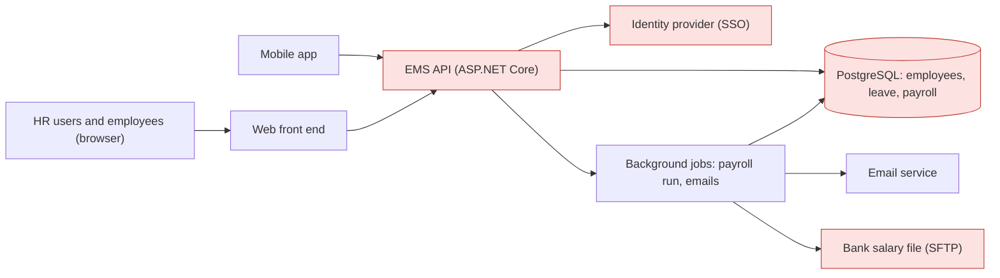
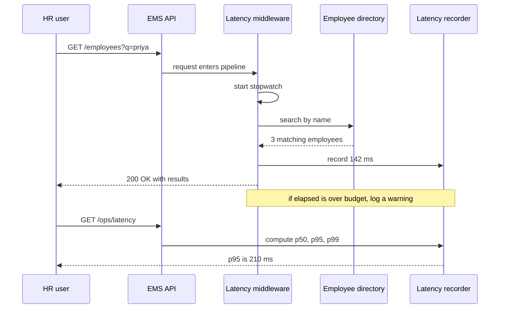

Every software system has an architecture, whether anyone chose it on purpose or not. This lesson explains what that word means in practice, why some decisions deserve far more care than others, and how to talk about the qualities of a system (how fast, how safe, how easy to change) in numbers instead of adjectives. We will use one running example through the whole module: an **employee management application** (EMS) that a company uses to store employee records, approve leave and run monthly payroll.

## Learning objectives

By the end of this lesson you will be able to:

1. Define software architecture as "the decisions that are hard to change", and give five examples from a real application.
2. Tell an architectural decision apart from an ordinary design or coding decision.
3. Name the common quality attributes (performance, availability, scalability, security, modifiability, testability, deployability, observability, cost) and explain how they pull against each other.
4. Write a quality attribute as a measurable scenario, for example "95 % of employee searches return in under 300 ms with 200 concurrent users".
5. Measure one quality attribute (latency percentiles) in an ASP.NET Core app and check one structural rule automatically (a fitness function).
6. Describe what an architect does day to day, and why the role is about trade-offs and communication more than diagrams.

## Prerequisites

- [What is software engineering?](#/lesson/m01-software-engineering): you should know that most of a system's cost comes after the first release.
- [What is a software system?](#/lesson/m01-software-system): components, inputs, outputs and boundaries.

Basic C# reading skills are enough for the code in this lesson. You do not need any prior architecture knowledge.

## Explain it like I'm a beginner

Think about building a house in Gurgaon.

Some choices are easy to change later: the colour of the walls, the curtains, where the sofa goes. If you get them wrong, you fix them on a Sunday afternoon for a few thousand rupees.

Other choices are very hard to change once the house is built: how many floors it has, where the staircase goes, whether the foundation can carry a fourth floor, where the water and sewage pipes run. Changing those means breaking walls, and maybe moving out for months. Nobody calls the wall colour "architecture". Everybody calls the foundation and the staircase "architecture".

Software is the same. Some choices are cheap to change: the name of a variable, the colour of a button, the wording of an error message. Other choices are expensive: which database you store employee data in, whether the app is one program or twenty small ones, how users log in, whether data can leave India, how the mobile app talks to the server. Those expensive choices are the **software architecture**.

There is a second idea hiding in the house example. You do not choose the foundation because you like foundations. You choose it because of what you want from the house: it must be **safe** in an earthquake, **cheap** to maintain, **quick** to build, able to **grow** by one floor later. Those wishes are the house's **qualities**. In software we call them **quality attributes** (sometimes "non-functional requirements" or "the -ilities"): performance, availability, security, scalability, maintainability and so on.

So a working definition for a beginner:

> Software architecture is the small set of important, hard-to-change decisions about how a system is structured, made to achieve the qualities the system needs.

And an architect is the person (or, more often, the group of people) who makes sure those decisions are made deliberately, explained clearly, and revisited when the situation changes.

## First-principles explanation

### What architecture is

There is no single official definition, and that is fine. Three useful ones, from different angles:

- **Structure view:** the system's main parts (components), how they relate to each other, and the rules that govern them. For EMS: a web front end, an API, a PostgreSQL database, a nightly payroll job, an email service.
- **Decision view:** the decisions that are expensive to reverse. Martin Fowler describes architecture as "the important stuff, whatever that is", and points out that "important" usually means "hard to change".
- **Shared-understanding view:** what the senior developers on the team agree the system's important parts are. If the team's mental picture and the code disagree, the code wins, and the picture is wrong.

All three are true at once. The decision view is the most practical, because it tells you where to spend your thinking time.

### Why "hard to change" is the core idea

Every decision has a **cost of reversal**: the work needed to undo it later. Plot your decisions on that axis and you get a quick map of what matters:

| Decision in EMS | Cost to reverse after 2 years (estimate) | Architectural? |
|---|---|---|
| Rename `EmpService` to `EmployeeService` | Minutes, the IDE does it | No |
| Pick the date picker component on the leave form | A day | No |
| Use `decimal` instead of `double` for salary | Days, plus checking every report | Borderline |
| Store all data in one PostgreSQL database vs one per feature | Months of migration work | Yes |
| Deploy as one application vs many services | Months to a year | Yes |
| Identity: company Azure AD/Entra ID single sign-on vs our own password table | Weeks to months, plus user re-onboarding | Yes |
| Host employee data only in an India region | Months, plus legal review | Yes |
| Expose a public API that 30 client companies integrate with | Very high: you no longer control the callers | Yes |

The last row is worth pausing on. Some decisions are hard to change not because of your code, but because **other people now depend on them**. A public API, a file format that customers store, a database schema that a reporting team queries directly: all become architecture the moment someone else relies on them.

Jeff Bezos popularised a related idea: **one-way doors** (irreversible, decide slowly and carefully) and **two-way doors** (reversible, decide fast and move on). Good architects spend their energy on the one-way doors and deliberately make more doors two-way: for example by putting the payroll calculation behind an interface so it can be replaced later.

### Quality attributes

Functional requirements say **what** the system does: "an employee can apply for leave", "HR can export payroll". Quality attributes say **how well** it does it. Two systems can have identical features and completely different architectures because they need different qualities.

The common ones (the ISO/IEC 25010 model and cloud frameworks such as the Azure Well-Architected Framework list similar sets):

| Quality attribute | Plain-English question | EMS example target |
|---|---|---|
| Performance (latency, throughput) | How fast does it respond? How much work per second? | Search returns in under 300 ms for 95 % of requests |
| Scalability | Can it handle more users or data by adding resources? | Grow from 2,000 to 50,000 employees without a rewrite |
| Availability | What fraction of time is it usable? | 99.9 % during office hours |
| Reliability and fault tolerance | Does it keep working correctly when parts fail? | A failed email server must not block leave approval |
| Security | Can only the right people see and change the right data? | Only HR and the employee can see a salary |
| Modifiability (maintainability) | How cheaply can we change it? | A new leave type ships in under 2 days |
| Testability | How easily can we prove it works? | Payroll rules testable without a database |
| Deployability | How safely and often can we release? | Release on any weekday in under 15 minutes, no downtime |
| Observability | Can we see what it is doing in production? | Every request traceable by a correlation id |
| Cost | What does it cost to build and run? | Under ₹60,000 a month of cloud spend |
| Usability, accessibility | Can people use it easily? | Leave application in 3 clicks on a phone |
| Interoperability | Can it exchange data with other systems? | Export to the bank's salary upload format |

Two numbers worth memorising for availability, based on a 30-day month of 43,200 minutes:

- 99.9 % ("three nines") allows 0.1 % × 43,200 ≈ **43 minutes** of downtime a month.
- 99.99 % ("four nines") allows ≈ **4.3 minutes** a month. That is shorter than most deployments without special tooling, which is why four nines changes your architecture (rolling deployments, redundancy in every layer) while three nines may not.

### Quality attributes pull against each other

You can rarely maximise all of them. Some typical tensions:

- **Performance vs modifiability.** Caching employee data in memory makes reads fast, but every change to the data model now also means changing the cache and its invalidation.
- **Security vs usability.** Asking for a one-time password on every login is safer and more annoying.
- **Availability vs consistency.** Keeping a copy of the database in a second region keeps the system up if one region fails, but the copy may be a few seconds behind.
- **Cost vs almost everything.** Two servers instead of one doubles the compute bill but removes a single point of failure.
- **Time to market vs everything.** A deadline in six weeks is itself a constraint that limits which architectures are realistic (see [constraints](#/lesson/m02-constraints)).

Architecture is the art of choosing which qualities win **for this system, at this time**. An internal EMS for 300 people does not need four nines. A payroll system that must pay 40,000 salaries on the 1st of the month needs correctness and auditability far more than it needs sub-100 ms responses.

### Writing a quality attribute as a scenario

"The system must be fast" cannot be tested, so it cannot be achieved. A useful format, taken from the Software Engineering Institute's work on architecture, has six parts:

1. **Source:** who or what causes the event (an HR user, a batch job, an attacker).
2. **Stimulus:** what happens (a search request, a server crash, a login attempt with a stolen password).
3. **Environment:** under what conditions (normal load, month-end peak, during a deployment).
4. **Artifact:** which part is affected (the employee API, the payroll database).
5. **Response:** what the system should do.
6. **Response measure:** the number that proves it.

Example for EMS: "When **an HR user** **searches employees by name** during **month-end peak (200 concurrent users)**, the **employee API** **returns matching records**, with **95 % of responses in under 300 ms and 99 % in under 800 ms**."

Notice the percentiles. An average hides the slow requests: if 95 requests take 100 ms and 5 take 4 seconds, the average is 295 ms and looks fine, while 1 user in 20 is waiting 4 seconds. We will measure percentiles in code later in this lesson.

### What the architect does

"Architect" can be a job title or a hat that a senior developer wears for part of the week. Either way, the work is roughly:

- **Understand the drivers.** Find the quality attributes and constraints that really matter, and get them as numbers from the business.
- **Make or guide the hard-to-change decisions.** Usually by comparing two or three options against those drivers, not by picking a favourite technology.
- **Write the decisions down** with their reasons, typically as [Architecture Decision Records](#/lesson/m02-adr), so that the next team knows *why*.
- **Keep the structure healthy.** Check that the code still follows the agreed rules (for example "payroll code never reads the leave tables directly") with reviews and automated checks called **fitness functions**.
- **Communicate.** Explain trade-offs to managers in cost and risk, and to developers in code and diagrams.
- **Stay close to the code.** An architect who has not built anything for years makes decisions that look clean on slides and hurt in production.

### When architecture work is unnecessary

Not every project needs an architecture phase. A two-week internal tool for 20 users, a prototype for a tender demo, or a script that runs once can go straight to code. The test is simple: **if you are wrong, how expensive is it to fix?** If the answer is "a day", just build it. Over-architecting a small system (five projects, three message queues, a service mesh for an app with 50 users) is just as real a failure as under-architecting a big one.

## Visual explanation

### Where the hard-to-change decisions sit in EMS



This is a simple box-and-arrow view of EMS. Users reach the system through a web front end or a mobile app. Both call one API. The API stores data in a single PostgreSQL database, delegates login to the company's identity provider (single sign-on), and hands slow work (the monthly payroll run, sending emails) to background jobs. The background jobs also write the salary file that the bank picks up.

The boxes highlighted in red are the hard-to-change decisions. The **database** choice and its schema are used by everything. The **identity provider** decides how every user logs in. The **bank file format** is fixed by someone outside the company. The **API shape** becomes a contract once the mobile app ships, because old app versions stay on phones for months. The web front end's framework, by contrast, can be replaced screen by screen, so it is less architectural.

### How a quality attribute is measured at runtime



This shows how the quality scenario "95 % of searches under 300 ms" turns into something you can check every day. Each request passes through a small middleware that starts a stopwatch, lets the request run, then records the elapsed time. Requests slower than the budget are logged so someone can investigate. An operations endpoint calculates the percentiles over the last few thousand requests. If p95 creeps from 210 ms towards 300 ms over a few weeks, the team knows before users complain. That is the difference between a quality attribute written on a slide and one that is actually managed.

## Step-by-step example

Let us walk through the first architecture conversation for EMS, for a company of 2,500 employees with offices in Gurgaon, Pune and Chennai.

### Step 1 — collect the functions

Employees view their profile and apply for leave. Managers approve leave. HR maintains records and runs payroll monthly. Finance downloads a bank salary file. These are the functional requirements, and they do not yet tell us much about structure.

### Step 2 — ask for qualities as numbers

You ask HR and IT questions until vague words turn into numbers:

- "Fast?" becomes: 95 % of screens load in under 1 second, search under 300 ms.
- "Always available?" becomes: 99.5 % during 8 am – 10 pm IST, payroll window 25th–1st must not lose a single run.
- "Secure?" becomes: salary visible only to HR, the employee and their skip-level manager; all access logged for 7 years.
- "Grow?" becomes: an acquisition may add 6,000 employees next year.
- "Cheap?" becomes: run cost under ₹60,000 a month, built by a team of 4 developers.

### Step 3 — find the one-way doors

From those numbers, the hard decisions appear: where data is hosted (India region, because of company policy), how users log in (the company already uses single sign-on, so reuse it), how payroll data is kept correct (transactions, audit table), and how the system is deployed (one application or several).

### Step 4 — pick the simplest structure that meets the numbers

2,500 employees growing to 8,500 is small. A month-end peak of a few hundred concurrent users fits comfortably on one well-sized application server and one PostgreSQL instance (an estimate; confirm with a load test). A team of 4 cannot run 15 services well. So the sensible first architecture is a **single deployable application** (a [monolith](#/lesson/m02-monolith)) with clear internal layers or modules, one database, background jobs for payroll, and single sign-on. The rest of this module looks at that choice and its alternatives in detail.

### Step 5 — make the decisions checkable

Write an ADR for each one-way door. Add a latency measurement so the 300 ms target is visible. Add an automated rule so the structure does not decay. The next section shows both in code.

## Production-style C# implementation

Two small, practical pieces of "architecture in code":

1. A **latency recorder and middleware** that turns the performance scenario into live numbers.
2. A **dependency rule** (fitness function) that fails a test if lower-level code starts depending on higher-level code.

```text
Ems.Api/
  Program.cs
  Employees/
    Employee.cs
    IEmployeeDirectory.cs
    InMemoryEmployeeDirectory.cs
  Observability/
    LatencyRecorder.cs
    LatencyBudgetMiddleware.cs
  Architecture/
    DependencyRule.cs
Ems.Tests/
  ArchitectureTests.cs
  LatencyRecorderTests.cs
```

```csharp file=Employees/Employee.cs
namespace Ems.Employees;

public sealed record Employee(int Id, string Name, string Department, string Email);
```

```csharp file=Employees/IEmployeeDirectory.cs
namespace Ems.Employees;

public interface IEmployeeDirectory
{
    Employee? Find(int id);
    IReadOnlyList<Employee> Search(string text, int take);
}
```

```csharp file=Employees/InMemoryEmployeeDirectory.cs
namespace Ems.Employees;

/// <summary>Stand-in for the real PostgreSQL-backed directory, so the example runs anywhere.</summary>
public sealed class InMemoryEmployeeDirectory : IEmployeeDirectory
{
    private readonly List<Employee> _employees =
    [
        new(1, "Priya Sharma", "HR", "priya.sharma@example.in"),
        new(2, "Arjun Mehta", "Finance", "arjun.mehta@example.in"),
        new(3, "Kavya Iyer", "Engineering", "kavya.iyer@example.in"),
        new(4, "Rahul Verma", "Engineering", "rahul.verma@example.in"),
    ];

    public Employee? Find(int id) => _employees.FirstOrDefault(e => e.Id == id);

    public IReadOnlyList<Employee> Search(string text, int take) =>
        _employees.Where(e => e.Name.Contains(text, StringComparison.OrdinalIgnoreCase))
                  .Take(Math.Clamp(take, 1, 100))
                  .ToList();
}
```

```csharp file=Observability/LatencyRecorder.cs
namespace Ems.Observability;

/// <summary>Keeps the most recent N request durations in a ring buffer and computes percentiles.
/// Thread-safe. Registered as a singleton.</summary>
public sealed class LatencyRecorder
{
    private readonly double[] _samples;
    private readonly Lock _gate = new();
    private int _next;
    private int _count;

    public LatencyRecorder(int capacity = 1000)
    {
        ArgumentOutOfRangeException.ThrowIfLessThan(capacity, 1);
        _samples = new double[capacity];
    }

    public void Record(double milliseconds)
    {
        lock (_gate)
        {
            _samples[_next] = milliseconds;
            _next = (_next + 1) % _samples.Length;
            if (_count < _samples.Length) _count++;
        }
    }

    /// <summary>Nearest-rank percentile, for example 95 for p95. Returns null when nothing is recorded.</summary>
    public double? Percentile(double percentile)
    {
        ArgumentOutOfRangeException.ThrowIfLessThanOrEqual(percentile, 0);
        ArgumentOutOfRangeException.ThrowIfGreaterThan(percentile, 100);

        double[] copy;
        lock (_gate)
        {
            if (_count == 0) return null;
            copy = _samples[.._count];
        }
        Array.Sort(copy);
        var rank = (int)Math.Ceiling(percentile / 100.0 * copy.Length);
        return copy[Math.Clamp(rank, 1, copy.Length) - 1];
    }
}
```

```csharp file=Observability/LatencyBudgetMiddleware.cs
using System.Diagnostics;
using Microsoft.Extensions.Options;

namespace Ems.Observability;

public sealed class LatencyBudgetOptions
{
    /// <summary>The response measure from the quality scenario, in milliseconds.</summary>
    public double BudgetMs { get; set; } = 300;
}

public sealed class LatencyBudgetMiddleware(
    RequestDelegate next,
    LatencyRecorder recorder,
    IOptions<LatencyBudgetOptions> options,
    ILogger<LatencyBudgetMiddleware> logger)
{
    public async Task InvokeAsync(HttpContext context)
    {
        var start = Stopwatch.GetTimestamp();
        try
        {
            await next(context);
        }
        finally
        {
            var elapsed = Stopwatch.GetElapsedTime(start).TotalMilliseconds;
            recorder.Record(elapsed);
            if (elapsed > options.Value.BudgetMs)
                logger.LogWarning("Request {Method} {Path} took {Elapsed:F0} ms, over the {Budget} ms budget",
                    context.Request.Method, context.Request.Path, elapsed, options.Value.BudgetMs);
        }
    }
}
```

```csharp file=Architecture/DependencyRule.cs
using System.Reflection;

namespace Ems.Architecture;

public sealed record RuleViolation(string Type, string ForbiddenDependency);

/// <summary>A tiny fitness function: types in one namespace must not depend on types in another.
/// Checks constructor parameters and fields, which catches the usual way dependencies sneak in.</summary>
public static class DependencyRule
{
    public static IReadOnlyList<RuleViolation> Check(IEnumerable<Type> types, string fromNamespace, string forbiddenNamespace)
    {
        const BindingFlags all = BindingFlags.Instance | BindingFlags.Static | BindingFlags.Public | BindingFlags.NonPublic;
        var violations = new List<RuleViolation>();

        foreach (var type in types.Where(t => InNamespace(t, fromNamespace)))
        {
            var dependencies = type.GetConstructors(all).SelectMany(c => c.GetParameters()).Select(p => p.ParameterType)
                .Concat(type.GetFields(all).Select(f => f.FieldType))
                .Distinct();

            foreach (var dependency in dependencies.Where(d => InNamespace(d, forbiddenNamespace)))
                violations.Add(new RuleViolation(type.FullName ?? type.Name, dependency.FullName ?? dependency.Name));
        }
        return violations;
    }

    private static bool InNamespace(Type t, string ns) =>
        t.Namespace is { } n && (n == ns || n.StartsWith(ns + ".", StringComparison.Ordinal));
}
```

```csharp file=Program.cs
using Ems.Employees;
using Ems.Observability;

var builder = WebApplication.CreateBuilder(args);

builder.Services.Configure<LatencyBudgetOptions>(builder.Configuration.GetSection("LatencyBudget"));
builder.Services.AddSingleton(new LatencyRecorder(capacity: 2000));
builder.Services.AddSingleton<IEmployeeDirectory, InMemoryEmployeeDirectory>();

var app = builder.Build();

// Measure everything, including endpoints added later.
app.UseMiddleware<LatencyBudgetMiddleware>();

app.MapGet("/employees/{id:int}", (int id, IEmployeeDirectory directory) =>
    directory.Find(id) is { } e ? Results.Ok(e) : Results.NotFound());

app.MapGet("/employees", (string? q, IEmployeeDirectory directory) =>
    Results.Ok(directory.Search(q ?? "", take: 50)));

// In production, protect this endpoint or export to a metrics system instead.
app.MapGet("/ops/latency", (LatencyRecorder recorder) => Results.Ok(new
{
    p50 = recorder.Percentile(50),
    p95 = recorder.Percentile(95),
    p99 = recorder.Percentile(99),
}));

app.Run();
```

**Why a hand-rolled recorder?** To show the idea in 40 lines. In a real deployment you would publish request duration through `System.Diagnostics.Metrics` (ASP.NET Core already emits an `http.server.request.duration` histogram) and let OpenTelemetry plus a dashboard such as Grafana or Azure Monitor compute the percentiles. The architectural point is the same: **a quality attribute you do not measure is a wish, not a requirement.**

**Why a reflection-based rule?** It is a minimal fitness function. Libraries such as NetArchTest or ArchUnitNET do the same job with a richer API. The test below fails the build the day someone injects a database class into the domain.

## Bad design vs good design

**Bad: architecture by accident.** A team starts EMS with "let's just build features". Six months later:

- Salary is stored as `double` in one table and `numeric` in another, and the payroll totals differ by a few paise every month.
- The mobile app reads the database through a reporting view, so nobody can rename a column without breaking phones in the field.
- "Fast" was never defined, so when HR complains, nobody knows whether 2 seconds is a bug or normal.
- Every developer added their own way of sending email, so there are three.

None of these were decided. They happened. Each one is now a hard-to-change decision that nobody chose.

**Good: deliberate, light-weight architecture.**

- A one-page list of the top five quality scenarios with numbers.
- An ADR for each one-way door: database, hosting region, identity, deployment unit, public API style.
- A measured latency budget and a dashboard.
- Two or three automated structure rules, run in CI.
- Everything else (UI library, folder names, which logging sink) left to the developers, and changed freely.

**Is the extra work worth it?** For a 2-week internal tool, no: just build it. For anything that will live for years, handle personal data, or be used by other teams, an afternoon of deliberate decisions at the start saves months later. The key is proportion: a few hours of thought per one-way door, not a three-month "architecture phase".

:::callout type=mistake title="Confusing architecture with technology choice"
"Our architecture is React, .NET and PostgreSQL" lists tools, not architecture. Architecture says how the parts are arranged and why: one deployable or many, which component owns which data, how failures are contained, what talks to what. You can build a good or a terrible architecture with exactly the same tools.
:::

:::callout type=tradeoff title="Deferring decisions is also a decision"
Sometimes the best architectural move is to keep a door two-way: hide the database behind a repository interface, or keep payroll in its own module, so you can change your mind when you know more. But deferral has a cost too (extra abstraction). Defer when the uncertainty is real and the abstraction is cheap.
:::

## Practical playground

Run the program below. It simulates 1,000 employee-search requests where most are fast and a few are very slow (for example, when the database is busy). Compare the average with p95 and p99. Then change `slowShare` from 0.03 to 0.06 and see which number reacts most. That is why quality scenarios use percentiles.

:::playground type=csharp title="Why averages hide slow requests"
```csharp file=Program.cs
using System;
using System.Collections.Generic;
using System.Linq;

public static class Program
{
    public static void Main()
    {
        var random = new Random(42);
        const double slowShare = 0.03;      // 3 % of requests hit a slow path
        var samples = new List<double>();

        for (var i = 0; i < 1000; i++)
        {
            var isSlow = random.NextDouble() < slowShare;
            var ms = isSlow ? 1500 + random.NextDouble() * 2500 : 60 + random.NextDouble() * 120;
            samples.Add(Math.Round(ms, 1));
        }

        Console.WriteLine($"Average: {samples.Average():F0} ms");
        foreach (var p in new[] { 50.0, 90.0, 95.0, 99.0 })
            Console.WriteLine($"p{p}: {NearestRank(samples, p):F0} ms");

        const double budget = 300;
        var within = samples.Count(s => s <= budget) * 100.0 / samples.Count;
        Console.WriteLine($"{within:F1} % of requests within the {budget} ms budget (target: 95 %)");
    }

    private static double NearestRank(List<double> samples, double percentile)
    {
        var sorted = samples.OrderBy(s => s).ToList();
        var rank = (int)Math.Ceiling(percentile / 100.0 * sorted.Count);
        return sorted[Math.Clamp(rank, 1, sorted.Count) - 1];
    }
}
```
:::

## Exercises

:::exercise id=m02-what-is-architecture-ex1 difficulty=beginner kind=code title="Compute a latency percentile"
Implement `Percentiles.NearestRank`, which returns the value at a given percentile using the nearest-rank method. This is the calculation behind every "95 % of requests under X ms" quality scenario.
::requirements
- Rank = ceiling(percentile ÷ 100 × count). Return the value at that 1-based rank in the sorted samples.
- `percentile` must be greater than 0 and at most 100, otherwise throw `ArgumentOutOfRangeException`.
- An empty list throws `ArgumentException`.
- Do not change the order of the caller's list.
::acceptance
- For samples 10, 20, … 100 (ten values), p50 is 50 and p95 is 100.
- Unsorted input gives the same result as sorted input.
- The caller's list keeps its original order.
- Invalid percentile and empty input throw the specified exceptions.
::hint
Percentiles are about position in a sorted list. What must you do to the samples first?
::hint
Sort a copy, not the original. `samples.OrderBy(x => x).ToList()` creates a new list.
::hint
For 10 samples and p95: 0.95 × 10 = 9.5, ceiling is 10, so you return the 10th value (index 9).
::hint
```csharp
var sorted = samples.OrderBy(x => x).ToList();
var rank = (int)Math.Ceiling(percentile / 100.0 * sorted.Count);
return sorted[rank - 1];
```
Then add the argument checks before this.
::starter
```csharp file=Percentiles.cs
using System;
using System.Collections.Generic;
using System.Linq;

public static class Percentiles
{
    public static double NearestRank(IReadOnlyList<double> samples, double percentile)
    {
        throw new NotImplementedException();
    }
}
```
::tests
```csharp file=PercentilesTests.cs
using System;
using System.Collections.Generic;
using System.Linq;
using Xunit;

public class PercentilesTests
{
    private static readonly double[] Ten = { 10, 20, 30, 40, 50, 60, 70, 80, 90, 100 };

    [Fact] public void P50_of_ten_values() => Assert.Equal(50.0, Percentiles.NearestRank(Ten, 50));

    [Fact] public void P95_of_ten_values() => Assert.Equal(100.0, Percentiles.NearestRank(Ten, 95));

    [Fact] public void P100_is_max() => Assert.Equal(100.0, Percentiles.NearestRank(Ten, 100));

    [Fact]
    public void Unsorted_input_gives_same_answer()
    {
        var shuffled = new List<double> { 70, 10, 100, 40, 90, 20, 60, 30, 80, 50 };
        Assert.Equal(90.0, Percentiles.NearestRank(shuffled, 90));
    }

    [Fact]
    public void Does_not_reorder_callers_list()
    {
        var list = new List<double> { 300, 100, 200 };
        Percentiles.NearestRank(list, 50);
        Assert.Equal(new List<double> { 300, 100, 200 }, list);
    }

    [Fact] public void Empty_throws() => Assert.Throws<ArgumentException>(() => Percentiles.NearestRank(new List<double>(), 95));

    [Fact] public void Zero_percentile_throws() => Assert.Throws<ArgumentOutOfRangeException>(() => Percentiles.NearestRank(Ten, 0));

    [Fact] public void Over_100_throws() => Assert.Throws<ArgumentOutOfRangeException>(() => Percentiles.NearestRank(Ten, 101));
}
```
::solution
Sort a copy, compute the 1-based rank, and guard against bad arguments first.

```csharp file=Percentiles.cs
using System;
using System.Collections.Generic;
using System.Linq;

public static class Percentiles
{
    public static double NearestRank(IReadOnlyList<double> samples, double percentile)
    {
        ArgumentNullException.ThrowIfNull(samples);
        if (samples.Count == 0) throw new ArgumentException("At least one sample is required.", nameof(samples));
        if (percentile <= 0 || percentile > 100)
            throw new ArgumentOutOfRangeException(nameof(percentile), percentile, "Percentile must be in (0, 100].");

        var sorted = samples.OrderBy(x => x).ToList();
        var rank = (int)Math.Ceiling(percentile / 100.0 * sorted.Count);
        return sorted[Math.Clamp(rank, 1, sorted.Count) - 1];
    }
}
```

`Math.Clamp` protects against tiny floating-point surprises at the edges. There are other percentile definitions (linear interpolation is common in monitoring tools), so always check which one your dashboard uses before comparing numbers.
::mistakes
- Sorting the caller's list in place with `List.Sort`, which silently changes data the caller still uses.
- Using `percentile / 100 * count` as a 0-based index, which is off by one.
- Using integer division (`95 / 100` is 0 in C#).
::extensions
Add a `Linear` method that interpolates between neighbouring ranks, and compare its p95 with nearest-rank for 5, 50 and 5,000 samples.
:::

:::exercise id=m02-what-is-architecture-ex2 difficulty=beginner kind=written title="Which decisions are architectural?"
For EMS, classify each decision as **architectural** (hard to change, affects qualities) or **not architectural**, and give a one-line reason.

1. Use PostgreSQL as the only database.
2. Name the leave-approval method `ApproveAsync`.
3. Employees log in with the company's existing single sign-on.
4. Use a blue theme for the HR dashboard.
5. All employee data must stay in an India cloud region.
6. The mobile app talks to the server through a versioned REST API.
7. Use `foreach` instead of LINQ in the payroll loop.
8. Payroll runs as a background job rather than inside a web request.
::acceptance
- Each item is classified with a reason that mentions cost of reversal or quality attributes.
- At least one item is identified as "architectural because others depend on it".
::hint
For each item ask: "If this is wrong in two years, how much work is it to change?"
::hint
Also ask: "Does anyone outside this codebase depend on it?"
::hint
Method names, loop styles and colours are cheap to change. Data stores, identity, hosting location, external contracts and runtime structure are not.
::solution
| # | Classification | Reason |
|---|---|---|
| 1 | Architectural | Schema, queries, backups, team skills all depend on it; migration takes months. |
| 2 | Not | IDE rename, minutes. |
| 3 | Architectural | Affects security, every user's login, and user records; changing it means re-onboarding users. |
| 4 | Not | Cosmetic, easily changed. |
| 5 | Architectural | A compliance constraint that limits hosting, backups and third-party services. |
| 6 | Architectural | Old app versions in the field depend on the contract (others depend on it). |
| 7 | Not | Local code style; affects one method. |
| 8 | Architectural (light) | Affects reliability and availability: a 20-minute payroll run inside a web request would time out and block a server thread. |
::mistakes
- Calling every technology choice architectural. The UI component library usually is not.
- Ignoring external dependencies: the API contract is architectural because of the callers, not the code.
:::

:::exercise id=m02-what-is-architecture-ex3 difficulty=intermediate kind=code title="Write a fitness function for forbidden dependencies"
Architects use **fitness functions**, automated checks that fail when the structure drifts. Implement `FitnessFunction.Check`, which receives a list of type-to-type dependencies (as full type names) and a list of forbidden rules, and returns every violation.
::requirements
- A rule "from `Ems.Payroll` to `Ems.Leave.Data`" forbids any type in namespace `Ems.Payroll` (or a sub-namespace such as `Ems.Payroll.Tax`) from depending on any type in `Ems.Leave.Data` (or below).
- Namespace matching is by **segment**: `Ems.Payroll` must not match `Ems.PayrollReports.Exporter`.
- A type name like `Ems.Payroll.PayrollService` is "in" `Ems.Payroll` because its namespace is everything before the last dot.
- The same dependency listed twice produces one violation per rule.
- Return violations sorted by `FromType`, then `ToType`.
::acceptance
- A direct violation is reported with the rule that caused it.
- `Ems.PayrollReports.X` is not treated as inside `Ems.Payroll`.
- Duplicates are removed and the output order is stable.
::hint
Split the problem in two: "is this type inside this namespace?" and "does this dependency break this rule?"
::hint
The namespace of `Ems.Payroll.Tax.TdsCalculator` is `Ems.Payroll.Tax`. Use `LastIndexOf('.')`.
::hint
A namespace `ns` is inside `prefix` if `ns == prefix` or `ns.StartsWith(prefix + ".")`. The added dot is what stops `PayrollReports` from matching.
::hint
```csharp
var result = deps.Distinct()
    .SelectMany(d => rules.Where(r => In(d.FromType, r.FromNamespace) && In(d.ToType, r.ToNamespace))
                          .Select(r => new Violation(d, r)))
    .OrderBy(v => v.Dependency.FromType, StringComparer.Ordinal)
    .ThenBy(v => v.Dependency.ToType, StringComparer.Ordinal)
    .ToList();
```
::starter
```csharp file=FitnessFunction.cs
using System;
using System.Collections.Generic;
using System.Linq;

public sealed record Dependency(string FromType, string ToType);
public sealed record ForbiddenRule(string FromNamespace, string ToNamespace, string Reason);
public sealed record Violation(Dependency Dependency, ForbiddenRule Rule);

public static class FitnessFunction
{
    public static IReadOnlyList<Violation> Check(IEnumerable<Dependency> dependencies, IEnumerable<ForbiddenRule> rules)
    {
        throw new NotImplementedException();
    }
}
```
::tests
```csharp file=FitnessFunctionTests.cs
using System.Collections.Generic;
using System.Linq;
using Xunit;

public class FitnessFunctionTests
{
    private static readonly ForbiddenRule PayrollToLeaveData =
        new("Ems.Payroll", "Ems.Leave.Data", "Payroll must use the Leave module's public API");

    [Fact]
    public void Reports_direct_violation()
    {
        var deps = new[] { new Dependency("Ems.Payroll.PayrollService", "Ems.Leave.Data.LeaveTable") };
        var v = Assert.Single(FitnessFunction.Check(deps, new[] { PayrollToLeaveData }));
        Assert.Equal("Ems.Payroll.PayrollService", v.Dependency.FromType);
        Assert.Same(PayrollToLeaveData, v.Rule);
    }

    [Fact]
    public void Sub_namespaces_are_included()
    {
        var deps = new[] { new Dependency("Ems.Payroll.Tax.TdsCalculator", "Ems.Leave.Data.Sql.LeaveQueries") };
        Assert.Single(FitnessFunction.Check(deps, new[] { PayrollToLeaveData }));
    }

    [Fact]
    public void Matches_by_segment_not_by_text()
    {
        var deps = new[] { new Dependency("Ems.PayrollReports.Exporter", "Ems.Leave.Data.LeaveTable") };
        Assert.Empty(FitnessFunction.Check(deps, new[] { PayrollToLeaveData }));
    }

    [Fact]
    public void Allowed_dependency_is_not_reported()
    {
        var deps = new[] { new Dependency("Ems.Payroll.PayrollService", "Ems.Leave.ILeaveQueries") };
        Assert.Empty(FitnessFunction.Check(deps, new[] { PayrollToLeaveData }));
    }

    [Fact]
    public void Duplicates_removed_and_sorted()
    {
        var d1 = new Dependency("Ems.Payroll.Z", "Ems.Leave.Data.A");
        var d2 = new Dependency("Ems.Payroll.A", "Ems.Leave.Data.B");
        var result = FitnessFunction.Check(new[] { d1, d2, d1 }, new[] { PayrollToLeaveData });
        Assert.Equal(new List<string> { "Ems.Payroll.A", "Ems.Payroll.Z" }, result.Select(v => v.Dependency.FromType).ToList());
    }

    [Fact]
    public void Multiple_rules_each_reported()
    {
        var rule2 = new ForbiddenRule("Ems.Payroll", "Ems.Leave", "No Leave at all");
        var deps = new[] { new Dependency("Ems.Payroll.PayrollService", "Ems.Leave.Data.LeaveTable") };
        Assert.Equal(2, FitnessFunction.Check(deps, new[] { PayrollToLeaveData, rule2 }).Count);
    }
}
```
::solution
```csharp file=FitnessFunction.cs
using System;
using System.Collections.Generic;
using System.Linq;

public sealed record Dependency(string FromType, string ToType);
public sealed record ForbiddenRule(string FromNamespace, string ToNamespace, string Reason);
public sealed record Violation(Dependency Dependency, ForbiddenRule Rule);

public static class FitnessFunction
{
    public static IReadOnlyList<Violation> Check(IEnumerable<Dependency> dependencies, IEnumerable<ForbiddenRule> rules)
    {
        var ruleList = rules.ToList();
        return dependencies
            .Distinct()
            .SelectMany(d => ruleList
                .Where(r => IsIn(d.FromType, r.FromNamespace) && IsIn(d.ToType, r.ToNamespace))
                .Select(r => new Violation(d, r)))
            .OrderBy(v => v.Dependency.FromType, StringComparer.Ordinal)
            .ThenBy(v => v.Dependency.ToType, StringComparer.Ordinal)
            .ToList();
    }

    private static bool IsIn(string typeName, string prefix)
    {
        var dot = typeName.LastIndexOf('.');
        var ns = dot < 0 ? "" : typeName[..dot];
        return ns == prefix || ns.StartsWith(prefix + ".", StringComparison.Ordinal);
    }
}
```

Records give value equality for free, so `Distinct()` removes duplicate dependencies. In a real project the dependency list comes from reflection (see `DependencyRule` above) or from a library such as NetArchTest, and this check runs as an ordinary unit test in CI.
::alternatives
Instead of forbidden rules you can write **allowed** rules ("Payroll may depend only on Payroll, Shared and Leave.Contracts"). Allow-lists are stricter and catch new modules automatically, but need more maintenance.
::mistakes
- Plain `StartsWith(prefix)` without the dot, which matches `Ems.PayrollReports`.
- Comparing the full type name to the namespace prefix, so `Ems.Payroll.PayrollService` is never "in" `Ems.Payroll.PayrollService`'s namespace.
- Forgetting `ToList()` on `rules`, which re-enumerates a lazy sequence for every dependency.
:::

:::exercise id=m02-what-is-architecture-ex4 difficulty=intermediate kind=written title="Write four quality attribute scenarios for EMS"
Write one six-part scenario (source, stimulus, environment, artifact, response, response measure) for each of: **performance**, **availability**, **security**, **modifiability**. Then rank them in priority order for a 2,500-employee company, with one sentence of justification.
::acceptance
- All six parts present in each scenario.
- Every response measure is a number that someone could test.
- The ranking is justified by business impact, not personal preference.
::hint
Start from a real event: "the payroll job crashes on the 30th", "a manager tries to open a salary they should not see".
::hint
Response measures are things like "within 300 ms for 95 %", "recovered within 15 minutes with no lost data", "denied and logged in 100 % of cases", "shipped in 2 days touching at most 3 files".
::hint
For ranking, ask "what does a failure cost the business?" A wrong salary affects 2,500 people and is a legal issue. A slow search is an annoyance.
::solution
**Security:** Source: a logged-in manager. Stimulus: requests the salary of an employee outside their reporting line. Environment: normal operation. Artifact: payroll API. Response: request denied and an audit entry written. Measure: 100 % of such requests denied, audit entry within 1 second, verified by automated tests for every salary endpoint.

**Availability:** Source: hardware or cloud fault. Stimulus: the application server process crashes. Environment: payroll window (25th–1st). Artifact: EMS API and payroll job. Response: traffic moves to the second instance, the payroll job resumes from its last checkpoint. Measure: users see under 1 minute of errors, no payroll record processed twice or lost.

**Performance:** Source: HR user. Stimulus: searches employees by name. Environment: 200 concurrent users at month end. Artifact: employee API. Response: matching records returned. Measure: p95 under 300 ms, p99 under 800 ms.

**Modifiability:** Source: HR policy change. Stimulus: add a new "paternity leave" type with its own balance rule. Environment: development time. Artifact: leave module. Response: change made, tested, deployed. Measure: done in under 2 developer-days, touching only the leave module.

**Ranking:** 1. Security (salary data is personal, a leak is a legal and trust problem). 2. Availability during the payroll window (late salaries affect everyone). 3. Modifiability (HR policies change every year). 4. Performance (current load is small, and the target is easy to meet).
::mistakes
- "The system shall be secure" with no stimulus or measure.
- Measuring averages instead of percentiles for latency.
- Ranking performance first by habit when the business risk is elsewhere.
:::

:::exercise id=m02-what-is-architecture-ex5 difficulty=advanced kind=written title="One-way doors for a SaaS version of EMS"
Your company wants to sell EMS to 40 client companies (between 200 and 15,000 employees each) as a hosted product. List the five most important one-way-door decisions, say for each which quality attributes drive it, and say which ones you would deliberately keep two-way (defer) and how.
::acceptance
- At least five decisions, each tied to named quality attributes.
- Tenant isolation is discussed with at least two options and their trade-offs.
- At least two decisions are deliberately deferred, with the cheap mechanism that keeps them reversible.
- Mentions how decisions will be recorded and checked.
::hint
What is new in SaaS that did not exist for one company? Think about data from different companies sitting side by side.
::hint
Tenant isolation options: shared tables with a `tenant_id` column, a schema per tenant, a database per tenant. Each has a different security, cost and operations profile.
::hint
Other one-way doors: identity (each client has its own SSO), public API and versioning policy, data residency per client, billing model, upgrade policy (all tenants on one version or not).
::hint
To keep a door two-way: put the choice behind an interface, a configuration value, or a module boundary, and write a fitness function that protects it.
::solution
**1. Tenant isolation model** (security, cost, operability). Shared tables with `tenant_id` and PostgreSQL row-level security is cheapest and easiest to upgrade, but one bug in a query filter can leak data. Database per tenant isolates best and allows per-tenant backup and restore, but 40 databases means 40 migrations per release. A common middle path: shared database for small tenants, a dedicated database for the largest (15,000-employee) clients. One-way door: deciding later means migrating every tenant.

**2. Identity** (security, usability, interoperability). Each client will want its own SSO (Entra ID, Google Workspace, Okta). Choose an identity layer that supports per-tenant OpenID Connect from day one.

**3. Public API contract and versioning** (interoperability, modifiability). Clients will integrate payroll exports with their banks and ERPs. Versioned REST with a written deprecation policy (for example 12 months).

**4. Data residency** (compliance, cost). Some clients may require data in India, some abroad. Decide whether you support multiple regions now; adding regions later affects backups, support and every third-party service.

**5. Single version for all tenants** (deployability, cost). One codebase, one version, per-tenant feature flags. Allowing tenants to stay on old versions multiplies support cost.

**Deferred (kept two-way):** the payroll calculation engine stays behind an `IPayrollCalculator` interface so country-specific engines can be added later. The choice of message broker is deferred: start with database-backed background jobs behind an `IJobQueue` interface. The deployment split (monolith vs services) is deferred by keeping clear module boundaries checked by fitness functions, so a module can be extracted if one tenant's load demands it.

**Recording and checking:** an ADR per one-way door, a tenant-isolation integration test that tries cross-tenant reads on every endpoint, and dependency rules in CI.
::mistakes
- Listing technologies ("use Kubernetes") rather than decisions with drivers.
- Ignoring tenant isolation, the biggest new risk in SaaS.
- Deferring everything: some doors (isolation, identity) must be decided before the first client signs.
:::

## Automated testing

Architecture decisions are only real if something checks them. Three kinds of test help.

**1. Unit tests for measurement code**, so your quality numbers are trustworthy:

```csharp
public class LatencyRecorderTests
{
    [Fact]
    public void Keeps_only_the_most_recent_samples()
    {
        var r = new LatencyRecorder(capacity: 3);
        foreach (var ms in new double[] { 1000, 1000, 10, 20, 30 }) r.Record(ms);
        Assert.Equal(30.0, r.Percentile(100));   // the two 1000 ms samples were overwritten
    }

    [Fact]
    public void Empty_recorder_returns_null() => Assert.Null(new LatencyRecorder().Percentile(95));
}
```

**2. Architecture tests (fitness functions)** that protect structure:

```csharp
public class ArchitectureTests
{
    [Fact]
    public void Employees_code_does_not_depend_on_web_infrastructure()
    {
        var types = typeof(Ems.Employees.Employee).Assembly.GetTypes();
        var violations = DependencyRule.Check(types, "Ems.Employees", "Microsoft.AspNetCore");
        Assert.Empty(violations);
    }
}
```

**3. Load tests for performance scenarios.** A unit test cannot prove "p95 under 300 ms with 200 users". Use a load tool (k6, NBomber, JMeter or Azure Load Testing) against a production-like environment, and fail the pipeline if the scenario's response measure is missed. Run it before big releases and after infrastructure changes.

Edge cases: the latency recorder with exactly one sample, with capacity reached, and concurrent `Record` calls (run 8 parallel tasks recording 10,000 values each and check nothing throws).

## Real-world application

- **Government and infrastructure platforms** that serve many departments usually have strict hosting and audit requirements. Hosting region and audit logging are one-way doors decided at the start, while screens and reports change every month.
- **Large public platforms** such as a national payments network or a railway booking site are publicly documented as designing for extreme peaks (festival sales, Tatkal booking windows). Their key quality attribute is throughput at a predictable peak, and that drives queueing and capacity decisions.
- **Banks** treat correctness and auditability as more important than raw speed: a transfer that takes 2 seconds is fine, a transfer applied twice is not.
- **Cloud frameworks** such as the Azure Well-Architected Framework and the AWS Well-Architected Framework are essentially checklists of quality attributes (reliability, security, cost, operational excellence, performance) with questions for each.
- **ASP.NET Core itself** makes architectural choices for you: a middleware pipeline, dependency injection and configuration providers. Using them well is "working with the grain" of the framework's architecture.

## Interview questions

:::interview
::q beginner
What is software architecture?
::a
The set of significant decisions about how a system is structured: its main components, how they communicate, where data lives, and how it is deployed. Those decisions are expensive to change later and are made to achieve quality attributes such as performance, availability, security and modifiability. A useful short version is "the decisions that are hard to change".
::q beginner
What is a quality attribute? Give three examples with numbers.
::a
A property describing how well the system works rather than what it does. Examples: performance ("p95 search latency under 300 ms at 200 concurrent users"), availability ("99.9 % monthly, about 43 minutes of downtime allowed"), modifiability ("a new leave type ships in under 2 developer-days").
::q intermediate
How do you tell an architectural decision from a design decision?
::a
Ask how expensive it is to reverse and how widely it spreads. Architectural decisions affect many components or external parties (database, deployment unit, identity, public API, hosting region) and take weeks or months to undo. Design decisions are local (class structure inside one feature, naming, algorithm choice) and can be changed in hours or days. Some decisions become architectural because others start depending on them, such as a database view used by another team.
::q intermediate
Two quality attributes conflict. Give an example and how you would resolve it.
::a
Availability vs cost: a second application server and a database replica remove single points of failure but roughly double infrastructure cost. Resolve it by asking the business for the cost of downtime (for EMS, a few hours outside the payroll window costs little; a failed payroll run costs a lot). The answer might be: one server most of the month, scale to two plus a tested restore plan during the payroll window. The resolution is a business trade-off made explicit, not a technical preference.
::q advanced
How do you stop an architecture from decaying over time?
::a
Make the important rules executable and visible. Record decisions and their reasons in ADRs so newcomers understand them. Add fitness functions in CI: dependency rules between modules, performance budgets in load tests, security checks such as "every salary endpoint requires the HR policy". Measure quality attributes in production (latency percentiles, error rates, deployment frequency). Review the architecture regularly against changed drivers: a rule that no longer serves a quality attribute should be removed, not silently broken.
::q advanced
When is investing in architecture up front a mistake?
::a
When the cost of being wrong is low or the uncertainty is so high that early decisions will be guesses: prototypes, short-lived tools, products still searching for users. Then prefer the simplest thing that works, keep decisions reversible (interfaces, modules, configuration), and invest in architecture once the drivers are known. The mistake is not "doing no architecture", but spending time on the wrong decisions or building for scale and flexibility nobody needs.
:::

## Summary and revision

**Key takeaways**

- Architecture is the set of important decisions that are expensive to change, made to achieve quality attributes.
- Decisions become architectural through wide impact or because other people depend on them.
- Quality attributes (performance, availability, scalability, security, modifiability, testability, deployability, observability, cost) often conflict, so architecture is about choosing which ones win.
- Write qualities as six-part scenarios with a number in the response measure. Use percentiles, not averages, for latency.
- Spend design effort on one-way doors. Keep other doors two-way with interfaces, modules and configuration.
- Make decisions checkable: ADRs, fitness functions, production measurements.
- The architect's job is drivers, decisions, communication and keeping the structure healthy, done close to the code.

**Terminology**: architecture, architecturally significant decision, quality attribute, quality attribute scenario, response measure, percentile (p95, p99), one-way and two-way door, fitness function, ADR.

:::flashcards
Q: A one-sentence definition of software architecture?
A: The important, hard-to-change decisions about a system's structure, made to achieve its quality attributes.
Q: What are the six parts of a quality attribute scenario?
A: Source, stimulus, environment, artifact, response, response measure.
Q: How much downtime per 30-day month does 99.9 % availability allow?
A: About 43 minutes (0.1 % of 43,200 minutes).
Q: Why use p95 instead of the average for latency?
A: The average hides slow outliers; p95 tells you what 1 in 20 users actually experiences.
Q: What is a fitness function?
A: An automated check (test, metric threshold) that fails when the architecture drifts from an agreed rule or quality target.
Q: Name a way a decision becomes architectural even if the code is simple.
A: Other systems or teams start depending on it, such as a public API, a file format or a shared database view.
Q: One-way door vs two-way door?
A: One-way doors are costly or impossible to reverse, so decide carefully. Two-way doors are cheap to reverse, so decide fast.
Q: Is "React, .NET and PostgreSQL" an architecture?
A: No, it is a technology list. Architecture describes structure, responsibilities, communication and the reasons behind them.
:::

## Knowledge check

:::quiz pass=70
::q single
The EMS team must decide between storing salaries as `decimal` or `double`, and between hosting in an India region or a cheaper overseas region. Which is the more clearly architectural decision, and why?
- [ ] The `decimal` choice, because money is important.
- [x] The hosting region, because it is hard to reverse, affects backups and third-party services, and is driven by a compliance quality.
- [ ] Neither, because both are technology choices.
- [ ] Both are equally architectural.
> Both matter, but the number type is mostly local to the code. The region affects the whole deployment, legal compliance and every external service, and moving data later is slow and risky.
::q single
HR says "search must be fast". Which is the best quality attribute scenario?
- [ ] Search is fast for all users.
- [ ] Average search time is under 300 ms.
- [x] With 200 concurrent HR users at month end, 95 % of searches return in under 300 ms and 99 % under 800 ms.
- [ ] Search uses an index on the name column.
> It names the environment, uses percentiles and has testable numbers. The last option is a solution, not a requirement.
::q single
Your measured average latency is 180 ms but HR still complains about slowness. What should you check first?
- [ ] CPU usage of the database.
- [x] The p95 and p99 latency, because a small share of very slow requests can hide behind a good average.
- [ ] Whether the front end uses the latest framework.
- [ ] Nothing, the average is within budget.
> Averages hide tails. If p99 is 4 seconds, 1 user in 100 waits that long, and frequent users hit it every day.
::q multi
Which are typical responsibilities of an architect? (Select all that apply.)
- [x] Turning vague qualities into measurable targets with the business.
- [x] Recording significant decisions and their reasons.
- [ ] Choosing the colour scheme of every screen.
- [x] Adding automated checks that protect important structural rules.
- [x] Explaining trade-offs in cost and risk to managers.
> Cosmetic choices are not architectural. The architect works on drivers, decisions, checks and communication.
::q single
A team of 3 is building an internal tool for 25 users, expected to live for 2 months. The lead proposes a week of architecture documents. Best response?
- [ ] Agree, every system needs full architecture documentation.
- [x] Keep it minimal: build the simplest thing, note any genuine one-way doors (such as where data is stored), and skip the rest.
- [ ] Use microservices so it can scale later.
- [ ] Skip testing as well, since it is temporary.
> Architecture effort should match the cost of being wrong. Here it is low, so a short note is enough.
::q single
Which pair of quality attributes most directly conflicts in this situation: "add a second database copy in another region"?
- [ ] Testability and usability.
- [x] Availability and cost (and possibly consistency, since the copy may lag).
- [ ] Modifiability and deployability.
- [ ] Security and observability.
> A replica improves availability but costs money, and asynchronous replication means the copy can be slightly behind.
::q single
A reporting team reads EMS's `employees` table directly. Six months later you want to split the `name` column into first and last name. What happened architecturally?
- [x] The table schema became a hard-to-change contract because another team depends on it.
- [ ] Nothing, schemas are always easy to change.
- [ ] The reporting team violated a coding standard.
- [ ] This is only a database administration question.
> Decisions become architectural when others rely on them. A published view or API would have kept the internal table free to change.
:::

## Completion criteria

You have finished this lesson when you can:

- [ ] Score at least 70 % on the knowledge check.
- [ ] Complete exercise 1 and exercise 3 with all tests passing.
- [ ] Write at least two measurable quality attribute scenarios for a system you work on.
- [ ] Explain in under two minutes why "architecture = hard-to-change decisions", using one example from your own work.
