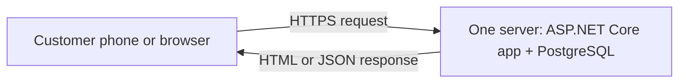
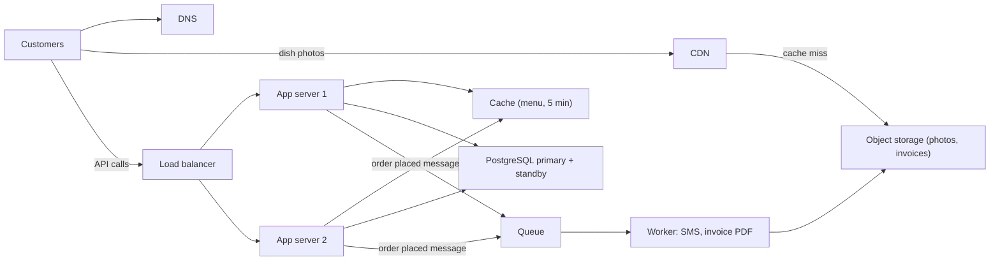
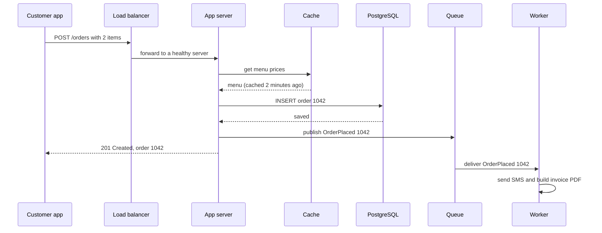

When you write a program, you think about classes, methods and loops. When you design a **system**, you step back and think about the whole thing that runs in the real world: the phones and browsers that use it, the servers that answer them, the databases that remember things, and the wires and queues in between. System design is deciding **which pieces you need, what each one does, how data moves between them, and what happens when there are a lot more users, or when something breaks**. This lesson introduces those ideas gently, by taking one small app and growing it step by step.

## Learning objectives

By the end of this lesson you will be able to:

1. Explain in plain words what system design is and how it differs from writing code.
2. Name the common building blocks (client, DNS, load balancer, application server, database, cache, queue, worker, object storage, CDN) and say what each one is for.
3. Trace how data flows through a system for a read, a write and a background task.
4. Explain why scale (more users, more data) changes the design, using simple numbers.
5. Describe the trade-off each new building block brings, and recognise when a simple design is enough.
6. Read a small ASP.NET Core app and point to where each building block appears in code.

## Prerequisites

- [What is a software system?](#/lesson/m01-software-system): inputs, outputs, users and boundaries.
- [What is software architecture?](#/lesson/m02-what-is-architecture): the idea that some decisions are hard to change.
- Basic C# reading skills. You do not need any cloud or networking experience.

## Explain it like I'm a beginner

Imagine a home kitchen that cooks lunch boxes (tiffins) for office workers. On day one, one person takes orders on the phone, cooks, packs and delivers. That works for 20 lunches.

When orders grow to 500 a day, one person cannot do everything. So the kitchen changes:

- One person **takes orders**, another **cooks**, others **deliver**. (Separate jobs for separate parts.)
- A **notice board** lists the orders, so cooks do not have to stop and ask the order-taker. (A waiting line of work, like a queue.)
- Popular dishes are **prepared in advance** because everyone asks for them. (Keeping ready answers nearby, like a cache.)
- There are **two phone lines**, so if one is busy or broken, customers can still call. (Spreading the load, and having a spare.)
- The **recipe book and the customer list** are kept in one safe place that everyone reads from. (One trusted record, like a database.)

Nobody changed the food. They changed **how the work is organised** so it could handle more people and survive problems. That is system design: deciding how the pieces of a software system are organised so it serves its users well, at the size it needs to be, without falling over.

## First-principles explanation

### System design in one sentence

**System design is choosing the parts of a software system, what each part is responsible for, and how they communicate, so that the system meets its requirements (what it must do and how well) at the expected scale and budget.**

Three words in that sentence matter most:

- **Parts (components)**: the separate pieces, such as a web server or a database.
- **Communicate (data flow)**: how requests and data move between the pieces.
- **Requirements and scale**: how many users, how fast, how reliable, how cheap. Without these, there is no "right" design.

### How it differs from coding

| Coding | System design |
|---|---|
| Inside one program | Across many programs and machines |
| Classes, methods, algorithms | Servers, databases, caches, queues, networks |
| "Does this function return the right answer?" | "Does the system stay fast and correct with 100,000 users, and when a server dies?" |
| Mistakes are usually cheap to fix | Mistakes (wrong database, wrong data model) are often expensive to change later |

You need both. Good code inside a badly designed system still falls over at lunchtime. A good design with buggy code still gives wrong answers. The two meet in the middle: high-level design decides the parts, and [low-level design](#/lesson/m02-hld-vs-lld) decides the classes and methods inside each part.

### The building blocks

Almost every system is made of a small set of common parts. Learn these ten and you can read most architecture diagrams.

| Building block | Plain-English job | Example |
|---|---|---|
| **Client** | The thing a person uses | Mobile app, web browser, another company's server |
| **DNS (Domain Name System)** | The phone book of the internet: turns a name into an address | `tiffinbox.in` → `203.0.113.10` |
| **Load balancer** | A receptionist who sends each visitor to a free counter | Spreads requests across several app servers |
| **Application server (app server)** | Runs your code: checks input, applies business rules, talks to other parts | An ASP.NET Core API |
| **Database** | The trusted long-term memory | PostgreSQL storing customers and orders |
| **Cache** | A small, fast memory for answers that are asked for often | The lunch menu kept in memory for 5 minutes |
| **Queue (message queue)** | A waiting line of work to be done later | "Send SMS for order 1042" |
| **Worker** | A background program that takes work from the queue | Sends SMS, generates invoices |
| **Object storage** | A huge, cheap store for files | Dish photos, PDF invoices |
| **CDN (content delivery network)** | Copies of files kept in many cities, close to users | Dish photos served from a nearby city |

You do not need all of them. A small app may need only a client, an app server and a database. Each extra block solves a specific problem and adds work. That is the most important habit in system design: **add a part only when you can say which problem it solves.**

### Data flow: reads, writes and background work

Data moves through a system along three kinds of paths:

1. **Read path**: the user asks for something. "Show me today's menu." The request goes client → load balancer → app server → cache (or database) → back to the client. Reads are usually the most common requests, often 10 or more for every write.
2. **Write path**: the user changes something. "Place my order." The request goes to the app server, which checks it and saves it in the database. The write must not be lost, so it goes to the trusted store.
3. **Background (asynchronous) path**: work that does not need to finish before the user gets an answer. "Send the order confirmation SMS." The app server puts a message on a queue and replies to the user straight away; a worker sends the SMS a moment later.

Thinking in these paths helps you see where speed matters (reads), where correctness matters (writes), and what can wait (background work).

### Scale: why size changes the design

**Scale** means how big the load is: how many users, how many requests per second, how much data. The same app needs a very different design at different sizes. Simple arithmetic shows why (these are rough estimates, which is normal in system design):

```text
50 orders a day × 10 requests per order       = 500 requests a day
500 ÷ 86,400 seconds in a day                 ≈ 0.006 requests per second   (one server is plenty)

50,000 orders a day × 10 requests per order   = 500,000 requests a day
500,000 ÷ 86,400                              ≈ 6 requests per second on average
Lunch rush, about 5× the average              ≈ 30 requests per second       (one server is still fine, but a spare is wise)

2,000,000 orders a day × 10 requests          = 20,000,000 requests a day
20,000,000 ÷ 86,400                           ≈ 230 requests per second on average
Lunch rush ×5                                 ≈ 1,150 requests per second    (many servers, caching, queues)
```

There are two ways to handle more load:

- **Scale up (vertical scaling)**: buy a bigger machine. Simple, but there is a limit, and one machine is still one point of failure.
- **Scale out (horizontal scaling)**: add more machines and share the work. No hard limit, but your code must work when requests for the same user land on different machines (the app servers should not keep important data in their own memory). See [Scaling](#/lesson/m11-scaling).

### Things go wrong: failure is normal

At small scale, failures are rare. At large scale, something is always failing somewhere: a disk, a server, a network cable, a third-party SMS service. System design assumes failure and plans for it:

- **Remove single points of failure**: if one server's death stops everything, add a second one.
- **Keep the trusted data safe**: backups, and a standby copy of the database.
- **Let non-essential parts fail quietly**: if the SMS service is down, the order should still be placed; the SMS can be sent later.

### Trade-offs: nothing is free

Every building block gives you something and costs you something. That cost may be money, complexity or a new way to fail.

| Add this | You gain | You pay |
|---|---|---|
| Second app server + load balancer | Survives one server failing, handles more traffic | More cost, and code must be stateless |
| Cache | Faster reads, less database load | Users may see slightly old data, and you must decide when to refresh |
| Queue + worker | User gets a fast answer, slow work happens later | Work is delayed, may run twice, and you must monitor the queue |
| Read replica (a read-only copy of the database) | More read capacity | The copy lags slightly behind |
| CDN | Fast file delivery, less load on your servers | Cost per GB, and old files may stay cached |

Learning system design is mostly learning these trade-offs, so you can choose deliberately. A later lesson, [Explaining trade-offs](#/lesson/m11-trade-offs), goes deeper.

### When a simple design is enough

Most systems are small. An office app for 200 employees, a society maintenance portal, or a shop's billing system usually needs one app server (or two for safety), one database with backups, and nothing else. Adding queues, caches and microservices "because big companies do" makes the system harder to build, run and fix, with no benefit. A good system designer is often the person who says, with numbers, "we don't need that yet".

## Visual explanation

### Stage 1: everything on one server



This is how most systems start, and it is a fine start. The **customer's phone or browser** sends a request over the internet using HTTPS. **One server** runs both the application code and the database. The server reads or writes data and sends a response back. It is cheap, simple and easy to understand. Its weaknesses: if the server goes down, everything stops; if lunch-time traffic grows, the app and the database fight over the same CPU and memory; and there is no room to grow except buying a bigger machine.

### Stage 5: the same app, grown up



Now each job has its own part. **DNS** tells phones where to find the service. **Dish photos** come from a **CDN**, which fetches them from **object storage** only the first time. **API calls** reach a **load balancer**, which sends each one to **app server 1 or 2**; either can answer any request, so one can fail without an outage. The app servers check the **cache** for the menu before asking the **database**, which has a **standby** copy ready to take over. When an order is placed, the app server saves it in the database, puts an **"order placed" message on the queue**, and replies immediately. A **worker** picks the message up, sends the SMS and writes the invoice PDF to object storage. Every arrow is a decision someone made for a reason, which the step-by-step example explains.

### Placing an order, step by step



The **customer app** sends the order to the **load balancer**, which forwards it to any healthy **app server**. The app server gets the current prices from the **cache** (fast, no database trip) and saves the order in **PostgreSQL**. That save is the moment the order truly exists. It then **publishes a message** to the queue and **replies 201 Created** right away; the customer does not wait for the SMS. Separately, the **queue** delivers the message to a **worker**, which sends the SMS and builds the invoice. If the SMS service is slow or down, the customer's order is already safe; the worker simply tries again later.

## Step-by-step example

Follow **TiffinBox**, an imaginary lunch-box delivery service in Pune, as it grows. At each stage, notice three things: **what broke**, **what we added**, and **what it cost**.

### Stage 1 — One server (50 orders a day)

- **Design:** one small cloud server running the ASP.NET Core app and PostgreSQL. Daily database backup to cloud storage.
- **Load:** about 500 requests a day. The server is idle 99.9 % of the time.
- **Cost:** low (a single small server).
- **Verdict:** perfect for now. Spending more would be waste.

### Stage 2 — Separate the database (2,000 orders a day)

- **What broke:** a heavy monthly report run on the same machine made lunch-time ordering slow, because the report and the app shared CPU and memory.
- **What we added:** a managed PostgreSQL database on its own server, with automatic backups.
- **Trade-off:** one more thing to pay for, and a network hop between app and database (about a millisecond). In return, the database gets its own resources and the provider handles backups and patching.

### Stage 3 — Two app servers behind a load balancer (20,000 orders a day)

- **What broke:** a routine update restarted the only app server at 12:30, and 300 customers saw errors.
- **What we added:** a **load balancer** and a **second app server**. Updates now restart one server at a time.
- **Trade-off:** the app must be **stateless**: no shopping cart kept in one server's memory, because the next request may go to the other server. Carts move to the database (or a shared cache).
- **Numbers:** 20,000 × 10 ÷ 86,400 ≈ 2.3 requests per second on average, about 12 at the lunch peak. One server could handle that; the second one is for **safety**, not speed.

### Stage 4 — Cache and file storage (200,000 orders a day, several cities)

- **What broke:** 90 % of requests were "show the menu" and "show dish photos". The database spent most of its time answering the same menu question, and photos made pages slow on mobile networks.
- **What we added:** a **cache** for the menu (kept for 5 minutes), **object storage** for photos and a **CDN** to serve them from nearby.
- **Trade-off:** a menu change can take up to 5 minutes to appear. The kitchen agreed: menus change once a day. We also added a way to clear the cache when the menu is edited.

### Stage 5 — Queue and workers (2,000,000 orders a day)

- **What broke:** sending SMS and building invoice PDFs inside the order request made ordering take 3 seconds, and when the SMS provider had an outage, orders failed.
- **What we added:** a **queue** and **workers**. The order is saved and confirmed in about 200 ms; SMS and invoices follow a few seconds later.
- **Trade-off:** messages can occasionally be delivered twice, so the worker must make sure it does not send two SMS for the same order (it records which orders it has already handled). We also need to watch the queue: if it grows, workers are falling behind.
- **Numbers:** about 230 requests per second on average and 1,150 at peak. Several app servers, a database with a standby and read replicas, and a cache that absorbs most reads.

### What stayed the same

Through all five stages, the **business rules** (how an order is priced, which items can be ordered, when the kitchen closes) did not change. Good code kept those rules separate from the infrastructure, so moving from stage 1 to stage 5 meant adding parts around the code, not rewriting it. The next section shows what that looks like in C#.

## Production-style C# implementation

Here is a small TiffinBox API that contains, in code, each building block from the diagrams. Real infrastructure (PostgreSQL, Redis, a message broker) is replaced by in-memory versions behind interfaces, so you can run it on your laptop and later swap the real ones in without touching the business rules.

```text
TiffinBox.Api/
  Program.cs
  Orders/Models.cs
  Orders/Ports.cs
  Orders/InMemoryAdapters.cs
  Orders/MenuService.cs
  Orders/OrderService.cs
  Orders/NotificationWorker.cs
```

```csharp file=Orders/Models.cs
namespace TiffinBox.Orders;

public sealed record MenuItem(string Id, string Name, decimal PriceRupees);

public sealed record Order(Guid Id, string CustomerId, IReadOnlyList<string> ItemIds, decimal TotalRupees, DateTimeOffset PlacedAt);

public sealed record PlaceOrderRequest(string CustomerId, List<string> ItemIds);

/// <summary>The message put on the queue after an order is saved.</summary>
public sealed record OrderPlaced(Guid OrderId, string CustomerId, decimal TotalRupees);
```

```csharp file=Orders/Ports.cs
namespace TiffinBox.Orders;

/// <summary>The database (PostgreSQL in production).</summary>
public interface IMenuRepository
{
    Task<IReadOnlyList<MenuItem>> GetMenuAsync(CancellationToken ct);
}

public interface IOrderRepository
{
    Task SaveAsync(Order order, CancellationToken ct);
    Task<Order?> FindAsync(Guid id, CancellationToken ct);
}

/// <summary>The queue (a message broker in production).</summary>
public interface IOrderEvents
{
    ValueTask PublishAsync(OrderPlaced message, CancellationToken ct);
}

/// <summary>The external SMS provider.</summary>
public interface INotifier
{
    Task SendAsync(OrderPlaced message, CancellationToken ct);
}
```

```csharp file=Orders/InMemoryAdapters.cs
using System.Collections.Concurrent;
using System.Threading.Channels;
using Microsoft.Extensions.Logging;

namespace TiffinBox.Orders;

public sealed class InMemoryMenuRepository : IMenuRepository
{
    private static readonly IReadOnlyList<MenuItem> Menu =
    [
        new MenuItem("dal-rice", "Dal rice", 90m),
        new MenuItem("veg-thali", "Veg thali", 140m),
        new MenuItem("paneer-roti", "Paneer and roti", 160m),
    ];

    public int Calls { get; private set; }

    public Task<IReadOnlyList<MenuItem>> GetMenuAsync(CancellationToken ct)
    {
        Calls++; // lets you see how often the "database" is really asked
        return Task.FromResult(Menu);
    }
}

public sealed class InMemoryOrderRepository : IOrderRepository
{
    private readonly ConcurrentDictionary<Guid, Order> _orders = new();

    public Task SaveAsync(Order order, CancellationToken ct)
    {
        _orders[order.Id] = order;
        return Task.CompletedTask;
    }

    public Task<Order?> FindAsync(Guid id, CancellationToken ct) =>
        Task.FromResult(_orders.TryGetValue(id, out var o) ? o : null);
}

/// <summary>An in-process queue built on System.Threading.Channels.</summary>
public sealed class ChannelOrderEvents(Channel<OrderPlaced> channel) : IOrderEvents
{
    public ValueTask PublishAsync(OrderPlaced message, CancellationToken ct) => channel.Writer.WriteAsync(message, ct);
}

public sealed class LoggingNotifier(ILogger<LoggingNotifier> logger) : INotifier
{
    public Task SendAsync(OrderPlaced message, CancellationToken ct)
    {
        logger.LogInformation("SMS to {Customer}: order {OrderId} confirmed, total Rs {Total}", message.CustomerId, message.OrderId, message.TotalRupees);
        return Task.CompletedTask;
    }
}
```

```csharp file=Orders/MenuService.cs
using Microsoft.Extensions.Caching.Memory;

namespace TiffinBox.Orders;

/// <summary>The cache in front of the database for the most common read: the menu.</summary>
public sealed class MenuService(IMenuRepository repository, IMemoryCache cache)
{
    private const string Key = "menu";
    public static readonly TimeSpan Ttl = TimeSpan.FromMinutes(5); // trade-off: menu changes may take up to 5 minutes to appear

    public async Task<IReadOnlyList<MenuItem>> GetMenuAsync(CancellationToken ct)
    {
        var menu = await cache.GetOrCreateAsync(Key, entry =>
        {
            entry.AbsoluteExpirationRelativeToNow = Ttl;
            return repository.GetMenuAsync(ct);
        });
        return menu ?? [];
    }

    /// <summary>Call this when the kitchen edits the menu, so customers see the change at once.</summary>
    public void Invalidate() => cache.Remove(Key);
}
```

```csharp file=Orders/OrderService.cs
namespace TiffinBox.Orders;

public sealed class OrderValidationException(string message) : Exception(message);

/// <summary>The business rules. It knows nothing about HTTP, PostgreSQL or SMS providers.</summary>
public sealed class OrderService(MenuService menu, IOrderRepository orders, IOrderEvents events, TimeProvider clock)
{
    public async Task<Order> PlaceAsync(PlaceOrderRequest request, CancellationToken ct)
    {
        if (string.IsNullOrWhiteSpace(request.CustomerId)) throw new OrderValidationException("Customer is required.");
        if (request.ItemIds is not { Count: > 0 }) throw new OrderValidationException("Choose at least one item.");

        var prices = (await menu.GetMenuAsync(ct)).ToDictionary(m => m.Id, m => m.PriceRupees);
        var unknown = request.ItemIds.Where(id => !prices.ContainsKey(id)).ToList();
        if (unknown.Count > 0) throw new OrderValidationException($"Unknown items: {string.Join(", ", unknown)}");

        var order = new Order(Guid.NewGuid(), request.CustomerId, request.ItemIds, request.ItemIds.Sum(id => prices[id]), clock.GetUtcNow());

        await orders.SaveAsync(order, ct);                                                  // write path: the order now exists
        await events.PublishAsync(new OrderPlaced(order.Id, order.CustomerId, order.TotalRupees), ct); // background path
        return order;
    }
}
```

```csharp file=Orders/NotificationWorker.cs
using System.Threading.Channels;
using Microsoft.Extensions.Hosting;
using Microsoft.Extensions.Logging;

namespace TiffinBox.Orders;

/// <summary>The worker: takes messages from the queue and does the slow work outside the request.</summary>
public sealed class NotificationWorker(Channel<OrderPlaced> channel, INotifier notifier, ILogger<NotificationWorker> logger) : BackgroundService
{
    private readonly HashSet<Guid> _handled = new(); // avoid sending two SMS if a message arrives twice

    protected override async Task ExecuteAsync(CancellationToken stoppingToken)
    {
        await foreach (var message in channel.Reader.ReadAllAsync(stoppingToken))
        {
            if (!_handled.Add(message.OrderId)) continue;
            try
            {
                await notifier.SendAsync(message, stoppingToken);
            }
            catch (Exception ex) when (ex is not OperationCanceledException)
            {
                // A real system would retry with backoff and finally move the message to a dead-letter queue.
                logger.LogError(ex, "Could not notify for order {OrderId}", message.OrderId);
                _handled.Remove(message.OrderId);
            }
        }
    }
}
```

```csharp file=Program.cs
using System.Threading.Channels;
using TiffinBox.Orders;

var builder = WebApplication.CreateBuilder(args);

builder.Services.AddSingleton(TimeProvider.System);
builder.Services.AddMemoryCache();                                                    // cache
builder.Services.AddSingleton<IMenuRepository, InMemoryMenuRepository>();             // database (menu)
builder.Services.AddSingleton<IOrderRepository, InMemoryOrderRepository>();           // database (orders)
builder.Services.AddSingleton(Channel.CreateBounded<OrderPlaced>(1_000));             // queue
builder.Services.AddSingleton<IOrderEvents, ChannelOrderEvents>();
builder.Services.AddSingleton<INotifier, LoggingNotifier>();                          // external SMS provider
builder.Services.AddHostedService<NotificationWorker>();                              // worker
builder.Services.AddSingleton<MenuService>();
builder.Services.AddScoped<OrderService>();

var app = builder.Build();

// Read path: served from the cache most of the time.
app.MapGet("/menu", (MenuService menu, CancellationToken ct) => menu.GetMenuAsync(ct));

// Write path + background path.
app.MapPost("/orders", async (PlaceOrderRequest request, OrderService service, CancellationToken ct) =>
{
    try
    {
        var order = await service.PlaceAsync(request, ct);
        return Results.Created($"/orders/{order.Id}", order);
    }
    catch (OrderValidationException ex)
    {
        return Results.BadRequest(new { error = ex.Message });
    }
});

app.MapGet("/orders/{id:guid}", async (Guid id, IOrderRepository orders, CancellationToken ct) =>
    await orders.FindAsync(id, ct) is { } order ? Results.Ok(order) : Results.NotFound());

app.Run();
```

How the code maps to the diagram:

1. **App server** = the ASP.NET Core endpoints in `Program.cs`. They translate HTTP into calls on services and back. They hold no data of their own, so you could run two copies behind a load balancer.
2. **Database** = `IMenuRepository` and `IOrderRepository`. Today they are in memory; tomorrow they are PostgreSQL. `OrderService` does not care.
3. **Cache** = `MenuService` with `IMemoryCache`. The 5-minute `Ttl` is the trade-off written down. (With several servers you would use a shared cache such as Redis, or `HybridCache`, so all servers agree.)
4. **Queue** = `Channel<OrderPlaced>`, published through `IOrderEvents`. In production this would be a message broker so messages survive a restart.
5. **Worker** = `NotificationWorker`, a `BackgroundService`. It handles duplicates and failures without affecting the customer's order.

## Bad design vs good design

**Bad: doing everything inside the request.**

```csharp
// The customer waits for every step, and an SMS outage fails the order.
app.MapPost("/orders", async (PlaceOrderRequest r) =>
{
    var order = SaveOrder(r);
    await smsClient.SendAsync(r.CustomerId, "Order confirmed");   // 1-3 seconds, sometimes fails
    var pdf = BuildInvoicePdf(order);                             // 500 ms of CPU
    await emailClient.SendAsync(r.CustomerId, pdf);
    return Results.Ok(order);
});
```

The order takes seconds, and if the SMS provider is down, the customer sees an error even though the order may already be saved. They try again and get two lunches.

**Bad: keeping important data in one server's memory.** A static `Dictionary` of shopping carts works with one server. With two servers behind a load balancer, half the requests cannot find the cart.

**Bad: building for a scale you do not have.** Ten microservices, a message broker cluster and three databases for 50 orders a day. The team spends its time running infrastructure instead of improving the product.

**Good:**

- Start simple and add each building block when a real problem (with numbers) needs it.
- Keep business rules separate from infrastructure, behind interfaces, so the system can grow without rewrites.
- Save important data in the database first; do slow, non-essential work in the background.
- Keep app servers stateless so you can add or replace them freely.
- Write down each trade-off (for example "menu may be 5 minutes old").

:::callout type=tip title="Ask 'what problem does this solve?'"
For every box on a diagram, you should be able to finish the sentence "this exists because…" with a requirement or a number. If you cannot, the box probably should not be there yet.
:::

:::callout type=mistake title="Confusing more parts with better design"
A diagram with many boxes looks impressive but has more places to fail and more things to pay for and monitor. A good design is the simplest one that meets the requirements, with room to grow.
:::

## Practical playground

The HLD canvas below starts with TiffinBox at stage 1: one server running the app and the database. Increase the client's `rps` (requests per second) to 30, then to 1,000, and add building blocks one at a time: a load balancer and second app server, a cache, a queue and worker, object storage and a CDN. For each block you add, write one sentence: "this exists because…".

:::playground type=hld title="Grow TiffinBox from one server"
```json
{
  "nodes": [
    { "id": "c", "type": "client", "label": "Customer app", "props": { "rps": 1 } },
    { "id": "s", "type": "app-server", "label": "ASP.NET Core app (same VM as DB)", "props": { "instances": 1 } },
    { "id": "db", "type": "database", "label": "PostgreSQL (same VM)", "props": { "replicas": 0 } }
  ],
  "edges": [
    { "from": "c", "to": "s", "kind": "sync", "label": "HTTPS" },
    { "from": "s", "to": "db", "kind": "sync", "label": "SQL" }
  ]
}
```
:::

## Exercises

:::exercise id=m02-what-is-system-design-ex1 difficulty=beginner kind=written title="Name the parts of a library reservation system"
A city library network (12 branches) wants an app where members search the catalogue, reserve a book, and get an SMS when it is ready to collect. Librarians mark books as returned. Members also see the cover image of each book.

1. List the building blocks you would use for a **first version** with 5,000 members, and say what each one does in one sentence.
2. Describe the **read path**, the **write path** and the **background path** for "reserve a book".
3. Name one building block you would **not** add yet, and why.
::acceptance
- At least a client, an app server and a database, each with a clear job.
- The three paths are described in order, from the member's phone to the data and back.
- The SMS is sent in the background, not during the reservation request.
- The "not yet" choice is justified with the size of the system.
::hint
Start from what the member does: search (read), reserve (write), get an SMS (background).
::hint
Cover images are files. Where do files usually live?
::hint
5,000 members is small. Estimate requests per second roughly: even 20 requests per member per day is 100,000 a day, about 1 per second.
::hint
A good "not yet" candidate is something that solves a scale problem the library does not have.
::solution
**1. First-version building blocks.**

- **Client** (mobile app or website): where members search and reserve.
- **App server** (ASP.NET Core API): checks requests, applies rules such as "maximum 3 reservations per member", talks to the database.
- **Database** (PostgreSQL): books, copies per branch, members, reservations. The trusted record.
- **Object storage**: cover images, referenced by URL from the database.
- **Queue + worker** (can be a simple background service at first): sends "ready to collect" SMS without slowing the librarian's screen.
- **SMS provider** (external): actually delivers the message.

**2. Paths for "reserve a book".**

- *Read:* member searches "Malgudi Days" → app server → database query on title → list of copies and branches → shown in the app, with cover images loaded from object storage.
- *Write:* member taps Reserve → app server checks the member's limit and that a copy exists → inserts a reservation row in the database → replies "Reserved, we'll tell you when it's ready".
- *Background:* when the librarian marks the book as returned and set aside, the app server saves that and puts a "notify member" message on the queue → the worker sends the SMS through the provider. If the provider is down, the worker retries later; the librarian's action is not affected.

**3. Not yet: a cache or read replica.** About 100,000 requests a day is roughly 1 request per second on average. PostgreSQL answers catalogue searches comfortably at that rate. A cache would add a "slightly old data" problem (a book shown as available when it was just reserved) for no benefit. Revisit if search becomes slow or traffic grows tenfold. (A CDN for covers is also optional at this size.)
::mistakes
- Sending the SMS inside the reservation request.
- Adding a cache, microservices or a CDN "to be safe" without a reason based on load.
- Forgetting where cover images are stored.
:::

:::exercise id=m02-what-is-system-design-ex2 difficulty=beginner kind=code title="Is one server enough?"
Write three small helpers that answer the first system-design question: how much load, and how many servers?
::requirements
- `ScaleCheck.AverageRps(long eventsPerDay, double requestsPerEvent)` returns `eventsPerDay × requestsPerEvent ÷ 86,400`.
- `ScaleCheck.PeakRps(double averageRps, double peakFactor)` returns `averageRps × peakFactor`. A peak factor below 1 throws `ArgumentOutOfRangeException`.
- `ScaleCheck.ServersNeeded(double peakRps, double rpsPerServer, double targetUtilisation = 0.7)` returns `max(1, ceil(peakRps ÷ (rpsPerServer × targetUtilisation)))` plus **one spare** server.
- Negative inputs throw `ArgumentOutOfRangeException`; `rpsPerServer <= 0` or `targetUtilisation` outside `(0, 1]` throws `ArgumentOutOfRangeException`.
::acceptance
- 50,000 orders a day × 10 requests ≈ 5.79 average RPS; × 5 for the lunch peak ≈ 28.94.
- At 200 RPS per server and 70 % utilisation, 28.94 peak RPS needs 2 servers (1 + 1 spare).
- 2,000,000 orders × 10 requests at a 5× peak (≈ 1,157 RPS) needs 10 servers.
::hint
There are 86,400 seconds in a day (24 × 60 × 60).
::hint
Use `Math.Ceiling` to round up the number of servers: you cannot run 8.27 servers.
::hint
"Target utilisation 0.7" means you plan to use only 70 % of each server's capacity, so it can handle surprises.
::hint
```csharp
int needed = (int)Math.Ceiling(peakRps / (rpsPerServer * targetUtilisation));
return Math.Max(1, needed) + 1;
```
::starter
```csharp file=ScaleCheck.cs
using System;

public static class ScaleCheck
{
    public static double AverageRps(long eventsPerDay, double requestsPerEvent) => throw new NotImplementedException();

    public static double PeakRps(double averageRps, double peakFactor) => throw new NotImplementedException();

    public static int ServersNeeded(double peakRps, double rpsPerServer, double targetUtilisation = 0.7) => throw new NotImplementedException();
}
```
::tests
```csharp file=ScaleCheckTests.cs
using System;
using Xunit;

public class ScaleCheckTests
{
    [Fact]
    public void Average_requests_per_second() => Assert.Equal(5.787, ScaleCheck.AverageRps(50_000, 10), 3);

    [Fact]
    public void Peak_requests_per_second() => Assert.Equal(28.935, ScaleCheck.PeakRps(ScaleCheck.AverageRps(50_000, 10), 5), 3);

    [Fact]
    public void Small_load_needs_one_server_plus_a_spare() =>
        Assert.Equal(2, ScaleCheck.ServersNeeded(28.94, 200));

    [Fact]
    public void Large_load_needs_many_servers()
    {
        double peak = ScaleCheck.PeakRps(ScaleCheck.AverageRps(2_000_000, 10), 5);
        Assert.Equal(10, ScaleCheck.ServersNeeded(peak, 200));
    }

    [Fact]
    public void Zero_load_still_needs_one_server_and_a_spare() => Assert.Equal(2, ScaleCheck.ServersNeeded(0, 200));

    [Fact]
    public void Invalid_inputs_throw()
    {
        Assert.Throws<ArgumentOutOfRangeException>(() => ScaleCheck.AverageRps(-1, 10));
        Assert.Throws<ArgumentOutOfRangeException>(() => ScaleCheck.PeakRps(10, 0.5));
        Assert.Throws<ArgumentOutOfRangeException>(() => ScaleCheck.ServersNeeded(10, 0));
        Assert.Throws<ArgumentOutOfRangeException>(() => ScaleCheck.ServersNeeded(10, 200, 1.5));
    }
}
```
::solution
```csharp file=ScaleCheck.cs
using System;

public static class ScaleCheck
{
    private const double SecondsPerDay = 86_400;

    public static double AverageRps(long eventsPerDay, double requestsPerEvent)
    {
        if (eventsPerDay < 0) throw new ArgumentOutOfRangeException(nameof(eventsPerDay));
        if (requestsPerEvent < 0) throw new ArgumentOutOfRangeException(nameof(requestsPerEvent));
        return eventsPerDay * requestsPerEvent / SecondsPerDay;
    }

    public static double PeakRps(double averageRps, double peakFactor)
    {
        if (averageRps < 0) throw new ArgumentOutOfRangeException(nameof(averageRps));
        if (peakFactor < 1) throw new ArgumentOutOfRangeException(nameof(peakFactor), "Peak cannot be lower than the average.");
        return averageRps * peakFactor;
    }

    public static int ServersNeeded(double peakRps, double rpsPerServer, double targetUtilisation = 0.7)
    {
        if (peakRps < 0) throw new ArgumentOutOfRangeException(nameof(peakRps));
        if (rpsPerServer <= 0) throw new ArgumentOutOfRangeException(nameof(rpsPerServer));
        if (targetUtilisation is <= 0 or > 1) throw new ArgumentOutOfRangeException(nameof(targetUtilisation));

        int needed = (int)Math.Ceiling(peakRps / (rpsPerServer * targetUtilisation));
        return Math.Max(1, needed) + 1; // +1 spare so one server can fail or be updated
    }
}
```

**Worked numbers.** 2,000,000 × 10 = 20,000,000 requests a day ÷ 86,400 ≈ 231.5 average RPS; × 5 ≈ 1,157 at peak. Each server is planned at 200 × 0.7 = 140 RPS, so 1,157 ÷ 140 ≈ 8.27 → 9 servers, plus 1 spare = 10. The "200 RPS per server" is an assumption; in a real project you measure it with a load test.
::mistakes
- Dividing by 3,600 (seconds in an hour) instead of 86,400.
- Rounding down the number of servers.
- Forgetting the spare, so one failure or one deployment overloads the rest.
::extensions
Add a `ServersNeededAcrossZones(peak, rpsPerServer, zones)` that still has enough capacity when a whole zone (group of servers) is lost.
:::

:::exercise id=m02-what-is-system-design-ex3 difficulty=intermediate kind=hld title="Grow the single-server design"
TiffinBox is at stage 1 (one server running the app and PostgreSQL). It expects to reach 200,000 orders a day across three cities within a year: about 23 average and 120 peak requests per second, 90 % of them menu and photo reads. The SMS provider has had two outages this year.

Redesign the graph for that load. For each building block you add, give the problem it solves and its trade-off.
::acceptance
- The database is on its own and has a standby or backup strategy.
- There are at least two app servers behind a load balancer, and the design says the app servers are stateless.
- Menu reads are cached and the staleness is stated.
- Photos are in object storage, served through a CDN.
- SMS sending happens through a queue and a worker.
- Each addition has a "because" and a trade-off.
::hint
Start with what breaks first: one server is a single point of failure for everything.
::hint
90 % reads that rarely change are a strong hint for which block to add.
::hint
Which part should keep working when the SMS provider is down?
::hint
Use node types `load-balancer`, `app-server` (instances 2+), `cache`, `database` (replicas 1), `object-storage`, `cdn`, `queue`, `worker`, `external`.
::starter
```json
{
  "nodes": [
    { "id": "c", "type": "client", "label": "Customer app", "props": { "rps": 120 } },
    { "id": "s", "type": "app-server", "label": "ASP.NET Core app (same VM as DB)", "props": { "instances": 1 } },
    { "id": "db", "type": "database", "label": "PostgreSQL (same VM)", "props": { "replicas": 0 } }
  ],
  "edges": [
    { "from": "c", "to": "s", "kind": "sync" },
    { "from": "s", "to": "db", "kind": "sync" }
  ]
}
```
::solution
```json
{
  "nodes": [
    { "id": "c", "type": "client", "label": "Customer app", "props": { "rps": 120 } },
    { "id": "dns", "type": "dns", "label": "DNS" },
    { "id": "cdn", "type": "cdn", "label": "CDN (dish photos)" },
    { "id": "obj", "type": "object-storage", "label": "Object storage (photos, invoices)" },
    { "id": "lb", "type": "load-balancer", "label": "Load balancer" },
    { "id": "app", "type": "app-server", "label": "ASP.NET Core API (stateless)", "props": { "instances": 2 } },
    { "id": "cache", "type": "cache", "label": "Menu cache", "props": { "ttlSeconds": 300 } },
    { "id": "db", "type": "database", "label": "Managed PostgreSQL + standby", "props": { "replicas": 1 } },
    { "id": "q", "type": "queue", "label": "Order events" },
    { "id": "w", "type": "worker", "label": "Notification and invoice worker", "props": { "instances": 1 } },
    { "id": "sms", "type": "external", "label": "SMS provider" }
  ],
  "edges": [
    { "from": "c", "to": "dns", "kind": "sync" },
    { "from": "c", "to": "cdn", "kind": "sync", "label": "photos" },
    { "from": "cdn", "to": "obj", "kind": "sync", "label": "cache miss" },
    { "from": "c", "to": "lb", "kind": "sync", "label": "API" },
    { "from": "lb", "to": "app", "kind": "sync" },
    { "from": "app", "to": "cache", "kind": "sync", "label": "menu, 5 min" },
    { "from": "app", "to": "db", "kind": "sync", "label": "orders" },
    { "from": "app", "to": "q", "kind": "async", "label": "OrderPlaced" },
    { "from": "q", "to": "w", "kind": "async" },
    { "from": "w", "to": "sms", "kind": "sync", "label": "retry later if down" },
    { "from": "w", "to": "obj", "kind": "sync", "label": "invoice PDF" }
  ]
}
```

**Why each block, and its trade-off.**

- **Separate managed PostgreSQL with a standby**, because the app and database should not fight for one machine and the orders must survive a server failure. Trade-off: higher cost and a network hop.
- **Load balancer + 2 stateless app servers**, because one server is a single point of failure and deployments caused errors. 120 peak RPS fits on one server; the second is for safety. Trade-off: carts and sessions must live in the database or a shared cache, not in memory.
- **Menu cache (5 minutes)**, because about 90 % of requests read a menu that changes once a day. Trade-off: a menu edit may take up to 5 minutes to show, unless the cache is cleared on edit.
- **Object storage + CDN for photos**, because large files are slow from the API server and photos never change once uploaded. Trade-off: CDN cost per GB, and a replaced photo needs a new file name or a cache purge.
- **Queue + worker for SMS and invoices**, because the SMS provider's outages must not fail orders. Trade-off: SMS arrives a few seconds later, may be sent twice unless the worker remembers handled orders, and the queue must be monitored.

Not added yet: read replicas and multiple regions. At 120 peak RPS one database handles the load easily.
::mistakes
- Adding read replicas and sharding for 120 RPS.
- Keeping SMS inside the order request.
- Two app servers that still store carts in their own memory.
:::

:::exercise id=m02-what-is-system-design-ex4 difficulty=intermediate kind=code title="Put a cache in front of the menu"
The menu is read on almost every request but changes once a day. Implement a cache-aside menu reader using `IMemoryCache`: check the cache, and on a miss load from the source and store the result.
::requirements
- `CachedMenu(IMenuSource source, IMemoryCache cache, TimeSpan ttl)`; null arguments throw `ArgumentNullException`; a `ttl` of zero or less throws `ArgumentOutOfRangeException`.
- `Get(string kitchenId)` returns the menu for that kitchen. The first call for a kitchen loads from `source`; later calls within the TTL come from the cache.
- Each kitchen is cached separately (use a key that includes the kitchen id).
- `Invalidate(string kitchenId)` removes that kitchen's cached menu so the next `Get` loads fresh data.
::acceptance
- Two `Get` calls for the same kitchen load from the source once.
- Different kitchens load separately.
- After `Invalidate`, the next `Get` loads again and returns the new menu.
::hint
`cache.TryGetValue(key, out IReadOnlyList<string>? menu)` tells you whether the menu is cached.
::hint
`cache.Set(key, value, ttl)` stores a value that expires after `ttl`.
::hint
Build the key from the kitchen id, for example `$"menu:{kitchenId}"`, so kitchens do not overwrite each other.
::hint
```csharp
if (_cache.TryGetValue(Key(kitchenId), out IReadOnlyList<string>? cached) && cached is not null)
    return cached;
var menu = _source.Load(kitchenId);
_cache.Set(Key(kitchenId), menu, _ttl);
return menu;
```
::starter
```csharp file=CachedMenu.cs
using System;
using System.Collections.Generic;
using Microsoft.Extensions.Caching.Memory;

public interface IMenuSource
{
    IReadOnlyList<string> Load(string kitchenId);
}

public sealed class CachedMenu
{
    public CachedMenu(IMenuSource source, IMemoryCache cache, TimeSpan ttl) => throw new NotImplementedException();

    public IReadOnlyList<string> Get(string kitchenId) => throw new NotImplementedException();

    public void Invalidate(string kitchenId) => throw new NotImplementedException();
}
```
::tests
```csharp file=CachedMenuTests.cs
using System;
using System.Collections.Generic;
using Microsoft.Extensions.Caching.Memory;
using Xunit;

public class CachedMenuTests
{
    private sealed class CountingSource : IMenuSource
    {
        public Dictionary<string, int> Loads { get; } = new();
        public string Special { get; set; } = "dal-rice";

        public IReadOnlyList<string> Load(string kitchenId)
        {
            Loads[kitchenId] = Loads.TryGetValue(kitchenId, out var n) ? n + 1 : 1;
            return new[] { Special, "veg-thali" };
        }
    }

    private static (CachedMenu Menu, CountingSource Source) Create()
    {
        var source = new CountingSource();
        var cache = new MemoryCache(new MemoryCacheOptions());
        return (new CachedMenu(source, cache, TimeSpan.FromMinutes(5)), source);
    }

    [Fact]
    public void Second_read_comes_from_the_cache()
    {
        var (menu, source) = Create();
        menu.Get("pune-1");
        menu.Get("pune-1");
        Assert.Equal(1, source.Loads["pune-1"]);
    }

    [Fact]
    public void Kitchens_are_cached_separately()
    {
        var (menu, source) = Create();
        menu.Get("pune-1");
        menu.Get("nagpur-1");
        Assert.Equal(1, source.Loads["pune-1"]);
        Assert.Equal(1, source.Loads["nagpur-1"]);
    }

    [Fact]
    public void Invalidate_forces_a_fresh_load()
    {
        var (menu, source) = Create();
        Assert.Equal("dal-rice", menu.Get("pune-1")[0]);
        source.Special = "rajma-rice";
        Assert.Equal("dal-rice", menu.Get("pune-1")[0]); // still cached: the trade-off
        menu.Invalidate("pune-1");
        Assert.Equal("rajma-rice", menu.Get("pune-1")[0]);
        Assert.Equal(2, source.Loads["pune-1"]);
    }

    [Fact]
    public void Invalid_arguments_throw()
    {
        var cache = new MemoryCache(new MemoryCacheOptions());
        Assert.Throws<ArgumentNullException>(() => new CachedMenu(null!, cache, TimeSpan.FromMinutes(1)));
        Assert.Throws<ArgumentOutOfRangeException>(() => new CachedMenu(new CountingSource(), cache, TimeSpan.Zero));
    }
}
```
::solution
```csharp file=CachedMenu.cs
using System;
using System.Collections.Generic;
using Microsoft.Extensions.Caching.Memory;

public interface IMenuSource
{
    IReadOnlyList<string> Load(string kitchenId);
}

public sealed class CachedMenu
{
    private readonly IMenuSource _source;
    private readonly IMemoryCache _cache;
    private readonly TimeSpan _ttl;

    public CachedMenu(IMenuSource source, IMemoryCache cache, TimeSpan ttl)
    {
        _source = source ?? throw new ArgumentNullException(nameof(source));
        _cache = cache ?? throw new ArgumentNullException(nameof(cache));
        if (ttl <= TimeSpan.Zero) throw new ArgumentOutOfRangeException(nameof(ttl), "TTL must be positive.");
        _ttl = ttl;
    }

    public IReadOnlyList<string> Get(string kitchenId)
    {
        string key = Key(kitchenId);
        if (_cache.TryGetValue(key, out IReadOnlyList<string>? cached) && cached is not null)
            return cached;

        var menu = _source.Load(kitchenId);
        _cache.Set(key, menu, _ttl);
        return menu;
    }

    public void Invalidate(string kitchenId) => _cache.Remove(Key(kitchenId));

    private static string Key(string kitchenId) => $"menu:{kitchenId}";
}
```

This is the **cache-aside** pattern: the application checks the cache, and on a miss reads the source and fills the cache. The test `Invalidate_forces_a_fresh_load` shows the trade-off in action: after the kitchen changes its special, customers still see the old one until the cache expires or is invalidated. Calling `Invalidate` from the "edit menu" screen gives fresh data where it matters without losing the speed benefit for everyone else.
::mistakes
- One cache key for all kitchens, so Nagpur customers see Pune's menu.
- No expiry, so a missed invalidation shows an old menu forever.
- Caching data that must always be exact, such as a wallet balance.
::extensions
With two app servers, each has its own `MemoryCache`, and `Invalidate` clears only one. Explain the problem and how a shared cache (Redis) or `HybridCache` solves it.
:::

:::exercise id=m02-what-is-system-design-ex5 difficulty=advanced kind=code title="Accept orders even when the queue is full"
The order must be saved even if the notification queue is full (for example because the SMS worker is down and messages are piling up). Implement an intake that saves the order first, then tries to queue the notification, and remembers deferred notifications to retry later.
::requirements
- `OrderIntake(Channel<OrderEvent> queue)`.
- `Place(int orderId, string customer)` returns an `IntakeResult`:
  - `Rejected` if `customer` is empty or the `orderId` was already placed (no duplicate orders).
  - Otherwise the order is saved (added to `SavedOrders`), then the event is written with `TryWrite`. If that succeeds: `AcceptedAndQueued`. If the queue is full: the order id is added to `Deferred` and the result is `AcceptedNotificationDeferred`.
- `RetryDeferred()` tries to write each deferred event, in order, stopping at the first that does not fit; it returns how many were moved to the queue and removes them from `Deferred`.
::acceptance
- With a queue of capacity 2 and no consumer, orders 1 and 2 are queued and order 3 is saved but deferred.
- Placing order 1 again is rejected.
- After one message is read from the queue, `RetryDeferred()` moves order 3 and returns 1.
::hint
The order of operations is the lesson: save first, then notify. A full queue must never undo or fail the save.
::hint
`Channel.CreateBounded<T>(capacity)` creates a queue whose `Writer.TryWrite` returns `false` when full.
::hint
Keep `SavedOrders` in a `HashSet<int>` (fast duplicate check) and `Deferred` in a `List<int>` (keeps order).
::hint
```csharp
int moved = 0;
while (_deferred.Count > 0 && _queue.Writer.TryWrite(new OrderEvent(_deferred[0], _customers[_deferred[0]])))
{
    _deferred.RemoveAt(0);
    moved++;
}
return moved;
```
::starter
```csharp file=OrderIntake.cs
using System;
using System.Collections.Generic;
using System.Threading.Channels;

public sealed record OrderEvent(int OrderId, string Customer);

public enum IntakeResult { AcceptedAndQueued, AcceptedNotificationDeferred, Rejected }

public sealed class OrderIntake
{
    public OrderIntake(Channel<OrderEvent> queue) => throw new NotImplementedException();

    public IReadOnlyCollection<int> SavedOrders => throw new NotImplementedException();

    public IReadOnlyList<int> Deferred => throw new NotImplementedException();

    public IntakeResult Place(int orderId, string customer) => throw new NotImplementedException();

    public int RetryDeferred() => throw new NotImplementedException();
}
```
::tests
```csharp file=OrderIntakeTests.cs
using System;
using System.Threading.Channels;
using Xunit;

public class OrderIntakeTests
{
    private static (OrderIntake Intake, Channel<OrderEvent> Queue) Create()
    {
        var queue = Channel.CreateBounded<OrderEvent>(2);
        return (new OrderIntake(queue), queue);
    }

    [Fact]
    public void Orders_are_queued_while_there_is_room()
    {
        var (intake, _) = Create();
        Assert.Equal(IntakeResult.AcceptedAndQueued, intake.Place(1, "asha"));
        Assert.Equal(IntakeResult.AcceptedAndQueued, intake.Place(2, "ravi"));
    }

    [Fact]
    public void Full_queue_still_saves_the_order()
    {
        var (intake, _) = Create();
        intake.Place(1, "asha");
        intake.Place(2, "ravi");
        Assert.Equal(IntakeResult.AcceptedNotificationDeferred, intake.Place(3, "meera"));
        Assert.Contains(3, intake.SavedOrders);
        Assert.Equal(new[] { 3 }, intake.Deferred);
    }

    [Fact]
    public void Duplicates_and_empty_customers_are_rejected()
    {
        var (intake, _) = Create();
        intake.Place(1, "asha");
        Assert.Equal(IntakeResult.Rejected, intake.Place(1, "asha"));
        Assert.Equal(IntakeResult.Rejected, intake.Place(9, ""));
        Assert.Single(intake.SavedOrders);
    }

    [Fact]
    public void Retry_moves_deferred_events_when_room_appears()
    {
        var (intake, queue) = Create();
        intake.Place(1, "asha");
        intake.Place(2, "ravi");
        intake.Place(3, "meera");
        intake.Place(4, "john");

        Assert.Equal(0, intake.RetryDeferred()); // still full

        Assert.True(queue.Reader.TryRead(out var first));
        Assert.Equal(1, first!.OrderId);

        Assert.Equal(1, intake.RetryDeferred());
        Assert.Equal(new[] { 4 }, intake.Deferred);
    }
}
```
::solution
```csharp file=OrderIntake.cs
using System;
using System.Collections.Generic;
using System.Threading.Channels;

public sealed record OrderEvent(int OrderId, string Customer);

public enum IntakeResult { AcceptedAndQueued, AcceptedNotificationDeferred, Rejected }

public sealed class OrderIntake
{
    private readonly Channel<OrderEvent> _queue;
    private readonly HashSet<int> _saved = new();
    private readonly Dictionary<int, string> _customers = new();
    private readonly List<int> _deferred = new();

    public OrderIntake(Channel<OrderEvent> queue) => _queue = queue ?? throw new ArgumentNullException(nameof(queue));

    public IReadOnlyCollection<int> SavedOrders => _saved;

    public IReadOnlyList<int> Deferred => _deferred;

    public IntakeResult Place(int orderId, string customer)
    {
        if (string.IsNullOrWhiteSpace(customer) || _saved.Contains(orderId)) return IntakeResult.Rejected;

        // 1. Save first: this is the moment the order exists.
        _saved.Add(orderId);
        _customers[orderId] = customer;

        // 2. Then try to notify. A full queue must not fail the order.
        if (_queue.Writer.TryWrite(new OrderEvent(orderId, customer))) return IntakeResult.AcceptedAndQueued;

        _deferred.Add(orderId);
        return IntakeResult.AcceptedNotificationDeferred;
    }

    public int RetryDeferred()
    {
        int moved = 0;
        while (_deferred.Count > 0 && _queue.Writer.TryWrite(new OrderEvent(_deferred[0], _customers[_deferred[0]])))
        {
            _deferred.RemoveAt(0);
            moved++;
        }
        return moved;
    }
}
```

**Why this matters.** The customer cares that the lunch is ordered; the SMS is a nice extra. By saving first and treating the notification as "best effort, retry later", a slow or broken SMS path never costs a sale. In a real system, "deferred" would be stored in the database next to the order (the [transactional outbox](#/lesson/m12-outbox) pattern), so it survives a server restart, and a background service would call `RetryDeferred` every few seconds.
::alternatives
Instead of a bounded queue, an unbounded one never fills up, but memory then grows without limit during an outage. Bounded queues make overload visible and force a decision, which is usually better.
::mistakes
- Writing to the queue before saving the order, so a notification can go out for an order that was never saved.
- Throwing an exception when the queue is full, which fails the customer's order for a non-essential step.
- Losing deferred notifications because they were never recorded.
:::

## Automated testing

System design decisions can and should be tested, not just drawn.

**Test business rules without infrastructure.** Because `OrderService` depends on interfaces, a test can use in-memory fakes and check the rules (unknown items are rejected, totals are correct) in milliseconds:

```csharp
[Fact]
public async Task Unknown_items_are_rejected()
{
    var menu = new MenuService(new InMemoryMenuRepository(), new MemoryCache(new MemoryCacheOptions()));
    var service = new OrderService(menu, new InMemoryOrderRepository(), new NullEvents(), TimeProvider.System);

    await Assert.ThrowsAsync<OrderValidationException>(() =>
        service.PlaceAsync(new PlaceOrderRequest("asha", ["pizza"]), CancellationToken.None));
}
```

**Test the trade-offs.** The cache test in exercise 4 proves that a menu change is invisible until invalidation. The intake test in exercise 5 proves that a full queue does not lose an order. These tests document design decisions as much as code behaviour.

**Test failure paths.** Make a fake SMS notifier that throws, and check that orders are still saved and that the worker retries. Make a fake slow database and check that requests time out instead of hanging.

**Load-test before you grow.** When you add servers or a cache, measure: send realistic traffic with a load-testing tool and check response times and error rates at your expected peak. The "200 requests per second per server" in exercise 2 should come from such a test, not from a guess.

## Real-world application

- **Food and grocery delivery apps** separate the fast path (browse, order) from slow work (notifications, invoices, partner payouts) using queues and workers, and serve images from CDNs.
- **Government portals** such as results, tax or certificate services are mostly reads with sharp peaks; caching and CDNs carry the peak while the database handles the much smaller number of writes.
- **Construction and infrastructure project tools** (site photos, inspection reports, drawings) store large files in object storage and keep only metadata in the database.
- **Small business systems** (a clinic's appointments, a shop's billing) often stay at "stage 2" for years: one app server or two, one managed database, backups. That is a success, not a failure to scale.
- **Cloud architecture guidance**, such as Microsoft's Azure Architecture Center, describes the same building blocks and styles (for example "web-queue-worker"), which is a good place to see reference designs.

## Interview questions

:::interview
::q beginner
What is system design?
::a
It is deciding the parts of a software system (clients, servers, databases, caches, queues and so on), what each part is responsible for, and how they communicate, so the system meets its requirements at the expected scale. For example, a lunch-delivery app might start as one server with a database, and later add a load balancer, a cache for the menu and a queue for SMS as it grows.
::q beginner
What is the difference between a database and a cache?
::a
The database is the trusted, long-term record: if it says an order exists, it exists, and the data survives restarts. A cache is a small, fast copy of data that is read often, kept to make reads quicker and reduce load on the database. A cache can be emptied at any time without losing anything important, and it may be slightly out of date, so you only cache data where that is acceptable.
::q intermediate
Why would you put a queue between the API and the code that sends SMS?
::a
So that the customer does not wait for the SMS, and so that an SMS provider outage does not fail the order. The API saves the order, puts a message on the queue and replies at once. A worker sends the SMS from the queue and retries if the provider is down. The trade-offs are a short delay, the possibility of a message being processed twice (so the worker must avoid duplicate SMS), and the need to monitor the queue.
::q intermediate
What does it mean for an app server to be stateless, and why does it matter?
::a
It means the server does not keep important data (such as a user's cart or session) in its own memory between requests; that data lives in a database or shared cache. It matters because with several servers behind a load balancer, the next request may go to a different server. Stateless servers can be added, removed or restarted freely, which is what makes horizontal scaling and safe deployments possible.
::q advanced
How do you decide when a simple single-server design is no longer enough?
::a
With numbers and with failures. I estimate peak requests per second and data size and compare them with what one server and one database handle in a load test. I also look at availability needs: if a restart or a single machine failure causing minutes of downtime is unacceptable, I need at least two app servers and a database standby even if load is low. And I watch for specific symptoms: slow responses at peak, the database CPU near its limit, slow external calls inside requests. Each symptom points to a specific building block, and I add only that one.
::q advanced
Walk me through what happens when a user places an order in a scaled system.
::a
The app resolves the domain through DNS and sends the request to a load balancer, which forwards it to a healthy app server. The app server validates the input, reads prices from the cache (or the database on a miss), and saves the order in the database inside a transaction; at that point the order exists. It then publishes an "order placed" message to a queue and returns 201 Created. A worker picks up the message and sends the SMS and builds the invoice, storing the PDF in object storage. If any background step fails, it is retried without affecting the saved order. Each step has a reason: the load balancer for capacity and failover, the cache for read speed, the queue so slow or failing services do not block ordering.
:::

## Summary and revision

**Key takeaways**

- System design = choosing the parts, their responsibilities and how they communicate, to meet requirements at the expected scale.
- Ten building blocks cover most systems: client, DNS, load balancer, app server, database, cache, queue, worker, object storage, CDN.
- Think in three paths: reads (fast), writes (correct and safe), background work (can wait).
- Scale changes the design. Estimate with simple arithmetic: requests per day ÷ 86,400, then a peak factor.
- Failure is normal at scale: remove single points of failure, keep the trusted data safe, let non-essential parts fail quietly.
- Every building block is a trade-off. Add one only when you can say which problem it solves.
- Keep business rules separate from infrastructure so the system can grow without rewrites.
- A simple design that meets the requirements is a good design.

**Terminology**: client, DNS, load balancer, application server, database, cache, cache-aside, TTL, queue, worker, object storage, CDN, read path, write path, asynchronous, scale up (vertical), scale out (horizontal), stateless, single point of failure, trade-off.

:::flashcards
Q: What is system design, in one sentence?
A: Choosing the parts of a system, what each does and how they communicate, so it meets its requirements at the expected scale and budget.
Q: What does a load balancer do?
A: Spreads incoming requests across several app servers and stops sending traffic to servers that are unhealthy.
Q: Database versus cache?
A: The database is the trusted long-term record. The cache is a fast, temporary copy of frequently read data that may be slightly out of date.
Q: Why use a queue and a worker?
A: To do slow or unreliable work (SMS, PDFs) after replying to the user, so the user gets a fast answer and failures can be retried.
Q: Average requests per second from requests per day?
A: Requests per day ÷ 86,400. Then multiply by a peak factor for the busiest time.
Q: Scale up versus scale out?
A: Scale up: a bigger machine. Scale out: more machines sharing the work.
Q: What does "stateless app server" mean?
A: It keeps no important data in its own memory between requests, so any server can handle any request.
Q: The single most useful question for every box on a design diagram?
A: "What problem does this solve?" If there is no answer, it probably should not be there yet.
:::

## Knowledge check

:::quiz pass=70
::q single
A new society-maintenance app will have 300 households and about 2,000 requests a day. What is the most sensible first design?
- [ ] Microservices with a message broker and a cache cluster.
- [x] One app server (or two for safety) and one database with backups.
- [ ] A multi-region deployment with read replicas.
- [ ] A CDN in front of every API call.
> 2,000 requests a day is far below one request per second. Extra parts would add cost and complexity without solving any problem.
::q single
The menu is read on 90 % of requests and changes once a day. Which building block helps most?
- [ ] A queue
- [x] A cache
- [ ] A second database
- [ ] A worker
> Frequently read, rarely changed data is the ideal case for a cache. The trade-off is that a change may take until the cache expires to appear.
::q single
Sending the order SMS inside the order request makes ordering slow and fails orders when the SMS provider is down. What should you do?
- [ ] Buy a faster server.
- [ ] Retry the SMS inside the request until it works.
- [x] Save the order, put a message on a queue, reply to the user, and let a worker send the SMS.
- [ ] Remove SMS notifications.
> Separating the background path from the write path keeps ordering fast and independent of the SMS provider.
::q single
You add a second app server behind a load balancer. Users report that their carts sometimes disappear. What is the most likely cause?
- [ ] The load balancer is broken.
- [x] Carts are stored in each server's memory, so requests landing on the other server cannot find them.
- [ ] The database is too slow.
- [ ] The CDN is caching carts.
> App servers must be stateless when you scale out. Store carts in the database or a shared cache.
::q single
An app has 1,000,000 requests a day with a peak 4× the average. Roughly what peak RPS should you design for?
- [ ] About 12
- [x] About 46
- [ ] About 4,000
- [ ] About 1,000,000
> 1,000,000 ÷ 86,400 ≈ 11.6 average; × 4 ≈ 46 at peak.
::q multi
Which of these are trade-offs of adding a cache? (Select all that apply.)
- [x] Users may see slightly old data.
- [x] You must decide when to refresh or clear cached data.
- [ ] The database must store more data.
- [x] There is one more component to run and monitor.
> A cache adds staleness, invalidation work and operational effort in exchange for faster reads and less database load.
::q single
Where should dish photos and invoice PDFs usually be stored?
- [ ] In the app server's local disk
- [ ] As binary columns in every database row
- [x] In object storage, optionally served through a CDN
- [ ] In the cache
> Object storage is cheap and built for large files; the database keeps only a reference. A CDN serves popular files from near the user.
:::

## Completion criteria

You have finished this lesson when you can:

- [ ] Score at least 70 % on the knowledge check.
- [ ] Name the ten building blocks and explain each in one sentence without notes.
- [ ] Draw the read, write and background paths for a simple app.
- [ ] Complete exercises 2, 4 and 5 with all tests passing.
- [ ] Complete exercise 3 in the HLD canvas with a "because" and a trade-off for every block.
