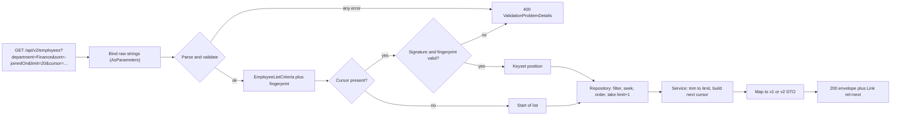
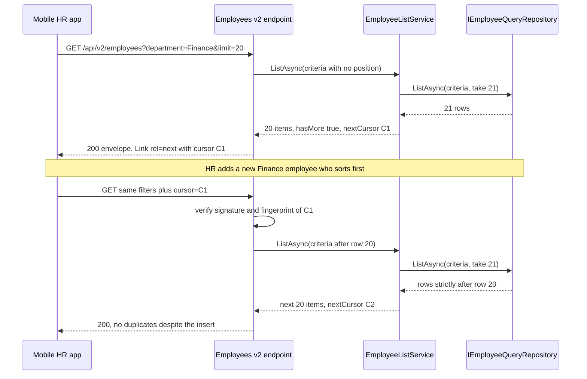

The employee API from [REST API design and HTTP status codes](#/lesson/m03-rest-status-codes) has a list endpoint that works beautifully with 40 employees on a developer laptop. Put it in front of an infrastructure firm with 18,000 staff across 60 project sites, and three things happen within a month: someone asks for "all employees" and the server serialises 7 MB of JSON, a mobile app scrolls to page 400 and the database spends a second skipping rows, and the HR team asks to change the salary field, which would break the payroll vendor's integration. This lesson fixes all three by designing the *shape* of the API: how lists are paged, filtered and sorted, and how the contract changes over time without breaking the people who depend on it.

## Learning objectives

By the end of this lesson you will be able to:

1. Explain why every list endpoint needs a default and a maximum page size, and pick sensible numbers.
2. Compare offset pagination with keyset (cursor) pagination, and say when each is the right choice.
3. Build an opaque, tamper-proof cursor that is bound to the filters and sort it was created for.
4. Design filters and sorts as an allow-list that maps to indexed columns, and validate every query parameter with clear 400 errors.
5. Return one consistent list envelope (items, limit, next cursor, optional total) plus a `Link` header.
6. Decide when a change is breaking, choose a versioning style, and announce retirement with `Deprecation` and `Sunset` headers.
7. Implement all of this in ASP.NET Core 10 with minimal APIs, an in-memory repository and the matching PostgreSQL query.

## Prerequisites

- [REST API design and HTTP status codes](#/lesson/m03-rest-status-codes): the module's employee API, Problem Details and the status-code table.
- [DTOs, entities, mapping and validation](#/lesson/m03-dtos-mapping-validation): why the wire contract is separate from the domain model.

Helpful but optional: [Offset versus keyset pagination](#/lesson/m09-pagination) goes deeper on the database side, and [Indexes, composite indexes, B-tree and hash](#/lesson/m09-indexes) explains why column order in an index matters for the queries we write here.

## Explain it like I'm a beginner

Imagine the Indian Railways enquiry counter. You ask for trains from Delhi to Pune. The clerk does not hand you a printout of every train in the country (that is "no pagination"). They do not let you say "skip the first 4,000 trains and show me the next ten" either, because counting 4,000 trains takes ages (that is "offset pagination" at scale). Instead they show ten trains, and say "next time, ask for trains *after the 14:30 departure*" (that is a **cursor**: a bookmark that says where you stopped).

You can also say "only sleeper class" or "only trains leaving after 6 pm". Those are **filters**. "Cheapest first" is **sorting**. But the clerk only accepts a fixed set of filters and sorts printed on the form, because their ledger is organised (indexed) for exactly those. If you ask "sort by the colour of the engine", they say "we cannot do that" (a **400 Bad Request**), instead of reading every page of every ledger.

Finally, one day the railway changes the form: fares now show the amount and the currency separately. Old travel agents still use the old form. So the counter accepts both for a year, stamps the old form "will stop on 31 March 2027", and eventually retires it. That is **API versioning** with a **deprecation** notice and a **sunset** date.

Four ideas, then:

- **Pagination**: never send everything; send a page and a way to get the next page.
- **Filtering**: let the client narrow the list, but only by fields you have planned for.
- **Sorting**: let the client choose the order, from a short allow-list, with a fixed tie-breaker.
- **Versioning**: when you must break the contract, run old and new side by side and announce the end date.

## First-principles explanation

### Why "give me everything" is never an option

A serialised employee in our API is about 350 bytes of JSON (an estimate; measure your own). Ten thousand employees is 3.5 MB per call, and with gzip still several hundred kilobytes. If an HR dashboard polls that every 30 seconds from 200 browsers, the server encodes about 23 MB of JSON per second for data nobody scrolls through. The database has to read all the rows, the API has to hold them in memory, and the client has to parse them.

So every list endpoint gets two numbers:

- A **default page size** used when the client says nothing. Twenty to fifty is typical for UI lists.
- A **maximum page size** the client cannot exceed. One hundred to five hundred is typical. Exports of "everything" belong in an asynchronous job that writes a file, not in a list endpoint.

When a client asks for more than the maximum, you have two options. **Clamp** silently to 100, or **reject** with 400. Clamping is friendlier for humans typing URLs; rejecting is safer for programs, because a client that thinks it received 1,000 rows and actually received 100 may silently lose data. This lesson rejects, and documents the maximum in OpenAPI. Whichever you choose, do it the same way on every endpoint.

### Offset pagination: simple, and slow when deep

Offset pagination is `?page=3&pageSize=20`, which becomes SQL `ORDER BY full_name LIMIT 20 OFFSET 40`. It is easy to understand and lets a UI show "page 3 of 87". The module project uses it today.

It has two real problems.

**Cost grows with depth.** PostgreSQL cannot jump to row 40,000. It must produce the first 40,020 rows in order and throw away 40,000 of them. With a matching index this is a fast index walk for small offsets, but the work is still proportional to the offset. Page 2 and page 2,000 do very different amounts of work, which is why "the last page is slow" is a classic support ticket.

**Pages drift when data changes.** Suppose page 1 showed employees 1–20 sorted by name. Before the client asks for page 2, HR adds "Aarav Shah", who sorts first. Every row shifts down by one; page 2 now starts with the employee who was 20th, so the client sees them twice. Delete a row instead and the client skips one. For a feed or a sync job, that is data loss.

Offset is still the right tool for small, mostly static admin lists where users want numbered pages, typically under ten thousand rows.

### Keyset (cursor) pagination: stable and constant-cost

Keyset pagination says "give me the 20 rows that come *after* this one in sort order". If the list is sorted by name and the last row on the page was ("Kavya Iyer", id 7f3a...), the next query is:

```sql
SELECT ... FROM employees
WHERE (full_name, id) > ('Kavya Iyer', '7f3a...')
ORDER BY full_name, id
LIMIT 21;
```

With an index on `(full_name, id)`, PostgreSQL seeks straight to that position in the B-tree and reads 21 entries. Page 2 and page 2,000 cost the same. Inserts and deletes elsewhere do not shift the bookmark, so nothing is duplicated or skipped.

Three details make it correct:

1. **A unique tie-breaker.** Two employees can share a name or a join date. If the sort is only `joined_on`, the cursor "after 2026-03-01" would skip every other employee who joined that day. Always append the primary key as the final sort column, and include it in the cursor.
2. **Fetch one extra row.** Ask for `limit + 1`. If you get 21 rows, there is a next page; return 20 and build the cursor from the 20th. This avoids a separate `COUNT(*)`.
3. **The cursor must carry the sort-key values**, not just the id, because the database compares on the sort columns first.

The trade-off: no "jump to page 37", and no cheap "page 37 of 87". That is fine for infinite scroll, mobile lists, sync jobs and exports; it is the wrong choice for a back-office grid where users genuinely jump to page 37.

### Making cursors opaque and tamper-proof

Clients should treat the cursor as an opaque string: they pass back exactly what you gave them. If the cursor is readable JSON such as `{"name":"Kavya","id":"7f3a"}`, clients will start building their own, and you can never change the format. So we encode it in base64url (URL-safe, no `+`, `/` or `=`), and sign it with HMAC-SHA256 using a server-side key.

Signing matters for two reasons. It stops clients fabricating positions (which might bypass a tenant filter if you were careless). And it means the server can trust the decoded values without re-validating every field.

The cursor also carries a **fingerprint** of the filters and sort it was made for. If a client takes a cursor from `?department=Finance&sort=-joinedOn` and replays it with `?department=Legal&sort=fullName`, the position is meaningless. The fingerprint check turns that into a clear 400 instead of a confusing page.

### Filtering: an allow-list, not a query language

The tempting design is "let the client filter by any field": `?filter=salary gt 50000 and city eq 'Pune'`. That is a query language, and building one safely is a large project (OData and GraphQL exist for that reason). For most APIs, a short list of named, typed parameters is better:

| Parameter | Type | Example | Maps to |
|---|---|---|---|
| `department` | exact match, case-insensitive | `department=Finance` | `department = $1` (indexed) |
| `status` | comma-separated enum list | `status=Active,OnLeave` | `status = ANY($2)` |
| `joinedFrom`, `joinedTo` | ISO date range, inclusive | `joinedFrom=2026-01-01` | `joined_on BETWEEN $3 AND $4` |
| `q` | text search, 2–50 characters | `q=iyer` | name or email prefix/contains (trigram index) |

Rules that keep this safe and fast:

- **Every filter maps to a column you have indexed** (or a deliberate full scan you accept on a small table). If a filter cannot use an index on a 2-million-row table, you are publishing a denial-of-service endpoint.
- **Values are typed and parsed** before they reach the repository. `joinedFrom=yesterday` is a 400 with a message, not a SQL error.
- **Values are always parameters**, never concatenated into SQL. This is where [SQL injection](#/lesson/m14-owasp) lives.
- **Unknown parameters**: either ignore them (lenient, the web's tradition) or reject them (strict, catches typos like `departmnet=`). Strict is safer for internal APIs; lenient is kinder for public ones. Pick one.

### Sorting: few fields, explicit direction, fixed tie-breaker

A common, readable convention is `sort=-joinedOn,fullName`: comma-separated fields, a leading `-` for descending. (Avoid a leading `+` for ascending; in a query string `+` decodes to a space.) Map each public name to a column through a dictionary, so a client can never inject `sort=salary; DROP TABLE`. Limit the number of sort keys to two or three; every combination you allow needs an index if the table is large.

Sorting and keyset pagination interact. The cursor holds one value per sort key plus the id. With all keys in the same direction, PostgreSQL's row comparison `(a, b, id) > ($1, $2, $3)` does the job in one expression and uses a composite index. With mixed directions (`-joinedOn, fullName`), row comparison no longer works and you expand it by hand:

```sql
WHERE joined_on < $1
   OR (joined_on = $1 AND full_name > $2)
   OR (joined_on = $1 AND full_name = $2 AND id > $3)
```

That still works, and PostgreSQL 17 can use an index created with matching directions, `(joined_on DESC, full_name ASC, id ASC)`. But each allowed combination needs its own index, which is another reason to keep the allow-list short.

### One response envelope for every list

Clients write one function to handle lists if every list looks the same. We use:

```json
{
  "items": [ { "id": "…", "fullName": "Kavya Iyer", "department": "Finance" } ],
  "limit": 20,
  "nextCursor": "eyJGaW5nZXJwcmludCI6…",
  "hasMore": true,
  "totalItems": null
}
```

plus a `Link: </api/v2/employees?department=Finance&cursor=eyJ…>; rel="next"` header (RFC 8288), so generic HTTP clients can follow pages without understanding the body.

`totalItems` is **opt-in** (`includeTotal=true`). An exact `COUNT(*)` over a filtered 2-million-row table can cost more than the page itself, and the number is stale the moment it is computed. Many UIs only need "is there more?", which `hasMore` answers for free. If a UI needs a rough count, PostgreSQL's planner estimate (`EXPLAIN` row estimate or `pg_class.reltuples`) is an option, labelled as approximate.

### Versioning: change without breaking

Most changes do **not** need a new version. Adding an optional request field, a new response field, a new endpoint or a new enum value that clients are told to tolerate are all **additive**. Clients that follow the "tolerant reader" rule (ignore what you do not understand) keep working.

A change is **breaking** when an existing, correct client would fail or misbehave:

- Removing or renaming a field, or changing its type (`monthlySalary: 85000` to `monthlyPay: { amount, currency }`).
- Changing the meaning of a value (salary was monthly, now annual).
- Making an optional request field required, or tightening validation.
- Changing default sort, default page size or pagination style.
- Changing status codes for existing outcomes.

When you must break, you publish a new version and run both. The three common styles:

| Style | Example | Good | Bad |
|---|---|---|---|
| URL segment | `/api/v2/employees` | Visible in logs, easy to route, cache-friendly, trivially testable with curl | "Not pure REST" (the resource has two URLs) |
| Query string | `/api/employees?api-version=2.0` | Optional default version, one path | Easy to forget; some caches ignore query order |
| Header | `api-version: 2.0` or `Accept: application/vnd.rodic.v2+json` | Clean URLs | Invisible in browser address bar and many logs; harder to test |

URL segments are the most common choice for public and cross-team APIs because they are obvious. The `Asp.Versioning.Http` package supports all three in ASP.NET Core, reports supported versions in an `api-supported-versions` header and can mark versions deprecated. In this lesson we version by URL with plain route groups, which needs no package and makes the mechanism visible. (In the REST lesson the minimal-API front door sat at `/api/v2` only to keep two programming styles apart; here, v2 is a genuinely different contract.)

**Version the contract, not the code.** Both versions call the same service and repository. Only the DTO mapping differs: `EmployeeV1` has `monthlySalary`, `EmployeeV2` has `monthlyPay { amount, currency }`. Copying the whole controller and service per version doubles every bug fix.

**Retire versions politely.** Mark the old version with response headers:

- `Deprecation: @1782864000` (RFC 9745, a Unix timestamp of when it was deprecated),
- `Sunset: Wed, 31 Mar 2027 00:00:00 GMT` (RFC 8594, when it will stop working),
- `Link: </api/v2/employees>; rel="successor-version"`.

Then watch your logs for traffic still on v1 (log the client name from authentication) and contact those teams before the sunset date. A typical policy for an internal platform is "two versions live at once, at least six months' overlap" (a policy choice, not a rule).

## Visual explanation

### From query string to page



Raw strings come in. All parsing happens in one place, and any failure becomes a single 400 that lists every bad field at once (not one error per round trip). Only a fully valid criteria object reaches the repository, so the repository never sees user-supplied column names. The cursor is verified before it is trusted. The repository asks for one extra row; the service decides `hasMore`, signs the next cursor and leaves mapping to the version-specific endpoint, which is the only place v1 and v2 differ.

### A client walking pages



The important moment is the note in the middle. With offset pagination, the insert would push row 20 onto page 2 and the app would show it twice. With a cursor, page 2 is defined as "strictly after row 20", so the insert (which sorts before row 20) does not affect it. The app will see the new employee next time it refreshes from the top, which is the behaviour users expect from a feed.

## Step-by-step example

We will upgrade the module project's list endpoint. The goal URL is:

```text
GET /api/v2/employees?department=Finance&status=Active,OnLeave&joinedFrom=2025-04-01&sort=-joinedOn&limit=20
```

**Step 1: Write the parameter table.** Before code, write down every parameter, its type, default, limits and error message. This table becomes the OpenAPI description and the test list. (See [API documentation with OpenAPI](#/lesson/m03-openapi).)

| Parameter | Default | Limits | Error example |
|---|---|---|---|
| `limit` | 20 | 1–100 | "limit must be a whole number from 1 to 100." |
| `sort` | `fullName` | ≤3 of fullName, department, joinedOn, monthlySalary | "Cannot sort by 'salary'." |
| `status` | all | Active, OnLeave, Resigned | "Unknown status 'Retired'." |
| `joinedFrom`/`joinedTo` | none | `yyyy-MM-dd`, from ≤ to | "joinedTo must be on or after joinedFrom." |
| `q` | none | 2–50 chars | "q must be 2 to 50 characters." |
| `cursor` | none | ≤2 KB, signed | "cursor is invalid or does not match these filters." |
| `includeTotal` | false | true/false | "includeTotal must be true or false." |

**Step 2: Bind everything as strings.** If `limit` is declared as `int?` and a client sends `limit=abc`, minimal APIs reject the request during binding with a bare 400 before your code runs. Binding to strings and parsing ourselves gives one consistent `ValidationProblemDetails` listing every problem.

**Step 3: Parse into a criteria object.** `EmployeeListCriteria` is an immutable record with typed values: a `HashSet<EmploymentStatus>`, `DateOnly?` dates, a list of `SortTerm`. Compute the fingerprint from everything except the position and limit. (Changing `limit` between pages is harmless; changing filters is not.)

**Step 4: Decode the cursor against the fingerprint.** Bad base64, bad signature, wrong fingerprint and wrong number of values all produce the same 400. Do not tell attackers which check failed.

**Step 5: Query with limit + 1.** The repository filters, applies the keyset condition, orders with the id tie-breaker and takes `limit + 1`.

**Step 6: Build the envelope and Link header.** Copy the incoming query string, replace `cursor`, and emit `rel="next"`.

**Step 7: Version the mapping.** `/api/v1/employees` maps rows with `EmployeeV1.From` and adds `Deprecation`, `Sunset` and `successor-version` headers; `/api/v2/employees` maps with `EmployeeV2.From`.

**Step 8: Add the index.** For the default sort and the department filter: `CREATE INDEX ON employees (department, full_name, id);` and for the newest-first view `CREATE INDEX ON employees (department, joined_on DESC, id DESC);`. Check with `EXPLAIN ANALYZE` that the plan is an index scan with no separate sort step (see [Query planning and EXPLAIN ANALYZE](#/lesson/m09-query-planning)).

## Production-style C# implementation

All `file=` blocks below compile together as one ASP.NET Core 10 project. They extend the module project's `EmployeeApi` namespace with a query layer. The domain class is repeated in trimmed form so this lesson compiles on its own.

```text
EmployeeApi/
  Program.cs
  Employees/Employee.cs
  Employees/EmployeeContracts.cs        v1 and v2 DTOs, CursorPage<T>
  Employees/IEmployeeQueryRepository.cs  + in-memory implementation
  Querying/SortTerms.cs                  allow-listed sort parsing
  Querying/EmployeeListCriteria.cs       typed criteria + fingerprint
  Querying/EmployeeOrdering.cs           comparisons for keyset
  Querying/CursorCodec.cs                signed, opaque cursors
  Querying/EmployeeQueryParser.cs        query string -> criteria or errors
  Querying/EmployeeListService.cs        limit+1, next cursor, total
  Endpoints/EmployeeListEndpoints.cs     /api/v1 and /api/v2
```

### Domain and contracts

```csharp file=Employees/Employee.cs
namespace EmployeeApi.Employees;

public enum EmploymentStatus { Active, OnLeave, Resigned }

/// <summary>Trimmed copy of the module project's domain class.</summary>
public sealed class Employee
{
    public Guid Id { get; init; } = Guid.NewGuid();
    public required string FullName { get; set; }
    public required string Email { get; set; }
    public required string Department { get; set; }
    public decimal MonthlySalary { get; set; }
    public DateOnly JoinedOn { get; set; }
    public EmploymentStatus Status { get; set; } = EmploymentStatus.Active;
    public int Version { get; set; } = 1;
}
```

```csharp file=Employees/EmployeeContracts.cs
namespace EmployeeApi.Employees;

/// <summary>The single list envelope used by every collection endpoint.</summary>
public sealed record CursorPage<T>(IReadOnlyList<T> Items, int Limit, string? NextCursor, bool HasMore, int? TotalItems);

/// <summary>Version 1 contract: salary is a bare number in rupees. Deprecated.</summary>
public sealed record EmployeeV1(Guid Id, string FullName, string Email, string Department,
    decimal MonthlySalary, DateOnly JoinedOn, EmploymentStatus Status)
{
    public static EmployeeV1 From(Employee e) =>
        new(e.Id, e.FullName, e.Email, e.Department, e.MonthlySalary, e.JoinedOn, e.Status);
}

public sealed record Money(decimal Amount, string Currency);

/// <summary>Version 2 contract: pay carries its currency, a breaking change for v1 clients.</summary>
public sealed record EmployeeV2(Guid Id, string FullName, string Email, string Department,
    Money MonthlyPay, DateOnly JoinedOn, EmploymentStatus Status)
{
    public static EmployeeV2 From(Employee e) =>
        new(e.Id, e.FullName, e.Email, e.Department, new Money(e.MonthlySalary, "INR"), e.JoinedOn, e.Status);
}
```

### Sorting and criteria

```csharp file=Querying/SortTerms.cs
namespace EmployeeApi.Querying;

public enum EmployeeSortField { FullName, Department, JoinedOn, MonthlySalary }

public sealed record SortTerm(EmployeeSortField Field, bool Descending)
{
    public override string ToString() => (Descending ? "-" : "") + EmployeeSortParser.PublicName(Field);
}

/// <summary>Turns "-joinedOn,fullName" into typed sort terms. Only allow-listed fields are accepted.</summary>
public static class EmployeeSortParser
{
    public const int MaxTerms = 3;

    private static readonly Dictionary<string, EmployeeSortField> Allowed = new(StringComparer.OrdinalIgnoreCase)
    {
        ["fullName"] = EmployeeSortField.FullName,
        ["department"] = EmployeeSortField.Department,
        ["joinedOn"] = EmployeeSortField.JoinedOn,
        ["monthlySalary"] = EmployeeSortField.MonthlySalary,
    };

    public static IReadOnlyList<SortTerm> Default { get; } = [new SortTerm(EmployeeSortField.FullName, false)];

    public static string PublicName(EmployeeSortField field) => field switch
    {
        EmployeeSortField.FullName => "fullName",
        EmployeeSortField.Department => "department",
        EmployeeSortField.JoinedOn => "joinedOn",
        EmployeeSortField.MonthlySalary => "monthlySalary",
        _ => throw new ArgumentOutOfRangeException(nameof(field)),
    };

    public static bool TryParse(string? raw, out IReadOnlyList<SortTerm> terms, out string? error)
    {
        terms = Default;
        error = null;
        if (string.IsNullOrWhiteSpace(raw)) return true;

        var parts = raw.Split(',', StringSplitOptions.TrimEntries | StringSplitOptions.RemoveEmptyEntries);
        if (parts.Length == 0) return true;
        if (parts.Length > MaxTerms)
        {
            error = $"At most {MaxTerms} sort fields are allowed.";
            return false;
        }

        var result = new List<SortTerm>(parts.Length);
        foreach (var part in parts)
        {
            var descending = part.StartsWith('-');
            var name = descending ? part[1..] : part;
            if (!Allowed.TryGetValue(name, out var field))
            {
                error = $"Cannot sort by '{name}'. Allowed: {string.Join(", ", Allowed.Keys)}.";
                return false;
            }
            if (result.Any(t => t.Field == field))
            {
                error = $"'{name}' appears more than once in sort.";
                return false;
            }
            result.Add(new SortTerm(field, descending));
        }
        terms = result;
        return true;
    }
}
```

```csharp file=Querying/EmployeeListCriteria.cs
using System.Globalization;
using System.Security.Cryptography;
using System.Text;
using EmployeeApi.Employees;

namespace EmployeeApi.Querying;

/// <summary>Where the previous page ended: one string per sort term (invariant format) plus the id tie-breaker.</summary>
public sealed record KeysetPosition(IReadOnlyList<string> Values, Guid LastId);

/// <summary>Fully validated, typed list request. Nothing user-supplied reaches the repository except through this.</summary>
public sealed record EmployeeListCriteria(
    string? Department,
    IReadOnlySet<EmploymentStatus> Statuses,
    DateOnly? JoinedFrom,
    DateOnly? JoinedTo,
    string? Search,
    IReadOnlyList<SortTerm> Sort,
    int Limit,
    KeysetPosition? After)
{
    /// <summary>Identifies the result set (filters and sort), ignoring position and limit. Cursors are bound to it.</summary>
    public string Fingerprint()
    {
        var canonical = string.Join('|',
            "d=" + (Department ?? "").ToLowerInvariant(),
            "s=" + string.Join(',', Statuses.Order()),
            "f=" + JoinedFrom?.ToString("yyyy-MM-dd", CultureInfo.InvariantCulture),
            "t=" + JoinedTo?.ToString("yyyy-MM-dd", CultureInfo.InvariantCulture),
            "q=" + (Search ?? "").ToLowerInvariant(),
            "o=" + string.Join(',', Sort));
        return Convert.ToHexString(SHA256.HashData(Encoding.UTF8.GetBytes(canonical)))[..16];
    }
}
```

### Keyset ordering

The in-memory repository needs the same ordering rules that PostgreSQL applies with `ORDER BY ... , id`. Strings compare ordinally so the order is deterministic; in PostgreSQL, make sure the index and the query use the same collation.

```csharp file=Querying/EmployeeOrdering.cs
using System.Globalization;
using EmployeeApi.Employees;

namespace EmployeeApi.Querying;

public static class EmployeeOrdering
{
    private static readonly CultureInfo Inv = CultureInfo.InvariantCulture;

    public static string KeyValue(Employee e, EmployeeSortField field) => field switch
    {
        EmployeeSortField.FullName => e.FullName,
        EmployeeSortField.Department => e.Department,
        EmployeeSortField.JoinedOn => e.JoinedOn.ToString("yyyy-MM-dd", Inv),
        EmployeeSortField.MonthlySalary => e.MonthlySalary.ToString(Inv),
        _ => throw new ArgumentOutOfRangeException(nameof(field)),
    };

    private static int CompareField(Employee e, EmployeeSortField field, string value) => field switch
    {
        EmployeeSortField.FullName => string.CompareOrdinal(e.FullName, value),
        EmployeeSortField.Department => string.CompareOrdinal(e.Department, value),
        EmployeeSortField.JoinedOn => e.JoinedOn.CompareTo(DateOnly.ParseExact(value, "yyyy-MM-dd", Inv)),
        EmployeeSortField.MonthlySalary => e.MonthlySalary.CompareTo(decimal.Parse(value, Inv)),
        _ => throw new ArgumentOutOfRangeException(nameof(field)),
    };

    public static KeysetPosition PositionOf(Employee e, IReadOnlyList<SortTerm> sort) =>
        new(sort.Select(t => KeyValue(e, t.Field)).ToArray(), e.Id);

    /// <summary>Negative: e sorts before the position. Positive: after. The id breaks ties in the direction of the last term.</summary>
    public static int CompareToPosition(Employee e, IReadOnlyList<SortTerm> sort, KeysetPosition position)
    {
        for (var i = 0; i < sort.Count; i++)
        {
            var c = CompareField(e, sort[i].Field, position.Values[i]);
            if (c != 0) return sort[i].Descending ? -c : c;
        }
        var byId = e.Id.CompareTo(position.LastId);
        return sort[^1].Descending ? -byId : byId;
    }

    public static IComparer<Employee> Comparer(IReadOnlyList<SortTerm> sort) =>
        Comparer<Employee>.Create((a, b) => CompareToPosition(a, sort, PositionOf(b, sort)));
}
```

### Signed cursors

```csharp file=Querying/CursorCodec.cs
using System.Buffers.Text;
using System.Security.Cryptography;
using System.Text;
using System.Text.Json;
using Microsoft.Extensions.Options;

namespace EmployeeApi.Querying;

public sealed class CursorOptions
{
    public const string SectionName = "Cursors";

    /// <summary>At least 32 characters. Store in a secret store, not in appsettings.json. Rotating it invalidates open cursors.</summary>
    public string SigningKey { get; set; } = "";
}

internal sealed record CursorPayload(string Fingerprint, string[] Values, Guid LastId);

/// <summary>Opaque cursor = base64url(json) + "." + base64url(HMAC-SHA256(json)).</summary>
public sealed class CursorCodec
{
    private const int MaxCursorLength = 2048;
    private readonly byte[] _key;

    public CursorCodec(IOptions<CursorOptions> options)
    {
        var key = options.Value.SigningKey;
        if (string.IsNullOrWhiteSpace(key) || key.Length < 32)
            throw new InvalidOperationException("Cursors:SigningKey must be configured with at least 32 characters.");
        _key = Encoding.UTF8.GetBytes(key);
    }

    public string Encode(string fingerprint, KeysetPosition position)
    {
        var json = JsonSerializer.SerializeToUtf8Bytes(new CursorPayload(fingerprint, position.Values.ToArray(), position.LastId));
        var signature = HMACSHA256.HashData(_key, json);
        return Base64Url.EncodeToString(json) + "." + Base64Url.EncodeToString(signature);
    }

    public bool TryDecode(string? cursor, string expectedFingerprint, int expectedValues, out KeysetPosition? position)
    {
        position = null;
        if (string.IsNullOrEmpty(cursor) || cursor.Length > MaxCursorLength) return false;
        var dot = cursor.IndexOf('.');
        if (dot <= 0 || dot == cursor.Length - 1) return false;
        try
        {
            var json = Base64Url.DecodeFromChars(cursor.AsSpan(0, dot));
            var signature = Base64Url.DecodeFromChars(cursor.AsSpan(dot + 1));
            if (!CryptographicOperations.FixedTimeEquals(signature, HMACSHA256.HashData(_key, json))) return false;

            var payload = JsonSerializer.Deserialize<CursorPayload>(json);
            if (payload is null || payload.Fingerprint != expectedFingerprint || payload.Values.Length != expectedValues)
                return false;
            position = new KeysetPosition(payload.Values, payload.LastId);
            return true;
        }
        catch (FormatException) { return false; }
        catch (JsonException) { return false; }
    }
}
```

### Parsing and validating the query

```csharp file=Querying/EmployeeQueryParser.cs
using System.Globalization;
using EmployeeApi.Employees;

namespace EmployeeApi.Querying;

/// <summary>Raw query string. Every property is a string so that we, not the binder, produce the error messages.</summary>
public sealed class EmployeeListRequest
{
    public string? Department { get; set; }
    public string? Status { get; set; }
    public string? JoinedFrom { get; set; }
    public string? JoinedTo { get; set; }
    public string? Q { get; set; }
    public string? Sort { get; set; }
    public string? Limit { get; set; }
    public string? Cursor { get; set; }
    public string? IncludeTotal { get; set; }
}

public sealed record QueryParseResult(EmployeeListCriteria? Criteria, string Fingerprint, bool IncludeTotal,
    IDictionary<string, string[]>? Errors)
{
    public bool IsValid => Errors is null;
}

public sealed class EmployeeQueryParser(CursorCodec cursors)
{
    public const int DefaultLimit = 20;
    public const int MaxLimit = 100;
    private static readonly CultureInfo Inv = CultureInfo.InvariantCulture;

    public QueryParseResult Parse(EmployeeListRequest r)
    {
        var errors = new Dictionary<string, string[]>(StringComparer.OrdinalIgnoreCase);
        void Fail(string field, string message) => errors[field] = [message];

        var limit = DefaultLimit;
        if (r.Limit is not null &&
            (!int.TryParse(r.Limit, NumberStyles.None, Inv, out limit) || limit is < 1 or > MaxLimit))
            Fail("limit", $"limit must be a whole number from 1 to {MaxLimit}.");

        var includeTotal = false;
        if (r.IncludeTotal is not null && !bool.TryParse(r.IncludeTotal, out includeTotal))
            Fail("includeTotal", "includeTotal must be true or false.");

        string? department = string.IsNullOrWhiteSpace(r.Department) ? null : r.Department.Trim();
        if (department is { Length: > 60 }) Fail("department", "department must be at most 60 characters.");

        var statuses = new HashSet<EmploymentStatus>();
        if (!string.IsNullOrWhiteSpace(r.Status))
        {
            foreach (var s in r.Status.Split(',', StringSplitOptions.TrimEntries | StringSplitOptions.RemoveEmptyEntries))
            {
                // Reject numbers: Enum.TryParse would otherwise accept "1" or "42".
                if (int.TryParse(s, out _) || !Enum.TryParse<EmploymentStatus>(s, ignoreCase: true, out var status))
                {
                    Fail("status", $"Unknown status '{s}'. Allowed: {string.Join(", ", Enum.GetNames<EmploymentStatus>())}.");
                    break;
                }
                statuses.Add(status);
            }
        }

        var from = ParseDate(r.JoinedFrom, "joinedFrom", Fail);
        var to = ParseDate(r.JoinedTo, "joinedTo", Fail);
        if (from is not null && to is not null && to < from) Fail("joinedTo", "joinedTo must be on or after joinedFrom.");

        string? search = string.IsNullOrWhiteSpace(r.Q) ? null : r.Q.Trim();
        if (search is { Length: < 2 or > 50 }) Fail("q", "q must be 2 to 50 characters.");

        if (!EmployeeSortParser.TryParse(r.Sort, out var sort, out var sortError)) Fail("sort", sortError!);

        if (errors.Count > 0) return new QueryParseResult(null, "", false, errors);

        var criteria = new EmployeeListCriteria(department, statuses, from, to, search, sort, limit, After: null);
        var fingerprint = criteria.Fingerprint();

        if (r.Cursor is not null)
        {
            if (!cursors.TryDecode(r.Cursor, fingerprint, sort.Count, out var position))
            {
                Fail("cursor", "cursor is invalid or does not match these filters. Restart from the first page.");
                return new QueryParseResult(null, "", false, errors);
            }
            criteria = criteria with { After = position };
        }
        return new QueryParseResult(criteria, fingerprint, includeTotal, null);
    }

    private static DateOnly? ParseDate(string? raw, string field, Action<string, string> fail)
    {
        if (string.IsNullOrWhiteSpace(raw)) return null;
        if (DateOnly.TryParseExact(raw.Trim(), "yyyy-MM-dd", Inv, DateTimeStyles.None, out var d)) return d;
        fail(field, $"{field} must be a date in yyyy-MM-dd format.");
        return null;
    }
}
```

### Repository and service

```csharp file=Employees/IEmployeeQueryRepository.cs
using EmployeeApi.Querying;

namespace EmployeeApi.Employees;

/// <summary>Read side of the employee store. The PostgreSQL version is shown after the code listing.</summary>
public interface IEmployeeQueryRepository
{
    /// <summary>Rows matching the filters, strictly after criteria.After, in sort order, at most <paramref name="take"/>.</summary>
    Task<IReadOnlyList<Employee>> ListAsync(EmployeeListCriteria criteria, int take, CancellationToken ct);

    /// <summary>Exact count of rows matching the filters (position ignored). Potentially expensive.</summary>
    Task<int> CountAsync(EmployeeListCriteria criteria, CancellationToken ct);
}

public sealed class InMemoryEmployeeQueryRepository : IEmployeeQueryRepository
{
    private readonly List<Employee> _items = new();
    private readonly Lock _gate = new();

    public void Add(Employee employee)
    {
        lock (_gate) _items.Add(employee);
    }

    public Task<IReadOnlyList<Employee>> ListAsync(EmployeeListCriteria criteria, int take, CancellationToken ct)
    {
        var query = Filter(Snapshot(), criteria);
        if (criteria.After is { } after)
            query = query.Where(e => EmployeeOrdering.CompareToPosition(e, criteria.Sort, after) > 0);
        IReadOnlyList<Employee> page = query.Order(EmployeeOrdering.Comparer(criteria.Sort)).Take(take).ToList();
        return Task.FromResult(page);
    }

    public Task<int> CountAsync(EmployeeListCriteria criteria, CancellationToken ct) =>
        Task.FromResult(Filter(Snapshot(), criteria).Count());

    private Employee[] Snapshot()
    {
        lock (_gate) return _items.ToArray();
    }

    private static IEnumerable<Employee> Filter(IEnumerable<Employee> source, EmployeeListCriteria c)
    {
        if (c.Department is not null)
            source = source.Where(e => string.Equals(e.Department, c.Department, StringComparison.OrdinalIgnoreCase));
        if (c.Statuses.Count > 0) source = source.Where(e => c.Statuses.Contains(e.Status));
        if (c.JoinedFrom is { } from) source = source.Where(e => e.JoinedOn >= from);
        if (c.JoinedTo is { } to) source = source.Where(e => e.JoinedOn <= to);
        if (c.Search is not null)
            source = source.Where(e => e.FullName.Contains(c.Search, StringComparison.OrdinalIgnoreCase)
                                    || e.Email.Contains(c.Search, StringComparison.OrdinalIgnoreCase));
        return source;
    }
}
```

```csharp file=Querying/EmployeeListService.cs
using EmployeeApi.Employees;

namespace EmployeeApi.Querying;

public sealed class EmployeeListService(IEmployeeQueryRepository repository, CursorCodec cursors)
{
    public async Task<CursorPage<T>> ListAsync<T>(EmployeeListCriteria criteria, string fingerprint, bool includeTotal,
        Func<Employee, T> map, CancellationToken ct)
    {
        // Ask for one extra row: if it arrives, there is a next page, and no COUNT(*) was needed to know that.
        var rows = await repository.ListAsync(criteria, criteria.Limit + 1, ct);
        var hasMore = rows.Count > criteria.Limit;
        var page = hasMore ? rows.Take(criteria.Limit).ToList() : rows.ToList();

        var next = hasMore ? cursors.Encode(fingerprint, EmployeeOrdering.PositionOf(page[^1], criteria.Sort)) : null;
        int? total = includeTotal ? await repository.CountAsync(criteria with { After = null }, ct) : null;

        return new CursorPage<T>(page.Select(map).ToList(), criteria.Limit, next, hasMore, total);
    }
}
```

### Versioned endpoints

```csharp file=Endpoints/EmployeeListEndpoints.cs
using System.Globalization;
using EmployeeApi.Employees;
using EmployeeApi.Querying;
using Microsoft.AspNetCore.Http.HttpResults;

namespace EmployeeApi.Endpoints;

public static class EmployeeListEndpoints
{
    public static readonly DateTimeOffset V1Deprecated = new(2026, 7, 1, 0, 0, 0, TimeSpan.Zero);
    public static readonly DateTimeOffset V1Sunset = new(2027, 3, 31, 0, 0, 0, TimeSpan.Zero);

    public static IEndpointRouteBuilder MapEmployeeListEndpoints(this IEndpointRouteBuilder app)
    {
        var v1 = app.MapGroup("/api/v1/employees")
            .WithTags("Employees v1 (deprecated)")
            .AddEndpointFilter(async (ctx, next) =>
            {
                var headers = ctx.HttpContext.Response.Headers;
                headers["Deprecation"] = "@" + V1Deprecated.ToUnixTimeSeconds().ToString(CultureInfo.InvariantCulture);
                headers["Sunset"] = V1Sunset.ToString("R", CultureInfo.InvariantCulture);
                headers.Append("Link", "</api/v2/employees>; rel=\"successor-version\"");
                return await next(ctx);
            });

        v1.MapGet("/", ([AsParameters] EmployeeListRequest request, EmployeeQueryParser parser,
                EmployeeListService service, HttpContext http, CancellationToken ct) =>
            List<EmployeeV1>(request, parser, service, http, EmployeeV1.From, ct))
          .WithName("ListEmployeesV1");

        var v2 = app.MapGroup("/api/v2/employees").WithTags("Employees v2");

        v2.MapGet("/", ([AsParameters] EmployeeListRequest request, EmployeeQueryParser parser,
                EmployeeListService service, HttpContext http, CancellationToken ct) =>
            List<EmployeeV2>(request, parser, service, http, EmployeeV2.From, ct))
          .WithName("ListEmployeesV2");

        return app;
    }

    private static async Task<Results<Ok<CursorPage<T>>, ValidationProblem>> List<T>(
        EmployeeListRequest request, EmployeeQueryParser parser, EmployeeListService service,
        HttpContext http, Func<Employee, T> map, CancellationToken ct)
    {
        var parsed = parser.Parse(request);
        if (!parsed.IsValid) return TypedResults.ValidationProblem(parsed.Errors!);

        var page = await service.ListAsync(parsed.Criteria!, parsed.Fingerprint, parsed.IncludeTotal, map, ct);
        if (page.NextCursor is not null)
            http.Response.Headers.Append("Link", $"<{NextLink(http.Request, page.NextCursor)}>; rel=\"next\"");
        return TypedResults.Ok(page);
    }

    /// <summary>Same path and filters, with the cursor replaced.</summary>
    private static string NextLink(HttpRequest request, string cursor)
    {
        var pairs = request.Query
            .Where(kv => !kv.Key.Equals("cursor", StringComparison.OrdinalIgnoreCase))
            .SelectMany(kv => kv.Value.Select(v => new KeyValuePair<string, string?>(kv.Key, v)))
            .Append(new KeyValuePair<string, string?>("cursor", cursor));
        return request.PathBase + request.Path + QueryString.Create(pairs);
    }
}
```

### Composition root

```csharp file=Program.cs
using System.Text.Json.Serialization;
using EmployeeApi.Employees;
using EmployeeApi.Endpoints;
using EmployeeApi.Querying;

var builder = WebApplication.CreateBuilder(args);

builder.Services.AddProblemDetails();
builder.Services.ConfigureHttpJsonOptions(o => o.SerializerOptions.Converters.Add(new JsonStringEnumConverter()));

builder.Services.Configure<CursorOptions>(builder.Configuration.GetSection(CursorOptions.SectionName));
builder.Services.AddSingleton<CursorCodec>();
builder.Services.AddSingleton<EmployeeQueryParser>();

builder.Services.AddSingleton<InMemoryEmployeeQueryRepository>();
builder.Services.AddSingleton<IEmployeeQueryRepository>(sp => sp.GetRequiredService<InMemoryEmployeeQueryRepository>());
builder.Services.AddScoped<EmployeeListService>();

var app = builder.Build();

app.UseExceptionHandler();
app.UseStatusCodePages();
app.MapEmployeeListEndpoints();

app.Run();

public partial class Program { }
```

The signing key comes from configuration (`Cursors__SigningKey` as an environment variable in production; see [Configuration, environment variables and secrets](#/lesson/m03-configuration)). The codec throws at first use if the key is missing, so a misconfigured deployment fails loudly instead of issuing unsigned cursors.

### The PostgreSQL repository (Npgsql)

This is the production read side. It needs the Npgsql package, so it is shown without `file=`. It handles the common case where all sort terms share one direction, so a single row comparison works; mixed directions use the expanded `OR` form from the first-principles section.

```csharp
public sealed class PostgresEmployeeQueryRepository(NpgsqlDataSource db) : IEmployeeQueryRepository
{
    // Allow-list: public sort field -> SQL column. User input never becomes SQL text.
    private static readonly Dictionary<EmployeeSortField, string> Columns = new()
    {
        [EmployeeSortField.FullName] = "full_name",
        [EmployeeSortField.Department] = "department",
        [EmployeeSortField.JoinedOn] = "joined_on",
        [EmployeeSortField.MonthlySalary] = "monthly_salary",
    };

    public async Task<IReadOnlyList<Employee>> ListAsync(EmployeeListCriteria c, int take, CancellationToken ct)
    {
        await using var cmd = db.CreateCommand();
        var where = new List<string>();
        if (c.Department is not null) { where.Add($"lower(department) = lower(${Add(cmd, c.Department)})"); }
        if (c.Statuses.Count > 0)     { where.Add($"status = ANY(${Add(cmd, c.Statuses.Select(s => (short)s).ToArray())})"); }
        if (c.JoinedFrom is { } f)    { where.Add($"joined_on >= ${Add(cmd, f)}"); }
        if (c.JoinedTo is { } t)      { where.Add($"joined_on <= ${Add(cmd, t)}"); }
        if (c.Search is not null)     { where.Add($"(full_name ILIKE ${Add(cmd, "%" + c.Search + "%")} OR email ILIKE ${cmd.Parameters.Count})"); }

        var cols = c.Sort.Select(s => Columns[s.Field]).Append("id").ToArray();
        var desc = c.Sort[^1].Descending;                       // single-direction case
        if (c.After is { } after)
        {
            var values = c.Sort.Select((s, i) => $"${Add(cmd, Typed(s.Field, after.Values[i]))}")
                               .Append($"${Add(cmd, after.LastId)}");
            where.Add($"({string.Join(", ", cols)}) {(desc ? "<" : ">")} ({string.Join(", ", values)})");
        }

        cmd.CommandText = $"""
            SELECT id, full_name, email, department, monthly_salary, joined_on, status, version
            FROM employees
            {(where.Count > 0 ? "WHERE " + string.Join(" AND ", where) : "")}
            ORDER BY {string.Join(", ", cols.Select(col => col + (desc ? " DESC" : "")))}
            LIMIT {take}
            """;
        // ... execute reader and map rows ...
    }

    private static int Add(NpgsqlCommand cmd, object value) { cmd.Parameters.Add(new NpgsqlParameter { Value = value }); return cmd.Parameters.Count; }
}
```

```sql
-- Indexes that match the allowed filter + sort combinations (estimate the set you really need).
CREATE INDEX employees_dept_name_idx   ON employees (lower(department), full_name, id);
CREATE INDEX employees_dept_joined_idx ON employees (lower(department), joined_on DESC, id DESC);
CREATE EXTENSION IF NOT EXISTS pg_trgm;
CREATE INDEX employees_name_trgm_idx   ON employees USING gin (full_name gin_trgm_ops);
```

With EF Core, the same keyset filter is a LINQ `Where` with explicit comparisons, for example `.Where(e => e.JoinedOn < lastDate || (e.JoinedOn == lastDate && e.Id.CompareTo(lastId) < 0))`, followed by `.OrderByDescending(e => e.JoinedOn).ThenByDescending(e => e.Id).Take(limit + 1)`. The Npgsql EF provider translates that to SQL; check the generated SQL with `ToQueryString()`.

### Versioning with the Asp.Versioning package

If you prefer the library to hand-rolled groups, the package `Asp.Versioning.Http` gives the same result with less code and also reports versions in headers:

```csharp
builder.Services.AddApiVersioning(o =>
{
    o.DefaultApiVersion = new ApiVersion(2);
    o.ReportApiVersions = true;                          // api-supported-versions / api-deprecated-versions headers
    o.ApiVersionReader = new UrlSegmentApiVersionReader();
});

var versions = app.NewApiVersionSet()
    .HasDeprecatedApiVersion(new ApiVersion(1))
    .HasApiVersion(new ApiVersion(2))
    .Build();

var employees = app.MapGroup("/api/v{version:apiVersion}/employees").WithApiVersionSet(versions);
employees.MapGet("/", ListV1).MapToApiVersion(1);
employees.MapGet("/", ListV2).MapToApiVersion(2);
```

## Bad design vs good design

**Bad**: the list endpoint every team writes first.

```csharp
[HttpGet]
public IActionResult List(string? sortBy, string? filterField, string? filterValue, int page = 1, int pageSize = 1000)
{
    var sql = $"SELECT * FROM employees WHERE {filterField} = '{filterValue}' ORDER BY {sortBy} " +
              $"LIMIT {pageSize} OFFSET {(page - 1) * pageSize}";
    var rows = _db.Query<Employee>(sql);
    return Ok(rows);           // a bare array: no next link, no hasMore, no total
}
```

What is wrong with it:

- **SQL injection** three ways: `filterField`, `filterValue` and `sortBy` are pasted into SQL. `sortBy=1; DROP TABLE employees` is the textbook attack.
- **Any column is filterable and sortable**, including unindexed ones, so one request can force a full scan and sort of 2 million rows.
- **`pageSize` has no maximum**, and the default is 1,000. `pageSize=1000000` loads the table into memory.
- **Deep offsets** make the last pages slow, and concurrent inserts duplicate or skip rows.
- **No tie-breaker**, so rows with equal sort values can appear on two pages or none, differently on each call.
- **A bare JSON array** cannot grow: adding `nextCursor` later is a breaking change, because the top level is an array, not an object.
- **The entity is returned directly**, so renaming a column renames a JSON field and breaks clients without anyone noticing.

**Good**: the implementation above. Raw strings are parsed once into typed criteria; filters and sorts go through allow-lists that map to indexed columns; the page size is bounded; keyset cursors are signed and bound to their filters; every list returns the same object envelope; and each version has its own DTO.

**When the simple version is fine**: an internal admin screen over a table that will never exceed a few thousand rows (say, 60 project sites or 25 departments). Offset paging with `page`/`pageSize`, a maximum of 100 and an allow-listed sort is perfectly adequate. Do not build signed cursors for a dropdown.

:::callout type=tradeoff title="Offset or keyset? Decide per endpoint"
Offset gives numbered pages and exact totals, at a cost that grows with depth and with drift under writes. Keyset gives constant cost and stable pages, but no random access. Many APIs offer offset for small admin grids and keyset for feeds, exports and mobile lists. What matters is that each endpoint documents which one it uses, and that the envelope looks the same.
:::

:::callout type=warning title="Do not expose the database through the query string"
Sort and filter names are part of your public contract. If they are column names, you can never rename a column. Map public names to columns through a dictionary, and keep that dictionary small.
:::

## Practical playground

This console program pages through a list twice, once with offsets and once with a keyset cursor, while a new row is inserted between page fetches. Run it, then change the insert (try a name that sorts last, or delete a row instead) and predict the output before running again.

:::playground type=csharp title="Offset versus keyset under concurrent inserts"
```csharp file=Program.cs
using System;
using System.Collections.Generic;
using System.Linq;

public sealed record Row(int Id, string Name);

public static class Program
{
    private static List<Row> Seed() =>
        new[] { "Bhavna", "Chirag", "Divya", "Farhan", "Gauri", "Harish", "Ishita", "Jatin" }
            .Select((n, i) => new Row(i + 1, n)).ToList();

    private static IEnumerable<Row> Sorted(List<Row> rows) => rows.OrderBy(r => r.Name, StringComparer.Ordinal).ThenBy(r => r.Id);

    public static void Main()
    {
        const int pageSize = 3;

        // Offset pagination
        var table = Seed();
        var seenOffset = new List<string>();
        for (var page = 0; ; page++)
        {
            var rows = Sorted(table).Skip(page * pageSize).Take(pageSize).ToList();
            if (rows.Count == 0) break;
            seenOffset.AddRange(rows.Select(r => r.Name));
            if (page == 0) table.Add(new Row(99, "Aarav"));   // inserted after page 1 was served
        }

        // Keyset pagination
        table = Seed();
        var seenKeyset = new List<string>();
        Row? after = null;
        while (true)
        {
            var rows = Sorted(table)
                .Where(r => after is null
                    || string.CompareOrdinal(r.Name, after.Name) > 0
                    || (r.Name == after.Name && r.Id > after.Id))
                .Take(pageSize).ToList();
            if (rows.Count == 0) break;
            seenKeyset.AddRange(rows.Select(r => r.Name));
            if (after is null) table.Add(new Row(99, "Aarav"));
            after = rows[^1];
        }

        Console.WriteLine("Offset : " + string.Join(", ", seenOffset));
        Console.WriteLine("Keyset : " + string.Join(", ", seenKeyset));
        var dupes = seenOffset.GroupBy(n => n).Where(g => g.Count() > 1).Select(g => g.Key).ToList();
        Console.WriteLine("Offset duplicates: " + (dupes.Count == 0 ? "none" : string.Join(", ", dupes)));
        Console.WriteLine("Keyset duplicates: " + (seenKeyset.Count == seenKeyset.Distinct().Count() ? "none" : "some"));
    }
}
```
:::

You should see "Divya" twice in the offset run: inserting "Aarav" at the top pushed Divya from position 3 to position 4, onto the second page. The keyset run shows each original row exactly once. Neither run shows Aarav, which is correct: he sorts before where the client already is.

## Exercises

:::exercise id=m03-api-shape-ex1 difficulty=beginner kind=code title="Parse an allow-listed sort parameter"
Implement `SortParser.Parse` for the `sort` query parameter of the employee list. The format is a comma-separated list of field names, each optionally prefixed by `-` for descending.
::requirements
- Allowed fields (case-insensitive): `fullName`, `joinedOn`, `monthlySalary`.
- `null`, empty, whitespace or only commas returns the default: `fullName` ascending.
- Whitespace around entries is ignored: `" joinedOn , -fullName "` is valid.
- More than `MaxKeys` (3) entries is an error.
- An unknown field is an error whose message contains the field name as the client typed it.
- The same field twice (in any direction) is an error.
::acceptance
- All tests pass.
- `Parse` never throws for any string input; errors are returned in `SortParseResult.Error`.
::hint
Use a `Dictionary<string, SortField>` with `StringComparer.OrdinalIgnoreCase` as the allow-list.
::hint
`string.Split(',', StringSplitOptions.TrimEntries | StringSplitOptions.RemoveEmptyEntries)` handles spaces and empty entries in one call.
::hint
Check the count first, then loop: strip a leading `-`, look up the name, reject duplicates, add the key.
::hint
```csharp
var desc = part.StartsWith('-');
var name = desc ? part[1..] : part;
if (!Allowed.TryGetValue(name, out var field)) return Fail($"Cannot sort by '{name}'.");
if (keys.Any(k => k.Field == field)) return Fail($"'{name}' appears twice.");
keys.Add(new SortKey(field, desc));
```
::starter
```csharp file=SortParser.cs
using System;
using System.Collections.Generic;

public enum SortField { FullName, JoinedOn, MonthlySalary }

public sealed record SortKey(SortField Field, bool Descending);

public sealed record SortParseResult(IReadOnlyList<SortKey> Keys, string? Error)
{
    public bool IsValid => Error is null;
}

public static class SortParser
{
    public const int MaxKeys = 3;

    public static SortParseResult Parse(string? raw) => throw new NotImplementedException();
}
```
::tests
```csharp file=SortParserTests.cs
using Xunit;

public class SortParserTests
{
    [Theory]
    [InlineData(null)]
    [InlineData("")]
    [InlineData("   ")]
    [InlineData(" , ,")]
    public void Empty_input_gives_default(string? raw)
    {
        var r = SortParser.Parse(raw);
        Assert.True(r.IsValid);
        Assert.Equal(1, r.Keys.Count);
        Assert.Equal(new SortKey(SortField.FullName, false), r.Keys[0]);
    }

    [Fact]
    public void Parses_direction_and_order()
    {
        var r = SortParser.Parse(" joinedOn , -monthlySalary ");
        Assert.True(r.IsValid);
        Assert.Equal(2, r.Keys.Count);
        Assert.Equal(new SortKey(SortField.JoinedOn, false), r.Keys[0]);
        Assert.Equal(new SortKey(SortField.MonthlySalary, true), r.Keys[1]);
    }

    [Fact]
    public void Field_names_are_case_insensitive()
    {
        var r = SortParser.Parse("-JOINEDON");
        Assert.True(r.IsValid);
        Assert.Equal(new SortKey(SortField.JoinedOn, true), r.Keys[0]);
    }

    [Fact]
    public void Unknown_field_is_rejected_with_its_name()
    {
        var r = SortParser.Parse("fullName,-salary");
        Assert.False(r.IsValid);
        Assert.Contains("salary", r.Error);
    }

    [Fact]
    public void Duplicate_field_is_rejected()
    {
        var r = SortParser.Parse("fullName,-fullName");
        Assert.False(r.IsValid);
    }

    [Fact]
    public void Too_many_keys_is_rejected()
    {
        var r = SortParser.Parse("fullName,joinedOn,monthlySalary,fullName");
        Assert.False(r.IsValid);
        Assert.Contains("3", r.Error);
    }

    [Fact]
    public void Injection_attempt_is_just_an_unknown_field()
    {
        var r = SortParser.Parse("fullName; DROP TABLE employees");
        Assert.False(r.IsValid);
    }
}
```
::solution
The allow-list is a dictionary, so the only values that can ever leave the parser are the three enum members. That is what makes the later SQL safe: the repository maps an enum to a column name, and no client text reaches the query.

```csharp file=SortParser.cs
using System;
using System.Collections.Generic;
using System.Linq;

public enum SortField { FullName, JoinedOn, MonthlySalary }

public sealed record SortKey(SortField Field, bool Descending);

public sealed record SortParseResult(IReadOnlyList<SortKey> Keys, string? Error)
{
    public bool IsValid => Error is null;
}

public static class SortParser
{
    public const int MaxKeys = 3;

    private static readonly Dictionary<string, SortField> Allowed = new(StringComparer.OrdinalIgnoreCase)
    {
        ["fullName"] = SortField.FullName,
        ["joinedOn"] = SortField.JoinedOn,
        ["monthlySalary"] = SortField.MonthlySalary,
    };

    private static readonly IReadOnlyList<SortKey> Default = new[] { new SortKey(SortField.FullName, false) };

    public static SortParseResult Parse(string? raw)
    {
        if (string.IsNullOrWhiteSpace(raw)) return new SortParseResult(Default, null);

        var parts = raw.Split(',', StringSplitOptions.TrimEntries | StringSplitOptions.RemoveEmptyEntries);
        if (parts.Length == 0) return new SortParseResult(Default, null);
        if (parts.Length > MaxKeys) return Fail($"At most {MaxKeys} sort fields are allowed.");

        var keys = new List<SortKey>(parts.Length);
        foreach (var part in parts)
        {
            var desc = part.StartsWith('-');
            var name = desc ? part[1..] : part;
            if (!Allowed.TryGetValue(name, out var field))
                return Fail($"Cannot sort by '{name}'. Allowed: {string.Join(", ", Allowed.Keys)}.");
            if (keys.Any(k => k.Field == field)) return Fail($"'{name}' appears more than once.");
            keys.Add(new SortKey(field, desc));
        }
        return new SortParseResult(keys, null);
    }

    private static SortParseResult Fail(string message) => new(Array.Empty<SortKey>(), message);
}
```
::alternatives
A regular expression such as `^-?(fullName|joinedOn|monthlySalary)$` per entry also works, but the dictionary gives you the mapping to the enum for free and is easier to extend. Some APIs use two parameters (`sortBy=joinedOn&sortDir=desc`); that is clearer for one key and clumsy for several.
::mistakes
- Passing the raw string to `ORDER BY` "because it was validated with a regex". Map to an enum and then to a column.
- Accepting `+fullName`: the `+` arrives as a space after URL decoding, so it only "works" because of trimming. Document `-` only.
- Returning the default sort silently for an unknown field. The client asked for something specific and deserves a 400.
:::

:::exercise id=m03-api-shape-ex2 difficulty=beginner kind=written title="Breaking or not?"
The employee API v2 has many consumers: the HR web app, a payroll vendor, and a site-attendance system at 60 project locations. For each proposed change, say whether it is **breaking** for an existing, correct client, and what you would do (ship in v2, ship behind an opt-in, or wait for v3).

1. Add an optional `employeeCode` field to the response.
2. Rename `fullName` to `name` in the response.
3. Add a new status value `Probation` to `EmploymentStatus`.
4. Change the default page size from 20 to 50.
5. Make `department` required on `POST /api/v2/employees` (it was optional).
6. Add a new optional filter `site=Pune-Metro-L3`.
7. Change `monthlyPay.amount` from monthly to annual, keeping the name.
8. Return `422` instead of `400` for business-rule failures.
::acceptance
- Each answer says breaking or not, with one sentence of reasoning that names the kind of client that would fail.
- At least one answer discusses the tolerant-reader assumption.
- The remedy for each breaking change is concrete (new field, new version, opt-in parameter, or deprecation plan).
::hint
Ask: "If a client compiled against today's OpenAPI document and never changes, does it still do the right thing?"
::hint
Enum additions are the grey area. They are additive on paper, but a client with a `switch` that throws on unknown values will break.
::hint
Changing the meaning of a field without changing its name is the most dangerous breaking change, because nothing fails loudly.
::solution
1. **Not breaking.** Tolerant readers ignore unknown fields. Ship in v2. (A client that uses strict deserialisation that rejects unknown members would break; the API guidelines must tell consumers not to do that.)
2. **Breaking.** Every client reading `fullName` gets null. Either add `name` alongside `fullName` and deprecate the old field, or wait for v3.
3. **Grey area, treat as breaking unless documented.** If the API guidelines already said "enums may gain values, handle unknowns", ship in v2 and notify consumers. Otherwise the payroll vendor's `switch` may throw. Safer: announce it, give a date, and check logs for errors from that client after release.
4. **Breaking in practice.** A client that relied on 20 per page (for example, for a fixed-size grid) changes behaviour. Keep 20 as the default; clients that want 50 can ask with `limit=50`.
5. **Breaking.** Requests that were valid now get 400. Make it required only in v3, or default the value server-side.
6. **Not breaking.** Old clients do not send it. Ship in v2, and add the index for it.
7. **Breaking and silent**, the worst kind: the payroll vendor would pay twelve times too much without any error. Never reuse a field with new meaning. Add `annualPay` as a new field instead.
8. **Breaking.** Clients branching on 400 for validation would miss these. Do it in v3, or never: consistency matters more than which code you picked.
::mistakes
- Assuming "it's only adding" is always safe, without considering enums and strict deserialisers.
- Treating a meaning change (monthly to annual) as non-breaking because the JSON schema did not change.
- Forgetting that defaults (page size, sort order) are part of the contract.
:::

:::exercise id=m03-api-shape-ex3 difficulty=intermediate kind=code title="A signed, filter-bound cursor"
Implement `SignedCursorCodec`, which turns a `PageCursor` into an opaque URL-safe token and back. The token must be tamper-proof (HMAC-SHA256 with a server key) and must only decode for the same filter fingerprint it was created with.
::requirements
- The constructor rejects keys shorter than 32 bytes with `ArgumentException`.
- `Encode` returns `base64url(json) + "." + base64url(hmac)`. The token contains no `+`, `/` or `=` characters.
- `TryDecode(token, expectedFingerprint, out cursor)` returns true and the original cursor only if the signature is valid and the fingerprint matches.
- Any malformed input (null, empty, no dot, bad base64, bad JSON, wrong signature, wrong key) returns false. It never throws.
- Compare signatures in constant time.
::acceptance
- All tests pass.
- A token whose payload part is swapped with the payload of another token fails to decode.
::hint
`System.Text.Json.JsonSerializer.SerializeToUtf8Bytes` gives you the bytes to sign; `HMACSHA256.HashData(key, bytes)` gives the signature.
::hint
`System.Buffers.Text.Base64Url.EncodeToString` and `DecodeFromChars` (in .NET 9 and later) handle URL-safe base64 without padding. Decoding bad input throws `FormatException`, so catch it.
::hint
Use `CryptographicOperations.FixedTimeEquals` for the signature comparison, so response timing does not reveal how many bytes matched.
::hint
```csharp
var dot = token.IndexOf('.');
var json = Base64Url.DecodeFromChars(token.AsSpan(0, dot));
var sig  = Base64Url.DecodeFromChars(token.AsSpan(dot + 1));
if (!CryptographicOperations.FixedTimeEquals(sig, HMACSHA256.HashData(_key, json))) return false;
var c = JsonSerializer.Deserialize<PageCursor>(json);
return c is not null && c.Fingerprint == expectedFingerprint;
```
::starter
```csharp file=SignedCursorCodec.cs
using System;

public sealed record PageCursor(string Fingerprint, DateOnly LastJoinedOn, int LastId);

public sealed class SignedCursorCodec
{
    public SignedCursorCodec(byte[] key) => throw new NotImplementedException();

    public string Encode(PageCursor cursor) => throw new NotImplementedException();

    public bool TryDecode(string? token, string expectedFingerprint, out PageCursor? cursor) =>
        throw new NotImplementedException();
}
```
::tests
```csharp file=SignedCursorCodecTests.cs
using System;
using System.Text;
using Xunit;

public class SignedCursorCodecTests
{
    private static readonly byte[] KeyA = Encoding.UTF8.GetBytes("a-very-long-test-signing-key-0001");
    private static readonly byte[] KeyB = Encoding.UTF8.GetBytes("another-long-test-signing-key-002");
    private static readonly PageCursor Sample = new("fp-finance", new DateOnly(2026, 3, 1), 7);

    [Fact]
    public void Round_trips()
    {
        var codec = new SignedCursorCodec(KeyA);
        var token = codec.Encode(Sample);
        Assert.True(codec.TryDecode(token, "fp-finance", out var decoded));
        Assert.Equal(Sample, decoded);
    }

    [Fact]
    public void Token_is_url_safe()
    {
        var token = new SignedCursorCodec(KeyA).Encode(Sample with { LastId = 123456789 });
        Assert.DoesNotContain("+", token);
        Assert.DoesNotContain("/", token);
        Assert.DoesNotContain("=", token);
        Assert.Contains(".", token);
    }

    [Fact]
    public void Wrong_fingerprint_is_rejected()
    {
        var codec = new SignedCursorCodec(KeyA);
        Assert.False(codec.TryDecode(codec.Encode(Sample), "fp-legal", out var c));
        Assert.Null(c);
    }

    [Fact]
    public void Token_from_another_key_is_rejected()
    {
        var token = new SignedCursorCodec(KeyB).Encode(Sample);
        Assert.False(new SignedCursorCodec(KeyA).TryDecode(token, "fp-finance", out _));
    }

    [Fact]
    public void Swapped_payload_is_rejected()
    {
        var codec = new SignedCursorCodec(KeyA);
        var real = codec.Encode(Sample).Split('.');
        var other = codec.Encode(Sample with { LastId = 99 }).Split('.');
        var forged = other[0] + "." + real[1];
        Assert.False(codec.TryDecode(forged, "fp-finance", out _));
    }

    [Theory]
    [InlineData(null)]
    [InlineData("")]
    [InlineData("no-dot-here")]
    [InlineData(".")]
    [InlineData("abc.")]
    [InlineData("!!!.???")]
    [InlineData("e30.e30")]
    public void Garbage_returns_false_without_throwing(string? token)
    {
        Assert.False(new SignedCursorCodec(KeyA).TryDecode(token, "fp-finance", out _));
    }

    [Fact]
    public void Short_key_is_rejected() =>
        Assert.Throws<ArgumentException>(() => new SignedCursorCodec(new byte[16]));
}
```
::solution
The signature covers the exact JSON bytes, so any change to the payload (or a payload borrowed from another token) breaks it. The fingerprint check happens after the signature check, on trusted data.

```csharp file=SignedCursorCodec.cs
using System;
using System.Buffers.Text;
using System.Security.Cryptography;
using System.Text.Json;

public sealed record PageCursor(string Fingerprint, DateOnly LastJoinedOn, int LastId);

public sealed class SignedCursorCodec
{
    private readonly byte[] _key;

    public SignedCursorCodec(byte[] key)
    {
        ArgumentNullException.ThrowIfNull(key);
        if (key.Length < 32) throw new ArgumentException("The signing key must be at least 32 bytes.", nameof(key));
        _key = (byte[])key.Clone();
    }

    public string Encode(PageCursor cursor)
    {
        var json = JsonSerializer.SerializeToUtf8Bytes(cursor);
        var signature = HMACSHA256.HashData(_key, json);
        return Base64Url.EncodeToString(json) + "." + Base64Url.EncodeToString(signature);
    }

    public bool TryDecode(string? token, string expectedFingerprint, out PageCursor? cursor)
    {
        cursor = null;
        if (string.IsNullOrEmpty(token) || token.Length > 2048) return false;
        var dot = token.IndexOf('.');
        if (dot <= 0 || dot == token.Length - 1) return false;
        try
        {
            var json = Base64Url.DecodeFromChars(token.AsSpan(0, dot));
            var signature = Base64Url.DecodeFromChars(token.AsSpan(dot + 1));
            if (!CryptographicOperations.FixedTimeEquals(signature, HMACSHA256.HashData(_key, json))) return false;

            var decoded = JsonSerializer.Deserialize<PageCursor>(json);
            if (decoded is null || decoded.Fingerprint != expectedFingerprint) return false;
            cursor = decoded;
            return true;
        }
        catch (FormatException) { return false; }
        catch (JsonException) { return false; }
    }
}
```
::alternatives
ASP.NET Core Data Protection (`IDataProtector.Protect`) encrypts and signs in one call and manages key rotation for you, at the cost of longer tokens and a dependency on the key ring being shared across instances. Encryption also hides the sort values from curious clients, which matters if a sort key is sensitive (salary).
::mistakes
- Comparing signatures with `SequenceEqual` or `==` on base64 strings, which leaks timing information.
- Checking the fingerprint before verifying the signature, which means trusting unverified data.
- Letting `FormatException` escape, which turns a bad cursor into a 500 instead of a 400.
- Using standard base64: `+` and `/` must then be escaped in URLs, and many clients forget.
:::

:::exercise id=m03-api-shape-ex4 difficulty=intermediate kind=sql title="Write the keyset query" ordered=true
The table `employees` is seeded below. A client is paging through Finance employees **newest first**, with `id` as the tie-breaker in the same direction. The last row on its previous page had `joined_on = 2026-03-01` and `id = 7`. Write the query for the next page of 3 rows, returning `id, full_name, joined_on`.
::requirements
- Order by `joined_on DESC, id DESC`.
- Only rows strictly after the cursor position in that order.
- Only department `Finance`.
- At most 3 rows. Do not use `OFFSET`.
::acceptance
- The result matches the reference query exactly, in order.
- Employee 9 (same date, higher id) is **not** returned; employee 4 (same date, lower id) is.
::hint
"After" in a descending order means "less than".
::hint
PostgreSQL compares row values left to right: `(joined_on, id) < (DATE '2026-03-01', 7)` is true when the date is earlier, or the date is equal and the id is smaller.
::hint
```sql
SELECT id, full_name, joined_on
FROM employees
WHERE department = 'Finance' AND (joined_on, id) < (...)
ORDER BY ...
LIMIT 3;
```
::setup
```sql
CREATE TABLE employees (
  id         int PRIMARY KEY,
  full_name  text NOT NULL,
  department text NOT NULL,
  joined_on  date NOT NULL
);
INSERT INTO employees VALUES
 (1,  'Ananya Rao',     'Legal',   '2026-03-01'),
 (2,  'Rohit Verma',    'Finance', '2026-01-05'),
 (3,  'Meera Pillai',   'Finance', '2026-04-10'),
 (4,  'Suresh Patil',   'Finance', '2026-03-01'),
 (5,  'Kiran Shetty',   'Design',  '2026-02-20'),
 (6,  'Neha Gupta',     'Legal',   '2025-11-30'),
 (7,  'Vikram Singh',   'Finance', '2026-03-01'),
 (8,  'Pooja Desai',    'Design',  '2026-03-01'),
 (9,  'Aditya Kulkarni','Finance', '2026-03-01'),
 (10, 'Lakshmi Menon',  'Finance', '2025-12-01'),
 (11, 'Imran Qureshi',  'Legal',   '2026-02-14'),
 (12, 'Tanvi Joshi',    'Finance', '2026-02-14');
CREATE INDEX employees_dept_joined_idx ON employees (department, joined_on DESC, id DESC);
```
::check
```sql
SELECT id, full_name, joined_on
FROM employees
WHERE department = 'Finance'
  AND (joined_on, id) < (DATE '2026-03-01', 7)
ORDER BY joined_on DESC, id DESC
LIMIT 3;
```
::solution
```sql
SELECT id, full_name, joined_on
FROM employees
WHERE department = 'Finance'
  AND (joined_on, id) < (DATE '2026-03-01', 7)
ORDER BY joined_on DESC, id DESC
LIMIT 3;
```
The full Finance order is 3, 9, 7, 4, 12, 2, 10. The previous page ended at 7, so the next three are 4 (Suresh Patil), 12 (Tanvi Joshi) and 2 (Rohit Verma). The row comparison handles the tie on 2026-03-01: 9 is "before" 7 in descending id order, so it was on the previous page, and 4 is "after", so it is on this one. With the index `(department, joined_on DESC, id DESC)` PostgreSQL can seek directly to the position and read three entries. In the API, you would ask for `LIMIT 4` and use the fourth row only to decide `hasMore`.
::alternatives
The expanded form `joined_on < '2026-03-01' OR (joined_on = '2026-03-01' AND id < 7)` returns the same rows and is what you need when sort directions are mixed. Some planners use the index less effectively with `OR`; check with `EXPLAIN`.
::mistakes
- `WHERE joined_on < '2026-03-01'`: skips employee 4, who joined the same day.
- `WHERE joined_on <= '2026-03-01' AND id < 7`: wrongly excludes later-id rows from earlier dates (12 would be lost on a different dataset).
- Using `>` because "next page" sounds like "greater": in a descending order, next means smaller.
:::

:::exercise id=m03-api-shape-ex5 difficulty=advanced kind=code title="A keyset pager with mixed sort directions"
Implement `KeysetPager`, an in-memory keyset paginator that supports multi-key sorts with mixed directions and an `Id` tie-breaker. It must never return a row twice or skip an existing row while a client walks the pages, even if rows are inserted during the walk.
::requirements
- `Compare(a, b, order)` compares two rows by the order keys in turn (respecting each key's direction), then by `Id` ascending.
- `GetPage(rows, order, after, limit)` returns up to `limit` rows strictly after `after` in that order (all rows from the start if `after` is null), and `NextAfter` set to the last returned row when more rows exist, else null.
- Use the limit + 1 technique: an exact multiple of `limit` must not produce an empty final page.
- `limit` outside 1–100 throws `ArgumentOutOfRangeException`. An empty `order` throws `ArgumentException`.
::acceptance
- All tests pass, including the walk-with-inserts test.
- `GetPage` does not mutate its input.
::hint
Write `Compare` first; everything else depends on it. A `foreach` over the order keys with an early return on the first non-zero comparison is enough.
::hint
"Strictly after" is `Compare(row, after, order) > 0`. Because `Id` is unique, no two distinct rows compare equal, which is why the tie-breaker guarantees no duplicates.
::hint
Sort the filtered rows with `Comparer<Row>.Create((a, b) => Compare(a, b, order))`, take `limit + 1`, and decide `NextAfter` from whether you got the extra row.
::hint
```csharp
var candidates = rows.Where(r => after is null || Compare(r, after, order) > 0)
                     .Order(Comparer<Row>.Create((a, b) => Compare(a, b, order)))
                     .Take(limit + 1).ToList();
var hasMore = candidates.Count > limit;
var items = candidates.Take(limit).ToList();
return new Page(items, hasMore ? items[^1] : null);
```
::starter
```csharp file=KeysetPager.cs
using System;
using System.Collections.Generic;

public sealed record Row(int Id, string Name, DateOnly JoinedOn, decimal Salary);

public enum Key { Name, JoinedOn, Salary }

public sealed record OrderKey(Key Key, bool Descending);

public sealed record Page(IReadOnlyList<Row> Items, Row? NextAfter);

public static class KeysetPager
{
    public static int Compare(Row a, Row b, IReadOnlyList<OrderKey> order) => throw new NotImplementedException();

    public static Page GetPage(IEnumerable<Row> rows, IReadOnlyList<OrderKey> order, Row? after, int limit) =>
        throw new NotImplementedException();
}
```
::tests
```csharp file=KeysetPagerTests.cs
using System;
using System.Collections.Generic;
using System.Linq;
using Xunit;

public class KeysetPagerTests
{
    private static List<Row> Make(int n) => Enumerable.Range(1, n)
        .Select(i => new Row(i, "Emp" + (i % 5), new DateOnly(2026, 1, 1).AddDays(i % 4), 50_000m + (i % 3) * 1_000m))
        .ToList();

    private static readonly OrderKey[] NewestThenName = { new(Key.JoinedOn, true), new(Key.Name, false) };

    [Fact]
    public void Ties_are_broken_by_id()
    {
        var a = new Row(2, "Same", new DateOnly(2026, 1, 1), 1m);
        var b = new Row(5, "Same", new DateOnly(2026, 1, 1), 1m);
        var order = new[] { new OrderKey(Key.Name, false) };
        Assert.True(KeysetPager.Compare(a, b, order) < 0);
        Assert.True(KeysetPager.Compare(b, a, order) > 0);
        Assert.Equal(0, KeysetPager.Compare(a, a, order));
    }

    [Fact]
    public void Mixed_directions_are_respected()
    {
        var older = new Row(1, "A", new DateOnly(2026, 1, 1), 1m);
        var newer = new Row(2, "Z", new DateOnly(2026, 2, 1), 1m);
        Assert.True(KeysetPager.Compare(newer, older, NewestThenName) < 0);   // newer first
        var sameDayA = new Row(3, "A", new DateOnly(2026, 2, 1), 1m);
        Assert.True(KeysetPager.Compare(sameDayA, newer, NewestThenName) < 0); // then name ascending
    }

    [Fact]
    public void Walking_all_pages_returns_every_row_once_in_order()
    {
        var rows = Make(25);
        var seen = new List<Row>();
        Row? after = null;
        var pages = 0;
        do
        {
            var page = KeysetPager.GetPage(rows, NewestThenName, after, 7);
            seen.AddRange(page.Items);
            after = page.NextAfter;
            pages++;
        } while (after is not null);

        Assert.Equal(4, pages);
        Assert.Equal(25, seen.Select(r => r.Id).Distinct().Count());
        var expected = rows.Order(Comparer<Row>.Create((a, b) => KeysetPager.Compare(a, b, NewestThenName))).Select(r => r.Id).ToList();
        Assert.Equal(expected, seen.Select(r => r.Id).ToList());
    }

    [Fact]
    public void Exact_multiple_has_no_empty_last_page()
    {
        var rows = Make(21);
        var p1 = KeysetPager.GetPage(rows, NewestThenName, null, 7);
        var p2 = KeysetPager.GetPage(rows, NewestThenName, p1.NextAfter, 7);
        var p3 = KeysetPager.GetPage(rows, NewestThenName, p2.NextAfter, 7);
        Assert.Equal(7, p3.Items.Count);
        Assert.Null(p3.NextAfter);
    }

    [Fact]
    public void Inserts_during_the_walk_cause_no_duplicates_or_skips()
    {
        var rows = Make(20);
        var original = rows.Select(r => r.Id).ToHashSet();
        var seen = new List<int>();
        Row? after = null;
        var nextId = 1000;
        do
        {
            var page = KeysetPager.GetPage(rows, NewestThenName, after, 6);
            seen.AddRange(page.Items.Select(r => r.Id));
            after = page.NextAfter;
            // Someone inserts a row that sorts first, and one that sorts last.
            rows.Add(new Row(nextId++, "AAA", new DateOnly(2030, 1, 1), 1m));
            rows.Add(new Row(nextId++, "ZZZ", new DateOnly(2000, 1, 1), 1m));
        } while (after is not null);

        Assert.Equal(seen.Count, seen.Distinct().Count());
        Assert.True(original.IsSubsetOf(seen));
    }

    [Fact]
    public void Does_not_mutate_input()
    {
        var rows = Make(10);
        var before = rows.Select(r => r.Id).ToList();
        KeysetPager.GetPage(rows, NewestThenName, null, 3);
        Assert.Equal(before, rows.Select(r => r.Id).ToList());
    }

    [Theory]
    [InlineData(0)]
    [InlineData(101)]
    public void Limit_out_of_range_throws(int limit) =>
        Assert.Throws<ArgumentOutOfRangeException>(() => KeysetPager.GetPage(Make(3), NewestThenName, null, limit));

    [Fact]
    public void Empty_order_throws() =>
        Assert.Throws<ArgumentException>(() => KeysetPager.GetPage(Make(3), Array.Empty<OrderKey>(), null, 5));
}
```
::solution
The unique `Id` tie-breaker makes the ordering total: no two different rows ever compare as equal, so "strictly after the last row I saw" is unambiguous. New rows that sort before the cursor are never seen in this walk (correct for a feed), and new rows that sort after it simply appear on a later page.

```csharp file=KeysetPager.cs
using System;
using System.Collections.Generic;
using System.Linq;

public sealed record Row(int Id, string Name, DateOnly JoinedOn, decimal Salary);

public enum Key { Name, JoinedOn, Salary }

public sealed record OrderKey(Key Key, bool Descending);

public sealed record Page(IReadOnlyList<Row> Items, Row? NextAfter);

public static class KeysetPager
{
    public static int Compare(Row a, Row b, IReadOnlyList<OrderKey> order)
    {
        foreach (var k in order)
        {
            var c = k.Key switch
            {
                Key.Name => string.CompareOrdinal(a.Name, b.Name),
                Key.JoinedOn => a.JoinedOn.CompareTo(b.JoinedOn),
                Key.Salary => a.Salary.CompareTo(b.Salary),
                _ => throw new ArgumentOutOfRangeException(nameof(order)),
            };
            if (c != 0) return k.Descending ? -c : c;
        }
        return a.Id.CompareTo(b.Id);
    }

    public static Page GetPage(IEnumerable<Row> rows, IReadOnlyList<OrderKey> order, Row? after, int limit)
    {
        ArgumentNullException.ThrowIfNull(rows);
        ArgumentNullException.ThrowIfNull(order);
        if (order.Count == 0) throw new ArgumentException("At least one order key is required.", nameof(order));
        ArgumentOutOfRangeException.ThrowIfLessThan(limit, 1);
        ArgumentOutOfRangeException.ThrowIfGreaterThan(limit, 100);

        var comparer = Comparer<Row>.Create((a, b) => Compare(a, b, order));
        var candidates = rows
            .Where(r => after is null || Compare(r, after, order) > 0)
            .Order(comparer)
            .Take(limit + 1)
            .ToList();

        var hasMore = candidates.Count > limit;
        var items = hasMore ? candidates.Take(limit).ToList() : candidates;
        return new Page(items, hasMore ? items[^1] : null);
    }
}
```

In PostgreSQL, `Compare(r, after) > 0` becomes the expanded `OR` condition for mixed directions, and `Order(...).Take(limit + 1)` becomes `ORDER BY joined_on DESC, full_name ASC, id ASC LIMIT 7` backed by an index with the same column directions.
::alternatives
For a large in-memory list that is already sorted, a binary search for the cursor position (`List<T>.BinarySearch` with the same comparer) gives O(log n) seeks instead of a filter over every row; this is what a B-tree index does for the database.
::mistakes
- Forgetting the tie-breaker, so rows with equal sort values are skipped or duplicated across page boundaries.
- Using `>=` instead of `>` for "after", which repeats the last row of each page.
- Returning `NextAfter` whenever the page is full, which produces an empty final page for exact multiples.
- Applying `Descending` to the tie-breaker inconsistently between `Compare` and the database query.
:::

## Automated testing

The query layer is mostly pure functions, so most tests are fast unit tests. A few integration tests prove the wiring, binding and headers. Both are shown without `file=` because the test packages are not part of the offline checker.

### Unit tests: parser and service

```csharp
public class EmployeeQueryParserTests
{
    private readonly EmployeeQueryParser _parser = new(new CursorCodec(Options.Create(new CursorOptions { SigningKey = new string('k', 40) })));

    [Fact]
    public void Collects_all_errors_at_once()
    {
        var r = _parser.Parse(new EmployeeListRequest { Limit = "500", Sort = "salary", JoinedFrom = "01/04/2026", Status = "Retired" });
        Assert.False(r.IsValid);
        Assert.Equal(new[] { "joinedFrom", "limit", "sort", "status" }, r.Errors!.Keys.Order(StringComparer.Ordinal));
    }

    [Fact]
    public void Cursor_from_other_filters_is_rejected()
    {
        var finance = _parser.Parse(new EmployeeListRequest { Department = "Finance" });
        var codec = new CursorCodec(Options.Create(new CursorOptions { SigningKey = new string('k', 40) }));
        var cursor = codec.Encode(finance.Fingerprint, new KeysetPosition(new[] { "Kavya Iyer" }, Guid.NewGuid()));

        var legal = _parser.Parse(new EmployeeListRequest { Department = "Legal", Cursor = cursor });
        Assert.True(legal.Errors!.ContainsKey("cursor"));
    }
}

public class EmployeeListServiceTests
{
    [Fact]
    public async Task Pages_cover_every_employee_once()
    {
        var repo = new InMemoryEmployeeQueryRepository();
        for (var i = 0; i < 45; i++)
            repo.Add(new Employee { FullName = $"Emp {i % 7}", Email = $"e{i}@rodic.example", Department = "Finance", JoinedOn = new DateOnly(2026, 1, 1) });
        var codec = new CursorCodec(Options.Create(new CursorOptions { SigningKey = new string('k', 40) }));
        var parser = new EmployeeQueryParser(codec);
        var service = new EmployeeListService(repo, codec);

        var seen = new HashSet<Guid>();
        string? cursor = null;
        do
        {
            var parsed = parser.Parse(new EmployeeListRequest { Limit = "10", Cursor = cursor });
            var page = await service.ListAsync(parsed.Criteria!, parsed.Fingerprint, false, e => e.Id, default);
            foreach (var id in page.Items) Assert.True(seen.Add(id));
            cursor = page.NextCursor;
        } while (cursor is not null);
        Assert.Equal(45, seen.Count);
    }
}
```

### Integration tests: binding, headers and versions

```csharp
public class EmployeeListApiTests(WebApplicationFactory<Program> factory) : IClassFixture<WebApplicationFactory<Program>>
{
    private HttpClient Client() => factory.WithWebHostBuilder(b =>
        b.UseSetting("Cursors:SigningKey", new string('t', 40))).CreateClient();

    [Fact]
    public async Task Invalid_limit_is_400_problem_with_field()
    {
        var response = await Client().GetAsync("/api/v2/employees?limit=abc");
        Assert.Equal(HttpStatusCode.BadRequest, response.StatusCode);
        var problem = await response.Content.ReadFromJsonAsync<HttpValidationProblemDetails>();
        Assert.Contains("limit", problem!.Errors.Keys);
    }

    [Fact]
    public async Task V1_is_marked_deprecated_with_sunset_and_successor()
    {
        var response = await Client().GetAsync("/api/v1/employees");
        Assert.True(response.Headers.Contains("Deprecation"));
        Assert.True(response.Headers.Contains("Sunset"));
        Assert.Contains(response.Headers.GetValues("Link"), v => v.Contains("successor-version"));
    }

    [Fact]
    public async Task V2_uses_money_object()
    {
        // seed through the singleton repository, then call the endpoint
        var app = factory.WithWebHostBuilder(b => b.UseSetting("Cursors:SigningKey", new string('t', 40)));
        app.Services.GetRequiredService<InMemoryEmployeeQueryRepository>()
           .Add(new Employee { FullName = "Kavya Iyer", Email = "kavya@rodic.example", Department = "Finance", MonthlySalary = 91_000m });
        var json = await app.CreateClient().GetStringAsync("/api/v2/employees");
        Assert.Contains("\"monthlyPay\":{\"amount\":91000", json);
    }
}
```

What to cover: every validation rule has a unit test (they are cheap); the paging walk is tested with ties in the sort key; at least one integration test per version checks the envelope shape, and one checks the headers. For the PostgreSQL repository, run the same "walk all pages" test against a real database (Testcontainers) with an insert in the middle of the walk, and run `EXPLAIN` on the generated SQL in a test to assert it uses an index scan.

## Real-world application

- **Public APIs from large platforms** almost universally use opaque cursors for lists (often named `cursor`, `starting_after`, `page_token` or `continuation`) and cap the page size at around 100. The specific names differ; the mechanism is this lesson's.
- **Government open-data portals** that publish tender notices, land records or GST statistics often expose offset paging with a hard maximum, because consumers want "page 12 of 40". Under heavy write load the same portals switch feeds to "changes since timestamp X", which is keyset pagination on `updated_at, id`.
- **Infrastructure project dashboards** (daily progress reports from dozens of sites) are a good keyset case: reports arrive all day, and a supervisor scrolling the feed must not see yesterday's report twice because a new one landed.
- **Payroll and HR integrations** are where versioning discipline pays off. A vendor integration may be updated once a year; a breaking change without a sunset period means salaries go out wrong. Running v1 and v2 side by side for six months, with `Sunset` headers and per-client traffic logs, is cheap insurance.
- **Sync clients** (mobile apps with offline mode) page through "everything changed since my last sync" using a keyset on `(updated_at, id)`; the final cursor is stored on the device as the next sync's starting point.

## Interview questions

:::interview
::q beginner
Why should every list endpoint have a maximum page size, and what happens if a client asks for more?
::a
Without a maximum, one request can make the server read, hold and serialise an entire table, which costs database I/O, memory and bandwidth and can take the service down for everyone. Set a default (for example 20) and a maximum (for example 100). If a client asks for more, either clamp to the maximum or reject with 400 and a clear message. Rejecting is safer for programmatic clients because they never silently receive fewer rows than they think. Document the choice, and apply it consistently across endpoints. Bulk exports go to an asynchronous job, not the list endpoint.
::q beginner
What is the difference between filtering and searching in an API, and how should each be exposed?
::a
Filtering narrows by exact, typed values on known fields: `department=Finance`, `status=Active,OnLeave`, `joinedFrom=2026-01-01`. Each maps to an indexed column and a parameterised SQL condition. Searching is fuzzy text matching across one or more fields (`q=iyer`), usually backed by a trigram or full-text index, with minimum and maximum lengths to keep it cheap. Expose both as named query parameters from an allow-list, validate their types and lengths, and return 400 for invalid values. Avoid a free-form filter language unless you are prepared to build and secure one.
::q intermediate
Explain why offset pagination can show duplicates, and how keyset pagination avoids it.
::a
Offset pagination defines page 2 as "rows 21–40 in the current order". If a row is inserted before row 20 between the two requests, everything shifts down one, so the old row 20 becomes row 21 and appears again on page 2; a deletion causes a skip. Keyset pagination defines page 2 as "the 20 rows strictly after the last row I saw", using that row's sort values plus a unique tie-breaker such as the id. Inserts and deletes elsewhere do not change that position. It also avoids scanning and discarding the offset rows, so deep pages cost the same as the first. The trade-off is no random access to page N and no free total count.
::q intermediate
How do you decide whether an API change needs a new version?
::a
Ask whether an existing, correct client would fail or behave wrongly. Additive changes (new optional request fields, new response fields, new endpoints, new optional filters) do not need a version if consumers follow the tolerant-reader rule. Removing or renaming fields, changing types, changing meanings (monthly to annual), tightening validation, changing defaults and changing status codes are breaking. Enum additions are a grey area that should be covered by an explicit policy. When a break is unavoidable, add the new version alongside the old, share the service layer, mark the old version with `Deprecation` and `Sunset` headers, monitor its traffic per client and retire it on the announced date.
::q advanced
Design cursor pagination for `GET /employees?sort=-joinedOn,fullName` on PostgreSQL with 5 million rows. What goes in the cursor, what SQL runs, and which index do you need?
::a
The cursor holds the last row's `joined_on`, `full_name` and `id`, plus a fingerprint of the filters and sort, serialised as JSON, base64url-encoded and HMAC-signed so clients cannot forge or reuse it with different filters. Because the directions are mixed, a single row comparison does not work, so the SQL is `WHERE (joined_on < $1) OR (joined_on = $1 AND full_name > $2) OR (joined_on = $1 AND full_name = $2 AND id > $3) ORDER BY joined_on DESC, full_name ASC, id ASC LIMIT 21`. The index is `(joined_on DESC, full_name ASC, id ASC)`, with any equality filter such as department as the leading column. I would check with `EXPLAIN ANALYZE` that it is an index scan with no sort node, fetch limit + 1 to compute `hasMore`, make total counts opt-in, and make sure the string comparison collation in the query matches the index.
::q advanced
A partner complains that their integration broke after you "only added a field". Walk through what went wrong and how you would prevent it.
::a
Likely causes: their deserialiser rejects unknown members (strict mode), they used a generated client that validates the schema, their code switches over an enum and you added a value, or the added field changed the shape of something they relied on (for example, a top-level array became an object). Prevention: publish API guidelines that require tolerant readers and unknown-enum handling; run contract tests that diff the OpenAPI document in CI and flag removals, renames, type changes and new required fields; ship changes that are additive on paper but risky (new enum values) with notice; keep per-client usage logs so you know who calls what; and for genuinely breaking changes, run versions in parallel with `Deprecation` and `Sunset` headers. Fix the immediate incident by rolling the change back or offering a compatibility flag while they update.
:::

## Summary and revision

**Key takeaways**

- Every list has a default and a maximum page size. Exports belong in background jobs.
- Offset pagination is simple and gives numbered pages, but cost grows with depth and pages drift under writes.
- Keyset pagination uses "strictly after the last row", needs a unique tie-breaker and an index that matches the sort, and costs the same at any depth.
- Cursors are opaque, signed and bound to a fingerprint of the filters and sort. Bad cursors are a 400, never a 500.
- Filters and sorts are allow-lists that map public names to indexed columns. Bind raw strings, parse once, and report all errors in one `ValidationProblemDetails`.
- Every list returns the same object envelope; totals are opt-in; a `Link: rel="next"` header helps generic clients.
- Most changes are additive and need no new version. Breaking changes get a new version that shares the service layer, plus `Deprecation` and `Sunset` headers on the old one.

**Terminology**: page size, offset pagination, keyset (cursor) pagination, tie-breaker, row value comparison, fingerprint, HMAC, base64url, allow-list, list envelope, tolerant reader, breaking change, deprecation, sunset.

:::flashcards
Q: Why does keyset pagination need a unique tie-breaker column?
A: Without it, rows with equal sort values are ambiguous at page boundaries and get skipped or duplicated. Appending the primary key makes the order total.
Q: Why fetch limit + 1 rows?
A: If the extra row arrives, there is a next page. You learn hasMore without a COUNT(*) query, and you avoid an empty final page.
Q: Why sign a cursor with HMAC?
A: So clients cannot forge or alter positions, and the server can trust the decoded values without re-validating them.
Q: What is a cursor fingerprint for?
A: It binds the cursor to the filters and sort it was created with; replaying it with different filters becomes a clear 400.
Q: Why bind query parameters as strings in the list endpoint?
A: So your parser, not the binder, reports errors, and all problems are listed in one ValidationProblemDetails response.
Q: Name three breaking changes.
A: Renaming or removing a field, changing a field's type or meaning, making an optional input required (also: changing defaults or status codes).
Q: What do the Deprecation and Sunset headers say?
A: Deprecation (RFC 9745) says since when the endpoint is deprecated; Sunset (RFC 8594) says when it will stop working. Add a Link rel="successor-version".
Q: When is offset pagination the better choice?
A: Small, mostly static lists where users want numbered pages and exact totals, such as admin grids of a few thousand rows.
Q: Why should totalItems be opt-in?
A: An exact COUNT(*) over a large filtered table can cost more than the page itself and is stale immediately.
:::

## Knowledge check

:::quiz pass=70
::q single
A mobile app shows Finance employees newest first. Users report seeing the same colleague twice while scrolling during the morning when HR is onboarding new joiners. The API uses `page` and `pageSize`. What is the best fix?
- [ ] Increase the page size to 100 so fewer pages are needed.
- [ ] Cache each page for 10 minutes.
- [x] Switch the endpoint to keyset pagination on `(joined_on, id)` with an opaque cursor.
- [ ] Sort by name instead of join date.
> New rows inserted at the top shift every offset. A keyset cursor defines the next page relative to the last row seen, so inserts elsewhere do not cause duplicates.
::q single
A client sends `GET /api/v2/employees?limit=5000`. The API's maximum is 100. Which response follows this lesson's policy?
- [ ] 200 with 5,000 rows.
- [ ] 200 with 100 rows and no indication.
- [x] 400 ValidationProblemDetails explaining that limit must be from 1 to 100.
- [ ] 413 Payload Too Large.
> This lesson rejects out-of-range limits so programmatic clients never silently receive fewer rows than requested. Clamping is a defensible alternative only if documented and applied consistently.
::q multi
Which are good reasons to make the cursor opaque and signed? (Select all that apply.)
- [x] Clients cannot depend on its internal format, so you can change it later.
- [x] Clients cannot forge positions or alter sort values.
- [ ] It makes the database query faster.
- [x] The server can trust the decoded values after verifying the signature.
> Signing is about contract freedom and integrity. Query speed comes from the index and the keyset condition, not from the cursor's encoding.
::q single
The sort is `joined_on DESC` only, and the cursor stores just the last `joined_on`. Twelve employees joined on 2026-04-01, and a page boundary falls among them. What happens?
- [ ] Nothing; dates are unique enough.
- [x] Employees from that date after the boundary are skipped (or repeated, depending on `<` or `<=`).
- [ ] PostgreSQL raises an error.
- [ ] The page size automatically grows to include all twelve.
> Without a unique tie-breaker the boundary is ambiguous. Add `id` to the sort and to the cursor.
::q single
Which change to the v2 employee response is safe to ship without a new version, assuming consumers follow the tolerant-reader rule?
- [ ] Renaming `fullName` to `name`.
- [x] Adding a new optional `employeeCode` field.
- [ ] Changing `monthlyPay.amount` to mean annual pay.
- [ ] Changing the default sort from name to join date.
> Only the additive field is safe. Renames, meaning changes and default changes all alter behaviour for existing clients.
::q single
Your API supports `sort` on any column the client names, passed through to `ORDER BY`. What is the most serious problem?
- [ ] Clients may get results in an unexpected order.
- [x] It allows SQL injection and unindexed full-table sorts, so it is both a security and a denial-of-service risk.
- [ ] It is not RESTful.
- [ ] It prevents caching.
> Map an allow-list of public names to columns. Never put client text into SQL, and only allow sorts that have supporting indexes on large tables.
::q single
v1 of the employee API is being retired. Which set of response headers best communicates that on v1 responses?
- [ ] `Cache-Control: no-store`
- [ ] `Retry-After: 86400`
- [x] `Deprecation`, `Sunset` and `Link` with `rel="successor-version"`
- [ ] `Warning: 299 deprecated`
> Deprecation says it is deprecated, Sunset gives the shutdown date, and the Link header points to v2.
:::

## Completion criteria

You have finished this lesson when you can:

- [ ] Score at least 70 % on the knowledge check.
- [ ] Complete exercises 1 and 3 with all tests passing, and exercise 4 with the result matching the reference.
- [ ] Complete exercise 5 and explain why the tie-breaker guarantees no duplicates.
- [ ] Write the parameter table (name, type, default, limits, error message) for a list endpoint in your own project.
- [ ] Classify a list of proposed API changes as breaking or additive, and write the deprecation plan for one breaking change.
