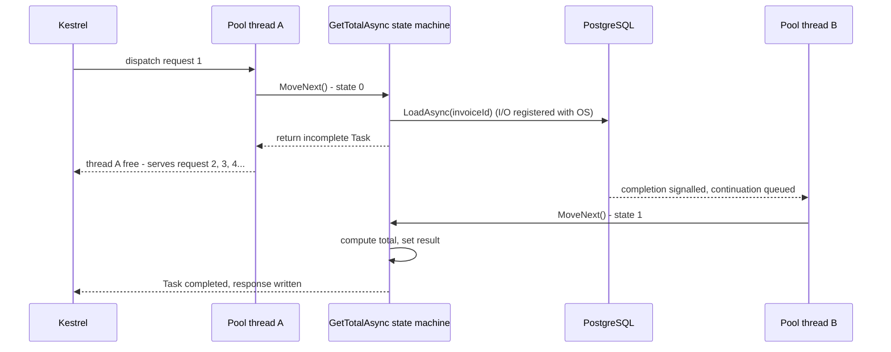
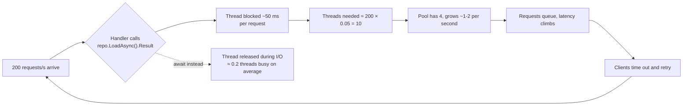

Every ASP.NET Core request you write will contain `await`. Most developers use it correctly by habit and get burned exactly once: a production outage where the server has plenty of CPU, plenty of memory, and still answers nothing. This lesson explains the machinery well enough that you can predict that outage, avoid it, and explain it in an interview.

## Learning objectives

By the end of this lesson you will be able to:

1. Explain what a `Task` is (a promise of a future result) and what `await` does to your method (splits it into a state machine).
2. Describe the thread pool and why asynchronous I/O lets a few threads serve thousands of concurrent requests.
3. Recognise sync-over-async (`.Result`, `.Wait()`, `GetAwaiter().GetResult()`) and explain the two ways it hurts: deadlocks under a synchronization context, and thread-pool starvation in ASP.NET Core.
4. Say when `ConfigureAwait(false)` matters and why ASP.NET Core application code usually does not need it.
5. Use `Task.WhenAll` for fan-out, bound concurrency with `SemaphoreSlim`, and consume `IAsyncEnumerable<T>`.
6. Decide when `ValueTask<T>` is worth its restrictions.
7. Spot the common mistakes: `async void`, forgetting to await, `Task.Run` in a web app, async lambdas in LINQ, disposing before the task finishes.

## Prerequisites

- [How a computer executes a program](#/lesson/m01-how-programs-run): processes, threads and the CPU.
- [Exceptions](#/lesson/m01-exceptions): async changes where exceptions surface.
- [HTTP request and response lifecycle](#/lesson/m03-request-lifecycle): the request thread is what we are trying not to block.

## Explain it like I'm a beginner

Think of a restaurant with one waiter and ten tables. A **synchronous** waiter takes an order from table 1, walks to the kitchen, and *stands there* until the food is ready. Then he serves table 1, and only then takes table 2's order. Nine tables wait while the kitchen cooks. The waiter is "busy" but doing nothing useful.

An **asynchronous** waiter takes table 1's order, hands it to the kitchen, and immediately moves to table 2. When the kitchen rings the bell for table 1, whichever waiter is free carries the plate over. One or two waiters can keep ten tables happy, because *waiting for the kitchen* does not need a waiter.

In a web server:

- Waiters are **threads** from a shared pool (the thread pool). Threads are expensive: each one reserves about 1 MB of memory for its stack, and switching between thousands of them wastes CPU.
- The kitchen is **anything your code waits on that is not CPU**: a database query, an HTTP call to a payment gateway, a file read. These are **I/O-bound** operations. The operating system and network card do the work; your thread just needs to know when it is done.
- `await` is the waiter saying "ring the bell when it's ready" and walking away. The thread goes back to the pool and serves another request. When the database answers, a thread (often a different one) picks up where your method left off.

The outage described in the intro is a waiter who insists on standing in the kitchen. Call `.Result` on a database task and the thread stands there. Do that in every request and soon all the waiters are standing in the kitchen while customers queue at the door. Memory is fine, CPU is near zero, and nothing is served.

## First-principles explanation

### Task: a promise, not a thread

A `Task` (or `Task<T>`) is an object that represents work that may finish later. It has a status (running, completed, faulted, cancelled), a result or exception, and a way to register "call me when done" (a continuation). Crucially, **a Task does not imply a thread**. When you call `httpClient.GetAsync(url)`, no thread sits waiting for the network. The runtime registers interest with the operating system's I/O completion mechanism, returns an incomplete `Task`, and when bytes arrive the OS signals the runtime, which schedules the continuation on a pool thread.

Only **CPU-bound** work, such as compressing a file or computing a hash, needs a thread for its whole duration. `Task.Run(() => Compress(file))` gives it one from the pool.

### What the compiler does with `await`

```csharp
public async Task<decimal> GetTotalAsync(int invoiceId)
{
    var invoice = await _repo.LoadAsync(invoiceId);     // suspension point 1
    var rate = await _rates.GetRateAsync(invoice.Hsn);  // suspension point 2
    return invoice.Amount * (1 + rate);
}
```

The compiler rewrites this into a **state machine**: a struct with a field for every local, an integer "where am I" state, and a `MoveNext()` method. Calling the method runs `MoveNext()` until the first `await` on an incomplete task. It then registers `MoveNext` as the continuation of that task and **returns** an incomplete `Task<decimal>` to the caller. The thread is free. When `LoadAsync` completes, `MoveNext` runs again from state 1 on some pool thread, hits the second await, and so on. The final `return` sets the result on the outer task, which wakes up *its* awaiter.

Two consequences follow directly:

- If the awaited task is **already complete** (a cached value, say), there is no suspension: execution continues synchronously on the same thread. This is the "fast path", and it is why `ValueTask` exists.
- An exception thrown inside the method is **caught and stored on the Task**. It is rethrown only when someone awaits (or inspects) the task. If nobody ever awaits it, the exception is silently lost.

### The thread pool and why blocking is poison

The .NET thread pool starts with roughly one thread per CPU core (so 4 on a 4-core container) and grows slowly, about one or two new threads per second, when queued work waits. That growth rate is deliberate: adding threads blindly hurts more than it helps. Since .NET 6 the pool injects threads faster when it sees a pool thread blocked in `Task.Wait` or `.Result`, which softens the problem below but does not remove it: every blocked thread still costs a stack and context switches, and injection still lags a sudden burst.

Now the arithmetic for a service doing 200 requests/second where each request spends 50 ms waiting on PostgreSQL:

- **Async**: a request occupies a thread only for its CPU slices, say 1 ms. Average in-flight threads ≈ 200 × 0.001 = 0.2. Four threads are idle most of the time. Thousands of requests can be in flight, each just a small state-machine object in memory (hundreds of bytes).
- **Blocking (`.Result`)**: each request holds a thread for the full 50 ms. Average threads needed ≈ 200 × 0.05 = 10. The pool starts at 4 and adds roughly 1–2 per second, so for several seconds requests queue; latency climbs from 50 ms to seconds. If traffic spikes to 2,000 RPS you need 100 threads; the pool takes about a minute to get there, and by then upstream timeouts have turned the spike into retries. This is **thread-pool starvation**: the symptom is high latency and timeouts with low CPU.

These are illustrative estimates, not benchmarks, but the shape is accurate and the pattern is one of the most common ASP.NET Core production incidents.

### Sync-over-async and the classic deadlock

Beyond starvation, there is a sharper failure. In environments with a **synchronization context** (WinForms, WPF, MAUI, classic ASP.NET on .NET Framework), `await` by default captures the context and schedules the continuation back on *that* context, typically the single UI or request thread. If that thread is blocked in `.Result` waiting for the task, and the task's continuation needs that same thread to finish, neither can proceed: a **deadlock**.

```csharp
// UI button handler or old ASP.NET controller — deadlocks
var data = _service.LoadAsync().Result;   // thread blocks here...
// ...while LoadAsync's continuation waits for this same thread. Forever.
```

ASP.NET Core **has no synchronization context**, so this exact deadlock does not occur there; continuations run on any pool thread. That is why "it worked in my API" is often heard, right before the starvation incident above. Both problems have the same fix: do not block on tasks. Make the method `async` and `await`.

### ConfigureAwait: what it is really for

`await task.ConfigureAwait(false)` says "do not bother capturing the synchronization context; continue on any thread". In **library code** that might be called from a UI app, this avoids both the deadlock and a pointless hop back to the UI thread. In **ASP.NET Core application code** there is no context to capture, so `ConfigureAwait(false)` changes nothing functionally. Guidance:

- Writing a reusable library (NuGet package, shared SDK): use `ConfigureAwait(false)` consistently.
- Writing an ASP.NET Core application: you may omit it. If you add it, be consistent, and remember that it never makes blocking safe.

### Fan-out with WhenAll, and bounded concurrency

If a request needs three independent things (invoice, customer, tax rates), awaiting them one after another adds their latencies: 30 + 40 + 20 = 90 ms. Start all three and await `Task.WhenAll`: roughly max(30, 40, 20) = 40 ms. Fan-out is the single biggest latency win async gives you.

The trap is **unbounded** fan-out. `Task.WhenAll(ids.Select(id => client.GetAsync(id)))` over 5,000 ids starts 5,000 HTTP requests at once and knocks over the downstream service (and your connection pool). Bound it with a `SemaphoreSlim(maxConcurrency)` around each call, or use `Parallel.ForEachAsync` with `MaxDegreeOfParallelism`.

### ValueTask: the fast path, with strings attached

`Task<T>` is a class: every call to an async method that returns one allocates an object, even if it completes synchronously. `ValueTask<T>` is a struct that can hold either a result directly (no allocation) or a wrapped `Task<T>`. For a method like `GetRateAsync` that hits an in-memory cache 99 % of the time, `ValueTask<T>` removes 99 % of the allocations.

The price is a stricter contract: **await a ValueTask exactly once**, never `.Result` it before it completes, never await it twice, never store it and await later from multiple places. If you need any of that, call `.AsTask()`. Use `ValueTask<T>` on measured hot paths and in low-level interfaces (`Stream.ReadAsync`, `IAsyncEnumerable<T>.MoveNextAsync` use it). Everywhere else, `Task<T>` is simpler and fine.

### IAsyncEnumerable: streaming results

`IAsyncEnumerable<T>` is a sequence you pull from asynchronously: `await foreach (var row in reader.ReadAsync())`. The producer can `yield return` rows as they arrive from the database instead of loading 100,000 rows into a list first. Memory stays flat and the first row reaches the caller early. ASP.NET Core can even stream an `IAsyncEnumerable<T>` response as JSON incrementally.

### Common mistakes, named

| Mistake | What goes wrong | Fix |
|---|---|---|
| `async void` | Exceptions crash the process; caller cannot await or observe completion | Return `Task`; `async void` only for event handlers |
| `.Result` / `.Wait()` / `GetAwaiter().GetResult()` | Deadlock under a sync context; starvation in ASP.NET Core | Await, and make the caller async |
| Forgetting `await` | Method returns before work finishes; exceptions vanish | Await it; enable CS4014 as an error |
| `Task.Run` around I/O in a web app | Burns a second thread for no gain; hurts throughput | Only use `Task.Run` for CPU-bound work, and rarely in web apps |
| `ids.Select(async id => await Process(id))` without `WhenAll` | Produces `IEnumerable<Task>` nobody awaits | `await Task.WhenAll(ids.Select(Process))` |
| `await` inside `foreach` when items are independent | Serial latency | Fan out with `WhenAll`, bounded |
| `using var conn = ...; return conn.QueryAsync(...)` (no await) | Connection disposed before the query runs | `return await ...` inside the using |
| Awaiting a `ValueTask` twice | Undefined behaviour, may throw | `.AsTask()` if you need multiple awaits |
| Catching `Exception` after `WhenAll` and seeing only one | `await` unwraps the first exception only | Inspect `task.Exception.InnerExceptions` if you need all |

### Trade-offs

| You gain | You pay |
|---|---|
| Thousands of concurrent requests on a handful of threads | Every method in the chain becomes async ("async all the way") |
| Lower latency with fan-out | Easy to overload a downstream service without bounds |
| Streaming with `IAsyncEnumerable` | Stack traces are harder to read; debugging needs the Tasks window |
| Fewer allocations with `ValueTask` | Stricter rules that are easy to break |

When is synchronous code fine? CLI tools and batch jobs that do one thing at a time, pure CPU-bound libraries, and tiny internal services with a dozen users. Async pays off when many requests wait on I/O at the same time, which describes almost every web API.

## Visual explanation

### What a thread does during an awaited database call



Thread A hands the query to the database and immediately goes back to serve other requests. The reply from PostgreSQL wakes a thread, possibly a different one (B), which resumes the method exactly where it stopped. No thread was tied up during the 50 ms the database took. Multiply by hundreds of concurrent requests and you see why a small pool is enough.

### How sync-over-async starves the pool



The loop on the right is the starvation spiral: blocked threads mean queued requests, queued requests mean timeouts, timeouts mean retries, retries mean more blocked threads. The dotted path is the fix: with `await`, the same 200 requests/s need well under one thread on average, and the spiral never starts.

## Step-by-step example

We will build a small GST invoice reconciliation endpoint for an online store that sells phones, clothes, groceries and toiletries. Given a list of invoice ids, it loads each invoice, looks up the tax rate for its HSN code (the product classification code printed on every GST invoice, such as 8517 for mobile phones), and returns totals. Each step fixes a real problem.

### Step 1 — the blocking version

```csharp
// Do NOT copy this.
public decimal Total(int invoiceId)
{
    var invoice = _repo.LoadAsync(invoiceId).Result;          // blocks a pool thread
    var rate = _rates.GetRateAsync(invoice.Hsn).Result;       // and again
    return invoice.Amount * (1 + rate);
}
```

Works on a laptop. Under load, this is the starvation diagram above.

### Step 2 — async all the way

```csharp
public async Task<decimal> TotalAsync(int invoiceId, CancellationToken ct)
{
    var invoice = await _repo.LoadAsync(invoiceId, ct);
    var rate = await _rates.GetRateAsync(invoice.Hsn, ct);
    return invoice.Amount * (1 + rate);
}
```

The endpoint, the service and the repository are all async. There is no `.Result` anywhere between Kestrel and the database driver. That is what "async all the way" means: one blocking call anywhere in the chain reintroduces the problem.

### Step 3 — fan out across invoices, bounded

The endpoint receives 50 ids. Serial awaits would take 50 × 50 ms = 2.5 s. We start them concurrently but cap at 8 at a time so the database connection pool (default 100 connections, shared with everything else) is not exhausted.

### Step 4 — a ValueTask cache for rates

An online store sells products from a few hundred HSN codes, and GST has only a handful of rate slabs that change a few times a year. After the first lookup for a code, `GetRateAsync` answers from a dictionary synchronously. Returning `ValueTask<decimal>` avoids allocating a `Task` for each of the thousands of cache hits per second.

### Step 5 — stream the results

Instead of building a list of 50 results and serialising it at the end, the service yields each result as it completes through `IAsyncEnumerable<InvoiceTotal>`, and the endpoint streams the JSON array. The full code follows.

## Production-style C# implementation

```text
Gst.Api/
  Program.cs
  Reconciliation/Models.cs
  Reconciliation/IInvoiceRepository.cs
  Reconciliation/ITaxRateSource.cs
  Reconciliation/CachedTaxRateService.cs
  Reconciliation/ReconciliationService.cs
```

```csharp file=Reconciliation/Models.cs
namespace Gst.Api.Reconciliation;

public sealed record Invoice(int Id, string Gstin, string Hsn, decimal Amount);

public sealed record InvoiceTotal(int InvoiceId, decimal Amount, decimal Rate, decimal Total);

public sealed record ReconcileRequest(IReadOnlyList<int> InvoiceIds);
```

```csharp file=Reconciliation/IInvoiceRepository.cs
namespace Gst.Api.Reconciliation;

public interface IInvoiceRepository
{
    Task<Invoice?> LoadAsync(int id, CancellationToken ct);
}

/// <summary>Stand-in for a PostgreSQL repository. Simulates ~20 ms of I/O without holding a thread.</summary>
public sealed class FakeInvoiceRepository : IInvoiceRepository
{
    private static readonly string[] HsnCodes = ["8517", "6109", "2202", "3305"];   // phones, T-shirts, soft drinks, shampoo

    public async Task<Invoice?> LoadAsync(int id, CancellationToken ct)
    {
        await Task.Delay(20, ct);   // Task.Delay is a timer, not a sleeping thread
        if (id <= 0) return null;
        return new Invoice(id, "07AABCU9603R1ZV", HsnCodes[id % HsnCodes.Length], 1000m + id * 10m);
    }
}
```

```csharp file=Reconciliation/ITaxRateSource.cs
namespace Gst.Api.Reconciliation;

/// <summary>The slow source of truth for GST rates by HSN code (a database or the GST portal).</summary>
public interface ITaxRateSource
{
    Task<decimal> FetchRateAsync(string hsn, CancellationToken ct);
}

public sealed class FakeTaxRateSource : ITaxRateSource
{
    public int Calls;

    public async Task<decimal> FetchRateAsync(string hsn, CancellationToken ct)
    {
        Interlocked.Increment(ref Calls);
        await Task.Delay(30, ct);
        return hsn switch { "8517" => 0.18m, "6109" => 0.05m, "2202" => 0.40m, "3305" => 0.05m, _ => 0.18m };   // illustrative rates
    }
}
```

```csharp file=Reconciliation/CachedTaxRateService.cs
using System.Collections.Concurrent;

namespace Gst.Api.Reconciliation;

/// <summary>Rates change a few times a year, lookups happen thousands of times a second.
/// ValueTask lets the cache hit complete synchronously with no Task allocation.</summary>
public sealed class CachedTaxRateService(ITaxRateSource source)
{
    private readonly ConcurrentDictionary<string, decimal> _cache = new();
    private readonly ConcurrentDictionary<string, Task<decimal>> _inFlight = new();

    public ValueTask<decimal> GetRateAsync(string hsn, CancellationToken ct)
    {
        if (_cache.TryGetValue(hsn, out var rate))
            return new ValueTask<decimal>(rate);            // fast path: no allocation, completes synchronously

        return new ValueTask<decimal>(FetchAndCacheAsync(hsn, ct));
    }

    private Task<decimal> FetchAndCacheAsync(string hsn, CancellationToken ct)
    {
        // Coalesce concurrent misses for the same key into ONE fetch (prevents a stampede on cold start).
        var fetch = _inFlight.GetOrAdd(hsn, static (key, s) => s.FetchAsync(key), this);
        return fetch;
    }

    private async Task<decimal> FetchAsync(string hsn)
    {
        try
        {
            // Deliberately not tied to one caller's cancellation token: the result is shared.
            var rate = await source.FetchRateAsync(hsn, CancellationToken.None);
            _cache[hsn] = rate;
            return rate;
        }
        finally
        {
            _inFlight.TryRemove(hsn, out _);
        }
    }
}
```

```csharp file=Reconciliation/ReconciliationService.cs
using System.Runtime.CompilerServices;
using Microsoft.Extensions.Logging;

namespace Gst.Api.Reconciliation;

public sealed class ReconciliationService(IInvoiceRepository repo, CachedTaxRateService rates, ILogger<ReconciliationService> logger)
{
    private const int MaxConcurrentLoads = 8;   // protects the DB connection pool

    /// <summary>One invoice: async all the way, no blocking.</summary>
    public async Task<InvoiceTotal?> TotalAsync(int invoiceId, CancellationToken ct)
    {
        var invoice = await repo.LoadAsync(invoiceId, ct);
        if (invoice is null) return null;
        var rate = await rates.GetRateAsync(invoice.Hsn, ct);
        return new InvoiceTotal(invoice.Id, invoice.Amount, rate, Math.Round(invoice.Amount * (1 + rate), 2));
    }

    /// <summary>Many invoices: bounded fan-out, results streamed as they complete.</summary>
    public async IAsyncEnumerable<InvoiceTotal> ReconcileAsync(IReadOnlyList<int> ids, [EnumeratorCancellation] CancellationToken ct)
    {
        using var gate = new SemaphoreSlim(MaxConcurrentLoads);

        var tasks = ids.Select(async id =>
        {
            await gate.WaitAsync(ct);
            try { return await TotalAsync(id, ct); }
            finally { gate.Release(); }
        }).ToList();

        // Yield in completion order rather than request order: the client sees the first row sooner.
        while (tasks.Count > 0)
        {
            var finished = await Task.WhenAny(tasks);
            tasks.Remove(finished);
            var result = await finished;                   // rethrows this task's exception, if any
            if (result is null) { logger.LogWarning("Invoice not found during reconciliation"); continue; }
            yield return result;
        }
    }

    /// <summary>Alternative shape when the caller wants everything at once.</summary>
    public async Task<IReadOnlyList<InvoiceTotal>> ReconcileAllAsync(IReadOnlyList<int> ids, CancellationToken ct)
    {
        var results = new List<InvoiceTotal>(ids.Count);
        await foreach (var t in ReconcileAsync(ids, ct)) results.Add(t);
        return results;
    }
}
```

```csharp file=Program.cs
using Gst.Api.Reconciliation;

var builder = WebApplication.CreateBuilder(args);

builder.Services.AddSingleton<IInvoiceRepository, FakeInvoiceRepository>();
builder.Services.AddSingleton<ITaxRateSource, FakeTaxRateSource>();
builder.Services.AddSingleton<CachedTaxRateService>();
builder.Services.AddSingleton<ReconciliationService>();

var app = builder.Build();

app.MapGet("/invoices/{id:int}/total", async (int id, ReconciliationService svc, CancellationToken ct) =>
    await svc.TotalAsync(id, ct) is { } total ? Results.Ok(total) : Results.NotFound());

// Streams a JSON array element by element as results complete.
app.MapPost("/invoices/reconcile", (ReconcileRequest request, ReconciliationService svc, CancellationToken ct) =>
    request.InvoiceIds.Count is 0 or > 500
        ? Results.Problem("Provide between 1 and 500 invoice ids.", statusCode: StatusCodes.Status400BadRequest)
        : Results.Ok(svc.ReconcileAsync(request.InvoiceIds, ct)));

app.Run();
```

Design notes:

- **`Task.Delay` in the fakes is honest.** It uses a timer, not a thread, exactly like real database I/O. Replace the fakes with Npgsql or EF Core and the shape of the code does not change.
- **The semaphore bounds concurrency at 8**, not because 8 is magic but because a PostgreSQL connection pool is a shared, finite resource. A request with 500 ids must not take 500 connections.
- **`Task.WhenAny` in a loop** yields results as they finish. With 50 ids and 8 in flight, the first result arrives after roughly 50 ms rather than after all 50 complete. The `tasks.Remove(finished)` pattern is O(n) per iteration; for thousands of tasks use a `Channel<T>` instead (see [Background services](#/lesson/m03-background-services)).
- **The rate cache fetch ignores the caller's cancellation token on purpose.** If request A triggers the fetch and is cancelled, request B waiting on the same fetch should still get its answer. We discuss this trade-off in [Cancellation tokens](#/lesson/m03-cancellation).
- **The endpoint returns the `IAsyncEnumerable` directly.** ASP.NET Core serialises it as a streaming JSON array. Note that once the first byte is written, a later exception cannot change the status code; for strict error semantics, use `ReconcileAllAsync` and return the list.

## Bad design vs good design

**Bad**

```csharp
public class InvoiceController : ControllerBase
{
    [HttpPost("reconcile")]
    public IActionResult Reconcile(int[] ids)
    {
        var results = new List<InvoiceTotal>();
        foreach (var id in ids)
            results.Add(Task.Run(() => _svc.TotalAsync(id, default)).Result!);   // 1, 2, 3
        _ = _audit.WriteAsync(ids);                                              // 4
        return Ok(results);
    }

    private async void LogSlow(TimeSpan t) => await _log.WriteAsync(t);          // 5
}
```

1. `.Result` blocks a pool thread per call: starvation under load.
2. `Task.Run` adds a *second* thread to do the blocking on. Doubling the damage is not a fix.
3. Serial `foreach`: 50 ids × 50 ms = 2.5 s for work that takes about 350 ms with 8 in flight (⌈50 ÷ 8⌉ = 7 waves × 50 ms).
4. The discarded audit task: if it throws, nobody knows; if the request ends, nothing guarantees it finished.
5. `async void`: an exception inside it tears down the process.

**Good**

```csharp
[HttpPost("reconcile")]
public async Task<ActionResult<IReadOnlyList<InvoiceTotal>>> Reconcile(int[] ids, CancellationToken ct)
{
    var results = await _svc.ReconcileAllAsync(ids, ct);     // bounded fan-out inside
    await _audit.WriteAsync(ids, ct);                        // awaited, so failures surface as a 500 and are logged
    return Ok(results);
}
```

If the audit write genuinely must not delay the response, hand it to a queue consumed by a hosted worker rather than fire-and-forget on the request thread.

:::callout type=mistake title="The one blocking call that undoes everything"
A team converts 200 methods to async. One helper deep in the stack still does `settings.GetAsync().Result`. Under load the service starves exactly as before. Async is a property of the whole call chain, which is why the rule is "async all the way". Enable analyzer CA1849 (call async methods when in an async method) and search your code for `.Result`, `.Wait(` and `GetAwaiter().GetResult(`.
:::

:::callout type=tradeoff title="When Task is better than ValueTask"
`ValueTask<T>` is a micro-optimisation. Unless a profiler shows allocations from a particular async method on a hot path, return `Task<T>`: it can be awaited many times, stored, passed to `WhenAll`, and nobody has to remember the rules.
:::

## Practical playground

Compare serial awaits with `Task.WhenAll`, then add a bound. `Task.Delay` stands in for I/O. Change `Delay(50)` to `Delay(200)` and the number of ids to see how the two approaches scale differently.

:::playground type=csharp title="Serial vs fan-out vs bounded fan-out"
```csharp file=Program.cs
using System;
using System.Collections.Generic;
using System.Diagnostics;
using System.Linq;
using System.Threading;
using System.Threading.Tasks;

public static class Program
{
    private static int _inFlight, _peak;

    private static async Task<decimal> LoadTotalAsync(int id)
    {
        var now = Interlocked.Increment(ref _inFlight);
        _peak = Math.Max(_peak, now);
        await Task.Delay(50);                       // pretend this is PostgreSQL
        Interlocked.Decrement(ref _inFlight);
        return 1000m + id;
    }

    public static async Task Main()
    {
        var ids = Enumerable.Range(1, 20).ToArray();

        var sw = Stopwatch.StartNew();
        var serial = new List<decimal>();
        foreach (var id in ids) serial.Add(await LoadTotalAsync(id));
        Console.WriteLine($"Serial:          {sw.ElapsedMilliseconds,5} ms  peak in-flight {_peak}");

        _peak = 0; sw.Restart();
        var all = await Task.WhenAll(ids.Select(LoadTotalAsync));
        Console.WriteLine($"WhenAll:         {sw.ElapsedMilliseconds,5} ms  peak in-flight {_peak}");

        _peak = 0; sw.Restart();
        using var gate = new SemaphoreSlim(4);
        var bounded = await Task.WhenAll(ids.Select(async id =>
        {
            await gate.WaitAsync();
            try { return await LoadTotalAsync(id); }
            finally { gate.Release(); }
        }));
        Console.WriteLine($"WhenAll (max 4): {sw.ElapsedMilliseconds,5} ms  peak in-flight {_peak}");

        Console.WriteLine($"Sums equal: {serial.Sum() == all.Sum() && all.Sum() == bounded.Sum()}");
    }
}
```
:::

Expected shape of the output (your numbers will differ): serial about 1,000 ms with peak 1; WhenAll about 50 ms with peak 20; bounded about 250 ms with peak 4. The bounded version trades some latency for predictable load on the downstream system.

## Exercises

:::exercise id=m03-async-await-ex1 difficulty=beginner kind=code title="Fan out invoice loads with WhenAll"
`InvoiceLoader.LoadAllAsync` currently loads invoices one after another. Rewrite it so all loads start before any completes, and results come back in the same order as the ids.
::requirements
- Use `Task.WhenAll`.
- Keep the method signature.
- The order of the returned array must match the order of `ids`.
::acceptance
- With the gated fake client, all N loads are started before any is allowed to complete.
- Results are in id order even if the fakes complete in reverse order.
- An empty id list returns an empty array without calling the client.
::hint
`foreach` with `await` inside waits for each load before starting the next. You want to *start* every load first and *await* all of them after.
::hint
`ids.Select(id => client.LoadAsync(id))` creates the tasks (starts them). `Task.WhenAll(tasks)` awaits them all and preserves order.
::hint
```csharp
var tasks = ids.Select(id => client.LoadAsync(id, ct));
return await Task.WhenAll(tasks);
```
::starter
```csharp file=InvoiceLoader.cs
using System;
using System.Collections.Generic;
using System.Linq;
using System.Threading;
using System.Threading.Tasks;

public sealed record Invoice(int Id, decimal Amount);

public interface IInvoiceClient
{
    Task<Invoice> LoadAsync(int id, CancellationToken ct);
}

public sealed class InvoiceLoader(IInvoiceClient client)
{
    public async Task<Invoice[]> LoadAllAsync(IReadOnlyList<int> ids, CancellationToken ct)
    {
        // Serial: each load waits for the previous one. Replace with a fan-out.
        var results = new List<Invoice>();
        foreach (var id in ids) results.Add(await client.LoadAsync(id, ct));
        return results.ToArray();
    }
}

/// <summary>Test double: every load is held until the test calls ReleaseAll().</summary>
public sealed class GatedInvoiceClient : IInvoiceClient
{
    private readonly List<(int Id, TaskCompletionSource<Invoice> Tcs)> _pending = new();
    public int Started => _pending.Count;

    public Task<Invoice> LoadAsync(int id, CancellationToken ct)
    {
        var tcs = new TaskCompletionSource<Invoice>(TaskCreationOptions.RunContinuationsAsynchronously);
        lock (_pending) _pending.Add((id, tcs));
        return tcs.Task;
    }

    public void ReleaseAllInReverse()
    {
        List<(int Id, TaskCompletionSource<Invoice> Tcs)> copy;
        lock (_pending) copy = _pending.ToList();
        foreach (var (id, tcs) in copy.AsEnumerable().Reverse()) tcs.SetResult(new Invoice(id, id * 100m));
    }
}
```
::tests
```csharp file=InvoiceLoaderTests.cs
using System.Linq;
using System.Threading;
using System.Threading.Tasks;
using Xunit;

public class InvoiceLoaderTests
{
    [Fact]
    public async Task Starts_all_loads_before_any_completes()
    {
        var client = new GatedInvoiceClient();
        var loader = new InvoiceLoader(client);
        var ids = new[] { 1, 2, 3, 4, 5 };

        var pending = loader.LoadAllAsync(ids, CancellationToken.None);
        Assert.False(pending.IsCompleted);
        Assert.Equal(5, client.Started);           // serial code would show 1 here

        client.ReleaseAllInReverse();
        var result = await pending;
        Assert.Equal(ids, result.Select(i => i.Id).ToArray());
        Assert.Equal(300m, result[2].Amount);
    }

    [Fact]
    public async Task Empty_input_returns_empty()
    {
        var client = new GatedInvoiceClient();
        var result = await new InvoiceLoader(client).LoadAllAsync(new int[0], CancellationToken.None);
        Assert.Empty(result);
        Assert.Equal(0, client.Started);
    }
}
```
::solution
```csharp file=InvoiceLoader.cs
using System;
using System.Collections.Generic;
using System.Linq;
using System.Threading;
using System.Threading.Tasks;

public sealed record Invoice(int Id, decimal Amount);

public interface IInvoiceClient
{
    Task<Invoice> LoadAsync(int id, CancellationToken ct);
}

public sealed class InvoiceLoader(IInvoiceClient client)
{
    public async Task<Invoice[]> LoadAllAsync(IReadOnlyList<int> ids, CancellationToken ct)
    {
        if (ids.Count == 0) return Array.Empty<Invoice>();
        var tasks = ids.Select(id => client.LoadAsync(id, ct));   // starts every load
        return await Task.WhenAll(tasks);                          // preserves input order
    }
}

public sealed class GatedInvoiceClient : IInvoiceClient
{
    private readonly List<(int Id, TaskCompletionSource<Invoice> Tcs)> _pending = new();
    public int Started => _pending.Count;

    public Task<Invoice> LoadAsync(int id, CancellationToken ct)
    {
        var tcs = new TaskCompletionSource<Invoice>(TaskCreationOptions.RunContinuationsAsynchronously);
        lock (_pending) _pending.Add((id, tcs));
        return tcs.Task;
    }

    public void ReleaseAllInReverse()
    {
        List<(int Id, TaskCompletionSource<Invoice> Tcs)> copy;
        lock (_pending) copy = _pending.ToList();
        foreach (var (id, tcs) in copy.AsEnumerable().Reverse()) tcs.SetResult(new Invoice(id, id * 100m));
    }
}
```

The test is deterministic because the fake never completes on its own: the only way `Started` can be 5 before `ReleaseAllInReverse` is if all five tasks were created up front. `Task.WhenAll` returns results in the order of the input tasks regardless of completion order.
::mistakes
- `ids.Select(async id => await client.LoadAsync(id, ct))` then `.ToList()` without `WhenAll`: you get a list of tasks, not invoices.
- Sorting the results afterwards to "fix" the order: unnecessary, `WhenAll` already preserves it.
- Not bounding concurrency when `ids` can be large. Exercise 3 adds the bound.
:::

:::exercise id=m03-async-await-ex2 difficulty=beginner kind=code title="Sum a stream of payments with await foreach"
Implement `PaymentSummariser.SumAsync` which consumes an `IAsyncEnumerable<decimal>` and returns the total and the count, without materialising the sequence into a list.
::acceptance
- Works for an empty stream (0 total, 0 count).
- Processes items as they arrive; memory use does not grow with the stream length (no `ToListAsync`).
- Passes the cancellation token to the enumeration with `WithCancellation`.
::hint
`await foreach (var x in source) { ... }` is the loop you need.
::hint
Keep two running variables: `total` and `count`. Return a tuple or record.
::hint
`await foreach (var amount in source.WithCancellation(ct))` forwards cancellation to the producer.
::starter
```csharp file=PaymentSummariser.cs
using System;
using System.Collections.Generic;
using System.Runtime.CompilerServices;
using System.Threading;
using System.Threading.Tasks;

public sealed record PaymentSummary(decimal Total, int Count);

public static class PaymentSummariser
{
    public static Task<PaymentSummary> SumAsync(IAsyncEnumerable<decimal> payments, CancellationToken ct)
    {
        throw new NotImplementedException();
    }

    /// <summary>Test helper: yields the given amounts one at a time, asynchronously.</summary>
    public static async IAsyncEnumerable<decimal> Stream(decimal[] amounts, [EnumeratorCancellation] CancellationToken ct = default)
    {
        foreach (var a in amounts)
        {
            await Task.Yield();
            ct.ThrowIfCancellationRequested();
            yield return a;
        }
    }
}
```
::tests
```csharp file=PaymentSummariserTests.cs
using System.Threading;
using System.Threading.Tasks;
using Xunit;

public class PaymentSummariserTests
{
    [Fact]
    public async Task Sums_and_counts()
    {
        var s = await PaymentSummariser.SumAsync(PaymentSummariser.Stream(new[] { 499m, 1200.50m, 0.50m }), CancellationToken.None);
        Assert.Equal(1700m, s.Total);
        Assert.Equal(3, s.Count);
    }

    [Fact]
    public async Task Empty_stream()
    {
        var s = await PaymentSummariser.SumAsync(PaymentSummariser.Stream(new decimal[0]), CancellationToken.None);
        Assert.Equal(0m, s.Total);
        Assert.Equal(0, s.Count);
    }

    [Fact]
    public async Task Honours_cancellation()
    {
        using var cts = new CancellationTokenSource();
        cts.Cancel();
        await Assert.ThrowsAnyAsync<System.OperationCanceledException>(() =>
            PaymentSummariser.SumAsync(PaymentSummariser.Stream(new[] { 1m, 2m }), cts.Token));
    }
}
```
::solution
```csharp file=PaymentSummariser.cs
using System;
using System.Collections.Generic;
using System.Runtime.CompilerServices;
using System.Threading;
using System.Threading.Tasks;

public sealed record PaymentSummary(decimal Total, int Count);

public static class PaymentSummariser
{
    public static async Task<PaymentSummary> SumAsync(IAsyncEnumerable<decimal> payments, CancellationToken ct)
    {
        decimal total = 0;
        var count = 0;
        await foreach (var amount in payments.WithCancellation(ct))
        {
            total += amount;
            count++;
        }
        return new PaymentSummary(total, count);
    }

    public static async IAsyncEnumerable<decimal> Stream(decimal[] amounts, [EnumeratorCancellation] CancellationToken ct = default)
    {
        foreach (var a in amounts)
        {
            await Task.Yield();
            ct.ThrowIfCancellationRequested();
            yield return a;
        }
    }
}
```

`WithCancellation(ct)` hands the token to the iterator's `[EnumeratorCancellation]` parameter, so the producer stops too. Without it, cancelling the consumer leaves the producer running until its next yield.
::mistakes
- Calling a `ToListAsync`-style helper first, which defeats streaming.
- Forgetting `WithCancellation`, so the test for cancellation hangs or fails.
:::

:::exercise id=m03-async-await-ex3 difficulty=intermediate kind=code title="Bounded concurrency with SemaphoreSlim"
Implement `BoundedRunner.RunAsync<TIn, TOut>` that applies an async function to every item with at most `maxConcurrency` in flight, preserving order.
::requirements
- Throw `ArgumentOutOfRangeException` if `maxConcurrency < 1`.
- Use `SemaphoreSlim` (or `Parallel.ForEachAsync`), but results must come back in input order.
- Release the semaphore even when the function throws.
::acceptance
- With `maxConcurrency = 3` and 10 items whose work takes a few milliseconds, the observed peak concurrency is at most 3.
- With `maxConcurrency = 10`, the peak reaches at least 2 (so it does actually run concurrently).
- Output order matches input order.
::hint
Wrap each item in an async lambda that does `await gate.WaitAsync(ct); try { return await fn(item, ct); } finally { gate.Release(); }`.
::hint
Create all the wrapped tasks with `Select` and await `Task.WhenAll`: the semaphore limits how many are *inside* the work at once, while `WhenAll` keeps the order.
::hint
The semaphore should be disposed when done: `using var gate = new SemaphoreSlim(maxConcurrency);`.
::hint
```csharp
using var gate = new SemaphoreSlim(maxConcurrency);
var tasks = items.Select(async item => { await gate.WaitAsync(ct); try { return await fn(item, ct); } finally { gate.Release(); } });
return await Task.WhenAll(tasks);
```
::starter
```csharp file=BoundedRunner.cs
using System;
using System.Collections.Generic;
using System.Linq;
using System.Threading;
using System.Threading.Tasks;

public static class BoundedRunner
{
    public static Task<TOut[]> RunAsync<TIn, TOut>(IReadOnlyList<TIn> items, int maxConcurrency, Func<TIn, CancellationToken, Task<TOut>> fn, CancellationToken ct)
    {
        throw new NotImplementedException();
    }
}

/// <summary>Counts how many calls are inside the work at the same time.</summary>
public sealed class ConcurrencyProbe
{
    private int _current;
    private int _peak;
    public int Peak => _peak;

    public async Task<int> WorkAsync(int item, CancellationToken ct)
    {
        var now = Interlocked.Increment(ref _current);
        int seen;
        do { seen = _peak; } while (now > seen && Interlocked.CompareExchange(ref _peak, now, seen) != seen);
        await Task.Delay(15, ct);
        Interlocked.Decrement(ref _current);
        return item * 2;
    }
}
```
::tests
```csharp file=BoundedRunnerTests.cs
using System;
using System.Linq;
using System.Threading;
using System.Threading.Tasks;
using Xunit;

public class BoundedRunnerTests
{
    [Fact]
    public async Task Never_exceeds_the_limit()
    {
        var probe = new ConcurrencyProbe();
        var items = Enumerable.Range(1, 10).ToArray();
        var result = await BoundedRunner.RunAsync(items, 3, probe.WorkAsync, CancellationToken.None);
        Assert.True(probe.Peak <= 3, $"peak was {probe.Peak}");
        Assert.Equal(items.Select(i => i * 2).ToArray(), result);
    }

    [Fact]
    public async Task Actually_runs_concurrently()
    {
        var probe = new ConcurrencyProbe();
        await BoundedRunner.RunAsync(Enumerable.Range(1, 10).ToArray(), 10, probe.WorkAsync, CancellationToken.None);
        Assert.True(probe.Peak >= 2, $"peak was {probe.Peak}");
    }

    [Fact]
    public async Task Releases_on_failure()
    {
        var calls = 0;
        Func<int, CancellationToken, Task<int>> fn = (i, ct) =>
        {
            Interlocked.Increment(ref calls);
            if (i == 2) throw new InvalidOperationException("bad item");
            return Task.FromResult(i);
        };
        await Assert.ThrowsAsync<InvalidOperationException>(() => BoundedRunner.RunAsync(new[] { 1, 2, 3, 4 }, 1, fn, CancellationToken.None));
        Assert.Equal(4, calls);   // the semaphore was released after the failure, so later items still ran
    }

    [Fact]
    public async Task Rejects_zero_concurrency()
    {
        await Assert.ThrowsAsync<ArgumentOutOfRangeException>(() =>
            BoundedRunner.RunAsync(new[] { 1 }, 0, (i, ct) => Task.FromResult(i), CancellationToken.None));
    }
}
```
::solution
```csharp file=BoundedRunner.cs
using System;
using System.Collections.Generic;
using System.Linq;
using System.Threading;
using System.Threading.Tasks;

public static class BoundedRunner
{
    public static async Task<TOut[]> RunAsync<TIn, TOut>(IReadOnlyList<TIn> items, int maxConcurrency, Func<TIn, CancellationToken, Task<TOut>> fn, CancellationToken ct)
    {
        ArgumentOutOfRangeException.ThrowIfLessThan(maxConcurrency, 1);
        using var gate = new SemaphoreSlim(maxConcurrency);

        var tasks = items.Select(async item =>
        {
            await gate.WaitAsync(ct);
            try { return await fn(item, ct); }
            finally { gate.Release(); }
        });

        return await Task.WhenAll(tasks);
    }
}

public sealed class ConcurrencyProbe
{
    private int _current;
    private int _peak;
    public int Peak => _peak;

    public async Task<int> WorkAsync(int item, CancellationToken ct)
    {
        var now = Interlocked.Increment(ref _current);
        int seen;
        do { seen = _peak; } while (now > seen && Interlocked.CompareExchange(ref _peak, now, seen) != seen);
        await Task.Delay(15, ct);
        Interlocked.Decrement(ref _current);
        return item * 2;
    }
}
```

Note that the method is `async` and awaits `WhenAll` *inside* the `using`: if it returned the `Task` without awaiting, the semaphore would be disposed while work was still using it. That is the "dispose before the task finishes" mistake from the table.
::alternatives
`Parallel.ForEachAsync(items, new ParallelOptions { MaxDegreeOfParallelism = n }, ...)` is built in and handles the bound for you, but it does not collect results in order; you would write into a pre-sized array by index. Use it when you do not need results, or when the collection is very large.
::mistakes
- Awaiting `fn` *outside* the try/finally, so an exception skips `Release()` and later items hang forever.
- Returning `Task.WhenAll(tasks)` from a non-async method with `using var gate`: the semaphore is disposed early.
- Calling `gate.Wait()` (synchronous) instead of `WaitAsync()`: blocks a pool thread, the exact thing this lesson is about.
:::

:::exercise id=m03-async-await-ex4 difficulty=intermediate kind=code title="A ValueTask-returning rate cache"
Implement `RateCache.GetAsync(hsn)` returning `ValueTask<decimal>`. On a cache hit it must complete synchronously with no `Task` allocation; on a miss it fetches from `IRateSource`, stores the result, and returns it.
::acceptance
- The first call for an HSN code calls the source once; the second call does not call the source.
- The second call's `ValueTask` has `IsCompletedSuccessfully == true` *before* it is awaited (synchronous completion).
- Different HSN codes are cached independently.
::hint
`new ValueTask<decimal>(value)` wraps a ready value with no allocation. `new ValueTask<decimal>(task)` wraps a `Task<decimal>`.
::hint
Split the miss path into a separate `async Task<decimal>` method so the hot path method itself is not `async` (an `async` method always goes through the state machine).
::hint
```csharp
public ValueTask<decimal> GetAsync(string hsn, CancellationToken ct) =>
    _cache.TryGetValue(hsn, out var r) ? new ValueTask<decimal>(r) : new ValueTask<decimal>(FetchAsync(hsn, ct));
```
::starter
```csharp file=RateCache.cs
using System;
using System.Collections.Concurrent;
using System.Threading;
using System.Threading.Tasks;

public interface IRateSource
{
    Task<decimal> FetchAsync(string hsn, CancellationToken ct);
}

public sealed class RateCache(IRateSource source)
{
    private readonly ConcurrentDictionary<string, decimal> _cache = new();

    public ValueTask<decimal> GetAsync(string hsn, CancellationToken ct)
    {
        throw new NotImplementedException();
    }
}

public sealed class CountingRateSource : IRateSource
{
    public int Calls;
    public async Task<decimal> FetchAsync(string hsn, CancellationToken ct)
    {
        Interlocked.Increment(ref Calls);
        await Task.Yield();
        return hsn == "2202" ? 0.40m : 0.18m;
    }
}
```
::tests
```csharp file=RateCacheTests.cs
using System.Threading;
using System.Threading.Tasks;
using Xunit;

public class RateCacheTests
{
    [Fact]
    public async Task Second_call_is_a_synchronous_hit()
    {
        var source = new CountingRateSource();
        var cache = new RateCache(source);

        var first = await cache.GetAsync("2202", CancellationToken.None);
        Assert.Equal(0.40m, first);
        Assert.Equal(1, source.Calls);

        var second = cache.GetAsync("2202", CancellationToken.None);
        Assert.True(second.IsCompletedSuccessfully);
        Assert.Equal(0.40m, await second);
        Assert.Equal(1, source.Calls);
    }

    [Fact]
    public async Task Different_keys_are_independent()
    {
        var source = new CountingRateSource();
        var cache = new RateCache(source);
        Assert.Equal(0.40m, await cache.GetAsync("2202", CancellationToken.None));
        Assert.Equal(0.18m, await cache.GetAsync("8517", CancellationToken.None));
        Assert.Equal(2, source.Calls);
    }
}
```
::solution
```csharp file=RateCache.cs
using System;
using System.Collections.Concurrent;
using System.Threading;
using System.Threading.Tasks;

public interface IRateSource
{
    Task<decimal> FetchAsync(string hsn, CancellationToken ct);
}

public sealed class RateCache(IRateSource source)
{
    private readonly ConcurrentDictionary<string, decimal> _cache = new();

    public ValueTask<decimal> GetAsync(string hsn, CancellationToken ct)
    {
        if (_cache.TryGetValue(hsn, out var rate))
            return new ValueTask<decimal>(rate);               // hot path: no allocation

        return new ValueTask<decimal>(FetchAndStoreAsync(hsn, ct));
    }

    private async Task<decimal> FetchAndStoreAsync(string hsn, CancellationToken ct)
    {
        var rate = await source.FetchAsync(hsn, ct);
        _cache[hsn] = rate;
        return rate;
    }
}

public sealed class CountingRateSource : IRateSource
{
    public int Calls;
    public async Task<decimal> FetchAsync(string hsn, CancellationToken ct)
    {
        Interlocked.Increment(ref Calls);
        await Task.Yield();
        return hsn == "2202" ? 0.40m : 0.18m;
    }
}
```

Two concurrent misses for the same key will both fetch here. The production implementation above coalesces them with an in-flight dictionary; that is a good extension.
::alternatives
If the method were marked `async ValueTask<decimal>` and simply awaited everything, it would still work, and a synchronous cache hit would not allocate either (the builder stores the result straight in the `ValueTask`). But every call would still run the state-machine setup and the try/catch it generates. The explicit split keeps the hot path trivially cheap and makes the fast path obvious to the next reader.
::mistakes
- Awaiting the returned `ValueTask` twice in a caller. Convert with `.AsTask()` if you must.
- Capturing `ct` in a cached fetch shared by several callers (first caller cancels, everyone gets `OperationCanceledException`).
:::

:::exercise id=m03-async-await-ex5 difficulty=advanced kind=written title="Diagnose a thread-pool starvation incident"
An ASP.NET Core API on a 4-core container serves 300 RPS normally with p99 latency of 120 ms. After a release, p99 climbs to 8 s within two minutes of the morning traffic peak, CPU stays under 15 %, memory is flat, and the database shows normal query times. Health checks start failing and the orchestrator restarts the pod, which "fixes" it for ten minutes. The release added a feature-flag check to a shared helper: `var flags = _flagClient.GetFlagsAsync().GetAwaiter().GetResult();`.
::requirements
Write the incident analysis: what is happening mechanically, how you would confirm it (which counters or dumps), the immediate mitigation, the proper fix, and the guard rails to prevent a recurrence.
::acceptance
- Correctly identifies thread-pool starvation caused by sync-over-async and explains why CPU is low.
- Names at least two ways to confirm (e.g. `dotnet-counters` thread pool queue length and thread count, a `dotnet-dump`/`dotnet-stack` showing threads blocked in `GetResult`, the `ThreadPool` event counters).
- Explains why restarting helps temporarily and why it is not a fix.
- Gives both a mitigation (roll back, or temporarily raise `ThreadPool.SetMinThreads`, with its cost) and the real fix (make the helper async all the way).
- Lists guard rails: analyzers (CA1849, VSTHRD002-style rules), a load test in CI, an alert on thread-pool queue length.
::hint
Start from the symptom triad: high latency, low CPU, healthy database. Which resource is exhausted if not CPU, memory or the database?
::hint
Each request now blocks a pool thread for the duration of the flag-service call. Multiply RPS by that duration to get the threads needed, and compare with how fast the pool grows.
::hint
A restart resets the pool to a small size with no queue; it survives until traffic again outpaces the ~1–2 threads per second growth rate.
::hint
`ThreadPool.SetMinThreads(200, 200)` makes the pool inject threads immediately, which hides the problem at the cost of memory and context switching. It is a mitigation for tonight, not a fix.
::solution
**Mechanism.** The helper blocks the calling thread until the flag service responds (say 40 ms). At 300 RPS that is 300 × 0.04 = 12 threads continuously blocked, rising with any flag-service slowness. The pool starts at 4 threads and injects more slowly when it sees queued work; meanwhile incoming requests queue behind blocked threads. Queued requests do not use CPU, so CPU stays low. Clients time out and retry, adding load. Health checks run on the same pool, so they queue too, and the orchestrator restarts the pod. The fresh pod has an empty queue and recovers until traffic exceeds the growth rate again.

**Confirmation.** `dotnet-counters monitor` on the pod: `threadpool-thread-count` climbing slowly while `threadpool-queue-length` grows into the hundreds; request rate flat or falling. A `dotnet-stack` or `dotnet-dump` shows many threads parked in `Task.GetAwaiter().GetResult()` under the helper's frame. Kestrel's `current-requests` counter high while `requests-per-second` is low.

**Mitigation.** Roll back the release. If rollback is impossible, set `ThreadPool.SetMinThreads` to a high value at startup (or the `DOTNET_ThreadPool_MinThreads` environment variable) to let the pool grow instantly; accept extra memory (about 1 MB per thread stack) and context-switch overhead. This is a tourniquet.

**Fix.** Make the helper `async Task` and `await _flagClient.GetFlagsAsync(ct)`, then make every caller async up to the endpoint. If the helper is on a very hot path, cache flags in memory with a background refresh so the hot path never does I/O at all.

**Guard rails.** Enable CA1849 and the threading analyzers as build errors; add a code-review grep for `.Result`, `.Wait(` and `GetResult(`; run a short load test in the pipeline with a thread-pool queue-length assertion; alert on `threadpool-queue-length > 50` for more than 30 s; make the health check endpoint trivial so it does not depend on the same code paths.
::mistakes
- Blaming the database because latency rose; its query times were normal.
- Scaling out pods as the fix. More pods delay the symptom; each pod still starves.
- Setting `SetMinThreads` and closing the incident.
:::

## Automated testing

Async code is tested with async tests: xUnit supports `async Task` test methods directly. Guidelines that keep these tests reliable:

- **Never use `Thread.Sleep` or real delays to "let things finish".** Control completion with `TaskCompletionSource` (as in exercise 1) so the test decides when a fake completes. The test is then deterministic and fast.
- **Assert on observable state, not timing.** "All five loads were started before any completed" is a fact you can check. "It finished in under 100 ms" is a flaky test waiting to happen on a busy CI machine.
- **Test cancellation paths explicitly** with an already-cancelled token, and assert `OperationCanceledException` (or its subclass `TaskCanceledException`) with `ThrowsAnyAsync`.
- **Test the failure path of `WhenAll`:** when two tasks fail, `await` surfaces only the first exception. If your code needs all of them, test that it reads `task.Exception.InnerExceptions`.
- **Use a fake `TimeProvider`** for anything time-based (`Task.Delay(…, timeProvider)` is supported in .NET 8+), so a 30-second timeout can be tested in microseconds.

A smoke test worth having in every web project: resolve the endpoint's dependency graph and search the assembly for `.Result` and `.Wait()` on `Task` types. Roslyn analyzers do this better at build time; a test is the fallback when the build settings are not under your control.

## Real-world application

- **Web APIs.** Every controller action and minimal API handler that touches a database or another service should be async. ASP.NET Core itself is built on this: Kestrel's request handling, middleware, model binding and JSON serialisation are all asynchronous, so one blocking call in your handler is the only thread-waster in the chain.
- **Fan-out aggregation.** A food-delivery home screen that needs nearby restaurants, active offers and the user's recent orders calls three services concurrently and responds in the time of the slowest one. Bound the fan-out when the number of calls depends on user input.
- **Bulk imports.** Processing a 50,000-row bank settlement file of UPI transactions: stream rows with `IAsyncEnumerable`, process in bounded batches, and never hold the whole file in memory. [Background services](#/lesson/m03-background-services) moves such work off the request entirely.
- **Client SDKs.** A reusable NuGet library (say, a client for a payment gateway or the GST portal API) should expose only async methods, use `ConfigureAwait(false)`, accept a `CancellationToken` everywhere, and never offer synchronous wrappers that call `.Result`.
- **Thread-pool tuning is a last resort.** Teams sometimes raise `SetMinThreads` to 500 to survive a starvation incident. It works, and it hides the bug that will return at the next traffic level. Find the blocking call.

## Interview questions

:::interview
::q beginner
What does `await` do, and does it create a new thread?
::a
`await` splits the method at that point: if the awaited task is not complete, the method registers the rest of itself as a continuation and returns an incomplete task to its caller, freeing the current thread. When the awaited work finishes, the continuation runs on a pool thread. It does not create a thread; for I/O there is no thread waiting at all. If the awaited task is already complete, execution just continues synchronously.
::q beginner
What is the difference between I/O-bound and CPU-bound work, and how does that change how you use Task?
::a
I/O-bound work (database, HTTP, disk) waits on something outside the CPU; async APIs let the thread go while waiting, so you `await` them directly. CPU-bound work (hashing, image resizing) keeps a core busy; to avoid blocking the caller you offload it with `Task.Run`. In a web server you rarely use `Task.Run`, because the request is already on a pool thread and moving it just adds a context switch.
::q intermediate
Why is `.Result` dangerous, and does the danger differ between a WPF app and ASP.NET Core?
::a
In WPF (or classic ASP.NET), `await` captures the synchronization context and resumes on the UI thread; if that thread is blocked in `.Result`, the continuation can never run: deadlock. ASP.NET Core has no synchronization context, so there is no deadlock, but `.Result` still blocks a pool thread for the whole I/O duration. Under load, threads run out faster than the pool can grow, requests queue, latency spikes while CPU stays low: thread-pool starvation. The fix in both cases is to make the method async and await.
::q intermediate
When should you use `ConfigureAwait(false)`?
::a
In library code that might be consumed by a UI application or anything with a synchronization context: it avoids deadlocks when callers block, and skips the hop back to the UI thread. In ASP.NET Core application code there is no context, so it has no effect and can be omitted. It never makes blocking safe, and it must not be used in code that needs to touch the UI after the await.
::q advanced
Explain `ValueTask<T>`: when it helps, and the rules that come with it.
::a
`Task<T>` is a heap-allocated class; an async method returning it allocates even when it completes synchronously. `ValueTask<T>` is a struct that holds either the result directly or a wrapped task, so synchronous completions (cache hits, buffered reads) allocate nothing. Rules: await it exactly once; do not call `.Result` or `.GetAwaiter().GetResult()` until it is complete; do not store it and await from several places; use `.AsTask()` if you need any of that. Use it on measured hot paths and in low-level interfaces like `Stream.ReadAsync`; prefer `Task<T>` otherwise.
::q advanced
A request must call three downstream services and the user-supplied list can contain up to 1,000 ids. How do you structure the async code?
::a
Independent calls are started together and awaited with `Task.WhenAll` so latency is the max, not the sum. The per-id fan-out is bounded with `SemaphoreSlim` (or `Parallel.ForEachAsync` with a max degree) at a value that protects the downstream service and the connection pool, say 8–16. Everything takes the request's `CancellationToken` so an aborted request stops the fan-out. Results are collected in input order from `WhenAll`, or streamed with `IAsyncEnumerable` if the client benefits from early rows. Failures: decide whether one failed id fails the request or is reported per item; `WhenAll` surfaces only the first exception on `await`, so per-item reporting means catching inside the wrapper. Finally, cap the input (reject more than N ids with a 400) so the endpoint's cost is predictable.
:::

## Summary and revision

**Key takeaways**

- A `Task` is a promise; `await` turns your method into a state machine that gives up its thread while waiting on I/O.
- A small thread pool can serve thousands of concurrent requests only if no one blocks. `.Result`, `.Wait()` and `GetResult()` are the enemy: deadlocks under a sync context, starvation in ASP.NET Core.
- Async all the way: one blocking call anywhere in the chain reintroduces the problem.
- Fan out independent work with `Task.WhenAll`; bound it with `SemaphoreSlim`.
- `ValueTask<T>` saves allocations on hot paths and comes with strict single-await rules.
- `IAsyncEnumerable<T>` streams results without buffering them.
- Never `async void` (except event handlers), never fire-and-forget on the request thread, never `Task.Run` around I/O in a web app.

**Terminology**: Task, continuation, state machine, thread pool, I/O-bound, CPU-bound, synchronization context, sync-over-async, thread-pool starvation, `ConfigureAwait`, `ValueTask`, fan-out, bounded concurrency, `IAsyncEnumerable`.

:::flashcards
Q: Does `await` start a new thread?
A: No. It registers a continuation and returns; for I/O no thread waits at all. The continuation later runs on a pool thread.
Q: Why does `.Result` cause starvation in ASP.NET Core if there is no deadlock?
A: It holds a pool thread for the whole I/O duration; the pool grows only ~1–2 threads/second, so requests queue and latency spikes while CPU stays low.
Q: When does `ConfigureAwait(false)` matter?
A: In library code that may run under a synchronization context (UI apps). In ASP.NET Core app code it has no effect.
Q: What does `Task.WhenAll` give you compared with sequential awaits?
A: Latency equal to the slowest call instead of the sum, with results in input order.
Q: How do you bound fan-out concurrency?
A: Wrap each call in `SemaphoreSlim.WaitAsync` / `Release` in try/finally, or use `Parallel.ForEachAsync` with MaxDegreeOfParallelism.
Q: The one rule for ValueTask?
A: Await it exactly once (and not before it completes); use `.AsTask()` if you need more.
Q: Why is `async void` dangerous?
A: Its exceptions cannot be observed by a caller and crash the process; callers cannot await completion.
Q: What happens to an exception thrown in an async method nobody awaits?
A: It is stored on the Task and effectively lost (surfacing only via TaskScheduler.UnobservedTaskException).
:::

## Knowledge check

:::quiz pass=70
::q single
A 4-core API shows p99 latency of 6 s, CPU at 10 %, memory flat, database healthy. What is the most likely cause?
- [ ] The database is slow.
- [x] Thread-pool starvation from blocking calls (`.Result` / `.Wait()`) in the request path.
- [ ] Too much logging.
- [ ] The JIT compiler is warming up.
> Low CPU with high latency and a healthy database points at threads being held while waiting. Blocking on tasks is the classic cause.
::q single
Which code waits for the slowest of three independent calls rather than the sum of all three?
- [ ] `var a = await A(); var b = await B(); var c = await C();`
- [x] `var ta = A(); var tb = B(); var tc = C(); await Task.WhenAll(ta, tb, tc);`
- [ ] `var a = A().Result; var b = B().Result; var c = C().Result;`
- [ ] `Task.Run(() => { A(); B(); C(); });`
> Starting all three before awaiting lets them overlap. Sequential awaits add latencies; `.Result` blocks threads; the `Task.Run` version does not even await the inner tasks.
::q single
You are writing an ASP.NET Core minimal API handler. Does `await repo.LoadAsync(id).ConfigureAwait(false)` prevent thread-pool starvation if a caller uses `.Result`?
- [ ] Yes, it makes blocking safe.
- [x] No. ASP.NET Core has no synchronization context, so `ConfigureAwait(false)` changes nothing here, and blocking still holds a thread.
- [ ] Yes, but only on Linux.
- [ ] It prevents deadlocks and starvation.
> ConfigureAwait(false) only affects context capture. Starvation is caused by the blocked thread, which it does not help.
::q multi
Which of these are correct uses of `ValueTask<T>`? (Select all that apply.)
- [x] Returning a cached value synchronously from a method called thousands of times per second.
- [ ] Storing the ValueTask in a field and awaiting it from two places.
- [x] Calling `.AsTask()` when you need to pass it to `Task.WhenAll`.
- [ ] Calling `.Result` on it immediately, before it is complete.
> ValueTask avoids allocations on synchronous completions but must be awaited exactly once; convert to Task for anything else.
::q single
What is wrong with `foreach (var id in ids) results.Add(await client.LoadAsync(id));` when the loads are independent?
- [ ] It does not compile.
- [ ] It leaks connections.
- [x] It serialises the loads, so latency is the sum of all of them instead of roughly the slowest one.
- [ ] It throws if the list is empty.
> Independent operations should be started together and awaited with WhenAll, with a bound if the list can be large.
::q single
A method is declared `async void` and throws. What happens?
- [ ] The exception is returned to the caller.
- [ ] Nothing; it is silently ignored.
- [x] The exception is raised on the synchronization context or thread pool and typically crashes the process.
- [ ] It is converted to a cancelled Task.
> There is no Task to hold the exception, so it escapes. Return Task instead; async void is only for event handlers.
::q single
`using var conn = await OpenAsync(); return conn.QueryAsync(sql);` in a non-async method returning `Task<T>`. What is the bug?
- [x] The connection is disposed when the method returns, before the query task completes.
- [ ] `using var` is not allowed with connections.
- [ ] `QueryAsync` must be called with `.Result`.
- [ ] There is no bug.
> Returning the task without awaiting exits the using scope immediately. Mark the method async and `return await` inside the scope.
::q single
You want results from an `IAsyncEnumerable<Row>` to stop being produced when the client disconnects. What do you add?
- [ ] `.ToListAsync()` first.
- [x] `await foreach (var r in source.WithCancellation(ct))` with the request's CancellationToken, and `[EnumeratorCancellation]` on the producer.
- [ ] `ConfigureAwait(false)`.
- [ ] `Task.Run` around the loop.
> WithCancellation forwards the token into the iterator so the producer observes cancellation at its next await.
:::

## Completion criteria

You have finished this lesson when you can:

- [ ] Score at least 70 % on the knowledge check.
- [ ] Complete exercises 1 and 2; `dotnet test` on the downloaded projects passes.
- [ ] Complete exercise 3 or 4 and compare with the solution.
- [ ] Write the incident analysis in exercise 5 and check it against the acceptance bullets.
- [ ] Search a codebase you work on for `.Result`, `.Wait(` and `GetResult(` and explain, for each hit, whether it is a problem.
