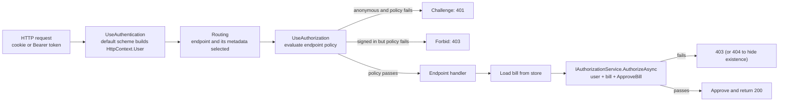
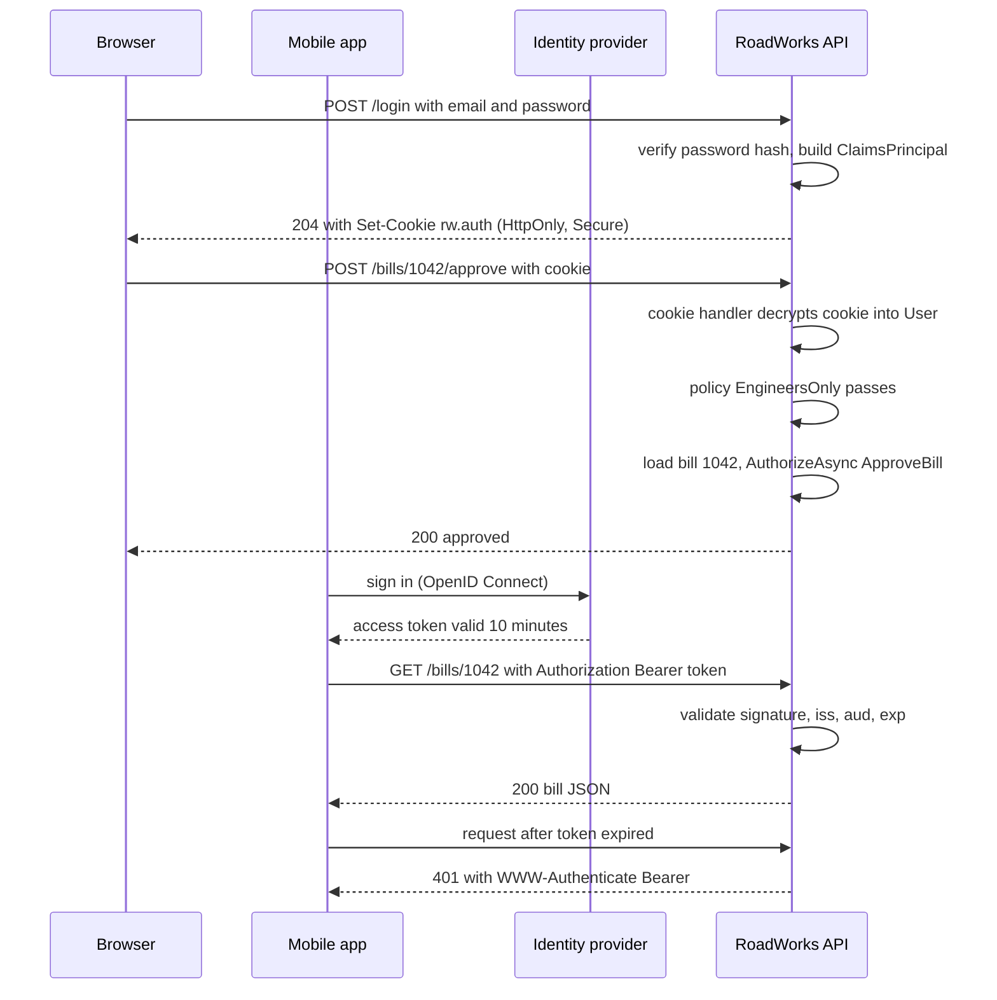
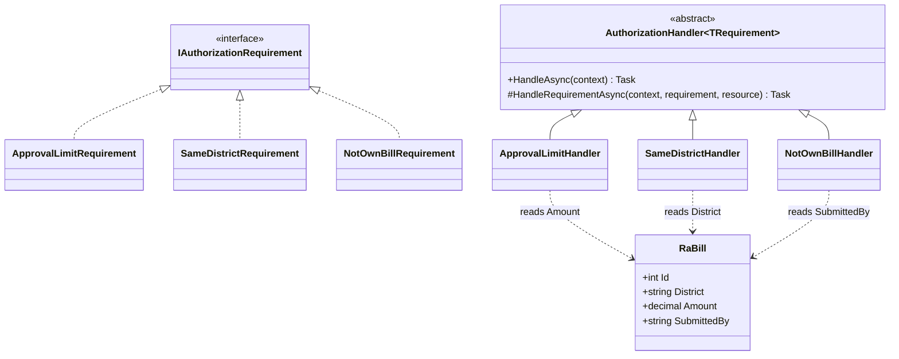

Every protected API answers two questions on every request, in this order: **who are you?** and **are you allowed to do this?** Mixing them up is the root of most access-control bugs: an endpoint that checks the role but not the district, a token that is trusted without checking its signature, a 403 returned when the user simply forgot to log in. This lesson separates the two questions cleanly and shows how ASP.NET Core answers each one.

## Learning objectives

By the end of this lesson you will be able to:

1. Explain the difference between authentication (proving identity) and authorization (granting permission), and map each to a status code (401 vs 403).
2. Describe what a claim, a claims identity and a claims principal are, and how `HttpContext.User` gets filled.
3. Configure cookie authentication for a browser app and JWT bearer authentication for a mobile or service client, and say when each fits.
4. Write role checks, named policies, and custom requirements with handlers.
5. Use resource-based authorization (`IAuthorizationService`) when the decision depends on the data being touched.
6. Describe what ASP.NET Core Identity adds (user store, password hashing, lockout, two-factor) and when you do not need it.
7. Recognise common failure modes: missing middleware order, trusting unsigned tokens, role explosion, and leaking existence through 403 vs 404.

## Prerequisites

- [Kestrel, middleware, routing, controllers and minimal APIs](#/lesson/m03-kestrel-middleware-routing): authentication and authorization are middleware plus endpoint metadata.
- [Dependency injection](#/lesson/m03-dependency-injection): handlers and `IAuthorizationService` come from the container.
- [Configuration, environment variables and secrets](#/lesson/m03-configuration): signing keys and issuer URLs are configuration, and keys are secrets.

The security module goes deeper on the protocols themselves: [Authentication versus authorization](#/lesson/m14-authn-vs-authz), [OAuth 2.0 and OpenID Connect](#/lesson/m14-oauth-oidc) and [JWT validation and limitations](#/lesson/m14-jwt). Here we stay inside one ASP.NET Core app.

## Explain it like I'm a beginner

Picture the site office of a highway construction project. At the gate, a guard looks at your ID card. That card was issued by the project HR office, it has your photo, your name, your company ("Contractor: Shree Infra") and a hologram that is hard to forge. The guard does not decide what you may do inside. The guard only answers: *is this card real, and is it yours?* That is **authentication** (proving who you are).

Inside, you walk to the bill-approval desk with a running-account bill for ₹38 lakh. The clerk checks three things: are you a site engineer, is this bill from your district, and is ₹38 lakh within your approval limit? Your ID card is the same one the guard saw, but now the questions are about **permission**. That is **authorization** (deciding what an identified person may do).

Each fact printed on the card ("name: Priya", "role: SiteEngineer", "district: Nagpur", "approval limit: ₹50 lakh") is a **claim**. The card itself is a **claims identity**. A person who carries both a project ID card and a government ID card is a **claims principal**: one person, possibly several identities.

Two kinds of cards exist in web apps:

- **A cookie** is like a visitor wristband the gate puts on you. You got it once by showing your password; after that, the browser shows the wristband automatically on every visit. Great for people using a browser.
- **A bearer token (JWT)** is like a sealed letter of authority you carry and hand over yourself. Anyone holding it is let in ("bearer"), so it must be short-lived and kept safe. Great for mobile apps and other services that are not browsers.

If you arrive without any card, the guard says "please identify yourself": **401 Unauthorized** (the name is historical; it really means *unauthenticated*). If your card is fine but you try to approve a ₹2 crore bill with a ₹50 lakh limit, the clerk says "you are not allowed": **403 Forbidden**.

## First-principles explanation

### Claims, identities and principals

ASP.NET Core represents the caller as a `ClaimsPrincipal`, available as `HttpContext.User` and injectable into minimal API handlers as a `ClaimsPrincipal` parameter.

- A **claim** (`Claim`) is a type-value pair asserted by an issuer: `(ClaimTypes.Role, "SiteEngineer")`, `("district", "Nagpur")`.
- A **claims identity** (`ClaimsIdentity`) is a bag of claims plus an `AuthenticationType` such as `"Cookies"` or `"Bearer"`. `IsAuthenticated` is true only when `AuthenticationType` is non-empty. That is why `new ClaimsIdentity()` is anonymous and `new ClaimsIdentity(claims, "Cookies")` is not.
- A **claims principal** holds one or more identities. `User.IsInRole("SiteEngineer")` and `User.FindFirst("district")` search across them.

Claims are *statements*, not truths. A claim is only as trustworthy as the mechanism that produced it. A cookie encrypted and signed by your server's Data Protection keys is trustworthy. A JWT is trustworthy only after its signature, issuer, audience and expiry are validated. A header called `X-User-Role` sent by the client is never trustworthy.

### Authentication: schemes and handlers

Authentication in ASP.NET Core is organised around **schemes**. A scheme is a name (`"Cookies"`, `"Bearer"`) plus a handler that knows how to do four things:

| Operation | Meaning | Cookie handler | JWT bearer handler |
|---|---|---|---|
| Authenticate | Read the request and build a `ClaimsPrincipal` | Decrypt the auth cookie | Validate the `Authorization: Bearer ...` token |
| Challenge | Respond when an anonymous user hits a protected endpoint | Redirect to login (or 401 for APIs) | 401 with `WWW-Authenticate: Bearer` |
| Forbid | Respond when an authenticated user lacks permission | Redirect to access-denied (or 403 for APIs) | 403 |
| Sign in / out | Persist or remove the identity | Write / delete the cookie | Not supported; tokens are issued elsewhere |

You register schemes in phase 1 with `AddAuthentication(defaultScheme).AddCookie(...)` or `.AddJwtBearer(...)`. In phase 2, `app.UseAuthentication()` runs the default scheme's *Authenticate* on every request and assigns the result to `HttpContext.User`. It does not reject anyone. An invalid or missing cookie simply leaves `User` anonymous. Rejection is authorization's job.

(Since .NET 7, `WebApplication` adds the authentication and authorization middleware automatically when the services are registered. Calling them explicitly is still common because it documents the order.)

### Cookies: the browser case

With cookie authentication, the login endpoint checks the password, builds a principal and calls `HttpContext.SignInAsync`. The cookie handler serialises the principal, encrypts and signs it with ASP.NET Core Data Protection, and sends it as `Set-Cookie`. The browser returns it on every request to the same site.

Settings that matter:

- `HttpOnly = true` so JavaScript cannot read the cookie (limits damage from cross-site scripting).
- `SecurePolicy = Always` so it is never sent over plain HTTP.
- `SameSite = Lax` (or `Strict`) so other sites cannot make the browser send it on cross-site form posts. This is your first defence against cross-site request forgery (CSRF); for HTML forms also use antiforgery tokens.
- `ExpireTimeSpan` and `SlidingExpiration`: an 8-hour shift-length session that renews while active is a sensible default for an office portal.

Two operational facts catch teams out. First, the cookie is encrypted with Data Protection keys. If you run three instances behind a load balancer, they must share a key ring (a shared folder, blob storage or database), or a cookie issued by instance A is unreadable on instance B and users get logged out randomly. Second, the cookie carries the claims as they were at sign-in. If you remove a user's role, the change takes effect at next sign-in unless you validate the principal periodically (`OnValidatePrincipal`) or keep sessions short.

For API endpoints, a redirect to a login page is wrong; a script expects a 401. From ASP.NET Core 10 the cookie handler returns 401/403 instead of redirecting for endpoints it recognises as API endpoints. Many codebases still override `Events.OnRedirectToLogin` explicitly, which also works on older versions and makes the intent visible.

### JWT bearer tokens: the mobile and service case

A **JSON Web Token** is three Base64URL-encoded parts separated by dots: a header (`{"alg":"RS256","kid":"key-2026-10"}`), a payload of claims (`sub`, `iss`, `aud`, `exp`, `role`, `district`) and a signature over the first two parts. Anyone can *read* a JWT; only the holder of the key can *produce* a valid signature. That is the whole security model.

In practice your API rarely issues tokens. An identity provider (Microsoft Entra ID, Keycloak, Auth0, or a self-hosted OpenID Connect server) issues them, and your API validates them. The `Microsoft.AspNetCore.Authentication.JwtBearer` package does this:

```csharp
builder.Services.AddAuthentication(JwtBearerDefaults.AuthenticationScheme)
    .AddJwtBearer(o =>
    {
        o.Authority = "https://login.example-idp.in/realms/roadworks"; // downloads signing keys via OIDC discovery
        o.Audience = "roadworks-api";                                    // token must be meant for this API
        o.TokenValidationParameters.ClockSkew = TimeSpan.FromMinutes(1); // default is 5 minutes
        o.MapInboundClaims = false;                                      // keep "role", "sub" as-is
        o.TokenValidationParameters.RoleClaimType = "role";
        o.TokenValidationParameters.NameClaimType = "name";
    });
```

Validation checks, in order of importance: the **signature** with a key the API trusts, the **algorithm** is one you expect (never `none`), the **issuer** (`iss`) is your identity provider, the **audience** (`aud`) is this API, and the **lifetime** (`exp`, `nbf`) with a small clock skew. Exercise 5 has you implement these checks by hand so you know what the library is doing.

The trade-off with JWTs is revocation. A signed token stays valid until it expires, even if you disable the user one second after issuing it. The usual answer is short access tokens (5 to 15 minutes) plus refresh tokens that the identity provider can revoke. For a high-risk action, such as releasing a ₹5 crore payment, re-check the user's status in the database rather than trusting the token alone.

### Cookie or token?

| Situation | Choose | Why |
|---|---|---|
| Server-rendered site or SPA on the same domain as the API | Cookie | Browser handles storage, `HttpOnly` keeps it away from scripts |
| Mobile app, desktop app, CLI | JWT bearer from an identity provider | No browser cookie jar; token sent explicitly |
| Service-to-service call | JWT (client credentials) or mutual TLS | No human, no login page |
| SPA on a different domain calling many APIs | Often "backend for frontend": cookie to your own backend, which holds tokens | Avoids storing tokens in browser JavaScript |

Storing a JWT in `localStorage` is a frequent and risky shortcut: any cross-site scripting bug can read it. A cookie marked `HttpOnly` cannot be read by script.

An app can register both schemes and choose per endpoint: `RequireAuthorization(new AuthorizeAttribute { AuthenticationSchemes = "Bearer" })` or a policy with `AddAuthenticationSchemes("Bearer")`.

### Authorization: from simple to precise

Authorization runs in `app.UseAuthorization()`, which reads the endpoint's metadata (`[Authorize]`, `RequireAuthorization(...)`, `[AllowAnonymous]`) and evaluates the matching **policy**. If the user is anonymous and the policy fails, it calls *Challenge* (401). If the user is authenticated and the policy fails, it calls *Forbid* (403).

There are four levels of precision.

**1. Authenticated or not.** `RequireAuthorization()` with no arguments uses the default policy: any authenticated user. A **fallback policy** applies to endpoints with no metadata at all. Setting the fallback to "require authenticated user" makes the whole API secure by default, and you mark the login and health endpoints `AllowAnonymous`. That is safer than remembering `[Authorize]` on every new endpoint.

**2. Roles.** `RequireRole("SiteEngineer", "ExecutiveEngineer")` passes if the user has *any* of the listed roles. Roles are easy to understand but coarse. If permissions depend on the district, the amount, or ownership, roles alone multiply into "NagpurSiteEngineerUpTo50Lakh" and similar nonsense. This is **role explosion**.

**3. Named policies.** A policy is a list of **requirements** that must *all* pass:

```csharp
builder.Services.AddAuthorizationBuilder()
    .AddPolicy("FinanceOnly", p => p.RequireRole("FinanceOfficer"))
    .AddPolicy("HasDistrict", p => p.RequireClaim("district"));
```

Endpoints then refer to the policy name, so the rule lives in one place and can change without touching endpoints.

**4. Custom requirements and handlers.** A **requirement** (`IAuthorizationRequirement`) is a small data class describing *what* must be true ("approval limit must cover the amount"). A **handler** (`AuthorizationHandler<TRequirement>`) is the code that decides *whether* it is true for this user. Handlers are registered in DI, so they can use other services, such as a delegation table or the clock.

The evaluation rules are worth memorising:

- A requirement passes if **at least one** handler calls `context.Succeed(requirement)`.
- The policy passes if **every** requirement passed and **no** handler called `context.Fail()`.
- A handler that does nothing is neutral. Doing nothing is the normal way to say "not my concern" or "no".
- `Fail()` is a veto. Use it only for "this must block even if another handler would allow it", such as a suspended account.

Several handlers for one requirement give you OR logic ("site engineer of the district OR a delegated engineer"). Several requirements give you AND logic.

### Resource-based authorization

Endpoint policies run *before* your handler code, so they cannot see the bill being approved. When the decision depends on the data (this bill's district, amount, submitter), load the resource first and call `IAuthorizationService.AuthorizeAsync(user, resource, policyName)` yourself. Handlers derive from `AuthorizationHandler<TRequirement, TResource>` and receive the resource.

A typical approve endpoint therefore has two checks: an endpoint policy "is an engineer at all" (cheap, runs before loading anything), and a resource check "may approve *this* bill" after loading it.

### 403 or 404?

If a contractor from Pune requests a Nagpur contractor's bill by id, a 403 confirms that bill 1042 exists. In multi-tenant systems that leak matters, so many APIs return **404** for resources the caller may not even see, and **403** only for actions on resources they can see but may not change. Decide once and apply it consistently.

### Where ASP.NET Core Identity fits

**ASP.NET Core Identity** is a membership library: it stores users and passwords and handles the account lifecycle. It gives you `UserManager<TUser>` (create users, hash and verify passwords with PBKDF2, reset tokens, email confirmation), `SignInManager<TUser>` (password sign-in with lockout after repeated failures, two-factor, external logins), and EF Core stores for the tables. Since .NET 8, `MapIdentityApi<TUser>()` adds ready-made `/register`, `/login` and `/refresh` endpoints for SPAs and mobile apps.

```csharp
builder.Services.AddIdentityApiEndpoints<AppUser>()
    .AddEntityFrameworkStores<AppDbContext>();   // EF Core + PostgreSQL via Npgsql
app.MapIdentityApi<AppUser>();
```

Identity answers "how do I store and check passwords safely?". It does not replace authorization: you still write policies. And it is not an identity provider: it does not issue standard OpenID Connect tokens to other apps. Choose by situation:

- **One app, its own users, small team**: Identity with cookies is quick and safe.
- **Several apps sharing users, or a single sign-on requirement, or government SSO**: use an external identity provider and validate its tokens. Do not build your own token server.
- **Internal staff in a company that already has Entra ID or Google Workspace**: use that directory. Storing passwords yourself is a liability you do not need.

The `PasswordHasher<TUser>` class from Identity is usable on its own; the implementation below uses it without the rest of Identity.

### Trade-offs

| Choice | You gain | You pay |
|---|---|---|
| Cookies | Browser-managed, `HttpOnly`, easy revocation by key or session store | CSRF to defend against, shared Data Protection keys across instances |
| JWT bearer | Stateless validation, works for any client | Hard to revoke, token theft risk, must validate carefully |
| Roles only | Simple, readable | Explodes when rules depend on data |
| Policies with handlers | Rules in one testable place | More types; over-engineering for a 3-endpoint tool |
| Resource-based checks | Precise per-record decisions | You must remember to call them, and load data first |

## Visual explanation

### Where authentication and authorization run



Read left to right. Authentication never rejects; it only fills `HttpContext.User` (possibly anonymous). Routing happens before authorization because the authorization middleware needs to know *which* endpoint was selected to find its policy. The endpoint policy is a coarse gate ("is an engineer"). The resource check inside the endpoint is the precise gate ("may approve this bill"). Two exits lead to 403 for two different reasons, and the second one is where many systems choose 404 instead.

### Cookie login and a bearer-token call



The browser flow involves only the API: it checks the password and issues its own cookie. The mobile flow involves a separate identity provider: the API never sees a password, it only checks that the token was signed by a key it trusts and is meant for it. Notice the last exchange: an expired token produces 401, which tells the app to refresh its token, not to show "access denied".

### Requirements and handlers



Each requirement is a plain marker or data class; each handler holds the logic for exactly one rule. The `ApproveBill` policy lists all three requirements, so all three must pass (AND). If later you add "a delegated engineer may approve while the regular engineer is on leave", you add a second handler for `SameDistrictRequirement` (OR) without touching the others. The handlers depend on `RaBill` only to read it; they never change it.

## Step-by-step example

We build the approval rules for a state road agency's contractor billing portal. Contractors submit **running-account (RA) bills** for work done; site engineers approve them; finance pays.

### Step 1 — sign in and see who you are

Register cookie authentication and a `/login` endpoint that checks a password hash and signs in. Add `/me`, protected by the default "authenticated" policy, that echoes the claims. Calling `/me` without the cookie returns 401. After logging in as Priya, it returns her role, district and limit.

### Step 2 — a role gate

Add `/bills/{id}/approve` with `RequireAuthorization("EngineersOnly")`, a policy that requires the `SiteEngineer` or `ExecutiveEngineer` role. A contractor calling it now gets 403. Good, but Priya, a Nagpur site engineer with a ₹50 lakh limit, can still approve a ₹2 crore bill from Pune. The role is right; the rule is incomplete.

### Step 3 — requirements that need the bill

Create three requirements: `SameDistrictRequirement`, `ApprovalLimitRequirement`, `NotOwnBillRequirement` (an engineer who also submitted the bill on a contractor's behalf may not approve it; this is **segregation of duties**). Each gets a handler deriving from `AuthorizationHandler<TRequirement, RaBill>`. Register them as `IAuthorizationHandler` singletons and group them in an `ApproveBill` policy.

### Step 4 — call the resource check

In the endpoint, load bill 1042 first, then call `authz.AuthorizeAsync(user, bill, "ApproveBill")`. If it fails, return `Results.Forbid()`. Now the numbers decide:

| User | Role | District | Limit | Bill 1042 (Nagpur, ₹38 lakh) | Bill 1043 (Pune, ₹12 lakh) | Bill 1044 (Nagpur, ₹1.2 crore) |
|---|---|---|---|---|---|---|
| Priya | SiteEngineer | Nagpur | ₹50 lakh | Allowed | 403 (district) | 403 (limit) |
| Rakesh | ExecutiveEngineer | Nagpur | ₹2 crore | Allowed | 403 (district) | Allowed |
| Shree Infra | Contractor | Nagpur | none | 403 (role) | 403 (role) | 403 (role) |

## Production-style C# implementation

Layout:

```text
RoadWorks.Api/
  Program.cs
  Bills/RaBill.cs
  Bills/IBillStore.cs
  Bills/InMemoryBillStore.cs
  Auth/AppClaims.cs
  Auth/UserDirectory.cs
  Auth/BillRequirements.cs
  Auth/BillHandlers.cs
  Auth/AuthorizationSetup.cs
```

```csharp file=Bills/RaBill.cs
namespace RoadWorks.Bills;

/// <summary>A running-account bill submitted by a contractor for work done in one district.</summary>
public sealed record RaBill(int Id, string District, decimal Amount, string SubmittedBy, string ContractorName)
{
    public string Status { get; init; } = "Submitted";
    public string? ApprovedBy { get; init; }
    public DateTimeOffset? ApprovedAt { get; init; }
}
```

```csharp file=Bills/IBillStore.cs
namespace RoadWorks.Bills;

public interface IBillStore
{
    RaBill? Find(int id);
    RaBill Approve(int id, string approverId, DateTimeOffset at);
}
```

```csharp file=Bills/InMemoryBillStore.cs
using System.Collections.Concurrent;

namespace RoadWorks.Bills;

/// <summary>Stand-in for a PostgreSQL repository so the sample runs without a database.</summary>
public sealed class InMemoryBillStore : IBillStore
{
    private readonly ConcurrentDictionary<int, RaBill> _bills = new()
    {
        [1042] = new RaBill(1042, "Nagpur", 38_00_000m, "u-contractor-7", "Shree Infra"),
        [1043] = new RaBill(1043, "Pune", 12_00_000m, "u-contractor-9", "Deccan Roads"),
        [1044] = new RaBill(1044, "Nagpur", 1_20_00_000m, "u-contractor-7", "Shree Infra"),
    };

    public RaBill? Find(int id) => _bills.TryGetValue(id, out var bill) ? bill : null;

    public RaBill Approve(int id, string approverId, DateTimeOffset at) =>
        _bills.AddOrUpdate(id,
            _ => throw new KeyNotFoundException($"Bill {id} not found"),
            (_, existing) => existing with { Status = "Approved", ApprovedBy = approverId, ApprovedAt = at });
}
```

```csharp file=Auth/AppClaims.cs
namespace RoadWorks.Auth;

/// <summary>One place for claim types and role names, so typos become compile errors.</summary>
public static class AppClaims
{
    public const string District = "district";
    public const string ApprovalLimit = "approval_limit";
}

public static class AppRoles
{
    public const string Contractor = "Contractor";
    public const string SiteEngineer = "SiteEngineer";
    public const string ExecutiveEngineer = "ExecutiveEngineer";
    public const string FinanceOfficer = "FinanceOfficer";
}
```

```csharp file=Auth/UserDirectory.cs
using System.Globalization;
using System.Security.Claims;
using Microsoft.AspNetCore.Authentication.Cookies;
using Microsoft.AspNetCore.Identity;

namespace RoadWorks.Auth;

public sealed record AppUser(string Id, string Email, string DisplayName, string Role, string? District, decimal? ApprovalLimit)
{
    public string PasswordHash { get; set; } = "";
}

public interface IUserDirectory
{
    /// <summary>Returns a principal for valid credentials, or null. Never says which part was wrong.</summary>
    ClaimsPrincipal? TryLogin(string email, string password);
}

/// <summary>
/// Demo user store. Uses Identity's PasswordHasher (PBKDF2) without the rest of Identity.
/// In production this would be ASP.NET Core Identity's UserManager or an external identity provider.
/// </summary>
public sealed class InMemoryUserDirectory : IUserDirectory
{
    private readonly PasswordHasher<AppUser> _hasher = new();
    private readonly Dictionary<string, AppUser> _byEmail = new(StringComparer.OrdinalIgnoreCase);

    public InMemoryUserDirectory()
    {
        Add(new AppUser("u-eng-priya", "priya@roadworks.example", "Priya Deshmukh", AppRoles.SiteEngineer, "Nagpur", 50_00_000m), "demo-only-1");
        Add(new AppUser("u-ee-rakesh", "rakesh@roadworks.example", "Rakesh Rao", AppRoles.ExecutiveEngineer, "Nagpur", 2_00_00_000m), "demo-only-2");
        Add(new AppUser("u-contractor-7", "accounts@shreeinfra.example", "Shree Infra", AppRoles.Contractor, "Nagpur", null), "demo-only-3");
    }

    private void Add(AppUser user, string password)
    {
        user.PasswordHash = _hasher.HashPassword(user, password);
        _byEmail[user.Email] = user;
    }

    public ClaimsPrincipal? TryLogin(string email, string password)
    {
        if (!_byEmail.TryGetValue(email, out var user)) return null;
        var check = _hasher.VerifyHashedPassword(user, user.PasswordHash, password);
        if (check == PasswordVerificationResult.Failed) return null;

        var claims = new List<Claim>
        {
            new(ClaimTypes.NameIdentifier, user.Id),
            new(ClaimTypes.Name, user.DisplayName),
            new(ClaimTypes.Email, user.Email),
            new(ClaimTypes.Role, user.Role),
        };
        if (user.District is not null) claims.Add(new Claim(AppClaims.District, user.District));
        if (user.ApprovalLimit is decimal limit)
            claims.Add(new Claim(AppClaims.ApprovalLimit, limit.ToString(CultureInfo.InvariantCulture)));

        var identity = new ClaimsIdentity(claims, CookieAuthenticationDefaults.AuthenticationScheme);
        return new ClaimsPrincipal(identity);
    }
}
```

```csharp file=Auth/BillRequirements.cs
using Microsoft.AspNetCore.Authorization;

namespace RoadWorks.Auth;

/// <summary>The approver's district claim must match the bill's district.</summary>
public sealed class SameDistrictRequirement : IAuthorizationRequirement;

/// <summary>The approver's approval_limit claim must cover the bill amount.</summary>
public sealed class ApprovalLimitRequirement : IAuthorizationRequirement;

/// <summary>Segregation of duties: whoever submitted a bill may not approve it.</summary>
public sealed class NotOwnBillRequirement : IAuthorizationRequirement;
```

```csharp file=Auth/BillHandlers.cs
using System.Globalization;
using System.Security.Claims;
using Microsoft.AspNetCore.Authorization;
using RoadWorks.Bills;

namespace RoadWorks.Auth;

public sealed class SameDistrictHandler : AuthorizationHandler<SameDistrictRequirement, RaBill>
{
    protected override Task HandleRequirementAsync(AuthorizationHandlerContext context, SameDistrictRequirement requirement, RaBill bill)
    {
        var district = context.User.FindFirstValue(AppClaims.District);
        if (district is not null && string.Equals(district, bill.District, StringComparison.OrdinalIgnoreCase))
            context.Succeed(requirement);
        return Task.CompletedTask;   // doing nothing means "not satisfied by me"
    }
}

public sealed class ApprovalLimitHandler : AuthorizationHandler<ApprovalLimitRequirement, RaBill>
{
    protected override Task HandleRequirementAsync(AuthorizationHandlerContext context, ApprovalLimitRequirement requirement, RaBill bill)
    {
        var raw = context.User.FindFirstValue(AppClaims.ApprovalLimit);
        if (raw is not null
            && decimal.TryParse(raw, NumberStyles.Number, CultureInfo.InvariantCulture, out var limit)
            && bill.Amount <= limit)
        {
            context.Succeed(requirement);
        }
        return Task.CompletedTask;
    }
}

public sealed class NotOwnBillHandler : AuthorizationHandler<NotOwnBillRequirement, RaBill>
{
    protected override Task HandleRequirementAsync(AuthorizationHandlerContext context, NotOwnBillRequirement requirement, RaBill bill)
    {
        var userId = context.User.FindFirstValue(ClaimTypes.NameIdentifier);
        if (userId is not null && userId != bill.SubmittedBy)
            context.Succeed(requirement);
        return Task.CompletedTask;
    }
}
```

```csharp file=Auth/AuthorizationSetup.cs
using Microsoft.AspNetCore.Authorization;
using Microsoft.Extensions.DependencyInjection;

namespace RoadWorks.Auth;

public static class Policies
{
    public const string EngineersOnly = "EngineersOnly";
    public const string ApproveBill = "ApproveBill";
}

public static class AuthorizationSetup
{
    public static IServiceCollection AddRoadWorksAuthorization(this IServiceCollection services)
    {
        services.AddAuthorizationBuilder()
            // Secure by default: endpoints with no metadata still need a signed-in user.
            .SetFallbackPolicy(new AuthorizationPolicyBuilder().RequireAuthenticatedUser().Build())
            .AddPolicy(Policies.EngineersOnly, p => p.RequireRole(AppRoles.SiteEngineer, AppRoles.ExecutiveEngineer))
            .AddPolicy(Policies.ApproveBill, p => p
                .RequireAuthenticatedUser()
                .AddRequirements(new SameDistrictRequirement(), new ApprovalLimitRequirement(), new NotOwnBillRequirement()));

        // Handlers are stateless, so singletons are fine. Use scoped if a handler needs a DbContext.
        services.AddSingleton<IAuthorizationHandler, SameDistrictHandler>();
        services.AddSingleton<IAuthorizationHandler, ApprovalLimitHandler>();
        services.AddSingleton<IAuthorizationHandler, NotOwnBillHandler>();
        return services;
    }
}
```

```csharp file=Program.cs
using System.Security.Claims;
using Microsoft.AspNetCore.Authentication;
using Microsoft.AspNetCore.Authentication.Cookies;
using Microsoft.AspNetCore.Authorization;
using RoadWorks.Auth;
using RoadWorks.Bills;

var builder = WebApplication.CreateBuilder(args);

builder.Services.AddSingleton(TimeProvider.System);
builder.Services.AddSingleton<IBillStore, InMemoryBillStore>();
builder.Services.AddSingleton<IUserDirectory, InMemoryUserDirectory>();

builder.Services
    .AddAuthentication(CookieAuthenticationDefaults.AuthenticationScheme)
    .AddCookie(o =>
    {
        o.Cookie.Name = "rw.auth";
        o.Cookie.HttpOnly = true;
        o.Cookie.SecurePolicy = CookieSecurePolicy.Always;
        o.Cookie.SameSite = SameSiteMode.Lax;
        o.ExpireTimeSpan = TimeSpan.FromHours(8);
        o.SlidingExpiration = true;
        // An API should answer 401/403, not redirect a script to an HTML login page.
        o.Events.OnRedirectToLogin = ctx => { ctx.Response.StatusCode = StatusCodes.Status401Unauthorized; return Task.CompletedTask; };
        o.Events.OnRedirectToAccessDenied = ctx => { ctx.Response.StatusCode = StatusCodes.Status403Forbidden; return Task.CompletedTask; };
    });
builder.Services.AddRoadWorksAuthorization();

var app = builder.Build();

app.UseAuthentication();   // fills HttpContext.User, never rejects
app.UseAuthorization();    // evaluates endpoint policies: 401 or 403

app.MapPost("/login", async (LoginRequest req, IUserDirectory users, HttpContext http) =>
{
    var principal = users.TryLogin(req.Email, req.Password);
    if (principal is null)
        return Results.Problem(statusCode: 401, title: "Invalid email or password");   // same message for both cases
    await http.SignInAsync(CookieAuthenticationDefaults.AuthenticationScheme, principal);
    return Results.NoContent();
}).AllowAnonymous();

app.MapPost("/logout", async (HttpContext http) =>
{
    await http.SignOutAsync(CookieAuthenticationDefaults.AuthenticationScheme);
    return Results.NoContent();
});   // fallback policy: must be signed in

app.MapGet("/me", (ClaimsPrincipal user) => Results.Ok(new
{
    id = user.FindFirstValue(ClaimTypes.NameIdentifier),
    name = user.Identity?.Name,
    roles = user.FindAll(ClaimTypes.Role).Select(c => c.Value),
    district = user.FindFirstValue(AppClaims.District),
}));

app.MapPost("/bills/{id:int}/approve", async (int id, ClaimsPrincipal user, IBillStore store,
                                               IAuthorizationService authz, TimeProvider clock) =>
{
    var bill = store.Find(id);
    if (bill is null) return Results.NotFound();

    var decision = await authz.AuthorizeAsync(user, bill, Policies.ApproveBill);
    if (!decision.Succeeded) return Results.Forbid();

    var approved = store.Approve(id, user.FindFirstValue(ClaimTypes.NameIdentifier)!, clock.GetUtcNow());
    return Results.Ok(approved);
}).RequireAuthorization(Policies.EngineersOnly);

app.MapGet("/healthz", () => Results.Ok("ok")).AllowAnonymous();

app.Run();

public sealed record LoginRequest(string Email, string Password);
```

Things to notice:

- The login endpoint returns the same message for "no such email" and "wrong password", so an attacker cannot use it to discover registered emails. Add rate limiting on `/login` in production (see [Rate limiting algorithms](#/lesson/m10-rate-limiting)).
- `TryLogin` puts the approval limit into the cookie as a claim. That is fine for an 8-hour cookie if limits change rarely. If finance changes limits daily, the handler should look the limit up in the database instead (handlers can inject services).
- The approve endpoint does the coarse check by policy (before loading anything) and the precise check after loading the bill. Both are needed: the coarse check avoids a database read for contractors.
- The demo passwords are deliberately named `demo-only-*`. Real passwords never appear in code.

## Bad design vs good design

**Bad**: authorization scattered as string comparisons inside endpoints, trusting client input.

```csharp
app.MapPost("/bills/{id}/approve", (int id, HttpRequest req, IBillStore store) =>
{
    var role = req.Headers["X-Role"].ToString();          // client says who it is
    if (role != "SiteEngineer") return Results.StatusCode(401);  // wrong code: user is known
    var bill = store.Find(id)!;
    if (bill.Amount > 5000000) return Results.StatusCode(403);   // hard-coded limit, no district check
    return Results.Ok(store.Approve(id, "unknown", DateTimeOffset.Now));
});
```

Problems: any client can send `X-Role: SiteEngineer`; the status code says "log in" to someone who is logged in; the limit is a magic number copied into every endpoint that needs it; there is no district or segregation-of-duties check; the approver is not recorded; and a missing bill throws a `NullReferenceException`.

**Good**: the implementation above. Identity comes only from a validated cookie or token. Rules are named policies with one handler per rule. The endpoint loads the resource and asks `IAuthorizationService`. Status codes match meaning. Adding "delegated approver" is a new handler, not an edit to five endpoints.

:::callout type=tip title="A simpler alternative for a small internal tool"
A three-endpoint admin tool used by four people does not need custom requirements. `RequireAuthorization(p => p.RequireRole("Admin"))` and a fallback policy are enough. Introduce handlers when a rule depends on the data or appears in more than one place.
:::

:::callout type=warning title="Never decide authorization in the client"
Hiding the Approve button for contractors in the UI is good user experience, not security. Every rule must be enforced on the server, because anyone can send the HTTP request without your UI.
:::

## Practical playground

This console program uses the real `DefaultAuthorizationService` with the same three handlers as the implementation, outside a web server. Try adding a delegation handler: a second `SameDistrictRequirement` handler that succeeds when the user has a claim `delegated_district` equal to the bill's district.

:::playground type=csharp title="Evaluate the ApproveBill policy for different users"
```csharp file=Program.cs
using System;
using System.Collections.Generic;
using System.Globalization;
using System.Security.Claims;
using System.Threading.Tasks;
using Microsoft.AspNetCore.Authorization;
using Microsoft.Extensions.DependencyInjection;

public sealed record Bill(int Id, string District, decimal Amount, string SubmittedBy);
public sealed class SameDistrict : IAuthorizationRequirement;
public sealed class WithinLimit : IAuthorizationRequirement;
public sealed class NotOwnBill : IAuthorizationRequirement;

public sealed class SameDistrictHandler : AuthorizationHandler<SameDistrict, Bill>
{
    protected override Task HandleRequirementAsync(AuthorizationHandlerContext c, SameDistrict r, Bill b)
    {
        if (c.User.FindFirst("district")?.Value == b.District) c.Succeed(r);
        return Task.CompletedTask;
    }
}

public sealed class WithinLimitHandler : AuthorizationHandler<WithinLimit, Bill>
{
    protected override Task HandleRequirementAsync(AuthorizationHandlerContext c, WithinLimit r, Bill b)
    {
        var raw = c.User.FindFirst("approval_limit")?.Value;
        if (raw is not null && decimal.Parse(raw, CultureInfo.InvariantCulture) >= b.Amount) c.Succeed(r);
        return Task.CompletedTask;
    }
}

public sealed class NotOwnBillHandler : AuthorizationHandler<NotOwnBill, Bill>
{
    protected override Task HandleRequirementAsync(AuthorizationHandlerContext c, NotOwnBill r, Bill b)
    {
        if (c.User.FindFirst(ClaimTypes.NameIdentifier)?.Value != b.SubmittedBy) c.Succeed(r);
        return Task.CompletedTask;
    }
}

public static class Program
{
    static ClaimsPrincipal User(string id, string role, string district, decimal limit) =>
        new(new ClaimsIdentity(new[]
        {
            new Claim(ClaimTypes.NameIdentifier, id),
            new Claim(ClaimTypes.Role, role),
            new Claim("district", district),
            new Claim("approval_limit", limit.ToString(CultureInfo.InvariantCulture)),
        }, "Demo"));

    public static async Task Main()
    {
        var services = new ServiceCollection();
        services.AddLogging();
        services.AddAuthorizationCore(o => o.AddPolicy("ApproveBill", p => p
            .RequireRole("SiteEngineer", "ExecutiveEngineer")
            .AddRequirements(new SameDistrict(), new WithinLimit(), new NotOwnBill())));
        services.AddSingleton<IAuthorizationHandler, SameDistrictHandler>();
        services.AddSingleton<IAuthorizationHandler, WithinLimitHandler>();
        services.AddSingleton<IAuthorizationHandler, NotOwnBillHandler>();
        var authz = services.BuildServiceProvider().GetRequiredService<IAuthorizationService>();

        var users = new Dictionary<string, ClaimsPrincipal>
        {
            ["Priya (SE, Nagpur, 50L)"] = User("priya", "SiteEngineer", "Nagpur", 5_000_000m),
            ["Rakesh (EE, Nagpur, 2Cr)"] = User("rakesh", "ExecutiveEngineer", "Nagpur", 20_000_000m),
            ["Shree Infra (Contractor)"] = User("c7", "Contractor", "Nagpur", 0m),
        };
        var bills = new[]
        {
            new Bill(1042, "Nagpur", 3_800_000m, "c7"),
            new Bill(1043, "Pune", 1_200_000m, "c9"),
            new Bill(1044, "Nagpur", 12_000_000m, "c7"),
        };

        foreach (var (name, user) in users)
            foreach (var bill in bills)
            {
                var result = await authz.AuthorizeAsync(user, bill, "ApproveBill");
                var why = result.Succeeded ? "" : " missing: " + string.Join(", ",
                    result.Failure!.FailedRequirements.Select(r => r.GetType().Name));
                Console.WriteLine($"{name,-26} bill {bill.Id}: {(result.Succeeded ? "ALLOW" : "DENY")}{why}");
            }
    }
}
```
:::

`FailedRequirements` tells you *which* rule failed, which is useful for logs and for a precise error message to the user. Note that `RequireRole` appears as `RolesAuthorizationRequirement` in the output for the contractor.

## Exercises

:::exercise id=m03-authn-authz-ex1 difficulty=beginner kind=code title="Build a claims principal and query it"
After a successful login, your app must turn a user record into a `ClaimsPrincipal`. Implement `PrincipalFactory.Create`, `PrincipalFactory.Anonymous` and `PrincipalFactory.CanSeeDistrict`.
::requirements
- `Create(userId, displayName, roles, district)` returns an **authenticated** principal with authentication type `"Cookies"`, a `NameIdentifier` claim, a `Name` claim, one `Role` claim per role, and a `"district"` claim when `district` is not null.
- `Anonymous()` returns a principal whose identity is **not** authenticated.
- `CanSeeDistrict(user, district)` returns true when the user is authenticated and either has role `"Auditor"` or a `"district"` claim equal to `district` (case-insensitive).
::acceptance
- `Identity.IsAuthenticated` is true for `Create` and false for `Anonymous`.
- `Identity.Name` equals the display name and `IsInRole` works for each role.
- An auditor can see every district; a Nagpur engineer sees Nagpur but not Pune; an anonymous user sees nothing.
::hint
A `ClaimsIdentity` is authenticated only when it has a non-empty authentication type. Pass `"Cookies"` as the second constructor argument.
::hint
`ClaimTypes.Name` and `ClaimTypes.Role` are the default name and role claim types, so `Identity.Name` and `IsInRole` work without extra configuration.
::hint
Anonymous is simply `new ClaimsPrincipal(new ClaimsIdentity())`.
::hint
```csharp
var claims = new List<Claim> { new(ClaimTypes.NameIdentifier, userId), new(ClaimTypes.Name, displayName) };
foreach (var r in roles) claims.Add(new Claim(ClaimTypes.Role, r));
if (district is not null) claims.Add(new Claim(DistrictClaim, district));
return new ClaimsPrincipal(new ClaimsIdentity(claims, "Cookies"));
```
::starter
```csharp file=PrincipalFactory.cs
using System;
using System.Collections.Generic;
using System.Security.Claims;

public static class PrincipalFactory
{
    public const string DistrictClaim = "district";

    public static ClaimsPrincipal Create(string userId, string displayName, IEnumerable<string> roles, string? district)
        => throw new NotImplementedException();

    public static ClaimsPrincipal Anonymous() => throw new NotImplementedException();

    public static bool CanSeeDistrict(ClaimsPrincipal user, string district) => throw new NotImplementedException();
}
```
::tests
```csharp file=PrincipalFactoryTests.cs
using System.Security.Claims;
using Xunit;

public class PrincipalFactoryTests
{
    [Fact]
    public void Created_principal_is_authenticated_with_name_and_roles()
    {
        var p = PrincipalFactory.Create("u-1", "Priya Deshmukh", new[] { "SiteEngineer", "Reviewer" }, "Nagpur");
        Assert.True(p.Identity!.IsAuthenticated);
        Assert.Equal("Cookies", p.Identity.AuthenticationType);
        Assert.Equal("Priya Deshmukh", p.Identity.Name);
        Assert.True(p.IsInRole("SiteEngineer"));
        Assert.True(p.IsInRole("Reviewer"));
        Assert.False(p.IsInRole("FinanceOfficer"));
        Assert.Equal("u-1", p.FindFirst(ClaimTypes.NameIdentifier)!.Value);
        Assert.Equal("Nagpur", p.FindFirst(PrincipalFactory.DistrictClaim)!.Value);
    }

    [Fact]
    public void No_district_means_no_district_claim()
    {
        var p = PrincipalFactory.Create("u-2", "Asha", new[] { "Auditor" }, null);
        Assert.Null(p.FindFirst(PrincipalFactory.DistrictClaim));
    }

    [Fact]
    public void Anonymous_is_not_authenticated()
    {
        Assert.False(PrincipalFactory.Anonymous().Identity!.IsAuthenticated);
    }

    [Fact]
    public void District_visibility_rules()
    {
        var engineer = PrincipalFactory.Create("u-1", "Priya", new[] { "SiteEngineer" }, "Nagpur");
        var auditor = PrincipalFactory.Create("u-2", "Asha", new[] { "Auditor" }, null);
        Assert.True(PrincipalFactory.CanSeeDistrict(engineer, "nagpur"));
        Assert.False(PrincipalFactory.CanSeeDistrict(engineer, "Pune"));
        Assert.True(PrincipalFactory.CanSeeDistrict(auditor, "Pune"));
        Assert.False(PrincipalFactory.CanSeeDistrict(PrincipalFactory.Anonymous(), "Nagpur"));
    }
}
```
::solution
The authentication type is what makes an identity "authenticated". Everything else is just claims.

```csharp file=PrincipalFactory.cs
using System;
using System.Collections.Generic;
using System.Security.Claims;

public static class PrincipalFactory
{
    public const string DistrictClaim = "district";

    public static ClaimsPrincipal Create(string userId, string displayName, IEnumerable<string> roles, string? district)
    {
        var claims = new List<Claim>
        {
            new(ClaimTypes.NameIdentifier, userId),
            new(ClaimTypes.Name, displayName),
        };
        foreach (var role in roles) claims.Add(new Claim(ClaimTypes.Role, role));
        if (district is not null) claims.Add(new Claim(DistrictClaim, district));
        return new ClaimsPrincipal(new ClaimsIdentity(claims, "Cookies"));
    }

    public static ClaimsPrincipal Anonymous() => new(new ClaimsIdentity());

    public static bool CanSeeDistrict(ClaimsPrincipal user, string district)
    {
        if (user.Identity?.IsAuthenticated != true) return false;
        if (user.IsInRole("Auditor")) return true;
        var mine = user.FindFirst(DistrictClaim)?.Value;
        return mine is not null && string.Equals(mine, district, StringComparison.OrdinalIgnoreCase);
    }
}
```
::mistakes
- Creating `new ClaimsIdentity(claims)` without an authentication type: the user looks logged in to you but `IsAuthenticated` is false, so every `[Authorize]` endpoint returns 401.
- Putting all roles in one claim as `"SiteEngineer,Reviewer"`; `IsInRole` compares the whole value and fails.
- Forgetting the anonymous check, so a forged principal with no identity but a district claim passes.
::extensions
Add a `"tenant"` claim and make `CanSeeDistrict` also require the tenant to match, which is how a multi-state SaaS portal would isolate data.
:::

:::exercise id=m03-authn-authz-ex2 difficulty=beginner kind=written title="401, 403 or 404?"
For each situation, give the status code the API should return and say whether it is an authentication or an authorization outcome.

1. A mobile app calls `GET /bills/1042` with no `Authorization` header.
2. The same call with a token whose `exp` was 20 minutes ago.
3. A Pune contractor, correctly signed in, calls `GET /bills/1042`, which belongs to a Nagpur contractor. The API is multi-tenant and must not reveal which bill ids exist.
4. Priya (Nagpur site engineer, ₹50 lakh limit) calls `POST /bills/1044/approve` for a ₹1.2 crore Nagpur bill.
5. A signed-in finance officer calls `POST /bills/9999/approve` and bill 9999 does not exist.
6. A token signed with the wrong key arrives.
::acceptance
- Cases 1, 2, 6 are 401 (authentication failed or absent).
- Case 3 is 404 with a stated reason (hiding existence), with 403 acknowledged as the alternative for single-tenant systems.
- Case 4 is 403 (authorization), and case 5 is decided after the role check.
- Each answer names *which* layer produced it (authentication handler, endpoint policy, resource check).
::hint
401 means "I do not know who you are" (or your proof is invalid). 403 means "I know who you are, and no".
::hint
An expired or badly signed token is not a valid identity at all. Which code follows?
::hint
For case 5, think about the order of checks in the endpoint: the `EngineersOnly` policy runs before the bill is loaded.
::solution
1. **401**, authentication: no credentials, the authorization middleware calls Challenge, the JWT handler adds `WWW-Authenticate: Bearer`.
2. **401**, authentication: the JWT handler rejects an expired token, so `User` is anonymous. The app should refresh its token, not show "access denied".
3. **404**, authorization outcome deliberately disguised. The contractor is known, so strictly this is a 403, but returning 404 avoids confirming that bill 1042 exists for another tenant. In a single-tenant internal tool, 403 is acceptable and clearer.
4. **403**, authorization: the resource check fails on `ApprovalLimitRequirement`. The response body (ProblemDetails) can say "amount exceeds your approval limit" because the engineer can see this bill anyway.
5. The finance officer is not an engineer, so the endpoint policy `EngineersOnly` fails first: **403**, before the bill is even looked up. If an engineer sent the same request, it would be **404** from the endpoint.
6. **401**, authentication: a bad signature means the token proves nothing. Log it at warning level; repeated occurrences may indicate an attack or a key-rotation mismatch.
::mistakes
- Returning 403 for an expired token, which makes the client show "you have no access" instead of silently refreshing.
- Returning 401 to a signed-in user who lacks permission, which makes browsers or clients loop back to the login page.
:::

:::exercise id=m03-authn-authz-ex3 difficulty=intermediate kind=code title="Requirements and handlers for bill approval"
Implement two resource-based handlers and register them so that the real `IAuthorizationService` enforces the `ApproveBill` policy.
::requirements
- `ApprovalLimitHandler`: succeeds when the user's `"approval_limit"` claim (invariant-culture decimal) is greater than or equal to `Bill.Amount`.
- `NotOwnBillHandler`: succeeds when the user's `NameIdentifier` differs from `Bill.SubmittedBy`.
- `SuspendedUserHandler`: for **any** requirement in the policy, call `context.Fail()` if the user has claim `"status"` = `"suspended"`. This is a veto.
- `ApprovalPolicy.Register(IServiceCollection)` adds logging, authorization with the `ApproveBill` policy (both requirements) and all three handlers.
::acceptance
- A user with limit 50,00,000 can approve a 38,00,000 bill they did not submit.
- The same user cannot approve a 1,20,00,000 bill, and `FailedRequirements` contains `ApprovalLimitRequirement`.
- A user cannot approve their own bill.
- A suspended user with a sufficient limit is denied.
- A missing or non-numeric limit claim denies rather than throws.
::hint
Derive from `AuthorizationHandler<TRequirement, Bill>` and override `HandleRequirementAsync`. Call `context.Succeed(requirement)` only when the rule holds; otherwise just return.
::hint
For the veto, implement `IAuthorizationHandler` directly. Its `HandleAsync(AuthorizationHandlerContext context)` runs once per evaluation and sees all requirements via `context.PendingRequirements`.
::hint
Use `decimal.TryParse(raw, NumberStyles.Number, CultureInfo.InvariantCulture, out var limit)` so that "5000000" parses the same on every server locale.
::hint
```csharp
services.AddLogging();
services.AddAuthorizationCore(o => o.AddPolicy("ApproveBill",
    p => p.RequireAuthenticatedUser().AddRequirements(new ApprovalLimitRequirement(), new NotOwnBillRequirement())));
services.AddSingleton<IAuthorizationHandler, ApprovalLimitHandler>();
```
::starter
```csharp file=ApprovalPolicy.cs
using System;
using System.Globalization;
using System.Security.Claims;
using System.Threading.Tasks;
using Microsoft.AspNetCore.Authorization;
using Microsoft.Extensions.DependencyInjection;

public sealed record Bill(int Id, string District, decimal Amount, string SubmittedBy);

public sealed class ApprovalLimitRequirement : IAuthorizationRequirement;
public sealed class NotOwnBillRequirement : IAuthorizationRequirement;

public sealed class ApprovalLimitHandler : AuthorizationHandler<ApprovalLimitRequirement, Bill>
{
    protected override Task HandleRequirementAsync(AuthorizationHandlerContext context, ApprovalLimitRequirement requirement, Bill resource)
        => throw new NotImplementedException();
}

public sealed class NotOwnBillHandler : AuthorizationHandler<NotOwnBillRequirement, Bill>
{
    protected override Task HandleRequirementAsync(AuthorizationHandlerContext context, NotOwnBillRequirement requirement, Bill resource)
        => throw new NotImplementedException();
}

public sealed class SuspendedUserHandler : IAuthorizationHandler
{
    public Task HandleAsync(AuthorizationHandlerContext context) => throw new NotImplementedException();
}

public static class ApprovalPolicy
{
    public const string Name = "ApproveBill";
    public static IServiceCollection Register(IServiceCollection services) => throw new NotImplementedException();
}
```
::tests
```csharp file=ApprovalPolicyTests.cs
using System.Linq;
using System.Security.Claims;
using System.Threading.Tasks;
using Microsoft.AspNetCore.Authorization;
using Microsoft.Extensions.DependencyInjection;
using Xunit;

public class ApprovalPolicyTests
{
    private static IAuthorizationService Authz()
    {
        var services = new ServiceCollection();
        ApprovalPolicy.Register(services);
        return services.BuildServiceProvider().GetRequiredService<IAuthorizationService>();
    }

    private static ClaimsPrincipal User(string id, string? limit, string? status = null)
    {
        var identity = new ClaimsIdentity("Test");
        identity.AddClaim(new Claim(ClaimTypes.NameIdentifier, id));
        if (limit is not null) identity.AddClaim(new Claim("approval_limit", limit));
        if (status is not null) identity.AddClaim(new Claim("status", status));
        return new ClaimsPrincipal(identity);
    }

    private static readonly Bill Small = new(1042, "Nagpur", 3_800_000m, "c7");
    private static readonly Bill Large = new(1044, "Nagpur", 12_000_000m, "c7");

    [Fact]
    public async Task Within_limit_and_not_own_bill_is_allowed()
    {
        var r = await Authz().AuthorizeAsync(User("priya", "5000000"), Small, ApprovalPolicy.Name);
        Assert.True(r.Succeeded);
    }

    [Fact]
    public async Task Over_limit_is_denied_with_named_requirement()
    {
        var r = await Authz().AuthorizeAsync(User("priya", "5000000"), Large, ApprovalPolicy.Name);
        Assert.False(r.Succeeded);
        Assert.Contains(r.Failure!.FailedRequirements, x => x is ApprovalLimitRequirement);
    }

    [Fact]
    public async Task Own_bill_is_denied()
    {
        var r = await Authz().AuthorizeAsync(User("c7", "99000000"), Small, ApprovalPolicy.Name);
        Assert.False(r.Succeeded);
    }

    [Fact]
    public async Task Suspended_user_is_vetoed()
    {
        var r = await Authz().AuthorizeAsync(User("priya", "99000000", "suspended"), Small, ApprovalPolicy.Name);
        Assert.False(r.Succeeded);
        Assert.True(r.Failure!.FailCalled);
    }

    [Fact]
    public async Task Bad_or_missing_limit_denies_without_throwing()
    {
        var authz = Authz();
        Assert.False((await authz.AuthorizeAsync(User("priya", "fifty lakh"), Small, ApprovalPolicy.Name)).Succeeded);
        Assert.False((await authz.AuthorizeAsync(User("priya", null), Small, ApprovalPolicy.Name)).Succeeded);
    }
}
```
::solution
Each handler implements one rule and stays silent when the rule does not hold. The veto handler is the only one that calls `Fail()`.

```csharp file=ApprovalPolicy.cs
using System;
using System.Globalization;
using System.Linq;
using System.Security.Claims;
using System.Threading.Tasks;
using Microsoft.AspNetCore.Authorization;
using Microsoft.Extensions.DependencyInjection;

public sealed record Bill(int Id, string District, decimal Amount, string SubmittedBy);

public sealed class ApprovalLimitRequirement : IAuthorizationRequirement;
public sealed class NotOwnBillRequirement : IAuthorizationRequirement;

public sealed class ApprovalLimitHandler : AuthorizationHandler<ApprovalLimitRequirement, Bill>
{
    protected override Task HandleRequirementAsync(AuthorizationHandlerContext context, ApprovalLimitRequirement requirement, Bill resource)
    {
        var raw = context.User.FindFirst("approval_limit")?.Value;
        if (raw is not null
            && decimal.TryParse(raw, NumberStyles.Number, CultureInfo.InvariantCulture, out var limit)
            && resource.Amount <= limit)
        {
            context.Succeed(requirement);
        }
        return Task.CompletedTask;
    }
}

public sealed class NotOwnBillHandler : AuthorizationHandler<NotOwnBillRequirement, Bill>
{
    protected override Task HandleRequirementAsync(AuthorizationHandlerContext context, NotOwnBillRequirement requirement, Bill resource)
    {
        var id = context.User.FindFirst(ClaimTypes.NameIdentifier)?.Value;
        if (id is not null && id != resource.SubmittedBy) context.Succeed(requirement);
        return Task.CompletedTask;
    }
}

public sealed class SuspendedUserHandler : IAuthorizationHandler
{
    public Task HandleAsync(AuthorizationHandlerContext context)
    {
        if (context.User.FindFirst("status")?.Value == "suspended") context.Fail();
        return Task.CompletedTask;
    }
}

public static class ApprovalPolicy
{
    public const string Name = "ApproveBill";

    public static IServiceCollection Register(IServiceCollection services)
    {
        services.AddLogging();
        services.AddAuthorizationCore(o => o.AddPolicy(Name, p => p
            .RequireAuthenticatedUser()
            .AddRequirements(new ApprovalLimitRequirement(), new NotOwnBillRequirement())));
        services.AddSingleton<IAuthorizationHandler, ApprovalLimitHandler>();
        services.AddSingleton<IAuthorizationHandler, NotOwnBillHandler>();
        services.AddSingleton<IAuthorizationHandler, SuspendedUserHandler>();
        return services;
    }
}
```
::alternatives
The suspension check could be a requirement with a handler that *succeeds* when the status is not suspended. That is equivalent for this policy, but a veto handler applies to **every** policy automatically, which is what you want for a global rule like suspension.
::mistakes
- Calling `context.Fail()` in every handler when its rule does not hold. That turns OR logic into a veto and breaks the "second handler for delegation" extension.
- `decimal.Parse` without a culture: on a server with a culture that uses `,` as a decimal separator, "50000.50" misparses.
- Registering handlers as scoped and resolving them from the root provider, which throws with scope validation on.
::extensions
Add a `DelegatedLimitHandler` for `ApprovalLimitRequirement` that reads a delegation from an injected `IDelegationStore` and succeeds when the delegator's limit covers the bill. Show that the policy now passes if *either* handler succeeds.
:::

:::exercise id=m03-authn-authz-ex4 difficulty=intermediate kind=design title="Authorization model for a grievance portal"
A state grievance redressal portal has citizens who file complaints, district officers who resolve complaints in their district, department heads who see all complaints for their department across districts, and auditors with read-only access to everything. Officers may be temporarily assigned to a second district. A complaint marked "sensitive" (for example, against a named official) is visible only to department heads and auditors.

Design the authentication and authorization model: which identities, which claims, which policies, which requirements and handlers, and which checks are endpoint policies versus resource-based checks.
::acceptance
- Separates authentication (citizens versus staff, possibly different schemes) from authorization.
- Uses claims for stable facts (role, department, home district) and a data lookup for volatile facts (temporary assignments).
- Defines at least three policies and maps each endpoint to one.
- Shows the "sensitive" rule as a resource-based requirement and explains the 403 versus 404 choice.
- Explains how a new rule ("vigilance officers see sensitive complaints for their department") is added without editing endpoints.
::hint
Start with a table of endpoints and, for each, the question "can I decide this before loading the complaint?".
::hint
Temporary assignments change weekly. Would you put them in a cookie that lives 8 hours, or look them up?
::hint
OR logic ("home district OR assigned district") means two handlers for the same requirement.
::hint
Sketch: `ViewComplaintRequirement` with handlers `OwnComplaintHandler` (citizen filed it), `DistrictOfficerHandler`, `AssignmentHandler`, `DepartmentHeadHandler`, `AuditorHandler`, and a separate `SensitiveComplaintRequirement`.
::solution
**Authentication.** Citizens sign in with mobile OTP through the state's citizen identity service; the API validates its JWTs (scheme `Citizen`). Staff sign in through the government's staff single sign-on (scheme `Staff`, OpenID Connect plus cookies for the officer web app). Two schemes keep the token audiences separate and let policies say which scheme they accept.

**Claims.** Citizen: `sub`, `mobile_verified`. Staff: `sub`, `role` (Officer, DepartmentHead, Auditor), `department`, `home_district`. Temporary assignments are **not** claims: they live in an `officer_assignments` table and are read by a handler through an injected, cached `IAssignmentStore`, because they change while a session is alive.

**Policies.**
- `CitizenOnly`: scheme Citizen, authenticated. Used by `POST /complaints` and `GET /my/complaints`.
- `StaffOnly`: scheme Staff, role in {Officer, DepartmentHead, Auditor}. Coarse gate on all `/staff/*` endpoints.
- `ViewComplaint` (resource): requirements `CanSeeComplaintRequirement` and `SensitiveComplaintRequirement`.
- `ResolveComplaint` (resource): `CanSeeComplaintRequirement` plus `NotAuditorRequirement` (auditors are read-only).

**Handlers.** `CanSeeComplaintRequirement` has five handlers, any one of which succeeds: citizen owns it; officer's home district matches; officer has an active assignment to that district; department head's department matches; auditor. `SensitiveComplaintRequirement` succeeds when the complaint is not sensitive, or the user is a department head of that department or an auditor.

**Endpoint mapping.** List endpoints filter in SQL by the same rules (`WHERE district = ANY(@visibleDistricts)`), because loading 10,000 complaints and filtering in memory is slow and leaks counts. Detail endpoints load one complaint and call `AuthorizeAsync`.

**403 or 404.** For complaints the user cannot see, return 404 so that complaint ids cannot be probed. For a visible complaint the user cannot resolve (an auditor clicking Resolve), return 403.

**Extension.** "Vigilance officers see sensitive complaints for their department" is one new handler for `SensitiveComplaintRequirement` plus a role. No endpoint changes.
::mistakes
- Putting temporary assignments in the token, so an officer keeps access for hours after reassignment.
- Applying authorization only on detail endpoints and forgetting the list endpoint, which then leaks sensitive complaint titles.
- One role per district ("Officer_Nagpur"), which explodes to hundreds of roles across 36 districts and several departments.
:::

:::exercise id=m03-authn-authz-ex5 difficulty=advanced kind=code title="Validate an HS256 JWT by hand"
Libraries validate tokens for you, but you should know exactly what they check. Implement `MiniJwtValidator.Validate`, which validates a compact JWT signed with HMAC-SHA256, using only the BCL.
::requirements
- Token format: `base64url(header).base64url(payload).base64url(signature)`. Anything else is `Malformed`.
- Header `alg` must be exactly `"HS256"`; otherwise `UnsupportedAlgorithm` (this rejects `"none"`).
- Signature: HMAC-SHA256 over the ASCII bytes of `header.payload` using the key. Compare with `CryptographicOperations.FixedTimeEquals`. Mismatch is `BadSignature`.
- `exp` (seconds since Unix epoch) is required: `now > exp + clockSkew` is `Expired`. If `nbf` is present, `now < nbf - clockSkew` is `NotYetValid`.
- `iss` must equal the configured issuer (`WrongIssuer`). `aud` may be a string or an array and must contain the configured audience (`WrongAudience`).
- Checks run in this order: format, algorithm, signature, lifetime, issuer, audience. On success, return the payload claims.
::acceptance
- A correctly signed, in-date token with the right issuer and audience is valid and exposes `sub`.
- Changing one character of the payload makes it `BadSignature`.
- `alg: none` with an empty signature is `UnsupportedAlgorithm`.
- A token expired 30 seconds ago is valid with 60 seconds skew; one expired 2 minutes ago is `Expired`.
- Wrong audience and garbage input are reported correctly; nothing throws.
::hint
Base64URL is Base64 with `-` instead of `+`, `_` instead of `/`, and no `=` padding. To decode, reverse the substitutions and pad to a multiple of 4.
::hint
Parse JSON with `JsonDocument.Parse`. Catch `FormatException` and `JsonException` and map them to `Malformed`.
::hint
Verify the signature **before** trusting anything in the payload. An attacker controls every byte until the signature is checked.
::hint
```csharp
var expected = HMACSHA256.HashData(_key, Encoding.ASCII.GetBytes(parts[0] + "." + parts[1]));
if (!CryptographicOperations.FixedTimeEquals(expected, signature)) return Fail(JwtFailure.BadSignature);
```
::hint
For `aud`: `if (aud.ValueKind == JsonValueKind.String) ok = aud.GetString() == _audience; else if (aud.ValueKind == JsonValueKind.Array) ok = aud.EnumerateArray().Any(a => a.GetString() == _audience);`
::starter
```csharp file=MiniJwtValidator.cs
using System;
using System.Collections.Generic;
using System.Text.Json;

public enum JwtFailure { None, Malformed, UnsupportedAlgorithm, BadSignature, Expired, NotYetValid, WrongIssuer, WrongAudience }

public sealed record JwtValidationResult(bool IsValid, JwtFailure Failure, IReadOnlyDictionary<string, JsonElement> Claims);

public sealed class MiniJwtValidator
{
    private readonly byte[] _key;
    private readonly string _issuer;
    private readonly string _audience;
    private readonly TimeSpan _clockSkew;

    public MiniJwtValidator(byte[] key, string issuer, string audience, TimeSpan clockSkew)
    {
        _key = key; _issuer = issuer; _audience = audience; _clockSkew = clockSkew;
    }

    public JwtValidationResult Validate(string token, DateTimeOffset now) => throw new NotImplementedException();
}
```
::tests
```csharp file=MiniJwtValidatorTests.cs
using System;
using System.Security.Cryptography;
using System.Text;
using Xunit;

public class MiniJwtValidatorTests
{
    private static readonly byte[] Key = Encoding.UTF8.GetBytes("a-32-byte-demo-key-for-tests-only!");
    private static readonly DateTimeOffset Now = new(2026, 10, 20, 10, 0, 0, TimeSpan.Zero);
    private static readonly MiniJwtValidator V = new(Key, "https://idp.roadworks.example", "roadworks-api", TimeSpan.FromSeconds(60));

    private static string B64(string s) => B64(Encoding.UTF8.GetBytes(s));
    private static string B64(byte[] b) => Convert.ToBase64String(b).TrimEnd('=').Replace('+', '-').Replace('/', '_');

    private static string Token(string payloadJson, string alg = "HS256", byte[]? key = null)
    {
        var h = B64("{\"alg\":\"" + alg + "\",\"typ\":\"JWT\"}");
        var p = B64(payloadJson);
        var sig = B64(HMACSHA256.HashData(key ?? Key, Encoding.ASCII.GetBytes(h + "." + p)));
        return h + "." + p + "." + sig;
    }

    private static string Payload(long exp, string aud = "\"roadworks-api\"", string iss = "https://idp.roadworks.example") =>
        "{\"sub\":\"ce-104\",\"role\":\"SiteEngineer\",\"iss\":\"" + iss + "\",\"aud\":" + aud + ",\"exp\":" + exp + "}";

    private static long In(int seconds) => Now.AddSeconds(seconds).ToUnixTimeSeconds();

    [Fact]
    public void Valid_token_passes_and_exposes_claims()
    {
        var r = V.Validate(Token(Payload(In(600))), Now);
        Assert.True(r.IsValid);
        Assert.Equal(JwtFailure.None, r.Failure);
        Assert.Equal("ce-104", r.Claims["sub"].GetString());
    }

    [Fact]
    public void Tampered_payload_fails_signature()
    {
        var parts = Token(Payload(In(600))).Split('.');
        var forged = B64(Payload(In(600)).Replace("SiteEngineer", "FinanceOfficer"));
        Assert.Equal(JwtFailure.BadSignature, V.Validate(parts[0] + "." + forged + "." + parts[2], Now).Failure);
    }

    [Fact]
    public void Wrong_key_fails_signature()
    {
        var other = Encoding.UTF8.GetBytes("another-32-byte-key-for-tests!!!!");
        Assert.Equal(JwtFailure.BadSignature, V.Validate(Token(Payload(In(600)), key: other), Now).Failure);
    }

    [Fact]
    public void Alg_none_is_rejected()
    {
        var token = B64("{\"alg\":\"none\"}") + "." + B64(Payload(In(600))) + ".";
        Assert.Equal(JwtFailure.UnsupportedAlgorithm, V.Validate(token, Now).Failure);
    }

    [Fact]
    public void Clock_skew_is_honoured()
    {
        Assert.True(V.Validate(Token(Payload(In(-30))), Now).IsValid);
        Assert.Equal(JwtFailure.Expired, V.Validate(Token(Payload(In(-120))), Now).Failure);
    }

    [Fact]
    public void Audience_array_and_wrong_audience()
    {
        Assert.True(V.Validate(Token(Payload(In(600), "[\"billing\",\"roadworks-api\"]")), Now).IsValid);
        Assert.Equal(JwtFailure.WrongAudience, V.Validate(Token(Payload(In(600), "\"billing\"")), Now).Failure);
    }

    [Fact]
    public void Wrong_issuer_is_rejected()
    {
        Assert.Equal(JwtFailure.WrongIssuer, V.Validate(Token(Payload(In(600), iss: "https://evil.example")), Now).Failure);
    }

    [Fact]
    public void Garbage_is_malformed()
    {
        Assert.Equal(JwtFailure.Malformed, V.Validate("not-a-jwt", Now).Failure);
        Assert.Equal(JwtFailure.Malformed, V.Validate("a.b.c", Now).Failure);
    }
}
```
::solution
The order is the security: nothing in the payload is believed until the signature matches, and the algorithm is fixed by the server, not chosen by the token.

```csharp file=MiniJwtValidator.cs
using System;
using System.Collections.Generic;
using System.Linq;
using System.Security.Cryptography;
using System.Text;
using System.Text.Json;

public enum JwtFailure { None, Malformed, UnsupportedAlgorithm, BadSignature, Expired, NotYetValid, WrongIssuer, WrongAudience }

public sealed record JwtValidationResult(bool IsValid, JwtFailure Failure, IReadOnlyDictionary<string, JsonElement> Claims);

public sealed class MiniJwtValidator
{
    private static readonly IReadOnlyDictionary<string, JsonElement> NoClaims = new Dictionary<string, JsonElement>();
    private readonly byte[] _key;
    private readonly string _issuer;
    private readonly string _audience;
    private readonly TimeSpan _clockSkew;

    public MiniJwtValidator(byte[] key, string issuer, string audience, TimeSpan clockSkew)
    {
        _key = key; _issuer = issuer; _audience = audience; _clockSkew = clockSkew;
    }

    public JwtValidationResult Validate(string token, DateTimeOffset now)
    {
        var parts = token.Split('.');
        if (parts.Length != 3) return Fail(JwtFailure.Malformed);

        try
        {
            using var header = JsonDocument.Parse(Decode(parts[0]));
            if (!header.RootElement.TryGetProperty("alg", out var alg) || alg.ValueKind != JsonValueKind.String || alg.GetString() != "HS256")
                return Fail(JwtFailure.UnsupportedAlgorithm);

            var signature = Decode(parts[2]);
            var expected = HMACSHA256.HashData(_key, Encoding.ASCII.GetBytes(parts[0] + "." + parts[1]));
            if (!CryptographicOperations.FixedTimeEquals(expected, signature)) return Fail(JwtFailure.BadSignature);

            using var payload = JsonDocument.Parse(Decode(parts[1]));
            var root = payload.RootElement;
            if (root.ValueKind != JsonValueKind.Object) return Fail(JwtFailure.Malformed);

            if (!root.TryGetProperty("exp", out var exp) || exp.ValueKind != JsonValueKind.Number) return Fail(JwtFailure.Malformed);
            if (now > DateTimeOffset.FromUnixTimeSeconds(exp.GetInt64()) + _clockSkew) return Fail(JwtFailure.Expired);
            if (root.TryGetProperty("nbf", out var nbf) && nbf.ValueKind == JsonValueKind.Number
                && now < DateTimeOffset.FromUnixTimeSeconds(nbf.GetInt64()) - _clockSkew)
                return Fail(JwtFailure.NotYetValid);

            if (!root.TryGetProperty("iss", out var iss) || iss.ValueKind != JsonValueKind.String || iss.GetString() != _issuer)
                return Fail(JwtFailure.WrongIssuer);

            var audOk = root.TryGetProperty("aud", out var aud) && aud.ValueKind switch
            {
                JsonValueKind.String => aud.GetString() == _audience,
                JsonValueKind.Array => aud.EnumerateArray().Any(a => a.ValueKind == JsonValueKind.String && a.GetString() == _audience),
                _ => false,
            };
            if (!audOk) return Fail(JwtFailure.WrongAudience);

            var claims = root.EnumerateObject().ToDictionary(p => p.Name, p => p.Value.Clone());
            return new JwtValidationResult(true, JwtFailure.None, claims);
        }
        catch (Exception ex) when (ex is FormatException or JsonException)
        {
            return Fail(JwtFailure.Malformed);
        }
    }

    private static JwtValidationResult Fail(JwtFailure f) => new(false, f, NoClaims);

    private static byte[] Decode(string s)
    {
        var b = s.Replace('-', '+').Replace('_', '/');
        b = (b.Length % 4) switch { 2 => b + "==", 3 => b + "=", 0 => b, _ => throw new FormatException("bad base64url length") };
        return Convert.FromBase64String(b);
    }
}
```
::alternatives
In real code use `Microsoft.AspNetCore.Authentication.JwtBearer`, which also handles asymmetric keys (RS256, ES256), key rotation through the identity provider's JWKS endpoint (keys selected by `kid`), and claim mapping. Asymmetric signing is preferred when several services validate tokens, because they only need the public key and cannot mint tokens themselves.
::mistakes
- Reading `alg` from the token and using it to choose the algorithm: the classic "alg none" and RS256-to-HS256 confusion attacks.
- Comparing signatures with `SequenceEqual`, which can leak timing information.
- Checking `exp` before the signature, then logging attacker-controlled claims as if they were real.
- Treating a missing `exp` as "never expires".
::extensions
Add a `kid` header lookup against a dictionary of keys, so that the validator supports key rotation: tokens signed with last month's key keep working until they expire while new tokens use the new key.
:::

## Automated testing

Authorization rules are business rules, so they deserve the same tests as pricing logic.

**Handler unit tests.** Construct an `AuthorizationHandlerContext` directly with the requirement, user and resource, call `HandleAsync`, and assert `HasSucceeded`:

```csharp
[Fact]
public async Task Limit_handler_denies_over_limit()
{
    var req = new ApprovalLimitRequirement();
    var user = new ClaimsPrincipal(new ClaimsIdentity(new[] { new Claim("approval_limit", "5000000") }, "Test"));
    var bill = new RaBill(1044, "Nagpur", 12_000_000m, "c7", "Shree Infra");
    var ctx = new AuthorizationHandlerContext(new[] { req }, user, bill);

    await new ApprovalLimitHandler().HandleAsync(ctx);

    Assert.False(ctx.HasSucceeded);
}
```

**Policy tests with the real service.** Exercise 3 shows the pattern: register the policy and handlers in a `ServiceCollection`, resolve `IAuthorizationService`, and run a table of users against a table of bills. A matrix test like the playground's output, asserted cell by cell, documents the rules better than prose.

**Endpoint tests.** With `WebApplicationFactory<Program>` (package `Microsoft.AspNetCore.Mvc.Testing`), register a test authentication scheme that builds a principal from a request header, so tests can act as any user without passwords:

```csharp
services.AddAuthentication("Test")
    .AddScheme<AuthenticationSchemeOptions, TestAuthHandler>("Test", _ => { });
// TestAuthHandler reads "X-Test-User" and returns a principal. Registered only in the test host.
```

Then assert status codes: anonymous gets 401, contractor gets 403, Priya on bill 1044 gets 403, Rakesh gets 200. Also assert that *every* endpoint except an allow-list returns 401 anonymously; this one test catches a forgotten `RequireAuthorization` (or a removed fallback policy) before it reaches production.

Edge cases worth a test: claim values with different casing ("nagpur" vs "Nagpur"), a limit claim exactly equal to the amount, a user with two roles, an expired cookie, and the `Fail()` veto overriding a success.

## Real-world application

- **Government portals with single sign-on.** Staff portals commonly integrate with a state or central SSO via OpenID Connect; the app validates tokens and maps the SSO's claims (department, designation) to its own policies. The app should not store officer passwords at all.
- **Banking and payments.** High-value actions (approving a ₹5 crore payment) typically use **step-up authentication**: the policy requires a recent multi-factor sign-in (an `amr` or `auth_time` claim newer than 5 minutes), not just any session.
- **SaaS multi-tenancy.** Every request carries a tenant claim, and a global handler or query filter ensures data from other tenants is never loaded. Authorization in code is backed by row-level security in PostgreSQL as a second line of defence ([Multi-tenant security](#/lesson/m14-multi-tenant-security)).
- **Microservices.** An API gateway may validate tokens at the edge, but each service should still validate the token (or a gateway-signed internal token) itself. "The gateway checked it" fails the moment someone reaches a service directly inside the network.

## Interview questions

:::interview
::q beginner
What is the difference between authentication and authorization, and which status codes go with each?
::a
Authentication establishes who the caller is, by validating a cookie, token or certificate. Authorization decides whether that identified caller may perform this action on this resource. Missing or invalid credentials produce **401 Unauthorized** (really "unauthenticated"), which tells the client to sign in or refresh its token. Valid credentials without permission produce **403 Forbidden**. Some APIs return 404 instead of 403 to avoid revealing that a resource exists.
::q beginner
What is a claim, and why is `ClaimsIdentity.IsAuthenticated` sometimes false even when claims exist?
::a
A claim is a type-value statement about the subject issued by some authority, such as `role = SiteEngineer`. A `ClaimsIdentity` groups claims and records the authentication type. `IsAuthenticated` is true only if the authentication type is non-empty, so `new ClaimsIdentity(claims)` without a type is considered anonymous even though it has claims. Authentication handlers set the type (`"Cookies"`, `"Bearer"`).
::q intermediate
When would you choose cookie authentication over JWT bearer tokens?
::a
Cookies fit browser apps on the same site as the API: the browser stores and sends them, `HttpOnly` keeps them away from scripts, and `SameSite` plus antiforgery handle CSRF. Server-side revocation is easier (sign-out, short sessions, security stamps). JWT bearer tokens fit clients without a cookie jar, such as mobile apps, CLIs and other services, and scenarios where an external identity provider issues tokens for several APIs. Their weaknesses are revocation (valid until expiry) and theft if stored in browser storage. Many SPAs use a backend-for-frontend: a cookie to their own backend, which holds tokens server-side.
::q intermediate
Explain how ASP.NET Core evaluates a policy with several requirements and several handlers.
::a
Each requirement passes if at least one handler calls `Succeed` for it. The policy passes if all requirements passed and no handler called `Fail`. A handler that does nothing is neutral. So multiple handlers for one requirement give OR, multiple requirements give AND, and `Fail` is a veto. By default all handlers run even after a failure (`InvokeHandlersAfterFailure = true`), which is useful for logging every reason.
::q advanced
A bill can be approved only by an engineer of the same district within their limit, and not by its submitter. How do you implement this in ASP.NET Core, and why not with roles alone?
::a
Roles can say "is an engineer" but not "of this bill's district" or "within this amount", because those depend on the resource. I would put a coarse `EngineersOnly` role policy on the endpoint, then load the bill and call `IAuthorizationService.AuthorizeAsync(user, bill, "ApproveBill")`. The policy has three requirements, each with a handler deriving from `AuthorizationHandler<TRequirement, RaBill>`: same district, approval limit, not own bill. Handlers are in DI, so if limits change often they read from a store rather than a claim. Encoding these as roles would produce one role per district and limit band, an unmaintainable explosion, and still could not express segregation of duties.
::q advanced
A user's access was revoked, but they can still call the API for an hour. What is happening and how do you fix it?
::a
The API trusts a self-contained credential issued before revocation: a JWT with a one-hour lifetime or a cookie whose claims were captured at sign-in. Fixes depend on the credential. For JWTs: shorten access-token lifetime to minutes, revoke the refresh token at the identity provider, and for high-risk operations check the user's status in the database or a revocation list (cached briefly) inside a handler. For cookies: use `OnValidatePrincipal` to re-check a security stamp every few minutes (Identity does this), or store sessions server-side so sign-out deletes them. Trade-off: every extra check costs latency and couples the API to a store, so apply it where the risk justifies it.
:::

## Summary and revision

**Key takeaways**

- Authentication answers *who*; authorization answers *may they*. Missing or invalid identity is 401; valid identity without permission is 403 (or 404 to hide existence).
- `UseAuthentication` builds `HttpContext.User` from the default scheme and never rejects. `UseAuthorization` evaluates endpoint policies and calls Challenge or Forbid.
- Cookies suit browsers (`HttpOnly`, `Secure`, `SameSite`, shared Data Protection keys). JWT bearer suits mobile and service clients; validate signature, algorithm, issuer, audience and lifetime, and keep tokens short-lived.
- Roles are coarse. Policies group requirements; handlers implement one rule each. One `Succeed` per requirement, no `Fail`, means allowed.
- Rules that depend on data use resource-based authorization: load first, then `IAuthorizationService.AuthorizeAsync`.
- A fallback policy makes new endpoints secure by default.
- ASP.NET Core Identity stores users and passwords and handles lockout and two-factor; it does not replace policies, and it is not needed when an external identity provider owns users.

**Terminology**: claim, claims identity, claims principal, authentication scheme, challenge, forbid, cookie authentication, Data Protection, JWT, issuer, audience, clock skew, role, policy, requirement, handler, resource-based authorization, fallback policy, ASP.NET Core Identity, segregation of duties.

:::flashcards
Q: What status code means "I don't know who you are" and which means "I know you, and no"?
A: 401 Unauthorized for missing or invalid credentials; 403 Forbidden for an authenticated user without permission.
Q: What makes a ClaimsIdentity authenticated?
A: A non-empty AuthenticationType, set by the authentication handler (for example "Cookies" or "Bearer").
Q: Does UseAuthentication reject anonymous requests?
A: No. It only fills HttpContext.User. UseAuthorization rejects based on endpoint policies.
Q: When does a policy with several requirements pass?
A: When every requirement has at least one handler that called Succeed and no handler called Fail.
Q: When do you need resource-based authorization?
A: When the decision depends on the data being accessed (district, amount, owner), so the resource must be loaded first and passed to IAuthorizationService.
Q: Five things to validate on a JWT?
A: Signature with a trusted key, expected algorithm, issuer, audience, and lifetime (exp and nbf with small clock skew).
Q: Why do multi-instance apps log users out randomly with cookie auth?
A: Each instance has its own Data Protection key ring, so cookies from one instance cannot be decrypted by another. Share and persist the keys.
Q: What does a fallback authorization policy do?
A: Applies to endpoints with no authorization metadata, so setting it to "authenticated user" makes the API secure by default.
Q: What does ASP.NET Core Identity provide?
A: User and password storage with PBKDF2 hashing, sign-in with lockout, two-factor, reset tokens, external logins, and optional ready-made API endpoints. Not policies, not an OpenID Connect server.
:::

## Knowledge check

:::quiz pass=70
::q single
After deployment, every protected endpoint returns 401 even for users who just logged in. `Program.cs` has `app.UseAuthorization(); app.UseAuthentication();`. What is wrong?
- [ ] The cookie is not marked `HttpOnly`.
- [x] Authorization runs before authentication, so `User` is still anonymous when policies are evaluated.
- [ ] The fallback policy is missing.
- [ ] Minimal APIs do not support cookies.
> Authentication must fill `HttpContext.User` before authorization reads it.
::q single
A Nagpur site engineer with a ₹50 lakh limit tries to approve a ₹1.2 crore Nagpur bill. The endpoint has `RequireAuthorization("EngineersOnly")` and nothing else. What happens?
- [ ] 403, because the limit is exceeded.
- [x] 200, because the role policy passes and nothing checks the amount.
- [ ] 401, because the claim is missing.
- [ ] 404, because the bill is hidden.
> Endpoint role policies cannot see the bill. A resource-based check after loading the bill is required.
::q single
The `ApproveBill` policy has requirements A and B. Handler H1 succeeds A. Handler H2 does nothing for B. Handler H3 succeeds B. Handler H4 calls `Fail()`. Result?
- [ ] Allowed, because both requirements succeeded.
- [x] Denied, because a handler called `Fail()`.
- [ ] Denied, because H2 did not succeed B.
- [ ] Allowed, because `Fail()` only affects H4's requirement.
> Both requirements were satisfied, but `Fail()` is a veto for the whole evaluation. H2 doing nothing is neutral.
::q single
A mobile app sends a JWT whose `exp` was 10 minutes ago. What should the API return, and why does it matter?
- [x] 401, so the app knows to refresh its token or sign in again.
- [ ] 403, because the user is known but the token is old.
- [ ] 200, because the signature is still valid.
- [ ] 400, because the token is malformed.
> An expired token proves nothing about current identity. 401 triggers the client's refresh flow; 403 would show "no access" wrongly.
::q multi
Which settings are appropriate for an authentication cookie on a public internet portal? (Select all that apply.)
- [x] `HttpOnly = true`
- [x] `SecurePolicy = Always`
- [x] `SameSite = Lax` or `Strict`
- [ ] Storing the password hash in the cookie for faster re-validation
- [ ] `ExpireTimeSpan` of 365 days with no sliding expiration
> Keep cookies away from scripts, off plain HTTP and out of cross-site posts. Never put secrets in them, and keep sessions bounded.
::q single
A team stores JWT access tokens in browser `localStorage` for their SPA. What is the main risk?
- [ ] Tokens expire faster in `localStorage`.
- [x] Any cross-site scripting bug can read and exfiltrate the token.
- [ ] `localStorage` is not sent automatically, so the API rejects requests.
- [ ] JWTs cannot be stored as strings.
> Script-readable storage turns an XSS bug into account takeover. `HttpOnly` cookies or a backend-for-frontend avoid this.
::q single
Your internal admin tool has four endpoints and three users, all admins. A colleague proposes custom requirements, handlers and resource-based checks. What is the best response?
- [ ] Agree, because handlers are always best practice.
- [x] A role policy (or fallback policy requiring the Admin role) is enough; add handlers when rules start depending on data.
- [ ] Skip authorization because the tool is internal.
- [ ] Use API keys in query strings instead.
> Match the mechanism to the rule's complexity. "Internal" is not a reason to skip authorization, but it is a reason to keep it simple.
::q single
Which statement about ASP.NET Core Identity is correct?
- [ ] It replaces the need to write authorization policies.
- [ ] It is an OpenID Connect provider for other applications by default.
- [x] It manages user storage, password hashing, lockout and two-factor, and works with cookie or token sign-in.
- [ ] It requires JWT bearer authentication.
> Identity is membership and sign-in. Authorization is still policies, and issuing standard tokens to other apps needs a separate identity server.
:::

## Completion criteria

You have finished this lesson when you can:

- [ ] Score at least 70 % on the knowledge check.
- [ ] Complete exercises 1 and 3; the downloaded projects' tests pass.
- [ ] Explain, without notes, what happens between a browser sending a cookie and an endpoint running, including where 401 and 403 come from.
- [ ] Write a policy with a custom requirement and a resource-based handler from memory.
- [ ] List the five checks a JWT validator must perform and why the signature comes first.
