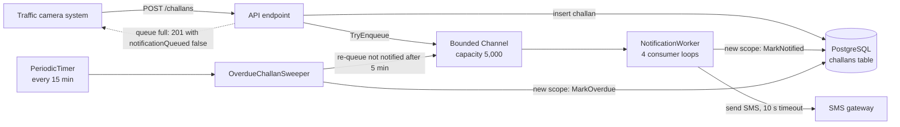
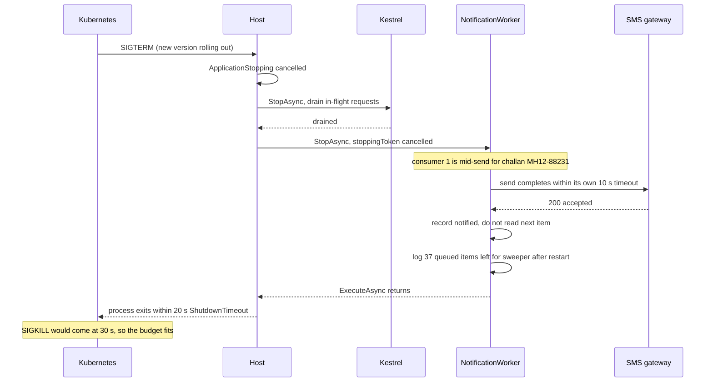

Not all work belongs inside an HTTP request. When a traffic camera issues an e-challan, the API should answer the camera system in milliseconds; sending the SMS to the vehicle owner can happen a second later. Every 15 minutes, someone has to mark unpaid challans as overdue. Neither job has a user waiting on it. ASP.NET Core can run this work **inside the same process** with hosted services. This lesson shows how to do that safely, and where in-process background work stops being the right tool.

## Learning objectives

By the end of this lesson you will be able to:

1. Explain `IHostedService` and `BackgroundService`, how the host starts and stops them, and what happens when one throws.
2. Build a producer-consumer pipeline with a bounded `Channel<T>`, and explain backpressure and the four "queue full" modes.
3. Use scoped services (database contexts, repositories) safely from a singleton worker with `IServiceScopeFactory`.
4. Run scheduled work with `PeriodicTimer`, and explain why ticks never overlap.
5. Handle failures inside a worker: per-item errors, retries, poison items, and when a crash should stop the app.
6. Shut down gracefully: honour the stopping token, finish in-flight work, and know what is lost.
7. Decide when an in-process worker is enough and when you need a durable queue, an outbox or a job scheduler.

## Prerequisites

- [How an ASP.NET Core application starts](#/lesson/m03-startup): the host, `Run()`, and hosted services starting in registration order.
- [Singleton, scoped and transient services](#/lesson/m03-service-lifetimes): captive dependencies and scope validation.
- [Cancellation tokens and request cancellation](#/lesson/m03-cancellation): the stopping token is a cancellation token.

## Explain it like I'm a beginner

Think of a district transport office that issues traffic fines.

The **front counter** (your API) takes each new fine from the camera operator, writes it in the register and gives a receipt. It must be quick, because a queue of operators is waiting.

Sending a letter to each vehicle owner is slower: find the address, print, post. If the counter clerk did that for each fine, the line would stretch out of the door. So the clerk drops a slip into a **tray** and moves on. In the back office, a **dispatcher** picks slips from the tray one by one and sends the letters. That is the **producer-consumer** pattern: the counter *produces* work, the dispatcher *consumes* it, and the tray between them is a **queue**.

The tray has a limited size, say 500 slips. If the dispatcher falls behind and the tray fills up, the clerk has to decide: wait for space, throw away the oldest slip, or tell the operator "come back later". That decision is **backpressure**: the slow part pushing back on the fast part instead of being buried.

Another clerk has a **wall clock** job: every 15 minutes, walk through the register and stamp "overdue" on unpaid fines older than 60 days. That is a **scheduled** (periodic) job.

At 6 p.m. the office closes. A good dispatcher finishes the letter in hand, puts it in the post bag, and goes home. A bad one walks out mid-letter. And here is the catch: **the slips still in the tray are lost when the office closes**, because the tray is just a box on a desk. If those slips matter, they should be kept in the register itself (a database table) or in a proper post office (a message broker), not only in the tray.

In ASP.NET Core, the dispatcher and the wall-clock clerk are **hosted services**, the tray is a **channel**, and closing time is **graceful shutdown**.

## First-principles explanation

### IHostedService and BackgroundService

The host (the same one that runs Kestrel) manages objects that implement `IHostedService`:

```csharp
public interface IHostedService
{
    Task StartAsync(CancellationToken cancellationToken);
    Task StopAsync(CancellationToken cancellationToken);
}
```

`StartAsync` runs during `app.Run()`, before Kestrel accepts traffic, one service at a time in registration order. `StopAsync` runs at shutdown in reverse order. This is perfect for short start-up and tear-down work, and awkward for a loop that runs forever, because a `StartAsync` that never returns blocks the whole app from starting.

`BackgroundService` is an abstract base class for the long-running case. You override one method:

```csharp
public sealed class ChallanNotifier : BackgroundService
{
    protected override async Task ExecuteAsync(CancellationToken stoppingToken)
    {
        while (!stoppingToken.IsCancellationRequested)
        {
            // take work, do work
        }
    }
}
```

The base class's `StartAsync` starts `ExecuteAsync` and returns without waiting for it to finish. Its `StopAsync` cancels `stoppingToken` and then waits for `ExecuteAsync` to finish (or for the shutdown timeout to expire). Before .NET 10, the synchronous part of `ExecuteAsync` (everything before its first `await`) ran on the startup path, so a slow synchronous start delayed the whole app; from .NET 10, the whole of `ExecuteAsync` runs as a background task. Either way, keep start-up work light and asynchronous.

Register with `builder.Services.AddHostedService<ChallanNotifier>()`. Hosted services are **singletons**: one instance for the life of the process.

### What happens when a worker throws

Since .NET 6, an unhandled exception that escapes `ExecuteAsync` is logged and, by default, **stops the host** (`HostOptions.BackgroundServiceExceptionBehavior = StopHost`). The whole app shuts down, and your orchestrator (Kubernetes, systemd, IIS, Azure App Service) restarts it. The alternative, `Ignore`, logs the exception and leaves the app running without the worker, which is usually worse: the API looks healthy while no SMS has been sent for three hours.

So the rule is: **a worker must catch per-item failures itself** (log, retry, move on) and let only truly fatal errors escape. A single bad phone number should never stop the app; a missing configuration value that makes every item fail probably should.

### Host options that matter

- `ShutdownTimeout` (default 30 seconds): total time the host waits for all `StopAsync` calls. After that, it gives up and the process exits with work still running.
- `ServicesStartConcurrently` / `ServicesStopConcurrently` (since .NET 8, default false): start or stop hosted services in parallel instead of one by one.
- `IHostedLifecycleService` (since .NET 8) adds `StartingAsync`, `StartedAsync`, `StoppingAsync` and `StoppedAsync` hooks, for services that need to act at a precise point in the lifecycle.

### Channels: an in-process queue

`System.Threading.Channels` provides fast, thread-safe, async queues. A channel has a `Writer` (producers) and a `Reader` (consumers):

```csharp
var channel = Channel.CreateBounded<ChallanNotification>(new BoundedChannelOptions(capacity: 500)
{
    FullMode = BoundedChannelFullMode.Wait,
    SingleReader = false,
    SingleWriter = false,
});

channel.Writer.TryWrite(item);                         // false if full (with Wait mode)
await channel.Writer.WriteAsync(item, ct);             // waits for space
await foreach (var n in channel.Reader.ReadAllAsync(ct)) { /* consume */ }
channel.Writer.Complete();                             // no more items; readers finish what is left
```

**Bounded versus unbounded.** `Channel.CreateUnbounded<T>()` never says "full", so if producers outpace consumers, memory grows until the process dies. A bounded channel makes the limit explicit. Choose the capacity from numbers: if a camera network produces about 40 challans a second at peak and the SMS gateway allows 20 sends a second, the queue grows by 20 a second during a peak. A capacity of 5,000 absorbs about four minutes of peak (estimate). Beyond that, something has to give.

**What gives** is `FullMode`:

| Mode | When full | Good for |
|---|---|---|
| `Wait` | `WriteAsync` waits; `TryWrite` returns false | Work that must not be dropped; caller can be told "busy" (HTTP 503) |
| `DropOldest` | Discards the oldest item to make room | Latest-value data, such as vehicle GPS positions |
| `DropNewest` | Discards the newest item already in the channel | Rarely; keeps the earliest backlog |
| `DropWrite` | Silently discards the item being written | Telemetry you can afford to lose |

For challan SMS, `Wait` plus `TryWrite` is right: the API learns immediately that the queue is full and can return 503 with `Retry-After`, or fall back to marking the challan "notification pending" for the sweeper to pick up. That is backpressure reaching the caller instead of hidden memory growth. See [Backpressure, load shedding and graceful degradation](#/lesson/m13-backpressure).

**Several consumers.** Many tasks can read from one channel; each item goes to exactly one reader (competing consumers). Running 4 consumer loops lets 4 SMS calls be in flight at once, which is how you match a gateway that has 200 ms latency but allows 20 requests a second (4 / 0.2 s = 20 a second).

### The big limitation: in-memory means lossy

A channel lives in process memory. When the process stops (deployment, crash, pod eviction, out-of-memory), everything in it is gone. For each background job, ask: **"if this item is lost, who notices and what does it cost?"**

- A cache warm-up or a metrics flush: nobody notices. A channel is fine.
- An SMS receipt for a ₹500 challan: the owner might not pay in time and dispute the late fee. Worth protecting with a safety net: store "notified at" in the database and let a periodic sweeper re-queue anything not notified after 5 minutes.
- A payment instruction to a bank: must never be lost. Use the [transactional outbox](#/lesson/m12-outbox) (write the message in the same database transaction as the business change) and a durable [message queue](#/lesson/m12-message-queues).

### Scoped services inside a singleton worker

A `BackgroundService` is a singleton. A repository or EF Core `DbContext` is typically **scoped** (one per request). Injecting a scoped service into a singleton constructor creates a **captive dependency**: the scoped object is kept alive forever, shared across threads, and never disposed. With scope validation on (the default in Development), the app refuses to start; without it, you get subtle bugs such as a `DbContext` whose change tracker grows for days.

The fix is to create a **scope per unit of work**:

```csharp
public sealed class OverdueSweeper(IServiceScopeFactory scopes) : BackgroundService
{
    protected override async Task ExecuteAsync(CancellationToken stoppingToken)
    {
        await using var scope = scopes.CreateAsyncScope();               // like one HTTP request
        var repo = scope.ServiceProvider.GetRequiredService<IChallanRepository>();
        await repo.MarkOverdueAsync(DateOnly.FromDateTime(DateTime.UtcNow), stoppingToken);
    }                                                                     // scope disposed: DbContext disposed
}
```

Think of each tick or each message as a "fake request": open a scope, resolve what you need, do the work, dispose. `CreateAsyncScope` (with `await using`) is preferred because services such as `DbContext` implement `IAsyncDisposable`.

### Scheduled work with PeriodicTimer

`PeriodicTimer` (since .NET 6) is the modern way to "do this every N minutes" in async code:

```csharp
using var timer = new PeriodicTimer(TimeSpan.FromMinutes(15), timeProvider);
do
{
    await SweepOnceAsync(stoppingToken);
}
while (await timer.WaitForNextTickAsync(stoppingToken));
```

Properties that make it safer than `System.Threading.Timer`:

- **No overlap.** The next wait starts only after your work finishes. If a sweep takes 20 minutes with a 15-minute period, the timer does not start a second sweep in parallel; it fires once immediately afterwards (missed ticks are coalesced into one).
- **Async-friendly.** No callbacks on thread-pool threads, no `async void`, exceptions flow normally.
- **Cancellable.** `WaitForNextTickAsync(ct)` throws `OperationCanceledException` when the stopping token is cancelled; disposing the timer makes it return `false`.
- **Testable.** The constructor that takes a `TimeProvider` (since .NET 8) lets tests use a fake clock.

`PeriodicTimer` means "every 15 minutes from when the app started". For "at 02:00 every night" or cron-style schedules, compute the delay to the next run, or use a scheduler library (Quartz.NET, Hangfire) or a platform scheduler (Kubernetes CronJob).

### Multiple instances run multiple workers

If the API runs on 3 pods, each pod runs its own `OverdueChallanSweeper`. Three sweepers marking the same challans overdue is harmless if the update is idempotent (`UPDATE ... WHERE status = 'Issued' AND due_date < @today`), but three nightly report emails is not. Options:

- Make the work idempotent and accept the duplication.
- Take a PostgreSQL advisory lock (`SELECT pg_try_advisory_lock(42)`) and skip the run if another instance holds it.
- Claim rows with `SELECT ... FOR UPDATE SKIP LOCKED` so instances share the work without overlap.
- Run the worker in a separate deployment with exactly one replica.

[Background processing and job queues](#/lesson/m11-background-processing) covers these at system scale.

### Graceful shutdown

On `SIGTERM` (a Kubernetes rolling deployment, for example), the host:

1. Cancels `IHostApplicationLifetime.ApplicationStopping`.
2. Stops Kestrel from accepting new requests and drains in-flight requests.
3. Calls `StopAsync` on hosted services in reverse registration order. For a `BackgroundService` this cancels `stoppingToken` and waits for `ExecuteAsync`.
4. Gives up after `ShutdownTimeout`, disposes the container and exits.

A well-behaved worker:

- Passes `stoppingToken` to its waits (`ReadAllAsync`, `WaitForNextTickAsync`, `Task.Delay`) so it notices quickly.
- **Finishes the item in hand** rather than abandoning it halfway. An SMS call already sent to the gateway should complete (with its own short timeout) so the database can record that it was sent.
- Does not start new items once stopping.
- Logs how many queued items will be lost, so operators know.
- Fits inside the budget: Kubernetes sends `SIGKILL` after `terminationGracePeriodSeconds` (30 by default), so `ShutdownTimeout` should be shorter, for example 20 seconds.

Catch `OperationCanceledException` at the top of `ExecuteAsync` only when `stoppingToken` is cancelled; that is a normal stop, not a failure.

### Trade-offs

| Choice | You gain | You pay |
|---|---|---|
| In-process worker + channel | Simple, fast, no infrastructure | Work lost on restart; scales with the API, not independently |
| Bounded channel | Memory safety, explicit backpressure | Must decide what to do when full |
| Database table as queue (with `SKIP LOCKED`) | Durable, transactional with business data | Polling load on the database; more code |
| Message broker (RabbitMQ, Kafka, Azure Service Bus) | Durable, independent scaling, retries, dead letters | Another system to run, monitor and pay for |
| Job scheduler (Hangfire, Quartz.NET) | Cron schedules, retries, dashboard, persistence | Dependency, storage tables, learning curve |

## Visual explanation

### The e-challan background pipeline



The API does only the fast, essential part: it stores the challan and tries to enqueue a notification, then answers. If the channel is full, the challan is still safely in the database; only the SMS is delayed. The worker's four consumer loops send SMS messages in parallel and record success through a fresh scope. The sweeper is the safety net: on every tick it marks overdue challans and re-queues any challan whose SMS never got recorded, which covers both a full queue and items lost in a restart. The database, not the channel, is the source of truth.

### Graceful shutdown during a deployment



Shutdown is a sequence, not a switch. Kestrel stops first so no new challans arrive; then the worker's stopping token is cancelled. The consumer that was mid-send finishes that one SMS (it uses its own short timeout, not the stopping token, because the side effect has already started), records it, and does not take another item. The 37 items still queued are lost from memory, but they are still "not notified" in the database, so the sweeper in the new pod re-queues them. Everything fits inside the 20-second host budget, which is itself inside Kubernetes' 30-second grace period.

## Step-by-step example

### Step 1 — send inline (the slow way)

The `POST /challans` endpoint saves the challan and calls the SMS gateway before responding. Gateway latency is 200 ms on a good day and 5 seconds on a bad one. The camera system's requests start timing out whenever the gateway is slow. The API's latency is now the gateway's latency.

### Step 2 — fire and forget (the dangerous way)

A developer writes `_ = Task.Run(() => sms.SendAsync(...))`. The API is fast again, but exceptions vanish, nothing limits how many sends run at once (a burst of 2,000 challans makes 2,000 simultaneous gateway calls and gets rate-limited), scoped services used inside the lambda may already be disposed, and shutdown kills the sends mid-flight. Never do this in a web app.

### Step 3 — a bounded channel and a worker

Register a singleton `ChannelNotificationQueue` (capacity 5,000) and a `NotificationWorker` with 4 consumer loops. The endpoint calls `TryEnqueue`. Now the API responds in a few milliseconds, at most 4 sends run at once, and a full queue is visible.

### Step 4 — record success in a scope

After each successful send, the worker opens a scope, resolves the scoped `IChallanRepository` and records `NotifiedAt`. The worker never holds a repository across items.

### Step 5 — a sweeper as the safety net

Add `OverdueChallanSweeper` with a 15-minute `PeriodicTimer`. Each tick, in a new scope: mark challans overdue after their due date, and re-queue challans issued more than 5 minutes ago that are still not notified.

| Event | What happens |
|---|---|
| Normal challan | Enqueued, SMS sent within about a second, `NotifiedAt` recorded |
| Burst of 8,000 challans in 2 minutes | First 5,000 queued; the rest return `notificationQueued: false`; sweeper re-queues them later |
| SMS gateway down for 10 minutes | Each item retried 3 times with backoff, then left unnotified; sweeper re-queues after recovery |
| Pod restarted with 37 items queued | Items lost from memory, still unnotified in the database; sweeper re-queues them |

## Production-style C# implementation

Layout:

```text
Challans.Api/
  Program.cs
  Challans/Challan.cs
  Challans/ChallanStore.cs
  Challans/NotificationOptions.cs
  Challans/ChannelNotificationQueue.cs
  Challans/SmsGateway.cs
  Workers/WorkerHeartbeat.cs
  Workers/NotificationWorker.cs
  Workers/OverdueChallanSweeper.cs
```

```csharp file=Challans/Challan.cs
namespace Challans.Domain;

public enum ChallanStatus { Issued, Paid, Overdue }

public sealed class Challan
{
    public required string Id { get; init; }
    public required string VehicleNo { get; init; }
    public required string MobileNo { get; init; }
    public required decimal Amount { get; init; }
    public required DateTimeOffset IssuedAt { get; init; }
    public required DateOnly DueDate { get; init; }
    public ChallanStatus Status { get; set; } = ChallanStatus.Issued;
    public DateTimeOffset? NotifiedAt { get; set; }
}

public sealed record ChallanNotification(string ChallanId, string MobileNo, string Text);
```

```csharp file=Challans/ChallanStore.cs
using Challans.Domain;

namespace Challans.Data;

/// <summary>Process-wide storage standing in for the PostgreSQL challans table.</summary>
public sealed class ChallanStore
{
    internal readonly object Gate = new();
    internal readonly Dictionary<string, Challan> Rows = new();
}

/// <summary>Scoped, like a DbContext: one instance per request or per unit of background work.</summary>
public interface IChallanRepository
{
    void Add(Challan challan);
    void MarkNotified(string challanId, DateTimeOffset at);
    int MarkOverdue(DateOnly today);
    IReadOnlyList<Challan> ListUnnotifiedIssuedBefore(DateTimeOffset cutoff, int limit);
}

public sealed class ChallanRepository(ChallanStore store) : IChallanRepository, IDisposable
{
    private bool _disposed;

    public void Add(Challan challan)
    {
        ObjectDisposedException.ThrowIf(_disposed, this);
        lock (store.Gate) store.Rows.Add(challan.Id, challan);
    }

    public void MarkNotified(string challanId, DateTimeOffset at)
    {
        ObjectDisposedException.ThrowIf(_disposed, this);
        lock (store.Gate)
            if (store.Rows.TryGetValue(challanId, out var c)) c.NotifiedAt ??= at;
    }

    public int MarkOverdue(DateOnly today)
    {
        ObjectDisposedException.ThrowIf(_disposed, this);
        // SQL equivalent: UPDATE challans SET status = 'Overdue' WHERE status = 'Issued' AND due_date < @today
        lock (store.Gate)
        {
            var due = store.Rows.Values.Where(c => c.Status == ChallanStatus.Issued && c.DueDate < today).ToList();
            foreach (var c in due) c.Status = ChallanStatus.Overdue;
            return due.Count;
        }
    }

    public IReadOnlyList<Challan> ListUnnotifiedIssuedBefore(DateTimeOffset cutoff, int limit)
    {
        ObjectDisposedException.ThrowIf(_disposed, this);
        lock (store.Gate)
            return store.Rows.Values.Where(c => c.NotifiedAt is null && c.IssuedAt < cutoff)
                .OrderBy(c => c.IssuedAt).Take(limit).ToList();
    }

    public void Dispose() => _disposed = true;   // a real DbContext releases its connection here
}
```

```csharp file=Challans/NotificationOptions.cs
namespace Challans.Workers;

public sealed class NotificationOptions
{
    public const string SectionName = "Notifications";
    public int QueueCapacity { get; set; } = 5_000;
    public int Consumers { get; set; } = 4;
    public int MaxAttempts { get; set; } = 3;
    public TimeSpan SendTimeout { get; set; } = TimeSpan.FromSeconds(10);
    public TimeSpan SweepInterval { get; set; } = TimeSpan.FromMinutes(15);
    public TimeSpan RequeueAfter { get; set; } = TimeSpan.FromMinutes(5);
}
```

```csharp file=Challans/ChannelNotificationQueue.cs
using System.Threading.Channels;
using Challans.Domain;
using Microsoft.Extensions.Options;

namespace Challans.Workers;

public interface INotificationQueue
{
    /// <summary>Returns false when the queue is full or closed. Never blocks the caller.</summary>
    bool TryEnqueue(ChallanNotification notification);
    ChannelReader<ChallanNotification> Reader { get; }
    int Count { get; }
}

/// <summary>Bounded, in-memory. Items here are lost on restart; the database stays the source of truth.</summary>
public sealed class ChannelNotificationQueue : INotificationQueue
{
    private readonly Channel<ChallanNotification> _channel;

    public ChannelNotificationQueue(IOptions<NotificationOptions> options)
    {
        _channel = Channel.CreateBounded<ChallanNotification>(new BoundedChannelOptions(options.Value.QueueCapacity)
        {
            FullMode = BoundedChannelFullMode.Wait,   // TryWrite returns false when full: explicit backpressure
            SingleReader = false,                     // several consumer loops
            SingleWriter = false,                     // many request threads
        });
    }

    public bool TryEnqueue(ChallanNotification notification) => _channel.Writer.TryWrite(notification);
    public ChannelReader<ChallanNotification> Reader => _channel.Reader;
    public int Count => _channel.Reader.Count;
}
```

```csharp file=Challans/SmsGateway.cs
namespace Challans.Workers;

public interface ISmsGateway
{
    Task SendAsync(string mobileNo, string text, CancellationToken ct);
}

/// <summary>Stand-in for an HTTP SMS provider client. Fails for obviously invalid numbers.</summary>
public sealed class FakeSmsGateway(ILogger<FakeSmsGateway> logger) : ISmsGateway
{
    public async Task SendAsync(string mobileNo, string text, CancellationToken ct)
    {
        await Task.Delay(200, ct);   // typical provider latency
        if (mobileNo.Length != 10) throw new InvalidOperationException($"Gateway rejected number ending {mobileNo[^Math.Min(2, mobileNo.Length)..]}");
        logger.LogInformation("SMS to ******{Last4}: {Text}", mobileNo[^4..], text);
    }
}
```

```csharp file=Workers/WorkerHeartbeat.cs
using System.Collections.Concurrent;

namespace Challans.Workers;

/// <summary>Last successful activity per worker, for a health check or a status endpoint.</summary>
public sealed class WorkerHeartbeat
{
    private readonly ConcurrentDictionary<string, DateTimeOffset> _last = new();
    public void Beat(string worker, DateTimeOffset at) => _last[worker] = at;
    public IReadOnlyDictionary<string, DateTimeOffset> Snapshot() => new Dictionary<string, DateTimeOffset>(_last);
}
```

```csharp file=Workers/NotificationWorker.cs
using Challans.Data;
using Challans.Domain;
using Microsoft.Extensions.Options;

namespace Challans.Workers;

/// <summary>Consumes the notification channel with N concurrent loops. Singleton, so it creates a scope per item.</summary>
public sealed class NotificationWorker(
    INotificationQueue queue,
    ISmsGateway sms,
    IServiceScopeFactory scopes,
    WorkerHeartbeat heartbeat,
    TimeProvider clock,
    IOptions<NotificationOptions> options,
    ILogger<NotificationWorker> logger) : BackgroundService
{
    private readonly NotificationOptions _o = options.Value;

    protected override async Task ExecuteAsync(CancellationToken stoppingToken)
    {
        logger.LogInformation("Notification worker starting {Consumers} consumers", _o.Consumers);
        var loops = Enumerable.Range(1, Math.Max(1, _o.Consumers)).Select(i => ConsumeAsync(i, stoppingToken));
        await Task.WhenAll(loops);
        logger.LogInformation("Notification worker stopped; {Remaining} queued items left for the sweeper", queue.Count);
    }

    private async Task ConsumeAsync(int consumer, CancellationToken stoppingToken)
    {
        try
        {
            while (await queue.Reader.WaitToReadAsync(stoppingToken))
            {
                if (stoppingToken.IsCancellationRequested) break;            // do not start new work when stopping
                if (!queue.Reader.TryRead(out var item)) continue;
                await HandleAsync(consumer, item, stoppingToken);
            }
        }
        catch (OperationCanceledException) when (stoppingToken.IsCancellationRequested)
        {
            // normal shutdown while waiting for the next item
        }
    }

    private async Task HandleAsync(int consumer, ChallanNotification item, CancellationToken stoppingToken)
    {
        for (var attempt = 1; attempt <= _o.MaxAttempts; attempt++)
        {
            try
            {
                // The send is a side effect: once started, finish it with its own timeout, not the stopping token.
                using var sendTimeout = new CancellationTokenSource(_o.SendTimeout, clock);
                await sms.SendAsync(item.MobileNo, item.Text, sendTimeout.Token);

                await using var scope = scopes.CreateAsyncScope();
                scope.ServiceProvider.GetRequiredService<IChallanRepository>().MarkNotified(item.ChallanId, clock.GetUtcNow());
                heartbeat.Beat(nameof(NotificationWorker), clock.GetUtcNow());
                return;
            }
            catch (Exception ex) when (ex is not OperationCanceledException || !stoppingToken.IsCancellationRequested)
            {
                logger.LogWarning(ex, "Consumer {Consumer}: SMS for {ChallanId} failed, attempt {Attempt}/{Max}",
                    consumer, item.ChallanId, attempt, _o.MaxAttempts);
                if (attempt == _o.MaxAttempts || stoppingToken.IsCancellationRequested) break;
                try { await Task.Delay(TimeSpan.FromSeconds(Math.Pow(2, attempt - 1)), clock, stoppingToken); }   // 1 s, 2 s
                catch (OperationCanceledException) { break; }
            }
        }
        // Left unnotified in the database; the sweeper will re-queue it later.
        logger.LogError("SMS for {ChallanId} gave up after {Max} attempts; sweeper will retry", item.ChallanId, _o.MaxAttempts);
    }
}
```

```csharp file=Workers/OverdueChallanSweeper.cs
using Challans.Data;
using Challans.Domain;
using Microsoft.Extensions.Options;

namespace Challans.Workers;

/// <summary>Every SweepInterval: mark overdue challans and re-queue notifications that never got recorded.</summary>
public sealed class OverdueChallanSweeper(
    IServiceScopeFactory scopes,
    INotificationQueue queue,
    WorkerHeartbeat heartbeat,
    TimeProvider clock,
    IOptions<NotificationOptions> options,
    ILogger<OverdueChallanSweeper> logger) : BackgroundService
{
    protected override async Task ExecuteAsync(CancellationToken stoppingToken)
    {
        using var timer = new PeriodicTimer(options.Value.SweepInterval, clock);
        try
        {
            do
            {
                try
                {
                    SweepOnce();
                    heartbeat.Beat(nameof(OverdueChallanSweeper), clock.GetUtcNow());
                }
                catch (Exception ex)
                {
                    // One bad sweep must not stop the app; the next tick tries again.
                    logger.LogError(ex, "Overdue sweep failed");
                }
            }
            while (await timer.WaitForNextTickAsync(stoppingToken));
        }
        catch (OperationCanceledException) when (stoppingToken.IsCancellationRequested)
        {
        }
    }

    private void SweepOnce()
    {
        using var scope = scopes.CreateScope();
        var repo = scope.ServiceProvider.GetRequiredService<IChallanRepository>();
        var now = clock.GetUtcNow();

        var overdue = repo.MarkOverdue(DateOnly.FromDateTime(now.UtcDateTime));

        var requeued = 0;
        foreach (var c in repo.ListUnnotifiedIssuedBefore(now - options.Value.RequeueAfter, limit: 1_000))
        {
            if (!queue.TryEnqueue(new ChallanNotification(c.Id, c.MobileNo, NotificationText.For(c)))) break;   // queue full: stop, try next tick
            requeued++;
        }
        logger.LogInformation("Sweep: {Overdue} marked overdue, {Requeued} notifications re-queued", overdue, requeued);
    }
}

public static class NotificationText
{
    public static string For(Challan c) =>
        $"E-challan {c.Id} for {c.VehicleNo}: Rs {c.Amount:N0} due by {c.DueDate:dd-MMM-yyyy}. Pay at the state e-challan portal.";
}
```

```csharp file=Program.cs
using Challans.Data;
using Challans.Domain;
using Challans.Workers;

var builder = WebApplication.CreateBuilder(args);

builder.Services.AddSingleton(TimeProvider.System);
builder.Services.Configure<NotificationOptions>(builder.Configuration.GetSection(NotificationOptions.SectionName));

builder.Services.AddSingleton<ChallanStore>();
builder.Services.AddScoped<IChallanRepository, ChallanRepository>();
builder.Services.AddSingleton<INotificationQueue, ChannelNotificationQueue>();
builder.Services.AddSingleton<ISmsGateway, FakeSmsGateway>();
builder.Services.AddSingleton<WorkerHeartbeat>();

builder.Services.AddHostedService<NotificationWorker>();
builder.Services.AddHostedService<OverdueChallanSweeper>();

builder.Services.Configure<HostOptions>(o =>
{
    o.ShutdownTimeout = TimeSpan.FromSeconds(20);   // inside Kubernetes' default 30 s grace period
    o.BackgroundServiceExceptionBehavior = BackgroundServiceExceptionBehavior.StopHost;   // the default, stated explicitly
});

var app = builder.Build();

app.MapPost("/challans", (IssueChallanRequest req, IChallanRepository repo, INotificationQueue queue, TimeProvider clock) =>
{
    var now = clock.GetUtcNow();
    var challan = new Challan
    {
        Id = $"CH-{now:yyyyMMdd}-{Random.Shared.Next(100_000, 999_999)}",
        VehicleNo = req.VehicleNo,
        MobileNo = req.MobileNo,
        Amount = req.Amount,
        IssuedAt = now,
        DueDate = DateOnly.FromDateTime(now.UtcDateTime).AddDays(60),
    };
    repo.Add(challan);   // the database row is the source of truth

    var queued = queue.TryEnqueue(new ChallanNotification(challan.Id, challan.MobileNo, NotificationText.For(challan)));
    return Results.Created($"/challans/{challan.Id}", new { challan.Id, notificationQueued = queued });
});

app.MapGet("/workers/status", (WorkerHeartbeat heartbeat, INotificationQueue queue) =>
    Results.Ok(new { queued = queue.Count, lastActivity = heartbeat.Snapshot() }));

app.Run();

public sealed record IssueChallanRequest(string VehicleNo, string MobileNo, decimal Amount);
```

Things to notice:

- The endpoint never waits for the SMS. It writes the challan, tries to enqueue, and reports honestly whether the notification was queued.
- The worker holds no scoped services. Each successful send opens its own scope; the sweeper opens one per tick.
- The send uses its own timeout, not the stopping token, so a shutdown never interrupts an SMS that the gateway may already have accepted. Retry delays, which have no side effect, do honour the stopping token.
- Delivery is **at least once**, not exactly once. If the send succeeds but recording `NotifiedAt` fails, the retry (or the sweeper) sends a second SMS. Most SMS and email providers accept a client reference or idempotency key; pass the challan id so the provider can drop the duplicate, and make every consumer of this queue tolerate repeats.
- Every `catch` is deliberate: per-item failures are logged and retried, a failed sweep waits for the next tick, and only a normal shutdown is swallowed. Anything else escaping `ExecuteAsync` stops the host, which is what you want for a bug that affects every item.
- The status endpoint exposes queue length and last activity; a health check can turn "no notification sent for 30 minutes while the queue is non-empty" into an alert ([Health checks and graceful shutdown](#/lesson/m03-health-shutdown)).

## Bad design vs good design

**Bad**: fire-and-forget from the endpoint, with a scoped service captured in the lambda.

```csharp
app.MapPost("/challans", (IssueChallanRequest req, IChallanRepository repo, ISmsGateway sms) =>
{
    var challan = CreateChallan(req);
    repo.Add(challan);
    _ = Task.Run(async () =>
    {
        await sms.SendAsync(challan.MobileNo, "Challan issued", CancellationToken.None);
        repo.MarkNotified(challan.Id, DateTimeOffset.UtcNow);   // repo is disposed when the request ended
    });
    return Results.Ok();
});
```

Problems: the scoped repository is disposed at the end of the request, so `MarkNotified` throws (or, with a real `DbContext`, corrupts state on another thread); the exception goes nowhere because nobody awaits the task; there is no limit on concurrent sends, so a burst overwhelms the gateway; shutdown kills sends mid-flight with no record; and there is no retry or safety net.

**Also bad**: injecting `IChallanRepository` into a `BackgroundService` constructor. It becomes a captive dependency living for days, shared by four consumer loops on different threads.

**Good**: the implementation above. A bounded channel decouples the API from the gateway, a fixed number of consumers limits concurrency, each unit of work gets its own scope, failures are retried and logged, the database records progress, and the sweeper recovers anything lost.

:::callout type=tip title="A simpler alternative"
If the background work is a one-off at startup (warm a cache, check a dependency), a plain `IHostedService` with a short `StartAsync` is enough, no channel or loop needed. If the work is "every night at 2 a.m., run one SQL statement", a PostgreSQL `pg_cron` job or a Kubernetes CronJob may be simpler than any C# worker.
:::

:::callout type=warning title="Do not lose important work in memory"
A channel is a buffer, not a queue you can trust with money. Anything that must survive a restart needs a durable record: a status column the sweeper checks, a transactional outbox, or a message broker. Ask "what happens to the items in the channel when the pod is killed?" in every design review.
:::

## Practical playground

This console program runs the generic host with a producer and a consumer connected by a bounded channel of capacity 5. The producer is faster than the consumer, so watch it get pushed back. After 1.5 seconds the host stops and the consumer finishes the item in hand. Try `FullMode = BoundedChannelFullMode.DropOldest` and compare which items get processed.

:::playground type=csharp title="Producer, consumer and graceful stop"
```csharp file=Program.cs
using System;
using System.Diagnostics;
using System.Threading;
using System.Threading.Channels;
using System.Threading.Tasks;
using Microsoft.Extensions.DependencyInjection;
using Microsoft.Extensions.Hosting;
using Microsoft.Extensions.Logging;

public sealed class Producer(Channel<int> channel) : BackgroundService
{
    protected override async Task ExecuteAsync(CancellationToken stoppingToken)
    {
        var sw = Stopwatch.StartNew();
        try
        {
            for (var i = 1; !stoppingToken.IsCancellationRequested; i++)
            {
                await channel.Writer.WriteAsync(i, stoppingToken);   // waits when the channel is full
                Console.WriteLine($"{sw.ElapsedMilliseconds,5} ms  produced challan #{i}  (queued {channel.Reader.Count})");
                await Task.Delay(40, stoppingToken);                // 25 per second
            }
        }
        catch (OperationCanceledException) { }
    }
}

public sealed class Consumer(Channel<int> channel) : BackgroundService
{
    protected override async Task ExecuteAsync(CancellationToken stoppingToken)
    {
        try
        {
            while (await channel.Reader.WaitToReadAsync(stoppingToken))
            {
                if (!channel.Reader.TryRead(out var item)) continue;
                await Task.Delay(150, CancellationToken.None);       // the "SMS send": finish it even when stopping
                Console.WriteLine($"         sent SMS for challan #{item}");
                if (stoppingToken.IsCancellationRequested) break;   // do not start the next one
            }
        }
        catch (OperationCanceledException) { }
        Console.WriteLine($"consumer stopped, {channel.Reader.Count} item(s) left in memory");
    }
}

public static class Program
{
    public static async Task Main(string[] args)
    {
        var builder = Host.CreateApplicationBuilder(args);
        builder.Logging.ClearProviders();
        builder.Services.AddSingleton(Channel.CreateBounded<int>(new BoundedChannelOptions(5) { FullMode = BoundedChannelFullMode.Wait }));
        builder.Services.AddHostedService<Producer>();
        builder.Services.AddHostedService<Consumer>();
        using var host = builder.Build();

        await host.StartAsync();
        await Task.Delay(1500);
        Console.WriteLine("---- SIGTERM ----");
        await host.StopAsync();
    }
}
```
:::

The producer makes 25 items a second, the consumer handles about 6, so the queue fills to 5 within about half a second and the producer's `WriteAsync` starts waiting. That wait is backpressure. At stop, notice the consumer finishes the SMS it was sending, and the final line shows how many items would be lost without a durable record.

## Exercises

:::exercise id=m03-background-services-ex1 difficulty=beginner kind=code title="A periodic heartbeat worker"
Implement `HeartbeatWorker`, a `BackgroundService` that increments a counter once per period using `PeriodicTimer`, and stops cleanly when the host stops.
::requirements
- Constructor takes a `TimeSpan period`; throw `ArgumentOutOfRangeException` if it is not positive.
- `Beats` returns the current count (thread-safe read).
- `ExecuteAsync` uses `PeriodicTimer` and `WaitForNextTickAsync(stoppingToken)`.
- Stopping must not leave `ExecuteTask` faulted: treat cancellation by `stoppingToken` as a normal exit.
::acceptance
- With a 20 ms period, `Beats` reaches at least 3 within 2 seconds.
- After `StopAsync`, `ExecuteTask` has completed successfully and `Beats` no longer changes.
- A zero period throws `ArgumentOutOfRangeException`.
::hint
`using var timer = new PeriodicTimer(_period);` then `while (await timer.WaitForNextTickAsync(stoppingToken))`.
::hint
`WaitForNextTickAsync` throws `OperationCanceledException` when the token is cancelled. Catch it with `when (stoppingToken.IsCancellationRequested)`.
::hint
Use `Interlocked.Increment(ref _beats)` and `Volatile.Read(ref _beats)`, because the test thread reads while the worker writes.
::hint
```csharp
try { while (await timer.WaitForNextTickAsync(stoppingToken)) Interlocked.Increment(ref _beats); }
catch (OperationCanceledException) when (stoppingToken.IsCancellationRequested) { }
```
::starter
```csharp file=HeartbeatWorker.cs
using System;
using System.Threading;
using System.Threading.Tasks;
using Microsoft.Extensions.Hosting;

public sealed class HeartbeatWorker : BackgroundService
{
    public HeartbeatWorker(TimeSpan period) => throw new NotImplementedException();

    public int Beats => throw new NotImplementedException();

    protected override Task ExecuteAsync(CancellationToken stoppingToken) => throw new NotImplementedException();
}
```
::tests
```csharp file=HeartbeatWorkerTests.cs
using System;
using System.Diagnostics;
using System.Threading;
using System.Threading.Tasks;
using Xunit;

public class HeartbeatWorkerTests
{
    [Fact]
    public async Task Beats_periodically_and_stops_cleanly()
    {
        var worker = new HeartbeatWorker(TimeSpan.FromMilliseconds(20));
        await worker.StartAsync(CancellationToken.None);

        var sw = Stopwatch.StartNew();
        while (worker.Beats < 3 && sw.ElapsedMilliseconds < 2000) await Task.Delay(10);
        await worker.StopAsync(CancellationToken.None);

        Assert.True(worker.Beats >= 3, $"only {worker.Beats} beats");
        Assert.True(worker.ExecuteTask!.IsCompletedSuccessfully);

        var after = worker.Beats;
        await Task.Delay(100);
        Assert.Equal(after, worker.Beats);
    }

    [Fact]
    public void Non_positive_period_is_rejected()
    {
        Assert.Throws<ArgumentOutOfRangeException>(() => new HeartbeatWorker(TimeSpan.Zero));
    }
}
```
::solution
```csharp file=HeartbeatWorker.cs
using System;
using System.Threading;
using System.Threading.Tasks;
using Microsoft.Extensions.Hosting;

public sealed class HeartbeatWorker : BackgroundService
{
    private readonly TimeSpan _period;
    private int _beats;

    public HeartbeatWorker(TimeSpan period)
    {
        ArgumentOutOfRangeException.ThrowIfLessThanOrEqual(period, TimeSpan.Zero);
        _period = period;
    }

    public int Beats => Volatile.Read(ref _beats);

    protected override async Task ExecuteAsync(CancellationToken stoppingToken)
    {
        using var timer = new PeriodicTimer(_period);
        try
        {
            while (await timer.WaitForNextTickAsync(stoppingToken))
                Interlocked.Increment(ref _beats);
        }
        catch (OperationCanceledException) when (stoppingToken.IsCancellationRequested)
        {
            // normal shutdown
        }
    }
}
```
::mistakes
- Using `while (true) { await Task.Delay(period); ... }` without the token, so the worker never stops and the host waits until the shutdown timeout.
- Letting the `OperationCanceledException` escape, which marks `ExecuteTask` as cancelled and produces noisy logs on every deployment.
::extensions
Pass a `TimeProvider` to the `PeriodicTimer` constructor and, with a fake time provider, write a test that advances 60 virtual seconds and expects 3 beats for a 20-second period without any real waiting.
:::

:::exercise id=m03-background-services-ex2 difficulty=beginner kind=written title="Spot the captive dependency"
A teammate wrote this worker for a water utility's billing system. It runs fine on their laptop for an hour, then on the server memory grows steadily and after two days bills start showing stale meter readings. Explain what is wrong and how to fix it.

```csharp
public sealed class BillGenerator(BillingDbContext db, ILogger<BillGenerator> log) : BackgroundService
{
    protected override async Task ExecuteAsync(CancellationToken stoppingToken)
    {
        using var timer = new PeriodicTimer(TimeSpan.FromMinutes(10));
        while (await timer.WaitForNextTickAsync(stoppingToken))
        {
            var readings = await db.MeterReadings.Where(r => !r.Billed).ToListAsync(stoppingToken);
            foreach (var r in readings) { db.Bills.Add(Bill.From(r)); r.Billed = true; }
            await db.SaveChangesAsync(stoppingToken);
        }
    }
}
// Program.cs: builder.Services.AddDbContext<BillingDbContext>(...); builder.Services.AddHostedService<BillGenerator>();
```
::acceptance
- Identifies that `BillingDbContext` is scoped and the worker is a singleton (captive dependency).
- Explains why memory grows (change tracker keeps every entity) and why data goes stale (tracked entities are not refreshed).
- Explains why it did not fail on startup on the server (scope validation off outside Development) but would in Development.
- Gives the fix: inject `IServiceScopeFactory` and create an async scope per tick.
- Mentions what to do if two instances run the worker.
::hint
What lifetime does `AddDbContext` register? What lifetime does `AddHostedService` register?
::hint
A `DbContext` remembers every entity it has loaded. What happens to that memory over 144 ticks a day?
::hint
In Development, `ValidateScopes` is on. What does it do when a singleton depends on a scoped service?
::solution
**What is wrong.** `AddDbContext` registers `BillingDbContext` as **scoped**; `AddHostedService` registers `BillGenerator` as a **singleton**. Constructor-injecting a scoped service into a singleton makes the context a captive dependency: one `DbContext` instance lives for the whole process.

**Memory growth.** The context's change tracker keeps every entity it has loaded or added. Every 10 minutes (144 ticks a day) it loads more readings and adds more bills, and none are ever released. Memory grows until the process is restarted.

**Stale data.** When a query returns a row the context is already tracking, EF Core by default returns the tracked instance and keeps its in-memory values instead of overwriting them with the database values. If a meter reading was corrected in the database by another service, this long-lived context keeps using the old values.

**Why nobody caught it.** In Development, the default service provider validates scopes and would throw at startup: "Cannot consume scoped service from singleton". The teammate's launch profile ran with `ASPNETCORE_ENVIRONMENT=Production` (a common copy-paste accident), so nothing complained locally either. Outside Development, scope validation is off by default, which is why the bug reached the server.

**Fix.**

```csharp
public sealed class BillGenerator(IServiceScopeFactory scopes, ILogger<BillGenerator> log) : BackgroundService
{
    protected override async Task ExecuteAsync(CancellationToken stoppingToken)
    {
        using var timer = new PeriodicTimer(TimeSpan.FromMinutes(10));
        while (await timer.WaitForNextTickAsync(stoppingToken))
        {
            await using var scope = scopes.CreateAsyncScope();
            var db = scope.ServiceProvider.GetRequiredService<BillingDbContext>();
            // same work; the context and its tracker are disposed at the end of each tick
        }
    }
}
```

Also wrap the body in try/catch so one failed tick does not stop the host, and turn on `ValidateOnBuild`/`ValidateScopes` in a test that builds the container.

**Multiple instances.** With two API pods, two workers could bill the same readings. Claim rows atomically (`UPDATE ... SET billed = true WHERE id = ANY(...) AND NOT billed RETURNING id`, or `SELECT ... FOR UPDATE SKIP LOCKED`) or take a PostgreSQL advisory lock per run.
::mistakes
- Fixing it with `AddSingleton<BillingDbContext>`, which makes the same problem official and adds thread-safety bugs.
- Creating one scope outside the loop, which has exactly the same effect as the original.
:::

:::exercise id=m03-background-services-ex3 difficulty=intermediate kind=code title="A bounded notification queue"
Wrap a bounded `Channel<T>` in a small queue class that the API and the worker share.
::requirements
- `NotificationQueue<T>(int capacity)`: throw `ArgumentOutOfRangeException` if capacity is less than 1. Use `BoundedChannelFullMode.Wait`.
- `TryEnqueue(T)` never waits: returns false when full or completed.
- `EnqueueAsync(T, CancellationToken)` waits for space; honours the token.
- `ReadAllAsync(CancellationToken)` yields items in FIFO order until the queue is completed and empty.
- `Complete()` stops further writes; existing items can still be read.
- `Count` returns the number of queued items.
::acceptance
- Capacity 2: `TryEnqueue` returns true, true, false; `Count` is 2.
- `EnqueueAsync` on a full queue completes only after a reader takes an item.
- `EnqueueAsync` on a full queue with a cancelled token throws `OperationCanceledException`.
- After `Complete()`, `TryEnqueue` returns false and `ReadAllAsync` yields the remaining items, then ends.
::hint
`Channel.CreateBounded<T>(new BoundedChannelOptions(capacity) { FullMode = BoundedChannelFullMode.Wait })`.
::hint
`TryWrite`, `WriteAsync`, `ReadAllAsync`, `TryComplete` and `Reader.Count` already do almost everything.
::hint
`ValueTask` is the return type of `Writer.WriteAsync`, so `EnqueueAsync` can simply return it.
::starter
```csharp file=NotificationQueue.cs
using System;
using System.Collections.Generic;
using System.Threading;
using System.Threading.Channels;
using System.Threading.Tasks;

public sealed class NotificationQueue<T>
{
    public NotificationQueue(int capacity) => throw new NotImplementedException();

    public bool TryEnqueue(T item) => throw new NotImplementedException();
    public ValueTask EnqueueAsync(T item, CancellationToken ct) => throw new NotImplementedException();
    public IAsyncEnumerable<T> ReadAllAsync(CancellationToken ct) => throw new NotImplementedException();
    public void Complete() => throw new NotImplementedException();
    public int Count => throw new NotImplementedException();
}
```
::tests
```csharp file=NotificationQueueTests.cs
using System;
using System.Collections.Generic;
using System.Threading;
using System.Threading.Tasks;
using Xunit;

public class NotificationQueueTests
{
    [Fact]
    public void TryEnqueue_reports_full()
    {
        var q = new NotificationQueue<string>(2);
        Assert.True(q.TryEnqueue("CH-1"));
        Assert.True(q.TryEnqueue("CH-2"));
        Assert.False(q.TryEnqueue("CH-3"));
        Assert.Equal(2, q.Count);
    }

    [Fact]
    public async Task EnqueueAsync_waits_for_space()
    {
        var q = new NotificationQueue<string>(1);
        q.TryEnqueue("CH-1");
        var pending = q.EnqueueAsync("CH-2", CancellationToken.None).AsTask();
        await Task.Delay(50);
        Assert.False(pending.IsCompleted);

        await using var reader = q.ReadAllAsync(CancellationToken.None).GetAsyncEnumerator();
        Assert.True(await reader.MoveNextAsync());
        Assert.Equal("CH-1", reader.Current);
        await pending.WaitAsync(TimeSpan.FromSeconds(2));
        Assert.Equal(1, q.Count);
    }

    [Fact]
    public async Task EnqueueAsync_honours_cancellation_when_full()
    {
        var q = new NotificationQueue<string>(1);
        q.TryEnqueue("CH-1");
        using var cts = new CancellationTokenSource(50);
        await Assert.ThrowsAnyAsync<OperationCanceledException>(async () => await q.EnqueueAsync("CH-2", cts.Token));
    }

    [Fact]
    public async Task Complete_lets_readers_drain_in_order()
    {
        var q = new NotificationQueue<string>(10);
        q.TryEnqueue("CH-1"); q.TryEnqueue("CH-2"); q.TryEnqueue("CH-3");
        q.Complete();
        Assert.False(q.TryEnqueue("CH-4"));

        var seen = new List<string>();
        await foreach (var item in q.ReadAllAsync(CancellationToken.None)) seen.Add(item);
        Assert.Equal(new[] { "CH-1", "CH-2", "CH-3" }, seen);
    }

    [Fact]
    public void Capacity_must_be_positive()
    {
        Assert.Throws<ArgumentOutOfRangeException>(() => new NotificationQueue<string>(0));
    }
}
```
::solution
```csharp file=NotificationQueue.cs
using System;
using System.Collections.Generic;
using System.Threading;
using System.Threading.Channels;
using System.Threading.Tasks;

public sealed class NotificationQueue<T>
{
    private readonly Channel<T> _channel;

    public NotificationQueue(int capacity)
    {
        ArgumentOutOfRangeException.ThrowIfLessThan(capacity, 1);
        _channel = Channel.CreateBounded<T>(new BoundedChannelOptions(capacity)
        {
            FullMode = BoundedChannelFullMode.Wait,
            SingleReader = false,
            SingleWriter = false,
        });
    }

    public bool TryEnqueue(T item) => _channel.Writer.TryWrite(item);
    public ValueTask EnqueueAsync(T item, CancellationToken ct) => _channel.Writer.WriteAsync(item, ct);
    public IAsyncEnumerable<T> ReadAllAsync(CancellationToken ct) => _channel.Reader.ReadAllAsync(ct);
    public void Complete() => _channel.Writer.TryComplete();
    public int Count => _channel.Reader.Count;
}
```
`EnqueueAsync` on a completed channel throws `ChannelClosedException`; `TryEnqueue` returns false. Both are the right signals for "we are shutting down".
::alternatives
Expose `ChannelReader<T>` and `ChannelWriter<T>` directly instead of a wrapper; many codebases do. A wrapper is useful when you want to hide the channel type, add metrics (enqueued, dropped, queue length) or swap in a durable implementation later behind the same interface.
::mistakes
- Using `Channel.CreateUnbounded`, so `TryEnqueue` never returns false and memory grows without limit under load.
- Using `DropWrite` for notifications that matter: writes "succeed" while items silently disappear.
:::

:::exercise id=m03-background-services-ex4 difficulty=intermediate kind=code title="One scope per unit of work"
Implement `DailySweep.RunAsync`, which a singleton worker calls to process several days of overdue marking. Each day must run in its **own** DI scope, and a failure on one day must not stop the others.
::requirements
- For each date in `days`, create an async scope from `IServiceScopeFactory`, resolve the scoped `IUnitOfWork`, and call `MarkOverdueAsync(day, ct)`.
- Sum the returned counts into `SweepResult.Total`.
- If a day throws (anything except cancellation), record the day in `FailedDays` and continue with the next day.
- Cancellation (`OperationCanceledException` with `ct` cancelled) propagates.
- Every scope is disposed, including when the work throws.
::acceptance
- Three days produce three different `IUnitOfWork` instances, all disposed afterwards.
- A failing middle day is reported in `FailedDays`, the other two are counted, and its scope is still disposed.
- Works with a container built with `ValidateScopes = true`.
- A cancelled token stops the sweep with `OperationCanceledException`.
::hint
`await using var scope = scopes.CreateAsyncScope();` inside the loop body.
::hint
Use `catch (Exception) when (ex is not OperationCanceledException || !ct.IsCancellationRequested)` to keep cancellation separate from failures.
::hint
Call `ct.ThrowIfCancellationRequested()` at the top of each iteration so a cancelled sweep stops before opening a scope.
::starter
```csharp file=DailySweep.cs
using System;
using System.Collections.Generic;
using System.Threading;
using System.Threading.Tasks;
using Microsoft.Extensions.DependencyInjection;

public interface IUnitOfWork
{
    Task<int> MarkOverdueAsync(DateOnly day, CancellationToken ct);
}

public sealed record SweepResult(int Total, IReadOnlyList<DateOnly> FailedDays);

public static class DailySweep
{
    public static Task<SweepResult> RunAsync(IServiceScopeFactory scopes, IEnumerable<DateOnly> days, CancellationToken ct)
        => throw new NotImplementedException();
}
```
::tests
```csharp file=DailySweepTests.cs
using System;
using System.Collections.Generic;
using System.Linq;
using System.Threading;
using System.Threading.Tasks;
using Microsoft.Extensions.DependencyInjection;
using Xunit;

public sealed class Tracker
{
    public readonly List<FakeUnitOfWork> Created = new();
    public DateOnly? FailOn;
}

public sealed class FakeUnitOfWork : IUnitOfWork, IDisposable
{
    private readonly Tracker _tracker;
    public bool Disposed { get; private set; }
    public FakeUnitOfWork(Tracker tracker) { _tracker = tracker; tracker.Created.Add(this); }

    public Task<int> MarkOverdueAsync(DateOnly day, CancellationToken ct)
    {
        if (Disposed) throw new ObjectDisposedException(nameof(FakeUnitOfWork));
        if (_tracker.FailOn == day) throw new InvalidOperationException("deadlock detected");
        return Task.FromResult(day.Day);   // pretend: number of challans marked
    }

    public void Dispose() => Disposed = true;
}

public class DailySweepTests
{
    private static (IServiceScopeFactory, Tracker) Build()
    {
        var services = new ServiceCollection();
        services.AddSingleton<Tracker>();
        services.AddScoped<FakeUnitOfWork>();
        services.AddScoped<IUnitOfWork>(sp => sp.GetRequiredService<FakeUnitOfWork>());
        var sp = services.BuildServiceProvider(new ServiceProviderOptions { ValidateScopes = true, ValidateOnBuild = true });
        return (sp.GetRequiredService<IServiceScopeFactory>(), sp.GetRequiredService<Tracker>());
    }

    private static readonly DateOnly[] Days = { new(2026, 10, 1), new(2026, 10, 2), new(2026, 10, 3) };

    [Fact]
    public async Task Each_day_gets_its_own_disposed_scope()
    {
        var (scopes, tracker) = Build();
        var r = await DailySweep.RunAsync(scopes, Days, CancellationToken.None);
        Assert.Equal(1 + 2 + 3, r.Total);
        Assert.Empty(r.FailedDays);
        Assert.Equal(3, tracker.Created.Distinct().Count());
        Assert.All(tracker.Created, u => Assert.True(u.Disposed));
    }

    [Fact]
    public async Task Failure_is_recorded_and_others_continue()
    {
        var (scopes, tracker) = Build();
        tracker.FailOn = new DateOnly(2026, 10, 2);
        var r = await DailySweep.RunAsync(scopes, Days, CancellationToken.None);
        Assert.Equal(1 + 3, r.Total);
        Assert.Equal(new[] { new DateOnly(2026, 10, 2) }, r.FailedDays);
        Assert.All(tracker.Created, u => Assert.True(u.Disposed));
    }

    [Fact]
    public async Task Cancellation_propagates()
    {
        var (scopes, _) = Build();
        using var cts = new CancellationTokenSource();
        cts.Cancel();
        await Assert.ThrowsAnyAsync<OperationCanceledException>(() => DailySweep.RunAsync(scopes, Days, cts.Token));
    }
}
```
::solution
```csharp file=DailySweep.cs
using System;
using System.Collections.Generic;
using System.Threading;
using System.Threading.Tasks;
using Microsoft.Extensions.DependencyInjection;

public interface IUnitOfWork
{
    Task<int> MarkOverdueAsync(DateOnly day, CancellationToken ct);
}

public sealed record SweepResult(int Total, IReadOnlyList<DateOnly> FailedDays);

public static class DailySweep
{
    public static async Task<SweepResult> RunAsync(IServiceScopeFactory scopes, IEnumerable<DateOnly> days, CancellationToken ct)
    {
        var total = 0;
        var failed = new List<DateOnly>();
        foreach (var day in days)
        {
            ct.ThrowIfCancellationRequested();
            await using var scope = scopes.CreateAsyncScope();
            try
            {
                var uow = scope.ServiceProvider.GetRequiredService<IUnitOfWork>();
                total += await uow.MarkOverdueAsync(day, ct);
            }
            catch (Exception ex) when (ex is not OperationCanceledException || !ct.IsCancellationRequested)
            {
                failed.Add(day);   // a real worker would also log ex here
            }
        }
        return new SweepResult(total, failed);
    }
}
```
The `await using` declaration disposes the scope at the end of each loop iteration, whether the body completed or threw, so a failing day can never leak its `DbContext`.
::alternatives
If the days share nothing and the database can take it, run them in parallel with `Parallel.ForEachAsync` (still one scope per day, and a limited `MaxDegreeOfParallelism`). Sequential is easier to reason about and gentler on the database; choose parallel only when measured duration matters.
::mistakes
- Creating the scope once before the loop, so all days share one unit of work and one failure poisons the rest.
- Resolving `IUnitOfWork` from the root provider, which `ValidateScopes` rejects and which would otherwise never dispose it.
- Catching `Exception` without the filter, which turns a shutdown into a list of "failed" days.
:::

:::exercise id=m03-background-services-ex5 difficulty=advanced kind=code title="A queue worker with retries, dead letters and graceful stop"
Implement `QueueWorker<T>`, a `BackgroundService` that consumes a `ChannelReader<T>`, retries failing items, moves poison items to a dead-letter list, and on shutdown finishes the item in hand without starting another.
::requirements
- Constructor: `(ChannelReader<T> reader, Func<T, CancellationToken, Task> handler, int maxAttempts)`.
- Process one item at a time in channel order.
- Call `handler(item, CancellationToken.None)`: once started, an item finishes even if shutdown begins.
- If the handler throws, retry immediately up to `maxAttempts` total attempts; after the last failure add the item to `DeadLetters` and continue with the next item.
- `Processed` counts items handled successfully.
- When `stoppingToken` is cancelled: do not start new items; exit `ExecuteAsync` without throwing.
- When the channel is completed and empty, `ExecuteAsync` finishes on its own.
::acceptance
- Five items are processed in order.
- An item that always throws is attempted exactly `maxAttempts` times and appears in `DeadLetters`; the items after it are still processed.
- If `StopAsync` is called while an item is in the handler, `StopAsync` waits for it, the item completes, and the next queued item is not started.
- Completing the channel ends `ExecuteTask` successfully.
::hint
Loop on `await reader.WaitToReadAsync(stoppingToken)`; it returns false when the channel is completed and empty.
::hint
After waking up, check `stoppingToken.IsCancellationRequested` before `TryRead`, so a stop that happened during the previous item prevents the next one.
::hint
Retry with a `for` loop and two catch clauses: `catch (Exception) when (attempt < maxAttempts)` to try again, then a plain `catch` to dead-letter.
::hint
Wrap the whole loop in `try { ... } catch (OperationCanceledException) when (stoppingToken.IsCancellationRequested) { }` so a stop while waiting is a normal exit.
::hint
```csharp
while (await _reader.WaitToReadAsync(stoppingToken))
{
    if (stoppingToken.IsCancellationRequested) break;
    if (!_reader.TryRead(out var item)) continue;
    await ProcessAsync(item);
}
```
::starter
```csharp file=QueueWorker.cs
using System;
using System.Collections.Concurrent;
using System.Collections.Generic;
using System.Threading;
using System.Threading.Channels;
using System.Threading.Tasks;
using Microsoft.Extensions.Hosting;

public sealed class QueueWorker<T> : BackgroundService
{
    private readonly ChannelReader<T> _reader;
    private readonly Func<T, CancellationToken, Task> _handler;
    private readonly int _maxAttempts;

    public QueueWorker(ChannelReader<T> reader, Func<T, CancellationToken, Task> handler, int maxAttempts)
    {
        _reader = reader;
        _handler = handler;
        _maxAttempts = maxAttempts;
    }

    public IReadOnlyCollection<T> DeadLetters => throw new NotImplementedException();
    public int Processed => throw new NotImplementedException();

    protected override Task ExecuteAsync(CancellationToken stoppingToken) => throw new NotImplementedException();
}
```
::tests
```csharp file=QueueWorkerTests.cs
using System;
using System.Collections.Concurrent;
using System.Collections.Generic;
using System.Diagnostics;
using System.Linq;
using System.Threading;
using System.Threading.Channels;
using System.Threading.Tasks;
using Xunit;

public class QueueWorkerTests
{
    private static async Task Until(Func<bool> condition)
    {
        var sw = Stopwatch.StartNew();
        while (!condition() && sw.ElapsedMilliseconds < 3000) await Task.Delay(5);
    }

    [Fact]
    public async Task Processes_items_in_order()
    {
        var ch = Channel.CreateUnbounded<int>();
        var seen = new ConcurrentQueue<int>();
        var w = new QueueWorker<int>(ch.Reader, (i, _) => { seen.Enqueue(i); return Task.CompletedTask; }, 3);
        await w.StartAsync(CancellationToken.None);
        for (var i = 1; i <= 5; i++) ch.Writer.TryWrite(i);
        await Until(() => w.Processed == 5);
        await w.StopAsync(CancellationToken.None);
        Assert.Equal(new[] { 1, 2, 3, 4, 5 }, seen.ToArray());
    }

    [Fact]
    public async Task Poison_item_is_retried_then_dead_lettered()
    {
        var ch = Channel.CreateUnbounded<string>();
        var attempts = new ConcurrentDictionary<string, int>();
        var w = new QueueWorker<string>(ch.Reader, (s, _) =>
        {
            attempts.AddOrUpdate(s, 1, (_, n) => n + 1);
            if (s == "bad-number") throw new InvalidOperationException("gateway rejected");
            return Task.CompletedTask;
        }, maxAttempts: 3);
        await w.StartAsync(CancellationToken.None);
        ch.Writer.TryWrite("CH-1"); ch.Writer.TryWrite("bad-number"); ch.Writer.TryWrite("CH-3");
        await Until(() => w.Processed == 2 && w.DeadLetters.Count == 1);
        await w.StopAsync(CancellationToken.None);

        Assert.Equal(3, attempts["bad-number"]);
        Assert.Equal(new[] { "bad-number" }, w.DeadLetters.ToArray());
        Assert.Equal(2, w.Processed);
    }

    [Fact]
    public async Task Stop_finishes_in_flight_item_and_starts_no_new_one()
    {
        var ch = Channel.CreateUnbounded<string>();
        var started = new TaskCompletionSource(TaskCreationOptions.RunContinuationsAsynchronously);
        var gate = new TaskCompletionSource(TaskCreationOptions.RunContinuationsAsynchronously);
        var done = new ConcurrentQueue<string>();
        var w = new QueueWorker<string>(ch.Reader, async (s, ct) =>
        {
            Assert.False(ct.CanBeCanceled);
            if (s == "A") { started.SetResult(); await gate.Task; }
            done.Enqueue(s);
        }, 3);
        await w.StartAsync(CancellationToken.None);
        ch.Writer.TryWrite("A"); ch.Writer.TryWrite("B");
        await started.Task.WaitAsync(TimeSpan.FromSeconds(3));

        var stop = w.StopAsync(CancellationToken.None);
        await Task.Delay(50);
        Assert.False(stop.IsCompleted);           // waiting for A to finish

        gate.SetResult();
        await stop.WaitAsync(TimeSpan.FromSeconds(3));
        Assert.Equal(new[] { "A" }, done.ToArray());
        Assert.True(w.ExecuteTask!.IsCompletedSuccessfully);
    }

    [Fact]
    public async Task Completed_channel_ends_the_worker()
    {
        var ch = Channel.CreateUnbounded<int>();
        var w = new QueueWorker<int>(ch.Reader, (_, _) => Task.CompletedTask, 1);
        await w.StartAsync(CancellationToken.None);
        ch.Writer.TryWrite(1);
        ch.Writer.Complete();
        await Until(() => w.ExecuteTask!.IsCompleted);
        Assert.True(w.ExecuteTask!.IsCompletedSuccessfully);
        Assert.Equal(1, w.Processed);
    }
}
```
::solution
```csharp file=QueueWorker.cs
using System;
using System.Collections.Concurrent;
using System.Collections.Generic;
using System.Threading;
using System.Threading.Channels;
using System.Threading.Tasks;
using Microsoft.Extensions.Hosting;

public sealed class QueueWorker<T> : BackgroundService
{
    private readonly ChannelReader<T> _reader;
    private readonly Func<T, CancellationToken, Task> _handler;
    private readonly int _maxAttempts;
    private readonly ConcurrentQueue<T> _deadLetters = new();
    private int _processed;

    public QueueWorker(ChannelReader<T> reader, Func<T, CancellationToken, Task> handler, int maxAttempts)
    {
        ArgumentOutOfRangeException.ThrowIfLessThan(maxAttempts, 1);
        _reader = reader;
        _handler = handler;
        _maxAttempts = maxAttempts;
    }

    public IReadOnlyCollection<T> DeadLetters => _deadLetters;
    public int Processed => Volatile.Read(ref _processed);

    protected override async Task ExecuteAsync(CancellationToken stoppingToken)
    {
        try
        {
            while (await _reader.WaitToReadAsync(stoppingToken))
            {
                if (stoppingToken.IsCancellationRequested) break;   // stopped during the previous item
                if (!_reader.TryRead(out var item)) continue;        // another reader took it
                await ProcessAsync(item);
            }
        }
        catch (OperationCanceledException) when (stoppingToken.IsCancellationRequested)
        {
            // normal shutdown while waiting for work
        }
    }

    private async Task ProcessAsync(T item)
    {
        for (var attempt = 1; ; attempt++)
        {
            try
            {
                await _handler(item, CancellationToken.None);   // once started, an item finishes
                Interlocked.Increment(ref _processed);
                return;
            }
            catch (Exception) when (attempt < _maxAttempts)
            {
                // retry; a real worker would log and back off here
            }
            catch (Exception)
            {
                _deadLetters.Enqueue(item);
                return;
            }
        }
    }
}
```
`BackgroundService.StopAsync` cancels the stopping token and then awaits `ExecuteTask`, which is why the third test's `StopAsync` stays pending until the in-flight item finishes.
::alternatives
Real workers back off between retries (`Task.Delay(1s, 2s, 4s)`, honouring the stopping token, because waiting has no side effect) and write dead letters somewhere durable, such as a `failed_notifications` table, with the exception message, so an operator can fix and replay them. A broker such as RabbitMQ or Azure Service Bus provides retries and dead-letter queues natively ([Retries and dead-letter queues](#/lesson/m12-retries-dlq)).
::mistakes
- Passing `stoppingToken` to the handler, so a deployment interrupts an SMS halfway and you cannot know whether it was sent.
- Retrying forever, so one poison item blocks the whole queue behind it.
- Letting a handler exception escape `ExecuteAsync`, which stops the entire host because of one bad item.
::extensions
Add a shutdown budget: if the in-flight item has not finished 10 seconds after stop is requested, cancel a separate "drain" token passed to the handler, and record the item as "unknown outcome" for reconciliation.
:::

## Automated testing

Background code fails silently, so it needs tests more than request code does.

**Test the unit of work without the loop.** Extract the body of a tick or the handling of one item into a method or class (`SweepOnce`, `HandleAsync`, `DailySweep.RunAsync`) and test it directly. Most bugs live there, and these tests need no timing.

**Test the worker with `StartAsync` and `StopAsync`.** A `BackgroundService` is a plain class: construct it with fakes, call `StartAsync`, feed it items, wait for a condition with a bounded polling loop, then `StopAsync` and assert `ExecuteTask.IsCompletedSuccessfully` (exercises 1 and 5). Never `Thread.Sleep` for a fixed time and hope.

**Use controllable fakes for shutdown tests.** A handler that waits on a `TaskCompletionSource` lets a test stop the worker at an exact point and check that the in-flight item completes (exercise 5).

**Use fake time for schedules.** `PeriodicTimer` and `CancellationTokenSource` accept a `TimeProvider`. With `FakeTimeProvider` from `Microsoft.Extensions.TimeProvider.Testing`, a test moves the clock forward 15 virtual minutes at a time and expects 4 sweeps (the immediate one plus 3 ticks). Advance in steps and wait for each sweep before the next step: `PeriodicTimer` coalesces ticks that fire while nobody is waiting, so a single 45-minute jump produces fewer sweeps than you expect.

```csharp
var clock = new FakeTimeProvider();
var sweeper = new OverdueChallanSweeper(scopes, queue, heartbeat, clock, Options.Create(new NotificationOptions { SweepInterval = TimeSpan.FromMinutes(15) }), NullLogger<OverdueChallanSweeper>.Instance);
await sweeper.StartAsync(CancellationToken.None);
for (var i = 1; i <= 3; i++)
{
    clock.Advance(TimeSpan.FromMinutes(15));
    await WaitUntil(() => SweepCount() == i + 1);   // bounded polling helper, as in exercise 5
}
// 4 sweeps: the immediate one plus 3 ticks
```

**Validate the container.** A test that builds the real service collection with `ValidateScopes = true` and `ValidateOnBuild = true` catches captive dependencies (exercise 2) before they reach a server.

Edge cases worth testing: an empty queue at shutdown, a stop requested during a retry delay, a handler that throws `OperationCanceledException` on its own (not a shutdown), a full queue when the sweeper re-queues, and the host stopping when a fatal exception escapes.

## Real-world application

- **Notifications.** SMS, email and push notifications for e-challans, utility bills, OTP-free receipts and order updates are the classic in-process worker, with the database as the record of what was sent.
- **Cache refresh and warm-up.** A worker refreshes exchange rates or the list of active discount coupons every 10 minutes into `IMemoryCache` or `HybridCache`, so requests never wait on the source ([Caching in ASP.NET Core](#/lesson/m03-caching)).
- **Outbox relays.** A `BackgroundService` with a `PeriodicTimer` reads unsent rows from an outbox table (`FOR UPDATE SKIP LOCKED`), publishes them to a broker and marks them sent. This is the bridge between a database transaction and a message queue ([Transactional outbox](#/lesson/m12-outbox)).
- **Queue consumers.** Dedicated worker services (`Host.CreateApplicationBuilder`, no Kestrel) consume RabbitMQ or Kafka topics. The code shape is the same as here; the channel is replaced by the broker client, and scaling is independent of the API.
- **Batch and clean-up jobs.** Purging expired sessions, archiving old chat attachments to cold storage, or recalculating yesterday's average delivery times for a food-delivery operations dashboard. When these need exact times, cron schedules or a history of runs, teams move them to Hangfire, Quartz.NET or a platform scheduler.

## Interview questions

:::interview
::q beginner
What is the difference between `IHostedService` and `BackgroundService`?
::a
`IHostedService` has `StartAsync` and `StopAsync`; the host calls `StartAsync` in registration order before the server takes traffic and waits for each to finish, so it suits short start-up and tear-down work. `BackgroundService` is an abstract class implementing `IHostedService` for long-running work: you override `ExecuteAsync(stoppingToken)`, the base `StartAsync` starts it without waiting for it to finish, and `StopAsync` cancels the token and waits for it to end (up to the shutdown timeout). Both are registered with `AddHostedService` as singletons.
::q beginner
How do you use a scoped service such as a `DbContext` inside a `BackgroundService`?
::a
Do not inject it into the constructor: the worker is a singleton, so the scoped service would become a captive dependency living forever. Inject `IServiceScopeFactory`, and for each unit of work (one tick, one message) create a scope with `await using var scope = factory.CreateAsyncScope()`, resolve the service from `scope.ServiceProvider`, do the work and let the scope dispose it. That mirrors what ASP.NET Core does per HTTP request.
::q intermediate
Why use a bounded channel instead of an unbounded one, and how do you choose what happens when it is full?
::a
An unbounded channel grows without limit when producers outpace consumers, so a slow downstream dependency eventually exhausts memory. A bounded channel makes the limit explicit and creates backpressure. The full mode encodes the business decision: `Wait` (with `TryWrite` returning false or `WriteAsync` waiting) for items that must not be dropped, so the caller can be told it is busy; `DropOldest` for latest-value data such as GPS positions; `DropWrite` for telemetry you can lose. Capacity comes from estimates: peak inflow minus processing rate times how long a burst you want to absorb.
::q intermediate
What happens if an exception escapes `ExecuteAsync`, and how should a worker handle errors?
::a
Since .NET 6 the default `BackgroundServiceExceptionBehavior` is `StopHost`: the exception is logged and the whole application shuts down, so the orchestrator restarts it. The alternative `Ignore` keeps the app running without the worker, which hides the failure. Workers should catch per-item exceptions themselves, log them, retry with backoff, and move poison items aside (a dead-letter table), so one bad item never stops the app. Only failures that make every item fail, such as broken configuration, should escape, and a health check should report when a worker has stopped making progress.
::q advanced
Your API runs on three Kubernetes pods and has a `BackgroundService` that sends a daily summary email at 07:00. Users receive three emails. How do you fix it?
::a
Each pod runs its own copy of every hosted service, so the job runs three times. Options: make the job claim the run atomically in the database (insert a `job_runs (job, run_date)` row with a unique constraint, and only the instance whose insert succeeds sends); take a PostgreSQL advisory lock with `pg_try_advisory_lock` and skip if it is held; run scheduled jobs in a separate single-replica worker deployment; or move the job to a scheduler with distributed locking (Hangfire, Quartz.NET clustered) or a Kubernetes CronJob. I would prefer the unique-row claim because it is durable, survives restarts, and documents which instance did the work.
::q advanced
Describe a graceful shutdown for a worker that sends SMS messages from an in-memory queue during a rolling deployment.
::a
On SIGTERM the host cancels `ApplicationStopping`, stops Kestrel so no new work arrives, then calls the worker's `StopAsync`, which cancels `stoppingToken`. The worker's waits (`WaitToReadAsync`, retry delays) observe the token and stop; an SMS already in flight finishes with its own short timeout rather than the stopping token, because cancelling a started side effect leaves its outcome unknown; it records success and then does not take another item. Items still in the channel are lost from memory, so the design must not depend on them: the database marks challans as not yet notified and a sweeper re-queues them after restart. `HostOptions.ShutdownTimeout` (for example 20 s) must be shorter than Kubernetes' `terminationGracePeriodSeconds` (30 s by default), and the worker logs how many items it left behind.
:::

## Summary and revision

**Key takeaways**

- `IHostedService` is for start/stop work; `BackgroundService.ExecuteAsync(stoppingToken)` is for long-running loops. Both are singletons registered with `AddHostedService`.
- An exception escaping `ExecuteAsync` stops the host by default. Catch per-item failures inside the worker; let only fatal ones escape.
- `Channel<T>` is a fast in-process producer-consumer queue. Prefer bounded channels and choose a full mode deliberately; `TryWrite` returning false is backpressure you can report.
- Workers are singletons: create a DI scope per unit of work with `IServiceScopeFactory.CreateAsyncScope()`.
- `PeriodicTimer` gives non-overlapping, cancellable, testable schedules; for cron-style timing use a scheduler.
- Graceful shutdown: honour the stopping token for waits, finish the item in hand with its own timeout, start nothing new, fit inside `ShutdownTimeout` and the orchestrator's grace period.
- In-memory queues lose items on restart. Keep the database as the source of truth with a sweeper, or use an outbox and a durable broker for work that must not be lost. Every replica runs every worker.

**Terminology**: hosted service, `BackgroundService`, stopping token, producer-consumer, channel, bounded capacity, backpressure, full mode, competing consumers, captive dependency, scope per unit of work, `PeriodicTimer`, graceful shutdown, shutdown timeout, dead letter, sweeper, advisory lock.

:::flashcards
Q: What lifetime do hosted services have?
A: Singleton. One instance for the life of the process, created by AddHostedService.
Q: What does BackgroundService.StopAsync do?
A: Cancels the stopping token passed to ExecuteAsync, then waits for ExecuteAsync to finish or for the shutdown timeout.
Q: Default behaviour when an exception escapes ExecuteAsync (since .NET 6)?
A: The exception is logged and the host stops (BackgroundServiceExceptionBehavior.StopHost).
Q: How do you use a DbContext in a BackgroundService?
A: Inject IServiceScopeFactory and create an async scope per unit of work; resolve the DbContext from the scope.
Q: What does TryWrite return on a full bounded channel with FullMode Wait?
A: false, immediately, so the caller can apply backpressure (for example return 503 or mark the work pending).
Q: Do PeriodicTimer ticks overlap if the work is slower than the period?
A: No. The next wait starts after the work finishes, and missed ticks are coalesced into one immediate tick.
Q: What happens to items in a Channel when the process restarts?
A: They are lost. Keep a durable record (status column, outbox, broker) for anything that matters.
Q: Why might a scheduled BackgroundService run three times?
A: The app runs on three instances and each one runs every hosted service. Use a lock, an atomic claim, or a single-replica worker.
Q: Default HostOptions.ShutdownTimeout?
A: 30 seconds. Set it below the orchestrator's grace period (Kubernetes default terminationGracePeriodSeconds is 30).
:::

## Knowledge check

:::quiz pass=70
::q single
A worker injects `ChallanDbContext` through its constructor. In Development the app fails to start; in Production it starts but memory grows for days. What is the cause?
- [ ] `DbContext` is not thread-safe in Development only.
- [x] A scoped `DbContext` is captured by a singleton hosted service; Development validates scopes and rejects it.
- [ ] Hosted services cannot use EF Core.
- [ ] The PeriodicTimer leaks memory.
> Hosted services are singletons. Create a scope per unit of work instead of injecting scoped services.
::q single
The SMS gateway handles 20 messages a second. At peak, cameras create 40 challans a second for 3 minutes. With an unbounded channel, what happens?
- [ ] The channel drops the extra items automatically.
- [x] The queue grows by about 20 items a second (about 3,600 by the end of the peak) and memory grows with it, with nothing telling the API.
- [ ] The API slows down to 20 requests a second.
- [ ] The worker processes 40 a second.
> Unbounded channels hide backpressure. A bounded channel makes the limit and the overflow decision explicit.
::q single
A sweep runs every 15 minutes with `PeriodicTimer`. One sweep takes 22 minutes because the database is slow. What happens?
- [ ] A second sweep starts at minute 15 in parallel with the first.
- [x] No second sweep starts while the first runs. When it finishes, the next tick is available immediately, and then the schedule continues.
- [ ] The timer throws because a tick was missed.
- [ ] The sweep is cancelled at minute 15.
> PeriodicTimer never overlaps your work and coalesces missed ticks.
::q multi
Which of these should a notification worker do on shutdown? (Select all that apply.)
- [x] Stop waiting for new items when the stopping token is cancelled.
- [x] Finish an SMS that is already being sent, with its own short timeout.
- [ ] Pass the stopping token to the in-flight SMS call so it stops immediately.
- [x] Avoid starting the next item after stop is requested.
- [ ] Keep processing the whole queue even if it takes 10 minutes.
> Honour the token for waits, finish started side effects, start nothing new, and fit inside the shutdown budget.
::q single
One malformed mobile number makes the handler throw, and the exception escapes `ExecuteAsync`. With default settings, what is the effect?
- [ ] Only that item is skipped.
- [ ] The worker restarts itself.
- [x] The whole application stops, because the default behaviour is StopHost.
- [ ] Nothing; background exceptions are ignored.
> Catch per-item failures inside the worker; one bad item must not take down the API.
::q single
Which job is the best fit for an in-process `BackgroundService` with a channel, rather than a durable queue?
- [ ] Sending bank payment instructions.
- [x] Refreshing a cached list of active discount coupons every 10 minutes.
- [ ] Processing salary credits for 40,000 employees.
- [ ] Recording GST invoice submissions to the government portal.
> Losing a cache refresh costs nothing. Money and statutory submissions need durable, transactional handling.
::q single
The API runs on 4 pods. A `BackgroundService` sends a daily report email. Which fix is most robust?
- [ ] Add `Thread.Sleep(Random)` so instances do not collide.
- [ ] Only register the worker when `Environment.MachineName` ends in 0.
- [x] Claim the day's run atomically in PostgreSQL (unique row or advisory lock) and skip if another instance has it.
- [ ] Reduce the deployment to one pod.
> Every replica runs every hosted service. An atomic claim in the shared database coordinates them without guesswork.
:::

## Completion criteria

You have finished this lesson when you can:

- [ ] Score at least 70 % on the knowledge check.
- [ ] Complete exercises 1, 3 and 5; the downloaded projects' tests pass.
- [ ] Write a `BackgroundService` with a bounded channel, a scope per item and clean shutdown from memory.
- [ ] Explain, for one job in your own system, what happens to its in-flight and queued work when a pod is killed, and how it is recovered.
- [ ] Choose between an in-process worker, a database-backed queue, a broker and a scheduler for a given job, and justify the choice.
