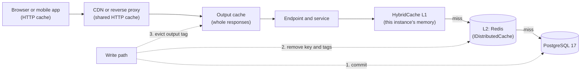
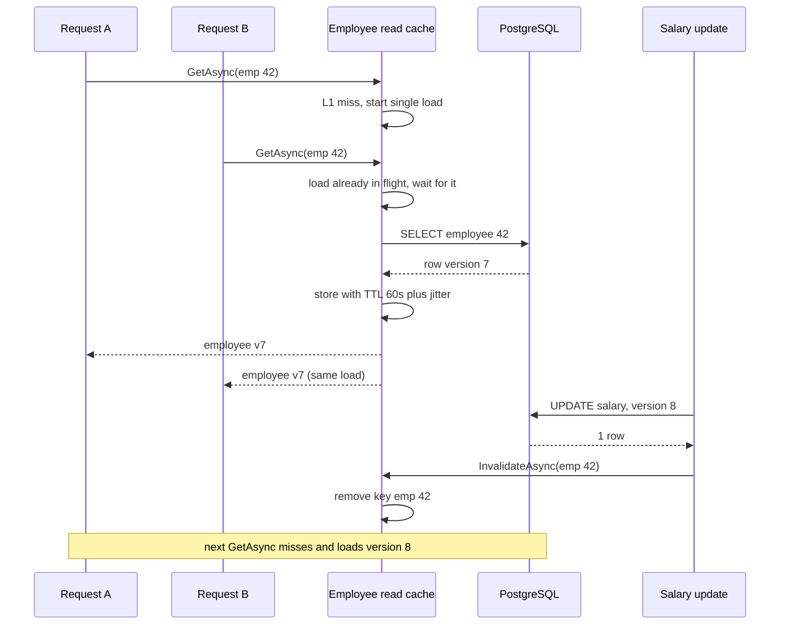

The employee API now pages and filters properly ([API versioning, pagination, filtering and sorting](#/lesson/m03-api-shape)). On Monday mornings, when 3,000 doctors and nurses across the hospital chain open the staff app at 9:00 to check their rosters, the same 500 employee profiles and the same 25 department directories are read thousands of times a minute, and PostgreSQL does identical work for every request. A cache keeps a copy of an answer close to where it is needed, so the expensive work happens once. The hard part is not storing the copy. It is knowing when the copy is wrong. This lesson covers both halves, using the caching tools built into ASP.NET Core 10.

## Learning objectives

By the end of this lesson you will be able to:

1. Explain what a cache trades (memory and staleness) for what it buys (latency and load), and estimate the benefit with a hit ratio.
2. Choose between `IMemoryCache`, `IDistributedCache`, `HybridCache`, output caching and HTTP caching headers for a given endpoint.
3. Implement cache-aside with stampede protection, negative caching, size limits and jittered expiry.
4. Write correct `Cache-Control`, `ETag` and `Vary` headers, and answer conditional requests with `304 Not Modified`.
5. Design invalidation for every cached item: TTL, explicit eviction after writes, tags and versioned keys, including across several server instances.
6. Recognise when caching is the wrong fix and an index, a query change or a read replica is better.

## Prerequisites

- [REST API design and HTTP status codes](#/lesson/m03-rest-status-codes): the module's employee API, ETags and the version column.
- [Singleton, scoped and transient services](#/lesson/m03-service-lifetimes): caches are singletons, and capturing a scoped service inside one is a classic bug.
- [Asynchronous programming with async/await](#/lesson/m03-async-await): we share one `Task` between many callers.

For the system-wide view (CDNs, Redis clusters, cache patterns), continue with [Why caching works](#/lesson/m12-why-caching) and [Cache-aside, read-through, write-through and write-behind](#/lesson/m12-cache-patterns) after this lesson.

## Explain it like I'm a beginner

Think of a busy chai stall outside a metro station. Making each cup from scratch takes four minutes. At 9 a.m. two hundred people want chai. So the owner brews a big kettle and keeps it hot in a flask. Most customers get a cup in ten seconds from the flask. That flask is a **cache**: a ready copy of something expensive to make.

Three questions decide whether the flask helps or hurts:

- **How long is the chai still good?** After 30 minutes it is stale. The owner throws it away and brews again. That is an **expiry time** (TTL, time to live).
- **What if the recipe changes?** If the owner switches to sugar-free, the flask must be emptied *now*, not in 30 minutes. That is **invalidation**.
- **What if the flask is empty and fifty people arrive at once?** If the owner starts fifty separate kettles, the stall drowns. Better: brew one kettle and make everyone wait for it. That is **stampede protection**.

There are several places to keep a flask:

- On the counter of each stall (**in-memory cache**, `IMemoryCache`): fastest, but each stall has its own, and they can disagree.
- In a shared kitchen behind all the stalls (**distributed cache**, `IDistributedCache`, usually Redis): one copy for everyone, a few steps away.
- Both, with the counter flask refilled from the kitchen (**HybridCache**).
- A stack of ready-packed cups for the most common order (**output caching**: the whole HTTP response).
- In the customer's own bottle, with a "best before" label (**HTTP caching headers**: the browser or CDN keeps it).

## First-principles explanation

### What a cache buys and what it costs

Reading an employee from PostgreSQL in the same data centre typically takes 1–5 ms including the network round trip and query (an estimate; measure yours). Reading it from process memory takes well under a microsecond; from Redis in the same region, roughly 0.5–1 ms. The difference per request is small. The difference in **load** is large.

Worked example (estimates): the profile endpoint gets 2,000 requests per second at the Monday peak. Without a cache, PostgreSQL runs 2,000 queries per second for it. With a 90 % hit ratio, it runs 200. With 99 %, it runs 20. The hit ratio is what matters, and it depends on how skewed the traffic is (a few hot keys) and how long entries live.

The costs are:

- **Staleness.** For up to one TTL after a change, some readers see the old value.
- **Memory.** Every entry occupies RAM in every instance (in-memory) or in Redis (distributed).
- **Complexity.** Invalidation logic, serialisation, a new failure mode (cache down), and bugs that only appear under concurrency.

Rule of thumb: cache data that is **read far more often than it is written**, **expensive to compute**, and **tolerant of a little staleness**. An employee's profile, a department directory, a list of hospital branches: yes. A leave balance seconds after approval, or a bank balance: be careful.

### Cache-aside: the default pattern

Cache-aside (also called lazy loading) is three steps:

1. Look in the cache. If found (a **hit**), return it.
2. If not found (a **miss**), load from the database.
3. Store the result in the cache with an expiry, then return it.

On writes, update the database first, then **delete** the cache entry (do not overwrite it). Deleting is safer because two concurrent writers that each `Set` their own version can leave the older one in the cache; with delete, the next reader loads whatever the database holds now.

### The ASP.NET Core caching toolbox

| Tool | Where data lives | What you cache | Shared across instances? | Typical use |
|---|---|---|---|---|
| `IMemoryCache` | This process's RAM | .NET objects (no serialisation) | No | Single-instance apps, hot reference data, per-instance L1 |
| `IDistributedCache` | Redis, SQL Server, PostgreSQL (community provider), or memory for dev | `byte[]` (you serialise) | Yes | Multi-instance apps, sessions, data that must agree across nodes |
| `HybridCache` | L1 memory plus optional L2 `IDistributedCache` | .NET objects (it serialises for L2) | L2 yes, L1 no | The recommended default for new code that caches data |
| Output caching | Server-side store (memory, or Redis) | Whole HTTP responses | With a Redis store, yes | Anonymous or shared GET endpoints |
| HTTP caching headers | The client, proxy or CDN | Whole responses | n/a | Static and public data, conditional requests with ETags |
| Response caching middleware | Server memory, driven by HTTP headers | Whole responses | No | Rarely the right choice for APIs; prefer output caching |

### `IMemoryCache`

The simplest cache: a thread-safe dictionary with expiry, in `Microsoft.Extensions.Caching.Memory`. Register with `AddMemoryCache()`. Key points:

- **Expiry**: *absolute* ("gone 60 s after creation") or *sliding* ("gone after 60 s without a read"). Sliding alone can keep a stale hot entry forever; combine it with an absolute cap or just use absolute.
- **Size limits**: set `SizeLimit` on the cache and a `Size` on every entry (any unit you choose, often "1 per entry"). Without a limit, a cache keyed on user input is a memory leak. Once `SizeLimit` is set, adding an entry without `Size` throws, which is a useful guard.
- **No stampede protection.** `GetOrCreateAsync` is not atomic: if 200 requests miss at once, the factory runs 200 times. You must add single-flight logic yourself (shown below), or use `HybridCache`.
- **Per instance.** Run three API instances and you have three caches that expire and invalidate independently.

### `IDistributedCache`

One cache shared by every instance. The interface is deliberately small: `GetAsync`, `SetAsync`, `RefreshAsync`, `RemoveAsync` on `byte[]` values. You serialise (usually with `System.Text.Json`). Implementations:

- `AddDistributedMemoryCache()`: in-process, for development and tests only. It is *not* actually distributed.
- `AddStackExchangeRedisCache(...)` (package `Microsoft.Extensions.Caching.StackExchangeRedis`): the common production choice.
- SQL Server and community PostgreSQL providers exist; a database-backed cache only helps if the cached computation is much more expensive than the cache lookup.

Every call is a network round trip, so a distributed cache is slower than memory and can fail. Decide what happens when Redis is down: usually log, skip the cache and go to the database (but watch that the database can survive the full load; see [Cache stampede, penetration and hot keys](#/lesson/m12-cache-failures)).

### `HybridCache`

`HybridCache` (abstract class in `Microsoft.Extensions.Caching.Abstractions`; implementation and `AddHybridCache()` in the `Microsoft.Extensions.Caching.Hybrid` package, generally available since .NET 9) combines both levels behind one call:

```csharp
var dto = await cache.GetOrCreateAsync(
    $"emp:v1:{id}",
    async token => await LoadEmployeeAsync(id, token),
    new HybridCacheEntryOptions { Expiration = TimeSpan.FromMinutes(5), LocalCacheExpiration = TimeSpan.FromSeconds(30) },
    tags: [$"employee:{id}", $"dept:{department}"]);
```

What it adds over writing it yourself:

- **Stampede protection**: concurrent callers for the same key on one instance share a single factory call.
- **Two levels**: L1 in memory (fast), L2 in whatever `IDistributedCache` is registered (shared). A miss in L1 checks L2 before running the factory.
- **Serialisation** for L2 (System.Text.Json by default, pluggable).
- **Tags**: `RemoveByTagAsync("dept:finance")` invalidates every entry carrying that tag.
- **Limits**: maximum key length and payload size, so a bug cannot push a 200 MB object into Redis.

The caveat to remember: removing a key or tag invalidates L2 and the **local** L1, but other instances' L1 copies live on until their `LocalCacheExpiration`. Keep L1 expiry short (seconds) for data that changes, or add a pub/sub invalidation message (the advanced exercise builds one). Check the current documentation for your version, because cross-instance L1 invalidation is an area where the library continues to evolve.

### Output caching

Output caching stores the **complete HTTP response** (status, headers, body) on the server and replays it for matching requests without running your endpoint at all. Register with `AddOutputCache()`, add `app.UseOutputCache()`, and mark endpoints with `.CacheOutput("policy")` or `[OutputCache]`. Defaults worth knowing:

- Only `GET` and `HEAD` requests with `200` responses are cached.
- Requests that carry an `Authorization` header, and responses that set cookies, are **not** cached by the default policy. This is a safety net: caching one user's response and serving it to another is a data leak.
- Default expiry is 60 seconds; policies can change it, vary by query string, header or route value, and add **tags** that you evict with `IOutputCacheStore.EvictByTagAsync`.
- It has built-in stampede protection (resource locking): concurrent misses for the same response wait for the first one.
- The default store is in memory per instance; a Redis store is available for sharing.

It is ideal for anonymous or shared data: a public list of doctors and their OPD timings, a list of hospital branches, a feed of job openings.

### HTTP caching headers

The cheapest request is the one that never reaches your server. HTTP caching (RFC 9111) lets browsers, proxies and CDNs keep responses based on headers you send:

| Header | Meaning | Example |
|---|---|---|
| `Cache-Control: no-store` | Never store this anywhere | Salary slips, tokens, anything sensitive |
| `Cache-Control: private, max-age=60` | Only the end user's browser may store it, for 60 s | A user's own dashboard |
| `Cache-Control: public, max-age=60, s-maxage=300` | Anyone may store it; browsers 60 s, shared caches (CDN) 300 s | Public directory, branch list |
| `Cache-Control: no-cache` | Store it, but revalidate with the server before every use | Data that must be fresh but is often unchanged |
| `ETag: "7"` | A version identifier for this representation | The employee's version column |
| `If-None-Match: "7"` (request) | "I have version 7; send it only if it changed" | Sent automatically by browsers |
| `304 Not Modified` | "Your copy is still good"; empty body | Saves bandwidth and serialisation |
| `Vary: Accept-Encoding, Accept-Language` | Cache separate copies per value of these request headers | Compressed vs plain, Hindi vs English |

The combination `Cache-Control: private, no-cache` plus an `ETag` is excellent for API resources: the client always asks, but if nothing changed the answer is a tiny `304` and the server can skip serialisation (and with a cheap version lookup, even the full database read).

The **response caching middleware** (`AddResponseCaching`) is a server-side cache that obeys these headers, including clients' `Cache-Control: no-cache` requests to bypass it. That makes it unsuitable for protecting your server from load, which is why output caching (which you control) replaced it for most uses.

### Invalidation: deciding when a copy is wrong

Every cached item needs a written answer to "how does this become fresh after a change?". The options, from simplest to most precise:

1. **TTL only.** Accept up to TTL of staleness. Simple and robust; right for reference data like department names or branch lists. Add a small random **jitter** (for example ±10 %) so thousands of entries created together do not expire together and stampede the database.
2. **Explicit eviction on write.** After the database commit, delete the cache entry (and evict output-cache tags). Precise, but every write path must remember to do it, and there is a race: a reader that loaded the old row just before the write can put it back into the cache just after the delete. Short TTLs bound the damage.
3. **Tags.** Group entries ("everything about department Finance") and evict the group. HybridCache and output caching both support tags.
4. **Versioned keys.** Put a version in the key: `emp:v1:{id}:{version}` or a per-department generation number `dept:finance:g42`. Bump the version and old entries become unreachable; they expire naturally. No delete race at all, at the cost of an extra lookup for the current version.
5. **Event-driven invalidation across instances.** Publish "employee 42 changed" on Redis pub/sub or a message bus; every instance evicts its L1. Needed when L1 TTLs must be long *and* freshness matters.

Also cache **misses** briefly (negative caching): if `GET /api/employees/{random-guid}` is hammered by a buggy client or a scraper, each miss would otherwise hit the database. A 5-second "not found" entry absorbs that, which is the simplest defence against cache penetration.

### When caching is the wrong fix

- The query is slow because of a **missing index**. Fix the index; a cache only hides it until the cache is cold. See [Indexes, composite indexes, B-tree and hash](#/lesson/m09-indexes).
- The data is **written as often as it is read** (live attendance counters). The hit ratio will be poor and invalidation constant.
- The data is **per user and rarely re-read** (a one-off report). Every entry is used once.
- You need **read scaling** for complex queries. A [read replica](#/lesson/m09-replicas) may be simpler and always consistent within its lag.

## Visual explanation

### Layers between a client and PostgreSQL



A request travels left to right and stops at the first layer that has a valid copy. Browser and CDN caches are controlled only by the headers you send; you cannot reach in and delete from them, which is why their TTLs must be short or their content revalidated with ETags. The output cache stores entire responses and is skipped for authenticated requests by default. Inside the endpoint, HybridCache checks this instance's memory first, then Redis, then runs the factory that queries PostgreSQL. The dotted write path shows the order that matters: commit to the database first, then remove cached copies in every layer you control.

### Read, stampede and write



Request B arrives while A's load is still running. Instead of issuing a second identical query, it waits for the same task. That is stampede protection, and with 200 concurrent requests it turns 200 queries into one. The write path updates the database first and only then removes the cache entry, so a reader can never load the old row *after* the removal from a database that still holds it. The remaining race (a slow load that started before the update finishes after the removal) is bounded by the TTL and is why the next section also discusses versioned keys.

## Step-by-step example

We will add caching to the employee API, endpoint by endpoint, writing down the invalidation plan first.

**Step 1: List read endpoints with their traffic and tolerance.** (Numbers are estimates for the Monday peak.)

| Endpoint | Peak reads/s | Writes | Staleness allowed | Sensitive? |
|---|---|---|---|---|
| `GET /api/employees/{id}` | 2,000 | ~20/day per 1,000 staff | Seconds | Yes (salary) |
| `GET /api/directory/{department}` | 300 | Rare | 1 minute | No (name, email, department) |
| `GET /api/departments/{name}/summary` | 50 | Derived | 1 minute | Aggregates only |

**Step 2: Choose a tool per endpoint.**

- Profiles: data cache (`IMemoryCache` today, `HybridCache` once we run more than one instance) plus `ETag` with `Cache-Control: private, no-cache`. Not output caching, because responses are authenticated and contain salaries.
- Directory: output caching with a tag per department, plus `Cache-Control: public, max-age=60` so browsers help too.
- Summary: `IDistributedCache` so all instances share one computed value.

**Step 3: Write keys and tags.** Keys are lower-case, prefixed with a schema version (`emp:v1:`), so a change to the cached DTO shape is deployed with `v2` and old entries are ignored instead of failing to deserialise.

**Step 4: Write the invalidation plan.**

| Change | Remove |
|---|---|
| Employee salary or name updated | `emp:v1:{id}`, output tag `directory:{dept}`, `dept-summary:v1:{dept}` |
| Employee moved from Finance to Legal | All of the above for **both** departments |
| DTO shape changed in a release | Bump key prefix to `v2` |

**Step 5: Implement cache-aside with single-flight and negative caching.** Shown below as `MemoryEmployeeReadCache`.

**Step 6: Add HTTP headers.** `ETag` from the version, `304` on a matching `If-None-Match`.

**Step 7: Measure.** Log hits and misses (or emit metrics), watch the hit ratio and database QPS before and after. If the hit ratio is below about 50 %, question whether the cache is worth its complexity.

## Production-style C# implementation

All `file=` blocks compile together as one ASP.NET Core 10 project extending the module's `EmployeeApi` namespace. `HybridCache` is compiled against its abstract class (part of the shared framework); its registration, `AddHybridCache()`, lives in the `Microsoft.Extensions.Caching.Hybrid` package, so `Program.cs` registers the memory-based implementation and shows the hybrid line as a comment.

```text
EmployeeApi/
  Program.cs
  Employees/Employee.cs                 trimmed domain + DTOs
  Employees/InMemoryEmployeeRepository.cs
  Caching/CacheKeys.cs
  Caching/IEmployeeReadCache.cs
  Caching/MemoryEmployeeReadCache.cs    IMemoryCache, single-flight, negative caching, jitter
  Caching/HybridEmployeeReadCache.cs    HybridCache version (recommended for multi-instance)
  Caching/DepartmentSummaryService.cs   IDistributedCache with JSON
  Caching/HttpCaching.cs                ETag and If-None-Match helpers
  Caching/DepartmentTagPolicy.cs        output-cache tags from route values
  Employees/EmployeeWriteService.cs     write then invalidate
  Endpoints/CachingEndpoints.cs
```

### Domain, DTOs and repository

```csharp file=Employees/Employee.cs
namespace EmployeeApi.Employees;

public enum EmploymentStatus { Active, OnLeave, Resigned }

/// <summary>Trimmed copy of the module project's domain class.</summary>
public sealed class Employee
{
    public Guid Id { get; init; } = Guid.NewGuid();
    public required string FullName { get; set; }
    public required string Email { get; set; }
    public required string Department { get; set; }
    public decimal MonthlySalary { get; set; }
    public EmploymentStatus Status { get; set; } = EmploymentStatus.Active;
    public int Version { get; set; } = 1;
}

/// <summary>What we cache: an immutable, serialisable snapshot, never the mutable entity.</summary>
public sealed record EmployeeDto(Guid Id, string FullName, string Email, string Department, decimal MonthlySalary,
    EmploymentStatus Status, int Version)
{
    public static EmployeeDto From(Employee e) =>
        new(e.Id, e.FullName, e.Email, e.Department, e.MonthlySalary, e.Status, e.Version);
}

public sealed record DirectoryEntry(string FullName, string Department, string Email);

public sealed record DepartmentSummary(string Department, int Headcount, decimal MonthlyPayroll, DateTimeOffset ComputedAt);

public interface IEmployeeRepository
{
    Task<Employee?> GetAsync(Guid id, CancellationToken ct);
    Task<IReadOnlyList<Employee>> ListByDepartmentAsync(string department, CancellationToken ct);
    Task<bool> UpdateAsync(Employee employee, int expectedVersion, CancellationToken ct);
}
```

```csharp file=Employees/InMemoryEmployeeRepository.cs
using System.Collections.Concurrent;

namespace EmployeeApi.Employees;

/// <summary>Stands in for PostgreSQL. Counts reads so tests and demos can see the cache working.</summary>
public sealed class InMemoryEmployeeRepository : IEmployeeRepository
{
    private readonly ConcurrentDictionary<Guid, Employee> _rows = new();
    private readonly Lock _writeGate = new();
    private int _reads;

    public int Reads => Volatile.Read(ref _reads);

    public void Add(Employee e) => _rows[e.Id] = Clone(e);

    public Task<Employee?> GetAsync(Guid id, CancellationToken ct)
    {
        Interlocked.Increment(ref _reads);
        return Task.FromResult(_rows.TryGetValue(id, out var e) ? Clone(e) : null);
    }

    public Task<IReadOnlyList<Employee>> ListByDepartmentAsync(string department, CancellationToken ct)
    {
        Interlocked.Increment(ref _reads);
        IReadOnlyList<Employee> list = _rows.Values
            .Where(e => string.Equals(e.Department, department, StringComparison.OrdinalIgnoreCase))
            .OrderBy(e => e.FullName, StringComparer.Ordinal)
            .Select(Clone)
            .ToList();
        return Task.FromResult(list);
    }

    public Task<bool> UpdateAsync(Employee employee, int expectedVersion, CancellationToken ct)
    {
        lock (_writeGate)
        {
            if (!_rows.TryGetValue(employee.Id, out var current) || current.Version != expectedVersion)
                return Task.FromResult(false);
            var next = Clone(employee);
            next.Version = expectedVersion + 1;
            _rows[employee.Id] = next;
            employee.Version = next.Version;
            return Task.FromResult(true);
        }
    }

    private static Employee Clone(Employee e) => new()
    {
        Id = e.Id, FullName = e.FullName, Email = e.Email, Department = e.Department,
        MonthlySalary = e.MonthlySalary, Status = e.Status, Version = e.Version,
    };
}
```

### Keys and the read-cache contract

```csharp file=Caching/CacheKeys.cs
namespace EmployeeApi.Caching;

/// <summary>One place for every key and tag. The "v1" prefix is the cached shape's schema version.</summary>
public static class CacheKeys
{
    public static string Employee(Guid id) => $"emp:v1:{id:N}";
    public static string EmployeeTag(Guid id) => $"employee:{id:N}";
    public static string DepartmentTag(string department) => $"dept:{Normalise(department)}";
    public static string DepartmentSummary(string department) => $"dept-summary:v1:{Normalise(department)}";
    public static string DirectoryTag(string department) => $"directory:{Normalise(department)}";

    private static string Normalise(string value) => value.Trim().ToLowerInvariant();
}
```

```csharp file=Caching/IEmployeeReadCache.cs
using EmployeeApi.Employees;

namespace EmployeeApi.Caching;

/// <summary>Cache-aside reads for single employees. Returns null for unknown ids (and caches that briefly).</summary>
public interface IEmployeeReadCache
{
    Task<EmployeeDto?> GetAsync(Guid id, CancellationToken ct);
    Task InvalidateAsync(Guid id, string department, CancellationToken ct);
}
```

### Cache-aside with `IMemoryCache`, done properly

```csharp file=Caching/MemoryEmployeeReadCache.cs
using System.Collections.Concurrent;
using EmployeeApi.Employees;
using Microsoft.Extensions.Caching.Memory;

namespace EmployeeApi.Caching;

/// <summary>
/// Single-instance cache-aside: single-flight loads (stampede protection), negative caching,
/// jittered expiry and a size of 1 per entry so the cache's SizeLimit bounds memory.
/// </summary>
public sealed class MemoryEmployeeReadCache(
    IMemoryCache cache, IEmployeeRepository repository, ILogger<MemoryEmployeeReadCache> logger) : IEmployeeReadCache
{
    public static readonly TimeSpan Ttl = TimeSpan.FromSeconds(60);
    public static readonly TimeSpan NegativeTtl = TimeSpan.FromSeconds(5);

    private readonly ConcurrentDictionary<string, Lazy<Task<EmployeeDto?>>> _inflight = new();

    /// <summary>Wrapper so that "known to be missing" (Value == null) is distinguishable from "not cached".</summary>
    private sealed record Slot(EmployeeDto? Value);

    public async Task<EmployeeDto?> GetAsync(Guid id, CancellationToken ct)
    {
        var key = CacheKeys.Employee(id);
        if (cache.TryGetValue(key, out Slot? hit) && hit is not null) return hit.Value;

        // All concurrent callers for this key share one Lazy, so the repository is called once.
        var load = _inflight.GetOrAdd(key, k => new Lazy<Task<EmployeeDto?>>(() => LoadAsync(k, id)));

        // Each caller may give up (ct), but that must not cancel the shared load for others.
        return await load.Value.WaitAsync(ct);
    }

    public Task InvalidateAsync(Guid id, string department, CancellationToken ct)
    {
        cache.Remove(CacheKeys.Employee(id));
        return Task.CompletedTask;
    }

    private async Task<EmployeeDto?> LoadAsync(string key, Guid id)
    {
        try
        {
            logger.LogDebug("Cache miss for {CacheKey}", key);
            var employee = await repository.GetAsync(id, CancellationToken.None);
            var dto = employee is null ? null : EmployeeDto.From(employee);

            cache.Set(key, new Slot(dto), new MemoryCacheEntryOptions
            {
                AbsoluteExpirationRelativeToNow = dto is null ? NegativeTtl : WithJitter(Ttl),
                Size = 1,
            });
            return dto;
        }
        finally
        {
            // The load removes itself, success or failure, even if every waiting caller has already given up.
            _inflight.TryRemove(key, out _);
        }
    }

    /// <summary>Adds 0-10 % so entries created together do not all expire in the same second.</summary>
    public static TimeSpan WithJitter(TimeSpan ttl) =>
        ttl + TimeSpan.FromMilliseconds(Random.Shared.NextDouble() * ttl.TotalMilliseconds * 0.10);
}
```

Three details are easy to get wrong. The shared load uses `CancellationToken.None`, because if it used the first caller's token, that caller closing their browser would fail the request for everyone waiting. The `Slot` wrapper lets us cache "not found" separately from "not cached". And exceptions are never cached: if `LoadAsync` throws, nothing is stored, the in-flight entry is removed, and the next request tries again. The removal lives inside the load itself, not in the callers: if every waiting caller cancels before the load finishes, a caller-side cleanup would never run, and the finished `Lazy` would sit in the dictionary and hand its old value to the next miss.

### The same contract with `HybridCache`

```csharp file=Caching/HybridEmployeeReadCache.cs
using EmployeeApi.Employees;
using Microsoft.Extensions.Caching.Hybrid;

namespace EmployeeApi.Caching;

/// <summary>
/// Recommended for multi-instance deployments: L1 memory + L2 Redis, stampede protection and tags built in.
/// Register with builder.Services.AddHybridCache() from the Microsoft.Extensions.Caching.Hybrid package.
/// </summary>
public sealed class HybridEmployeeReadCache(HybridCache cache, IEmployeeRepository repository) : IEmployeeReadCache
{
    private static readonly HybridCacheEntryOptions Options = new()
    {
        Expiration = TimeSpan.FromMinutes(5),             // L2 (shared) lifetime
        LocalCacheExpiration = TimeSpan.FromSeconds(30),  // L1 lifetime: bounds cross-instance staleness
    };

    public async Task<EmployeeDto?> GetAsync(Guid id, CancellationToken ct) =>
        await cache.GetOrCreateAsync<(IEmployeeRepository Repo, Guid Id), EmployeeDto?>(
            CacheKeys.Employee(id),
            (repository, id),
            static async (state, token) =>
            {
                var e = await state.Repo.GetAsync(state.Id, token);
                return e is null ? null : EmployeeDto.From(e);
            },
            Options,
            [CacheKeys.EmployeeTag(id)],
            ct);

    public async Task InvalidateAsync(Guid id, string department, CancellationToken ct)
    {
        await cache.RemoveAsync(CacheKeys.Employee(id), ct);
        // Also drop any other entry tagged with this employee (for example a future "team view" that embeds them).
        await cache.RemoveByTagAsync(CacheKeys.EmployeeTag(id), ct);
    }
}
```

The state tuple and `static` lambda avoid allocating a closure per call, a small but free win on a hot path. Compare the size of this class with the memory version: stampede protection, two levels and serialisation are all inside `GetOrCreateAsync`.

### `IDistributedCache` for a shared computed value

```csharp file=Caching/DepartmentSummaryService.cs
using System.Text.Json;
using EmployeeApi.Employees;
using Microsoft.Extensions.Caching.Distributed;

namespace EmployeeApi.Caching;

/// <summary>Headcount and payroll per department: computed once, shared by all instances through IDistributedCache.</summary>
public sealed class DepartmentSummaryService(
    IDistributedCache cache, IEmployeeRepository repository, TimeProvider clock, ILogger<DepartmentSummaryService> logger)
{
    private static readonly DistributedCacheEntryOptions Entry = new() { AbsoluteExpirationRelativeToNow = TimeSpan.FromSeconds(60) };

    public async Task<DepartmentSummary> GetAsync(string department, CancellationToken ct)
    {
        var key = CacheKeys.DepartmentSummary(department);
        try
        {
            var bytes = await cache.GetAsync(key, ct);
            if (bytes is not null) return JsonSerializer.Deserialize<DepartmentSummary>(bytes)!;
        }
        catch (Exception ex) when (ex is not OperationCanceledException)
        {
            // Cache down must not mean API down: fall through to the database.
            logger.LogWarning(ex, "Distributed cache read failed for {CacheKey}", key);
        }

        var employees = await repository.ListByDepartmentAsync(department, ct);
        var summary = new DepartmentSummary(department, employees.Count, employees.Sum(e => e.MonthlySalary), clock.GetUtcNow());

        try
        {
            await cache.SetAsync(key, JsonSerializer.SerializeToUtf8Bytes(summary), Entry, ct);
        }
        catch (Exception ex) when (ex is not OperationCanceledException)
        {
            logger.LogWarning(ex, "Distributed cache write failed for {CacheKey}", key);
        }
        return summary;
    }

    public Task InvalidateAsync(string department, CancellationToken ct) =>
        cache.RemoveAsync(CacheKeys.DepartmentSummary(department), ct);
}
```

### HTTP caching helpers and an output-cache tag policy

```csharp file=Caching/HttpCaching.cs
namespace EmployeeApi.Caching;

public static class HttpCaching
{
    /// <summary>Strong ETag from the row version: "7".</summary>
    public static string ETagFor(int version) => $"\"{version}\"";

    /// <summary>True when If-None-Match lists the current ETag (weak comparison) or "*".</summary>
    public static bool IfNoneMatchHits(string? ifNoneMatch, string currentETag)
    {
        if (string.IsNullOrWhiteSpace(ifNoneMatch)) return false;
        var current = StripWeak(currentETag);
        foreach (var candidate in ifNoneMatch.Split(',', StringSplitOptions.TrimEntries | StringSplitOptions.RemoveEmptyEntries))
        {
            if (candidate == "*" || StripWeak(candidate) == current) return true;
        }
        return false;
    }

    private static string StripWeak(string tag) => tag.StartsWith("W/", StringComparison.Ordinal) ? tag[2..] : tag;
}
```

```csharp file=Caching/DepartmentTagPolicy.cs
using Microsoft.AspNetCore.OutputCaching;

namespace EmployeeApi.Caching;

/// <summary>Adds a tag per department (from the route) so one department's cached directory can be evicted alone.</summary>
public sealed class DepartmentTagPolicy : IOutputCachePolicy
{
    public ValueTask CacheRequestAsync(OutputCacheContext context, CancellationToken cancellation)
    {
        if (context.HttpContext.Request.RouteValues.TryGetValue("department", out var value) && value is string department)
            context.Tags.Add(CacheKeys.DirectoryTag(department));
        return ValueTask.CompletedTask;
    }

    public ValueTask ServeFromCacheAsync(OutputCacheContext context, CancellationToken cancellation) => ValueTask.CompletedTask;

    public ValueTask ServeResponseAsync(OutputCacheContext context, CancellationToken cancellation) => ValueTask.CompletedTask;
}
```

### Writes: commit, then invalidate everything that depends on the row

```csharp file=Employees/EmployeeWriteService.cs
using EmployeeApi.Caching;
using Microsoft.AspNetCore.OutputCaching;

namespace EmployeeApi.Employees;

public enum WriteOutcome { Updated, NotFound, VersionConflict }

public sealed record WriteResult(WriteOutcome Outcome, EmployeeDto? Employee, int CurrentVersion);

public sealed record EmployeeChange(decimal MonthlySalary, string Department);

public sealed class EmployeeWriteService(
    IEmployeeRepository repository,
    IEmployeeReadCache readCache,
    DepartmentSummaryService summaries,
    IOutputCacheStore outputCache,
    ILogger<EmployeeWriteService> logger)
{
    public async Task<WriteResult> UpdateAsync(Guid id, int expectedVersion, EmployeeChange change, CancellationToken ct)
    {
        var employee = await repository.GetAsync(id, ct);
        if (employee is null) return new WriteResult(WriteOutcome.NotFound, null, 0);
        if (employee.Version != expectedVersion) return new WriteResult(WriteOutcome.VersionConflict, null, employee.Version);

        var oldDepartment = employee.Department;
        employee.MonthlySalary = change.MonthlySalary;
        employee.Department = change.Department.Trim();

        // 1. The database is the source of truth: commit first.
        if (!await repository.UpdateAsync(employee, expectedVersion, ct))
        {
            var fresh = await repository.GetAsync(id, ct);
            return new WriteResult(WriteOutcome.VersionConflict, null, fresh?.Version ?? expectedVersion + 1);
        }

        // 2. Then remove every cached copy that could now be wrong, in both departments if it moved.
        await InvalidateAsync(employee.Id, oldDepartment, employee.Department);
        logger.LogInformation("Employee {EmployeeId} updated to version {Version}, caches invalidated", employee.Id, employee.Version);
        return new WriteResult(WriteOutcome.Updated, EmployeeDto.From(employee), employee.Version);
    }

    private async Task InvalidateAsync(Guid id, string oldDepartment, string newDepartment)
    {
        // CancellationToken.None: once the write is committed, invalidation must finish even if the caller disconnects.
        var ct = CancellationToken.None;
        await readCache.InvalidateAsync(id, newDepartment, ct);
        foreach (var dept in new[] { oldDepartment, newDepartment }.Distinct(StringComparer.OrdinalIgnoreCase))
        {
            await summaries.InvalidateAsync(dept, ct);
            await outputCache.EvictByTagAsync(CacheKeys.DirectoryTag(dept), ct);
        }
    }
}
```

### Endpoints

```csharp file=Endpoints/CachingEndpoints.cs
using EmployeeApi.Caching;
using EmployeeApi.Employees;

namespace EmployeeApi.Endpoints;

public static class CachingEndpoints
{
    public static IEndpointRouteBuilder MapCachingEndpoints(this IEndpointRouteBuilder app)
    {
        // Sensitive, per-record: data cache + ETag revalidation. Browsers store it but must ask before reuse.
        app.MapGet("/api/employees/{id:guid}", async (Guid id, IEmployeeReadCache cache, HttpContext http, CancellationToken ct) =>
        {
            var dto = await cache.GetAsync(id, ct);
            if (dto is null) return Results.Problem(statusCode: StatusCodes.Status404NotFound, title: "Employee not found");

            var etag = HttpCaching.ETagFor(dto.Version);
            http.Response.Headers.ETag = etag;
            http.Response.Headers.CacheControl = "private, no-cache";
            if (HttpCaching.IfNoneMatchHits(http.Request.Headers.IfNoneMatch.ToString(), etag))
                return Results.StatusCode(StatusCodes.Status304NotModified);
            return Results.Ok(dto);
        });

        // Public, shared: whole response cached on the server, tagged per department, and cacheable by browsers.
        app.MapGet("/api/directory/{department}", async (string department, IEmployeeRepository repository, HttpContext http, CancellationToken ct) =>
        {
            var people = await repository.ListByDepartmentAsync(department, ct);
            http.Response.Headers.CacheControl = "public, max-age=60";
            return Results.Ok(people.Select(e => new DirectoryEntry(e.FullName, e.Department, e.Email)));
        }).CacheOutput("directory");

        // Aggregate shared by all instances via IDistributedCache.
        app.MapGet("/api/departments/{department}/summary", async (string department, DepartmentSummaryService summaries, CancellationToken ct) =>
            Results.Ok(await summaries.GetAsync(department, ct)));

        app.MapPut("/api/employees/{id:guid}", async (Guid id, EmployeeChange change, HttpContext http,
            EmployeeWriteService writer, CancellationToken ct) =>
        {
            var ifMatch = http.Request.Headers.IfMatch.ToString().Trim('"');
            if (!int.TryParse(ifMatch, out var expected))
                return Results.Problem(statusCode: StatusCodes.Status428PreconditionRequired, title: "Send If-Match with the current ETag");

            var result = await writer.UpdateAsync(id, expected, change, ct);
            switch (result.Outcome)
            {
                case WriteOutcome.NotFound:
                    return Results.Problem(statusCode: StatusCodes.Status404NotFound, title: "Employee not found");
                case WriteOutcome.VersionConflict:
                    http.Response.Headers.ETag = HttpCaching.ETagFor(result.CurrentVersion);
                    return Results.Problem(statusCode: StatusCodes.Status412PreconditionFailed, title: "Employee changed since you read it");
                default:
                    http.Response.Headers.ETag = HttpCaching.ETagFor(result.CurrentVersion);
                    return Results.Ok(result.Employee);
            }
        });

        return app;
    }
}
```

### Composition root

```csharp file=Program.cs
using EmployeeApi.Caching;
using EmployeeApi.Employees;
using EmployeeApi.Endpoints;

var builder = WebApplication.CreateBuilder(args);

builder.Services.AddProblemDetails();
builder.Services.AddSingleton(TimeProvider.System);

// Data caches
builder.Services.AddMemoryCache(o => o.SizeLimit = 50_000);       // every entry must declare Size
builder.Services.AddDistributedMemoryCache();                    // dev only. Production: AddStackExchangeRedisCache(...)
builder.Services.AddSingleton<IEmployeeReadCache, MemoryEmployeeReadCache>();
// Multi-instance, with the Microsoft.Extensions.Caching.Hybrid package:
// builder.Services.AddHybridCache();
// builder.Services.AddSingleton<IEmployeeReadCache, HybridEmployeeReadCache>();
builder.Services.AddSingleton<DepartmentSummaryService>();

// Response caching on the server
builder.Services.AddOutputCache(options =>
{
    options.DefaultExpirationTimeSpan = TimeSpan.FromSeconds(30);
    options.AddPolicy("directory", policy => policy
        .Expire(TimeSpan.FromSeconds(60))
        .AddPolicy<DepartmentTagPolicy>()
        .Tag("directory"));
});

// Storage and write path
builder.Services.AddSingleton<InMemoryEmployeeRepository>();
builder.Services.AddSingleton<IEmployeeRepository>(sp => sp.GetRequiredService<InMemoryEmployeeRepository>());
builder.Services.AddScoped<EmployeeWriteService>();

var app = builder.Build();

app.UseExceptionHandler();
app.UseOutputCache();
app.MapCachingEndpoints();

app.Run();

public partial class Program { }
```

In production the Redis registrations replace the development ones (both need packages, so they are shown without `file=`):

```csharp
builder.Services.AddStackExchangeRedisCache(o =>
{
    o.Configuration = builder.Configuration.GetConnectionString("Redis");
    o.InstanceName = "employee-api:";           // key prefix, so several apps can share one Redis
});
builder.Services.AddHybridCache(o =>
{
    o.MaximumPayloadBytes = 1024 * 1024;        // refuse to cache anything over 1 MB
    o.DefaultEntryOptions = new HybridCacheEntryOptions { Expiration = TimeSpan.FromMinutes(5), LocalCacheExpiration = TimeSpan.FromSeconds(30) };
});
builder.Services.AddStackExchangeRedisOutputCache(o => o.Configuration = builder.Configuration.GetConnectionString("Redis"));
```

`HybridCache` automatically uses the registered `IDistributedCache` (Redis here) as its L2; with no distributed cache registered it runs as an L1-only cache with stampede protection, which is already better than raw `IMemoryCache`.

## Bad design vs good design

**Bad**: a cache added in a hurry.

```csharp
public class EmployeeService(IMemoryCache cache, AppDbContext db)
{
    public async Task<Employee?> Get(Guid id)
    {
        if (cache.TryGetValue(id.ToString(), out Employee? e)) return e;
        e = await db.Employees.FindAsync(id);
        cache.Set(id.ToString(), e);                 // no expiry, no size
        return e;                                    // the tracked entity itself is now shared
    }

    public async Task UpdateSalary(Guid id, decimal salary)
    {
        var e = await Get(id);
        e!.MonthlySalary = salary;                   // mutates the cached object in place before saving
        await db.SaveChangesAsync();                 // never invalidates the department summary or directory
    }
}
```

What is wrong with it:

- **No expiry and no size limit**: a scraper requesting random GUIDs grows memory until the process is killed. Each miss is also cached as `null` forever, so a later-created employee with that id is invisible.
- **The cached value is a mutable, tracked EF Core entity**, shared across requests. One request changes it in memory and every other request sees an uncommitted change. If the save fails, the cache now holds data the database never had.
- **Keys are bare ids**: no prefix, so the next cache added by someone else (`dept` ids, also GUIDs) can collide, and there is no way to retire entries when the cached shape changes.
- **Invalidation is forgotten** for everything derived from the row (summaries, directory).
- **No stampede protection**: when a hot entry is evicted, every concurrent request hits the database.
- **`AppDbContext` (scoped) inside a service that might be registered as a singleton** to "share the cache" becomes a captive dependency.

**Good**: the implementation above. Immutable DTOs are cached, never entities. Every entry has a TTL with jitter and a size. Keys are namespaced and versioned. Loads are single-flight. Misses are cached briefly. Writes commit first, then remove every dependent entry and output-cache tag.

**When no cache is better**: an internal tool with 50 users and a 2 ms query. Adding a cache there buys nothing measurable and adds a class of stale-data bugs.

:::callout type=tradeoff title="Short TTL or precise invalidation?"
A 30-second TTL with no invalidation code is simple and self-healing: any bug fixes itself in 30 seconds. Precise invalidation gives fresh data immediately but needs every write path to cooperate, and a forgotten path means stale data until the TTL. Most production systems combine both: explicit invalidation for freshness, plus a TTL as the safety net.
:::

:::callout type=warning title="Never cache authenticated responses in a shared cache by accident"
Output caching skips requests with an `Authorization` header by default for good reason. If you write a policy that caches authenticated responses, vary the cache key by user or tenant. Likewise, `Cache-Control: public` on a response that contains one person's salary lets a CDN serve it to someone else.
:::

## Practical playground

This simulation sends 200,000 reads and a stream of updates to 1,000 employees with skewed popularity (a few profiles are very hot), and reports the hit ratio and how many reads returned stale data for different TTLs, with and without invalidation on write. Change `ttlSeconds`, `updatesPerSecond` and `invalidateOnWrite` and predict the numbers before running.

:::playground type=csharp title="Hit ratio versus staleness"
```csharp file=Program.cs
using System;
using System.Collections.Generic;

public static class Program
{
    public static void Main()
    {
        foreach (var invalidate in new[] { false, true })
            foreach (var ttl in new[] { 5, 30, 120, 600 })
                Run(ttlSeconds: ttl, updatesPerSecond: 2, invalidateOnWrite: invalidate);
    }

    private static void Run(int ttlSeconds, double updatesPerSecond, bool invalidateOnWrite)
    {
        const int employees = 1_000, reads = 200_000;
        const double readsPerSecond = 500;
        var rng = new Random(42);
        var dbVersion = new int[employees];
        var cache = new Dictionary<int, (int Version, double ExpiresAt)>();
        int hits = 0, stale = 0, dbReads = 0;
        var nextUpdateAt = 0.0;

        for (var i = 0; i < reads; i++)
        {
            var now = i / readsPerSecond;
            while (nextUpdateAt <= now)
            {
                var victim = Skewed(rng, employees);
                dbVersion[victim]++;
                if (invalidateOnWrite) cache.Remove(victim);
                nextUpdateAt += -Math.Log(1 - rng.NextDouble()) / updatesPerSecond;
            }

            var id = Skewed(rng, employees);
            if (cache.TryGetValue(id, out var entry) && entry.ExpiresAt > now)
            {
                hits++;
                if (entry.Version != dbVersion[id]) stale++;
            }
            else
            {
                dbReads++;
                cache[id] = (dbVersion[id], now + ttlSeconds);
            }
        }

        Console.WriteLine($"TTL {ttlSeconds,4}s invalidate={invalidateOnWrite,-5}  hit ratio {100.0 * hits / reads,5:F1}%  " +
                          $"DB reads/s {dbReads / (reads / readsPerSecond),6:F1}  stale reads {100.0 * stale / reads,5:F2}%");
    }

    // Roughly Zipf-like: low ids are much more popular than high ids.
    private static int Skewed(Random rng, int n) => (int)Math.Min(n - 1, Math.Floor(Math.Pow(rng.NextDouble(), 3) * n));
}
```
:::

Things to notice: hit ratio climbs with TTL but so does the stale-read percentage when there is no invalidation. With invalidation, stale reads drop to zero in this single-cache simulation, regardless of TTL, which is why long TTLs are safe only when invalidation is reliable. In a multi-instance deployment with per-instance L1 caches, invalidation reaches only one instance unless you broadcast it, and staleness returns; the advanced exercise fixes that.

## Exercises

:::exercise id=m03-caching-ex1 difficulty=beginner kind=code title="Canonical cache keys for list queries"
Two requests for the same list, `?Department=Finance&limit=20` and `?limit=20&department=finance`, should hit the same cache entry. Implement `CacheKeyBuilder.ForQuery` so equivalent queries produce identical keys, and different tenants or schema versions never share a key.
::requirements
- Format: `v{schemaVersion}:{tenant}:{resource}?{name}={value}&...` with tenant and resource lower-cased.
- Parameter names are lower-cased and sorted ordinally. Values keep their case except for names listed in `caseInsensitive`, whose values are lower-cased.
- Parameters with null or empty values are omitted.
- Values are URL-escaped (`Uri.EscapeDataString`) so a value containing `&` or `=` cannot forge another parameter.
- With no parameters, the key ends with the resource (no `?`).
- `tenant` or `resource` empty throws `ArgumentException`.
::acceptance
- All tests pass.
- Equivalent queries produce identical keys; different tenants, versions or values produce different keys.
::hint
Build a sorted list of `(name, value)` pairs first, then join them. `StringComparer.Ordinal` gives a stable order regardless of culture.
::hint
Normalise in this order: drop empty values, lower-case names, lower-case values for case-insensitive names, escape values, sort by name.
::hint
```csharp
var parts = query.Where(kv => !string.IsNullOrEmpty(kv.Value))
    .Select(kv => (Name: kv.Key.ToLowerInvariant(), Value: ...))
    .OrderBy(p => p.Name, StringComparer.Ordinal)
    .Select(p => $"{p.Name}={Uri.EscapeDataString(p.Value)}");
```
::starter
```csharp file=CacheKeyBuilder.cs
using System;
using System.Collections.Generic;

public static class CacheKeyBuilder
{
    public static string ForQuery(int schemaVersion, string tenant, string resource,
        IReadOnlyDictionary<string, string?> query, IReadOnlySet<string> caseInsensitive) =>
        throw new NotImplementedException();
}
```
::tests
```csharp file=CacheKeyBuilderTests.cs
using System;
using System.Collections.Generic;
using Xunit;

public class CacheKeyBuilderTests
{
    private static readonly HashSet<string> Ci = new(StringComparer.OrdinalIgnoreCase) { "department" };

    [Fact]
    public void Equivalent_queries_share_a_key()
    {
        var a = CacheKeyBuilder.ForQuery(1, "CityCare", "Employees", new Dictionary<string, string?> { ["Department"] = "Finance", ["limit"] = "20" }, Ci);
        var b = CacheKeyBuilder.ForQuery(1, "citycare", "employees", new Dictionary<string, string?> { ["limit"] = "20", ["department"] = "finance" }, Ci);
        Assert.Equal(a, b);
        Assert.Equal("v1:citycare:employees?department=finance&limit=20", a);
    }

    [Fact]
    public void Case_sensitive_values_keep_their_case()
    {
        var key = CacheKeyBuilder.ForQuery(1, "t", "employees", new Dictionary<string, string?> { ["q"] = "Iyer" }, Ci);
        Assert.Equal("v1:t:employees?q=Iyer", key);
    }

    [Fact]
    public void Empty_values_are_dropped_and_no_query_means_no_question_mark()
    {
        var key = CacheKeyBuilder.ForQuery(2, "t", "branches", new Dictionary<string, string?> { ["q"] = "", ["status"] = null }, Ci);
        Assert.Equal("v2:t:branches", key);
    }

    [Fact]
    public void Values_are_escaped_so_they_cannot_forge_parameters()
    {
        var forged = CacheKeyBuilder.ForQuery(1, "t", "e", new Dictionary<string, string?> { ["q"] = "a&limit=1000" }, Ci);
        var honest = CacheKeyBuilder.ForQuery(1, "t", "e", new Dictionary<string, string?> { ["q"] = "a", ["limit"] = "1000" }, Ci);
        Assert.NotEqual(honest, forged);
        Assert.DoesNotContain("&limit=", forged);
    }

    [Fact]
    public void Tenant_and_version_are_part_of_the_key()
    {
        var q = new Dictionary<string, string?> { ["limit"] = "20" };
        Assert.NotEqual(CacheKeyBuilder.ForQuery(1, "a", "e", q, Ci), CacheKeyBuilder.ForQuery(1, "b", "e", q, Ci));
        Assert.NotEqual(CacheKeyBuilder.ForQuery(1, "a", "e", q, Ci), CacheKeyBuilder.ForQuery(2, "a", "e", q, Ci));
    }

    [Theory]
    [InlineData("", "employees")]
    [InlineData("t", " ")]
    public void Missing_tenant_or_resource_throws(string tenant, string resource) =>
        Assert.Throws<ArgumentException>(() => CacheKeyBuilder.ForQuery(1, tenant, resource, new Dictionary<string, string?>(), Ci));
}
```
::solution
Canonicalising keys raises the hit ratio (equivalent requests share an entry) and is a safety measure: the tenant prefix stops one customer's data being served to another, and escaping stops a crafted value from colliding with a different query's key.

```csharp file=CacheKeyBuilder.cs
using System;
using System.Collections.Generic;
using System.Linq;

public static class CacheKeyBuilder
{
    public static string ForQuery(int schemaVersion, string tenant, string resource,
        IReadOnlyDictionary<string, string?> query, IReadOnlySet<string> caseInsensitive)
    {
        if (string.IsNullOrWhiteSpace(tenant)) throw new ArgumentException("Tenant is required.", nameof(tenant));
        if (string.IsNullOrWhiteSpace(resource)) throw new ArgumentException("Resource is required.", nameof(resource));

        var parts = query
            .Where(kv => !string.IsNullOrEmpty(kv.Value))
            .Select(kv =>
            {
                var name = kv.Key.Trim().ToLowerInvariant();
                var value = caseInsensitive.Contains(kv.Key) ? kv.Value!.ToLowerInvariant() : kv.Value!;
                return (Name: name, Value: Uri.EscapeDataString(value));
            })
            .OrderBy(p => p.Name, StringComparer.Ordinal)
            .Select(p => $"{p.Name}={p.Value}")
            .ToList();

        var prefix = $"v{schemaVersion}:{tenant.Trim().ToLowerInvariant()}:{resource.Trim().ToLowerInvariant()}";
        return parts.Count == 0 ? prefix : prefix + "?" + string.Join('&', parts);
    }
}
```
::alternatives
Hash the canonical string (SHA-256, hex) when keys get long; Redis handles long keys but they cost memory and HybridCache enforces a maximum key length. Keep the readable prefix (`v1:tenant:resource:`) before the hash so you can still find and delete keys by pattern during an incident.
::mistakes
- Lower-casing every value, which merges `q=Iyer` and `q=iyer` (fine) but also merges case-sensitive ids or cursors (not fine).
- Forgetting the tenant in a multi-tenant system, the classic cross-customer data leak.
- Joining raw values without escaping, so `q=a&limit=1000` collides with a real two-parameter query.
:::

:::exercise id=m03-caching-ex2 difficulty=beginner kind=written title="Choose the Cache-Control header"
For each endpoint of a hospital chain's staff and patient platform, write the `Cache-Control` header you would send (and `ETag`/`Vary` if relevant), plus one sentence of justification.

1. `GET /api/employees/{id}`: profile including monthly salary, requested by authenticated HR users.
2. `GET /api/branches`: the public list of 60 hospitals and clinics with city, address and OPD hours; changes a few times a week.
3. `GET /api/payslips/{month}`: a PDF salary slip for the logged-in employee.
4. `GET /assets/app.4f9c2b.js`: a JavaScript bundle whose file name contains a content hash.
5. `GET /api/directory/finance`: names and work emails, shown to all logged-in staff, available in English and Hindi via `Accept-Language`.
6. `GET /api/vacancies/latest`: the latest job openings for nurses and technicians, polled by partner job portals every minute.
::acceptance
- Each answer names `public` or `private` (or `no-store`) correctly for who may cache it.
- Sensitive data is never `public`, and the payslip is `no-store`.
- At least one answer uses `immutable` or a long `max-age` for fingerprinted assets, and at least one uses `Vary`.
::hint
First decide who may keep a copy: nobody, only this user's browser, or any cache including a CDN.
::hint
A file whose name changes when its content changes never needs revalidation, so its lifetime can be a year.
::hint
If the representation depends on a request header (language, encoding), shared caches need `Vary` with that header, or they will serve Hindi to English readers.
::solution
1. `Cache-Control: private, no-cache` plus `ETag: "7"`. Only the user's browser may store it, and it must revalidate every time; the 304 path keeps that cheap. Salary rules out `public`.
2. `Cache-Control: public, max-age=300` plus an `ETag`. Public, low-churn data; five minutes of staleness is harmless, and a CDN can absorb traffic.
3. `Cache-Control: no-store`. Highly sensitive and personal; it should not sit on shared or even local disk caches.
4. `Cache-Control: public, max-age=31536000, immutable`. The hash in the name is the version; a new build produces a new URL.
5. `Cache-Control: private, max-age=60` plus `Vary: Accept-Language`. It requires login, so not public; one minute is fine; two language versions must be cached separately.
6. `Cache-Control: public, max-age=30` plus `ETag`. Pollers revalidate cheaply with `If-None-Match` and get 304 most minutes; the server can also use output caching for the same 30 seconds.
::mistakes
- Using `no-cache` when you mean `no-store`. `no-cache` still stores; it only forces revalidation.
- Marking authenticated responses `public`.
- Forgetting `Vary` when the body depends on a header.
:::

:::exercise id=m03-caching-ex3 difficulty=intermediate kind=code title="Cache-aside with negative caching and jitter"
Implement `EmployeeLookupCache`, a cache-aside wrapper over `IMemoryCache` for a `Func<int, Task<string?>>` loader (id to employee name). It must cache hits with a jittered TTL, cache misses briefly, never cache exceptions, and declare a size for every entry.
::requirements
- `GetAsync(id)` returns the cached value if present (including a cached "not found"), otherwise calls the loader once and caches the result.
- Found values use `BuildOptions(found: true)`: `AbsoluteExpirationRelativeToNow` between `Ttl` and `Ttl × 1.1`. Missing values use exactly `NegativeTtl`.
- Every entry has `Size = 1` (the tests use a cache with `SizeLimit`, which throws if `Size` is missing).
- If the loader throws, the exception propagates and nothing is cached: the next call retries.
- The jitter comes from an injected `Func<double>` returning values in [0, 1), so tests are deterministic.
::acceptance
- All tests pass.
- A second lookup of a missing id does not call the loader.
::hint
`IMemoryCache` cannot store "null means known-missing" distinctly from "absent". Wrap the value in a small record such as `Entry(string? Name)`.
::hint
`TryGetValue(key, out Entry? e)` then `e is not null` means "cached", and `e.Name` may still be null.
::hint
`BuildOptions` is pure: `new MemoryCacheEntryOptions { AbsoluteExpirationRelativeToNow = ..., Size = 1 }`. Compute the jitter as `Ttl * (1 + 0.1 * random())`.
::hint
```csharp
if (_cache.TryGetValue(key, out Entry? hit) && hit is not null) return hit.Name;
var name = await _loader(id);                 // exception: nothing cached
_cache.Set(key, new Entry(name), BuildOptions(name is not null));
return name;
```
::starter
```csharp file=EmployeeLookupCache.cs
using System;
using System.Threading.Tasks;
using Microsoft.Extensions.Caching.Memory;

public sealed class EmployeeLookupCache
{
    public static readonly TimeSpan Ttl = TimeSpan.FromSeconds(60);
    public static readonly TimeSpan NegativeTtl = TimeSpan.FromSeconds(5);

    public EmployeeLookupCache(IMemoryCache cache, Func<int, Task<string?>> loader, Func<double> random) =>
        throw new NotImplementedException();

    public Task<string?> GetAsync(int id) => throw new NotImplementedException();

    public MemoryCacheEntryOptions BuildOptions(bool found) => throw new NotImplementedException();
}
```
::tests
```csharp file=EmployeeLookupCacheTests.cs
using System;
using System.Threading.Tasks;
using Microsoft.Extensions.Caching.Memory;
using Xunit;

public class EmployeeLookupCacheTests
{
    private static MemoryCache NewCache() => new(new MemoryCacheOptions { SizeLimit = 100 });

    [Fact]
    public async Task Hit_is_served_from_cache()
    {
        var calls = 0;
        var sut = new EmployeeLookupCache(NewCache(), id => { calls++; return Task.FromResult<string?>("Kavya Iyer"); }, () => 0.5);
        Assert.Equal("Kavya Iyer", await sut.GetAsync(7));
        Assert.Equal("Kavya Iyer", await sut.GetAsync(7));
        Assert.Equal(1, calls);
    }

    [Fact]
    public async Task Miss_is_cached_briefly()
    {
        var calls = 0;
        var sut = new EmployeeLookupCache(NewCache(), id => { calls++; return Task.FromResult<string?>(null); }, () => 0.5);
        Assert.Null(await sut.GetAsync(404));
        Assert.Null(await sut.GetAsync(404));
        Assert.Equal(1, calls);
    }

    [Fact]
    public async Task Exceptions_are_not_cached()
    {
        var calls = 0;
        var sut = new EmployeeLookupCache(NewCache(), id =>
        {
            calls++;
            if (calls == 1) throw new TimeoutException("db slow");
            return Task.FromResult<string?>("Rohit Verma");
        }, () => 0.5);

        await Assert.ThrowsAsync<TimeoutException>(() => sut.GetAsync(1));
        Assert.Equal("Rohit Verma", await sut.GetAsync(1));
        Assert.Equal(2, calls);
    }

    [Theory]
    [InlineData(0.0, 60_000)]
    [InlineData(0.5, 63_000)]
    [InlineData(0.999, 65_994)]
    public void Positive_ttl_is_jittered_up_to_ten_percent(double random, double expectedMs)
    {
        var sut = new EmployeeLookupCache(NewCache(), _ => Task.FromResult<string?>("x"), () => random);
        var options = sut.BuildOptions(found: true);
        Assert.Equal(expectedMs, Math.Round(options.AbsoluteExpirationRelativeToNow!.Value.TotalMilliseconds), 0);
        Assert.Equal(1L, options.Size);
    }

    [Fact]
    public void Negative_ttl_is_fixed()
    {
        var sut = new EmployeeLookupCache(NewCache(), _ => Task.FromResult<string?>(null), () => 0.9);
        var options = sut.BuildOptions(found: false);
        Assert.Equal(EmployeeLookupCache.NegativeTtl, options.AbsoluteExpirationRelativeToNow);
        Assert.Equal(1L, options.Size);
    }
}
```
::solution
The `Entry` wrapper is the key idea: it lets the cache remember "we looked, and there is nothing", which protects the database from repeated lookups of ids that do not exist. Keeping `BuildOptions` separate makes the expiry policy testable without waiting for real time to pass.

```csharp file=EmployeeLookupCache.cs
using System;
using System.Threading.Tasks;
using Microsoft.Extensions.Caching.Memory;

public sealed class EmployeeLookupCache
{
    public static readonly TimeSpan Ttl = TimeSpan.FromSeconds(60);
    public static readonly TimeSpan NegativeTtl = TimeSpan.FromSeconds(5);

    private sealed record Entry(string? Name);

    private readonly IMemoryCache _cache;
    private readonly Func<int, Task<string?>> _loader;
    private readonly Func<double> _random;

    public EmployeeLookupCache(IMemoryCache cache, Func<int, Task<string?>> loader, Func<double> random)
    {
        _cache = cache ?? throw new ArgumentNullException(nameof(cache));
        _loader = loader ?? throw new ArgumentNullException(nameof(loader));
        _random = random ?? throw new ArgumentNullException(nameof(random));
    }

    public async Task<string?> GetAsync(int id)
    {
        var key = $"emp-name:v1:{id}";
        if (_cache.TryGetValue(key, out Entry? hit) && hit is not null) return hit.Name;

        var name = await _loader(id);                       // if this throws, nothing is cached
        _cache.Set(key, new Entry(name), BuildOptions(name is not null));
        return name;
    }

    public MemoryCacheEntryOptions BuildOptions(bool found) => new()
    {
        AbsoluteExpirationRelativeToNow = found
            ? TimeSpan.FromMilliseconds(Ttl.TotalMilliseconds * (1 + 0.1 * _random()))
            : NegativeTtl,
        Size = 1,
    };
}
```
::alternatives
`HybridCache.GetOrCreateAsync` gives you the loader-once behaviour plus stampede protection with less code; you would still choose the TTLs and wrap "not found" if you want different lifetimes for hits and misses. A Bloom filter of existing ids is the heavier-weight defence against penetration when the id space is huge.
::mistakes
- Caching `null` with the same long TTL as real values, so a newly created employee stays invisible for a minute.
- Catching the loader's exception and caching a default value, which turns a 2-second database blip into a minute of wrong answers.
- Forgetting `Size` when the cache has a `SizeLimit`: `Set` throws `InvalidOperationException` at runtime.
:::

:::exercise id=m03-caching-ex4 difficulty=intermediate kind=code title="Conditional GET with ETags"
Implement `ConditionalGet.Evaluate`, which decides whether a request can be answered with `304 Not Modified`, following RFC 9110's rules for `If-None-Match` on GET and HEAD.
::requirements
- Return `NotModified` only for `GET` or `HEAD` (case-insensitive) when `If-None-Match` matches the current ETag; otherwise `SendFull`.
- `If-None-Match` may hold a comma-separated list, for example `"5", "6", W/"7"`. Any match counts.
- Use **weak comparison**: `W/"7"` matches `"7"` and vice versa. The quotes are part of the tag.
- `*` matches any current representation.
- A null, empty or malformed header (unquoted tag) never matches.
- For other methods (`PUT`, `POST`, `DELETE`), return `SendFull`; preconditions for writes are handled by `If-Match` elsewhere.
::acceptance
- All tests pass.
::hint
Split on commas, trim each candidate, and compare after removing a leading `W/` from both sides.
::hint
A valid entity tag after removing `W/` starts and ends with a double quote. Ignore anything else.
::hint
```csharp
foreach (var raw in header.Split(',', StringSplitOptions.TrimEntries | StringSplitOptions.RemoveEmptyEntries))
{
    if (raw == "*") return CacheDecision.NotModified;
    var tag = StripWeak(raw);
    if (IsQuoted(tag) && tag == StripWeak(currentETag)) return CacheDecision.NotModified;
}
```
::starter
```csharp file=ConditionalGet.cs
using System;

public enum CacheDecision { SendFull, NotModified }

public static class ConditionalGet
{
    public static CacheDecision Evaluate(string method, string? ifNoneMatch, string currentETag) =>
        throw new NotImplementedException();
}
```
::tests
```csharp file=ConditionalGetTests.cs
using Xunit;

public class ConditionalGetTests
{
    [Theory]
    [InlineData("GET", "\"7\"", "\"7\"", CacheDecision.NotModified)]
    [InlineData("get", "\"7\"", "\"7\"", CacheDecision.NotModified)]
    [InlineData("HEAD", "\"7\"", "\"7\"", CacheDecision.NotModified)]
    [InlineData("GET", "\"6\"", "\"7\"", CacheDecision.SendFull)]
    [InlineData("GET", "\"5\", \"6\", \"7\"", "\"7\"", CacheDecision.NotModified)]
    [InlineData("GET", "W/\"7\"", "\"7\"", CacheDecision.NotModified)]
    [InlineData("GET", "\"7\"", "W/\"7\"", CacheDecision.NotModified)]
    [InlineData("GET", "*", "\"7\"", CacheDecision.NotModified)]
    [InlineData("GET", "7", "\"7\"", CacheDecision.SendFull)]
    [InlineData("GET", "", "\"7\"", CacheDecision.SendFull)]
    [InlineData("GET", null, "\"7\"", CacheDecision.SendFull)]
    [InlineData("PUT", "\"7\"", "\"7\"", CacheDecision.SendFull)]
    [InlineData("DELETE", "*", "\"7\"", CacheDecision.SendFull)]
    public void Evaluates(string method, string? header, string current, CacheDecision expected) =>
        Assert.Equal(expected, ConditionalGet.Evaluate(method, header, current));
}
```
::solution
```csharp file=ConditionalGet.cs
using System;

public enum CacheDecision { SendFull, NotModified }

public static class ConditionalGet
{
    public static CacheDecision Evaluate(string method, string? ifNoneMatch, string currentETag)
    {
        var isRead = string.Equals(method, "GET", StringComparison.OrdinalIgnoreCase)
                  || string.Equals(method, "HEAD", StringComparison.OrdinalIgnoreCase);
        if (!isRead || string.IsNullOrWhiteSpace(ifNoneMatch)) return CacheDecision.SendFull;

        var current = StripWeak(currentETag.Trim());
        foreach (var raw in ifNoneMatch.Split(',', StringSplitOptions.TrimEntries | StringSplitOptions.RemoveEmptyEntries))
        {
            if (raw == "*") return CacheDecision.NotModified;
            var tag = StripWeak(raw);
            if (IsQuoted(tag) && tag == current) return CacheDecision.NotModified;
        }
        return CacheDecision.SendFull;
    }

    private static string StripWeak(string tag) => tag.StartsWith("W/", StringComparison.Ordinal) ? tag[2..] : tag;

    private static bool IsQuoted(string tag) => tag.Length >= 2 && tag[0] == '"' && tag[^1] == '"';
}
```

In the endpoint, compute the ETag from the cached DTO's `Version` (no database call on a cache hit), call `Evaluate`, and return `304` with the `ETag` header and no body when it says `NotModified`. On a busy polling endpoint, most responses become a few hundred bytes of headers.
::alternatives
For responses without a natural version, hash the serialised body (for example, SHA-256 truncated to 16 hex characters) to form the ETag. That saves bandwidth but not the work of building the body; a version column saves both.
::mistakes
- Comparing without the quotes, or with them on one side only.
- Applying strong comparison to `If-None-Match`; RFC 9110 specifies weak comparison for it.
- Returning 304 for unsafe methods.
:::

:::exercise id=m03-caching-ex5 difficulty=advanced kind=code title="Two-level cache with cross-instance invalidation"
The employee API runs on three instances. Each has a fast in-memory L1, and they share a Redis L2. Today, an update on instance A removes the entry from A's L1 and from L2, but B and C keep serving their stale L1 copies until expiry. Build `TwoLevelCache` with an invalidation bus so that every instance drops its L1 copy when any instance invalidates a key or a tag.
::requirements
- `GetOrCreateAsync(key, factory, tags)`: check L1 (respecting `LocalTtl` measured with the injected `TimeProvider`), then L2 (respecting `SharedTtl`), then call `factory`. Store in L2 and L1 on a factory call. On an L2 hit, populate L1.
- `InvalidateAsync(key)`: remove from L2 and from this instance's L1, then publish the key on the bus. Every other instance subscribed to the bus removes it from its L1.
- `InvalidateTagAsync(tag)`: remove every L2 entry with that tag (the shared store tracks tags), drop matching L1 entries locally, and publish the tag so other instances do the same.
- An instance must not process its own published messages twice (either is harmless, but do not throw).
- Use the provided `SharedStore` (fake Redis) and `InvalidationBus` (fake pub/sub). Do not change them.
::acceptance
- All tests pass, including: B serves fresh data immediately after A invalidates, L1 expiry falls back to L2 without calling the factory, and tag invalidation crosses instances.
::hint
Each instance keeps `Dictionary<string, (string Value, DateTimeOffset ExpiresAt, string[] Tags)>` as L1, guarded by a lock. Subscribe to the bus in the constructor.
::hint
Bus messages need to say whether they carry a key or a tag. A small record `Invalidation(string? Key, string? Tag)` is enough.
::hint
For the tag case in L1, remove every local entry whose `Tags` contains the tag. That is O(n) over L1, acceptable for an L1 of a few thousand entries; a reverse index (tag to keys) is the optimisation.
::hint
```csharp
public async Task InvalidateAsync(string key)
{
    _shared.Remove(key);
    RemoveLocal(key);
    await _bus.PublishAsync(new Invalidation(key, null));
}
private void OnMessage(Invalidation m)
{
    if (m.Key is not null) RemoveLocal(m.Key);
    if (m.Tag is not null) RemoveLocalByTag(m.Tag);
}
```
::starter
```csharp file=TwoLevelCache.cs
using System;
using System.Collections.Generic;
using System.Linq;
using System.Threading.Tasks;

public sealed record Invalidation(string? Key, string? Tag);

/// <summary>Fake pub/sub (Redis channel). Delivers synchronously to every subscriber, including the publisher.</summary>
public sealed class InvalidationBus
{
    private readonly List<Action<Invalidation>> _subscribers = new();
    public void Subscribe(Action<Invalidation> handler) { lock (_subscribers) _subscribers.Add(handler); }
    public Task PublishAsync(Invalidation message)
    {
        Action<Invalidation>[] copy;
        lock (_subscribers) copy = _subscribers.ToArray();
        foreach (var s in copy) s(message);
        return Task.CompletedTask;
    }
}

/// <summary>Fake shared L2 (Redis) with expiry and tag tracking.</summary>
public sealed class SharedStore(TimeProvider clock)
{
    private readonly Dictionary<string, (string Value, DateTimeOffset ExpiresAt, string[] Tags)> _items = new();
    public int Reads { get; private set; }

    public string? Get(string key)
    {
        lock (_items)
        {
            Reads++;
            return _items.TryGetValue(key, out var e) && e.ExpiresAt > clock.GetUtcNow() ? e.Value : null;
        }
    }

    public void Set(string key, string value, TimeSpan ttl, string[] tags)
    {
        lock (_items) _items[key] = (value, clock.GetUtcNow() + ttl, tags);
    }

    public void Remove(string key) { lock (_items) _items.Remove(key); }

    public void RemoveByTag(string tag)
    {
        lock (_items)
            foreach (var k in _items.Where(kv => kv.Value.Tags.Contains(tag)).Select(kv => kv.Key).ToList())
                _items.Remove(k);
    }
}

public sealed class TwoLevelCache
{
    public TwoLevelCache(string instanceName, SharedStore shared, InvalidationBus bus, TimeProvider clock,
        TimeSpan localTtl, TimeSpan sharedTtl) => throw new NotImplementedException();

    public Task<string> GetOrCreateAsync(string key, Func<Task<string>> factory, params string[] tags) =>
        throw new NotImplementedException();

    public Task InvalidateAsync(string key) => throw new NotImplementedException();

    public Task InvalidateTagAsync(string tag) => throw new NotImplementedException();
}
```
::tests
```csharp file=TwoLevelCacheTests.cs
using System;
using System.Threading.Tasks;
using Xunit;

public sealed class ManualClock : TimeProvider
{
    private DateTimeOffset _now = new(2026, 10, 20, 9, 0, 0, TimeSpan.Zero);
    public override DateTimeOffset GetUtcNow() => _now;
    public void Advance(TimeSpan by) => _now += by;
}

public class TwoLevelCacheTests
{
    private readonly ManualClock _clock = new();
    private readonly SharedStore _redis;
    private readonly InvalidationBus _bus = new();
    private readonly TwoLevelCache _a, _b;
    private string _db = "Kavya Iyer, Finance, 91000";
    private int _dbReads;

    public TwoLevelCacheTests()
    {
        _redis = new SharedStore(_clock);
        _a = new TwoLevelCache("A", _redis, _bus, _clock, TimeSpan.FromSeconds(30), TimeSpan.FromMinutes(5));
        _b = new TwoLevelCache("B", _redis, _bus, _clock, TimeSpan.FromSeconds(30), TimeSpan.FromMinutes(5));
    }

    private Task<string> Load() { _dbReads++; return Task.FromResult(_db); }

    [Fact]
    public async Task Second_instance_uses_l2_instead_of_database()
    {
        await _a.GetOrCreateAsync("emp:42", Load, "dept:finance");
        var fromB = await _b.GetOrCreateAsync("emp:42", Load, "dept:finance");
        Assert.Equal(_db, fromB);
        Assert.Equal(1, _dbReads);
    }

    [Fact]
    public async Task L1_hit_does_not_touch_l2()
    {
        await _a.GetOrCreateAsync("emp:42", Load);
        var reads = _redis.Reads;
        await _a.GetOrCreateAsync("emp:42", Load);
        Assert.Equal(reads, _redis.Reads);
    }

    [Fact]
    public async Task Invalidation_on_A_clears_L1_on_B()
    {
        await _a.GetOrCreateAsync("emp:42", Load);
        await _b.GetOrCreateAsync("emp:42", Load);       // B now has it in L1

        _db = "Kavya Iyer, Finance, 95000";              // salary raised
        await _a.InvalidateAsync("emp:42");

        Assert.Equal("Kavya Iyer, Finance, 95000", await _b.GetOrCreateAsync("emp:42", Load));
        Assert.Equal(2, _dbReads);
    }

    [Fact]
    public async Task L1_expiry_falls_back_to_l2_without_factory()
    {
        await _a.GetOrCreateAsync("emp:42", Load);
        _clock.Advance(TimeSpan.FromSeconds(31));        // L1 expired, L2 still valid
        var reads = _redis.Reads;
        await _a.GetOrCreateAsync("emp:42", Load);
        Assert.Equal(1, _dbReads);
        Assert.Equal(reads + 1, _redis.Reads);
    }

    [Fact]
    public async Task L2_expiry_calls_factory_again()
    {
        await _a.GetOrCreateAsync("emp:42", Load);
        _clock.Advance(TimeSpan.FromMinutes(6));
        await _a.GetOrCreateAsync("emp:42", Load);
        Assert.Equal(2, _dbReads);
    }

    [Fact]
    public async Task Tag_invalidation_crosses_instances()
    {
        await _a.GetOrCreateAsync("emp:1", Load, "dept:finance");
        await _a.GetOrCreateAsync("emp:2", Load, "dept:legal");
        await _b.GetOrCreateAsync("emp:1", Load, "dept:finance");
        await _b.GetOrCreateAsync("emp:2", Load, "dept:legal");
        Assert.Equal(2, _dbReads);

        await _a.InvalidateTagAsync("dept:finance");

        await _b.GetOrCreateAsync("emp:1", Load, "dept:finance");   // must reload
        await _b.GetOrCreateAsync("emp:2", Load, "dept:legal");     // still cached
        Assert.Equal(3, _dbReads);
    }
}
```
::solution
The bus turns "invalidate" from a local action into a broadcast. Each instance owns its L1 and reacts to messages; the shared store is cleaned once by the instance that initiated the change. Because the fake bus also delivers to the publisher, the local removal runs twice, which is harmless because removal is idempotent.

```csharp file=TwoLevelCache.cs
using System;
using System.Collections.Generic;
using System.Linq;
using System.Threading.Tasks;

public sealed record Invalidation(string? Key, string? Tag);

/// <summary>Fake pub/sub (Redis channel). Delivers synchronously to every subscriber, including the publisher.</summary>
public sealed class InvalidationBus
{
    private readonly List<Action<Invalidation>> _subscribers = new();
    public void Subscribe(Action<Invalidation> handler) { lock (_subscribers) _subscribers.Add(handler); }
    public Task PublishAsync(Invalidation message)
    {
        Action<Invalidation>[] copy;
        lock (_subscribers) copy = _subscribers.ToArray();
        foreach (var s in copy) s(message);
        return Task.CompletedTask;
    }
}

/// <summary>Fake shared L2 (Redis) with expiry and tag tracking.</summary>
public sealed class SharedStore(TimeProvider clock)
{
    private readonly Dictionary<string, (string Value, DateTimeOffset ExpiresAt, string[] Tags)> _items = new();
    public int Reads { get; private set; }

    public string? Get(string key)
    {
        lock (_items)
        {
            Reads++;
            return _items.TryGetValue(key, out var e) && e.ExpiresAt > clock.GetUtcNow() ? e.Value : null;
        }
    }

    public void Set(string key, string value, TimeSpan ttl, string[] tags)
    {
        lock (_items) _items[key] = (value, clock.GetUtcNow() + ttl, tags);
    }

    public void Remove(string key) { lock (_items) _items.Remove(key); }

    public void RemoveByTag(string tag)
    {
        lock (_items)
            foreach (var k in _items.Where(kv => kv.Value.Tags.Contains(tag)).Select(kv => kv.Key).ToList())
                _items.Remove(k);
    }
}

public sealed class TwoLevelCache
{
    private readonly string _name;
    private readonly SharedStore _shared;
    private readonly InvalidationBus _bus;
    private readonly TimeProvider _clock;
    private readonly TimeSpan _localTtl;
    private readonly TimeSpan _sharedTtl;
    private readonly Dictionary<string, (string Value, DateTimeOffset ExpiresAt, string[] Tags)> _local = new();

    public TwoLevelCache(string instanceName, SharedStore shared, InvalidationBus bus, TimeProvider clock,
        TimeSpan localTtl, TimeSpan sharedTtl)
    {
        _name = instanceName;
        _shared = shared;
        _bus = bus;
        _clock = clock;
        _localTtl = localTtl;
        _sharedTtl = sharedTtl;
        _bus.Subscribe(OnMessage);
    }

    public async Task<string> GetOrCreateAsync(string key, Func<Task<string>> factory, params string[] tags)
    {
        var now = _clock.GetUtcNow();
        lock (_local)
        {
            if (_local.TryGetValue(key, out var l1) && l1.ExpiresAt > now) return l1.Value;
        }

        var fromShared = _shared.Get(key);
        if (fromShared is not null)
        {
            SetLocal(key, fromShared, tags);
            return fromShared;
        }

        var value = await factory();
        _shared.Set(key, value, _sharedTtl, tags);
        SetLocal(key, value, tags);
        return value;
    }

    public async Task InvalidateAsync(string key)
    {
        _shared.Remove(key);
        RemoveLocal(key);
        await _bus.PublishAsync(new Invalidation(key, null));
    }

    public async Task InvalidateTagAsync(string tag)
    {
        _shared.RemoveByTag(tag);
        RemoveLocalByTag(tag);
        await _bus.PublishAsync(new Invalidation(null, tag));
    }

    private void OnMessage(Invalidation message)
    {
        if (message.Key is not null) RemoveLocal(message.Key);
        if (message.Tag is not null) RemoveLocalByTag(message.Tag);
    }

    private void SetLocal(string key, string value, string[] tags)
    {
        lock (_local) _local[key] = (value, _clock.GetUtcNow() + _localTtl, tags);
    }

    private void RemoveLocal(string key)
    {
        lock (_local) _local.Remove(key);
    }

    private void RemoveLocalByTag(string tag)
    {
        lock (_local)
            foreach (var k in _local.Where(kv => kv.Value.Tags.Contains(tag)).Select(kv => kv.Key).ToList())
                _local.Remove(k);
    }

    public override string ToString() => $"TwoLevelCache({_name}, {_local.Count} local entries)";
}
```

In production the bus is a Redis pub/sub channel (`ISubscriber.PublishAsync` in StackExchange.Redis) or a message broker topic. Pub/sub is fire-and-forget: an instance that is briefly disconnected misses messages, so keep `LocalTtl` short as the safety net. Delete from L2 *before* publishing, otherwise another instance can reload the stale L2 value into its L1 right after receiving the message.
::alternatives
Instead of broadcasting invalidations, give every L1 entry a very short lifetime (5–10 seconds) and rely on L2 for freshness; simpler, slightly more Redis traffic. Or use versioned keys: store a per-department generation number in Redis and include it in every key, so bumping it makes all old L1 and L2 entries unreachable without any broadcast.
::mistakes
- Publishing before deleting from L2, which lets subscribers repopulate L1 from the stale L2 value.
- Expecting pub/sub to be reliable; messages to a disconnected subscriber are lost.
- Forgetting to populate L1 on an L2 hit, so every request on the other instances goes to Redis.
- Holding the L1 lock while awaiting the factory, which serialises every miss on the instance.
:::

## Automated testing

Cache code fails in ways ordinary tests miss: under concurrency, at expiry boundaries and after writes. Test each explicitly. These snippets use xUnit and `Microsoft.Extensions.TimeProvider.Testing`, so they are shown without `file=`.

### Unit tests: single-flight and invalidation

```csharp
public class MemoryEmployeeReadCacheTests
{
    [Fact]
    public async Task Concurrent_misses_cause_one_database_read()
    {
        var repo = new InMemoryEmployeeRepository();
        var kavya = new Employee { FullName = "Kavya Iyer", Email = "kavya@example.com", Department = "Finance", MonthlySalary = 91_000m };
        repo.Add(kavya);
        var sut = new MemoryEmployeeReadCache(new MemoryCache(new MemoryCacheOptions { SizeLimit = 100 }), repo, NullLogger<MemoryEmployeeReadCache>.Instance);

        var results = await Task.WhenAll(Enumerable.Range(0, 200).Select(_ => sut.GetAsync(kavya.Id, default)));

        Assert.All(results, r => Assert.Equal("Kavya Iyer", r!.FullName));
        Assert.Equal(1, repo.Reads);
    }

    [Fact]
    public async Task Update_then_read_returns_new_version()
    {
        // arrange repository, cache, summary service with MemoryDistributedCache, and a fake IOutputCacheStore
        // act: read (caches v1), update via EmployeeWriteService, read again
        // assert: second read returns Version 2, repo.Reads increased, output store received EvictByTagAsync("directory:finance")
    }
}
```

The in-memory repository's latency is near zero, so the 200 tasks in the first test may complete without overlapping much. To make the race deterministic, use a repository fake whose `GetAsync` awaits a `TaskCompletionSource` that the test releases after starting all callers.

### Integration tests: headers and output caching

```csharp
public class CachingApiTests(WebApplicationFactory<Program> factory) : IClassFixture<WebApplicationFactory<Program>>
{
    [Fact]
    public async Task Matching_if_none_match_returns_304()
    {
        var id = Seed(factory, "Kavya Iyer", "Finance");
        var client = factory.CreateClient();

        var first = await client.GetAsync($"/api/employees/{id}");
        var etag = first.Headers.ETag!;

        var request = new HttpRequestMessage(HttpMethod.Get, $"/api/employees/{id}");
        request.Headers.IfNoneMatch.Add(etag);
        var second = await client.SendAsync(request);

        Assert.Equal(HttpStatusCode.NotModified, second.StatusCode);
        Assert.Equal("private, no-cache", first.Headers.CacheControl!.ToString());
    }

    [Fact]
    public async Task Directory_is_served_from_output_cache_until_a_write_evicts_it()
    {
        var id = Seed(factory, "Rohit Verma", "Finance");
        var repo = factory.Services.GetRequiredService<InMemoryEmployeeRepository>();
        var client = factory.CreateClient();

        await client.GetAsync("/api/directory/finance");
        var readsAfterFirst = repo.Reads;
        await client.GetAsync("/api/directory/finance");
        Assert.Equal(readsAfterFirst, repo.Reads);                 // second call never reached the endpoint

        var put = new HttpRequestMessage(HttpMethod.Put, $"/api/employees/{id}") { Content = JsonContent.Create(new { monthlySalary = 80_000, department = "Finance" }) };
        put.Headers.IfMatch.Add(new EntityTagHeaderValue("\"1\""));
        await client.SendAsync(put);

        await client.GetAsync("/api/directory/finance");
        Assert.True(repo.Reads > readsAfterFirst);                // evicted by tag, recomputed
    }
}
```

What else to test: that a `null` result is cached only for the negative TTL (advance a `FakeTimeProvider`, or test the options as in exercise 3); that a failing distributed cache falls back to the database (a fake `IDistributedCache` that throws); and, for the HybridCache version, that tags passed at creation are the ones the write service removes. In a staging environment, measure hit ratio and p95 latency before and after enabling each cache.

## Real-world application

- **High-traffic read APIs** (product catalogues, train timetables, exam results on result day) rely on layered caching: CDN for static and public JSON, an application cache for hot records, and the database only for misses. Result-day traffic is the textbook case for pre-warming the cache before the announcement.
- **Government portals** serving public data (exam notifications, land records, scheme guidelines) benefit most from HTTP caching with `public, max-age` and ETags, because the data is the same for every visitor and changes rarely.
- **Hospital operations dashboards** aggregate bed occupancy and OPD queue lengths across dozens of branches. Computing the chain-wide summary once per minute into a distributed cache, instead of per request, turns a heavy aggregation query into a key lookup.
- **Payment and banking systems** cache cautiously: reference data (IFSC codes, bank lists) for hours, balances never, or only with explicit, short-lived and well-understood rules.
- **Multi-instance ASP.NET Core services** in containers typically use `HybridCache` with Redis as L2, short L1 lifetimes, and Redis-backed output caching so that all instances share one response cache.

## Interview questions

:::interview
::q beginner
What is the difference between `IMemoryCache` and `IDistributedCache`, and when would you use each?
::a
`IMemoryCache` stores .NET objects in the current process's memory: extremely fast, no serialisation, but private to one instance and lost on restart. `IDistributedCache` stores bytes in an external store (usually Redis) shared by all instances: one consistent copy that survives restarts, at the cost of a network round trip, serialisation and a dependency that can fail. Use memory for single-instance apps and small, hot reference data; use distributed when several instances must agree or the data is expensive enough to share. For new code, `HybridCache` combines both with stampede protection.
::q beginner
What do `Cache-Control: no-cache` and `Cache-Control: no-store` mean, and which would you use for a salary slip?
::a
`no-cache` allows storing the response but requires revalidation with the server before each reuse, typically with an `ETag` and `If-None-Match`, so unchanged data comes back as a cheap 304. `no-store` forbids storing the response anywhere. A salary slip is sensitive personal data, so `no-store`. For a frequently read profile that must be fresh, `private, no-cache` with an ETag is a good fit.
::q intermediate
Explain cache stampede and two ways to prevent it in ASP.NET Core.
::a
A stampede happens when a popular entry expires (or the cache is cold) and many concurrent requests miss at once, each running the same expensive query, which can overload the database exactly at peak. Prevention: single-flight loading, where the first miss starts the load and concurrent callers await the same task (built into `HybridCache` and output caching; hand-rolled for `IMemoryCache` with a `ConcurrentDictionary` of `Lazy<Task<T>>`); and jittered expiry, adding a random 0–10 % to TTLs so entries created together do not expire together. Other options include refreshing hot entries early in the background and serving slightly stale data while one request refreshes.
::q intermediate
On an update, why should you delete the cache entry rather than overwrite it with the new value?
::a
With two concurrent writers, each may `Set` its own value after committing, and the order of the cache writes need not match the order of the database commits, so the cache can end up holding the older value indefinitely. Deleting avoids that: the next reader loads whatever the database holds now. A small race remains (a reader that loaded the old row just before the commit can put it back just after the delete), which TTLs bound and versioned keys eliminate. Also commit to the database first, then delete, never the other way round.
::q advanced
You run six instances with HybridCache (L1 memory, L2 Redis). After an employee's department changes, some users see the old department for up to a minute. Why, and what are your options?
::a
`RemoveAsync` and `RemoveByTagAsync` clear L2 and the local L1 of the instance that handled the write, but the other five instances keep their L1 copies until `LocalCacheExpiration`, which is evidently about a minute. Options: shorten `LocalCacheExpiration` to a few seconds, trading more Redis reads for less staleness; broadcast invalidations over Redis pub/sub so every instance evicts its L1 (with a short L1 TTL still as the safety net, because pub/sub can drop messages); use versioned keys, such as a per-department generation number stored in Redis and included in keys, so a bump makes old entries unreachable everywhere; or not cache this field in L1 at all if correctness matters more than latency. I would also check that the write path invalidates both the old and the new department's tags.
::q advanced
Your output-cached endpoint started returning one user's data to another user after someone added `[OutputCache]` to an authenticated endpoint with a custom policy. How did that happen and how do you fix and prevent it?
::a
The default output-cache policy refuses to cache requests with an `Authorization` header precisely to prevent this. A custom policy that sets `AllowCacheLookup` and `AllowCacheStorage` regardless of authentication, without varying the key by user or tenant, stores the first user's response and replays it to everyone who requests the same URL. Fix immediately by removing caching from that endpoint and evicting the policy's tag. Then either do not output-cache per-user responses, or vary by a user or tenant identifier (`VaryByValue` from the claims principal) and keep TTLs short. Prevent recurrence with an integration test that calls the endpoint as two different users and asserts different bodies, and a code-review rule that every output-cache policy on an authenticated route documents its vary-by keys.
:::

## Summary and revision

**Key takeaways**

- Cache data that is read far more than written, expensive to produce and tolerant of a little staleness. Measure the hit ratio; it decides whether the cache is worth it.
- `IMemoryCache`: fast, per instance, no stampede protection, set size limits. `IDistributedCache`: shared bytes, network cost, must tolerate failure. `HybridCache`: both levels, stampede protection, tags; the default for new code.
- Output caching stores whole responses for anonymous or shared GETs; it skips authenticated requests by default. HTTP headers (`Cache-Control`, `ETag`, `Vary`) let browsers and CDNs cache and revalidate.
- Cache immutable DTOs, never tracked entities. Namespace and version your keys.
- Every cached item needs an invalidation plan: TTL with jitter as the safety net, delete after commit, tags for groups, versioned keys or pub/sub across instances.
- Cache misses briefly, never cache exceptions, and let a cache outage degrade to the database rather than fail the request.
- If the real problem is a missing index or a write-heavy workload, a cache is the wrong fix.

**Terminology**: hit ratio, cache-aside, TTL, absolute and sliding expiration, jitter, stampede, single-flight, negative caching, L1/L2, tag invalidation, versioned key, output caching, ETag, conditional request, 304 Not Modified, `Vary`.

:::flashcards
Q: What does HybridCache add over IMemoryCache?
A: Stampede protection, an optional shared L2 (any IDistributedCache), serialisation for L2, tags with RemoveByTagAsync, and payload/key limits.
Q: Does IMemoryCache.GetOrCreateAsync prevent stampedes?
A: No. Concurrent misses each run the factory. Add single-flight logic or use HybridCache.
Q: What must every entry declare when MemoryCacheOptions.SizeLimit is set?
A: A Size. Setting an entry without one throws InvalidOperationException.
Q: Which requests does output caching skip by default?
A: Anything other than GET/HEAD with a 200 response, requests with an Authorization header, and responses that set cookies.
Q: What is negative caching?
A: Caching "not found" results briefly so repeated lookups of missing keys do not hit the database (protects against cache penetration).
Q: On a write, what is the safe order of operations?
A: Commit to the database first, then delete (not overwrite) every dependent cache entry and tag.
Q: Why add jitter to TTLs?
A: So entries created at the same time do not all expire at the same moment and stampede the database.
Q: What does Cache-Control: private, no-cache with an ETag achieve?
A: Only the user's browser stores the response, it must revalidate every time, and unchanged data returns a tiny 304.
Q: Why does cross-instance staleness remain with HybridCache after RemoveAsync?
A: Removal clears L2 and the local L1 only. Other instances' L1 copies live until LocalCacheExpiration unless you broadcast invalidations.
:::

## Knowledge check

:::quiz pass=70
::q single
At 9:00 every Monday the profile endpoint's 60-second cache entries for the 500 most popular employees expire within the same second, and PostgreSQL CPU spikes. What is the most direct fix?
- [ ] Increase the TTL to 24 hours.
- [x] Add single-flight loading and jitter to the TTL so loads are shared and expiries spread out.
- [ ] Move the cache to Redis.
- [ ] Remove the cache.
> The spike is a stampede plus synchronised expiry. Single-flight collapses concurrent misses to one query per key, and jitter spreads expiries over time. Redis alone does neither.
::q single
Which endpoint is the best candidate for output caching with the default policy?
- [ ] `GET /api/employees/{id}` requiring a bearer token and returning salary.
- [x] `GET /api/branches`, an anonymous list of hospital branches that changes weekly.
- [ ] `POST /api/leave-requests`.
- [ ] `GET /api/payslips/2026-09` for the logged-in user.
> The default policy caches anonymous GETs with 200 responses. Authenticated, personal or non-GET endpoints are excluded for safety.
::q multi
Which statements about `IDistributedCache` are true? (Select all that apply.)
- [x] Values are byte arrays, so you choose and apply a serialiser.
- [x] `AddDistributedMemoryCache()` is not actually shared between instances.
- [ ] It provides built-in stampede protection.
- [x] Each call is a network round trip in production, so it can fail and must be handled.
> `IDistributedCache` is a minimal byte store. Stampede protection comes from HybridCache or your own code.
::q single
An HR officer updates an employee's salary on instance A. The app uses HybridCache with `LocalCacheExpiration` of 2 minutes. A manager on instance B still sees the old salary. Why?
- [ ] Redis replication lag.
- [x] RemoveAsync cleared L2 and A's L1, but B's L1 copy lives until its local expiry.
- [ ] HybridCache never removes entries.
- [ ] The browser cached it with `public, max-age`.
> Local L1 copies on other instances are not notified by default. Shorten L1 expiry or broadcast invalidations.
::q single
The API returns `ETag: "7"` and `Cache-Control: private, no-cache` for an employee. The browser sends `If-None-Match: W/"7"` and the record is unchanged. What should the server return?
- [ ] 200 with the full body, because the tag is weak.
- [x] 304 Not Modified with no body, because If-None-Match uses weak comparison.
- [ ] 412 Precondition Failed.
- [ ] 400 Bad Request.
> If-None-Match matches weakly, so W/"7" matches "7". The client keeps its stored copy.
::q single
Which write-path sequence is correct for cache-aside?
- [ ] Delete cache entry, then update database.
- [ ] Update cache with the new value, then update database.
- [x] Update database, then delete the cache entry and dependent tags.
- [ ] Update database only, and let the TTL handle it.
> Deleting first lets a concurrent reader reload the old value before the commit. Updating the cache first can cache a value that the database then rejects.
::q single
A buggy mobile build retries the same 50 deleted employee ids thousands of times per second. Every request misses the cache and hits PostgreSQL. What helps most at the cache layer?
- [ ] A longer TTL for found employees.
- [x] Caching "not found" results for a few seconds (negative caching), plus rate limiting.
- [ ] Switching from IMemoryCache to IDistributedCache.
- [ ] Adding `Vary: User-Agent`.
> Misses on non-existent keys bypass a normal cache. Negative caching turns the repeats into cache hits. If the ids were truly random (a scraper), negative caching would not help, and rate limiting is the real defence.
:::

## Completion criteria

You have finished this lesson when you can:

- [ ] Score at least 70 % on the knowledge check.
- [ ] Complete exercises 1, 3 and 4 with all tests passing.
- [ ] Complete exercise 5 and explain why L2 must be deleted before the invalidation is published.
- [ ] For an API you know, fill in the invalidation table: for each cached item, what change makes it wrong and what removes it.
- [ ] Explain to a colleague, with numbers, how a 90 % hit ratio changes database load, and when you would not add a cache at all.
