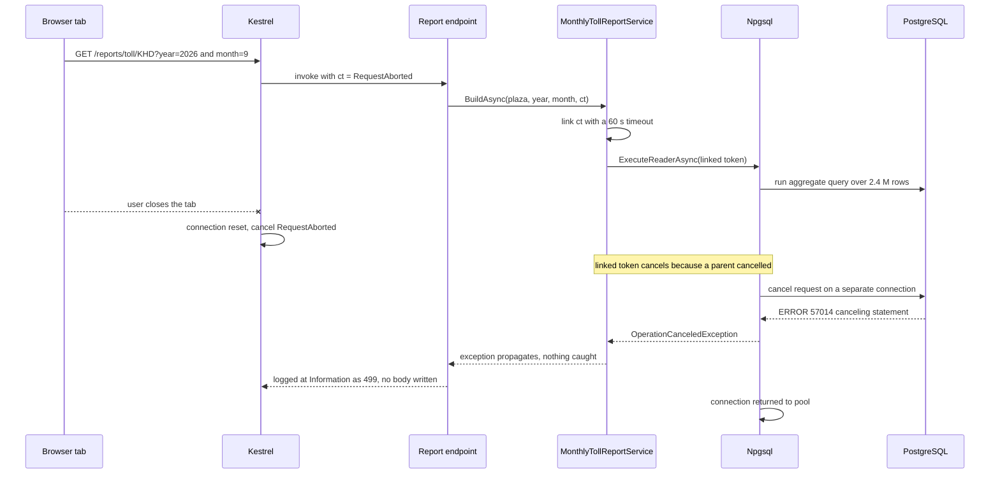
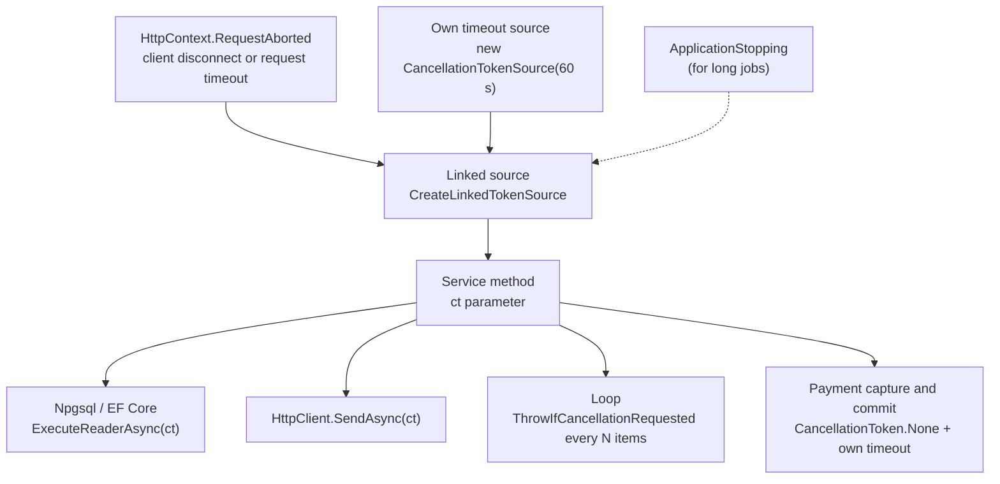

A user opens the monthly toll-collection report, waits five seconds, gives up and closes the tab. On the server, the report keeps running: it scans 2.4 million rows in PostgreSQL, aggregates them, builds a 6 MB response and writes it to a connection that no longer exists. Multiply that by forty impatient users at month-end and the database is busy doing work nobody will ever read. **Cancellation** is how .NET lets you stop that work early, cleanly, and only where it is safe to stop.

## Learning objectives

By the end of this lesson you will be able to:

1. Explain cooperative cancellation: who requests it (`CancellationTokenSource`), who observes it (`CancellationToken`), and why nothing is ever forcibly stopped.
2. Receive the request-aborted token in minimal APIs and controllers, and pass it through every layer to database and HTTP calls.
3. Add timeouts with `CancelAfter`, the request timeouts middleware, and linked token sources, and tell a timeout apart from a client abort.
4. Check for cancellation in CPU-bound loops and streaming code at a sensible frequency.
5. Decide where cancellation must **not** happen (after a payment is captured, during a commit) and use `CancellationToken.None` deliberately.
6. Avoid the common bugs: tokens dropped halfway down, swallowed `OperationCanceledException`, leaked linked sources, and treating cancellation as an error.

## Prerequisites

- [Asynchronous programming with async/await](#/lesson/m03-async-await): `Task`, `await`, and why async I/O does not block threads.
- [HTTP request and response lifecycle](#/lesson/m03-request-lifecycle): what happens between the client and the database and back.
- [Dependency injection](#/lesson/m03-dependency-injection): services that receive tokens are resolved from the container.

## Explain it like I'm a beginner

Imagine you order a thali at a busy restaurant, then get a phone call and have to leave. You tell the waiter, "Cancel my order." What happens next depends on the kitchen:

- If the cook has not started, the order slip is simply thrown away.
- If the rice is already cooking, the cook stops before making the dal and the rotis.
- If the thali is plated and the bill is printed, it is too late. The restaurant finishes the paperwork, because a half-printed bill is worse than a finished one.

Notice three things. First, the waiter does not run into the kitchen and grab the pan out of the cook's hands. The waiter **asks**, and the cook **checks** between steps. Second, every person in the chain (waiter, head cook, the cook making rotis) must hear the message, or someone keeps working. Third, some steps cannot be stopped halfway.

.NET cancellation works exactly like this:

- The person who can say "cancel" holds a **cancellation token source** (`CancellationTokenSource`). Calling `Cancel()` is telling the waiter.
- Everyone doing the work holds a **cancellation token** (`CancellationToken`), a read-only view of that source. They check it between steps: `token.IsCancellationRequested` or `token.ThrowIfCancellationRequested()`.
- The message only reaches people who were **handed the token**. If one method forgets to pass it on, that method and everything below it keep cooking.
- Nothing stops by force. This is called **cooperative cancellation**.

In a web app, the customer leaving is the browser closing the connection. ASP.NET Core notices and cancels a token called `HttpContext.RequestAborted`.

## First-principles explanation

### The two types

```csharp
using var cts = new CancellationTokenSource();
CancellationToken token = cts.Token;   // a cheap struct; copy it freely

var work = CountRowsAsync(token);      // the worker observes
cts.Cancel();                          // the owner requests
```

- `CancellationTokenSource` (CTS) is the **controller**. It can `Cancel()`, `CancelAfter(timeout)` and must be disposed when you create one, because it may hold a timer and registrations.
- `CancellationToken` is the **signal**. It has `IsCancellationRequested`, `ThrowIfCancellationRequested()`, `Register(callback)` and `CanBeCanceled`. It cannot cancel anything itself. That separation is deliberate: the code doing the work cannot cancel its caller.
- `CancellationToken.None` (same as `default`) is a token that can never be cancelled.

When code notices cancellation, the convention is to throw `OperationCanceledException` (OCE). `TaskCanceledException` derives from it and is what many framework methods (such as `Task.Delay` and `HttpClient`) throw. Always **catch `OperationCanceledException`**, never `TaskCanceledException` alone, so you catch both.

### Cooperative means "checked at safe points"

A token does nothing by itself. Work stops only when something checks it:

1. **Framework async methods** that accept a token check it for you: `Task.Delay(ms, ct)`, `stream.ReadAsync(buffer, ct)`, `HttpClient.SendAsync(request, ct)`, `SemaphoreSlim.WaitAsync(ct)`, `channel.Reader.ReadAsync(ct)`, EF Core's `ToListAsync(ct)`, Npgsql's `ExecuteReaderAsync(ct)`.
2. **Your own loops** must check explicitly with `ct.ThrowIfCancellationRequested()`.
3. **Callbacks** via `ct.Register(() => socket.Close())` let you hook cancellation into APIs that do not accept tokens.

A method that accepts a `CancellationToken` and ignores it is lying to its callers. If you cannot honour it, do not take it.

### Where tokens come from in ASP.NET Core

`HttpContext.RequestAborted` is cancelled when the client disconnects (closed tab, killed app, network loss detected by the server) or when the server aborts the request. You rarely read it directly; minimal APIs and controllers bind it for you:

```csharp
app.MapGet("/reports/toll/{plaza}", (string plaza, int year, int month, IReportService svc, CancellationToken ct) =>
    svc.BuildAsync(plaza, year, month, ct));   // ct == HttpContext.RequestAborted
```

Any `CancellationToken` parameter in a minimal API handler or controller action receives the request-aborted token. From there, **you** must pass it down: endpoint to service, service to repository, repository to the database driver. The convention is to make `CancellationToken ct` (or `cancellationToken`) the **last** parameter, and to give it a default only in public library APIs, not in internal services (a default makes it too easy to forget).

Other token sources you will meet:

- `IHostApplicationLifetime.ApplicationStopping`: cancelled when the host starts shutting down.
- `BackgroundService.ExecuteAsync(stoppingToken)`: cancelled on shutdown; see [Background services and hosted workers](#/lesson/m03-background-services).
- `IHostedService.StartAsync(ct)` / `StopAsync(ct)`: cancelled if startup is aborted or the shutdown timeout expires.

### What cancellation achieves in a database call

When a request token is cancelled during `await command.ExecuteReaderAsync(ct)`, Npgsql sends a **cancel request** to PostgreSQL over a separate connection, as the PostgreSQL protocol defines. The server stops the running statement and returns error `57014` ("canceling statement due to user request"), which Npgsql surfaces as an `OperationCanceledException`. The server process stops scanning rows, and the connection goes back to the pool for the next request.

Without the token, the query runs to completion even though nobody is waiting. With a pool of, say, 50 connections and a report query that takes 20 seconds, 50 abandoned reports are enough to block every other request in the app for 20 seconds. Cancellation is not just tidiness; it protects capacity.

Cancellation is a best effort. The query may finish before the cancel arrives, or PostgreSQL may be in a phase that ignores it briefly. Treat it as "stop soon", not "stop now". As a server-side safety net, also set `statement_timeout` for the application role, for example `ALTER ROLE app_reports SET statement_timeout = '60s';`, so a runaway query stops even if the app forgets.

### Timeouts are cancellation with a clock

A timeout is just a source that cancels itself:

```csharp
using var cts = new CancellationTokenSource(TimeSpan.FromSeconds(30));   // or cts.CancelAfter(...)
await gateway.FetchStatementAsync(accountId, cts.Token);
```

To make timeouts testable, pass a `TimeProvider`: `new CancellationTokenSource(TimeSpan.FromSeconds(30), timeProvider)`. Tests can then use a fake clock instead of waiting 30 real seconds.

`HttpClient.Timeout` (default 100 seconds) is a built-in timeout. When it fires, `HttpClient` throws `TaskCanceledException` whose `InnerException` is a `TimeoutException`, which is how you tell it apart from your own token being cancelled.

**ASP.NET Core request timeouts middleware** (since .NET 8) gives a whole endpoint a time budget:

```csharp
builder.Services.AddRequestTimeouts(o =>
{
    o.DefaultPolicy = new RequestTimeoutPolicy { Timeout = TimeSpan.FromSeconds(10) };
    o.AddPolicy("reports", TimeSpan.FromSeconds(60));
});
app.UseRequestTimeouts();          // after UseRouting, so it can read endpoint metadata
app.MapGet("/reports/...", ...).WithRequestTimeout("reports");
```

When the budget is exceeded, the middleware cancels `HttpContext.RequestAborted`. If your code honours the token and nothing has been written yet, the middleware responds with 504 by default. It does not apply while a debugger is attached, which surprises people testing locally.

### Linked tokens: "whichever comes first"

Most real operations should stop for **several** reasons: the client left, or 30 seconds passed, or the app is shutting down. `CancellationTokenSource.CreateLinkedTokenSource` builds a new source that cancels when **any** of its parents cancels:

```csharp
using var timeout = new CancellationTokenSource(TimeSpan.FromSeconds(30));
using var linked = CancellationTokenSource.CreateLinkedTokenSource(requestAborted, timeout.Token);
try
{
    return await BuildReportAsync(linked.Token);
}
catch (OperationCanceledException) when (timeout.IsCancellationRequested && !requestAborted.IsCancellationRequested)
{
    throw new TimeoutException("Report exceeded 30 seconds.");   // our budget, not the client's choice
}
```

The `when` filter is how you tell **why** it stopped, by asking each parent. This matters because the responses differ: a client abort needs no response at all (log it at Information level, as [Filters, middleware and exception handling](#/lesson/m03-filters-exceptions) shows), while a timeout is a real failure that the user should be told about, and that your dashboards should count.

Always dispose a linked source. It registers a callback on each parent token; if the parent is long-lived (the application-stopping token, for example) and you create a linked source per request without disposing it, those registrations accumulate. That is a slow memory leak.

### Checking in loops: how often?

For CPU-bound work, check the token at a regular interval:

```csharp
for (var i = 0; i < readings.Length; i++)
{
    if ((i & 1023) == 0) ct.ThrowIfCancellationRequested();   // every 1,024 items
    total += Score(readings[i]);
}
```

Checking is cheap (a field read), but not free in a tight loop of trivial work. A good rule of thumb is to check roughly every 10 to 100 milliseconds of work. If one item takes 1 ms, check every item. If one item takes 50 nanoseconds, every few thousand items. When you `await` a token-accepting method inside the loop, that call already checks for you.

`await foreach` over an `IAsyncEnumerable<T>` takes a token via the method parameter, or via `.WithCancellation(ct)` when the enumerable was created elsewhere. Async iterator methods receive it through a parameter marked `[EnumeratorCancellation]`.

`Parallel.ForEachAsync(items, new ParallelOptions { CancellationToken = ct }, ...)` passes the token to every body and stops scheduling new items when it is cancelled.

### Stopping a wait you cannot stop

Some APIs accept no token. `task.WaitAsync(ct)` (or `WaitAsync(timeout)`) lets **you** stop waiting, but the underlying work continues in the background. Use it at the edge, for example in a health check that must answer within 2 seconds, and understand you have abandoned the work, not stopped it.

### When not to cancel

Cancellation is safe only at points where stopping leaves the system consistent. Consider a ₹4,860 property-tax payment:

1. Validate the request. **Safe** to cancel.
2. Call the bank to capture the money. **Point of no return.** If the client disconnects while you wait for the bank, and you cancel, you may have charged the citizen and recorded nothing.
3. Write the receipt row and commit. Must finish.
4. Send the SMS receipt. Can be retried later by a background job.

From step 2 onward, pass `CancellationToken.None` (ideally with your **own** timeout instead), and let the work complete even if the client has gone. When the client retries, an [idempotency key](#/lesson/m10-idempotency) lets the server return the already-recorded receipt instead of charging twice.

The same applies to a transaction commit, to writing an outbox message, and to anything that makes a side effect visible to another system. A useful sentence for code review: **"cancel reads freely, cancel writes only before they start."**

### Cancellation is not an error

A cancelled operation is a normal outcome. Do not log it at Error level, do not count it in your 5xx rate, do not retry it automatically. But do not swallow it either: a `catch (Exception)` that logs and continues turns "stop" into "carry on with half the data". Rethrow OCE, or catch it only at the level that owns the decision (the endpoint, the background loop).

### Trade-offs

| Choice | You gain | You pay |
|---|---|---|
| Pass tokens everywhere | Abandoned work stops, capacity protected | One extra parameter on every async method; reviewers must check it is passed |
| Request timeouts middleware | Uniform budgets per endpoint | Applies to the whole request; does not stop work that ignores the token |
| Linked token with own timeout | Precise reason for stopping | A `using` and a `when` filter per operation |
| `CancellationToken.None` after the point of no return | Consistent side effects | Server keeps working for a client that left; needs idempotency for retries |
| Frequent checks in loops | Fast response to cancel | Tiny overhead; noisier code |

## Visual explanation

### A client abort travelling to PostgreSQL



Follow the token, not the data. The token created by Kestrel travels down the call chain as a parameter. When the browser disappears, Kestrel cancels it; because the service linked it with its own timeout, the linked token cancels too; Npgsql is registered on that token and sends PostgreSQL a cancel request. The database stops scanning, the exception unwinds the stack without anyone catching it, and the pooled connection is free again. If any layer had dropped the token, the query would have kept running to the end.

### Token sources and how they combine



Three sources feed one linked source, which cancels when any of them does. The service hands that single token to everything below it: the database driver, outgoing HTTP calls and its own loops. The dotted parent is optional: request-scoped work usually ignores application shutdown because the server drains requests anyway, but a long export job may want it. The last box is the deliberate exception: work past the point of no return gets `CancellationToken.None` and its own bounded timeout, so a disconnecting client cannot leave a half-finished payment.

## Step-by-step example

We build the monthly toll-collection report for a toll plaza operator. It aggregates a month of transactions (about 80,000 a day at a busy plaza, so roughly 2.4 million rows for a 30-day month) by vehicle class.

### Step 1 — the naive version

The endpoint calls `service.BuildAsync(plaza, year, month)` with no token. The service streams rows and sums them. Close the browser tab after one second: the server log shows the report finishing 20 seconds later anyway, and the database connection was busy the whole time.

### Step 2 — accept and pass the token

Add `CancellationToken ct` to the endpoint, the service method, and the transaction source's `ReadMonthAsync`. Pass it to the data reader. Close the tab again: the log now shows an `OperationCanceledException` within milliseconds, and the database stops the query.

### Step 3 — check in the aggregation loop

The aggregation is CPU work on rows already in memory. A check every 10,000 rows adds negligible cost and bounds the delay between "cancel" and "stopped" to a few milliseconds.

### Step 4 — a time budget

Month-end reports at a 24-lane plaza may take too long. Link the request token with a 60-second timeout. If the timeout fires and the client is still connected, throw a `ReportTimeoutException` (a `TimeoutException`) so the user sees "report took too long, try a smaller date range or request it by email". If the client left, let the OCE propagate quietly.

### Step 5 — protect the capacity with a server-side limit

Add `statement_timeout = '60s'` to the reporting database role, and the `reports` request-timeout policy to the endpoint. Now three independent mechanisms bound the cost: the app's linked token, the endpoint budget and the database's own limit. If one is misconfigured, the others still hold.

| Scenario | Who cancels | Outcome |
|---|---|---|
| Report finishes in 8 s | nobody | 200 with the report |
| User closes tab at 3 s | `RequestAborted` | query cancelled, logged as 499 at Information |
| Report needs 75 s | own 60 s timeout | `ReportTimeoutException`, 504 with a helpful message |
| App forgets to pass token to one query | PostgreSQL `statement_timeout` at 60 s | query stops, error logged, bug found |

## Production-style C# implementation

Layout:

```text
TollReports.Api/
  Program.cs
  Reports/TollTransaction.cs
  Reports/ITransactionSource.cs
  Reports/SyntheticTransactionSource.cs
  Reports/ReportOptions.cs
  Reports/MonthlyTollReportService.cs
  Reports/CsvExporter.cs
```

```csharp file=Reports/TollTransaction.cs
namespace TollReports.Reports;

public sealed record TollTransaction(string PlazaCode, DateOnly Date, string VehicleClass, decimal Amount);

public sealed record VehicleClassTotal(string VehicleClass, int Count, decimal Amount);

public sealed record TollReport(string PlazaCode, int Year, int Month, int Transactions, IReadOnlyList<VehicleClassTotal> ByClass);

/// <summary>Our own time budget ran out (as opposed to the client leaving).</summary>
public sealed class ReportTimeoutException(TimeSpan budget, Exception inner)
    : TimeoutException($"The report did not finish within {budget.TotalSeconds:N0} seconds.", inner)
{
    public TimeSpan Budget { get; } = budget;
}
```

```csharp file=Reports/ITransactionSource.cs
namespace TollReports.Reports;

public interface ITransactionSource
{
    /// <summary>Streams one plaza-month of transactions. Implementations must pass ct to the database reader.</summary>
    IAsyncEnumerable<TollTransaction> ReadMonthAsync(string plazaCode, int year, int month, CancellationToken ct);
}
```

```csharp file=Reports/SyntheticTransactionSource.cs
using System.Runtime.CompilerServices;

namespace TollReports.Reports;

/// <summary>
/// Stand-in for an Npgsql reader so the sample runs without a database. The real version is:
///   await using var cmd = dataSource.CreateCommand(sql);
///   await using var reader = await cmd.ExecuteReaderAsync(ct);
///   while (await reader.ReadAsync(ct)) yield return Map(reader);
/// </summary>
public sealed class SyntheticTransactionSource : ITransactionSource
{
    private static readonly (string Class, decimal Rate)[] Classes =
        [("CAR", 120m), ("LCV", 190m), ("BUS", 405m), ("TRUCK", 405m), ("MAV", 635m)];

    public async IAsyncEnumerable<TollTransaction> ReadMonthAsync(
        string plazaCode, int year, int month, [EnumeratorCancellation] CancellationToken ct)
    {
        var days = DateTime.DaysInMonth(year, month);
        const int perDay = 2_000;   // the real plaza has ~80,000 a day; kept small for the demo
        for (var day = 1; day <= days; day++)
        {
            // A real reader would await network I/O here; ReadAsync(ct) is where cancellation is observed.
            await Task.Delay(1, ct);
            for (var i = 0; i < perDay; i++)
            {
                var (cls, rate) = Classes[(day * 31 + i) % Classes.Length];
                yield return new TollTransaction(plazaCode, new DateOnly(year, month, day), cls, rate);
            }
        }
    }
}
```

```csharp file=Reports/ReportOptions.cs
namespace TollReports.Reports;

public sealed class ReportOptions
{
    public const string SectionName = "Reports";
    public TimeSpan MaxDuration { get; set; } = TimeSpan.FromSeconds(60);
    public int CancellationCheckInterval { get; set; } = 10_000;
}
```

```csharp file=Reports/MonthlyTollReportService.cs
using Microsoft.Extensions.Logging;
using Microsoft.Extensions.Options;

namespace TollReports.Reports;

public interface IMonthlyTollReportService
{
    Task<TollReport> BuildAsync(string plazaCode, int year, int month, CancellationToken requestAborted);
}

public sealed class MonthlyTollReportService(
    ITransactionSource source,
    IOptions<ReportOptions> options,
    TimeProvider clock,
    ILogger<MonthlyTollReportService> logger) : IMonthlyTollReportService
{
    public async Task<TollReport> BuildAsync(string plazaCode, int year, int month, CancellationToken requestAborted)
    {
        var budget = options.Value.MaxDuration;
        var checkEvery = Math.Max(1, options.Value.CancellationCheckInterval);

        // Stop when the client leaves OR our budget runs out, whichever comes first.
        using var timeout = new CancellationTokenSource(budget, clock);
        using var linked = CancellationTokenSource.CreateLinkedTokenSource(requestAborted, timeout.Token);
        var ct = linked.Token;

        var totals = new Dictionary<string, (int Count, decimal Amount)>();
        var rows = 0;
        try
        {
            await foreach (var t in source.ReadMonthAsync(plazaCode, year, month, ct))
            {
                if (++rows % checkEvery == 0) ct.ThrowIfCancellationRequested();   // CPU work between awaits
                totals[t.VehicleClass] = totals.TryGetValue(t.VehicleClass, out var x)
                    ? (x.Count + 1, x.Amount + t.Amount)
                    : (1, t.Amount);
            }
        }
        catch (OperationCanceledException ex) when (timeout.IsCancellationRequested && !requestAborted.IsCancellationRequested)
        {
            logger.LogWarning("Toll report {Plaza} {Year}-{Month} exceeded {Budget} after {Rows} rows",
                plazaCode, year, month, budget, rows);
            throw new ReportTimeoutException(budget, ex);
        }
        // A client abort is NOT caught here: it propagates as OperationCanceledException.

        var byClass = totals
            .OrderByDescending(kv => kv.Value.Amount)
            .Select(kv => new VehicleClassTotal(kv.Key, kv.Value.Count, kv.Value.Amount))
            .ToList();
        return new TollReport(plazaCode, year, month, rows, byClass);
    }
}
```

```csharp file=Reports/CsvExporter.cs
using System.Globalization;
using System.Text;

namespace TollReports.Reports;

/// <summary>Streams rows as CSV. Validation happens before the first byte, so errors can still become proper status codes.</summary>
public sealed class CsvExporter(ITransactionSource source)
{
    public async Task WriteAsync(Stream body, string plazaCode, int year, int month, CancellationToken ct)
    {
        await using var writer = new StreamWriter(body, new UTF8Encoding(false), bufferSize: 64 * 1024, leaveOpen: true);
        await writer.WriteLineAsync("date,plaza,class,amount".AsMemory(), ct);
        var n = 0;
        await foreach (var t in source.ReadMonthAsync(plazaCode, year, month, ct))
        {
            await writer.WriteLineAsync(string.Create(CultureInfo.InvariantCulture,
                $"{t.Date:yyyy-MM-dd},{t.PlazaCode},{t.VehicleClass},{t.Amount}").AsMemory(), ct);
            if (++n % 5_000 == 0) await writer.FlushAsync(ct);   // flushing to a closed socket fails fast too
        }
        await writer.FlushAsync(ct);
    }
}
```

```csharp file=Program.cs
using Microsoft.AspNetCore.Http.Timeouts;
using TollReports.Reports;

var builder = WebApplication.CreateBuilder(args);

builder.Services.AddSingleton(TimeProvider.System);
builder.Services.Configure<ReportOptions>(builder.Configuration.GetSection(ReportOptions.SectionName));
builder.Services.AddSingleton<ITransactionSource, SyntheticTransactionSource>();
builder.Services.AddScoped<IMonthlyTollReportService, MonthlyTollReportService>();
builder.Services.AddScoped<CsvExporter>();

builder.Services.AddRequestTimeouts(o =>
{
    o.DefaultPolicy = new RequestTimeoutPolicy { Timeout = TimeSpan.FromSeconds(10) };
    o.AddPolicy("reports", TimeSpan.FromSeconds(90));   // outer budget, wider than the service's own 60 s
});
builder.Services.AddProblemDetails();

var app = builder.Build();

app.UseExceptionHandler();
app.UseRouting();
app.UseRequestTimeouts();

static bool ValidMonth(int year, int month) => year is >= 2020 and <= 2100 && month is >= 1 and <= 12;

app.MapGet("/reports/toll/{plaza}", async (string plaza, int year, int month,
                                           IMonthlyTollReportService reports, CancellationToken ct) =>
{
    if (!ValidMonth(year, month)) return Results.Problem(statusCode: 400, title: "Invalid year or month");
    try
    {
        return Results.Ok(await reports.BuildAsync(plaza, year, month, ct));
    }
    catch (ReportTimeoutException ex)
    {
        return Results.Problem(statusCode: StatusCodes.Status504GatewayTimeout,
            title: "Report took too long",
            detail: $"{ex.Message} Try a shorter period, or request the report by email.");
    }
}).WithRequestTimeout("reports");

app.MapGet("/exports/toll/{plaza}.csv", async (string plaza, int year, int month, CsvExporter exporter,
                                               HttpContext http, CancellationToken ct) =>
{
    if (!ValidMonth(year, month)) { http.Response.StatusCode = 400; return; }   // before the first byte
    http.Response.ContentType = "text/csv";
    await exporter.WriteAsync(http.Response.Body, plaza, year, month, ct);
}).WithRequestTimeout("reports");

app.Run();
```

Points to notice:

- Every async method in the chain takes `CancellationToken` as its last parameter and passes it on. There is no `CancellationToken.None` anywhere on the read path.
- The service owns the timeout and translates it into a domain-specific exception. The endpoint translates that into 504 with a useful message. A client abort is never caught by application code; the global exception handler from the previous lesson logs it at Information level.
- The request timeout policy (90 s) is wider than the service's budget (60 s). The inner, more specific budget fires first and produces a friendly message; the outer one is a safety net.
- `new CancellationTokenSource(budget, clock)` uses the injected `TimeProvider`, so a test can advance a fake clock instead of waiting a minute.

## Bad design vs good design

**Bad**: the token is accepted at the top and lost on the way down.

```csharp
app.MapGet("/reports/toll/{plaza}", async (string plaza, int year, int month, IMonthlyTollReportService svc, CancellationToken ct) =>
    await svc.BuildAsync(plaza, year, month, CancellationToken.None));   // dropped here

public async Task<TollReport> BuildAsync(string plaza, int year, int month, CancellationToken ct)
{
    var cts = new CancellationTokenSource(TimeSpan.FromSeconds(60));       // never disposed, not linked to ct
    try
    {
        var rows = await _db.QueryAsync(sql, cts.Token);                     // ignores the client entirely
        return Aggregate(rows);
    }
    catch (Exception ex)                                                   // swallows cancellation too
    {
        _logger.LogError(ex, "Report failed");
        return TollReport.Empty;                                           // client sees an empty report as success
    }
}
```

Problems: the endpoint passes `None`, so a closed tab never stops the work; the timeout source is not linked to the request token and is never disposed; `catch (Exception)` logs a client abort as an error and then returns an empty report with status 200, which looks like "no transactions this month"; and the timeout cannot be distinguished from any other failure.

**Good**: the implementation above. The token flows unbroken, the timeout is linked and disposed, the reason for stopping is identified with a `when` filter, cancellation propagates, and timeouts produce an honest error.

:::callout type=tip title="A simpler alternative for quick endpoints"
For an endpoint that does one 5 ms database lookup, passing the request token to the query is all you need. Linked sources, own timeouts and loop checks are for operations that take seconds, loop over many items, or call slow external systems.
:::

:::callout type=warning title="Never cancel half a side effect"
Passing the request token to the bank capture call or to `transaction.CommitAsync` means a user closing the app at the wrong moment can leave money taken and no receipt recorded. After the point of no return, use `CancellationToken.None` with a bounded timeout of your own, and make retries safe with idempotency keys.
:::

## Practical playground

This console program simulates three requests with a linked token: one finishes, one hits the server's time budget, and one is abandoned by the client. Change the numbers and predict the outcome before running.

:::playground type=csharp title="Client abort, timeout or success?"
```csharp file=Program.cs
using System;
using System.Diagnostics;
using System.Threading;
using System.Threading.Tasks;

public static class Program
{
    static async Task<string> HandleRequestAsync(int workMs, int budgetMs, int clientLeavesAfterMs)
    {
        using var client = new CancellationTokenSource();          // stands in for HttpContext.RequestAborted
        if (clientLeavesAfterMs > 0) client.CancelAfter(clientLeavesAfterMs);

        using var budget = new CancellationTokenSource(budgetMs);  // our own time budget
        using var linked = CancellationTokenSource.CreateLinkedTokenSource(client.Token, budget.Token);
        var sw = Stopwatch.StartNew();
        try
        {
            // 10 chunks of work, each one an awaited call that observes the token.
            for (var chunk = 0; chunk < 10; chunk++)
                await Task.Delay(workMs / 10, linked.Token);
            return $"200 OK after {sw.ElapsedMilliseconds} ms";
        }
        catch (OperationCanceledException) when (budget.IsCancellationRequested && !client.IsCancellationRequested)
        {
            return $"504 budget exceeded after {sw.ElapsedMilliseconds} ms";
        }
        catch (OperationCanceledException)
        {
            return $"499 client left after {sw.ElapsedMilliseconds} ms (no body sent, logged at Information)";
        }
    }

    public static async Task Main()
    {
        Console.WriteLine("fast report:      " + await HandleRequestAsync(workMs: 200, budgetMs: 1000, clientLeavesAfterMs: 0));
        Console.WriteLine("slow report:      " + await HandleRequestAsync(workMs: 3000, budgetMs: 500, clientLeavesAfterMs: 0));
        Console.WriteLine("impatient client: " + await HandleRequestAsync(workMs: 3000, budgetMs: 2000, clientLeavesAfterMs: 300));
    }
}
```
:::

Notice that each cancelled request stops within one chunk (about 300 ms here) of the trigger, not at the end of the work. The chunk size is your "check interval". Try `workMs: 3000` with only one chunk to see how a coarse check delays the stop.

## Exercises

:::exercise id=m03-cancellation-ex1 difficulty=beginner kind=code title="Check for cancellation in a CPU-bound loop"
A pavement survey vehicle records road surface depth every 10 cm, so a 50 km stretch produces 500,000 readings. Implement `PavementScan.CountPotholes`, which counts readings at or above a threshold and stops promptly when cancelled.
::requirements
- Throw `OperationCanceledException` immediately if the token is already cancelled.
- While iterating, call `ct.ThrowIfCancellationRequested()` every `CheckEvery` (256) items.
- Count readings `>= thresholdMm`.
::acceptance
- Returns the correct count when not cancelled.
- A pre-cancelled token throws before reading any item.
- If cancellation happens at item 1,000 of 100,000, the method throws having read no more than 1,000 + 256 items.
::hint
Call `ct.ThrowIfCancellationRequested()` once before the loop.
::hint
Keep an index and check when `index % CheckEvery == 0`.
::hint
```csharp
var i = 0;
foreach (var d in depthsMm)
{
    if (++i % CheckEvery == 0) ct.ThrowIfCancellationRequested();
    if (d >= thresholdMm) count++;
}
```
::starter
```csharp file=PavementScan.cs
using System;
using System.Collections.Generic;
using System.Threading;

public static class PavementScan
{
    public const int CheckEvery = 256;

    public static int CountPotholes(IEnumerable<double> depthsMm, double thresholdMm, CancellationToken ct)
        => throw new NotImplementedException();
}
```
::tests
```csharp file=PavementScanTests.cs
using System;
using System.Collections.Generic;
using System.Threading;
using Xunit;

public class PavementScanTests
{
    [Fact]
    public void Counts_readings_at_or_above_threshold()
    {
        Assert.Equal(2, PavementScan.CountPotholes(new[] { 10.0, 50.0, 62.5, 20.0 }, 50.0, CancellationToken.None));
    }

    [Fact]
    public void Pre_cancelled_token_throws_before_reading()
    {
        var read = 0;
        IEnumerable<double> Readings() { while (true) { read++; yield return 1.0; } }
        using var cts = new CancellationTokenSource();
        cts.Cancel();
        Assert.Throws<OperationCanceledException>(() => PavementScan.CountPotholes(Readings(), 50, cts.Token));
        Assert.Equal(0, read);
    }

    [Fact]
    public void Stops_soon_after_cancellation()
    {
        using var cts = new CancellationTokenSource();
        var read = 0;
        IEnumerable<double> Readings()
        {
            for (var i = 0; i < 100_000; i++)
            {
                read++;
                if (read == 1_000) cts.Cancel();   // the user presses Stop mid-scan
                yield return i % 97 == 0 ? 80.0 : 5.0;
            }
        }
        Assert.Throws<OperationCanceledException>(() => PavementScan.CountPotholes(Readings(), 50, cts.Token));
        Assert.InRange(read, 1_000, 1_000 + PavementScan.CheckEvery);
    }
}
```
::solution
```csharp file=PavementScan.cs
using System;
using System.Collections.Generic;
using System.Threading;

public static class PavementScan
{
    public const int CheckEvery = 256;

    public static int CountPotholes(IEnumerable<double> depthsMm, double thresholdMm, CancellationToken ct)
    {
        ct.ThrowIfCancellationRequested();
        var count = 0;
        var i = 0;
        foreach (var d in depthsMm)
        {
            if (++i % CheckEvery == 0) ct.ThrowIfCancellationRequested();
            if (d >= thresholdMm) count++;
        }
        return count;
    }
}
```
`ThrowIfCancellationRequested` throws `OperationCanceledException` carrying the token, so callers can check `ex.CancellationToken == ct` if they need to know whose cancellation it was.
::mistakes
- Checking only before the loop, so a 500,000-item scan cannot be stopped.
- Returning a partial count instead of throwing, so the caller cannot tell "3 potholes" from "stopped after 1,000 readings".
::extensions
Turn it into `CountPotholesAsync(IAsyncEnumerable<double>, ...)` with `[EnumeratorCancellation]` on a generator in the test, and observe that `await foreach` with the token needs no manual checks when the source checks.
:::

:::exercise id=m03-cancellation-ex2 difficulty=beginner kind=written title="Find the cancellation bugs"
Review this code from a tender-portal search API and list every cancellation problem, with a fix for each.

```csharp
app.MapGet("/tenders/search", async (string q, ITenderSearch search) =>
    Results.Ok(await search.FindAsync(q)));

public async Task<IReadOnlyList<Tender>> FindAsync(string q, CancellationToken ct = default)
{
    var cts = new CancellationTokenSource(TimeSpan.FromSeconds(5));
    try
    {
        var ids = await _index.QueryAsync(q, cts.Token);
        var tenders = new List<Tender>();
        foreach (var id in ids)
            tenders.Add(await _repo.GetAsync(id));
        return tenders;
    }
    catch (TaskCanceledException)
    {
        return Array.Empty<Tender>();
    }
}
```
::acceptance
- Notes that the endpoint has no `CancellationToken` parameter, so `RequestAborted` is never used.
- Notes the default parameter value hid the missing argument.
- Notes the timeout source is not linked to `ct` and is never disposed.
- Notes `_repo.GetAsync(id)` receives no token and that N+1 queries make cancellation more important.
- Notes catching only `TaskCanceledException` and returning an empty list hides both timeouts and aborts as "no results".
::hint
Follow the token from the endpoint to every awaited call. Where does it disappear?
::hint
What would the user see if the 5-second timeout fires? Is that honest?
::hint
Which exception type do framework methods throw, and which type should you catch?
::solution
1. **Endpoint has no `CancellationToken`.** Add `CancellationToken ct` to the lambda and pass it: `search.FindAsync(q, ct)`. Without it, a user typing quickly fires a new search per keystroke and none of the old ones stop.
2. **`= default` on an internal method** let the call compile without a token. Remove the default so the compiler forces callers to decide.
3. **Timeout not linked.** Use `using var timeout = new CancellationTokenSource(TimeSpan.FromSeconds(5)); using var linked = CancellationTokenSource.CreateLinkedTokenSource(ct, timeout.Token);` and pass `linked.Token` everywhere. The original also never disposed the source.
4. **`_repo.GetAsync(id)` has no token.** Pass `linked.Token`. Better still, replace the loop with one query (`WHERE id = ANY(@ids)`), because 50 sequential lookups are slow and each is another place the token can be forgotten.
5. **Catching `TaskCanceledException` only.** Some APIs throw the base `OperationCanceledException`, which this misses. Catch `OperationCanceledException`.
6. **Returning an empty list on cancellation.** A timeout looks like "no tenders match", which is false and misleading. On timeout (timeout cancelled, client still there) throw a `TimeoutException` or return a 504 problem; on client abort, let the exception propagate.
::mistakes
- Fixing the endpoint but not the repository call, so the token still stops halfway.
- Replacing the catch with `catch (Exception)`, which makes things worse.
:::

:::exercise id=m03-cancellation-ex3 difficulty=intermediate kind=code title="A timeout that knows why it fired"
Implement `TimeoutRunner.RunAsync`, which runs an operation with both the caller's token and its own timeout, and reports a timeout differently from a caller cancellation.
::requirements
- Create a timeout source and a linked source of `callerToken` and the timeout token; dispose both.
- Pass the linked token to `work`.
- If the operation is cancelled because the **timeout** fired (and the caller did not cancel), throw `TimeoutException` with the original `OperationCanceledException` as `InnerException`.
- If the **caller** cancelled, let the `OperationCanceledException` propagate unchanged.
- Otherwise return the operation's result.
::acceptance
- A fast operation returns its value.
- A slow operation with a 50 ms timeout throws `TimeoutException` with an inner `OperationCanceledException`.
- A caller that cancels after 50 ms (timeout 10 s) gets an `OperationCanceledException`, not a `TimeoutException`.
- The token passed to `work` can be cancelled.
::hint
`CancellationTokenSource.CreateLinkedTokenSource(callerToken, timeoutCts.Token)` cancels when either parent does.
::hint
Use an exception filter: `catch (OperationCanceledException ex) when (timeoutCts.IsCancellationRequested && !callerToken.IsCancellationRequested)`.
::hint
Both sources need `using var` so their timer and registrations are released, even on exceptions.
::hint
```csharp
using var timeoutCts = new CancellationTokenSource(timeout);
using var linked = CancellationTokenSource.CreateLinkedTokenSource(callerToken, timeoutCts.Token);
try { return await work(linked.Token); }
catch (OperationCanceledException ex) when (...) { throw new TimeoutException("...", ex); }
```
::starter
```csharp file=TimeoutRunner.cs
using System;
using System.Threading;
using System.Threading.Tasks;

public static class TimeoutRunner
{
    public static Task<T> RunAsync<T>(Func<CancellationToken, Task<T>> work, TimeSpan timeout, CancellationToken callerToken)
        => throw new NotImplementedException();
}
```
::tests
```csharp file=TimeoutRunnerTests.cs
using System;
using System.Threading;
using System.Threading.Tasks;
using Xunit;

public class TimeoutRunnerTests
{
    private static async Task<int> Forever(CancellationToken ct)
    {
        await Task.Delay(Timeout.Infinite, ct);
        return -1;
    }

    [Fact]
    public async Task Fast_work_returns_value()
    {
        var v = await TimeoutRunner.RunAsync(_ => Task.FromResult(42), TimeSpan.FromSeconds(5), CancellationToken.None);
        Assert.Equal(42, v);
    }

    [Fact]
    public async Task Slow_work_times_out_with_inner_cancellation()
    {
        var ex = await Assert.ThrowsAsync<TimeoutException>(() =>
            TimeoutRunner.RunAsync(Forever, TimeSpan.FromMilliseconds(50), CancellationToken.None));
        Assert.IsAssignableFrom<OperationCanceledException>(ex.InnerException);
    }

    [Fact]
    public async Task Caller_cancellation_is_not_a_timeout()
    {
        using var caller = new CancellationTokenSource(TimeSpan.FromMilliseconds(50));
        await Assert.ThrowsAnyAsync<OperationCanceledException>(() =>
            TimeoutRunner.RunAsync(Forever, TimeSpan.FromSeconds(10), caller.Token));
    }

    [Fact]
    public async Task Work_receives_a_cancellable_token()
    {
        var canBeCancelled = await TimeoutRunner.RunAsync(ct => Task.FromResult(ct.CanBeCanceled), TimeSpan.FromSeconds(5), CancellationToken.None);
        Assert.True(canBeCancelled);
    }
}
```
::solution
```csharp file=TimeoutRunner.cs
using System;
using System.Threading;
using System.Threading.Tasks;

public static class TimeoutRunner
{
    public static async Task<T> RunAsync<T>(Func<CancellationToken, Task<T>> work, TimeSpan timeout, CancellationToken callerToken)
    {
        using var timeoutCts = new CancellationTokenSource(timeout);
        using var linked = CancellationTokenSource.CreateLinkedTokenSource(callerToken, timeoutCts.Token);
        try
        {
            return await work(linked.Token);
        }
        catch (OperationCanceledException ex) when (timeoutCts.IsCancellationRequested && !callerToken.IsCancellationRequested)
        {
            throw new TimeoutException($"Operation did not complete within {timeout.TotalMilliseconds:N0} ms.", ex);
        }
    }
}
```
The method must be `async` so that the `using` declarations live until the awaited work finishes. Returning `work(linked.Token)` directly from a non-async method would dispose the sources while the work is still running.
::alternatives
`await work(ct).WaitAsync(timeout, ct)` stops *waiting* after the timeout but does not cancel the work, so it keeps consuming resources. Use it only for APIs that accept no token. In production, a resilience pipeline (for example `Microsoft.Extensions.Http.Resilience` for HttpClient) offers a timeout strategy that does this linking for you.
::mistakes
- Checking `linked.IsCancellationRequested` to decide it was a timeout; the linked source is cancelled in both cases.
- Making the method non-async and returning the task, which disposes the sources too early.
- Swallowing the caller's cancellation and returning a default value.
:::

:::exercise id=m03-cancellation-ex4 difficulty=intermediate kind=code title="Stop between batches, never inside a commit"
An electricity distribution company imports meter readings from a CSV upload in batches. Each batch is committed in one database transaction. If the user cancels the upload, the import must stop **between** batches and report how much was committed, never leaving a batch half-written.
::requirements
- `ImportAsync(rows, batchSize, sink, ct)` processes rows in order, in batches of `batchSize` (the last batch may be smaller).
- Before starting each batch, if `ct` is cancelled, stop and return `ImportResult(committed, Cancelled: true)`. Do not throw.
- Call `sink.CommitBatchAsync(batch, CancellationToken.None)`: once a batch starts, it finishes.
- If all rows are imported, return `ImportResult(rows.Count, Cancelled: false)`.
::acceptance
- 1,000 rows in batches of 100 with no cancellation: 10 commits, result `(1000, false)`.
- Cancellation during the 3rd commit: exactly 3 batches committed, result `(300, true)`.
- Every commit receives a token that cannot be cancelled.
- A pre-cancelled token commits nothing and returns `(0, true)`.
- 250 rows in batches of 100 produce batches of 100, 100 and 50.
::hint
Loop with `for (var i = 0; i < rows.Count; i += batchSize)`.
::hint
Check `ct.IsCancellationRequested` at the **top** of each iteration, before taking the batch.
::hint
`rows.Skip(i).Take(batchSize).ToList()` builds a batch; for large lists, an index range avoids re-enumerating.
::hint
Returning a result instead of throwing is right here because a partial import is a normal, reportable outcome for the user ("300 of 1,000 readings imported").
::starter
```csharp file=BatchImporter.cs
using System;
using System.Collections.Generic;
using System.Threading;
using System.Threading.Tasks;

public sealed record MeterReading(string ConsumerNo, int Units);
public sealed record ImportResult(int Committed, bool Cancelled);

public interface IReadingSink
{
    Task CommitBatchAsync(IReadOnlyList<MeterReading> batch, CancellationToken ct);
}

public static class BatchImporter
{
    public static Task<ImportResult> ImportAsync(IReadOnlyList<MeterReading> rows, int batchSize, IReadingSink sink, CancellationToken ct)
        => throw new NotImplementedException();
}
```
::tests
```csharp file=BatchImporterTests.cs
using System;
using System.Collections.Generic;
using System.Linq;
using System.Threading;
using System.Threading.Tasks;
using Xunit;

public sealed class RecordingSink : IReadingSink
{
    public readonly List<int> BatchSizes = new();
    public readonly List<bool> TokensCancellable = new();
    public Action<int>? OnCommit;
    public Task CommitBatchAsync(IReadOnlyList<MeterReading> batch, CancellationToken ct)
    {
        BatchSizes.Add(batch.Count);
        TokensCancellable.Add(ct.CanBeCanceled);
        OnCommit?.Invoke(BatchSizes.Count);
        return Task.CompletedTask;
    }
}

public class BatchImporterTests
{
    private static List<MeterReading> Rows(int n) =>
        Enumerable.Range(1, n).Select(i => new MeterReading($"MH-{i:000000}", 100 + i % 50)).ToList();

    [Fact]
    public async Task Imports_everything_without_cancellation()
    {
        var sink = new RecordingSink();
        var r = await BatchImporter.ImportAsync(Rows(1000), 100, sink, CancellationToken.None);
        Assert.Equal(new ImportResult(1000, false), r);
        Assert.Equal(10, sink.BatchSizes.Count);
    }

    [Fact]
    public async Task Cancellation_during_third_commit_stops_after_it()
    {
        using var cts = new CancellationTokenSource();
        var sink = new RecordingSink { OnCommit = n => { if (n == 3) cts.Cancel(); } };
        var r = await BatchImporter.ImportAsync(Rows(1000), 100, sink, cts.Token);
        Assert.Equal(new ImportResult(300, true), r);
        Assert.Equal(3, sink.BatchSizes.Count);
        Assert.All(sink.TokensCancellable, c => Assert.False(c));
    }

    [Fact]
    public async Task Pre_cancelled_commits_nothing()
    {
        using var cts = new CancellationTokenSource();
        cts.Cancel();
        var sink = new RecordingSink();
        var r = await BatchImporter.ImportAsync(Rows(1000), 100, sink, cts.Token);
        Assert.Equal(new ImportResult(0, true), r);
        Assert.Empty(sink.BatchSizes);
    }

    [Fact]
    public async Task Last_batch_may_be_smaller()
    {
        var sink = new RecordingSink();
        await BatchImporter.ImportAsync(Rows(250), 100, sink, CancellationToken.None);
        Assert.Equal(new[] { 100, 100, 50 }, sink.BatchSizes);
    }
}
```
::solution
```csharp file=BatchImporter.cs
using System;
using System.Collections.Generic;
using System.Threading;
using System.Threading.Tasks;

public sealed record MeterReading(string ConsumerNo, int Units);
public sealed record ImportResult(int Committed, bool Cancelled);

public interface IReadingSink
{
    Task CommitBatchAsync(IReadOnlyList<MeterReading> batch, CancellationToken ct);
}

public static class BatchImporter
{
    public static async Task<ImportResult> ImportAsync(IReadOnlyList<MeterReading> rows, int batchSize, IReadingSink sink, CancellationToken ct)
    {
        if (batchSize <= 0) throw new ArgumentOutOfRangeException(nameof(batchSize));
        var committed = 0;
        for (var i = 0; i < rows.Count; i += batchSize)
        {
            if (ct.IsCancellationRequested) return new ImportResult(committed, Cancelled: true);   // safe point

            var size = Math.Min(batchSize, rows.Count - i);
            var batch = new List<MeterReading>(size);
            for (var j = 0; j < size; j++) batch.Add(rows[i + j]);

            await sink.CommitBatchAsync(batch, CancellationToken.None);   // point of no return
            committed += size;
        }
        return new ImportResult(committed, Cancelled: false);
    }
}
```
::alternatives
If a batch commit can take long, give it its own bounded timeout (`new CancellationTokenSource(TimeSpan.FromSeconds(30))`) rather than `None`, so a stuck database does not hang the import forever. A database transaction that is cancelled mid-way is rolled back by PostgreSQL, so passing the token *into* the transaction is also safe **if** nothing outside the database (an email, a message) happens inside the batch. The rule is about side effects you cannot roll back.
::mistakes
- Passing `ct` to `CommitBatchAsync`, so a cancel can interrupt between "rows inserted" and "status updated" if those are not in one transaction.
- Checking cancellation after the commit and throwing, which loses the count the user needs to resume.
::extensions
Return the index of the next row so the user can resume the upload from row 301, and make the commit idempotent with a batch id so a retried batch is not inserted twice.
:::

:::exercise id=m03-cancellation-ex5 difficulty=advanced kind=code title="Latest-wins search: cancel the previous request"
A tender search box sends a query on every keystroke. Only the latest query matters. Implement `LatestOnlySearch`, which cancels the previous in-flight search whenever a new one starts.
::requirements
- `SearchAsync(query, callerToken)` creates a linked source from `callerToken`, makes it the current search, and **cancels the previous current search** if any.
- The previous search's task ends with an `OperationCanceledException` (from the backend observing its token).
- The source for a search is disposed exactly once, by whoever removes it from "current": the replacing call (after cancelling it), `Dispose()`, or the search itself when it finishes while still current.
- `Dispose()` cancels the current search; later calls throw `ObjectDisposedException`.
- Must be safe when searches overlap on different threads (use a lock for the current-source swap).
::acceptance
- A single search returns the backend's results.
- Starting a second search cancels the first, whose token reports cancellation, while the second completes normally.
- Cancelling the caller token cancels that search.
- After `Dispose()`, the in-flight search is cancelled and new calls throw `ObjectDisposedException`.
::hint
Keep `private CancellationTokenSource? _current` and a `private readonly object _gate = new();`.
::hint
Swap under the lock: `previous = _current; _current = mine;`. Cancel and dispose `previous` **outside** the lock, because `Cancel()` runs callbacks synchronously and they could re-enter your code.
::hint
In `finally`, decide ownership under the lock: `own = ReferenceEquals(_current, mine); if (own) _current = null;`, then dispose only if `own`.
::hint
```csharp
var mine = CancellationTokenSource.CreateLinkedTokenSource(callerToken);
CancellationTokenSource? previous;
lock (_gate)
{
    if (_disposed) { mine.Dispose(); throw new ObjectDisposedException(nameof(LatestOnlySearch)); }
    previous = _current;
    _current = mine;
}
if (previous is not null) { previous.Cancel(); previous.Dispose(); }
```
::starter
```csharp file=LatestOnlySearch.cs
using System;
using System.Collections.Generic;
using System.Threading;
using System.Threading.Tasks;

public interface ISearchBackend
{
    Task<IReadOnlyList<string>> SearchAsync(string query, CancellationToken ct);
}

public sealed class LatestOnlySearch : IDisposable
{
    private readonly ISearchBackend _backend;
    public LatestOnlySearch(ISearchBackend backend) => _backend = backend;

    public Task<IReadOnlyList<string>> SearchAsync(string query, CancellationToken callerToken)
        => throw new NotImplementedException();

    public void Dispose() => throw new NotImplementedException();
}
```
::tests
```csharp file=LatestOnlySearchTests.cs
using System;
using System.Collections.Concurrent;
using System.Collections.Generic;
using System.Threading;
using System.Threading.Tasks;
using Xunit;

public sealed class ControlledBackend : ISearchBackend
{
    public readonly ConcurrentDictionary<string, TaskCompletionSource<IReadOnlyList<string>>> Pending = new();
    public readonly ConcurrentDictionary<string, CancellationToken> Tokens = new();

    public Task<IReadOnlyList<string>> SearchAsync(string query, CancellationToken ct)
    {
        var tcs = Pending.GetOrAdd(query, _ => new TaskCompletionSource<IReadOnlyList<string>>(TaskCreationOptions.RunContinuationsAsynchronously));
        Tokens[query] = ct;
        return tcs.Task.WaitAsync(ct);
    }
}

public class LatestOnlySearchTests
{
    [Fact]
    public async Task Single_search_returns_results()
    {
        var backend = new ControlledBackend();
        using var s = new LatestOnlySearch(backend);
        var t = s.SearchAsync("bridge", CancellationToken.None);
        backend.Pending["bridge"].SetResult(new[] { "T-2026-101" });
        Assert.Equal(new[] { "T-2026-101" }, await t);
    }

    [Fact]
    public async Task New_search_cancels_previous()
    {
        var backend = new ControlledBackend();
        using var s = new LatestOnlySearch(backend);
        var first = s.SearchAsync("bri", CancellationToken.None);
        var second = s.SearchAsync("bridge repair", CancellationToken.None);

        await Assert.ThrowsAnyAsync<OperationCanceledException>(() => first);
        Assert.True(backend.Tokens["bri"].IsCancellationRequested);
        Assert.False(backend.Tokens["bridge repair"].IsCancellationRequested);

        backend.Pending["bridge repair"].SetResult(new[] { "T-2026-118", "T-2026-122" });
        Assert.Equal(2, (await second).Count);
    }

    [Fact]
    public async Task Caller_token_cancels_search()
    {
        var backend = new ControlledBackend();
        using var s = new LatestOnlySearch(backend);
        using var caller = new CancellationTokenSource();
        var t = s.SearchAsync("culvert", caller.Token);
        caller.Cancel();
        await Assert.ThrowsAnyAsync<OperationCanceledException>(() => t);
    }

    [Fact]
    public async Task Dispose_cancels_in_flight_and_rejects_new_calls()
    {
        var backend = new ControlledBackend();
        var s = new LatestOnlySearch(backend);
        var t = s.SearchAsync("flyover", CancellationToken.None);
        s.Dispose();
        await Assert.ThrowsAnyAsync<OperationCanceledException>(() => t);
        await Assert.ThrowsAsync<ObjectDisposedException>(() => s.SearchAsync("again", CancellationToken.None));
    }
}
```
::solution
The key design decision is **ownership**: exactly one party disposes each source, decided under the lock.

```csharp file=LatestOnlySearch.cs
using System;
using System.Collections.Generic;
using System.Threading;
using System.Threading.Tasks;

public interface ISearchBackend
{
    Task<IReadOnlyList<string>> SearchAsync(string query, CancellationToken ct);
}

public sealed class LatestOnlySearch : IDisposable
{
    private readonly ISearchBackend _backend;
    private readonly object _gate = new();
    private CancellationTokenSource? _current;
    private bool _disposed;

    public LatestOnlySearch(ISearchBackend backend) => _backend = backend;

    public async Task<IReadOnlyList<string>> SearchAsync(string query, CancellationToken callerToken)
    {
        var mine = CancellationTokenSource.CreateLinkedTokenSource(callerToken);
        CancellationTokenSource? previous;
        lock (_gate)
        {
            if (_disposed)
            {
                mine.Dispose();
                throw new ObjectDisposedException(nameof(LatestOnlySearch));
            }
            previous = _current;
            _current = mine;
        }

        // We removed 'previous' from current, so we own it: cancel, then dispose. Outside the lock on purpose.
        if (previous is not null)
        {
            previous.Cancel();
            previous.Dispose();
        }

        try
        {
            return await _backend.SearchAsync(query, mine.Token);
        }
        finally
        {
            bool own;
            lock (_gate)
            {
                own = ReferenceEquals(_current, mine);
                if (own) _current = null;
            }
            if (own) mine.Dispose();
        }
    }

    public void Dispose()
    {
        CancellationTokenSource? current;
        lock (_gate)
        {
            if (_disposed) return;
            _disposed = true;
            current = _current;
            _current = null;
        }
        if (current is not null)
        {
            current.Cancel();
            current.Dispose();
        }
    }
}
```

Because the `async` method runs synchronously until its first `await`, the call to `SearchAsync` has already swapped `_current` and cancelled the previous search by the time it returns a task. That is what makes the second test deterministic.
::alternatives
On the client, debounce keystrokes (wait 250 ms of no typing before sending) so fewer requests are sent at all; the server-side cancellation then handles the rest. With `System.Threading.Channels` or Rx you can express "switch to latest" as a pipeline, but the explicit version above is easier to reason about and test.
::mistakes
- Calling `previous.Cancel()` inside the lock. Cancellation callbacks run synchronously and may run the previous search's `finally`, which takes the same lock on the same thread (re-entrant), making the logic hard to reason about.
- Disposing a source in two places (the replacer and the search's own `finally`), which can throw `ObjectDisposedException` on `Cancel` in a race.
- Never disposing linked sources, which leaks registrations on a long-lived caller token.
:::

## Automated testing

Cancellation paths are easy to forget and hard to trigger manually, so automate them.

**Pre-cancelled tokens.** The cheapest test: pass a token that is already cancelled and assert the method throws `OperationCanceledException` without side effects (exercise 1, exercise 4). This catches methods that never check.

**Cancel mid-way with a controllable source.** Fake dependencies that cancel the source at a precise point (the 1,000th reading, the 3rd commit) make tests deterministic. Prefer this to `CancelAfter` with real time.

**Fake time.** For code that uses `new CancellationTokenSource(delay, timeProvider)`, the `Microsoft.Extensions.TimeProvider.Testing` package provides `FakeTimeProvider`; calling `Advance(TimeSpan.FromSeconds(61))` fires the timeout instantly:

```csharp
var clock = new FakeTimeProvider();
var svc = new MonthlyTollReportService(new SlowSource(), Options.Create(new ReportOptions { MaxDuration = TimeSpan.FromSeconds(60) }), clock, NullLogger<MonthlyTollReportService>.Instance);
var task = svc.BuildAsync("KHD", 2026, 9, CancellationToken.None);
clock.Advance(TimeSpan.FromSeconds(61));
await Assert.ThrowsAsync<ReportTimeoutException>(() => task);
```

**Assert tokens are passed.** A fake repository can record the token it received and assert `ct.CanBeCanceled` (exercise 4 inverts this to check `None` on commits). A test that checks every dependency got a cancellable token catches dropped tokens.

**Integration.** With `WebApplicationFactory`, send a request with an `HttpClient` whose token you cancel after 100 ms, then assert the server-side fake saw cancellation. Remember that request timeouts are disabled when a debugger is attached.

Edge cases worth a test: cancellation exactly when work completes (the result should win, not an exception), a caller token that is `None`, a timeout of zero, and disposal while a search is in flight.

## Real-world application

- **Search-as-you-type.** Tender portals, railway station pickers and e-commerce search boxes fire a request per keystroke. Client-side debouncing plus server-side cancellation of abandoned requests keeps database load proportional to real searches, not keystrokes.
- **Reports and exports.** Month-end MIS reports in infrastructure, banking and government systems scan millions of rows. Cancellation, request budgets and `statement_timeout` together prevent a few abandoned reports from exhausting the connection pool. Long ones move to a background job that emails a link (see [Background processing and job queues](#/lesson/m11-background-processing)).
- **Fan-out calls.** An API that calls three services in parallel for a dashboard can cancel the other two calls as soon as one fails, by sharing a linked source and cancelling it on the first error.
- **Graceful shutdown.** During a Kubernetes rolling deployment, `ApplicationStopping` lets long-running work stop at a safe point before the pod is killed ([Health checks and graceful shutdown](#/lesson/m03-health-shutdown)).
- **Payments.** Payment flows deliberately stop honouring the client's token once money moves, and rely on idempotency keys and reconciliation jobs instead. Cancelling is a read-side optimisation, never a write-side shortcut.

## Interview questions

:::interview
::q beginner
What is the difference between `CancellationTokenSource` and `CancellationToken`?
::a
The source is the controller that requests cancellation (`Cancel`, `CancelAfter`) and must be disposed. The token is a lightweight, read-only view that work code observes (`IsCancellationRequested`, `ThrowIfCancellationRequested`, `Register`). Separating them means code that receives a token can react to cancellation but cannot cancel its caller. `CancellationToken.None` is a token that never cancels.
::q beginner
How does an ASP.NET Core endpoint find out that the client disconnected?
::a
Through `HttpContext.RequestAborted`, a token Kestrel cancels when the connection is closed or the request is aborted. Adding a `CancellationToken` parameter to a minimal API handler or controller action binds it automatically. The endpoint must then pass it to every async call: service methods, EF Core or Npgsql queries, `HttpClient` calls. Otherwise the work continues for a client that is gone.
::q intermediate
How do you apply a timeout to an operation that should also stop when the client disconnects, and how do you know which one happened?
::a
Create a timeout source (`new CancellationTokenSource(TimeSpan.FromSeconds(30))`), then a linked source with `CreateLinkedTokenSource(requestAborted, timeout.Token)`, and pass the linked token down. Dispose both with `using`. When an `OperationCanceledException` arrives, use an exception filter: if `timeout.IsCancellationRequested` and the request token is not cancelled, it was a timeout, so translate it to a `TimeoutException` or a 504. Otherwise the client left, so let it propagate and log it quietly. Checking the linked token tells you nothing, because it is cancelled in both cases.
::q intermediate
What happens in PostgreSQL when an Npgsql query is cancelled, and why does it matter for capacity?
::a
Npgsql sends a protocol-level cancel request over a separate connection; PostgreSQL stops the running statement and returns SQLSTATE 57014, which Npgsql turns into an `OperationCanceledException`. The server stops consuming CPU and I/O for that query and the pooled connection becomes available again. Without cancellation, abandoned long queries keep their connections busy; with a pool of 50 and 20-second report queries, a burst of abandoned reports can starve every other endpoint. A role-level `statement_timeout` is a useful server-side backstop.
::q advanced
Where should you deliberately not pass the request's cancellation token, and how do you keep the system consistent then?
::a
After the point of no return for side effects outside your transaction: capturing a payment, calling an external API that creates something, publishing a message, or a multi-step write that is not atomic. Cancelling there can leave money charged without a receipt or a message sent without the record. Use `CancellationToken.None` with your own bounded timeout so the operation completes even if the client left. Then make retries safe with idempotency keys (the client retries and gets the stored result) and have reconciliation jobs for anything that times out ambiguously. Reads and work before the first side effect can be cancelled freely.
::q advanced
A service creates a linked token source per request from `IHostApplicationLifetime.ApplicationStopping` and the request token, but never disposes it. Memory grows slowly over days. Why?
::a
A linked source registers a callback on each parent token. `ApplicationStopping` lives for the whole process, so every undisposed linked source leaves a registration on it, keeping the linked source (and anything its callbacks capture) reachable. After millions of requests, that is a lot of objects that the garbage collector cannot free. Disposing the linked source unregisters from the parents. The fix is `using var linked = ...`, and in reviews treating every `CreateLinkedTokenSource` without `using` as a bug.
:::

## Summary and revision

**Key takeaways**

- Cancellation in .NET is cooperative: a `CancellationTokenSource` requests it, code holding the `CancellationToken` observes it at safe points, and nothing is stopped by force.
- In ASP.NET Core, a `CancellationToken` parameter receives `HttpContext.RequestAborted`. Pass it through every layer to EF Core, Npgsql and `HttpClient`; a single dropped token stops the chain.
- Timeouts are sources that cancel themselves. Combine them with the request token using `CreateLinkedTokenSource`, dispose both, and use a `when` filter to tell timeout from client abort.
- Check tokens in CPU-bound loops roughly every 10 to 100 ms of work.
- Catch `OperationCanceledException`, not `TaskCanceledException`. Cancellation is a normal outcome: do not log it as an error, do not swallow it.
- Cancel reads freely; cancel writes only before they start. After the point of no return use `CancellationToken.None` with your own timeout, plus idempotency.
- Defence in depth for expensive queries: app-level token, request timeouts middleware, PostgreSQL `statement_timeout`.

**Terminology**: cooperative cancellation, `CancellationTokenSource`, `CancellationToken`, `OperationCanceledException`, `RequestAborted`, linked token source, `CancelAfter`, request timeouts middleware, `statement_timeout`, point of no return, `[EnumeratorCancellation]`, `WaitAsync`.

:::flashcards
Q: Who can cancel: the token or the source?
A: Only the CancellationTokenSource. The token is a read-only signal for the code doing the work.
Q: Which token does a CancellationToken parameter in a minimal API receive?
A: HttpContext.RequestAborted, cancelled when the client disconnects or the request is aborted (including by request timeouts).
Q: Which exception type should you catch for cancellation?
A: OperationCanceledException. TaskCanceledException derives from it, so catching the base type covers both.
Q: How do you combine a request token and a timeout?
A: CancellationTokenSource.CreateLinkedTokenSource(requestToken, timeoutCts.Token), with both sources in using statements.
Q: How do you tell a timeout from a client abort?
A: In a catch filter, check timeoutCts.IsCancellationRequested and that the request token is not cancelled. The linked token is cancelled either way.
Q: How often should a CPU-bound loop check the token?
A: Roughly every 10 to 100 ms of work: every item if items are slow, every few thousand if they are trivial.
Q: When should you pass CancellationToken.None on purpose?
A: After the point of no return for side effects you cannot roll back (payment capture, external writes, commits), with your own bounded timeout instead.
Q: What does task.WaitAsync(ct) do to the underlying work?
A: Nothing. It stops your wait, but the work keeps running. Use it only for APIs that accept no token.
:::

## Knowledge check

:::quiz pass=70
::q single
A report endpoint has a `CancellationToken ct` parameter and passes it to the service, which calls `repository.LoadAsync(month)` without a token. A user closes the tab after 2 seconds. What happens to the 20-second query?
- [ ] It is cancelled, because the endpoint received the token.
- [x] It runs to completion, because the token stopped at the service.
- [ ] Kestrel kills the thread running the query.
- [ ] PostgreSQL detects the closed browser and stops.
> Cancellation is cooperative and travels only as far as the token is passed. One missing parameter breaks the chain.
::q single
Code catches `OperationCanceledException` and needs to know whether its own 30-second timeout fired. Which check is correct?
- [ ] `linked.IsCancellationRequested`
- [x] `timeout.IsCancellationRequested && !requestAborted.IsCancellationRequested`
- [ ] `ex is TaskCanceledException`
- [ ] `ex.InnerException is TimeoutException`
> The linked token is cancelled for both reasons. Ask each parent. (The `InnerException` check applies only to `HttpClient.Timeout`.)
::q single
A citizen pays ₹4,860 and closes the app while the server waits for the bank's capture response. Which design is safest?
- [ ] Pass `RequestAborted` to the bank call so it stops immediately.
- [x] Pass `CancellationToken.None` with a bounded timeout to the capture and commit, and use an idempotency key for retries.
- [ ] Retry the capture until the client reconnects.
- [ ] Roll back by refunding whenever the client disconnects.
> Once money moves, finish the job. Idempotency lets the retrying client get the stored receipt.
::q multi
Which of these observe a cancellation token for you if you pass it? (Select all that apply.)
- [x] `await Task.Delay(1000, ct)`
- [x] `await httpClient.GetAsync(url, ct)`
- [x] `await reader.ReadAsync(ct)` on an Npgsql data reader
- [ ] A `for` loop summing an array
- [x] `await channel.Reader.ReadAsync(ct)`
> Framework async methods check the token. Your own loops must call `ThrowIfCancellationRequested` themselves.
::q single
A service logs `TaskCanceledException` at Error level on every client disconnect, and 5xx alerts fire during peak hours. What is the best fix?
- [ ] Catch all exceptions in every endpoint and return 200.
- [x] Treat `OperationCanceledException` with `RequestAborted` cancelled as a normal client abort, logged at Information and excluded from 5xx metrics.
- [ ] Increase `HttpClient.Timeout`.
- [ ] Remove cancellation tokens so the exception never happens.
> Cancellation is a normal outcome. Classify it, do not hide it and do not treat it as a failure.
::q single
Which statement about `CreateLinkedTokenSource` is true?
- [ ] The linked token cancels only when all parents cancel.
- [ ] It does not need disposing because tokens are structs.
- [x] It cancels when any parent cancels, and must be disposed to unregister from its parents.
- [ ] Cancelling the linked source cancels its parents.
> Linked means "any of". Cancellation flows from parents to child, never upwards. Disposal removes the registrations.
::q single
The request timeouts middleware is configured with a 10-second default, but a developer debugging locally sees a request run for 2 minutes. Why?
- [ ] The middleware only applies to controllers.
- [x] Request timeouts are not enforced while a debugger is attached.
- [ ] `UseRequestTimeouts` must come before `UseExceptionHandler`.
- [ ] Timeouts apply only in Production.
> The middleware deliberately skips enforcement under a debugger so breakpoints do not trigger timeouts.
::q single
A CPU-bound loop processes 5 million items at about 50 ns each, checking the token every item. A reviewer suggests a change. Which is most reasonable?
- [ ] Never check; cancellation is only for I/O.
- [x] Check every few thousand items, which still reacts within well under a millisecond.
- [ ] Check once at the end.
- [ ] Use `Thread.Abort` instead.
> 5,000 items at 50 ns is 0.25 ms between checks, which is plenty responsive with less overhead. `Thread.Abort` is not supported in .NET (Core).
:::

## Completion criteria

You have finished this lesson when you can:

- [ ] Score at least 70 % on the knowledge check.
- [ ] Complete exercises 1, 3 and 4; the downloaded projects' tests pass.
- [ ] Trace a token from an endpoint parameter to a database call in your own project and fix any place it is dropped.
- [ ] Write a linked timeout with a `when` filter from memory.
- [ ] Explain to a colleague, with one example, why a payment capture should not use the request's cancellation token.
