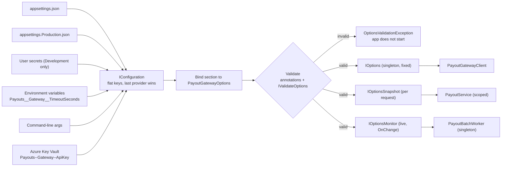
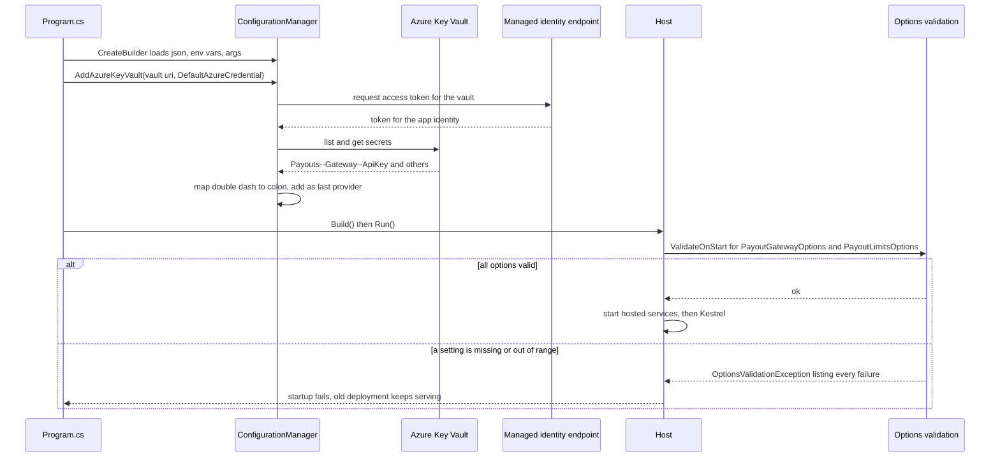

[How an ASP.NET Core application starts](#/lesson/m03-startup) showed that `CreateBuilder` loads settings from several places and that later sources win. This lesson goes deeper: how configuration is structured, how to read it safely as typed **options**, how to validate it so a bad deployment refuses to start, how options interact with the lifetimes from [Singleton, scoped and transient services](#/lesson/m03-service-lifetimes), and how to keep secrets out of source control from a developer's laptop all the way to production. The running example is a payout service for a gig-delivery platform that pays thousands of delivery partners every evening through a UPI payout gateway.

## Learning objectives

By the end of this lesson you will be able to:

1. Explain how `IConfiguration` represents settings as flat, case-insensitive keys, and map JSON, environment variables (`__`) and command-line arguments onto those keys.
2. Predict which value wins when the same key appears in several providers, and debug it with `GetDebugView()`.
3. Bind configuration to typed options classes with the options pattern, and choose between `IOptions<T>`, `IOptionsSnapshot<T>` and `IOptionsMonitor<T>`.
4. Validate options with data annotations, lambdas and `IValidateOptions<T>`, and make validation run at startup with `ValidateOnStart()`.
5. Store development secrets with user secrets, and describe how Azure Key Vault (with managed identity) supplies secrets in production.
6. Avoid the common mistakes: secrets in Git, `IConfiguration` injected everywhere, silent typos in keys, and secrets printed in logs.

## Prerequisites

- [How an ASP.NET Core application starts](#/lesson/m03-startup): environments and the configuration order.
- [Dependency injection](#/lesson/m03-dependency-injection): registering services and extension methods.
- [Singleton, scoped and transient services](#/lesson/m03-service-lifetimes): the options interfaces have different lifetimes, and that matters.

## Explain it like I'm a beginner

Think of a branch of a national bank opening on Monday morning.

- **The head office circular** says the standard rules for every branch: opening hours 10 a.m. to 4 p.m., cash withdrawal limit ₹50,000 without manager approval. That is `appsettings.json`: the defaults, checked into source control, the same everywhere.
- **The zonal office letter** adjusts a few rules for a region: branches in Mumbai open at 9:30 a.m. That is `appsettings.Production.json` or `appsettings.Staging.json`: only the differences for one environment.
- **The branch manager's notice on the door** overrides both for this branch today: "closing at 2 p.m. for the audit". That is an **environment variable** set on one server or container.
- **A phone call from the regional manager** right now beats everything: "open counter 3 for pensioners". That is a **command-line argument**.
- **The vault combination** is never written on any circular or notice. Only specific people can fetch it, and every fetch is logged. That is a **secret**, and it belongs in a secret store such as **Azure Key Vault**, not in any file.

A careful bank also has a checklist at opening time: "Is the vault combination available? Is the cash limit a positive number?" If something is missing, the branch does not open. That is **options validation at startup**.

## First-principles explanation

### Configuration is a flat dictionary of strings

Whatever the source, `IConfiguration` ends up as a set of **keys and string values**. Hierarchy is expressed with a colon:

```json
{
  "Payouts": {
    "Gateway": {
      "BaseUrl": "https://sandbox.payouts.example/v2",
      "MerchantId": "GIGFLEET01",
      "TimeoutSeconds": 15
    },
    "Limits": {
      "SinglePayoutMaxRupees": 25000,
      "DailyMaxRupees": 2000000,
      "AllowedBanks": [ "HDFC", "ICICI", "SBI" ]
    }
  }
}
```

becomes these keys:

```text
Payouts:Gateway:BaseUrl              = https://sandbox.payouts.example/v2
Payouts:Gateway:MerchantId           = GIGFLEET01
Payouts:Gateway:TimeoutSeconds       = 15
Payouts:Limits:SinglePayoutMaxRupees = 25000
Payouts:Limits:DailyMaxRupees        = 2000000
Payouts:Limits:AllowedBanks:0        = HDFC
Payouts:Limits:AllowedBanks:1        = ICICI
Payouts:Limits:AllowedBanks:2        = SBI
```

Three consequences:

1. **Keys are case-insensitive.** `payouts:gateway:baseurl` and `Payouts:Gateway:BaseUrl` are the same key.
2. **Everything is a string until you convert it.** `"15"` becomes an `int` only when you bind or call `GetValue<int>`.
3. **Arrays are just numbered keys.** Overriding element 1 from an environment variable replaces only `ICICI`; the other elements remain. That surprises people who expect the whole array to be replaced.

### Providers and who wins

A **configuration provider** reads one source into keys. `WebApplication.CreateBuilder` adds these, in this order:

1. `appsettings.json`
2. `appsettings.{Environment}.json`
3. User secrets (only when the environment is `Development`)
4. Environment variables
5. Command-line arguments

When a key exists in more than one provider, **the last provider added wins**. Merging is key by key, not file by file: if `appsettings.Production.json` sets only `Payouts:Gateway:BaseUrl`, every other `Payouts` key still comes from `appsettings.json`.

You can add your own providers on `builder.Configuration`: another JSON file, `AddKeyPerFile` for Kubernetes secrets mounted as files, `AddAzureKeyVault`, or a database-backed custom provider. Where you add it decides its precedence. A Key Vault provider added after `CreateBuilder` beats every default source, including environment variables and command-line arguments. If you want command-line arguments to keep the final say, add `builder.Configuration.AddCommandLine(args)` again after it.

### Environment variables: the server's way in

Containers, Kubernetes, Azure App Service and systemd all configure apps through environment variables, which is the "config" factor of the twelve-factor methodology: the same build artefact runs everywhere, and only the environment differs.

The colon is not allowed in environment variable names on all platforms, so .NET uses a **double underscore**:

```bash
export Payouts__Gateway__TimeoutSeconds=30
export Payouts__Limits__AllowedBanks__3=AXIS
export ConnectionStrings__Payouts="Host=pg-prod;Database=payouts;Username=payout_app"
```

`__` is translated to `:`. Variables starting with `DOTNET_` and `ASPNETCORE_` are read with the prefix removed into host settings (that is how `ASPNETCORE_ENVIRONMENT` becomes the environment name). You can also load only variables with your own prefix: `builder.Configuration.AddEnvironmentVariables(prefix: "GIGFLEET_")` turns `GIGFLEET_Payouts__Gateway__MerchantId` into `Payouts:Gateway:MerchantId`.

Environment variables are convenient, but they are **not** a secure vault: other processes run by the same user can read them, they appear in `docker inspect` and crash dumps, and orchestrator dashboards display them. They are acceptable for non-secret settings and as a delivery mechanism for secrets injected by a secret store; they are a poor place to type secrets by hand.

### Reading configuration directly

```csharp
string? url = builder.Configuration["Payouts:Gateway:BaseUrl"];                    // null if missing
int timeout = builder.Configuration.GetValue("Payouts:Gateway:TimeoutSeconds", 15); // default if missing
IConfigurationSection limits = builder.Configuration.GetSection("Payouts:Limits");
string? cs = builder.Configuration.GetConnectionString("Payouts");                  // ConnectionStrings:Payouts
```

This is fine in `Program.cs`. Inside services it is a smell: a class that takes `IConfiguration` can read *any* key, its real requirements are hidden in string literals, typos return `null` silently, and tests must build a configuration object. Use the options pattern instead.

### Binding: from keys to a C# class

**Binding** copies matching keys into public settable properties of a class, converting types as it goes:

```csharp
var limits = builder.Configuration.GetSection("Payouts:Limits").Get<PayoutLimitsOptions>();
```

Rules worth knowing:

- Property names match keys case-insensitively. A property with no matching key keeps its default value; **no error** is raised. A typo such as `SinglePayotMaxRupees` in JSON is silently ignored, which is why validation matters.
- A value that cannot be converted (`"fifteen"` into an `int`) throws `InvalidOperationException` when binding.
- Collections (`List<string>`, arrays) and dictionaries bind from numbered or named child keys.
- Properties need a public setter (or `init`) to be bound. Since .NET 8 a source generator can do binding without reflection, which matters for Native AOT.

### The options pattern

The **options pattern** registers a settings class once and lets services depend on it through an interface:

```csharp
builder.Services.AddOptions<PayoutGatewayOptions>()
    .Bind(builder.Configuration.GetSection(PayoutGatewayOptions.SectionName))
    .ValidateDataAnnotations()
    .ValidateOnStart();
```

Consumers ask for one of three interfaces. The choice matters because each has a different lifetime and refresh behaviour:

| Interface | Lifetime | Sees changes after a reload? | Use for |
|---|---|---|---|
| `IOptions<T>` | Singleton | No. Value computed once, on first access | Settings that never change while running (most settings) |
| `IOptionsSnapshot<T>` | Scoped | Yes, recomputed once per request (scope) | Per-request consistency in scoped services; supports named options |
| `IOptionsMonitor<T>` | Singleton | Yes, `CurrentValue` is always the latest, plus `OnChange` callbacks | Singletons and background services that must react to changes; named options |

The lifetime rule from the previous lesson applies: a singleton cannot depend on `IOptionsSnapshot<T>` (it is scoped). A singleton that needs live values uses `IOptionsMonitor<T>`.

**Reload** only happens if a provider supports it. The JSON providers added by `CreateBuilder` watch their files (`reloadOnChange: true`), so editing `appsettings.json` on a server updates `IOptionsMonitor` consumers within about a second. Environment variables and command-line arguments cannot change after the process starts. Key Vault can be polled with a `ReloadInterval`. In containers, files are usually baked into the image, so "change config without restart" really means a mounted volume or a remote provider.

**Named options** register several instances of one type under different names, such as two gateways:

```csharp
builder.Services.Configure<PayoutGatewayOptions>("primary", builder.Configuration.GetSection("Payouts:Gateways:Primary"));
builder.Services.Configure<PayoutGatewayOptions>("fallback", builder.Configuration.GetSection("Payouts:Gateways:Fallback"));
// consumer: monitor.Get("fallback")
```

### Validation: fail at startup, not at 7 p.m. payout time

Without validation, a missing `MerchantId` is discovered when the evening payout run calls the gateway and 18,000 delivery partners do not get paid on time. With validation, the deployment fails, the old version keeps running, and someone fixes the setting during working hours.

Three ways to validate, which combine:

1. **Data annotations** on the options class (`[Required]`, `[Range]`, `[Url]`) plus `.ValidateDataAnnotations()`. Quick for single-property rules.
2. **A lambda**: `.Validate(o => o.DailyMaxRupees >= o.SinglePayoutMaxRupees, "Daily max must be at least the single payout max")`. Good for one cross-property rule.
3. **A class implementing `IValidateOptions<T>`**, registered in DI. Best for several rules, rules that need other services (a `TimeProvider`, a list of supported banks), and for reporting **all** failures at once.

Validation runs when the options value is first created, which by default is the first time someone reads `.Value`. **`.ValidateOnStart()`** forces it during host startup, so an invalid configuration stops the app before Kestrel accepts traffic. Failures throw `OptionsValidationException`, whose `Failures` list contains every message.

Since .NET 8 there is also a compile-time **source-generated validator**: mark a `partial class` with `[OptionsValidator]` that implements `IValidateOptions<T>`, and the generator writes the data-annotation checks without reflection. Same behaviour, AOT-friendly.

### Secrets in development: user secrets

The **Secret Manager** stores secrets for a project outside the project folder, so they cannot be committed by accident:

```bash
dotnet user-secrets init                                    # adds <UserSecretsId> to the .csproj
dotnet user-secrets set "Payouts:Gateway:ApiKey" "sk_test_51Hx..."
dotnet user-secrets set "ConnectionStrings:Payouts" "Host=localhost;Database=payouts;Username=dev;Password=dev-only"
dotnet user-secrets list
```

The values live in a plain JSON file: `%APPDATA%\Microsoft\UserSecrets\<UserSecretsId>\secrets.json` on Windows, `~/.microsoft/usersecrets/<UserSecretsId>/secrets.json` on Linux and macOS. Key facts:

- They are loaded only when the environment is `Development`.
- They are **not encrypted**. The protection is "not in the repository", not "unreadable". Use test credentials only.
- They override `appsettings.json` and `appsettings.Development.json`, so JSON can contain an empty placeholder.

### Secrets in production: Azure Key Vault (and friends)

In production, secrets should come from a **secret store**: a managed service that encrypts secrets at rest, controls who can read them, logs every access, and supports rotation. On Azure that is **Azure Key Vault**; equivalents are AWS Secrets Manager, Google Secret Manager and HashiCorp Vault.

How Key Vault plugs into ASP.NET Core:

```csharp
// Shown for reference: requires the Azure.Extensions.AspNetCore.Configuration.Secrets and Azure.Identity packages.
if (!builder.Environment.IsDevelopment())
{
    builder.Configuration.AddAzureKeyVault(
        new Uri($"https://{builder.Configuration["KeyVault:Name"]}.vault.azure.net/"),
        new DefaultAzureCredential(),
        new AzureKeyVaultConfigurationOptions { ReloadInterval = TimeSpan.FromMinutes(30) });
}
```

- **Authentication without a secret**: the app uses a **managed identity**, an identity Azure assigns to the App Service, container app or VM. `DefaultAzureCredential` picks it up automatically. You grant that identity read access to secrets (the "Key Vault Secrets User" role). There is no "password to get the passwords" stored anywhere.
- **Naming**: Key Vault secret names cannot contain `:`, so the provider maps `--` to `:`. A secret named `Payouts--Gateway--ApiKey` becomes the key `Payouts:Gateway:ApiKey`, and binds into options like any other value.
- **Precedence**: added after the defaults, Key Vault wins over JSON and environment variables. The JSON placeholder for `ApiKey` is harmless.
- **Startup cost**: by default the provider loads all secrets at startup, one call per secret, adding latency (typically a few hundred milliseconds to a few seconds depending on the number of secrets; an estimate, measure yours). If Key Vault is unreachable, startup fails, which is usually what you want for required secrets.
- **Rotation**: with `ReloadInterval`, rotated secrets reach `IOptionsMonitor` consumers without a restart. Code that read the secret once into `IOptions<T>` still holds the old value until restart.
- **Scoping**: use one vault per environment (production secrets never share a vault with staging), and optionally a `KeyVaultSecretManager` subclass to load only secrets with an app prefix.

Kubernetes users often get secrets as mounted files or environment variables injected from a secret store (for example through the Secrets Store CSI driver). `builder.Configuration.AddKeyPerFile("/mnt/secrets", optional: true)` reads one file per key.

### Keeping secrets out of logs

Secrets leak through logs more often than through Git. Rules:

- Never log an options object that contains secrets. Override `ToString()` on secret-bearing options to redact, or keep secrets in a separate options class.
- Never return `GetDebugView()` from an endpoint in production. It prints every value from every provider.
- Connection strings contain passwords; log the host and database name only.

### Trade-offs

| You gain | You pay |
|---|---|
| One build runs in every environment, configured from outside | Precedence rules to learn; "which value won?" debugging |
| Typed, validated options with fail-fast startup | A class and a registration per settings group |
| Live reload with `IOptionsMonitor` | Code must cope with values changing mid-flight; not all providers reload |
| Secrets in a vault with access control and audit | A cloud dependency at startup, identity setup, per-environment vaults |

**A simpler alternative**: a small internal tool with three settings can read `builder.Configuration["X"]` in `Program.cs` and pass the values to constructors. Introduce options classes when settings are used in more than one place or need validation. But even the smallest app must keep secrets out of source control.

## Visual explanation

### From sources to consumers



Read it left to right. Six providers feed one `IConfiguration`; the order of the arrows into it is the order of precedence, top to bottom, with Key Vault last and therefore winning. A section is bound into a typed class and validated once. If validation fails, nothing downstream is created and the app stops. If it passes, consumers pick the options interface that matches their own lifetime: the singleton worker uses the monitor so it sees reloaded limits, the scoped service uses a snapshot for a stable value per request, and the gateway client reads a value that never changes while running.

### Startup with Key Vault and validation



The app never holds a credential for Key Vault: it asks the platform's managed identity endpoint for a token, then reads the secrets and adds them as the highest-precedence provider. Validation runs in `Run()` before Kestrel starts, so a missing or invalid setting stops the rollout. In a rolling deployment the previous version keeps handling payouts while you fix the configuration.

## Step-by-step example

### Step 1 — defaults in `appsettings.json`

Put every non-secret setting with a sensible default in `appsettings.json` (the JSON above). Leave `ApiKey` out entirely or set it to an empty string. Commit it.

### Step 2 — environment differences

`appsettings.Production.json` contains only `{"Payouts": {"Gateway": {"BaseUrl": "https://api.payouts.example/v2"}}}`. Staging uses the sandbox URL inherited from the base file. One line per real difference.

### Step 3 — a typed options class with rules

Create `PayoutGatewayOptions` with `[Required]`, `[Url]` and `[Range]` attributes and `PayoutLimitsOptions` with an `IValidateOptions` validator for cross-field rules ("daily max at least the single max", "at least one allowed bank"). Register both with `ValidateOnStart()`.

### Step 4 — the developer's secret

Each developer runs `dotnet user-secrets set "Payouts:Gateway:ApiKey" "<sandbox key>"`. No key is ever pasted into Slack or committed.

### Step 5 — the server's secrets

Production secrets live in Key Vault as `Payouts--Gateway--ApiKey` and `ConnectionStrings--Payouts`. The App Service has a managed identity with read access. `Program.cs` adds the provider outside Development.

### Step 6 — break it on purpose

Set `Payouts__Limits__DailyMaxRupees=100` as an environment variable and start the app. It refuses to start with "DailyMaxRupees (100) must be at least SinglePayoutMaxRupees (25000)". That message, in a failed deployment log at 3 p.m., is the whole point.

## Production-style C# implementation

Project layout:

```text
GigFleet.Payouts.Api/
  Program.cs
  appsettings.json
  appsettings.Production.json
  Payouts/PayoutGatewayOptions.cs
  Payouts/PayoutLimitsOptions.cs
  Payouts/PayoutGatewayClient.cs
  Payouts/PayoutService.cs
  Payouts/PayoutBatchWorker.cs
  Configuration/PayoutConfigurationExtensions.cs
  Configuration/ConfigDiagnostics.cs
```

```csharp file=Payouts/PayoutGatewayOptions.cs
using System.ComponentModel.DataAnnotations;

namespace GigFleet.Payouts;

/// <summary>Bound from "Payouts:Gateway". ApiKey arrives from user secrets or Key Vault, never from JSON.</summary>
public sealed class PayoutGatewayOptions
{
    public const string SectionName = "Payouts:Gateway";

    [Required, Url]
    public string BaseUrl { get; set; } = "";

    [Required, RegularExpression("^[A-Z0-9]{6,20}$")]
    public string MerchantId { get; set; } = "";

    [Required, MinLength(16)]
    public string ApiKey { get; set; } = "";

    [Range(1, 60)]
    public int TimeoutSeconds { get; set; } = 15;

    /// <summary>Redacted, so logging the options object can never leak the key.</summary>
    public override string ToString() =>
        $"BaseUrl={BaseUrl}, MerchantId={MerchantId}, ApiKey=***{(ApiKey.Length >= 4 ? ApiKey[^4..] : "")}, TimeoutSeconds={TimeoutSeconds}";
}
```

```csharp file=Payouts/PayoutLimitsOptions.cs
using Microsoft.Extensions.Options;

namespace GigFleet.Payouts;

/// <summary>Bound from "Payouts:Limits". Can change at runtime (e.g. raised on festival days).</summary>
public sealed class PayoutLimitsOptions
{
    public const string SectionName = "Payouts:Limits";

    public decimal SinglePayoutMaxRupees { get; set; } = 25_000m;
    public decimal DailyMaxRupees { get; set; } = 2_000_000m;
    public int CutoffHourIst { get; set; } = 21;
    public List<string> AllowedBanks { get; set; } = [];
}

/// <summary>Cross-field rules. Reports every failure at once so one deployment fixes them all.</summary>
public sealed class PayoutLimitsValidator : IValidateOptions<PayoutLimitsOptions>
{
    public ValidateOptionsResult Validate(string? name, PayoutLimitsOptions o)
    {
        var failures = new List<string>();
        if (o.SinglePayoutMaxRupees <= 0)
            failures.Add($"{nameof(o.SinglePayoutMaxRupees)} must be positive.");
        if (o.DailyMaxRupees < o.SinglePayoutMaxRupees)
            failures.Add($"{nameof(o.DailyMaxRupees)} ({o.DailyMaxRupees}) must be at least {nameof(o.SinglePayoutMaxRupees)} ({o.SinglePayoutMaxRupees}).");
        if (o.CutoffHourIst is < 0 or > 23)
            failures.Add($"{nameof(o.CutoffHourIst)} must be between 0 and 23.");
        if (o.AllowedBanks.Count == 0)
            failures.Add($"{nameof(o.AllowedBanks)} must list at least one bank.");

        return failures.Count == 0 ? ValidateOptionsResult.Success : ValidateOptionsResult.Fail(failures);
    }
}
```

```csharp file=Payouts/PayoutGatewayClient.cs
using System.Net.Http.Json;
using Microsoft.Extensions.Options;

namespace GigFleet.Payouts;

public sealed record PayoutInstruction(string PartnerId, string UpiId, decimal AmountRupees, string Reference);

public interface IPayoutGateway
{
    Task<bool> SendAsync(PayoutInstruction instruction, CancellationToken ct);
}

/// <summary>
/// Typed HttpClient. Base address, timeout and auth header are set once at registration from IOptions,
/// because they do not change while the process runs.
/// </summary>
public sealed class PayoutGatewayClient(HttpClient http, IOptions<PayoutGatewayOptions> options) : IPayoutGateway
{
    public async Task<bool> SendAsync(PayoutInstruction instruction, CancellationToken ct)
    {
        using var response = await http.PostAsJsonAsync("payouts",
            new { merchantId = options.Value.MerchantId, instruction.UpiId, amount = instruction.AmountRupees, instruction.Reference }, ct);
        return response.IsSuccessStatusCode;
    }
}
```

```csharp file=Payouts/PayoutService.cs
using Microsoft.Extensions.Options;

namespace GigFleet.Payouts;

public enum PayoutDecision { Sent, OverSingleLimit, BankNotAllowed, PastCutoff, GatewayRejected }

/// <summary>Scoped. IOptionsSnapshot gives one consistent set of limits for the whole request.</summary>
public sealed class PayoutService(IPayoutGateway gateway, IOptionsSnapshot<PayoutLimitsOptions> limits, TimeProvider clock)
{
    private static readonly TimeSpan Ist = TimeSpan.FromHours(5.5);

    public async Task<PayoutDecision> PayAsync(PayoutInstruction instruction, string bankCode, CancellationToken ct)
    {
        var l = limits.Value;   // same object for every call within this request
        if (instruction.AmountRupees > l.SinglePayoutMaxRupees) return PayoutDecision.OverSingleLimit;
        if (!l.AllowedBanks.Contains(bankCode, StringComparer.OrdinalIgnoreCase)) return PayoutDecision.BankNotAllowed;
        if (clock.GetUtcNow().ToOffset(Ist).Hour >= l.CutoffHourIst) return PayoutDecision.PastCutoff;

        return await gateway.SendAsync(instruction, ct) ? PayoutDecision.Sent : PayoutDecision.GatewayRejected;
    }
}
```

```csharp file=Payouts/PayoutBatchWorker.cs
using Microsoft.Extensions.Hosting;
using Microsoft.Extensions.Logging;
using Microsoft.Extensions.Options;

namespace GigFleet.Payouts;

/// <summary>Singleton hosted service: uses IOptionsMonitor so a raised daily limit applies without a restart.</summary>
public sealed class PayoutBatchWorker(IOptionsMonitor<PayoutLimitsOptions> limits, ILogger<PayoutBatchWorker> logger)
    : BackgroundService
{
    protected override async Task ExecuteAsync(CancellationToken stoppingToken)
    {
        using var subscription = limits.OnChange(l =>
            logger.LogInformation("Payout limits changed: daily max now Rs {Daily}, single max Rs {Single}",
                l.DailyMaxRupees, l.SinglePayoutMaxRupees));

        using var timer = new PeriodicTimer(TimeSpan.FromMinutes(1));
        while (await timer.WaitForNextTickAsync(stoppingToken))
        {
            var current = limits.CurrentValue;   // always the latest reloaded values
            logger.LogDebug("Batch tick with daily cap Rs {Daily}", current.DailyMaxRupees);
            // Real code: create a scope per batch and pay pending partners up to current.DailyMaxRupees.
        }
    }
}
```

```csharp file=Configuration/PayoutConfigurationExtensions.cs
using System.Net.Http.Headers;
using GigFleet.Payouts;
using Microsoft.Extensions.Configuration;
using Microsoft.Extensions.DependencyInjection;
using Microsoft.Extensions.Options;

namespace GigFleet.Configuration;

public static class PayoutConfigurationExtensions
{
    public static IServiceCollection AddPayouts(this IServiceCollection services, IConfiguration configuration)
    {
        services.AddOptions<PayoutGatewayOptions>()
            .Bind(configuration.GetSection(PayoutGatewayOptions.SectionName))
            .ValidateDataAnnotations()
            .ValidateOnStart();

        services.AddOptions<PayoutLimitsOptions>()
            .Bind(configuration.GetSection(PayoutLimitsOptions.SectionName))
            .ValidateOnStart();
        services.AddSingleton<IValidateOptions<PayoutLimitsOptions>, PayoutLimitsValidator>();

        services.AddHttpClient<IPayoutGateway, PayoutGatewayClient>((sp, http) =>
        {
            var o = sp.GetRequiredService<IOptions<PayoutGatewayOptions>>().Value;
            http.BaseAddress = new Uri(o.BaseUrl.TrimEnd('/') + "/");
            http.Timeout = TimeSpan.FromSeconds(o.TimeoutSeconds);
            http.DefaultRequestHeaders.Authorization = new AuthenticationHeaderValue("Bearer", o.ApiKey);
        });

        services.AddSingleton(TimeProvider.System);
        services.AddScoped<PayoutService>();
        services.AddHostedService<PayoutBatchWorker>();
        return services;
    }
}
```

```csharp file=Configuration/ConfigDiagnostics.cs
using Microsoft.Extensions.Configuration;

namespace GigFleet.Configuration;

/// <summary>Shows which provider supplied each key, with secrets masked. Development only.</summary>
public static class ConfigDiagnostics
{
    private static readonly string[] SecretMarkers = ["ApiKey", "Password", "Secret", "ConnectionStrings"];

    public static string SafeDebugView(IConfigurationRoot root) =>
        root.GetDebugView(ctx =>
            SecretMarkers.Any(m => ctx.Path.Contains(m, StringComparison.OrdinalIgnoreCase)) ? "******" : ctx.Value ?? "");
}
```

```csharp file=Program.cs
using GigFleet.Configuration;
using GigFleet.Payouts;
using Microsoft.Extensions.Options;

var builder = WebApplication.CreateBuilder(args);

// Optional extra source. Its position sets its precedence: added after env vars and the command line, so it beats both.
builder.Configuration.AddJsonFile("payouts.overrides.json", optional: true, reloadOnChange: true);

// Production secrets (requires the Key Vault configuration package, see the lesson text):
// if (!builder.Environment.IsDevelopment())
//     builder.Configuration.AddAzureKeyVault(new Uri(vaultUri), new DefaultAzureCredential());

builder.Services.AddPayouts(builder.Configuration);

var app = builder.Build();

app.MapPost("/payouts", async (PayoutInstruction instruction, string bank, PayoutService payouts, CancellationToken ct) =>
{
    var decision = await payouts.PayAsync(instruction, bank, ct);
    return decision == PayoutDecision.Sent ? Results.Accepted() : Results.UnprocessableEntity(new { decision = decision.ToString() });
});

app.MapGet("/payouts/limits", (IOptionsMonitor<PayoutLimitsOptions> limits) => Results.Ok(limits.CurrentValue));

if (app.Environment.IsDevelopment())
{
    // Never expose this outside Development, even masked: it reveals your configuration layout.
    app.MapGet("/debug/config", () => Results.Text(ConfigDiagnostics.SafeDebugView((IConfigurationRoot)app.Configuration)));
}

app.Run();   // ValidateOnStart runs here, before Kestrel accepts requests
```

Things to notice:

- `PayoutGatewayOptions` uses data annotations for single-field rules; `PayoutLimitsOptions` uses an `IValidateOptions` class for cross-field rules. Both are validated at startup.
- Each consumer picks the options interface matching its lifetime: the typed client reads `IOptions` once at registration, the scoped `PayoutService` uses `IOptionsSnapshot`, and the singleton worker uses `IOptionsMonitor` with `OnChange`.
- `ToString()` on the gateway options redacts the key, and the debug endpoint masks secrets and exists only in Development.
- The base `appsettings.json` contains no secret at all. The `ApiKey` property is `[Required]`, so forgetting to configure the secret in a new environment fails the deployment immediately.

## Bad design vs good design

**Bad**: configuration read ad hoc, with secrets in JSON and no validation.

```csharp
// appsettings.json (committed)
// { "PayoutApiKey": "sk_live_51Hx9...", "DailyMax": "20,00,000" }

public class PayoutService(IConfiguration config)
{
    public async Task PayAsync(PayoutInstruction i)
    {
        var key = config["PayoutApiKey"];                         // live secret in Git history forever
        var max = decimal.Parse(config["DailyMaxRupees"]!);       // key typo: DailyMax vs DailyMaxRupees -> null -> crash at 7 p.m.
        var http = new HttpClient { BaseAddress = new Uri(config["Payouts:Gateway:BaseUrl"]!) };
        Console.WriteLine($"Using key {key}");                    // secret in logs
        // ...
    }
}
```

Problems: a live secret committed (and still in history after you delete it, so it must be **rotated**, not just removed); a key typo that returns `null` and crashes only when the first payout runs; Indian digit grouping (`20,00,000`) that does not parse as expected; `IConfiguration` injected into business logic; a new `HttpClient` per call; and a secret printed to the console.

**Good**: the implementation above. Typed options bound once, validated at startup, secrets from user secrets or Key Vault, redacted `ToString()`, and services that declare exactly the settings they use.

:::callout type=warning title="A committed secret is a leaked secret"
Deleting a secret in a later commit does not remove it from Git history, forks or CI caches. Treat any secret that reached a remote repository as compromised: rotate it in the provider first, then clean up. Add secret scanning (GitHub secret scanning, `gitleaks` in CI) so it does not happen again.
:::

:::callout type=tip title="Do not over-engineer small apps"
A three-setting internal tool does not need named options, Key Vault reload intervals and custom validators. It needs: no secrets in Git, values from environment variables on the server, and a check that required values exist at startup. Add the rest when there is a second environment, a second team or real money involved.
:::

## Practical playground

This program builds configuration from in-memory "JSON", an environment variable and a command-line argument, shows which value wins, binds options, triggers a reload and watches `IOptions` versus `IOptionsMonitor`, then shows a validation failure. Change the values and re-run.

:::playground type=csharp title="Precedence, binding, reload and validation"
```csharp file=Program.cs
using System;
using System.Collections.Generic;
using Microsoft.Extensions.Configuration;
using Microsoft.Extensions.DependencyInjection;
using Microsoft.Extensions.Options;

public sealed class GatewaySettings
{
    public string BaseUrl { get; set; } = "";
    public int TimeoutSeconds { get; set; } = 15;
    public int MaxRetries { get; set; } = 3;
    public List<string> AllowedBanks { get; set; } = new();
}

public static class Program
{
    public static void Main()
    {
        Environment.SetEnvironmentVariable("PLAYGROUND_Gateway__TimeoutSeconds", "30");

        var config = new ConfigurationBuilder()
            .AddInMemoryCollection(new Dictionary<string, string?>
            {
                ["Gateway:BaseUrl"] = "https://sandbox.payouts.example/v2",
                ["Gateway:TimeoutSeconds"] = "15",
                ["Gateway:MaxRetries"] = "3",
                ["Gateway:AllowedBanks:0"] = "HDFC",
                ["Gateway:AllowedBanks:1"] = "SBI",
            })
            .AddEnvironmentVariables(prefix: "PLAYGROUND_")
            .AddCommandLine(new[] { "--Gateway:BaseUrl=https://api.payouts.example/v2" })
            .Build();

        Console.WriteLine("Winning values:");
        Console.WriteLine($"  BaseUrl        = {config["Gateway:BaseUrl"]}   (command line)");
        Console.WriteLine($"  TimeoutSeconds = {config["Gateway:TimeoutSeconds"]}   (environment variable)");

        var services = new ServiceCollection();
        services.AddOptions<GatewaySettings>()
            .Bind(config.GetSection("Gateway"))
            .Validate(s => s.MaxRetries is >= 0 and <= 10, "MaxRetries must be 0-10");
        using var sp = services.BuildServiceProvider();

        var fixedValue = sp.GetRequiredService<IOptions<GatewaySettings>>();
        var monitor = sp.GetRequiredService<IOptionsMonitor<GatewaySettings>>();
        Console.WriteLine($"Bound: timeout {fixedValue.Value.TimeoutSeconds}s, banks {string.Join("/", fixedValue.Value.AllowedBanks)}");

        // Simulate an edited settings file. Only the in-memory "file" keeps the new value on Reload():
        // the environment-variable and command-line providers re-read their sources, which have not changed.
        monitor.OnChange(s => Console.WriteLine($"  OnChange fired: retries now {s.MaxRetries}"));
        config["Gateway:MaxRetries"] = "5";
        config.Reload();
        Console.WriteLine($"After reload: IOptions says {fixedValue.Value.MaxRetries} retries, IOptionsMonitor says {monitor.CurrentValue.MaxRetries}");

        config["Gateway:MaxRetries"] = "50";
        try
        {
            config.Reload();               // the monitor re-binds and validates while notifying OnChange listeners
            _ = monitor.CurrentValue;
        }
        catch (Exception ex)
        {
            var validation = ex as OptionsValidationException ?? ex.InnerException as OptionsValidationException;
            Console.WriteLine($"Validation failed: {(validation is null ? ex.Message : string.Join("; ", validation.Failures))}");
        }
    }
}
```
:::

You should see the command-line URL and the environment-variable timeout win, `IOptions` stuck at 3 retries after the reload while `IOptionsMonitor` reports 5, and finally a validation failure for 50 retries. Try editing `Gateway:TimeoutSeconds` the same way: the change is lost on `Reload()` because the environment-variable provider re-reads the unchanged variable and still wins. That is precedence and reload interacting, and it is why environment variables cannot be used for settings you want to change at runtime. In a real app the same failure at startup (with `ValidateOnStart`) would stop the deployment.

## Exercises

:::exercise id=m03-configuration-ex1 difficulty=beginner kind=code title="Bind settings with an environment-variable override"
Implement `PayoutConfig.Load`, which builds configuration from base settings plus environment variables that start with a given prefix, and binds the `Gateway` section to `GatewaySettings`.
::requirements
- Sources in order: `AddInMemoryCollection(baseSettings)`, then `AddEnvironmentVariables(prefix)`.
- Bind the `Gateway` section with `Get<GatewaySettings>()`. If the section is missing, return a new `GatewaySettings` with its defaults.
- Do not parse environment variable names yourself: the provider strips the prefix and maps `__` to `:`.
::acceptance
- Base settings only: values come from base settings; missing keys keep class defaults.
- `<prefix>Gateway__TimeoutSeconds=45` overrides the base timeout.
- `<prefix>Gateway__AllowedBanks__2=AXIS` adds a third bank while the first two stay.
- An empty base with no matching variables returns defaults.
::hint
`new ConfigurationBuilder().AddInMemoryCollection(baseSettings).AddEnvironmentVariables(prefix).Build()`.
::hint
`config.GetSection("Gateway").Get<GatewaySettings>()` returns `null` when the section has no keys. Use `?? new GatewaySettings()`.
::hint
Array elements are separate keys (`Gateway:AllowedBanks:2`). Overriding one index does not replace the whole list.
::starter
```csharp file=PayoutConfig.cs
using System;
using System.Collections.Generic;
using Microsoft.Extensions.Configuration;

public sealed class GatewaySettings
{
    public string BaseUrl { get; set; } = "https://sandbox.payouts.example/v2";
    public int TimeoutSeconds { get; set; } = 15;
    public List<string> AllowedBanks { get; set; } = new();
}

public static class PayoutConfig
{
    public static GatewaySettings Load(IDictionary<string, string?> baseSettings, string envPrefix)
        => throw new NotImplementedException();
}
```
::tests
```csharp file=PayoutConfigTests.cs
using System;
using System.Collections.Generic;
using Xunit;

public class PayoutConfigTests
{
    private static Dictionary<string, string?> Base() => new()
    {
        ["Gateway:BaseUrl"] = "https://api.payouts.example/v2",
        ["Gateway:TimeoutSeconds"] = "20",
        ["Gateway:AllowedBanks:0"] = "HDFC",
        ["Gateway:AllowedBanks:1"] = "SBI",
    };

    private static GatewaySettings WithEnv(string prefix, Dictionary<string, string?> baseSettings, params (string Key, string Value)[] vars)
    {
        foreach (var (k, v) in vars) Environment.SetEnvironmentVariable(prefix + k, v);
        try { return PayoutConfig.Load(baseSettings, prefix); }
        finally { foreach (var (k, _) in vars) Environment.SetEnvironmentVariable(prefix + k, null); }
    }

    [Fact]
    public void Base_values_bind()
    {
        var s = WithEnv("SDLPCFG1A_", Base());
        Assert.Equal("https://api.payouts.example/v2", s.BaseUrl);
        Assert.Equal(20, s.TimeoutSeconds);
        Assert.Equal(new[] { "HDFC", "SBI" }, s.AllowedBanks);
    }

    [Fact]
    public void Environment_variable_overrides_base()
    {
        var s = WithEnv("SDLPCFG1B_", Base(), ("Gateway__TimeoutSeconds", "45"));
        Assert.Equal(45, s.TimeoutSeconds);
        Assert.Equal("https://api.payouts.example/v2", s.BaseUrl);
    }

    [Fact]
    public void Array_index_is_added_not_replaced()
    {
        var s = WithEnv("SDLPCFG1C_", Base(), ("Gateway__AllowedBanks__2", "AXIS"));
        Assert.Equal(new[] { "HDFC", "SBI", "AXIS" }, s.AllowedBanks);
    }

    [Fact]
    public void Missing_section_gives_defaults()
    {
        var s = WithEnv("SDLPCFG1D_", new Dictionary<string, string?>());
        Assert.Equal(15, s.TimeoutSeconds);
        Assert.Equal("https://sandbox.payouts.example/v2", s.BaseUrl);
        Assert.Empty(s.AllowedBanks);
    }
}
```
::solution
The providers do all the work: order sets precedence, the environment-variable provider strips the prefix and maps `__`, and the binder converts strings to typed properties.

```csharp file=PayoutConfig.cs
using System;
using System.Collections.Generic;
using Microsoft.Extensions.Configuration;

public sealed class GatewaySettings
{
    public string BaseUrl { get; set; } = "https://sandbox.payouts.example/v2";
    public int TimeoutSeconds { get; set; } = 15;
    public List<string> AllowedBanks { get; set; } = new();
}

public static class PayoutConfig
{
    public static GatewaySettings Load(IDictionary<string, string?> baseSettings, string envPrefix)
    {
        var config = new ConfigurationBuilder()
            .AddInMemoryCollection(baseSettings)
            .AddEnvironmentVariables(envPrefix)
            .Build();

        return config.GetSection("Gateway").Get<GatewaySettings>() ?? new GatewaySettings();
    }
}
```
::mistakes
- Adding environment variables before the base settings, so the server can never override a committed value.
- Expecting `AllowedBanks__0=AXIS` to replace the whole list; it replaces only element 0.
- Using a single underscore (`Gateway_TimeoutSeconds`), which is not mapped to `:` and is silently ignored.
::extensions
Add `AddCommandLine(args)` as a third source and a test proving `--Gateway:TimeoutSeconds=5` beats the environment variable.
:::

:::exercise id=m03-configuration-ex2 difficulty=beginner kind=written title="Review a configuration pull request"
A pull request for the payout service adds the following. Review it: list every problem, say how serious it is, and say what you would ask the author to change.

```json
// appsettings.json
{
  "Payouts": {
    "Gateway": { "BaseUrl": "https://api.payouts.example/v2", "ApiKey": "sk_live_8f2b...e91" },
    "Limits": { "DailyMax": 2000000, "AllowedBanks": [ "HDFC", "SBI" ] }
  },
  "ConnectionStrings": { "Payouts": "Host=10.20.0.15;Database=payouts;Username=postgres;Password=Payout@2026" }
}
```

```csharp
public class PayoutService(IConfiguration config, ILogger<PayoutService> log)
{
    public decimal DailyMax => config.GetValue<decimal>("Payouts:Limits:DailyMaxRupees");
    public void LogSetup() => log.LogInformation("Gateway config: {Config}", config.GetSection("Payouts:Gateway").Get<PayoutGatewayOptions>());
}
```
::acceptance
- Identifies the live API key and database password in a committed file as critical, and says they must be rotated, not just removed.
- Spots the `DailyMax` versus `DailyMaxRupees` mismatch that silently yields 0.
- Flags `IConfiguration` injected into a service instead of typed options with validation.
- Flags logging an options object that contains the API key.
- Notes the production URL in the base file and the use of the `postgres` superuser.
::hint
Read the JSON as if it were public on GitHub. What could an attacker do with each value?
::hint
Compare every key the C# code reads with the keys the JSON actually defines.
::hint
What does `GetValue<decimal>` return for a key that does not exist?
::solution
1. **Critical: live secrets committed.** `sk_live_...` and the database password are now in Git history. Ask the author to rotate both immediately, remove them from JSON, and use user secrets locally and Key Vault (or the platform's secret store) on servers. Add secret scanning to CI.
2. **Critical: database user is `postgres`** (the superuser). The app should use a least-privilege role such as `payout_app` with only the grants it needs.
3. **High: key mismatch.** JSON has `DailyMax`, code reads `DailyMaxRupees`. `GetValue<decimal>` returns `0` for a missing key, so every payout would exceed the daily limit, or worse, a check written the other way round would allow unlimited payouts. Typed options with validation (`DailyMaxRupees` must be positive and at least the single limit) plus `ValidateOnStart` would catch this at deployment.
4. **Medium: `IConfiguration` in a service.** Replace it with `IOptionsSnapshot<PayoutLimitsOptions>` (or `IOptionsMonitor` if a singleton), so dependencies are explicit and testable.
5. **High: logging the gateway options.** Unless `ToString()` is redacted, the log line prints the API key into every log sink. Remove the line or redact.
6. **Low: production URL in the base file.** Base settings should default to the sandbox; production differences belong in `appsettings.Production.json` so a developer running locally cannot accidentally call the live gateway.
7. **Low: hard-coded IP in the connection string.** Use a DNS name so failover does not require a config change.
::mistakes
- Saying "just delete the key in the next commit". History keeps it.
- Treating the `DailyMax` typo as cosmetic; silent defaults on money limits are serious.
:::

:::exercise id=m03-configuration-ex3 difficulty=intermediate kind=code title="Validate payout limits with IValidateOptions"
Implement `PayoutLimitsValidator` so invalid limits are rejected with every failure listed, and `IOptions<PayoutLimits>.Value` throws `OptionsValidationException` when the configuration is wrong.
::requirements
- `SinglePayoutMaxRupees` must be positive.
- `DailyMaxRupees` must be at least `SinglePayoutMaxRupees`.
- `CutoffHourIst` must be between 0 and 23.
- `AllowedBanks` must contain at least one entry, and no entry may be blank.
- Return `ValidateOptionsResult.Success` or `ValidateOptionsResult.Fail(failures)` with **all** failures. Each message must contain the property name.
::acceptance
- Valid limits: resolving `IOptions<PayoutLimits>.Value` succeeds.
- Three broken rules: `OptionsValidationException.Failures` contains three messages naming the three properties.
- A blank bank code is reported.
- Named options are validated too (the `name` parameter is ignored by these rules).
::hint
`IValidateOptions<T>` has one method: `ValidateOptionsResult Validate(string? name, T options)`.
::hint
Collect messages in a `List<string>` and decide at the end. Use `nameof(options.DailyMaxRupees)` in messages.
::hint
For the bank rule: `options.AllowedBanks.Count == 0` or `options.AllowedBanks.Any(string.IsNullOrWhiteSpace)`.
::hint
Registration used by the tests: `services.AddOptions<PayoutLimits>().Configure(...)` and `services.AddSingleton<IValidateOptions<PayoutLimits>, PayoutLimitsValidator>()`. The options factory calls every registered validator when it creates the value.
::starter
```csharp file=PayoutLimitsValidator.cs
using System;
using System.Collections.Generic;
using System.Linq;
using Microsoft.Extensions.Options;

public sealed class PayoutLimits
{
    public decimal SinglePayoutMaxRupees { get; set; } = 25_000m;
    public decimal DailyMaxRupees { get; set; } = 2_000_000m;
    public int CutoffHourIst { get; set; } = 21;
    public List<string> AllowedBanks { get; set; } = new();
}

public sealed class PayoutLimitsValidator : IValidateOptions<PayoutLimits>
{
    public ValidateOptionsResult Validate(string? name, PayoutLimits options) => throw new NotImplementedException();
}
```
::tests
```csharp file=PayoutLimitsValidatorTests.cs
using System;
using System.Linq;
using Microsoft.Extensions.DependencyInjection;
using Microsoft.Extensions.Options;
using Xunit;

public class PayoutLimitsValidatorTests
{
    private static ServiceProvider Build(Action<PayoutLimits> configure, string? name = null)
    {
        var services = new ServiceCollection();
        if (name is null) services.AddOptions<PayoutLimits>().Configure(configure);
        else services.AddOptions<PayoutLimits>(name).Configure(configure);
        services.AddSingleton<IValidateOptions<PayoutLimits>, PayoutLimitsValidator>();
        return services.BuildServiceProvider();
    }

    [Fact]
    public void Valid_limits_pass()
    {
        using var sp = Build(o => o.AllowedBanks.AddRange(new[] { "HDFC", "SBI" }));
        Assert.Equal(25_000m, sp.GetRequiredService<IOptions<PayoutLimits>>().Value.SinglePayoutMaxRupees);
    }

    [Fact]
    public void All_failures_are_reported()
    {
        using var sp = Build(o => { o.SinglePayoutMaxRupees = 50_000m; o.DailyMaxRupees = 100m; o.CutoffHourIst = 25; });
        var ex = Assert.Throws<OptionsValidationException>(() => sp.GetRequiredService<IOptions<PayoutLimits>>().Value);
        var all = string.Join(" | ", ex.Failures);
        Assert.Equal(3, ex.Failures.Count());
        Assert.Contains("DailyMaxRupees", all);
        Assert.Contains("CutoffHourIst", all);
        Assert.Contains("AllowedBanks", all);
    }

    [Fact]
    public void Non_positive_single_limit_is_rejected()
    {
        using var sp = Build(o => { o.SinglePayoutMaxRupees = 0m; o.AllowedBanks.Add("HDFC"); });
        var ex = Assert.Throws<OptionsValidationException>(() => sp.GetRequiredService<IOptions<PayoutLimits>>().Value);
        Assert.Contains("SinglePayoutMaxRupees", string.Join(" | ", ex.Failures));
    }

    [Fact]
    public void Blank_bank_is_rejected()
    {
        using var sp = Build(o => o.AllowedBanks.AddRange(new[] { "HDFC", " " }));
        var ex = Assert.Throws<OptionsValidationException>(() => sp.GetRequiredService<IOptions<PayoutLimits>>().Value);
        Assert.Contains("AllowedBanks", Assert.Single(ex.Failures));
    }

    [Fact]
    public void Named_options_are_validated()
    {
        using var sp = Build(o => o.CutoffHourIst = -1, name: "festival");
        Assert.Throws<OptionsValidationException>(() => sp.GetRequiredService<IOptionsMonitor<PayoutLimits>>().Get("festival"));
    }
}
```
::solution
```csharp file=PayoutLimitsValidator.cs
using System;
using System.Collections.Generic;
using System.Linq;
using Microsoft.Extensions.Options;

public sealed class PayoutLimits
{
    public decimal SinglePayoutMaxRupees { get; set; } = 25_000m;
    public decimal DailyMaxRupees { get; set; } = 2_000_000m;
    public int CutoffHourIst { get; set; } = 21;
    public List<string> AllowedBanks { get; set; } = new();
}

public sealed class PayoutLimitsValidator : IValidateOptions<PayoutLimits>
{
    public ValidateOptionsResult Validate(string? name, PayoutLimits options)
    {
        var failures = new List<string>();

        if (options.SinglePayoutMaxRupees <= 0)
            failures.Add($"{nameof(options.SinglePayoutMaxRupees)} must be positive.");

        if (options.DailyMaxRupees < options.SinglePayoutMaxRupees)
            failures.Add($"{nameof(options.DailyMaxRupees)} ({options.DailyMaxRupees}) must be at least " +
                         $"{nameof(options.SinglePayoutMaxRupees)} ({options.SinglePayoutMaxRupees}).");

        if (options.CutoffHourIst is < 0 or > 23)
            failures.Add($"{nameof(options.CutoffHourIst)} must be between 0 and 23, got {options.CutoffHourIst}.");

        if (options.AllowedBanks.Count == 0 || options.AllowedBanks.Any(string.IsNullOrWhiteSpace))
            failures.Add($"{nameof(options.AllowedBanks)} must contain at least one bank and no blank entries.");

        return failures.Count == 0 ? ValidateOptionsResult.Success : ValidateOptionsResult.Fail(failures);
    }
}
```

In an app, chain `.ValidateOnStart()` on `AddOptions<PayoutLimits>()` so these failures stop the host during startup instead of on the first payout.
::alternatives
For simple rules, `.Validate(o => o.DailyMaxRupees >= o.SinglePayoutMaxRupees, "...")` on the options builder is shorter. Data annotations (`[Range(1, 23)]`) cover single-field rules. A validator class wins when there are several rules, rules need injected services, or you want one place to unit-test them.
::mistakes
- Returning on the first failure, so operators fix one problem per deployment.
- Validating inside the consuming service's constructor, which runs late and only in that service.
- Forgetting `ValidateOnStart`, so validation happens on first use, possibly hours after deployment.
::extensions
Inject `TimeProvider` into the validator and reject a `CutoffHourIst` that has already passed today when the app starts after the cutoff, with a warning instead of a failure.
:::

:::exercise id=m03-configuration-ex4 difficulty=intermediate kind=code title="React to reloaded settings with IOptionsMonitor"
Implement `InstantPayoutGate`, a singleton that decides whether instant payouts are allowed, using `IOptionsMonitor<FeatureFlags>` so that a configuration reload takes effect without a restart.
::requirements
- Constructor: `InstantPayoutGate(IOptionsMonitor<FeatureFlags> flags)`. Subscribe to `OnChange` and count changes in `ChangeCount`.
- `IsAllowed(decimal amountRupees)` returns true only when `InstantPayouts` is enabled and `amountRupees <= InstantPayoutMaxRupees`, using the **current** values.
- Implement `IDisposable` and dispose the change subscription.
::acceptance
- Initially disabled: `IsAllowed(500)` is false.
- After the configuration is changed and reloaded to enable instant payouts with a ₹2,000 max, `IsAllowed(500)` is true and `IsAllowed(5000)` is false, without creating a new gate.
- `ChangeCount` is 1 after one reload.
- An `IOptions<FeatureFlags>` resolved before the reload still shows the old value (the test demonstrates the difference).
::hint
`flags.CurrentValue` always returns the latest bound value. Do not copy it into a field in the constructor.
::hint
`OnChange` returns an `IDisposable?`. Keep it and dispose it in `Dispose()`.
::hint
The tests use `services.Configure<FeatureFlags>(config.GetSection("Features"))`, which registers a change-token source so the monitor knows when configuration reloads.
::hint
```csharp
_subscription = flags.OnChange(_ => Interlocked.Increment(ref _changes));
public bool IsAllowed(decimal amount) { var f = _flags.CurrentValue; return f.InstantPayouts && amount <= f.InstantPayoutMaxRupees; }
```
::starter
```csharp file=InstantPayoutGate.cs
using System;
using System.Threading;
using Microsoft.Extensions.Options;

public sealed class FeatureFlags
{
    public bool InstantPayouts { get; set; }
    public decimal InstantPayoutMaxRupees { get; set; }
}

public sealed class InstantPayoutGate : IDisposable
{
    public InstantPayoutGate(IOptionsMonitor<FeatureFlags> flags) => throw new NotImplementedException();

    public int ChangeCount => throw new NotImplementedException();

    public bool IsAllowed(decimal amountRupees) => throw new NotImplementedException();

    public void Dispose() => throw new NotImplementedException();
}
```
::tests
```csharp file=InstantPayoutGateTests.cs
using System.Collections.Generic;
using Microsoft.Extensions.Configuration;
using Microsoft.Extensions.DependencyInjection;
using Microsoft.Extensions.Options;
using Xunit;

public class InstantPayoutGateTests
{
    private static (IConfigurationRoot config, ServiceProvider sp) Build()
    {
        var config = new ConfigurationBuilder()
            .AddInMemoryCollection(new Dictionary<string, string?>
            {
                ["Features:InstantPayouts"] = "false",
                ["Features:InstantPayoutMaxRupees"] = "1000",
            })
            .Build();
        var services = new ServiceCollection();
        services.Configure<FeatureFlags>(config.GetSection("Features"));
        services.AddSingleton<InstantPayoutGate>();
        return (config, services.BuildServiceProvider());
    }

    [Fact]
    public void Disabled_by_default()
    {
        var (_, sp) = Build();
        Assert.False(sp.GetRequiredService<InstantPayoutGate>().IsAllowed(500m));
    }

    [Fact]
    public void Reload_takes_effect_without_restart()
    {
        var (config, sp) = Build();
        var gate = sp.GetRequiredService<InstantPayoutGate>();
        var fixedOptions = sp.GetRequiredService<IOptions<FeatureFlags>>();
        Assert.False(fixedOptions.Value.InstantPayouts);

        config["Features:InstantPayouts"] = "true";
        config["Features:InstantPayoutMaxRupees"] = "2000";
        config.Reload();

        Assert.True(gate.IsAllowed(500m));
        Assert.False(gate.IsAllowed(5000m));
        Assert.Equal(1, gate.ChangeCount);
        Assert.False(fixedOptions.Value.InstantPayouts);   // IOptions computed its value once
    }

    [Fact]
    public void Dispose_unsubscribes()
    {
        var (config, sp) = Build();
        var gate = sp.GetRequiredService<InstantPayoutGate>();
        gate.Dispose();
        config["Features:InstantPayouts"] = "true";
        config.Reload();
        Assert.Equal(0, gate.ChangeCount);
    }
}
```
::solution
The gate never caches the flags; it reads `CurrentValue` on every decision, and the monitor refreshes that value when the configuration's reload token fires.

```csharp file=InstantPayoutGate.cs
using System;
using System.Threading;
using Microsoft.Extensions.Options;

public sealed class FeatureFlags
{
    public bool InstantPayouts { get; set; }
    public decimal InstantPayoutMaxRupees { get; set; }
}

public sealed class InstantPayoutGate : IDisposable
{
    private readonly IOptionsMonitor<FeatureFlags> _flags;
    private readonly IDisposable? _subscription;
    private int _changes;

    public InstantPayoutGate(IOptionsMonitor<FeatureFlags> flags)
    {
        _flags = flags;
        _subscription = flags.OnChange(_ => Interlocked.Increment(ref _changes));
    }

    public int ChangeCount => Volatile.Read(ref _changes);

    public bool IsAllowed(decimal amountRupees)
    {
        var f = _flags.CurrentValue;
        return f.InstantPayouts && amountRupees <= f.InstantPayoutMaxRupees;
    }

    public void Dispose() => _subscription?.Dispose();
}
```

Because `InstantPayoutGate` is a singleton, it could not use `IOptionsSnapshot` (scoped). `IOptionsMonitor` is the singleton-safe way to see changes.
::alternatives
For a full feature-flag system (percentage roll-outs, targeting by city or user), use `Microsoft.FeatureManagement`, which builds on the same configuration and options infrastructure. Keep the hand-written gate for one or two simple switches.
::mistakes
- Copying `flags.CurrentValue` into a field in the constructor, which freezes the value just like `IOptions`.
- Doing expensive work inside `OnChange`; it runs on the thread that triggered the reload. Keep it short or queue work.
- Assuming environment variables reload. They do not; only reloadable providers (JSON files, Key Vault with an interval, custom providers) can change values at runtime.
::extensions
Log a warning from `OnChange` when `InstantPayoutMaxRupees` increases by more than 50 % in one change, as a guard against fat-finger edits.
:::

:::exercise id=m03-configuration-ex5 difficulty=advanced kind=code title="Explain which provider won, with secrets masked"
When a value is wrong in production, the first question is "which source supplied it?". Implement `ConfigAudit` to answer that from an `IConfigurationRoot`, and to produce a safe dump with secrets masked.
::requirements
- `Explain(root, key)` returns a `KeyExplanation` with the winning value, the **index** of the provider that supplied it (in `root.Providers` order), and the indexes of **all** providers that define the key, ascending. If no provider defines it, return `WinningProvider = -1`, `Value = null` and an empty list.
- `Dump(root, isSecret)` returns lines `key = value [provider N]` for every key that has a value (skip section-only keys), sorted by key case-insensitively. When `isSecret(key)` is true, the value is replaced by `******`.
- Keys are compared case-insensitively, like configuration itself.
::acceptance
- A key defined in providers 0 and 2 reports winner 2 and the list `[0, 2]`.
- A key defined only in provider 1 reports winner 1.
- An unknown key reports -1.
- The dump masks secret values, includes the provider index and is sorted.
::hint
`root.Providers` is ordered from first added to last. The winner is the **last** provider whose `TryGet(key, out var value)` returns true.
::hint
`root.AsEnumerable()` yields every key, including parent sections whose value is `null`. Filter with `Where(kv => kv.Value is not null)`.
::hint
For each dumped key, reuse `Explain` to find the provider index.
::hint
```csharp
var providers = root.Providers.ToList();
for (var i = 0; i < providers.Count; i++)
    if (providers[i].TryGet(key, out var v)) { all.Add(i); winner = i; value = v; }
```
::starter
```csharp file=ConfigAudit.cs
using System;
using System.Collections.Generic;
using System.Linq;
using Microsoft.Extensions.Configuration;

public sealed record KeyExplanation(string Key, string? Value, int WinningProvider, IReadOnlyList<int> DefinedIn);

public static class ConfigAudit
{
    public static KeyExplanation Explain(IConfigurationRoot root, string key) => throw new NotImplementedException();

    public static IReadOnlyList<string> Dump(IConfigurationRoot root, Func<string, bool> isSecret) => throw new NotImplementedException();
}
```
::tests
```csharp file=ConfigAuditTests.cs
using System.Collections.Generic;
using Microsoft.Extensions.Configuration;
using Xunit;

public class ConfigAuditTests
{
    private static IConfigurationRoot Root() => new ConfigurationBuilder()
        .AddInMemoryCollection(new Dictionary<string, string?>   // provider 0: appsettings.json
        {
            ["Payouts:Gateway:BaseUrl"] = "https://sandbox.payouts.example/v2",
            ["Payouts:Gateway:TimeoutSeconds"] = "15",
            ["Payouts:Gateway:ApiKey"] = "",
        })
        .AddInMemoryCollection(new Dictionary<string, string?>   // provider 1: appsettings.Production.json
        {
            ["Payouts:Gateway:BaseUrl"] = "https://api.payouts.example/v2",
            ["Payouts:Limits:DailyMaxRupees"] = "2000000",
        })
        .AddInMemoryCollection(new Dictionary<string, string?>   // provider 2: Key Vault
        {
            ["Payouts:Gateway:ApiKey"] = "sk_live_9f8e7d6c5b4a",
        })
        .Build();

    [Fact]
    public void Last_provider_wins_and_all_are_listed()
    {
        var e = ConfigAudit.Explain(Root(), "Payouts:Gateway:ApiKey");
        Assert.Equal(2, e.WinningProvider);
        Assert.Equal("sk_live_9f8e7d6c5b4a", e.Value);
        Assert.Equal(new[] { 0, 2 }, e.DefinedIn);
    }

    [Fact]
    public void Single_provider_key()
    {
        var e = ConfigAudit.Explain(Root(), "payouts:limits:dailymaxrupees");
        Assert.Equal(1, e.WinningProvider);
        Assert.Equal("2000000", e.Value);
    }

    [Fact]
    public void Unknown_key()
    {
        var e = ConfigAudit.Explain(Root(), "Payouts:Gateway:MerchantId");
        Assert.Equal(-1, e.WinningProvider);
        Assert.Null(e.Value);
        Assert.Empty(e.DefinedIn);
    }

    [Fact]
    public void Dump_is_sorted_masked_and_attributed()
    {
        var lines = ConfigAudit.Dump(Root(), k => k.EndsWith("ApiKey", System.StringComparison.OrdinalIgnoreCase));
        Assert.Equal(new[]
        {
            "Payouts:Gateway:ApiKey = ****** [provider 2]",
            "Payouts:Gateway:BaseUrl = https://api.payouts.example/v2 [provider 1]",
            "Payouts:Gateway:TimeoutSeconds = 15 [provider 0]",
            "Payouts:Limits:DailyMaxRupees = 2000000 [provider 1]",
        }, lines);
        Assert.DoesNotContain(lines, l => l.Contains("sk_live"));
    }
}
```
::solution
Precedence is nothing more than "the last provider that has the key". Walking the providers in order and remembering the last hit reproduces exactly what `IConfiguration` does.

```csharp file=ConfigAudit.cs
using System;
using System.Collections.Generic;
using System.Linq;
using Microsoft.Extensions.Configuration;

public sealed record KeyExplanation(string Key, string? Value, int WinningProvider, IReadOnlyList<int> DefinedIn);

public static class ConfigAudit
{
    public static KeyExplanation Explain(IConfigurationRoot root, string key)
    {
        var providers = root.Providers.ToList();
        var definedIn = new List<int>();
        string? value = null;
        var winner = -1;

        for (var i = 0; i < providers.Count; i++)
        {
            if (providers[i].TryGet(key, out var v))
            {
                definedIn.Add(i);
                winner = i;
                value = v;
            }
        }

        return new KeyExplanation(key, value, winner, definedIn);
    }

    public static IReadOnlyList<string> Dump(IConfigurationRoot root, Func<string, bool> isSecret) =>
        root.AsEnumerable()
            .Where(kv => kv.Value is not null)
            .OrderBy(kv => kv.Key, StringComparer.OrdinalIgnoreCase)
            .Select(kv =>
            {
                var e = Explain(root, kv.Key);
                var shown = isSecret(kv.Key) ? "******" : kv.Value;
                return $"{kv.Key} = {shown} [provider {e.WinningProvider}]";
            })
            .ToList();
}
```

The built-in `root.GetDebugView(processValue)` gives a similar tree with provider names, and the `processValue` callback lets you mask secrets, as `ConfigDiagnostics` does in the production code. Writing it yourself shows that there is no magic in precedence.
::alternatives
Log a startup line per *important* key with its provider name (not its value) using `GetDebugView`, so the question "where did this come from?" can be answered from logs without exposing values.
::mistakes
- Using `root[key]` and stopping there: it tells you the value, not where it came from.
- Masking only keys named exactly `ApiKey`, missing `ConnectionStrings:*` passwords. Prefer a list of markers, or an allow-list of keys that are safe to show.
- Exposing the dump through an unauthenticated endpoint.
::extensions
Return the provider's display name (`providers[i].ToString()`) alongside the index, and add a check that fails startup if any key matching a secret marker is supplied by a JSON file provider.
:::

## Automated testing

Configuration bugs are cheap to test and expensive to discover in production.

**1. Bind-and-validate tests per options class.** Build configuration from an in-memory dictionary that mirrors your real `appsettings.json`, register the options exactly as the app does, and resolve `.Value`. One test for the committed defaults (does the base file plus a fake secret pass validation?) catches typos in JSON keys the moment someone renames a property.

```csharp
[Fact]
public void Committed_appsettings_are_valid_with_a_test_secret()
{
    var config = new ConfigurationBuilder()
        .AddJsonFile("appsettings.json")
        .AddInMemoryCollection(new Dictionary<string, string?> { ["Payouts:Gateway:ApiKey"] = new string('x', 32) })
        .Build();
    var services = new ServiceCollection().AddPayouts(config);
    using var sp = services.BuildServiceProvider();
    _ = sp.GetRequiredService<IOptions<PayoutGatewayOptions>>().Value;
    _ = sp.GetRequiredService<IOptions<PayoutLimitsOptions>>().Value;
}
```

**2. Validator unit tests.** `IValidateOptions` classes are plain classes: call `Validate(null, options)` directly with edge values (zero, negative, 23 and 24 for an hour).

**3. Precedence tests** like exercise 1 and the [startup lesson's](#/lesson/m03-startup) first exercise, for any custom provider you add, because its position decides whether servers can override it.

**4. Integration tests override configuration explicitly.** With `WebApplicationFactory<Program>`, use `builder.UseSetting("Payouts:Limits:DailyMaxRupees", "100")` or `ConfigureAppConfiguration` to add an in-memory source, and assert that the host fails to start (validation) or that the endpoint behaves accordingly. Never let integration tests read real user secrets or Key Vault.

**5. Secret scanning in CI.** Not a unit test, but the most valuable automated check in this lesson: run a scanner on every pull request so a key never reaches the main branch.

## Real-world application

- **Rolling deployments on Kubernetes or App Service.** `ValidateOnStart` makes a bad configuration fail the new pods' startup. The orchestrator keeps the old pods serving, and the rollout halts automatically. Without it, the new pods start "healthy" and fail on real traffic.
- **Payments and fintech.** Payout gateways, UPI collect APIs and bank integrations involve live keys and strict limits. Teams keep keys in a vault with managed identity, rotate them on a schedule, and validate limits at startup because a wrong limit is a financial incident.
- **Festival-day tuning.** E-commerce and delivery platforms raise limits and timeouts during sale events. Values that must change without a deployment come from a reloadable source (a mounted config file, Azure App Configuration, Key Vault with a reload interval) and are consumed through `IOptionsMonitor`.
- **Government and regulated environments.** Projects hosted in a state data centre often cannot use a public-cloud vault. The same code works with secrets delivered as environment variables or files by the platform team, or from an on-premises HashiCorp Vault, because the app only sees configuration keys.
- **Twelve-factor containers.** One container image is promoted from staging to production unchanged; only environment variables and secret references differ. This is only possible because no environment-specific value is baked into the image.

## Interview questions

:::interview
::q beginner
In what order does ASP.NET Core load configuration by default, and which value wins?
::a
`WebApplication.CreateBuilder` adds `appsettings.json`, then `appsettings.{Environment}.json`, then user secrets (only in Development), then environment variables, then command-line arguments. When the same key exists in several sources, the last one added wins, and merging is per key, not per file. Any provider you add later, such as Azure Key Vault, overrides all of these unless you re-add the command line after it.
::q beginner
How do you set a nested configuration value such as `Payouts:Gateway:TimeoutSeconds` from an environment variable?
::a
Use a double underscore as the separator: `Payouts__Gateway__TimeoutSeconds=30`. The environment-variable provider maps `__` to `:`. Array elements use their index: `Payouts__Limits__AllowedBanks__2=AXIS`. Variables with the `ASPNETCORE_` or `DOTNET_` prefix feed host settings, and you can load only variables with your own prefix using `AddEnvironmentVariables(prefix)`.
::q intermediate
What is the difference between `IOptions<T>`, `IOptionsSnapshot<T>` and `IOptionsMonitor<T>`?
::a
`IOptions<T>` is a singleton whose value is computed once, on first access, and never changes. `IOptionsSnapshot<T>` is scoped: its value is recomputed once per scope (per request), so it reflects reloaded configuration and stays consistent within a request; it cannot be injected into singletons. `IOptionsMonitor<T>` is a singleton whose `CurrentValue` always returns the latest value and which raises `OnChange` callbacks; use it in singletons and background services. Snapshot and monitor support named options. Reloads only happen when the underlying provider supports them, such as JSON files with `reloadOnChange`.
::q intermediate
How do you make sure invalid configuration stops the app at startup?
::a
Register options with `AddOptions<T>().Bind(section)`, add validation with `ValidateDataAnnotations()`, `.Validate(predicate, message)` or an `IValidateOptions<T>` implementation, and call `.ValidateOnStart()`. Without `ValidateOnStart`, validation runs lazily on first access of `.Value`, which may be hours later in a background job. With it, the host validates during startup and throws `OptionsValidationException` listing every failure before Kestrel accepts traffic, so orchestrators see a failed rollout and keep the previous version.
::q advanced
Describe how you would manage secrets for an ASP.NET Core app from development to production on Azure.
::a
In development, use the Secret Manager (`dotnet user-secrets`), which stores a plain-text `secrets.json` outside the repository and is loaded only in Development; use sandbox credentials only. In CI, inject test secrets from the pipeline's secret store as environment variables. In production, store secrets in Azure Key Vault (one vault per environment), give the app a managed identity with the "Key Vault Secrets User" role, and add `AddAzureKeyVault(vaultUri, new DefaultAzureCredential())` so no credential is stored anywhere. Name secrets with `--` to map to `:`. Bind them into options like any other value and validate required secrets on start. Use a reload interval plus `IOptionsMonitor` where rotation without restart matters. Redact secrets in `ToString()` and logs, and run secret scanning on every pull request. If a secret leaks, rotate first.
::q advanced
A setting in production has an unexpected value. How do you find out where it came from without exposing secrets?
::a
List the providers in order (`((IConfigurationRoot)configuration).Providers`) and check which ones define the key; the last one wins. `GetDebugView(processValue)` prints every key with the provider that supplied it, and the callback can mask values, so you can log it once at startup in a non-production environment or run it through a protected diagnostics command. Typical culprits are an environment variable set on the host or in a deployment slot, a Key Vault secret with the same mapped name, a command-line argument in the container's entrypoint, or the environment name not being what you think (so the expected `appsettings.{Env}.json` was never loaded). Never expose an unmasked dump through an endpoint.
:::

## Summary and revision

**Key takeaways**

- `IConfiguration` is a flat, case-insensitive dictionary of string keys joined with `:`. Arrays are numbered keys.
- Default precedence: `appsettings.json` → `appsettings.{Env}.json` → user secrets (Development) → environment variables (`__` for `:`) → command line. The last provider wins, per key.
- Bind sections to typed options with `AddOptions<T>().Bind(...)`. Do not inject `IConfiguration` into business services.
- `IOptions` (singleton, fixed), `IOptionsSnapshot` (scoped, per request), `IOptionsMonitor` (singleton, live with `OnChange`). Match the interface to the consumer's lifetime.
- Validate with data annotations, lambdas or `IValidateOptions<T>`, report all failures, and call `ValidateOnStart()`.
- Secrets never go in source control: user secrets locally, a vault such as Azure Key Vault with managed identity in production, and redaction in logs. A leaked secret must be rotated.

**Terminology**: configuration provider, configuration key, section, binding, options pattern, named options, `IValidateOptions`, `ValidateOnStart`, reload token, user secrets, Azure Key Vault, managed identity, secret rotation.

:::flashcards
Q: How is the JSON path Payouts → Gateway → ApiKey written as a configuration key and as an environment variable?
A: Key `Payouts:Gateway:ApiKey`, environment variable `Payouts__Gateway__ApiKey`.
Q: What happens when a JSON key name does not match any property during binding?
A: Nothing: it is silently ignored and the property keeps its default. That is why options need validation.
Q: Which options interface can a singleton use to see reloaded values?
A: `IOptionsMonitor<T>` (via `CurrentValue` and `OnChange`). `IOptionsSnapshot<T>` is scoped and cannot be injected into singletons.
Q: What does ValidateOnStart change?
A: Validation runs during host startup instead of on first access of `.Value`, so invalid settings stop the app before it serves traffic.
Q: Are user secrets encrypted?
A: No. They are a plain JSON file outside the project folder, loaded only in Development. They prevent commits, not reading.
Q: How do Azure Key Vault secret names map to configuration keys?
A: `--` becomes `:`, so the secret `Payouts--Gateway--ApiKey` becomes `Payouts:Gateway:ApiKey`.
Q: How does an app on Azure authenticate to Key Vault without a stored password?
A: With a managed identity, picked up by `DefaultAzureCredential`, granted a role such as Key Vault Secrets User.
Q: A live API key was committed and then deleted in the next commit. What must you do?
A: Rotate the key at the provider immediately. It remains in Git history, forks and caches.
:::

## Knowledge check

:::quiz pass=70
::q single
`appsettings.json` sets `Payouts:Gateway:TimeoutSeconds` to 15, the container has `Payouts__Gateway__TimeoutSeconds=30`, and the app starts with `--Payouts:Gateway:TimeoutSeconds=20`. No other providers are added. What is the value?
- [ ] 15
- [ ] 30
- [x] 20
- [ ] The app throws because of conflicting values.
> Command-line arguments are added after environment variables by default, so they win.
::q single
A teammate renames the property `DailyMax` to `DailyMaxRupees` in the options class but forgets to update `appsettings.json`. There is no validation. What happens at startup?
- [ ] Binding throws `InvalidOperationException`.
- [x] The app starts and `DailyMaxRupees` keeps its default value, silently.
- [ ] The old `DailyMax` value is mapped automatically.
- [ ] `ValidateOnBuild` reports the mismatch.
> Unmatched keys are ignored by the binder. A validation rule plus `ValidateOnStart` would turn this into a startup failure.
::q single
A singleton background worker must use the latest `PayoutLimitsOptions` after the settings file is edited on the server. Which should it inject?
- [ ] `IOptions<PayoutLimitsOptions>`
- [ ] `IOptionsSnapshot<PayoutLimitsOptions>`
- [x] `IOptionsMonitor<PayoutLimitsOptions>`
- [ ] `IConfiguration`, re-reading the keys each time.
> `IOptions` never changes and `IOptionsSnapshot` is scoped (a captive dependency in a singleton). The monitor is the singleton-safe live view.
::q multi
Which are appropriate places for the production payout gateway API key? (Select all that apply.)
- [x] Azure Key Vault, read with the app's managed identity.
- [ ] `appsettings.Production.json` in the repository.
- [x] An environment variable injected by the platform from its secret store.
- [ ] A constant in the code, obfuscated with Base64.
> Secrets belong in a secret store or are injected by the platform at runtime. Anything in the repository, obfuscated or not, is exposed to everyone with access and to its history.
::q single
Options are registered with `.ValidateDataAnnotations()` but not `.ValidateOnStart()`. `MerchantId` is missing. When is the problem detected?
- [ ] During `builder.Build()`.
- [ ] When Kestrel starts.
- [x] The first time something reads the options' `.Value`, which may be a request or a job much later.
- [ ] Never; data annotations require controllers.
> Validation is lazy by default. `ValidateOnStart()` moves it to host startup.
::q single
A developer runs the app with `ASPNETCORE_ENVIRONMENT=Staging` on their laptop and the API key from user secrets is missing. Why?
- [ ] User secrets are only loaded in Production.
- [x] User secrets are loaded by default only when the environment is Development.
- [ ] User secrets must be re-created for each environment name.
- [ ] Environment variables always delete user secrets.
> `CreateBuilder` adds user secrets only in Development. For other environments, provide secrets through environment variables or a vault.
::q single
Key Vault contains a secret named `ConnectionStrings--Payouts`. Which code reads it?
- [ ] `configuration["ConnectionStrings--Payouts"]`
- [x] `configuration.GetConnectionString("Payouts")`
- [ ] `configuration["KeyVault:ConnectionStrings:Payouts"]`
- [ ] It cannot be read through `IConfiguration`.
> The provider maps `--` to `:`, giving `ConnectionStrings:Payouts`, which `GetConnectionString("Payouts")` reads.
::q single
Which statement about environment variables as a place for secrets is most accurate?
- [ ] They are encrypted by the operating system, so they are as safe as a vault.
- [x] They are a reasonable delivery mechanism from a secret store, but they are visible to the process environment, inspection tools and dumps, so typing secrets into them by hand is weak practice.
- [ ] They cannot be read by .NET configuration.
- [ ] They are only available in Development.
> Prefer a vault as the source of truth, with environment variables or files as the injection mechanism if needed.
:::

## Completion criteria

You have finished this lesson when you can:

- [ ] Score at least 70 % on the knowledge check.
- [ ] Complete exercises 1, 3 and 4 with all tests passing.
- [ ] Given a set of providers and values, predict the winning value for any key and prove it with `GetDebugView`.
- [ ] Register an options class with binding, validation and `ValidateOnStart`, and choose the right options interface for a singleton, a scoped service and a fixed client.
- [ ] Explain to a colleague how a secret travels from Key Vault to an options property in production, and where it lives on a developer laptop.
