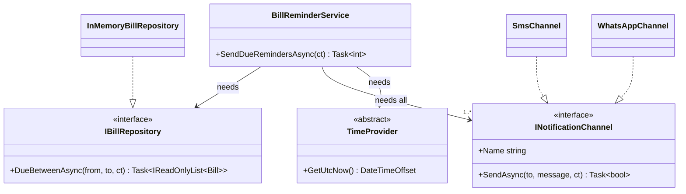
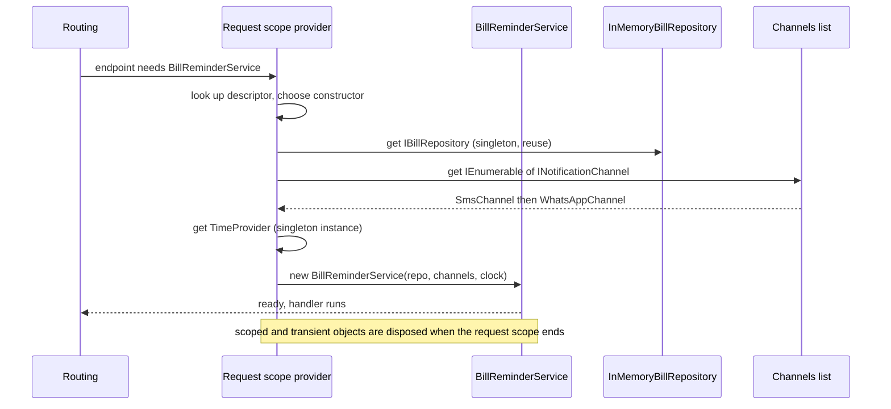

Every endpoint you wrote in [Kestrel, middleware, routing](#/lesson/m03-kestrel-middleware-routing) had parameters such as `IStationDirectory stations` that "just appeared". Something created that object, decided which class to use, and handed it over. That something is the **dependency injection container**, and it is the backbone of every ASP.NET Core app. This lesson explains the idea first, then the mechanics, using a city water utility that sends bill reminders over SMS and WhatsApp.

## Learning objectives

By the end of this lesson you will be able to:

1. Explain in plain words what a dependency is and why creating dependencies with `new` inside a class makes code rigid and hard to test.
2. Register services in `IServiceCollection` with interfaces, concrete types, factories and instances.
3. Use constructor injection (including primary constructors) and know where else ASP.NET Core injects: endpoint parameters, `InvokeAsync`, `[FromServices]`.
4. Register several implementations of one interface, resolve all of them with `IEnumerable<T>`, pick one by key with keyed services, and use `TryAdd` to avoid duplicates.
5. Organise registrations in extension methods and turn on `ValidateOnBuild` so wiring mistakes fail at startup.
6. Recognise DI anti-patterns: the service locator, constructor over-injection, and injecting things that should simply be created.

## Prerequisites

- [Interfaces and abstract classes](#/lesson/m01-interfaces-abstract): DI is mostly about depending on interfaces.
- [How an ASP.NET Core application starts](#/lesson/m03-startup): you know that services are registered on `builder.Services` before `Build()`.
- [Kestrel, middleware, routing](#/lesson/m03-kestrel-middleware-routing): you have seen endpoint parameters filled by the framework.

Lifetimes (singleton, scoped, transient) appear here only briefly. They have their own lesson next: [Singleton, scoped and transient services](#/lesson/m03-service-lifetimes).

## Explain it like I'm a beginner

Think of a wedding caterer in Jaipur preparing food for 800 guests.

The **head cook** needs gas cylinders, vegetables, and a team of helpers. There are two ways to run this kitchen:

1. **The cook arranges everything personally.** Before cooking, the cook drives to the gas agency, bargains at the vegetable mandi and phones helpers. The cook's recipe is now tangled with one particular gas agency and one particular vegetable seller. If the agency is closed, cooking stops. If you want to test a new recipe in a small trial kitchen, you cannot, because the cook insists on driving to the same agency.
2. **The event manager supplies everything.** The cook writes a list: "I need 4 commercial LPG cylinders, 60 kg vegetables, 3 helpers". The event manager arranges them and hands them over before cooking begins. The cook only cares that a cylinder *fits the burner*, not which agency filled it. For a trial, the manager hands over one small cylinder and 2 kg of vegetables, and the recipe works unchanged.

The second way is **dependency injection**. The things the cook needs are **dependencies**. The list the cook writes is the **constructor**. "Fits the burner" is an **interface**. The event manager is the **DI container** (in .NET: `IServiceProvider`), and the manager's address book of suppliers is the **service collection** (`IServiceCollection`), filled in `Program.cs`.

The cook does not lose control of the recipe; the cook gives up control of *shopping*. That shift is called **inversion of control**.

## First-principles explanation

### The problem: `new` hard-codes decisions

Here is a reminder service written without DI:

```csharp
public class BillReminderService
{
    public int SendReminders()
    {
        var repo = new PostgresBillRepository("Host=prod-db;Database=water");   // which database? fixed
        var sms = new AcmeSmsClient("api-key-123");                              // which provider? fixed
        var today = DateOnly.FromDateTime(DateTime.Now);                         // which clock? fixed
        var sent = 0;
        foreach (var bill in repo.DueBetween(today, today.AddDays(3)))
        {
            sms.Send(bill.MobileNumber, $"Bill of ₹{bill.AmountDue} due {bill.DueDate}");
            sent++;
        }
        return sent;
    }
}
```

Every `new` is a decision baked into the class:

- **Testing is impossible without real infrastructure.** A unit test would hit the production database and send real SMS messages. To test "reminders go out 3 days before the due date" you would need a bill that is really due in 3 days.
- **Changing providers means editing this class.** The utility moves from one SMS provider to another, or adds WhatsApp: the reminder logic, which did not change, must be edited and retested.
- **Configuration is scattered.** Connection strings and API keys live in code instead of configuration.
- **Lifetime is unmanaged.** Who disposes the repository's connection? Is one SMS client shared or created per call?

### The fix: ask for dependencies, do not create them

```csharp
public sealed class BillReminderService(IBillRepository bills, ISmsSender sms, TimeProvider clock)
{
    public int SendReminders(int daysBeforeDue)
    {
        var today = DateOnly.FromDateTime(clock.GetLocalNow().DateTime);
        var sent = 0;
        foreach (var bill in bills.DueBetween(today, today.AddDays(daysBeforeDue)))
        {
            sms.Send(bill.MobileNumber, $"Bill of ₹{bill.AmountDue:0.00} due {bill.DueDate:dd-MMM-yyyy}");
            sent++;
        }
        return sent;
    }
}
```

The class now declares *what* it needs (the constructor parameters) and depends only on **abstractions** (interfaces and the abstract `TimeProvider`). Whoever constructs it decides *which* implementations to pass. In a test, that is your test code with fakes. In the running app, that is the container. This is the **Dependency Inversion Principle** in practice ([Dependency Inversion Principle](#/lesson/m04-dip)): high-level policy (reminder rules) does not depend on low-level details (a specific SMS provider); both depend on an abstraction.

The line `public sealed class BillReminderService(IBillRepository bills, ...)` uses a C# 12 **primary constructor**: the parameters are available throughout the class body. It is equivalent to writing a constructor that assigns private readonly fields, which you will also see in many codebases. One difference: primary constructor parameters are not `readonly`, so do not reassign them.

### The three forms of injection

1. **Constructor injection** (the default). Dependencies are constructor parameters. The object cannot exist without them, they are visible in the signature, and the class can store them in readonly fields. Use this almost always.
2. **Method injection**. The dependency is a parameter of the method that needs it. ASP.NET Core uses this for minimal API handlers (`(int id, IStationDirectory stations) => ...`), for `InvokeAsync` in middleware, and for controller actions with `[FromServices]`. Good when only one method needs the dependency.
3. **Property injection**. A settable property filled after construction. The built-in container does **not** support it, deliberately: a forgotten property leads to a `NullReferenceException` far from the cause. Some third-party containers (Autofac) do.

### `IServiceCollection`: a list of recipes

`builder.Services` is an `IServiceCollection`, which is literally a list of `ServiceDescriptor` objects. Each descriptor answers three questions:

- **Service type**: what will people ask for? (`ISmsSender`)
- **Implementation**: how is it made? A type to construct (`TwilioLikeSmsSender`), a factory function (`sp => new ...`) or an existing instance.
- **Lifetime**: how long does one instance live? Singleton, scoped or transient.

Since .NET 8 a descriptor can also carry a **service key** for keyed services (below).

The common ways to add a descriptor:

```csharp
// Interface -> implementation type. The container calls the constructor and fills its parameters.
builder.Services.AddSingleton<ISmsSender, GatewaySmsSender>();

// Concrete type only. Fine for classes with no useful abstraction.
builder.Services.AddScoped<BillReminderService>();

// Factory: you write the construction code, the container decides when to call it.
builder.Services.AddSingleton<IBillRepository>(sp =>
    new InMemoryBillRepository(sp.GetRequiredService<ILogger<InMemoryBillRepository>>()));

// Existing instance: always singleton.
builder.Services.AddSingleton(TimeProvider.System);

// Open generic: one line covers IRepository<Bill>, IRepository<Consumer>, ...
builder.Services.AddScoped(typeof(IRepository<>), typeof(EfRepository<>));
```

`Build()` turns the list into an `IServiceProvider`, the object that actually creates instances. After that the list is read-only.

### How the container builds an object

When something asks for `BillReminderService`:

1. The provider looks up the descriptor for `BillReminderService`.
2. It picks a constructor. With several public constructors, it chooses the one with the **most parameters it can satisfy**. If two such constructors tie, it throws, so keep one public constructor.
3. For each parameter it repeats the process recursively: `IBillRepository` → `InMemoryBillRepository`, whose constructor needs `ILogger<InMemoryBillRepository>`, which the framework registered for you, and so on.
4. It applies lifetimes: a singleton already created is reused, a transient is always new.
5. It returns the finished object graph.

The result is a **tree of objects** (an object graph) built from the bottom up. You describe edges ("A needs B"); the container walks the tree. If any node is missing, you get the most common DI error in .NET:

```text
InvalidOperationException: Unable to resolve service for type 'CityWater.Notifications.ISmsSender'
while attempting to activate 'CityWater.Billing.BillReminderService'.
```

Read it as "I was building the second type and could not find a registration for the first". The fix is almost always a missing `Add...` line.

### `GetService` versus `GetRequiredService`

`GetService<T>()` returns `null` when nothing is registered. `GetRequiredService<T>()` throws with a clear message. In application code prefer `GetRequiredService`, and better still, avoid calling either: let constructors and endpoint parameters do the resolving. Code that calls `GetService` all over the place is the **service locator** anti-pattern ([DI versus service locator](#/lesson/m04-di-vs-service-locator)): dependencies become invisible in the constructor, tests must build a whole container, and missing registrations show up only when that line runs.

Legitimate places to touch `IServiceProvider` directly are few: factory registrations, `Program.cs` itself, and infrastructure code that must create scopes, such as background services ([Service lifetimes](#/lesson/m03-service-lifetimes)).

### Multiple implementations of one interface

The utility sends reminders by SMS and WhatsApp. Register both:

```csharp
builder.Services.AddSingleton<INotificationChannel, SmsChannel>();
builder.Services.AddSingleton<INotificationChannel, WhatsAppChannel>();
```

Two rules follow:

- Asking for a single `INotificationChannel` gives you the **last** registration (`WhatsAppChannel`). Last one wins.
- Asking for `IEnumerable<INotificationChannel>` gives you **all** of them, in registration order. This is how you build fan-out ("send on every channel") or fallback ("try SMS, then WhatsApp") logic without the consumer knowing the concrete classes.

### Keyed services

Sometimes a consumer needs one specific implementation. OTPs must go by SMS (WhatsApp delivery may be delayed), while monthly statements prefer WhatsApp. Since .NET 8 you can register with a key and ask by key:

```csharp
builder.Services.AddKeyedSingleton<INotificationChannel, SmsChannel>("sms");
builder.Services.AddKeyedSingleton<INotificationChannel, WhatsAppChannel>("whatsapp");

public sealed class OtpService([FromKeyedServices("sms")] INotificationChannel channel) { /* ... */ }

app.MapPost("/statements/{consumer}", (string consumer, [FromKeyedServices("whatsapp")] INotificationChannel ch) => ...);
```

Keys keep the consumer honest about what it needs. Do not use keys as a back door to pick implementations from configuration at runtime; for that, inject `IEnumerable<T>` and choose by a property such as `Name`.

### `TryAdd`, `Replace` and libraries

Library authors (and your own `AddBilling()` extension methods) should not clobber registrations the application already made. `Microsoft.Extensions.DependencyInjection.Extensions` provides:

- `TryAddSingleton<TService, TImpl>()` and friends: add only if **nothing** is registered for `TService` yet. If a test or the app registered a fake `TimeProvider` first, `TryAddSingleton(TimeProvider.System)` leaves it alone.
- `TryAddEnumerable(ServiceDescriptor)`: add this implementation only if *this exact implementation* is not already registered for the service. Safe for multi-registration lists like `INotificationChannel`.
- `Replace(ServiceDescriptor)` and `RemoveAll<T>()`: used mainly in integration tests to swap a real service for a fake.

### Organising registrations

When `Program.cs` grows past a few dozen registrations, group them by feature in extension methods:

```csharp
builder.Services
    .AddBilling(builder.Configuration)
    .AddNotifications(builder.Configuration);
```

Each method lives next to the feature it registers and returns `IServiceCollection` so calls chain. `Program.cs` becomes a table of contents. This is exactly how the framework's own `AddControllers()` or `AddAuthentication()` work.

### Validating the graph at startup

By default the container builds objects lazily: a missing registration is discovered on the first request that needs it, possibly days after deployment. Turn on validation:

```csharp
builder.Host.UseDefaultServiceProvider(o =>
{
    o.ValidateOnBuild = true;   // try to build every registered service's dependencies during Build()
    o.ValidateScopes = true;    // forbid resolving scoped services from the root (see the next lesson)
});
```

In the Development environment both are already on. Turning them on everywhere costs a little startup time (proportional to the number of registrations, usually milliseconds) and turns a 2 a.m. 500 into a failed deployment, which is what you want. Note that `ValidateOnBuild` cannot check factory registrations' internals or services resolved manually with `GetService`, another reason to avoid manual resolution.

### What not to inject

DI is for **services**: objects that do work and have dependencies of their own (repositories, clients, calculators, senders). Do not register or inject:

- **Data objects**: entities, DTOs, value objects such as `Money` or `ConsumerNumber`. Create them with `new`. A `Bill` is data, not a service.
- **Pure helper functions** with no dependencies and no state, such as a GST rounding function. A static method is fine and simpler.
- **Primitive values** such as `string connectionString`. The container cannot tell one string from another. Wrap settings in an options class ([Configuration, environment variables and secrets](#/lesson/m03-configuration)).

### Smells to watch for

- **Constructor over-injection**: a constructor with 7 or more dependencies usually means the class has too many responsibilities ([Single Responsibility Principle](#/lesson/m04-srp)). DI did not cause the problem; it made it visible. Split the class.
- **An interface for every class "because DI"**: interfaces earn their place when there are two implementations or a test fake. A concrete `BillFormatter` with no I/O can be registered and injected as itself.
- **Injecting `IServiceProvider`**: service locator. See above.
- **Circular dependencies**: A needs B and B needs A. The container throws "A circular dependency was detected". It is a design problem; extract the shared part into a third class.

### Trade-offs

| You gain | You pay |
|---|---|
| Classes testable with simple fakes | One more level of indirection when reading code ("which class is behind this interface?") |
| Swap implementations by changing one registration | Wiring errors happen at runtime unless you validate at startup |
| Lifetimes and disposal handled for you | You must understand lifetimes or you will create subtle bugs |
| Dependencies explicit in every constructor | Easy to over-abstract: interfaces nobody needs |

**When a simpler alternative is better**: a 50-line console script or a pure algorithm library does not need a container. Passing dependencies by hand through constructors ("pure DI") gives you all the testability with none of the container. The container pays off when the object graph is large and lifetimes matter, which describes almost every web app.

## Visual explanation

### Who depends on what



The service on the left knows only the three abstractions on the arrows. The concrete classes at the bottom implement those abstractions but are never mentioned by `BillReminderService`. The only place that connects a concrete class to an abstraction is `Program.cs` (or an `AddBilling()` extension). That one place is called the **composition root**. Change `SmsChannel` to a different provider and the only edit outside the new class is one registration line.

### What happens when a request needs the service



The provider walks the constructor parameters one by one, reusing singletons it already holds and creating the rest. The handler receives a fully built object and never sees the wiring. The note at the bottom previews the next lesson: the provider used here is a per-request **scope**, and when the request ends, the scope disposes the disposable objects it created.

## Step-by-step example

### Step 1 — write the class against abstractions

Start from the consumer. Write `BillReminderService` with a constructor that takes `IBillRepository`, `IEnumerable<INotificationChannel>`, `TimeProvider` and `ILogger<BillReminderService>`. Do not think about implementations yet. If writing the constructor feels awkward ("I need nine things"), the class is doing too much.

### Step 2 — write one test with fakes

Before any container exists, prove the logic with hand-written fakes: an in-memory repository with two bills, one due in 2 days and one in 10 days, a fake channel that records messages, and a fixed clock set to 1 March. Expect exactly one message. This is the payoff of DI: the test runs in microseconds and needs no database or SMS account.

### Step 3 — register the real implementations

Write `AddBilling()` and `AddNotifications()` extension methods. Use `TryAdd` for things a host might want to override (the clock) and `TryAddEnumerable` for the channels so calling the method twice does not send every SMS twice.

### Step 4 — consume it from an endpoint

`app.MapPost("/reminders/run", (BillReminderService svc, CancellationToken ct) => svc.SendDueRemindersAsync(ct))`. The handler asks for the service by parameter; routing and the container do the rest.

### Step 5 — validate the wiring

Turn on `ValidateOnBuild`. Comment out the `WhatsAppChannel` registration's dependency and watch the app refuse to start with a precise message, instead of failing on the first reminder run.

## Production-style C# implementation

Project layout:

```text
CityWater.Api/
  Program.cs
  Billing/Bill.cs
  Billing/InMemoryBillRepository.cs
  Billing/BillReminderService.cs
  Billing/BillingServiceCollectionExtensions.cs
  Notifications/INotificationChannel.cs
  Notifications/Channels.cs
  Notifications/OtpService.cs
  Notifications/NotificationServiceCollectionExtensions.cs
```

```csharp file=Billing/Bill.cs
namespace CityWater.Billing;

/// <summary>Plain data. Created with new, never registered in the container.</summary>
public sealed record Bill(string ConsumerNumber, string MobileNumber, decimal AmountDue, DateOnly DueDate, bool Paid);

public interface IBillRepository
{
    Task<IReadOnlyList<Bill>> DueBetweenAsync(DateOnly from, DateOnly to, CancellationToken ct);
    Task<Bill?> FindAsync(string consumerNumber, CancellationToken ct);
}
```

```csharp file=Billing/InMemoryBillRepository.cs
namespace CityWater.Billing;

/// <summary>Stand-in for a PostgreSQL repository. Same interface, so swapping it is one registration line.</summary>
public sealed class InMemoryBillRepository : IBillRepository
{
    private readonly List<Bill> _bills =
    [
        new("HYD-100245", "+919800000001", 1250.00m, new DateOnly(2026, 3, 3), Paid: false),
        new("HYD-100246", "+919800000002", 640.50m, new DateOnly(2026, 3, 12), Paid: false),
        new("HYD-100247", "+919800000003", 980.00m, new DateOnly(2026, 3, 2), Paid: true),
    ];

    public Task<IReadOnlyList<Bill>> DueBetweenAsync(DateOnly from, DateOnly to, CancellationToken ct) =>
        Task.FromResult<IReadOnlyList<Bill>>(_bills.Where(b => !b.Paid && b.DueDate >= from && b.DueDate <= to).ToList());

    public Task<Bill?> FindAsync(string consumerNumber, CancellationToken ct) =>
        Task.FromResult(_bills.FirstOrDefault(b => b.ConsumerNumber == consumerNumber));
}
```

```csharp file=Notifications/INotificationChannel.cs
namespace CityWater.Notifications;

public interface INotificationChannel
{
    string Name { get; }

    /// <summary>Returns false when the provider rejected the message, so callers can fall back.</summary>
    Task<bool> SendAsync(string mobileNumber, string message, CancellationToken ct);
}
```

```csharp file=Notifications/Channels.cs
using Microsoft.Extensions.Logging;

namespace CityWater.Notifications;

/// <summary>Fake providers that log instead of calling an external API. Real ones would use a typed HttpClient.</summary>
public sealed class SmsChannel(ILogger<SmsChannel> logger) : INotificationChannel
{
    public string Name => "sms";

    public Task<bool> SendAsync(string mobileNumber, string message, CancellationToken ct)
    {
        logger.LogInformation("SMS to {Mobile}: {Message}", mobileNumber, message);
        return Task.FromResult(true);
    }
}

public sealed class WhatsAppChannel(ILogger<WhatsAppChannel> logger) : INotificationChannel
{
    public string Name => "whatsapp";

    public Task<bool> SendAsync(string mobileNumber, string message, CancellationToken ct)
    {
        logger.LogInformation("WhatsApp to {Mobile}: {Message}", mobileNumber, message);
        return Task.FromResult(true);
    }
}
```

```csharp file=Notifications/OtpService.cs
using Microsoft.Extensions.DependencyInjection;

namespace CityWater.Notifications;

/// <summary>OTPs must go by SMS, so this class asks for the keyed "sms" channel explicitly.</summary>
public sealed class OtpService([FromKeyedServices("sms")] INotificationChannel sms, TimeProvider clock)
{
    public async Task<string> SendOtpAsync(string mobileNumber, CancellationToken ct)
    {
        // Demo only: use a cryptographically secure generator and store a hash with expiry in real code.
        var code = System.Security.Cryptography.RandomNumberGenerator.GetInt32(100_000, 1_000_000).ToString();
        var expires = clock.GetUtcNow().AddMinutes(5);
        await sms.SendAsync(mobileNumber, $"Your CityWater OTP is {code}. Valid until {expires:HH:mm} UTC.", ct);
        return code;
    }
}
```

```csharp file=Billing/BillReminderService.cs
using CityWater.Notifications;
using Microsoft.Extensions.Logging;

namespace CityWater.Billing;

public sealed class ReminderSettings
{
    public int DaysBeforeDue { get; set; } = 3;
}

/// <summary>Business rules only. Every dependency is an abstraction supplied by the container.</summary>
public sealed class BillReminderService(
    IBillRepository bills,
    IEnumerable<INotificationChannel> channels,
    TimeProvider clock,
    ReminderSettings settings,
    ILogger<BillReminderService> logger)
{
    private readonly INotificationChannel[] _channels = channels.ToArray();   // registration order = fallback order

    public async Task<int> SendDueRemindersAsync(CancellationToken ct)
    {
        var today = DateOnly.FromDateTime(clock.GetUtcNow().UtcDateTime);
        var due = await bills.DueBetweenAsync(today, today.AddDays(settings.DaysBeforeDue), ct);
        var sent = 0;

        foreach (var bill in due)
        {
            var message = $"CityWater: bill of Rs {bill.AmountDue:0.00} for {bill.ConsumerNumber} is due on {bill.DueDate:dd-MMM-yyyy}.";
            foreach (var channel in _channels)
            {
                if (await channel.SendAsync(bill.MobileNumber, message, ct)) { sent++; break; }
                logger.LogWarning("{Channel} failed for {Consumer}, trying next channel", channel.Name, bill.ConsumerNumber);
            }
        }

        logger.LogInformation("Sent {Sent} of {Due} reminders", sent, due.Count);
        return sent;
    }
}
```

```csharp file=Billing/BillingServiceCollectionExtensions.cs
using Microsoft.Extensions.Configuration;
using Microsoft.Extensions.DependencyInjection;
using Microsoft.Extensions.DependencyInjection.Extensions;

namespace CityWater.Billing;

public static class BillingServiceCollectionExtensions
{
    /// <summary>The billing feature's slice of the composition root.</summary>
    public static IServiceCollection AddBilling(this IServiceCollection services, IConfiguration configuration)
    {
        var settings = configuration.GetSection("Reminders").Get<ReminderSettings>() ?? new ReminderSettings();
        services.TryAddSingleton(settings);
        services.TryAddSingleton(TimeProvider.System);           // a test or host may register a fake first
        services.TryAddSingleton<IBillRepository, InMemoryBillRepository>();
        services.TryAddScoped<BillReminderService>();            // concrete type: no second implementation exists
        return services;
    }
}
```

```csharp file=Notifications/NotificationServiceCollectionExtensions.cs
using Microsoft.Extensions.DependencyInjection;
using Microsoft.Extensions.DependencyInjection.Extensions;

namespace CityWater.Notifications;

public static class NotificationServiceCollectionExtensions
{
    public static IServiceCollection AddNotifications(this IServiceCollection services)
    {
        // Ordered list for fallback. TryAddEnumerable makes a second AddNotifications() call harmless.
        services.TryAddEnumerable(ServiceDescriptor.Singleton<INotificationChannel, SmsChannel>());
        services.TryAddEnumerable(ServiceDescriptor.Singleton<INotificationChannel, WhatsAppChannel>());

        // Keyed registrations for consumers that need one specific channel.
        services.AddKeyedSingleton<INotificationChannel, SmsChannel>("sms");
        services.AddKeyedSingleton<INotificationChannel, WhatsAppChannel>("whatsapp");

        services.TryAddScoped<OtpService>();
        return services;
    }
}
```

```csharp file=Program.cs
using CityWater.Billing;
using CityWater.Notifications;
using Microsoft.AspNetCore.Mvc;

var builder = WebApplication.CreateBuilder(args);

// Composition root: the only place that knows concrete classes.
builder.Services
    .AddBilling(builder.Configuration)
    .AddNotifications();

// Fail at startup, not on the first request, if the graph is broken.
builder.Host.UseDefaultServiceProvider(o =>
{
    o.ValidateOnBuild = true;
    o.ValidateScopes = true;
});

var app = builder.Build();

app.MapPost("/reminders/run", (BillReminderService reminders, CancellationToken ct) =>
    reminders.SendDueRemindersAsync(ct));

app.MapGet("/bills/{consumerNumber}", async (string consumerNumber, IBillRepository bills, CancellationToken ct) =>
    await bills.FindAsync(consumerNumber, ct) is { } bill ? Results.Ok(bill) : Results.NotFound());

app.MapPost("/otp/{mobile}", async (string mobile, OtpService otp, CancellationToken ct) =>
{
    await otp.SendOtpAsync(mobile, ct);
    return Results.Accepted();
});

app.MapPost("/statements/{consumerNumber}", async (
    string consumerNumber,
    IBillRepository bills,
    [FromKeyedServices("whatsapp")] INotificationChannel whatsapp,
    CancellationToken ct) =>
{
    var bill = await bills.FindAsync(consumerNumber, ct);
    if (bill is null) return Results.NotFound();
    await whatsapp.SendAsync(bill.MobileNumber, $"Statement for {bill.ConsumerNumber}: Rs {bill.AmountDue:0.00}", ct);
    return Results.Accepted();
});

app.Run();
```

Things to notice:

- Only `Program.cs` and the two extension methods mention concrete classes. Everything else depends on abstractions.
- `BillReminderService` is registered as a concrete type. There is one implementation and it has no I/O of its own, so an interface would add nothing. Its *dependencies* are abstractions, which is what makes it testable.
- `ReminderSettings` is registered as a plain singleton here to keep this lesson focused. The [configuration lesson](#/lesson/m03-configuration) replaces it with the options pattern (`IOptions<ReminderSettings>`) and adds validation.
- `[FromKeyedServices]` works both on constructor parameters and on minimal API handler parameters.

## Bad design vs good design

**Bad**: hidden dependencies through a static locator and `new`.

```csharp
public static class ServiceLocator { public static IServiceProvider Provider { get; set; } = null!; }

public class ReminderJob
{
    public async Task RunAsync()
    {
        var bills = ServiceLocator.Provider.GetService<IBillRepository>();        // may be null
        var sms = new SmsChannel(NullLogger<SmsChannel>.Instance);                // concrete, untestable
        var today = DateOnly.FromDateTime(DateTime.Now);                          // real clock, local time
        foreach (var b in await bills!.DueBetweenAsync(today, today.AddDays(3), default))
            await sms.SendAsync(b.MobileNumber, "Pay your bill", default);
    }
}
```

Its constructor says it needs nothing, which is a lie. A test must set a global static, cannot replace the SMS channel, and cannot control time. Two tests running in parallel overwrite each other's `ServiceLocator.Provider`. A missing registration surfaces as a `NullReferenceException` at the `!`.

**Good**: `BillReminderService` above. Every dependency is in the constructor, so the class cannot be created half-configured, tests pass fakes directly, and `ValidateOnBuild` checks the wiring at startup.

:::callout type=tip title="Pure DI is a valid choice for small programs"
In a small console tool, `var svc = new BillReminderService(new InMemoryBillRepository(), channels, TimeProvider.System, new ReminderSettings(), logger);` is dependency injection too, done by hand. The container is a convenience for large graphs and lifetimes, not a requirement of the pattern.
:::

:::callout type=mistake title="Registering the same implementation twice"
Calling a feature's `AddNotifications()` from two places with plain `AddSingleton<INotificationChannel, SmsChannel>()` registers SMS twice, and fan-out code sends every message twice. Use `TryAddEnumerable` for lists and `TryAdd*` for single services in reusable registration methods.
:::

## Practical playground

Explore the container's rules directly: last registration wins, `IEnumerable<T>` returns all, `TryAdd` does not overwrite, keyed services pick by key, and a missing dependency produces a precise error. Change the registrations and re-run.

:::playground type=csharp title="Container rules you can see"
```csharp file=Program.cs
using System;
using System.Collections.Generic;
using System.Linq;
using Microsoft.Extensions.DependencyInjection;
using Microsoft.Extensions.DependencyInjection.Extensions;

public interface IChannel { string Name { get; } }
public sealed class Sms : IChannel { public string Name => "sms"; }
public sealed class WhatsApp : IChannel { public string Name => "whatsapp"; }
public interface IClock { DateTime Now { get; } }
public sealed class FixedClock : IClock { public DateTime Now => new DateTime(2026, 3, 1); }
public sealed class SystemClock : IClock { public DateTime Now => DateTime.UtcNow; }
public interface IAuditLog { }
public sealed class Reminder
{
    public Reminder(IChannel channel, IAuditLog audit) { }   // IAuditLog is never registered
}

public static class Program
{
    public static void Main()
    {
        var services = new ServiceCollection();
        services.AddSingleton<IChannel, Sms>();
        services.AddSingleton<IChannel, WhatsApp>();
        services.AddSingleton<IClock, FixedClock>();
        services.TryAddSingleton<IClock, SystemClock>();      // ignored: IClock already registered
        services.AddKeyedSingleton<IChannel, Sms>("otp");
        services.AddTransient<Reminder>();

        using var sp = services.BuildServiceProvider();
        Console.WriteLine($"Single IChannel      -> {sp.GetRequiredService<IChannel>().Name}");
        Console.WriteLine($"All IChannel         -> {string.Join(", ", sp.GetServices<IChannel>().Select(c => c.Name))}");
        Console.WriteLine($"IClock after TryAdd  -> {sp.GetRequiredService<IClock>().GetType().Name}");
        Console.WriteLine($"Keyed 'otp'          -> {sp.GetRequiredKeyedService<IChannel>("otp").Name}");
        Console.WriteLine($"GetService(missing)  -> {(sp.GetService<IAuditLog>() is null ? "null" : "found")}");

        try { sp.GetRequiredService<Reminder>(); }
        catch (InvalidOperationException ex) { Console.WriteLine($"Resolve Reminder     -> {ex.Message}"); }

        try { services.BuildServiceProvider(new ServiceProviderOptions { ValidateOnBuild = true }); }
        catch (AggregateException ex) { Console.WriteLine($"ValidateOnBuild      -> {ex.InnerExceptions.Count} problem(s) found at build time"); }
    }
}
```
:::

You should see `whatsapp` for the single resolution, `sms, whatsapp` for the list, `FixedClock` surviving the `TryAdd`, `sms` for the keyed lookup, `null` for `GetService`, and an "Unable to resolve service for type 'IAuditLog' while attempting to activate 'Reminder'" message. The last line shows `ValidateOnBuild` catching the same problem before any resolution happens.

## Exercises

:::exercise id=m03-dependency-injection-ex1 difficulty=beginner kind=code title="Make the reminder logic testable"
Implement `DueReminder.SendReminders` using only the dependencies passed to its constructor. The point of the exercise is that the tests can control the bills, capture the SMS messages and fix the date without any real infrastructure.
::requirements
- "Today" comes from `TimeProvider.GetUtcNow()` (use the UTC date).
- Send one SMS per bill that is **unpaid** and whose `DueDate` is between today and today + `daysBeforeDue`, inclusive.
- Message format: `Water bill of Rs {AmountDue:0.00} for {ConsumerNumber} is due on {DueDate:yyyy-MM-dd}` (use invariant culture).
- Return the number of messages sent.
::acceptance
- With today = 2026-03-01 and `daysBeforeDue = 3`, a bill due 2026-03-03 is reminded and a bill due 2026-03-10 is not.
- Paid bills are never reminded.
- A bill due today is reminded.
- The message contains the formatted amount and consumer number.
::hint
You do not need a container in this exercise. The constructor already receives everything. Store the parameters in fields.
::hint
`DateOnly.FromDateTime(_clock.GetUtcNow().UtcDateTime)` gives today's date.
::hint
Filter with `!b.Paid && b.DueDate >= today && b.DueDate <= today.AddDays(daysBeforeDue)`.
::hint
Format with `string.Create(CultureInfo.InvariantCulture, $"...{bill.AmountDue:0.00}...")` or `string.Format(CultureInfo.InvariantCulture, ...)` so the decimal separator is always a dot.
::starter
```csharp file=DueReminder.cs
using System;
using System.Collections.Generic;
using System.Globalization;
using System.Linq;

public sealed record Bill(string ConsumerNumber, string MobileNumber, decimal AmountDue, DateOnly DueDate, bool Paid);

public interface IBillRepository
{
    IReadOnlyList<Bill> All();
}

public interface ISmsSender
{
    void Send(string mobileNumber, string message);
}

public sealed class DueReminder
{
    private readonly IBillRepository _bills;
    private readonly ISmsSender _sms;
    private readonly TimeProvider _clock;

    public DueReminder(IBillRepository bills, ISmsSender sms, TimeProvider clock)
    {
        _bills = bills;
        _sms = sms;
        _clock = clock;
    }

    public int SendReminders(int daysBeforeDue) => throw new NotImplementedException();
}
```
::tests
```csharp file=DueReminderTests.cs
using System;
using System.Collections.Generic;
using Xunit;

public class DueReminderTests
{
    private sealed class FakeBills(params Bill[] bills) : IBillRepository
    {
        public IReadOnlyList<Bill> All() => bills;
    }

    private sealed class RecordingSms : ISmsSender
    {
        public List<(string To, string Message)> Sent { get; } = new();
        public void Send(string mobileNumber, string message) => Sent.Add((mobileNumber, message));
    }

    private sealed class FixedClock(DateTimeOffset now) : TimeProvider
    {
        public override DateTimeOffset GetUtcNow() => now;
    }

    private static readonly FixedClock March1 = new(new DateTimeOffset(2026, 3, 1, 4, 30, 0, TimeSpan.Zero));

    [Fact]
    public void Only_bills_inside_the_window_are_reminded()
    {
        var sms = new RecordingSms();
        var reminder = new DueReminder(new FakeBills(
            new Bill("HYD-1", "+911", 1250m, new DateOnly(2026, 3, 3), false),
            new Bill("HYD-2", "+912", 640.5m, new DateOnly(2026, 3, 10), false)), sms, March1);

        Assert.Equal(1, reminder.SendReminders(3));
        Assert.Equal("+911", Assert.Single(sms.Sent).To);
    }

    [Fact]
    public void Paid_bills_are_skipped()
    {
        var sms = new RecordingSms();
        var reminder = new DueReminder(new FakeBills(new Bill("HYD-3", "+913", 980m, new DateOnly(2026, 3, 2), true)), sms, March1);
        Assert.Equal(0, reminder.SendReminders(3));
        Assert.Empty(sms.Sent);
    }

    [Fact]
    public void Bill_due_today_is_reminded()
    {
        var sms = new RecordingSms();
        var reminder = new DueReminder(new FakeBills(new Bill("HYD-4", "+914", 10m, new DateOnly(2026, 3, 1), false)), sms, March1);
        Assert.Equal(1, reminder.SendReminders(0));
    }

    [Fact]
    public void Message_is_formatted()
    {
        var sms = new RecordingSms();
        var reminder = new DueReminder(new FakeBills(new Bill("HYD-1", "+911", 1250m, new DateOnly(2026, 3, 3), false)), sms, March1);
        reminder.SendReminders(3);
        Assert.Equal("Water bill of Rs 1250.00 for HYD-1 is due on 2026-03-03", sms.Sent[0].Message);
    }
}
```
::solution
The class does nothing clever. The value is that every input it depends on, including time, arrives through the constructor, so the tests are four lines each.

```csharp file=DueReminder.cs
using System;
using System.Collections.Generic;
using System.Globalization;
using System.Linq;

public sealed record Bill(string ConsumerNumber, string MobileNumber, decimal AmountDue, DateOnly DueDate, bool Paid);

public interface IBillRepository
{
    IReadOnlyList<Bill> All();
}

public interface ISmsSender
{
    void Send(string mobileNumber, string message);
}

public sealed class DueReminder
{
    private readonly IBillRepository _bills;
    private readonly ISmsSender _sms;
    private readonly TimeProvider _clock;

    public DueReminder(IBillRepository bills, ISmsSender sms, TimeProvider clock)
    {
        _bills = bills;
        _sms = sms;
        _clock = clock;
    }

    public int SendReminders(int daysBeforeDue)
    {
        var today = DateOnly.FromDateTime(_clock.GetUtcNow().UtcDateTime);
        var last = today.AddDays(daysBeforeDue);
        var sent = 0;
        foreach (var bill in _bills.All().Where(b => !b.Paid && b.DueDate >= today && b.DueDate <= last))
        {
            var message = string.Format(CultureInfo.InvariantCulture,
                "Water bill of Rs {0:0.00} for {1} is due on {2:yyyy-MM-dd}", bill.AmountDue, bill.ConsumerNumber, bill.DueDate);
            _sms.Send(bill.MobileNumber, message);
            sent++;
        }
        return sent;
    }
}
```
::mistakes
- Using `DateTime.Now` inside the method, which makes the tests depend on the day they run.
- Formatting with the current culture, so a server set to a culture with a comma decimal separator produces `1250,00`.
::extensions
Make `DueReminder` ask for `IEnumerable<ISmsSender>` and fall back to the next sender when one throws.
:::

:::exercise id=m03-dependency-injection-ex2 difficulty=beginner kind=code title="Write a safe registration method"
Implement `WaterBillingRegistration.AddWaterBilling`, an extension method that registers the billing feature so the container can build `DueReminder`, without overwriting registrations made earlier and without duplicating anything when called twice.
::requirements
- `IBillRepository` → `InMemoryBills` (singleton), `ISmsSender` → `ConsoleSms` (singleton), `TimeProvider` → `TimeProvider.System` (singleton), `DueReminder` (scoped).
- Use `TryAdd*` so an earlier registration (for example a fake clock in a test) is kept.
- Return the same `IServiceCollection` for chaining.
::acceptance
- A provider built with `ValidateOnBuild = true` and `ValidateScopes = true` resolves `DueReminder` inside a scope.
- If a `TimeProvider` is registered before `AddWaterBilling()`, it is the one resolved afterwards.
- Calling `AddWaterBilling()` twice leaves exactly one `ISmsSender` registration.
::hint
`TryAddSingleton` lives in the `Microsoft.Extensions.DependencyInjection.Extensions` namespace.
::hint
`services.TryAddSingleton(TimeProvider.System)` registers an existing instance only if no `TimeProvider` exists yet.
::hint
For interface-to-type: `services.TryAddSingleton<IBillRepository, InMemoryBills>();`. For the scoped concrete class: `services.TryAddScoped<DueReminder>();`.
::starter
```csharp file=WaterBillingRegistration.cs
using System;
using System.Collections.Generic;
using Microsoft.Extensions.DependencyInjection;
using Microsoft.Extensions.DependencyInjection.Extensions;

public interface IBillRepository { int CountDue(); }
public interface ISmsSender { void Send(string to, string message); }

public sealed class InMemoryBills : IBillRepository { public int CountDue() => 2; }
public sealed class ConsoleSms : ISmsSender { public void Send(string to, string message) => Console.WriteLine($"{to}: {message}"); }

public sealed class DueReminder
{
    public DueReminder(IBillRepository bills, ISmsSender sms, TimeProvider clock)
    {
        Bills = bills; Sms = sms; Clock = clock;
    }
    public IBillRepository Bills { get; }
    public ISmsSender Sms { get; }
    public TimeProvider Clock { get; }
}

public static class WaterBillingRegistration
{
    public static IServiceCollection AddWaterBilling(this IServiceCollection services) => throw new NotImplementedException();
}
```
::tests
```csharp file=WaterBillingRegistrationTests.cs
using System;
using System.Linq;
using Microsoft.Extensions.DependencyInjection;
using Xunit;

public class WaterBillingRegistrationTests
{
    private sealed class FrozenClock : TimeProvider
    {
        public override DateTimeOffset GetUtcNow() => new(2026, 3, 1, 0, 0, 0, TimeSpan.Zero);
    }

    private static ServiceProvider Build(IServiceCollection services) =>
        services.BuildServiceProvider(new ServiceProviderOptions { ValidateOnBuild = true, ValidateScopes = true });

    [Fact]
    public void Graph_is_valid_and_resolves()
    {
        using var sp = Build(new ServiceCollection().AddWaterBilling());
        using var scope = sp.CreateScope();
        var reminder = scope.ServiceProvider.GetRequiredService<DueReminder>();
        Assert.IsType<InMemoryBills>(reminder.Bills);
        Assert.IsType<ConsoleSms>(reminder.Sms);
    }

    [Fact]
    public void Earlier_clock_is_kept()
    {
        var services = new ServiceCollection();
        services.AddSingleton<TimeProvider>(new FrozenClock());
        services.AddWaterBilling();
        using var sp = Build(services);
        Assert.IsType<FrozenClock>(sp.GetRequiredService<TimeProvider>());
    }

    [Fact]
    public void Calling_twice_does_not_duplicate()
    {
        var services = new ServiceCollection();
        services.AddWaterBilling().AddWaterBilling();
        Assert.Equal(1, services.Count(d => d.ServiceType == typeof(ISmsSender)));
        using var sp = Build(services);
        Assert.Single(sp.GetServices<ISmsSender>());
    }
}
```
::solution
```csharp file=WaterBillingRegistration.cs
using System;
using System.Collections.Generic;
using Microsoft.Extensions.DependencyInjection;
using Microsoft.Extensions.DependencyInjection.Extensions;

public interface IBillRepository { int CountDue(); }
public interface ISmsSender { void Send(string to, string message); }

public sealed class InMemoryBills : IBillRepository { public int CountDue() => 2; }
public sealed class ConsoleSms : ISmsSender { public void Send(string to, string message) => Console.WriteLine($"{to}: {message}"); }

public sealed class DueReminder
{
    public DueReminder(IBillRepository bills, ISmsSender sms, TimeProvider clock)
    {
        Bills = bills; Sms = sms; Clock = clock;
    }
    public IBillRepository Bills { get; }
    public ISmsSender Sms { get; }
    public TimeProvider Clock { get; }
}

public static class WaterBillingRegistration
{
    public static IServiceCollection AddWaterBilling(this IServiceCollection services)
    {
        services.TryAddSingleton<IBillRepository, InMemoryBills>();
        services.TryAddSingleton<ISmsSender, ConsoleSms>();
        services.TryAddSingleton(TimeProvider.System);
        services.TryAddScoped<DueReminder>();
        return services;
    }
}
```

`ValidateOnBuild` proves every constructor can be satisfied, and `ValidateScopes` proves you did not, for example, make `DueReminder` depend on a scoped service from a singleton.
::mistakes
- Using `AddSingleton` in a reusable method, so the second call adds a second `ISmsSender` and fan-out code sends twice.
- Registering `TimeProvider.System` with `AddSingleton` after the test's fake, which then wins because the last registration wins.
::extensions
Add an overload `AddWaterBilling(Action<WaterBillingBuilder> configure)` that lets callers choose the SMS implementation fluently.
:::

:::exercise id=m03-dependency-injection-ex3 difficulty=intermediate kind=code title="Fallback channels and a keyed OTP sender"
Implement two consumers of `INotificationChannel`. `NotificationRouter` receives **all** channels and tries them in registration order until one succeeds. `OtpSender` must always use the channel registered with the key `"sms"`.
::requirements
- `NotificationRouter(IEnumerable<INotificationChannel> channels)`. `SendAsync(to, message)` returns the `Name` of the channel that succeeded, or `null` if all failed. Stop at the first success.
- `NotificationRouter.SendAsync(to, message, preferred)` overload: try the channel whose `Name` equals `preferred` first, then the others in registration order.
- `OtpSender([FromKeyedServices("sms")] INotificationChannel channel)`. `SendAsync(to, code)` sends `Your OTP is {code}` and returns the channel's result.
::acceptance
- With SMS (failing) then WhatsApp (succeeding) registered, `SendAsync` returns `"whatsapp"` after trying both.
- With a preferred channel, that channel is tried first.
- `OtpSender` resolved from the container uses the keyed SMS channel even when other channels are registered.
::hint
Store `channels.ToArray()` in the constructor so the order is fixed and the sequence is enumerated once.
::hint
For the preferred overload, build an ordered list: the preferred channel first, then the rest with `Where(c => c.Name != preferred)`.
::hint
`[FromKeyedServices("sms")]` goes on the constructor parameter. The attribute is in `Microsoft.Extensions.DependencyInjection`.
::hint
```csharp
foreach (var c in ordered)
    if (await c.SendAsync(to, message)) return c.Name;
return null;
```
::starter
```csharp file=Notifications.cs
using System;
using System.Collections.Generic;
using System.Linq;
using System.Threading.Tasks;
using Microsoft.Extensions.DependencyInjection;

public interface INotificationChannel
{
    string Name { get; }
    Task<bool> SendAsync(string to, string message);
}

public sealed class NotificationRouter
{
    public NotificationRouter(IEnumerable<INotificationChannel> channels) => throw new NotImplementedException();

    public Task<string?> SendAsync(string to, string message) => throw new NotImplementedException();

    public Task<string?> SendAsync(string to, string message, string preferred) => throw new NotImplementedException();
}

public sealed class OtpSender
{
    public OtpSender([FromKeyedServices("sms")] INotificationChannel channel) => throw new NotImplementedException();

    public Task<bool> SendAsync(string to, string code) => throw new NotImplementedException();
}
```
::tests
```csharp file=NotificationsTests.cs
using System.Collections.Generic;
using System.Threading.Tasks;
using Microsoft.Extensions.DependencyInjection;
using Xunit;

public class NotificationsTests
{
    private sealed class FakeChannel(string name, bool succeeds, List<string> log) : INotificationChannel
    {
        public string Name => name;
        public List<string> Messages { get; } = new();
        public Task<bool> SendAsync(string to, string message)
        {
            log.Add(name);
            Messages.Add(message);
            return Task.FromResult(succeeds);
        }
    }

    [Fact]
    public async Task Falls_back_in_registration_order()
    {
        var log = new List<string>();
        var services = new ServiceCollection();
        services.AddSingleton<INotificationChannel>(new FakeChannel("sms", false, log));
        services.AddSingleton<INotificationChannel>(new FakeChannel("whatsapp", true, log));
        services.AddSingleton<NotificationRouter>();
        var router = services.BuildServiceProvider().GetRequiredService<NotificationRouter>();

        Assert.Equal("whatsapp", await router.SendAsync("+911", "hello"));
        Assert.Equal(new[] { "sms", "whatsapp" }, log);
    }

    [Fact]
    public async Task All_failing_returns_null()
    {
        var log = new List<string>();
        var router = new NotificationRouter(new INotificationChannel[] { new FakeChannel("sms", false, log), new FakeChannel("email", false, log) });
        Assert.Null(await router.SendAsync("+911", "hello"));
    }

    [Fact]
    public async Task Preferred_channel_goes_first()
    {
        var log = new List<string>();
        var router = new NotificationRouter(new INotificationChannel[] { new FakeChannel("sms", true, log), new FakeChannel("whatsapp", true, log) });
        Assert.Equal("whatsapp", await router.SendAsync("+911", "statement", "whatsapp"));
        Assert.Equal(new[] { "whatsapp" }, log);
    }

    [Fact]
    public async Task Otp_uses_keyed_sms_channel()
    {
        var log = new List<string>();
        var sms = new FakeChannel("sms", true, log);
        var services = new ServiceCollection();
        services.AddSingleton<INotificationChannel>(new FakeChannel("whatsapp", true, log));
        services.AddKeyedSingleton<INotificationChannel>("sms", sms);
        services.AddKeyedSingleton<INotificationChannel>("whatsapp", new FakeChannel("whatsapp-keyed", true, log));
        services.AddTransient<OtpSender>();
        var otp = services.BuildServiceProvider().GetRequiredService<OtpSender>();

        Assert.True(await otp.SendAsync("+911", "482913"));
        Assert.Equal(new[] { "sms" }, log);
        Assert.Equal("Your OTP is 482913", sms.Messages[0]);
    }
}
```
::solution
`IEnumerable<T>` gives the router every implementation in registration order. The keyed attribute gives `OtpSender` exactly one, by name, and documents that requirement in the constructor.

```csharp file=Notifications.cs
using System;
using System.Collections.Generic;
using System.Linq;
using System.Threading.Tasks;
using Microsoft.Extensions.DependencyInjection;

public interface INotificationChannel
{
    string Name { get; }
    Task<bool> SendAsync(string to, string message);
}

public sealed class NotificationRouter
{
    private readonly INotificationChannel[] _channels;

    public NotificationRouter(IEnumerable<INotificationChannel> channels) => _channels = channels.ToArray();

    public Task<string?> SendAsync(string to, string message) => TryInOrder(_channels, to, message);

    public Task<string?> SendAsync(string to, string message, string preferred)
    {
        var ordered = _channels.Where(c => c.Name == preferred)
            .Concat(_channels.Where(c => c.Name != preferred));
        return TryInOrder(ordered, to, message);
    }

    private static async Task<string?> TryInOrder(IEnumerable<INotificationChannel> channels, string to, string message)
    {
        foreach (var channel in channels)
            if (await channel.SendAsync(to, message)) return channel.Name;
        return null;
    }
}

public sealed class OtpSender
{
    private readonly INotificationChannel _channel;

    public OtpSender([FromKeyedServices("sms")] INotificationChannel channel) => _channel = channel;

    public Task<bool> SendAsync(string to, string code) => _channel.SendAsync(to, $"Your OTP is {code}");
}
```
::alternatives
Before keyed services existed, teams registered a small factory (`INotificationChannelFactory.Get("sms")`) or a dedicated interface per role (`IOtpChannel`). A role interface is still a good choice when the role has extra members; keys are lighter when it does not.
::mistakes
- Injecting a single `INotificationChannel` into the router and getting only the last registration.
- Enumerating the `IEnumerable<T>` on every call: with transient channels that creates new instances each time.
- Choosing the OTP channel by reading `IServiceProvider` inside the method, which is a hidden service locator.
::extensions
Add a per-channel timeout, so a slow provider does not block the fallback for more than 2 seconds.
:::

:::exercise id=m03-dependency-injection-ex4 difficulty=intermediate kind=design title="Untangle a consumer portal controller"
A municipal water utility's `ConsumerPortalController` has these lines in its action methods: `new NpgsqlConnection("Host=10.0.0.5;Password=...")`, `new HttpClient()` to call a UPI payment gateway, `SmsHelper.Send(...)` (a static class), `DateTime.Now` to compute late fees, and `new LateFeeCalculator()` (pure arithmetic, no I/O).

Design the dependencies: which become interfaces, which stay concrete, which are not injected at all, how each is registered, and what the controller's constructor looks like.
::acceptance
- Database access goes behind a repository interface with an implementation registered as scoped.
- The payment gateway becomes a typed `HttpClient` client behind an interface (`AddHttpClient<IPaymentGateway, ...>`), not `new HttpClient()`.
- The static SMS helper becomes an injected `ISmsSender`.
- Time comes from `TimeProvider`.
- `LateFeeCalculator` is justified either as a static/pure helper or as a concrete injected class, with reasoning.
- The connection string and gateway key move to configuration.
::hint
Sort each dependency into three buckets: does I/O (needs an abstraction for tests), is pure logic (may stay concrete), is data (never injected).
::hint
`new HttpClient()` per request can exhaust sockets under load. `IHttpClientFactory` and typed clients exist for exactly this.
::hint
Aim for a constructor with four or fewer parameters. If you get more, ask whether the controller should delegate to a `BillPaymentService`.
::hint
Sketch:
```text
ConsumerPortalController(IBillPaymentService payments, IConsumerRepository consumers)
BillPaymentService(IConsumerRepository, IPaymentGateway, ISmsSender, TimeProvider)
```
::solution
**Buckets**

| Today | Becomes | Registration | Why |
|---|---|---|---|
| `new NpgsqlConnection(...)` | `IConsumerRepository` → `PostgresConsumerRepository` (uses `NpgsqlDataSource` or EF Core `DbContext`) | `AddScoped`, data source via `AddNpgsqlDataSource(connString)` | I/O, needs a fake in tests, per-request unit of work |
| `new HttpClient()` | `IPaymentGateway` → `UpiGatewayClient` typed client | `AddHttpClient<IPaymentGateway, UpiGatewayClient>(c => c.BaseAddress = ...)` | Factory manages handler pooling and DNS refresh, avoids socket exhaustion |
| `SmsHelper.Send` | `ISmsSender` → `GatewaySmsSender` | `AddSingleton` (stateless, thread-safe) | I/O, must be faked, provider may change |
| `DateTime.Now` | `TimeProvider` | `AddSingleton(TimeProvider.System)` | Late-fee rules must be testable on fixed dates |
| `new LateFeeCalculator()` | Keep concrete. Either a static pure function or `AddSingleton<LateFeeCalculator>()` | — | No I/O, deterministic. An interface adds nothing unless there are several fee policies |

**Configuration**: `ConnectionStrings:Water` and `PaymentGateway:ApiKey` in user secrets locally and environment variables or Key Vault on servers.

**Shape**: the controller becomes thin.

```text
ConsumerPortalController(IBillPaymentService payments, IConsumerRepository consumers)
BillPaymentService(IConsumerRepository, IPaymentGateway, ISmsSender, TimeProvider, LateFeeCalculator)
```

Five dependencies on `BillPaymentService` is at the upper edge. If notifications grow (SMS, WhatsApp, email), group them behind one `IPaymentNotifier`.
::mistakes
- Creating an interface for `LateFeeCalculator` "for consistency" and then never writing a second implementation.
- Registering the repository as a singleton, which shares one database context across concurrent requests.
- Injecting `IConfiguration` into the controller and reading keys there instead of using typed settings.
:::

:::exercise id=m03-dependency-injection-ex5 difficulty=advanced kind=code title="Build a tiny DI container"
Implement `MiniContainer` to see what the real container does: constructor selection, recursive resolution, singleton caching, and cycle detection.
::requirements
- `Register<TService, TImpl>(bool singleton = false)` maps a service type to an implementation type. `RegisterInstance<TService>(TService instance)` registers an existing object (always singleton).
- `Resolve<T>()` and `Resolve(Type)` build the object: if the type is registered use its implementation, otherwise throw `InvalidOperationException` whose message contains the service type name.
- Choose the **public constructor with the most parameters**. Resolve each parameter recursively.
- Singletons are created once and cached. Transients are new each time.
- Detect cycles: if resolving A requires A again, throw `InvalidOperationException` whose message contains `Circular` and the type names in the chain.
::acceptance
- A three-level graph (service → repository → clock) resolves.
- A singleton resolved twice is the same instance. A transient is not.
- A registered instance is returned as is.
- An unregistered parameter type throws with that type's name in the message.
- `A → B → A` throws a message containing `Circular`.
::hint
`typeof(TImpl).GetConstructors().OrderByDescending(c => c.GetParameters().Length).First()` picks the greediest public constructor.
::hint
Keep a `HashSet<Type>` (or a `Stack<Type>`) of types currently being built. If you are asked to build a type already in it, you found a cycle.
::hint
Remove the type from the "in progress" set in a `finally` block, so a failed resolution does not poison later ones.
::hint
```csharp
private object Build(Type service, Stack<Type> path)
{
    if (path.Contains(service)) throw new InvalidOperationException("Circular dependency: " + ...);
    path.Push(service);
    try { /* find registration, check singleton cache, pick ctor, resolve args, Activator/Invoke */ }
    finally { path.Pop(); }
}
```
::hint
`ctor.Invoke(args)` creates the instance. Cache it in a `Dictionary<Type, object>` when the registration is a singleton.
::starter
```csharp file=MiniContainer.cs
using System;
using System.Collections.Generic;
using System.Linq;
using System.Reflection;

public sealed class MiniContainer
{
    public void Register<TService, TImpl>(bool singleton = false) where TImpl : TService
        => throw new NotImplementedException();

    public void RegisterInstance<TService>(TService instance) where TService : notnull
        => throw new NotImplementedException();

    public T Resolve<T>() => (T)Resolve(typeof(T));

    public object Resolve(Type service) => throw new NotImplementedException();
}
```
::tests
```csharp file=MiniContainerTests.cs
using System;
using Xunit;

public interface IClock { DateTime Today { get; } }
public sealed class FixedClock : IClock { public DateTime Today => new DateTime(2026, 3, 1); }
public interface IBillStore { IClock Clock { get; } }
public sealed class BillStore : IBillStore { public BillStore(IClock clock) => Clock = clock; public IClock Clock { get; } }
public sealed class ReminderJob
{
    public ReminderJob() { }
    public ReminderJob(IBillStore store) => Store = store;
    public IBillStore? Store { get; }
}
public interface IAuditLog { }
public sealed class NeedsAudit { public NeedsAudit(IAuditLog log) { } }
public sealed class CycleA { public CycleA(CycleB b) { } }
public sealed class CycleB { public CycleB(CycleA a) { } }

public class MiniContainerTests
{
    [Fact]
    public void Resolves_a_graph_with_the_greediest_constructor()
    {
        var c = new MiniContainer();
        c.Register<IClock, FixedClock>(singleton: true);
        c.Register<IBillStore, BillStore>();
        c.Register<ReminderJob, ReminderJob>();
        var job = c.Resolve<ReminderJob>();
        Assert.NotNull(job.Store);
        Assert.IsType<FixedClock>(job.Store!.Clock);
    }

    [Fact]
    public void Singleton_is_cached_transient_is_not()
    {
        var c = new MiniContainer();
        c.Register<IClock, FixedClock>(singleton: true);
        c.Register<IBillStore, BillStore>();
        Assert.Same(c.Resolve<IClock>(), c.Resolve<IClock>());
        Assert.NotSame(c.Resolve<IBillStore>(), c.Resolve<IBillStore>());
        Assert.Same(c.Resolve<IBillStore>().Clock, c.Resolve<IBillStore>().Clock);
    }

    [Fact]
    public void Instance_is_returned_as_is()
    {
        var c = new MiniContainer();
        var clock = new FixedClock();
        c.RegisterInstance<IClock>(clock);
        Assert.Same(clock, c.Resolve<IClock>());
    }

    [Fact]
    public void Missing_registration_names_the_type()
    {
        var c = new MiniContainer();
        c.Register<NeedsAudit, NeedsAudit>();
        var ex = Assert.Throws<InvalidOperationException>(() => c.Resolve<NeedsAudit>());
        Assert.Contains("IAuditLog", ex.Message);
    }

    [Fact]
    public void Cycle_is_detected()
    {
        var c = new MiniContainer();
        c.Register<CycleA, CycleA>();
        c.Register<CycleB, CycleB>();
        var ex = Assert.Throws<InvalidOperationException>(() => c.Resolve<CycleA>());
        Assert.Contains("Circular", ex.Message);
        Assert.Contains("CycleB", ex.Message);
    }
}
```
::solution
A container is a dictionary of recipes plus a recursive function. The real one adds scopes, disposal tracking, open generics, keyed services, compiled expression trees for speed and validation, but the core is this.

```csharp file=MiniContainer.cs
using System;
using System.Collections.Generic;
using System.Linq;
using System.Reflection;

public sealed class MiniContainer
{
    private sealed record Registration(Type Implementation, bool Singleton);

    private readonly Dictionary<Type, Registration> _registrations = new();
    private readonly Dictionary<Type, object> _singletons = new();

    public void Register<TService, TImpl>(bool singleton = false) where TImpl : TService
        => _registrations[typeof(TService)] = new Registration(typeof(TImpl), singleton);

    public void RegisterInstance<TService>(TService instance) where TService : notnull
    {
        _registrations[typeof(TService)] = new Registration(instance.GetType(), Singleton: true);
        _singletons[typeof(TService)] = instance;
    }

    public T Resolve<T>() => (T)Resolve(typeof(T));

    public object Resolve(Type service) => Build(service, new Stack<Type>());

    private object Build(Type service, Stack<Type> path)
    {
        if (path.Contains(service))
        {
            var chain = string.Join(" -> ", path.Reverse().Append(service).Select(t => t.Name));
            throw new InvalidOperationException($"Circular dependency detected: {chain}");
        }

        if (!_registrations.TryGetValue(service, out var registration))
        {
            var requester = path.Count > 0 ? $" while building '{path.Peek().Name}'" : "";
            throw new InvalidOperationException($"No registration for '{service.Name}'{requester}.");
        }

        if (registration.Singleton && _singletons.TryGetValue(service, out var cached))
            return cached;

        path.Push(service);
        try
        {
            var ctor = registration.Implementation.GetConstructors()
                .OrderByDescending(c => c.GetParameters().Length)
                .First();
            var args = ctor.GetParameters().Select(p => Build(p.ParameterType, path)).ToArray();
            var instance = ctor.Invoke(args);
            if (registration.Singleton) _singletons[service] = instance;
            return instance;
        }
        finally
        {
            path.Pop();
        }
    }
}
```

Note one simplification: the real container picks the greediest constructor *it can satisfy*, skipping constructors whose parameters are not registered, and throws if two satisfiable constructors have the same length. This version always picks the longest one.
::alternatives
Instead of reflection on every call, compile a `Func<object>` per registration the first time (with `System.Linq.Expressions`) and cache it. That is roughly how the built-in provider gets its speed.
::mistakes
- Forgetting the `finally`, so after one failed resolution the type stays "in progress" and every later resolution reports a false cycle.
- Caching singletons by implementation type instead of service type, which breaks when one class implements two registered interfaces.
::extensions
Add `CreateScope()` returning a child container that caches scoped registrations per scope and disposes `IDisposable` instances it created when the scope is disposed.
:::

## Automated testing

DI changes how you test more than anything else in this module.

**1. Unit tests do not need a container.** Construct the class with fakes directly, as in exercise 1. If you find yourself building a `ServiceCollection` in a unit test just to create one class, the class probably has hidden dependencies.

**2. One "wiring test" per app.** Build the real registrations with validation on and resolve every top-level service. This catches missing registrations and lifetime errors in CI, before deployment:

```csharp
[Fact]
public void Composition_root_is_valid()
{
    var config = new ConfigurationBuilder().AddInMemoryCollection(new Dictionary<string, string?> { ["Reminders:DaysBeforeDue"] = "3" }).Build();
    var services = new ServiceCollection().AddLogging().AddBilling(config).AddNotifications();
    using var sp = services.BuildServiceProvider(new ServiceProviderOptions { ValidateOnBuild = true, ValidateScopes = true });
    using var scope = sp.CreateScope();
    Assert.NotNull(scope.ServiceProvider.GetRequiredService<BillReminderService>());
    Assert.NotNull(scope.ServiceProvider.GetRequiredService<OtpService>());
}
```

**3. Integration tests swap real services for fakes.** With `WebApplicationFactory<Program>`, call `builder.ConfigureTestServices(s => s.RemoveAll<INotificationChannel>().AddSingleton<INotificationChannel, RecordingChannel>())` so the full HTTP pipeline runs but no SMS leaves the building. `TryAdd` in your registration methods is what makes these overrides predictable.

**4. Prefer hand-written fakes for small interfaces.** A 6-line `RecordingSms` class is clearer than a mocking library setup and documents the behaviour you rely on. Small, role-focused interfaces ([Interface Segregation](#/lesson/m04-isp)) make fakes cheap.

Edge cases worth a test: what happens when zero channels are registered (the router should return `null`, not throw), duplicate registrations from calling an `Add...` method twice, and a keyed service requested with a key that does not exist (`InvalidOperationException`).

## Real-world application

- **Switching SMS or payment providers.** Indian businesses commonly change SMS aggregators for cost or DLT-compliance reasons. With DI, the change is a new `ISmsSender` implementation and one registration line, with the reminder rules untouched and their tests still green.
- **Multi-tenant SaaS.** A property-tax platform serving many municipal corporations can register a tenant-aware `ITenantContext` (scoped) and resolve per-tenant settings, without passing tenant ids through every method.
- **Typed HTTP clients.** `AddHttpClient<IPaymentGateway, UpiGatewayClient>()` is DI plus a factory that pools handlers, so services calling a payment gateway thousands of times per minute do not exhaust sockets.
- **Framework extensibility.** ASP.NET Core itself is built from services: `IAuthorizationHandler`, `IProblemDetailsService`, `IExceptionHandler`. You customise the framework by registering your own implementations, the same way you register yours.
- **Libraries.** Popular libraries expose `services.AddXyz(options => ...)` methods built on `TryAdd`, so your app can override any internal service. Writing your features the same way makes them feel native.

## Interview questions

:::interview
::q beginner
What is dependency injection, and what problem does it solve?
::a
Dependency injection means a class receives the objects it depends on (through its constructor, usually) instead of creating them with `new`. It solves rigid coupling: a class that creates its own database client, SMS client and clock cannot be tested without real infrastructure, cannot switch providers without being edited, and scatters configuration. With DI, the class depends on abstractions, a composition root (in ASP.NET Core, `Program.cs` and the container) chooses implementations, and tests pass fakes. It is the practical application of the Dependency Inversion Principle.
::q beginner
What happens if you register two implementations of the same interface?
::a
Both registrations are kept. Resolving a single `IFoo` returns the last one registered. Resolving `IEnumerable<IFoo>` returns all of them in registration order, which is how you implement fan-out or fallback. If you need a specific one, use keyed services (`AddKeyedSingleton<IFoo, Bar>("bar")` and `[FromKeyedServices("bar")]`). To avoid accidental duplicates in reusable registration methods, use `TryAdd*` or `TryAddEnumerable`.
::q intermediate
Why is injecting `IServiceProvider` and calling `GetService` in your classes considered an anti-pattern?
::a
It is the service locator pattern. The class's real dependencies are hidden in method bodies instead of declared in its constructor, so readers and tests cannot see what it needs. Tests must build a container. Missing registrations show up only when that line runs, not at startup, and `ValidateOnBuild` cannot check them. It also tempts code to resolve scoped services from the wrong scope. Legitimate uses are limited to infrastructure: factory registrations, creating scopes in background services, and framework extension points.
::q intermediate
How does the built-in container choose a constructor, and what errors can occur?
::a
It considers public constructors and picks the one with the most parameters that it can satisfy from registrations. If two satisfiable constructors have the same number of parameters it throws because the choice is ambiguous. Typical errors are "Unable to resolve service for type X while attempting to activate Y" (a missing registration), "A circular dependency was detected" (A needs B needs A), and, with scope validation on, "Cannot consume scoped service from singleton". Keeping a single public constructor avoids surprises.
::q advanced
A class has nine constructor dependencies. What do you do?
::a
Treat it as a design signal, not a DI problem. Group the dependencies by which methods use them; usually two or three clusters appear, each a separate responsibility. Extract each cluster into its own class (for example, `PaymentNotifier` that owns SMS, WhatsApp and email). Sometimes several dependencies are always used together and form a facade or a domain service. Avoid "fixes" that hide the problem, such as injecting `IServiceProvider`, a parameter-object bag of services, or property injection. After refactoring, each class should have a small constructor and a clear reason to change.
::q advanced
How would you design a feature's registration method so it works well in apps and tests?
::a
Expose `public static IServiceCollection AddFeature(this IServiceCollection services, IConfiguration config)` (or an options callback). Inside, use `TryAdd*` for single services so the app or a test can register an override before or replace it after, and `TryAddEnumerable` for multi-registration lists so calling it twice is harmless. Bind settings with the options pattern and validate on start. Register only the public entry points and the abstractions others may override. Return the collection for chaining. Add a wiring test that builds the provider with `ValidateOnBuild` and `ValidateScopes`. In integration tests, use `ConfigureTestServices` with `RemoveAll`/`Replace` to swap infrastructure for fakes.
:::

## Summary and revision

**Key takeaways**

- A dependency is an object your class needs. Ask for it in the constructor instead of creating it, and depend on abstractions for anything that does I/O or varies.
- `IServiceCollection` is a list of recipes (service type, implementation, lifetime, optional key). `Build()` turns it into an `IServiceProvider` that builds object graphs recursively.
- Constructor injection is the default. ASP.NET Core also injects into endpoint parameters, `InvokeAsync` and `[FromServices]` parameters. Property injection is not supported by the built-in container.
- Multiple registrations: single resolution returns the last, `IEnumerable<T>` returns all in order, keyed services pick by key, `TryAdd` avoids duplicates and overrides.
- Turn on `ValidateOnBuild` and `ValidateScopes` so wiring errors fail at startup.
- Do not inject data objects or primitives, avoid the service locator, and treat a large constructor as a sign to split the class.

**Terminology**: dependency, inversion of control, composition root, service descriptor, service collection, service provider, constructor injection, method injection, keyed service, `TryAdd`, service locator, pure DI.

:::flashcards
Q: What is the composition root?
A: The single place where concrete implementations are connected to abstractions. In ASP.NET Core: Program.cs and the feature registration extension methods it calls.
Q: Two registrations for ISmsSender. What does a single ISmsSender parameter receive?
A: The last registration. `IEnumerable<ISmsSender>` receives both, in registration order.
Q: What does TryAddSingleton do?
A: Adds the registration only if no registration exists for that service type yet, so earlier registrations (for example test fakes) are kept.
Q: Which injection form does the built-in container not support?
A: Property injection.
Q: How do you ask for a keyed service in a constructor?
A: Put `[FromKeyedServices("key")]` on the parameter, after registering with `AddKeyedSingleton/Scoped/Transient<TService, TImpl>("key")`.
Q: What does ValidateOnBuild do?
A: During `Build()`, checks that every registered service's constructor dependencies can be resolved, so missing registrations fail at startup.
Q: Name three things you should not register in the container.
A: Data objects (entities, DTOs, value objects), primitive values such as connection strings, and pure helper functions with no dependencies.
Q: Read this error: "Unable to resolve service for type 'ISmsSender' while attempting to activate 'BillReminderService'".
A: The container was building BillReminderService and found no registration for its ISmsSender constructor parameter. Add the missing registration.
:::

## Knowledge check

:::quiz pass=70
::q single
A unit test for `LateFeeService` keeps failing on the 1st of every month because the service uses `DateTime.Now`. What is the DI-friendly fix?
- [ ] Mark the test as skipped on the 1st.
- [x] Inject `TimeProvider` into the constructor and pass a fixed clock in the test.
- [ ] Make `LateFeeService` static.
- [ ] Resolve the current date from `IServiceProvider` inside the method.
> Time is a dependency like any other. `TimeProvider` lets production use the system clock and tests use a fixed date.
::q single
`AddSingleton<INotificationChannel, SmsChannel>()` is followed by `AddSingleton<INotificationChannel, WhatsAppChannel>()`. A constructor takes `INotificationChannel channel`. What does it receive?
- [ ] `SmsChannel`, the first registration.
- [x] `WhatsAppChannel`, the last registration.
- [ ] An exception, because the registration is ambiguous.
- [ ] A composite that sends on both.
> Single resolution returns the last registration. Ask for `IEnumerable<INotificationChannel>` to get both.
::q single
After deploying, the first call to `/reminders/run` fails with "Unable to resolve service for type 'IBillRepository'". Which setting would have caught this at startup?
- [ ] `ValidateScopes = true`
- [x] `ValidateOnBuild = true`
- [ ] `AddControllers()`
- [ ] `TryAddSingleton`
> `ValidateOnBuild` checks every registered service's dependencies during `Build()`, so a missing registration stops the app from starting instead of failing on the first request.
::q multi
Which of these are reasonable to register in the DI container? (Select all that apply.)
- [x] `IBillRepository` implemented over PostgreSQL.
- [ ] The `Bill` record returned by the repository.
- [x] A typed `HttpClient` for a payment gateway.
- [ ] A `string` holding the database connection string.
- [x] `TimeProvider.System`.
> Services that do work or I/O belong in the container. Data objects are created with `new`, and settings are wrapped in options classes rather than registered as primitives.
::q single
A reusable `AddNotifications()` method uses `AddSingleton<INotificationChannel, SmsChannel>()`. Two modules both call it. What is the effect on a fan-out sender that takes `IEnumerable<INotificationChannel>`?
- [ ] No effect; the container removes duplicates.
- [x] SMS appears twice in the list, so every message is sent twice by SMS.
- [ ] The app fails to start.
- [ ] Only the second call's registration is kept.
> Plain `Add*` always appends. Use `TryAddEnumerable` for multi-registration lists so repeated calls are harmless.
::q single
OTP messages must always go by SMS even though WhatsApp is also registered. What is the cleanest way to express this in `OtpService`?
- [ ] Inject `IServiceProvider` and look up `SmsChannel` inside `SendOtpAsync`.
- [ ] Inject `IEnumerable<INotificationChannel>` and take `.First()`.
- [x] Register the SMS channel with a key and use `[FromKeyedServices("sms")]` on the constructor parameter.
- [ ] Make `SmsChannel` a static class.
> The key documents the requirement in the constructor and is checked by the container. `.First()` silently depends on registration order.
::q single
A `ReportService` constructor has 9 dependencies. What is the best first response?
- [ ] Switch to property injection to shorten the constructor.
- [ ] Inject `IServiceProvider` and resolve what each method needs.
- [x] Look for clusters of dependencies used by different methods and split the class.
- [ ] Wrap all 9 in a `ReportDependencies` bag class.
> Many dependencies signal many responsibilities. DI made the problem visible; splitting the class fixes it.
:::

## Completion criteria

You have finished this lesson when you can:

- [ ] Score at least 70 % on the knowledge check.
- [ ] Complete exercises 1, 2 and 3 with all tests passing.
- [ ] Explain, without notes, what happens between "the endpoint needs `BillReminderService`" and the handler running.
- [ ] Write a feature registration extension method using `TryAdd` and add a wiring test with `ValidateOnBuild`.
- [ ] Spot a service locator and a hidden `new` dependency in a code review and propose the fix.
