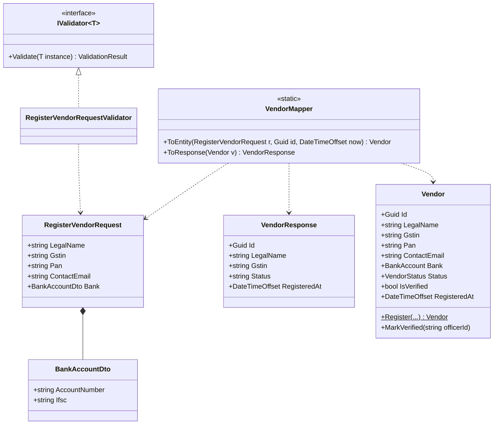
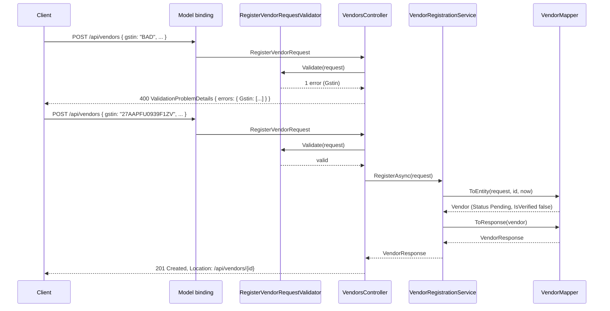

Every API has two shapes for the same idea: the shape the outside world sends and receives, and the shape you store and reason about inside. Beginners often use one class for both. It works for a week. Then a client sends a field it was not supposed to set, a database column change breaks a mobile app, and a validation rule is enforced on one endpoint but forgotten on another. This lesson is about keeping the two shapes apart on purpose, moving data between them cheaply, and rejecting bad input in a way clients can act on.

## Learning objectives

By the end of this lesson you will be able to:

1. Explain what a DTO is, how it differs from an entity, and why one class should not play both roles.
2. Describe the over-posting (mass assignment) vulnerability and show how a request DTO prevents it.
3. Write a manual mapper between DTOs and entities and judge when a mapping library is worth adding.
4. Validate request DTOs with DataAnnotations, with a hand-rolled validator class, and recognise the FluentValidation style.
5. Return validation failures as `ValidationProblemDetails` (RFC 9457) with per-field errors, from both controllers and minimal APIs.
6. Decide which rules belong in request validation and which belong in the domain model.

## Prerequisites

- [Controllers, services, repositories and domain models](#/lesson/m03-layers): this lesson adds the contract layer between the controller and the service.
- [Kestrel, middleware, routing, controllers and minimal APIs](#/lesson/m03-kestrel-middleware-routing): model binding and `[ApiController]` behaviour.
- [Classes, objects, fields, properties and methods](#/lesson/m01-classes-objects): records and init-only properties.

## Explain it like I'm a beginner

Think of a passport application at a Passport Seva Kendra.

The **form you fill in** has exactly the fields the office needs from you: name, date of birth, address, proof documents. It does not have a box for "application approved" or "officer's remarks". Those are decided by the office, not by you. That form is a **request DTO**: the data a client is allowed to send.

The **file the office keeps** has everything: your details, the officer who verified them, the approval status, internal notes, audit dates. That file is the **entity**: the full record the system owns.

The **passport you receive** shows only what the public needs: name, number, validity. It does not show the officer's notes. That is a **response DTO**: the data a client is allowed to see.

Now imagine the office used one single document for all three. You could write "approved" on your own form. A change to the internal filing format would change the passport layout. Anyone holding the passport could read the officer's notes. That is exactly what happens when a web API uses its database entity as its request and response type.

The three shapes have three owners: the client owns what it may send, the system owns what it stores, and the API contract owns what it exposes. **DTO** stands for data transfer object: a plain object whose only job is to carry data across a boundary.

## First-principles explanation

### Entities and DTOs serve different masters

An **entity** (or domain model) is shaped by business rules and storage: it has an identity, private state, behaviour, and often fields that are purely internal (`CreatedBy`, `RowVersion`, `IsVerified`). It changes when the business changes.

A **DTO** is shaped by a conversation: "what does the mobile app need to send to register a vendor?" It has no behaviour, only data. It changes when the API contract changes, which should be rarely and deliberately, because clients you do not control depend on it.

Using one class for both couples two things that change for different reasons. That is a Single Responsibility violation at the class level ([SRP](#/lesson/m04-srp)): renaming a database column should never break a mobile app, and adding a client-facing field should never add a database column.

### Over-posting: the security reason

Model binding in ASP.NET Core fills every public settable property it can match in the incoming JSON. If your action takes the entity directly:

```csharp
// DO NOT do this
[HttpPost]
public async Task<IActionResult> Register([FromBody] Vendor vendor) { _db.Vendors.Add(vendor); ... }
```

then a client can send `{"name":"Acme","isVerified":true,"rating":5,"creditLimit":10000000}` and all of it lands in the database. This is **over-posting**, also called **mass assignment**. It is on the OWASP list and it has caused real breaches (one well-known case involved a public code-hosting site where a user added their own key to another project's settings by posting an unexpected field).

The fix is structural, not a checklist: the request DTO contains only the fields the client may set. There is no `IsVerified` property to bind to, so no amount of creative JSON can set it. `[Bind]` attributes and `[JsonIgnore]` on the entity are fragile alternatives; someone will forget one.

### Mapping: the cost of two shapes

Two shapes means code that copies between them. There are three ways:

1. **Manual mapping** in a small static class or extension method. 10–30 lines per pair. Zero magic, refactor-safe (rename a property and the compiler tells you), easy to debug.
2. **Source-generated mappers** (Mapperly is the common one). You declare a partial method; the generator writes the manual mapping for you at compile time. You get compile-time safety and no runtime reflection.
3. **Reflection-based mappers** (AutoMapper is the best-known). Configure once, map by convention. Fast to write; failures appear at runtime when names drift, and nobody can "go to definition" on a mapping. Check its licence terms before adopting it in a commercial project, since they changed in 2025.

Our recommendation for most teams: write the mapping by hand. A typical API has 20–50 DTO pairs. That is maybe 800 lines of boring, obvious code that never surprises anyone. Reach for a generator when the count climbs and the mappings are truly mechanical. Avoid reflection-based mapping on the hot path of a high-throughput API, and avoid *any* mapper when a mapping involves a business decision; that is a domain method, not a copy.

:::callout type=tip title="Mapping is not where rules live"
`ToEntity()` should never contain `if (request.Amount > 100000) ...`. Mapping is copying. If a decision is being made, it is either validation (before mapping) or a domain rule (inside the entity's method). Keeping mappers dumb is what makes them boring, and boring is what you want here.
:::

### Validation: three places, three kinds of rule

Input can be wrong in three different ways, and each has a natural home:

| Kind of rule | Example | Where it belongs | Response |
|---|---|---|---|
| Shape and format | GSTIN must be 15 characters matching the pattern; email must be an email; quantity ≥ 1 | Request validation (DataAnnotations or a validator class), before the service is called | `400 Bad Request` with per-field errors |
| Cross-field and contextual | End date after start date; if `PaymentMode == "Bank"` then IFSC required | Request validation, same place | `400` with per-field errors |
| Business and state | GSTIN not already registered; vendor not blacklisted; bill not already paid | Domain model or service, because it needs data the request does not carry | `409 Conflict` or `422 Unprocessable Content` |

The first two are about the *request*. They can be checked with no database. The third is about the *world*. Mixing them (checking uniqueness inside a `[Required]`-style attribute, say) ties your request validation to a database call and makes it untestable in isolation.

### The tools in ASP.NET Core

**DataAnnotations** are attributes on DTO properties: `[Required]`, `[StringLength(100)]`, `[Range(1, 1000)]`, `[RegularExpression(...)]`, `[EmailAddress]`. With `[ApiController]` on a controller, an invalid model automatically produces a `400` with a `ValidationProblemDetails` body before your action runs. They are built in, declarative and fine for 80 % of rules. They are awkward for cross-field rules (you need `IValidatableObject` or a custom attribute) and they cannot take dependencies.

**Validator classes** put the rules in code: one class per DTO, a method that returns a list of errors. FluentValidation is the popular library for this style: `RuleFor(x => x.Gstin).Matches(...)`. The same idea can be hand-rolled in 40 lines with no package, which is what we compile below. Validator classes handle cross-field rules naturally, can be unit-tested directly, and can be registered in DI.

**Minimal APIs** do not validate automatically by default. In .NET 10, built-in validation for minimal APIs (`AddValidation()` and DataAnnotations on parameters and types) is available, so the gap has narrowed. Alternatively, call your validator in the endpoint, or use an endpoint filter.

### ProblemDetails: the standard shape for "no"

RFC 9457 (which replaced RFC 7807) defines a JSON body for errors: `type`, `title`, `status`, `detail`, `instance`, plus extension members. ASP.NET Core's `ValidationProblemDetails` adds `errors`, a dictionary of field name to array of messages:

```json
{
  "type": "https://tools.ietf.org/html/rfc9110#section-15.5.1",
  "title": "One or more validation errors occurred.",
  "status": 400,
  "errors": {
    "Gstin": ["GSTIN must be 15 characters in the format 22AAAAA0000A1Z5."],
    "BankAccount.Ifsc": ["IFSC is required when payment mode is Bank."]
  },
  "traceId": "00-7f3a...-01"
}
```

Why a standard shape? Because every client can write one error handler. A React form can map `errors` keys to input fields. A mobile app can show `title`. A support engineer can grep logs for `traceId`. Inventing your own `{ "success": false, "msg": "..." }` throws all of that away.

### What goes wrong without this discipline

- Entity exposed as response: a new `PasswordHash` or `InternalNotes` column appears in the JSON the day it is added.
- Entity accepted as request: over-posting, plus the client can send a malformed `Id` and overwrite someone else's record.
- Validation in the controller as `if` statements: the import endpoint forgets half of them; errors come back as plain strings in inconsistent formats.
- Validation in the mapper: nobody expects a `ToEntity()` call to throw.

## Visual explanation

### Class diagram — three shapes and the mapper between them



How to read it: `RegisterVendorRequest` has five fields the client may set. `Vendor` has those plus `Status`, `IsVerified` and `RegisteredAt`, which only the system sets. `VendorResponse` shows a subset of the entity (no PAN, no bank details) and formats `Status` as a string. The mapper depends on all three but none of them depend on it or on each other. The validator depends only on the request type, so it can be tested with a request object and nothing else.

### Sequence diagram — a request with a validation failure and one that succeeds



The first request never reaches the service: validation is cheap and happens first. The second passes, is mapped to an entity with system-owned fields set by the server (`IsVerified` is `false` no matter what the client sent, because the request type has no such property), and comes back as a response DTO that omits sensitive fields.

## Step-by-step example

The scenario: a state e-procurement portal where contractors register as vendors. The business needs the legal name, GSTIN, PAN, a contact email and bank details. Verification is done later by an officer. Vendors must never be able to mark themselves verified.

### Step 1 — the naive version and its three bugs

```csharp
// Entity used for everything
public class Vendor
{
    public Guid Id { get; set; }
    public string LegalName { get; set; }
    public string Gstin { get; set; }
    public string Pan { get; set; }
    public string BankAccountNumber { get; set; }
    public bool IsVerified { get; set; }
    public string? OfficerNotes { get; set; }
}

[HttpPost] public IActionResult Register(Vendor v) { if (v.LegalName == null) return BadRequest("name"); _db.Add(v); _db.SaveChanges(); return Ok(v); }
```

Bug 1: `IsVerified` can be set by the client. Bug 2: `Ok(v)` returns `OfficerNotes` and the full bank account number to the caller. Bug 3: the error is a bare string; the client cannot tell which field failed. The GSTIN is not checked at all.

### Step 2 — split the shapes

Create `RegisterVendorRequest` with exactly the five client-settable fields, `VendorResponse` with the public view, and keep `Vendor` as a proper entity with private setters and a `Register` factory method.

### Step 3 — map by hand

A static `VendorMapper` with two methods. Server-owned values (`Id`, `RegisteredAt`) are parameters, so the mapper stays pure and testable.

### Step 4 — validate before the service

Add DataAnnotations for the simple rules so `[ApiController]` rejects obviously broken requests. Add a validator class for the format rules (GSTIN, PAN, IFSC patterns) and the cross-field rule (bank details required). Return `ValidationProblem(...)` with the per-field errors.

### Step 5 — the business rule that needs data

"GSTIN must not already be registered" needs the database, so it lives in the service and comes back as `409 Conflict`, not `400`.

## Production-style C# implementation

Folder layout:

```text
Procure.Api/
  Program.cs
  Domain/Vendor.cs
  Contracts/VendorContracts.cs
  Contracts/VendorMapper.cs
  Validation/Validation.cs
  Validation/RegisterVendorRequestValidator.cs
  Application/VendorRegistrationService.cs
  Api/VendorsController.cs
```

```csharp file=Domain/Vendor.cs
namespace Procure.Domain;

public enum VendorStatus { Pending, Verified, Rejected }

public sealed record BankAccount(string AccountNumber, string Ifsc)
{
    /// <summary>Last four digits only, for display. The full number never leaves the server.</summary>
    public string Masked => AccountNumber.Length <= 4 ? "****" : $"****{AccountNumber[^4..]}";
}

/// <summary>The entity. System-owned fields (Status, IsVerified, RegisteredAt) have no public setter.</summary>
public sealed class Vendor
{
    public Guid Id { get; }
    public string LegalName { get; private set; }
    public string Gstin { get; }
    public string Pan { get; }
    public string ContactEmail { get; private set; }
    public BankAccount Bank { get; private set; }
    public VendorStatus Status { get; private set; } = VendorStatus.Pending;
    public bool IsVerified => Status == VendorStatus.Verified;
    public string? VerifiedByOfficerId { get; private set; }
    public DateTimeOffset RegisteredAt { get; }

    private Vendor(Guid id, string legalName, string gstin, string pan, string contactEmail, BankAccount bank, DateTimeOffset registeredAt)
    {
        Id = id;
        LegalName = legalName;
        Gstin = gstin;
        Pan = pan;
        ContactEmail = contactEmail;
        Bank = bank;
        RegisteredAt = registeredAt;
    }

    /// <summary>The only way to create a vendor. Trusts that format validation already happened; still guards the invariants it owns.</summary>
    public static Vendor Register(Guid id, string legalName, string gstin, string pan, string contactEmail, BankAccount bank, DateTimeOffset now)
    {
        ArgumentException.ThrowIfNullOrWhiteSpace(legalName);
        ArgumentException.ThrowIfNullOrWhiteSpace(gstin);
        if (!gstin.Substring(2, 10).Equals(pan, StringComparison.Ordinal))
            throw new ArgumentException("GSTIN characters 3–12 must equal the PAN.", nameof(gstin));
        return new Vendor(id, legalName.Trim(), gstin.ToUpperInvariant(), pan.ToUpperInvariant(), contactEmail.Trim(), bank, now);
    }

    public void MarkVerified(string officerId)
    {
        if (Status != VendorStatus.Pending) throw new InvalidOperationException($"Cannot verify a vendor in status {Status}.");
        ArgumentException.ThrowIfNullOrWhiteSpace(officerId);
        Status = VendorStatus.Verified;
        VerifiedByOfficerId = officerId;
    }

    /// <summary>Only the fields a vendor may change after registration. GSTIN and PAN are fixed; re-register to change them.</summary>
    public void UpdateContact(string contactEmail, BankAccount bank)
    {
        ArgumentException.ThrowIfNullOrWhiteSpace(contactEmail);
        ContactEmail = contactEmail.Trim();
        Bank = bank;
    }
}
```

```csharp file=Contracts/VendorContracts.cs
using System.ComponentModel.DataAnnotations;

namespace Procure.Contracts;

/// <summary>What a client may send. Note what is missing: Id, Status, IsVerified, RegisteredAt.</summary>
public sealed record RegisterVendorRequest
{
    [Required, StringLength(200, MinimumLength = 3)]
    public string LegalName { get; init; } = "";

    [Required, StringLength(15, MinimumLength = 15)]
    public string Gstin { get; init; } = "";

    [Required, StringLength(10, MinimumLength = 10)]
    public string Pan { get; init; } = "";

    [Required, EmailAddress, StringLength(254)]
    public string ContactEmail { get; init; } = "";

    [Required]
    public BankAccountDto Bank { get; init; } = new();
}

public sealed record BankAccountDto
{
    [Required, StringLength(18, MinimumLength = 9)]
    public string AccountNumber { get; init; } = "";

    [Required, StringLength(11, MinimumLength = 11)]
    public string Ifsc { get; init; } = "";
}

/// <summary>What a client may see. No PAN, no full account number, no officer id.</summary>
public sealed record VendorResponse(
    Guid Id,
    string LegalName,
    string Gstin,
    string ContactEmail,
    string BankAccountMasked,
    string Status,
    DateTimeOffset RegisteredAt);
```

```csharp file=Contracts/VendorMapper.cs
using Procure.Domain;

namespace Procure.Contracts;

/// <summary>Pure copying. No decisions, no I/O. Server-owned values come in as parameters.</summary>
public static class VendorMapper
{
    public static Vendor ToEntity(this RegisterVendorRequest r, Guid id, DateTimeOffset now) =>
        Vendor.Register(
            id,
            r.LegalName,
            r.Gstin.ToUpperInvariant(),
            r.Pan.ToUpperInvariant(),
            r.ContactEmail,
            new BankAccount(r.Bank.AccountNumber, r.Bank.Ifsc.ToUpperInvariant()),
            now);

    public static VendorResponse ToResponse(this Vendor v) =>
        new(v.Id, v.LegalName, v.Gstin, v.ContactEmail, v.Bank.Masked, v.Status.ToString(), v.RegisteredAt);
}
```

```csharp file=Validation/Validation.cs
namespace Procure.Validation;

public sealed record ValidationFailure(string PropertyName, string ErrorMessage);

public sealed class ValidationResult
{
    public static readonly ValidationResult Success = new(Array.Empty<ValidationFailure>());

    public IReadOnlyList<ValidationFailure> Errors { get; }
    public bool IsValid => Errors.Count == 0;

    public ValidationResult(IReadOnlyList<ValidationFailure> errors) => Errors = errors;

    /// <summary>Groups messages by property, in the shape ValidationProblemDetails expects.</summary>
    public Dictionary<string, string[]> ToDictionary() =>
        Errors.GroupBy(e => e.PropertyName)
              .ToDictionary(g => g.Key, g => g.Select(e => e.ErrorMessage).ToArray());
}

public interface IValidator<in T>
{
    ValidationResult Validate(T instance);
}

/// <summary>Tiny base class in the FluentValidation style: collect failures, return a result.</summary>
public abstract class AbstractValidator<T> : IValidator<T>
{
    public ValidationResult Validate(T instance)
    {
        var failures = new List<ValidationFailure>();
        Rules(instance, failures);
        return failures.Count == 0 ? ValidationResult.Success : new ValidationResult(failures);
    }

    protected abstract void Rules(T instance, List<ValidationFailure> failures);

    protected static void Must(List<ValidationFailure> failures, bool condition, string property, string message)
    {
        if (!condition) failures.Add(new ValidationFailure(property, message));
    }
}
```

```csharp file=Validation/RegisterVendorRequestValidator.cs
using System.Text.RegularExpressions;
using Procure.Contracts;

namespace Procure.Validation;

public sealed partial class RegisterVendorRequestValidator : AbstractValidator<RegisterVendorRequest>
{
    // Format only. The GSTIN check digit is not verified here; the GST network is the authority for that.
    [GeneratedRegex("^[0-9]{2}[A-Z]{5}[0-9]{4}[A-Z][1-9A-Z]Z[0-9A-Z]$")]
    private static partial Regex GstinPattern();

    [GeneratedRegex("^[A-Z]{5}[0-9]{4}[A-Z]$")]
    private static partial Regex PanPattern();

    [GeneratedRegex("^[A-Z]{4}0[A-Z0-9]{6}$")]
    private static partial Regex IfscPattern();

    protected override void Rules(RegisterVendorRequest r, List<ValidationFailure> f)
    {
        var gstin = r.Gstin.ToUpperInvariant();
        var pan = r.Pan.ToUpperInvariant();

        Must(f, GstinPattern().IsMatch(gstin), nameof(r.Gstin), "GSTIN must be 15 characters in the format 22AAAAA0000A1Z5.");
        Must(f, PanPattern().IsMatch(pan), nameof(r.Pan), "PAN must be 10 characters in the format AAAAA0000A.");

        // Cross-field rule: characters 3–12 of a GSTIN are the PAN of the registrant.
        if (gstin.Length == 15 && pan.Length == 10)
            Must(f, gstin.Substring(2, 10) == pan, nameof(r.Pan), "PAN does not match the PAN embedded in the GSTIN.");

        Must(f, IfscPattern().IsMatch(r.Bank.Ifsc.ToUpperInvariant()), $"{nameof(r.Bank)}.{nameof(r.Bank.Ifsc)}", "IFSC must be 11 characters, e.g. SBIN0001234.");
        Must(f, r.Bank.AccountNumber.All(char.IsDigit), $"{nameof(r.Bank)}.{nameof(r.Bank.AccountNumber)}", "Account number must contain digits only.");
    }
}
```

```csharp file=Application/VendorRegistrationService.cs
using System.Collections.Concurrent;
using Procure.Contracts;
using Procure.Domain;

namespace Procure.Application;

public interface IVendorRepository
{
    Task<bool> ExistsByGstinAsync(string gstin, CancellationToken ct = default);
    Task AddAsync(Vendor vendor, CancellationToken ct = default);
    Task<Vendor?> GetAsync(Guid id, CancellationToken ct = default);
}

public sealed class InMemoryVendorRepository : IVendorRepository
{
    private readonly ConcurrentDictionary<Guid, Vendor> _vendors = new();
    public Task<bool> ExistsByGstinAsync(string gstin, CancellationToken ct = default) =>
        Task.FromResult(_vendors.Values.Any(v => v.Gstin == gstin));
    public Task AddAsync(Vendor vendor, CancellationToken ct = default) { _vendors[vendor.Id] = vendor; return Task.CompletedTask; }
    public Task<Vendor?> GetAsync(Guid id, CancellationToken ct = default) => Task.FromResult(_vendors.GetValueOrDefault(id));
}

public enum RegistrationStatus { Created, DuplicateGstin }
public sealed record RegistrationOutcome(RegistrationStatus Status, VendorResponse? Vendor = null);

public sealed class VendorRegistrationService(IVendorRepository vendors, TimeProvider clock)
{
    public async Task<RegistrationOutcome> RegisterAsync(RegisterVendorRequest request, CancellationToken ct = default)
    {
        var gstin = request.Gstin.ToUpperInvariant();
        // A business rule that needs data the request does not carry: belongs here, not in the validator.
        if (await vendors.ExistsByGstinAsync(gstin, ct)) return new RegistrationOutcome(RegistrationStatus.DuplicateGstin);

        var vendor = request.ToEntity(Guid.NewGuid(), clock.GetUtcNow());
        await vendors.AddAsync(vendor, ct);
        return new RegistrationOutcome(RegistrationStatus.Created, vendor.ToResponse());
    }

    public async Task<VendorResponse?> GetAsync(Guid id, CancellationToken ct = default) =>
        (await vendors.GetAsync(id, ct))?.ToResponse();
}
```

```csharp file=Api/VendorsController.cs
using Microsoft.AspNetCore.Mvc;
using Procure.Application;
using Procure.Contracts;
using Procure.Validation;

namespace Procure.Api;

[ApiController]
[Route("api/vendors")]
public sealed class VendorsController(VendorRegistrationService registration, IValidator<RegisterVendorRequest> validator) : ControllerBase
{
    // [ApiController] has already returned 400 for DataAnnotation failures before this method runs.
    [HttpPost]
    [ProducesResponseType<VendorResponse>(StatusCodes.Status201Created)]
    [ProducesResponseType<ValidationProblemDetails>(StatusCodes.Status400BadRequest)]
    [ProducesResponseType<ProblemDetails>(StatusCodes.Status409Conflict)]
    public async Task<IActionResult> Register([FromBody] RegisterVendorRequest request, CancellationToken ct)
    {
        var validation = validator.Validate(request);
        if (!validation.IsValid)
            return ValidationProblem(new ValidationProblemDetails(validation.ToDictionary()));

        var outcome = await registration.RegisterAsync(request, ct);
        return outcome.Status switch
        {
            RegistrationStatus.Created => CreatedAtAction(nameof(GetById), new { id = outcome.Vendor!.Id }, outcome.Vendor),
            RegistrationStatus.DuplicateGstin => Problem(
                title: "Vendor already registered",
                detail: $"A vendor with GSTIN {request.Gstin.ToUpperInvariant()} already exists.",
                statusCode: StatusCodes.Status409Conflict),
            _ => Problem(statusCode: StatusCodes.Status500InternalServerError)
        };
    }

    [HttpGet("{id:guid}")]
    public async Task<ActionResult<VendorResponse>> GetById(Guid id, CancellationToken ct) =>
        await registration.GetAsync(id, ct) is { } vendor ? Ok(vendor) : NotFound();
}
```

```csharp file=Program.cs
using Procure.Application;
using Procure.Contracts;
using Procure.Validation;

var builder = WebApplication.CreateBuilder(args);

builder.Services.AddControllers();
builder.Services.AddProblemDetails();          // consistent ProblemDetails bodies for unhandled errors too
builder.Services.AddSingleton(TimeProvider.System);
builder.Services.AddSingleton<IVendorRepository, InMemoryVendorRepository>();
builder.Services.AddScoped<VendorRegistrationService>();
builder.Services.AddSingleton<IValidator<RegisterVendorRequest>, RegisterVendorRequestValidator>();

var app = builder.Build();
app.UseExceptionHandler();
app.MapControllers();

// The same validation from a minimal API endpoint: call the validator and use Results.ValidationProblem.
app.MapPost("/v2/vendors", async (RegisterVendorRequest request, IValidator<RegisterVendorRequest> validator,
                                  VendorRegistrationService registration, CancellationToken ct) =>
{
    var validation = validator.Validate(request);
    if (!validation.IsValid) return Results.ValidationProblem(validation.ToDictionary());

    var outcome = await registration.RegisterAsync(request, ct);
    return outcome.Status == RegistrationStatus.Created
        ? Results.Created($"/api/vendors/{outcome.Vendor!.Id}", outcome.Vendor)
        : Results.Problem(title: "Vendor already registered", statusCode: StatusCodes.Status409Conflict);
});

app.Run();
```

Points worth noticing:

- **Two validation passes, on purpose.** DataAnnotations catch the cheap, universal problems (missing, wrong length) and `[ApiController]` turns them into a 400 before the action runs. The validator class handles the domain-specific formats and the cross-field rule. Both produce the same `ValidationProblemDetails` shape, so the client sees one format.
- **The validator is a singleton** because it is stateless. A validator that needed a database (for uniqueness) would have to be scoped, and that is the smell telling you the rule belongs in the service instead.
- **`Vendor.Register` re-checks the GSTIN/PAN relationship.** The domain does not trust callers. Validation protects the user experience; invariants protect the data. Both are worth having, and the duplication is one line.
- **`Masked`** is how a response DTO avoids leaking: the mapper calls `v.Bank.Masked`, never `v.Bank.AccountNumber`.

### The same validator in FluentValidation

If your team prefers the library (it is widely used and well documented), the class above becomes:

```csharp
public sealed class RegisterVendorRequestValidator : AbstractValidator<RegisterVendorRequest>
{
    public RegisterVendorRequestValidator()
    {
        RuleFor(x => x.LegalName).NotEmpty().Length(3, 200);
        RuleFor(x => x.Gstin).Matches("^[0-9]{2}[A-Z]{5}[0-9]{4}[A-Z][1-9A-Z]Z[0-9A-Z]$")
            .WithMessage("GSTIN must be 15 characters in the format 22AAAAA0000A1Z5.");
        RuleFor(x => x.Pan).Matches("^[A-Z]{5}[0-9]{4}[A-Z]$");
        RuleFor(x => x).Must(r => r.Gstin.Length == 15 && r.Gstin.Substring(2, 10) == r.Pan)
            .WithName("Pan").WithMessage("PAN does not match the PAN embedded in the GSTIN.");
        RuleFor(x => x.Bank.Ifsc).Matches("^[A-Z]{4}0[A-Z0-9]{6}$");
        RuleFor(x => x.Bank.AccountNumber).Must(a => a.All(char.IsDigit));
    }
}

// Registration: builder.Services.AddValidatorsFromAssemblyContaining<RegisterVendorRequestValidator>();
// In the action: var result = await validator.ValidateAsync(request, ct);
//                if (!result.IsValid) return ValidationProblem(new ValidationProblemDetails(result.ToDictionary()));
```

The shape is the same as our hand-rolled version. The library adds a fluent API, async rules, conditional rules (`When(...)`), collection rules (`RuleForEach`) and localisation. Use it when you have more than a handful of validators; the hand-rolled version is enough for a small API and has no dependency.

## Bad design vs good design

**Bad**: one `Vendor` class for request, storage and response; validation by scattered `if` statements; errors as strings.

```csharp
[HttpPut("{id}")]
public async Task<IActionResult> Update(Guid id, Vendor incoming)
{
    var v = await _db.Vendors.FindAsync(id);
    if (v == null) return NotFound();
    _db.Entry(v).CurrentValues.SetValues(incoming);   // copies EVERY property, including IsVerified
    await _db.SaveChangesAsync();
    return Ok(v);                                     // returns OfficerNotes and the full account number
}
```

`SetValues(incoming)` is a one-line over-posting hole: whatever the client sends becomes the truth. And `Ok(v)` is a one-line data leak.

**Good**: an `UpdateVendorContactRequest` with only `ContactEmail` and `Bank`, validated, then `vendor.UpdateContact(...)` which can only change those two things, then `ToResponse()`. The entity's design makes the vulnerability impossible rather than merely unlikely.

**Also bad, in the other direction**: five DTOs per entity "for consistency" when three endpoints exist, a mapping library configured with 400 lines of profiles for 12 entities, and a validation layer that re-implements every domain invariant so the domain model becomes anemic. DTOs are a boundary tool. Inside the boundary (service to repository), pass the entity.

:::callout type=tradeoff title="How many DTOs per resource?"
A common, sensible set is: one *create* request, one *update* request (often a subset, because identity fields cannot change), and one *response*. Sometimes a *summary* response for list endpoints. Share a response type across GET-by-id and the body of a 201. Do not share a request type between create and update if the allowed fields differ; that is where over-posting creeps back in.
:::

## Practical playground

A console version of the request → validate → map → respond flow. Change the GSTIN or PAN and watch the errors appear per field. Then try sending an `IsVerified` property: there is nowhere for it to go.

:::playground type=csharp title="Validate, map, respond"
```csharp file=Program.cs
using System;
using System.Collections.Generic;
using System.Linq;
using System.Text.RegularExpressions;

public sealed record RegisterVendorRequest(string LegalName, string Gstin, string Pan, string Ifsc);

public sealed class Vendor
{
    public Guid Id { get; } = Guid.NewGuid();
    public string LegalName { get; }
    public string Gstin { get; }
    public bool IsVerified { get; private set; }   // no public setter: cannot be over-posted
    public Vendor(string legalName, string gstin) { LegalName = legalName; Gstin = gstin; }
    public void MarkVerified() => IsVerified = true;
}

public sealed record VendorResponse(Guid Id, string LegalName, string Gstin, string Status);

public static class Validator
{
    public static Dictionary<string, string[]> Validate(RegisterVendorRequest r)
    {
        var errors = new List<(string Field, string Message)>();
        if (string.IsNullOrWhiteSpace(r.LegalName) || r.LegalName.Length < 3) errors.Add(("LegalName", "At least 3 characters."));
        if (!Regex.IsMatch(r.Gstin, "^[0-9]{2}[A-Z]{5}[0-9]{4}[A-Z][1-9A-Z]Z[0-9A-Z]$")) errors.Add(("Gstin", "Invalid GSTIN format."));
        if (!Regex.IsMatch(r.Pan, "^[A-Z]{5}[0-9]{4}[A-Z]$")) errors.Add(("Pan", "Invalid PAN format."));
        else if (r.Gstin.Length == 15 && r.Gstin.Substring(2, 10) != r.Pan) errors.Add(("Pan", "PAN does not match GSTIN."));
        if (!Regex.IsMatch(r.Ifsc, "^[A-Z]{4}0[A-Z0-9]{6}$")) errors.Add(("Ifsc", "Invalid IFSC."));
        return errors.GroupBy(e => e.Field).ToDictionary(g => g.Key, g => g.Select(e => e.Message).ToArray());
    }
}

public static class Program
{
    public static void Main()
    {
        var request = new RegisterVendorRequest("Shree Infra Pvt Ltd", "27AAPFU0939F1ZV", "AAPFU0939F", "SBIN0001234");
        // Try: "27AAPFU0939F1ZV" with Pan "AAPFU0939G", or Ifsc "SBIN1234"

        var errors = Validator.Validate(request);
        if (errors.Count > 0)
        {
            Console.WriteLine("400 Bad Request");
            foreach (var (field, messages) in errors) Console.WriteLine($"  {field}: {string.Join("; ", messages)}");
            return;
        }

        var vendor = new Vendor(request.LegalName, request.Gstin);
        var response = new VendorResponse(vendor.Id, vendor.LegalName, vendor.Gstin, vendor.IsVerified ? "Verified" : "Pending");
        Console.WriteLine($"201 Created: {response}");
    }
}
```
:::

## Exercises

:::exercise id=m03-dtos-mapping-validation-ex1 difficulty=beginner kind=code title="Write a request validator"
Implement `CreateWorkOrderRequestValidator.Rules` for a work-order API used by a municipal corporation. Collect every failure (do not stop at the first) with the property name and a message.
::requirements
- `Title`: required, 5–120 characters after trimming.
- `WardNumber`: between 1 and 250 inclusive.
- `EstimatedCost`: greater than 0 and at most ₹5,00,00,000 (5 crore).
- `StartDate` must be on or before `EndDate` (cross-field; report under `EndDate`).
- `ContractorGstin`: if provided (not null or empty), must match the GSTIN pattern `^[0-9]{2}[A-Z]{5}[0-9]{4}[A-Z][1-9A-Z]Z[0-9A-Z]$`.
::acceptance
- A fully valid request returns `IsValid == true` with zero errors.
- A request with a 3-character title and ward 0 returns two errors, one per field.
- `ContractorGstin == null` produces no error; `"BAD"` produces one under `ContractorGstin`.
- `EndDate` before `StartDate` produces one error under `EndDate`.
::hint
Each rule is one `Must(...)` call. Collect, do not return early.
::hint
Trim the title before measuring it; `"  abc  "` has 3 real characters.
::hint
For the optional GSTIN, guard with `string.IsNullOrEmpty` before running the regex.
::hint
```csharp
Must(f, r.StartDate <= r.EndDate, nameof(r.EndDate), "End date must be on or after start date.");
if (!string.IsNullOrEmpty(r.ContractorGstin))
    Must(f, Gstin.IsMatch(r.ContractorGstin), nameof(r.ContractorGstin), "Invalid GSTIN format.");
```
::starter
```csharp file=CreateWorkOrderRequestValidator.cs
using System;
using System.Collections.Generic;
using System.Linq;
using System.Text.RegularExpressions;

public sealed record CreateWorkOrderRequest(
    string Title,
    int WardNumber,
    decimal EstimatedCost,
    DateOnly StartDate,
    DateOnly EndDate,
    string? ContractorGstin);

public sealed record ValidationFailure(string PropertyName, string ErrorMessage);

public sealed class ValidationResult
{
    public IReadOnlyList<ValidationFailure> Errors { get; }
    public bool IsValid => Errors.Count == 0;
    public ValidationResult(IReadOnlyList<ValidationFailure> errors) => Errors = errors;
    public Dictionary<string, string[]> ToDictionary() =>
        Errors.GroupBy(e => e.PropertyName).ToDictionary(g => g.Key, g => g.Select(e => e.ErrorMessage).ToArray());
}

public abstract class AbstractValidator<T>
{
    public ValidationResult Validate(T instance)
    {
        var failures = new List<ValidationFailure>();
        Rules(instance, failures);
        return new ValidationResult(failures);
    }

    protected abstract void Rules(T instance, List<ValidationFailure> failures);

    protected static void Must(List<ValidationFailure> failures, bool condition, string property, string message)
    {
        if (!condition) failures.Add(new ValidationFailure(property, message));
    }
}

public sealed class CreateWorkOrderRequestValidator : AbstractValidator<CreateWorkOrderRequest>
{
    private static readonly Regex Gstin = new("^[0-9]{2}[A-Z]{5}[0-9]{4}[A-Z][1-9A-Z]Z[0-9A-Z]$", RegexOptions.Compiled);

    protected override void Rules(CreateWorkOrderRequest r, List<ValidationFailure> f)
    {
        throw new NotImplementedException();
    }
}
```
::tests
```csharp file=CreateWorkOrderRequestValidatorTests.cs
using System;
using System.Linq;
using Xunit;

public class CreateWorkOrderRequestValidatorTests
{
    private static readonly CreateWorkOrderRequestValidator V = new();
    private static CreateWorkOrderRequest Valid() => new(
        "Resurfacing of MG Road, Ward 42", 42, 1_250_000m, new DateOnly(2026, 11, 1), new DateOnly(2027, 1, 31), "27AAPFU0939F1ZV");

    [Fact]
    public void Valid_request_has_no_errors()
    {
        var result = V.Validate(Valid());
        Assert.True(result.IsValid);
        Assert.Empty(result.Errors);
    }

    [Fact]
    public void Collects_multiple_failures()
    {
        var result = V.Validate(Valid() with { Title = "  abc ", WardNumber = 0 });
        Assert.False(result.IsValid);
        var dict = result.ToDictionary();
        Assert.Equal(2, dict.Count);
        Assert.True(dict.ContainsKey("Title"));
        Assert.True(dict.ContainsKey("WardNumber"));
    }

    [Fact]
    public void Cost_bounds()
    {
        Assert.False(V.Validate(Valid() with { EstimatedCost = 0m }).IsValid);
        Assert.False(V.Validate(Valid() with { EstimatedCost = 50_000_001m }).IsValid);
        Assert.True(V.Validate(Valid() with { EstimatedCost = 50_000_000m }).IsValid);
    }

    [Fact]
    public void End_before_start_is_reported_under_EndDate()
    {
        var result = V.Validate(Valid() with { EndDate = new DateOnly(2026, 10, 1) });
        var only = Assert.Single(result.Errors);
        Assert.Equal("EndDate", only.PropertyName);
    }

    [Fact]
    public void Gstin_is_optional_but_must_be_valid_when_present()
    {
        Assert.True(V.Validate(Valid() with { ContractorGstin = null }).IsValid);
        Assert.True(V.Validate(Valid() with { ContractorGstin = "" }).IsValid);
        var result = V.Validate(Valid() with { ContractorGstin = "BAD" });
        Assert.Equal("ContractorGstin", Assert.Single(result.Errors).PropertyName);
    }
}
```
::solution
Five rules, five `Must` calls, one guard for the optional field.

```csharp file=CreateWorkOrderRequestValidator.cs
using System;
using System.Collections.Generic;
using System.Linq;
using System.Text.RegularExpressions;

public sealed record CreateWorkOrderRequest(
    string Title,
    int WardNumber,
    decimal EstimatedCost,
    DateOnly StartDate,
    DateOnly EndDate,
    string? ContractorGstin);

public sealed record ValidationFailure(string PropertyName, string ErrorMessage);

public sealed class ValidationResult
{
    public IReadOnlyList<ValidationFailure> Errors { get; }
    public bool IsValid => Errors.Count == 0;
    public ValidationResult(IReadOnlyList<ValidationFailure> errors) => Errors = errors;
    public Dictionary<string, string[]> ToDictionary() =>
        Errors.GroupBy(e => e.PropertyName).ToDictionary(g => g.Key, g => g.Select(e => e.ErrorMessage).ToArray());
}

public abstract class AbstractValidator<T>
{
    public ValidationResult Validate(T instance)
    {
        var failures = new List<ValidationFailure>();
        Rules(instance, failures);
        return new ValidationResult(failures);
    }

    protected abstract void Rules(T instance, List<ValidationFailure> failures);

    protected static void Must(List<ValidationFailure> failures, bool condition, string property, string message)
    {
        if (!condition) failures.Add(new ValidationFailure(property, message));
    }
}

public sealed class CreateWorkOrderRequestValidator : AbstractValidator<CreateWorkOrderRequest>
{
    private static readonly Regex Gstin = new("^[0-9]{2}[A-Z]{5}[0-9]{4}[A-Z][1-9A-Z]Z[0-9A-Z]$", RegexOptions.Compiled);
    private const decimal MaxCost = 50_000_000m;   // ₹5 crore

    protected override void Rules(CreateWorkOrderRequest r, List<ValidationFailure> f)
    {
        var title = (r.Title ?? "").Trim();
        Must(f, title.Length is >= 5 and <= 120, nameof(r.Title), "Title must be 5–120 characters.");
        Must(f, r.WardNumber is >= 1 and <= 250, nameof(r.WardNumber), "Ward number must be between 1 and 250.");
        Must(f, r.EstimatedCost > 0 && r.EstimatedCost <= MaxCost, nameof(r.EstimatedCost), "Estimated cost must be between ₹1 and ₹5 crore.");
        Must(f, r.StartDate <= r.EndDate, nameof(r.EndDate), "End date must be on or after start date.");
        if (!string.IsNullOrEmpty(r.ContractorGstin))
            Must(f, Gstin.IsMatch(r.ContractorGstin), nameof(r.ContractorGstin), "Invalid GSTIN format.");
    }
}
```

`ToDictionary()` produces exactly the `errors` member that `ValidationProblemDetails` expects, so the controller can return `ValidationProblem(new ValidationProblemDetails(result.ToDictionary()))` without any further shaping.
::mistakes
- Returning after the first failure, so the user fixes one field, resubmits, and discovers the next problem. Collect everything.
- Reporting the date rule under `StartDate` and `EndDate` both, which shows the same message twice in a form.
- Treating `""` as a GSTIN to validate. Empty means "not provided".
:::

:::exercise id=m03-dtos-mapping-validation-ex2 difficulty=beginner kind=written title="Find the over-posting and the data leaks"
An HR system has this entity and endpoint:

```csharp
public class Employee
{
    public int Id { get; set; }
    public string Name { get; set; }
    public string Email { get; set; }
    public string Department { get; set; }
    public decimal Salary { get; set; }
    public string Role { get; set; }          // "Staff" | "Manager" | "Admin"
    public string PasswordHash { get; set; }
    public string PanNumber { get; set; }
    public DateTime CreatedAt { get; set; }
}

[HttpPut("me")]
public async Task<IActionResult> UpdateProfile(Employee e)
{
    var current = await _db.Employees.FindAsync(CurrentUserId);
    _db.Entry(current).CurrentValues.SetValues(e);
    await _db.SaveChangesAsync();
    return Ok(current);
}
```

Employees may update their own name and email only. List every field a malicious employee could change, every field that leaks in the response, and write the request and response DTOs that fix both.
::acceptance
- `Salary`, `Role`, `PasswordHash`, `Id`, `Department`, `PanNumber` and `CreatedAt` are all identified as over-postable.
- `PasswordHash`, `Salary` and `PanNumber` (at least) are identified as leaking in the response.
- The proposed request DTO has exactly two properties.
::hint
`SetValues` copies every property that exists on both objects. Which ones exist on `Employee`?
::hint
Anything in the entity is in the `Ok(current)` JSON. Which of those should a browser never see?
::hint
Name the DTOs `UpdateMyProfileRequest` and `EmployeeProfileResponse`.
::solution
**Over-postable**: every property except the two allowed ones, because model binding fills them from JSON and `SetValues` copies them all. An employee can POST `{"salary": 9999999, "role": "Admin", "passwordHash": "<hash of a password they know>"}` and become an admin with a chosen password. Changing `Id` can even redirect the write.

**Leaked**: `PasswordHash` (enables offline cracking), `Salary`, `PanNumber` (government identifier). Arguably `Role` and `CreatedAt` are fine but unnecessary.

**Fix**:

```csharp
public sealed record UpdateMyProfileRequest(
    [property: Required, StringLength(100, MinimumLength = 2)] string Name,
    [property: Required, EmailAddress] string Email);

public sealed record EmployeeProfileResponse(int Id, string Name, string Email, string Department, string Role);

[HttpPut("me")]
public async Task<ActionResult<EmployeeProfileResponse>> UpdateProfile(UpdateMyProfileRequest request)
{
    var employee = await _db.Employees.FindAsync(CurrentUserId);
    if (employee is null) return NotFound();
    employee.UpdateContact(request.Name, request.Email);   // domain method that touches only those two
    await _db.SaveChangesAsync();
    return Ok(new EmployeeProfileResponse(employee.Id, employee.Name, employee.Email, employee.Department, employee.Role));
}
```

The request type has nowhere to put `salary`; unknown JSON properties are ignored by `System.Text.Json` by default. The response type has no `PasswordHash` to leak.
::mistakes
- Fixing it by adding `[JsonIgnore]` to `PasswordHash` only. The over-posting remains, and the next sensitive column will be forgotten.
- Using `[Bind("Name,Email")]`. It works for MVC model binding but is easy to miss in review and does nothing for the response.
:::

:::exercise id=m03-dtos-mapping-validation-ex3 difficulty=intermediate kind=code title="Map a request to an entity without leaking system fields"
Implement `TenderMapper.ToEntity`, `TenderMapper.ToResponse` and `Tender.ApplyUpdate` for a tender-publishing API. The update must be able to change only the title, description and closing date; the tender's reference number, status and publication timestamp must be untouchable through the API.
::requirements
- `ToEntity(request, referenceNumber, now)` creates a `Tender` with `Status = Draft` and `CreatedAt = now`.
- `ToResponse(tender)` returns `TenderResponse` with `Status` as a string and `DaysUntilClose` computed from `asOf`.
- `ApplyUpdate(request)` changes title, description and closing date; throws `InvalidOperationException` if the tender is `Published` and the closing date would move earlier.
::acceptance
- Mapping a request never sets `Status` to anything but `Draft`.
- `DaysUntilClose` for a tender closing 2026-12-01 as of 2026-11-21 is 10.
- Updating a published tender to an earlier closing date throws; to a later date succeeds.
::hint
The mapper calls the entity's factory method. Server-owned values are parameters of the mapper so it stays pure.
::hint
`DaysUntilClose` is `closingDate.DayNumber - asOf.DayNumber`.
::hint
`ApplyUpdate` is a domain method: it knows the status rule. The mapper does not.
::hint
```csharp
public void ApplyUpdate(string title, string description, DateOnly closingDate)
{
    if (Status == TenderStatus.Published && closingDate < ClosingDate)
        throw new InvalidOperationException("Cannot bring forward the closing date of a published tender.");
    ...
}
```
::starter
```csharp file=TenderMapper.cs
using System;

public enum TenderStatus { Draft, Published, Closed }

public sealed class Tender
{
    public string ReferenceNumber { get; }
    public string Title { get; private set; }
    public string Description { get; private set; }
    public DateOnly ClosingDate { get; private set; }
    public TenderStatus Status { get; private set; }
    public DateTimeOffset CreatedAt { get; }
    public DateTimeOffset? PublishedAt { get; private set; }

    private Tender(string referenceNumber, string title, string description, DateOnly closingDate, DateTimeOffset createdAt)
    {
        ReferenceNumber = referenceNumber;
        Title = title;
        Description = description;
        ClosingDate = closingDate;
        CreatedAt = createdAt;
        Status = TenderStatus.Draft;
    }

    public static Tender Create(string referenceNumber, string title, string description, DateOnly closingDate, DateTimeOffset now)
    {
        ArgumentException.ThrowIfNullOrWhiteSpace(referenceNumber);
        ArgumentException.ThrowIfNullOrWhiteSpace(title);
        return new Tender(referenceNumber, title.Trim(), description?.Trim() ?? "", closingDate, now);
    }

    public void Publish(DateTimeOffset now)
    {
        if (Status != TenderStatus.Draft) throw new InvalidOperationException("Only drafts can be published.");
        Status = TenderStatus.Published;
        PublishedAt = now;
    }

    public void ApplyUpdate(string title, string description, DateOnly closingDate) => throw new NotImplementedException();
}

public sealed record CreateTenderRequest(string Title, string Description, DateOnly ClosingDate);
public sealed record UpdateTenderRequest(string Title, string Description, DateOnly ClosingDate);
public sealed record TenderResponse(string ReferenceNumber, string Title, string Description, DateOnly ClosingDate, string Status, int DaysUntilClose);

public static class TenderMapper
{
    public static Tender ToEntity(this CreateTenderRequest request, string referenceNumber, DateTimeOffset now) => throw new NotImplementedException();
    public static TenderResponse ToResponse(this Tender tender, DateOnly asOf) => throw new NotImplementedException();
}
```
::tests
```csharp file=TenderMapperTests.cs
using System;
using Xunit;

public class TenderMapperTests
{
    private static readonly DateTimeOffset Now = new(2026, 11, 1, 10, 0, 0, TimeSpan.Zero);

    [Fact]
    public void ToEntity_sets_system_fields_from_server_values()
    {
        var request = new CreateTenderRequest("  Supply of LED street lights  ", "500 units, 90W", new DateOnly(2026, 12, 1));
        var tender = request.ToEntity("PWD/2026/0117", Now);
        Assert.Equal("PWD/2026/0117", tender.ReferenceNumber);
        Assert.Equal("Supply of LED street lights", tender.Title);
        Assert.Equal(TenderStatus.Draft, tender.Status);
        Assert.Equal(Now, tender.CreatedAt);
        Assert.Null(tender.PublishedAt);
    }

    [Fact]
    public void ToResponse_formats_status_and_days()
    {
        var tender = Tender.Create("PWD/2026/0118", "Road marking", "", new DateOnly(2026, 12, 1), Now);
        var response = tender.ToResponse(new DateOnly(2026, 11, 21));
        Assert.Equal("Draft", response.Status);
        Assert.Equal(10, response.DaysUntilClose);
        Assert.Equal("PWD/2026/0118", response.ReferenceNumber);
    }

    [Fact]
    public void Update_changes_only_allowed_fields()
    {
        var tender = Tender.Create("PWD/2026/0119", "Old", "Old desc", new DateOnly(2026, 12, 1), Now);
        tender.ApplyUpdate("New", "New desc", new DateOnly(2026, 12, 15));
        Assert.Equal("New", tender.Title);
        Assert.Equal("New desc", tender.Description);
        Assert.Equal(new DateOnly(2026, 12, 15), tender.ClosingDate);
        Assert.Equal(TenderStatus.Draft, tender.Status);
        Assert.Equal(Now, tender.CreatedAt);
    }

    [Fact]
    public void Published_tender_cannot_close_earlier()
    {
        var tender = Tender.Create("PWD/2026/0120", "T", "", new DateOnly(2026, 12, 1), Now);
        tender.Publish(Now);
        Assert.Throws<InvalidOperationException>(() => tender.ApplyUpdate("T", "", new DateOnly(2026, 11, 25)));
        tender.ApplyUpdate("T", "", new DateOnly(2026, 12, 10));
        Assert.Equal(new DateOnly(2026, 12, 10), tender.ClosingDate);
    }
}
```
::solution
The mapper is two expression-bodied methods. The rule about published tenders is in the entity because it depends on entity state.

```csharp file=TenderMapper.cs
using System;

public enum TenderStatus { Draft, Published, Closed }

public sealed class Tender
{
    public string ReferenceNumber { get; }
    public string Title { get; private set; }
    public string Description { get; private set; }
    public DateOnly ClosingDate { get; private set; }
    public TenderStatus Status { get; private set; }
    public DateTimeOffset CreatedAt { get; }
    public DateTimeOffset? PublishedAt { get; private set; }

    private Tender(string referenceNumber, string title, string description, DateOnly closingDate, DateTimeOffset createdAt)
    {
        ReferenceNumber = referenceNumber;
        Title = title;
        Description = description;
        ClosingDate = closingDate;
        CreatedAt = createdAt;
        Status = TenderStatus.Draft;
    }

    public static Tender Create(string referenceNumber, string title, string description, DateOnly closingDate, DateTimeOffset now)
    {
        ArgumentException.ThrowIfNullOrWhiteSpace(referenceNumber);
        ArgumentException.ThrowIfNullOrWhiteSpace(title);
        return new Tender(referenceNumber, title.Trim(), description?.Trim() ?? "", closingDate, now);
    }

    public void Publish(DateTimeOffset now)
    {
        if (Status != TenderStatus.Draft) throw new InvalidOperationException("Only drafts can be published.");
        Status = TenderStatus.Published;
        PublishedAt = now;
    }

    public void ApplyUpdate(string title, string description, DateOnly closingDate)
    {
        ArgumentException.ThrowIfNullOrWhiteSpace(title);
        if (Status == TenderStatus.Published && closingDate < ClosingDate)
            throw new InvalidOperationException("Cannot bring forward the closing date of a published tender.");
        Title = title.Trim();
        Description = description?.Trim() ?? "";
        ClosingDate = closingDate;
    }
}

public sealed record CreateTenderRequest(string Title, string Description, DateOnly ClosingDate);
public sealed record UpdateTenderRequest(string Title, string Description, DateOnly ClosingDate);
public sealed record TenderResponse(string ReferenceNumber, string Title, string Description, DateOnly ClosingDate, string Status, int DaysUntilClose);

public static class TenderMapper
{
    public static Tender ToEntity(this CreateTenderRequest request, string referenceNumber, DateTimeOffset now) =>
        Tender.Create(referenceNumber, request.Title, request.Description, request.ClosingDate, now);

    public static TenderResponse ToResponse(this Tender tender, DateOnly asOf) =>
        new(tender.ReferenceNumber, tender.Title, tender.Description, tender.ClosingDate, tender.Status.ToString(),
            tender.ClosingDate.DayNumber - asOf.DayNumber);
}
```

In the controller, the update endpoint becomes `tender.ApplyUpdate(request.Title, request.Description, request.ClosingDate)`. There is no code path through which `Status`, `ReferenceNumber` or `CreatedAt` can be set from a request.
::alternatives
If the update DTO allowed partial updates (only the fields present), you would use nullable properties and `JSON Merge Patch` semantics, or `JsonPatchDocument`. That is more flexible and more complex; most APIs are fine with "send the whole editable subset".
::mistakes
- Putting the "published tender cannot close earlier" rule in the mapper or the controller.
- Letting `ToResponse` call `DateTime.Today` for `asOf`, making the mapper impure and untestable at a fixed date.
:::

:::exercise id=m03-dtos-mapping-validation-ex4 difficulty=intermediate kind=design title="Design the DTO set for a hospital appointment resource"
A clinic API manages appointments. Patients book through a mobile app; receptionists reschedule and cancel through a web portal; doctors see a daily list. The `Appointment` entity has: `Id`, `PatientId`, `DoctorId`, `SlotStart`, `SlotEnd`, `Status` (Booked, CheckedIn, Completed, Cancelled, NoShow), `BookedAt`, `CancelledReason`, `InternalNotes`, `PaymentStatus`, `ConsultationFee`.

Design the request and response DTOs for: patient booking, receptionist rescheduling, cancellation, and the doctor's daily list. State which fields each one includes and which it deliberately excludes.
::acceptance
- The patient booking request contains no `Status`, `PaymentStatus`, `ConsultationFee` or `InternalNotes`.
- The reschedule request contains only what changes (new slot) plus possibly a reason.
- The doctor's list response excludes `ConsultationFee` and `PaymentStatus` but includes patient display name.
- Each DTO has a one-line statement of who may send or receive it.
::hint
Start from the four conversations, not from the entity. What does each actor need to say or see?
::hint
A reschedule changes two fields. A cancellation changes one and adds a reason. They should not share a request type.
::hint
List responses are usually slimmer than detail responses; design a `AppointmentSummary` separate from `AppointmentDetail`.
::solution
**`BookAppointmentRequest`** (patient app → server): `DoctorId`, `SlotStart`. That is all. `PatientId` comes from the authenticated user, not the body (otherwise a patient could book for someone else). `SlotEnd` is derived from the doctor's slot length. `Status`, `BookedAt`, `ConsultationFee` and `PaymentStatus` are set by the server.

**`RescheduleAppointmentRequest`** (receptionist portal → server): `NewSlotStart`, optional `Reason`. The appointment id is in the URL. The server checks the receptionist's role and the slot's availability.

**`CancelAppointmentRequest`** (patient app or portal → server): `Reason` (required for receptionist, optional for patient; enforce in the validator based on the caller's role, or use two endpoints).

**`AppointmentDetailResponse`** (to patient or receptionist): `Id`, `DoctorName`, `SlotStart`, `SlotEnd`, `Status`, `ConsultationFee`, `PaymentStatus`. Excludes `InternalNotes` and `CancelledReason` when the caller is the patient; a receptionist variant may include `CancelledReason`.

**`DoctorDayListItem`** (to doctor): `Id`, `PatientDisplayName`, `SlotStart`, `SlotEnd`, `Status`. Excludes money fields, which are not the doctor's concern, and `InternalNotes`, which are reception-only.

Five DTOs for one entity sounds like a lot, but each one answers exactly one conversation, and none can be used to set or see something its actor should not.
::mistakes
- Accepting `PatientId` in the booking body. Identity comes from authentication.
- A single `AppointmentDto` used for all five cases, with nullable everything and comments saying "ignored on input".
:::

:::exercise id=m03-dtos-mapping-validation-ex5 difficulty=advanced kind=written title="Where does the uniqueness check go, and what status code is it?"
A team has a `RegisterUserRequest` with a `Username` field. They want "username must be unique" to be a validation rule, so they wrote a custom DataAnnotations attribute that injects `IUserRepository` via `validationContext.GetService` and queries the database. It works in development. In production they see two problems: duplicate usernames still appear occasionally under load, and the validator cannot be unit-tested without the database.

Explain why both problems occur, where the check should live instead, which status code the duplicate case should return and why, and how to make the rule actually hold under concurrency.
::acceptance
- Identifies the race between the check and the insert (time-of-check to time-of-use).
- Moves the rule to the service and names the database unique constraint as the real guarantee.
- Chooses 409 Conflict (or defends 422) with a reason, and shows a ProblemDetails body.
- Keeps request validation free of I/O so it remains unit-testable.
::hint
Two requests for the same username arrive 5 ms apart. Walk through what each one sees.
::hint
Request validation answers "is this request well-formed?". Uniqueness answers "does the world allow this?".
::hint
A unique index in PostgreSQL plus catching the unique-violation error (SQLSTATE 23505) is the only check that cannot race.
::solution
**Why duplicates appear**: the attribute checks "does `ravi` exist?" and gets "no". Five milliseconds later a second request checks and also gets "no". Both insert. The check and the insert are separate operations with no lock between them. No amount of validation code fixes this; only the database can, because only the database sees both inserts.

**Why it is untestable**: the attribute reaches into the service provider for a repository, so the validator has a hidden dependency on infrastructure. Request validation should be a pure function of the request.

**Where it goes**: in `UserRegistrationService.RegisterAsync`. Do a fast pre-check (`ExistsAsync`) for a friendly error in the common case, then rely on a `UNIQUE` index on `users(username)` as the actual guarantee. Catch the unique-violation exception from the insert and translate it to the same outcome as the pre-check. The pre-check is an optimisation; the constraint is the rule.

**Status code**: `409 Conflict`. The request is syntactically and semantically valid; it conflicts with the current state of the resource collection. `422 Unprocessable Content` is defensible if the team treats "cannot be processed given server state" that way, but 409 communicates "try a different value" more directly and is the more common convention for duplicates. Body:

```json
{
  "type": "https://example.gov.in/problems/username-taken",
  "title": "Username already taken",
  "status": 409,
  "detail": "The username 'ravi' is already registered.",
  "instance": "/api/users",
  "errors": { "Username": ["Already taken."] }
}
```

Including an `errors` extension member lets the same client-side form code highlight the field, even though the status is 409 rather than 400.

**Validation stays pure**: `RegisterUserRequestValidator` checks length and allowed characters only, needs no DI, and is tested with plain objects.
::mistakes
- "Fixing" the race with a `lock` in the service. It only works on one server instance and breaks the moment you scale out.
- Returning 400 for duplicates, which makes clients think the input was malformed and retry with the same value.
:::

## Automated testing

Three kinds of test, matching the three things this lesson introduced.

**Validator tests** are the cheapest and should be the most numerous. Construct a valid request, mutate one field with `with { ... }`, assert exactly which property failed and with what message. Exercise 1 shows the pattern. Aim for one test per rule plus one "all valid" test. Because the validator has no dependencies, a hundred of these run in well under a second.

**Mapper tests** check two things: that server-owned fields come from the parameters and not from the request, and that sensitive fields do not appear in responses. The second is worth an explicit test:

```csharp
[Fact]
public void Response_never_contains_full_account_number()
{
    var vendor = Vendor.Register(Guid.NewGuid(), "Shree Infra", "27AAPFU0939F1ZV", "AAPFU0939F", "a@b.in",
        new BankAccount("123456789012", "SBIN0001234"), DateTimeOffset.UtcNow);
    var json = JsonSerializer.Serialize(vendor.ToResponse());
    Assert.DoesNotContain("123456789012", json);
    Assert.Contains("****9012", json);
}
```

Serialising to JSON and searching the string is crude, but it catches the exact bug that matters: a secret in the wire format.

**Contract tests** through `WebApplicationFactory<Program>` send a real HTTP request with a bad body and assert the response is `400`, has `Content-Type: application/problem+json`, and that `errors` contains the expected key. One such test per endpoint proves the whole chain (binding, DataAnnotations, validator, `ValidationProblem`) is wired. Also send a body with an extra `"isVerified": true` property and assert that the created vendor's status is still `Pending`; that is your over-posting regression test.

## Real-world application

- **Public APIs with long-lived clients** (payment gateways, government data portals, UPI switches) treat DTOs as versioned contracts. The internal entity can be refactored freely as long as the mapper keeps producing the same JSON. Breaking changes get a new version ([API versioning, pagination, filtering and sorting](#/lesson/m03-api-shape)).
- **ASP.NET Core Identity** does not expose `IdentityUser` over HTTP in its templates; you write `RegisterRequest` and `LoginRequest` DTOs. The reason is exactly over-posting: `IdentityUser` has `EmailConfirmed`, `LockoutEnabled` and `PasswordHash`.
- **Infrastructure project platforms** that take progress data from contractors keep the "contractor-submitted" DTO strictly smaller than the entity, because the entity also carries engineer-approved quantities and payment certification flags that a contractor must never set.
- **Mobile apps on slow networks** benefit from response DTOs tailored to each screen, because sending a 40-field entity to render a 5-field list item wastes bandwidth and leaks data.

## Interview questions

:::interview
::q beginner
What is a DTO and why not just return the entity from a controller?
::a
A DTO (data transfer object) is a plain object that carries data across a boundary, such as HTTP, with no behaviour. Returning the entity couples the public API to the database schema (a renamed column breaks clients), leaks internal or sensitive fields (`PasswordHash`, audit columns), and, when used for input, allows over-posting, where the client sets fields it should not. A response DTO exposes exactly the intended view; a request DTO accepts exactly the allowed fields.
::q beginner
What is over-posting and what is the structural fix?
::a
Over-posting (mass assignment) is when a client sends JSON properties the developer did not intend to be settable, and model binding fills them because the bound type has those properties. For example posting `"isAdmin": true` to a profile update. The structural fix is to bind to a request DTO that only has the allowed properties, so there is nothing for the extra JSON to bind to. Attributes like `[Bind]` or `[JsonIgnore]` are patches that someone will forget.
::q intermediate
Compare DataAnnotations and a validator class (FluentValidation style). When would you choose each?
::a
DataAnnotations are attributes on properties, built in, declarative, and automatically enforced by `[ApiController]` (and in .NET 10 by minimal APIs with `AddValidation()`), producing `ValidationProblemDetails` with no extra code. They struggle with cross-field rules, conditional rules and anything needing a dependency. A validator class puts rules in code: natural for cross-field logic, easy to unit-test, composable, registrable in DI. Choose DataAnnotations for simple shape rules on small APIs; add validator classes (hand-rolled or FluentValidation) when rules are cross-field or numerous. Many teams use both: annotations for the basics, a validator for the rest, both producing the same ProblemDetails shape.
::q intermediate
What is ProblemDetails and why should validation errors use it?
::a
ProblemDetails is the standard JSON error body from RFC 9457: `type`, `title`, `status`, `detail`, `instance` plus extensions. ASP.NET Core's `ValidationProblemDetails` adds `errors`, a map of field name to messages, served with `Content-Type: application/problem+json`. Using it means every client can share one error handler: map `errors` to form fields, show `title`, log `traceId`. Custom `{ success: false, message }` shapes force every client to special-case every API.
::q advanced
A mapping library maps `OrderRequest` to `Order` by convention. A developer renames `Order.ShippingAddress` to `Order.DeliveryAddress`. What happens, and how does your choice of mapping approach affect it?
::a
With a reflection-based convention mapper, nothing fails at compile time. At runtime the destination property is silently left null (or a configuration validation step, if the team runs one in tests, reports an unmapped member). The bug is found by a customer whose order has no address. With a manual mapper, the compiler fails the build at the renamed property; the fix is a one-line edit. With a source-generated mapper like Mapperly, the generator emits a warning or error for the unmapped member at compile time. The trade-off is writing time versus failure time: convention mapping saves typing today and moves failures to runtime; explicit mapping costs typing and keeps failures at compile time. For money and addresses, prefer compile-time.
::q advanced
Where do you draw the line between request validation and domain invariants, given that they often check the same thing?
::a
Request validation answers "is this request well-formed and self-consistent?" and runs before any business logic, with no I/O, returning 400 with per-field errors; its purpose is user experience and early rejection. Domain invariants answer "can this object ever be in this state?" and run inside the entity's constructor or methods, throwing if violated; their purpose is data integrity regardless of caller (API, import job, test). Some rules appear in both, like "amount must be positive", and that duplication is deliberate: the validator gives a friendly message, the invariant guarantees that no code path, including ones written next year, can create a negative amount. Rules that need external state (uniqueness, balances, permissions) belong in the service or domain, never in request validation, and map to 409/422/403 rather than 400.
:::

## Summary and revision

**Key takeaways**

- Three shapes, three owners: request DTO (what the client may send), entity (what the system owns), response DTO (what the client may see).
- Over-posting is prevented by the *absence* of a property on the request type, not by attributes.
- Map by hand unless the count of mappings makes a source generator worthwhile; keep mappers free of decisions.
- Validate request shape with DataAnnotations and a validator class; validate world-state rules in the service or domain.
- Return validation failures as `ValidationProblemDetails` so clients can map `errors` to fields; use 409 or 422, not 400, for state conflicts.

**Terminology**: DTO, entity, over-posting / mass assignment, mapper, DataAnnotations, `[ApiController]`, `IValidatableObject`, FluentValidation, ProblemDetails (RFC 9457), `ValidationProblemDetails`, `application/problem+json`.

:::flashcards
Q: Why should a request DTO not include `IsVerified`?
A: So the client cannot set it. Model binding can only fill properties that exist on the bound type; absence is the protection.
Q: What is over-posting?
A: A client sending JSON fields the developer did not intend to be settable; model binding fills them because the bound type has them.
Q: What content type does ASP.NET Core use for ProblemDetails?
A: `application/problem+json`.
Q: Which member of ValidationProblemDetails holds per-field errors?
A: `errors`, a dictionary of property name to an array of messages.
Q: Where should "GSTIN must be unique" be checked?
A: In the service with a database unique constraint as the guarantee; returns 409, not 400.
Q: What should a mapper never contain?
A: Business decisions or I/O. Mapping is copying; decisions belong in validation or the domain.
Q: What does [ApiController] do for invalid models?
A: Returns 400 with ValidationProblemDetails automatically before the action runs.
Q: Manual mapping versus convention-based mapping: what is the key trade-off?
A: Manual costs typing but fails at compile time on renames; convention saves typing but fails silently at runtime.
:::

## Knowledge check

:::quiz pass=70
::q single
A `PUT /api/employees/me` action binds directly to the `Employee` entity, which has a `Salary` property. What can an employee do?
- [ ] Nothing unusual; model binding only fills fields marked `[Bind]`.
- [x] Include `"salary": 5000000` in the JSON and have it saved, because model binding fills every settable property on the bound type.
- [ ] Only change fields that are also in the database.
- [ ] Crash the server.
> This is over-posting. The fix is a request DTO with only `Name` and `Email`, so there is no `Salary` to bind.
::q single
Which status code best fits "a vendor with this GSTIN is already registered"?
- [ ] 400 Bad Request
- [x] 409 Conflict
- [ ] 404 Not Found
- [ ] 500 Internal Server Error
> The request is well-formed; it conflicts with existing state. 400 tells the client its input was malformed, which is misleading here.
::q multi
Which rules belong in request validation (before the service is called)? (Select all that apply.)
- [x] PAN must match `^[A-Z]{5}[0-9]{4}[A-Z]$`.
- [x] End date must be on or after start date.
- [ ] The username must not already exist.
- [ ] The vendor must not be blacklisted.
- [x] Quantity must be at least 1.
> Format, range and cross-field rules need only the request. Uniqueness and blacklist status need the database and belong in the service, returning 409 or 422.
::q single
A team's `ToEntity()` mapper contains `if (request.Amount > 100000) entity.RequiresApproval = true;`. What is the problem?
- [ ] Mappers cannot contain `if` statements in C#.
- [x] A business decision is hidden in a copy routine; it belongs in the domain (`Order.Create` or `RequiresApproval` computed property) where it is visible and tested.
- [ ] The threshold should be 50000.
- [ ] Nothing; mappers are the right place for rules.
> Mapping should be boring copying. When a decision hides in a mapper, nobody looks for it there and the import job that bypasses the mapper will miss it.
::q single
What does `ValidationProblemDetails.Errors` contain?
- [ ] A single error string.
- [x] A dictionary from property name to an array of error messages.
- [ ] An exception stack trace.
- [ ] The original request body.
> This shape lets a client map each key to a form field and show all messages for that field.
::q single
Your API has 60 DTO pairs with purely mechanical property copies, and the team has been bitten twice by a convention mapper silently dropping a renamed property. What is the best move?
- [ ] Go back to returning entities directly.
- [x] Switch to a source-generated mapper (or manual mapping), so unmapped members fail at compile time.
- [ ] Add a comment reminding developers to update the mapping profile.
- [ ] Disable the mapper's validation.
> Compile-time failure is the property you want for data-carrying code. Source generators give it with less typing than fully manual mapping.
::q single
A custom validation attribute queries the database to check uniqueness. Under load, duplicates still appear. Why?
- [ ] DataAnnotations run asynchronously.
- [x] The check and the insert are separate operations; two requests can both pass the check before either inserts. Only a database unique constraint prevents it.
- [ ] The attribute is not registered in DI.
- [ ] The regular expression is wrong.
> Time-of-check to time-of-use. Validation code cannot see the other request. The constraint, plus translating the violation to 409, is the real rule.
:::

## Completion criteria

You have finished this lesson when you can:

- [ ] Score at least 70 % on the knowledge check.
- [ ] Complete exercises 1 and 3 with all tests passing in your downloaded project.
- [ ] Complete exercise 2 and name every over-postable and leaking field without looking at the solution.
- [ ] Write a request DTO, a response DTO and a mapper for a resource of your choice in under 15 minutes.
- [ ] Explain to a teammate why "username must be unique" is not a request validation rule, and what status code it should return.
