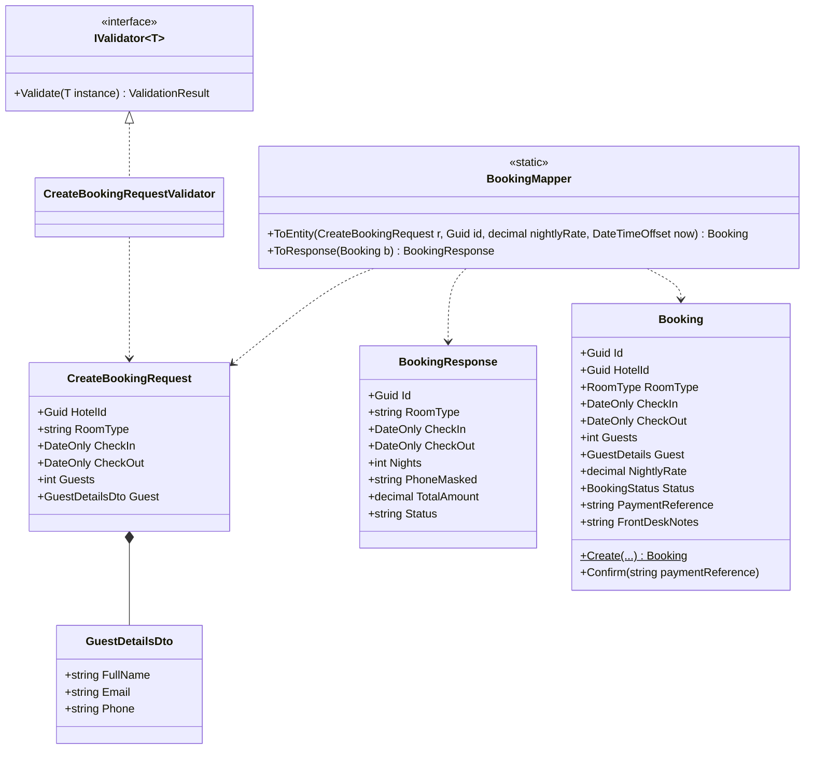
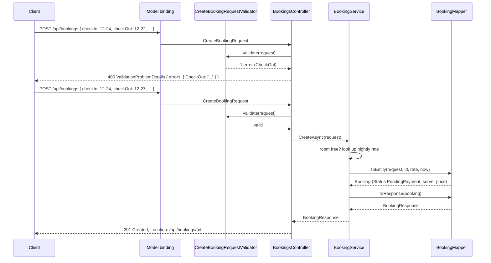

Every API has two shapes for the same idea: the shape the outside world sends and receives, and the shape you store and reason about inside. Beginners often use one class for both. It works for a week. Then a client sends a field it was not supposed to set, a database column change breaks a mobile app, and a validation rule is enforced on one endpoint but forgotten on another. This lesson is about keeping the two shapes apart on purpose, moving data between them cheaply, and rejecting bad input in a way clients can act on.

## Learning objectives

By the end of this lesson you will be able to:

1. Explain what a DTO is, how it differs from an entity, and why one class should not play both roles.
2. Describe the over-posting (mass assignment) vulnerability and show how a request DTO prevents it.
3. Write a manual mapper between DTOs and entities and judge when a mapping library is worth adding.
4. Validate request DTOs with DataAnnotations, with a hand-rolled validator class, and recognise the FluentValidation style.
5. Return validation failures as `ValidationProblemDetails` (RFC 9457) with per-field errors, from both controllers and minimal APIs.
6. Decide which rules belong in request validation and which belong in the domain model.

## Prerequisites

- [Controllers, services, repositories and domain models](#/lesson/m03-layers): this lesson adds the contract layer between the controller and the service.
- [Kestrel, middleware, routing, controllers and minimal APIs](#/lesson/m03-kestrel-middleware-routing): model binding and `[ApiController]` behaviour.
- [Classes, objects, fields, properties and methods](#/lesson/m01-classes-objects): records and init-only properties.

## Explain it like I'm a beginner

Think of checking in at a hotel in Goa.

The **booking form you fill in** on the app has exactly the fields the hotel needs from you: your name, phone, check-in and check-out dates, room type and number of guests. It has no box for "price per night", "payment received" or "booking confirmed". Those are decided by the hotel, not by you. That form is a **request DTO**: the data a client is allowed to send.

The **register the hotel keeps** has everything: your details, the rate the hotel actually charged, the payment reference, whether you are a repeat guest, and notes the front desk wrote ("asked for a late check-out", "card declined once"). That record is the **entity**: the full record the system owns.

The **confirmation voucher you receive** shows only what you need: booking id, dates, room type, total amount and status. It does not show the front-desk notes or your full card details. That is a **response DTO**: the data a client is allowed to see.

Now imagine the hotel used one single document for all three. You could write "paid, ₹1 per night, confirmed" on your own form. A change to the hotel's internal register would change the voucher layout. Anyone holding the voucher could read the staff notes. That is exactly what happens when a web API uses its database entity as its request and response type.

The three shapes have three owners: the client owns what it may send, the system owns what it stores, and the API contract owns what it exposes. **DTO** stands for data transfer object: a plain object whose only job is to carry data across a boundary.

## First-principles explanation

### Entities and DTOs serve different masters

An **entity** (or domain model) is shaped by business rules and storage: it has an identity, private state, behaviour, and often fields that are purely internal (`CreatedBy`, `RowVersion`, `PaymentReference`). It changes when the business changes.

A **DTO** is shaped by a conversation: "what does the mobile app need to send to book a room?" It has no behaviour, only data. It changes when the API contract changes, which should be rarely and deliberately, because clients you do not control depend on it.

Using one class for both couples two things that change for different reasons. That is a Single Responsibility violation at the class level ([SRP](#/lesson/m04-srp)): renaming a database column should never break a mobile app, and adding a client-facing field should never add a database column.

### Over-posting: the security reason

Model binding in ASP.NET Core fills every public settable property it can match in the incoming JSON. If your action takes the entity directly:

```csharp
// DO NOT do this
[HttpPost]
public async Task<IActionResult> Book([FromBody] Booking booking) { _db.Bookings.Add(booking); ... }
```

then a client can send `{"roomType":"Suite","checkIn":"2026-12-24","checkOut":"2026-12-27","nightlyRate":1,"status":"Confirmed","paymentReference":"fake"}` and all of it lands in the database: a three-night Christmas suite for ₹3, already marked as paid. This is **over-posting**, also called **mass assignment**. It is on the OWASP list and it has caused real breaches (one well-known case involved a public code-hosting site where a user added their own key to another project's settings by posting an unexpected field).

The fix is structural, not a checklist: the request DTO contains only the fields the client may set. There is no `NightlyRate` or `Status` property to bind to, so no amount of creative JSON can set them. `[Bind]` attributes and `[JsonIgnore]` on the entity are fragile alternatives; someone will forget one.

### Mapping: the cost of two shapes

Two shapes means code that copies between them. There are three ways:

1. **Manual mapping** in a small static class or extension method. 10–30 lines per pair. Zero magic, refactor-safe (rename a property and the compiler tells you), easy to debug.
2. **Source-generated mappers** (Mapperly is the common one). You declare a partial method; the generator writes the manual mapping for you at compile time. You get compile-time safety and no runtime reflection.
3. **Reflection-based mappers** (AutoMapper is the best-known). Configure once, map by convention. Fast to write; failures appear at runtime when names drift, and nobody can "go to definition" on a mapping. Check its licence terms before adopting it in a commercial project, since they changed in 2025.

Our recommendation for most teams: write the mapping by hand. A typical API has 20–50 DTO pairs. That is maybe 800 lines of boring, obvious code that never surprises anyone. Reach for a generator when the count climbs and the mappings are truly mechanical. Avoid reflection-based mapping on the hot path of a high-throughput API, and avoid *any* mapper when a mapping involves a business decision; that is a domain method, not a copy.

:::callout type=tip title="Mapping is not where rules live"
`ToEntity()` should never contain `if (request.Guests > 2) entity.AddExtraBedCharge(...)`. Mapping is copying. If a decision is being made, it is either validation (before mapping) or a domain rule (inside the entity's method). Keeping mappers dumb is what makes them boring, and boring is what you want here.
:::

### Validation: three places, three kinds of rule

Input can be wrong in three different ways, and each has a natural home:

| Kind of rule | Example | Where it belongs | Response |
|---|---|---|---|
| Shape and format | Phone must be a 10-digit mobile number; email must be an email; guests ≥ 1 | Request validation (DataAnnotations or a validator class), before the service is called | `400 Bad Request` with per-field errors |
| Cross-field and contextual | Check-out after check-in; a Deluxe room holds at most 3 guests; check-in not in the past | Request validation, same place | `400` with per-field errors |
| Business and state | Room still free for those dates; guest not on the hotel's blocked list; booking not already cancelled | Domain model or service, because it needs data the request does not carry | `409 Conflict` or `422 Unprocessable Content` |

The first two are about the *request*. They can be checked with no database. The third is about the *world*. Mixing them (checking room availability inside a `[Required]`-style attribute, say) ties your request validation to a database call and makes it untestable in isolation.

"Check-in not in the past" needs today's date, which is not in the request. That is fine: inject a `TimeProvider` into the validator. The clock is a stateless, in-memory dependency, not data about the world, so the validator stays fast and testable (tests pass a fake clock).

### The tools in ASP.NET Core

**DataAnnotations** are attributes on DTO properties: `[Required]`, `[StringLength(100)]`, `[Range(1, 10)]`, `[RegularExpression(...)]`, `[EmailAddress]`. With `[ApiController]` on a controller, an invalid model automatically produces a `400` with a `ValidationProblemDetails` body before your action runs. They are built in, declarative and fine for 80 % of rules. They are awkward for cross-field rules (you need `IValidatableObject` or a custom attribute) and they cannot take dependencies.

**Validator classes** put the rules in code: one class per DTO, a method that returns a list of errors. FluentValidation is the popular library for this style: `RuleFor(x => x.CheckOut).GreaterThan(x => x.CheckIn)`. The same idea can be hand-rolled in 40 lines with no package, which is what we compile below. Validator classes handle cross-field rules naturally, can be unit-tested directly, and can be registered in DI.

**Minimal APIs** do not validate automatically by default. In .NET 10, built-in validation for minimal APIs (`builder.Services.AddValidation()` plus DataAnnotations on parameters and types) is available, so the gap has narrowed. Alternatively, call your validator in the endpoint, or use an endpoint filter.

:::callout type=warning title="[Required] does not catch a missing date or Guid"
`DateOnly`, `Guid` and `int` are value types. If the JSON leaves out `checkIn`, System.Text.Json simply leaves the default value (`0001-01-01`), and `[Required]` is satisfied because a value type is never null. Either make the property nullable (`DateOnly?` with `[Required]`), mark it with the C# `required` keyword or `[JsonRequired]` so deserialisation fails, or check for the default in your validator (`HotelId != Guid.Empty`). The code below does the last; a past check-in date also catches a missing `checkIn`.
:::

### ProblemDetails: the standard shape for "no"

RFC 9457 (which replaced RFC 7807) defines a JSON body for errors: `type`, `title`, `status`, `detail`, `instance`, plus extension members. ASP.NET Core's `ValidationProblemDetails` adds `errors`, a dictionary of field name to array of messages:

```json
{
  "type": "https://tools.ietf.org/html/rfc9110#section-15.5.1",
  "title": "One or more validation errors occurred.",
  "status": 400,
  "errors": {
    "CheckOut": ["Check-out must be after check-in."],
    "Guest.Phone": ["Phone must be a 10-digit Indian mobile number, e.g. 9876543210."]
  },
  "traceId": "00-7f3a...-01"
}
```

Why a standard shape? Because every client can write one error handler. A React form can map `errors` keys to input fields. A mobile app can show `title`. A support engineer can grep logs for `traceId`. Inventing your own `{ "success": false, "msg": "..." }` throws all of that away.

### What goes wrong without this discipline

- Entity exposed as response: a new `PaymentReference` or `FrontDeskNotes` column appears in the JSON the day it is added.
- Entity accepted as request: over-posting, plus the client can send a malformed `Id` and overwrite someone else's booking.
- Validation in the controller as `if` statements: the partner-app endpoint forgets half of them; errors come back as plain strings in inconsistent formats.
- Validation in the mapper: nobody expects a `ToEntity()` call to throw.

## Visual explanation

### Class diagram — three shapes and the mapper between them



How to read it: `CreateBookingRequest` has the six fields the client may set. `Booking` has those plus `NightlyRate`, `Status`, `PaymentReference` and `FrontDeskNotes`, which only the system sets. `BookingResponse` shows a subset of the entity (no email, no full phone number, no payment reference, no staff notes) and adds values the server computed (`Nights`, `TotalAmount`). The mapper depends on all three but none of them depend on it or on each other. The validator depends only on the request type, so it can be tested with a request object and nothing else.

### Sequence diagram — a request with a validation failure and one that succeeds



The first request never reaches the service: validation is cheap and happens first. The second passes, the service checks availability and looks up the price itself, and the mapper builds an entity whose system-owned fields come from the server (`Status` is `PendingPayment` and `NightlyRate` is the hotel's rate no matter what the client sent, because the request type has no such properties). It comes back as a response DTO that omits sensitive fields.

## Step-by-step example

The scenario: a hotel booking app, the kind you use to book a room in Goa, Jaipur or Manali. The guest picks a hotel, a room type (Standard, Deluxe or Suite), check-in and check-out dates and the number of guests, and gives a name, email and mobile number. The server decides the price and the booking stays `PendingPayment` until the payment gateway confirms. Guests must never be able to set their own price or mark a booking as paid.

### Step 1 — the naive version and its three bugs

```csharp
// Entity used for everything
public class Booking
{
    public Guid Id { get; set; }
    public string RoomType { get; set; }
    public DateOnly CheckIn { get; set; }
    public DateOnly CheckOut { get; set; }
    public decimal NightlyRate { get; set; }
    public string Status { get; set; }
    public string GuestPhone { get; set; }
    public string? FrontDeskNotes { get; set; }
}

[HttpPost] public IActionResult Book(Booking b) { if (b.RoomType == null) return BadRequest("room"); _db.Add(b); _db.SaveChanges(); return Ok(b); }
```

Bug 1: `NightlyRate` and `Status` can be set by the client. Bug 2: `Ok(b)` returns `FrontDeskNotes` and the full phone number to the caller. Bug 3: the error is a bare string; the client cannot tell which field failed. The dates are not checked at all, so a booking with check-out before check-in is saved and the invoice shows a negative number of nights.

### Step 2 — split the shapes

Create `CreateBookingRequest` with exactly the client-settable fields, `BookingResponse` with the public view, and keep `Booking` as a proper entity with private setters and a `Create` factory method.

### Step 3 — map by hand

A static `BookingMapper` with two methods. Server-owned values (`Id`, the nightly rate, `CreatedAt`) are parameters, so the mapper stays pure and testable.

### Step 4 — validate before the service

Add DataAnnotations for the simple rules so `[ApiController]` rejects obviously broken requests. Add a validator class for the rules that need code: known room type, check-in not in the past, check-out after check-in, at most 30 nights, guests within the room's limit, and the mobile-number format. Return `ValidationProblem(...)` with the per-field errors.

### Step 5 — the business rule that needs data

"A Deluxe room must still be free for 24–27 December" needs the database, so it lives in the service and comes back as `409 Conflict`, not `400`. The pre-check in the service gives a friendly message; the real guarantee must be in PostgreSQL, because two guests can tap "Book" for the last room within the same millisecond. Typical options are an atomic `UPDATE room_inventory SET booked = booked + 1 WHERE hotel_id = $1 AND room_type = $2 AND night = ANY($3) AND booked < total` that must touch every night, or, when specific rooms are assigned, an exclusion constraint (`EXCLUDE USING gist (room_id WITH =, stay WITH &&)` on a `daterange` column, with the `btree_gist` extension). Mobile networks also retry, so a production booking endpoint accepts an `Idempotency-Key` header ([Idempotency keys](#/lesson/m10-idempotency)) so a retried POST does not create two bookings.

## Production-style C# implementation

Folder layout:

```text
Stays.Api/
  Program.cs
  Domain/Booking.cs
  Contracts/BookingContracts.cs
  Contracts/BookingMapper.cs
  Validation/Validation.cs
  Validation/CreateBookingRequestValidator.cs
  Application/BookingService.cs
  Api/BookingsController.cs
```

```csharp file=Domain/Booking.cs
namespace Stays.Domain;

public enum RoomType { Standard, Deluxe, Suite }

public enum BookingStatus { PendingPayment, Confirmed, Cancelled }

public static class RoomTypes
{
    /// <summary>Accepts names only ("Deluxe", "deluxe"). Enum.TryParse would also accept "1" or "7", which we do not want.</summary>
    public static bool TryParse(string? value, out RoomType roomType)
    {
        foreach (var candidate in Enum.GetValues<RoomType>())
        {
            if (string.Equals(candidate.ToString(), value?.Trim(), StringComparison.OrdinalIgnoreCase))
            {
                roomType = candidate;
                return true;
            }
        }
        roomType = default;
        return false;
    }

    public static RoomType Parse(string value) =>
        TryParse(value, out var roomType) ? roomType : throw new ArgumentException($"Unknown room type '{value}'.", nameof(value));

    public static int MaxGuests(RoomType roomType) => roomType switch
    {
        RoomType.Standard => 2,
        RoomType.Deluxe => 3,
        RoomType.Suite => 4,
        _ => throw new ArgumentOutOfRangeException(nameof(roomType))
    };
}

public sealed record GuestDetails(string FullName, string Email, string Phone)
{
    /// <summary>Last four digits only, for display. The full number never leaves the server.</summary>
    public string MaskedPhone => Phone.Length <= 4 ? "******" : $"******{Phone[^4..]}";
}

/// <summary>The entity. System-owned fields (NightlyRate, Status, PaymentReference, notes) have no public setter.</summary>
public sealed class Booking
{
    public Guid Id { get; }
    public Guid HotelId { get; }
    public RoomType RoomType { get; }
    public DateOnly CheckIn { get; }
    public DateOnly CheckOut { get; }
    public int Guests { get; }
    public GuestDetails Guest { get; private set; }
    public decimal NightlyRate { get; }
    public BookingStatus Status { get; private set; } = BookingStatus.PendingPayment;
    public string? PaymentReference { get; private set; }
    public string? FrontDeskNotes { get; private set; }
    public DateTimeOffset CreatedAt { get; }

    public int Nights => CheckOut.DayNumber - CheckIn.DayNumber;
    public decimal TotalAmount => NightlyRate * Nights;

    private Booking(Guid id, Guid hotelId, RoomType roomType, DateOnly checkIn, DateOnly checkOut, int guests,
                    GuestDetails guest, decimal nightlyRate, DateTimeOffset createdAt)
    {
        Id = id;
        HotelId = hotelId;
        RoomType = roomType;
        CheckIn = checkIn;
        CheckOut = checkOut;
        Guests = guests;
        Guest = guest;
        NightlyRate = nightlyRate;
        CreatedAt = createdAt;
    }

    /// <summary>The only way to create a booking. Trusts that request validation already happened; still guards the invariants it owns.</summary>
    public static Booking Create(Guid id, Guid hotelId, RoomType roomType, DateOnly checkIn, DateOnly checkOut, int guests,
                                 GuestDetails guest, decimal nightlyRate, DateTimeOffset now)
    {
        ArgumentNullException.ThrowIfNull(guest);
        ArgumentException.ThrowIfNullOrWhiteSpace(guest.FullName);
        if (checkOut <= checkIn)
            throw new ArgumentException("Check-out must be after check-in.", nameof(checkOut));
        if (guests < 1 || guests > RoomTypes.MaxGuests(roomType))
            throw new ArgumentOutOfRangeException(nameof(guests), $"A {roomType} room takes 1 to {RoomTypes.MaxGuests(roomType)} guests.");
        if (nightlyRate <= 0)
            throw new ArgumentOutOfRangeException(nameof(nightlyRate), "The nightly rate must be positive.");

        var cleanGuest = guest with { FullName = guest.FullName.Trim(), Email = guest.Email.Trim() };
        return new Booking(id, hotelId, roomType, checkIn, checkOut, guests, cleanGuest, nightlyRate, now);
    }

    /// <summary>Called by the payment webhook handler, never by the booking request.</summary>
    public void Confirm(string paymentReference)
    {
        if (Status != BookingStatus.PendingPayment) throw new InvalidOperationException($"Cannot confirm a booking in status {Status}.");
        ArgumentException.ThrowIfNullOrWhiteSpace(paymentReference);
        Status = BookingStatus.Confirmed;
        PaymentReference = paymentReference;
    }

    /// <summary>The only thing a guest may change after booking. Dates and room type change through a separate "modify stay" flow that re-prices.</summary>
    public void UpdateGuestDetails(GuestDetails guest)
    {
        ArgumentNullException.ThrowIfNull(guest);
        if (Status == BookingStatus.Cancelled) throw new InvalidOperationException("A cancelled booking cannot be edited.");
        Guest = guest;
    }

    public void AddFrontDeskNote(string note)
    {
        ArgumentException.ThrowIfNullOrWhiteSpace(note);
        FrontDeskNotes = string.IsNullOrEmpty(FrontDeskNotes) ? note.Trim() : $"{FrontDeskNotes}\n{note.Trim()}";
    }
}
```

```csharp file=Contracts/BookingContracts.cs
using System.ComponentModel.DataAnnotations;

namespace Stays.Contracts;

/// <summary>What a client may send. Note what is missing: Id, NightlyRate, Status, PaymentReference, CreatedAt.</summary>
public sealed record CreateBookingRequest
{
    // [Required] cannot reject Guid.Empty (a value type is never null); the validator checks that.
    public Guid HotelId { get; init; }

    [Required, StringLength(20)]
    public string RoomType { get; init; } = "";

    public DateOnly CheckIn { get; init; }

    public DateOnly CheckOut { get; init; }

    [Range(1, 10)]
    public int Guests { get; init; }

    [Required]
    public GuestDetailsDto Guest { get; init; } = new();
}

public sealed record GuestDetailsDto
{
    [Required, StringLength(100, MinimumLength = 2)]
    public string FullName { get; init; } = "";

    [Required, EmailAddress, StringLength(254)]
    public string Email { get; init; } = "";

    [Required, StringLength(10, MinimumLength = 10)]
    public string Phone { get; init; } = "";
}

/// <summary>What a client may see. No email, no full phone number, no payment reference, no staff notes.</summary>
public sealed record BookingResponse(
    Guid Id,
    Guid HotelId,
    string RoomType,
    DateOnly CheckIn,
    DateOnly CheckOut,
    int Nights,
    int Guests,
    string GuestName,
    string PhoneMasked,
    decimal NightlyRate,
    decimal TotalAmount,
    string Status,
    DateTimeOffset CreatedAt);
```

```csharp file=Contracts/BookingMapper.cs
using Stays.Domain;

namespace Stays.Contracts;

/// <summary>Pure copying. No decisions, no I/O. Server-owned values come in as parameters.</summary>
public static class BookingMapper
{
    public static Booking ToEntity(this CreateBookingRequest r, Guid id, decimal nightlyRate, DateTimeOffset now) =>
        Booking.Create(
            id,
            r.HotelId,
            RoomTypes.Parse(r.RoomType),
            r.CheckIn,
            r.CheckOut,
            r.Guests,
            new GuestDetails(r.Guest.FullName, r.Guest.Email, r.Guest.Phone),
            nightlyRate,
            now);

    public static BookingResponse ToResponse(this Booking b) =>
        new(b.Id, b.HotelId, b.RoomType.ToString(), b.CheckIn, b.CheckOut, b.Nights, b.Guests,
            b.Guest.FullName, b.Guest.MaskedPhone, b.NightlyRate, b.TotalAmount, b.Status.ToString(), b.CreatedAt);
}
```

```csharp file=Validation/Validation.cs
namespace Stays.Validation;

public sealed record ValidationFailure(string PropertyName, string ErrorMessage);

public sealed class ValidationResult
{
    public static readonly ValidationResult Success = new(Array.Empty<ValidationFailure>());

    public IReadOnlyList<ValidationFailure> Errors { get; }
    public bool IsValid => Errors.Count == 0;

    public ValidationResult(IReadOnlyList<ValidationFailure> errors) => Errors = errors;

    /// <summary>Groups messages by property, in the shape ValidationProblemDetails expects.</summary>
    public Dictionary<string, string[]> ToDictionary() =>
        Errors.GroupBy(e => e.PropertyName)
              .ToDictionary(g => g.Key, g => g.Select(e => e.ErrorMessage).ToArray());
}

public interface IValidator<in T>
{
    ValidationResult Validate(T instance);
}

/// <summary>Tiny base class in the FluentValidation style: collect failures, return a result.</summary>
public abstract class AbstractValidator<T> : IValidator<T>
{
    public ValidationResult Validate(T instance)
    {
        var failures = new List<ValidationFailure>();
        Rules(instance, failures);
        return failures.Count == 0 ? ValidationResult.Success : new ValidationResult(failures);
    }

    protected abstract void Rules(T instance, List<ValidationFailure> failures);

    protected static void Must(List<ValidationFailure> failures, bool condition, string property, string message)
    {
        if (!condition) failures.Add(new ValidationFailure(property, message));
    }
}
```

```csharp file=Validation/CreateBookingRequestValidator.cs
using System.Text.RegularExpressions;
using Stays.Contracts;
using Stays.Domain;

namespace Stays.Validation;

/// <summary>Request rules only: no database. The clock is injected so tests can fix "today".</summary>
public sealed partial class CreateBookingRequestValidator(TimeProvider clock) : AbstractValidator<CreateBookingRequest>
{
    public const int MaxNights = 30;
    public const int BookingWindowDays = 365;

    // Hotels in this example are in India. IST is UTC+05:30 all year (no daylight saving), so a fixed offset is correct.
    private static readonly TimeSpan HotelOffset = TimeSpan.FromHours(5.5);

    [GeneratedRegex("^[6-9][0-9]{9}$")]
    private static partial Regex IndianMobile();

    protected override void Rules(CreateBookingRequest r, List<ValidationFailure> f)
    {
        var today = DateOnly.FromDateTime(clock.GetUtcNow().ToOffset(HotelOffset).DateTime);

        Must(f, r.HotelId != Guid.Empty, nameof(r.HotelId), "HotelId is required.");

        var knownRoomType = RoomTypes.TryParse(r.RoomType, out var roomType);
        Must(f, knownRoomType, nameof(r.RoomType), "RoomType must be Standard, Deluxe or Suite.");

        Must(f, r.CheckIn >= today, nameof(r.CheckIn), "Check-in cannot be in the past.");
        Must(f, r.CheckIn <= today.AddDays(BookingWindowDays), nameof(r.CheckIn), $"Bookings open at most {BookingWindowDays} days ahead.");

        // Cross-field rules: reported once, under the field the user should fix.
        if (r.CheckOut <= r.CheckIn)
            f.Add(new ValidationFailure(nameof(r.CheckOut), "Check-out must be after check-in."));
        else
            Must(f, r.CheckOut.DayNumber - r.CheckIn.DayNumber <= MaxNights, nameof(r.CheckOut), $"A single booking can be at most {MaxNights} nights.");

        if (knownRoomType)
            Must(f, r.Guests <= RoomTypes.MaxGuests(roomType), nameof(r.Guests),
                 $"A {roomType} room allows at most {RoomTypes.MaxGuests(roomType)} guests.");

        Must(f, IndianMobile().IsMatch(r.Guest.Phone ?? ""), $"{nameof(r.Guest)}.{nameof(r.Guest.Phone)}",
             "Phone must be a 10-digit Indian mobile number, e.g. 9876543210.");
    }
}
```

```csharp file=Application/BookingService.cs
using System.Collections.Concurrent;
using Stays.Contracts;
using Stays.Domain;

namespace Stays.Application;

public interface IHotelCatalog
{
    decimal GetNightlyRate(Guid hotelId, RoomType roomType);
    int GetRoomCount(Guid hotelId, RoomType roomType);
}

/// <summary>Stand-in for the rates and inventory tables. Real rates vary by date and season.</summary>
public sealed class FixedHotelCatalog : IHotelCatalog
{
    public decimal GetNightlyRate(Guid hotelId, RoomType roomType) => roomType switch
    {
        RoomType.Standard => 3_500m,
        RoomType.Deluxe => 5_500m,
        _ => 9_000m
    };

    public int GetRoomCount(Guid hotelId, RoomType roomType) => roomType == RoomType.Suite ? 2 : 20;
}

public interface IBookingRepository
{
    Task<int> CountOverlappingAsync(Guid hotelId, RoomType roomType, DateOnly checkIn, DateOnly checkOut, CancellationToken ct = default);
    Task AddAsync(Booking booking, CancellationToken ct = default);
    Task<Booking?> GetAsync(Guid id, CancellationToken ct = default);
}

public sealed class InMemoryBookingRepository : IBookingRepository
{
    private readonly ConcurrentDictionary<Guid, Booking> _bookings = new();

    // Two stays overlap when each one starts before the other ends. Check-out day is free for the next guest.
    public Task<int> CountOverlappingAsync(Guid hotelId, RoomType roomType, DateOnly checkIn, DateOnly checkOut, CancellationToken ct = default) =>
        Task.FromResult(_bookings.Values.Count(b =>
            b.HotelId == hotelId && b.RoomType == roomType && b.Status != BookingStatus.Cancelled &&
            b.CheckIn < checkOut && checkIn < b.CheckOut));

    public Task AddAsync(Booking booking, CancellationToken ct = default) { _bookings[booking.Id] = booking; return Task.CompletedTask; }
    public Task<Booking?> GetAsync(Guid id, CancellationToken ct = default) => Task.FromResult(_bookings.GetValueOrDefault(id));
}

public enum BookingResult { Created, SoldOut }
public sealed record BookingOutcome(BookingResult Result, BookingResponse? Booking = null);

public sealed class BookingService(IBookingRepository bookings, IHotelCatalog catalog, TimeProvider clock)
{
    public async Task<BookingOutcome> CreateAsync(CreateBookingRequest request, CancellationToken ct = default)
    {
        var roomType = RoomTypes.Parse(request.RoomType);

        // A business rule that needs data the request does not carry: belongs here, not in the validator.
        // This check-then-insert can race; in PostgreSQL an atomic inventory UPDATE or an exclusion constraint is the real guarantee.
        var taken = await bookings.CountOverlappingAsync(request.HotelId, roomType, request.CheckIn, request.CheckOut, ct);
        if (taken >= catalog.GetRoomCount(request.HotelId, roomType)) return new BookingOutcome(BookingResult.SoldOut);

        // The price comes from the server's catalogue, never from the request.
        var rate = catalog.GetNightlyRate(request.HotelId, roomType);
        var booking = request.ToEntity(Guid.NewGuid(), rate, clock.GetUtcNow());
        await bookings.AddAsync(booking, ct);
        return new BookingOutcome(BookingResult.Created, booking.ToResponse());
    }

    public async Task<BookingResponse?> GetAsync(Guid id, CancellationToken ct = default) =>
        (await bookings.GetAsync(id, ct))?.ToResponse();
}
```

```csharp file=Api/BookingsController.cs
using Microsoft.AspNetCore.Mvc;
using Stays.Application;
using Stays.Contracts;
using Stays.Validation;

namespace Stays.Api;

[ApiController]
[Route("api/bookings")]
public sealed class BookingsController(BookingService bookingService, IValidator<CreateBookingRequest> validator) : ControllerBase
{
    // [ApiController] has already returned 400 for DataAnnotation failures before this method runs.
    [HttpPost]
    [ProducesResponseType<BookingResponse>(StatusCodes.Status201Created)]
    [ProducesResponseType<ValidationProblemDetails>(StatusCodes.Status400BadRequest)]
    [ProducesResponseType<ProblemDetails>(StatusCodes.Status409Conflict)]
    public async Task<IActionResult> Create([FromBody] CreateBookingRequest request, CancellationToken ct)
    {
        var validation = validator.Validate(request);
        if (!validation.IsValid)
            return ValidationProblem(new ValidationProblemDetails(validation.ToDictionary()));

        var outcome = await bookingService.CreateAsync(request, ct);
        return outcome.Result switch
        {
            BookingResult.Created => CreatedAtAction(nameof(GetById), new { id = outcome.Booking!.Id }, outcome.Booking),
            BookingResult.SoldOut => Problem(
                title: "No rooms left",
                detail: $"No {request.RoomType} room is free from {request.CheckIn:yyyy-MM-dd} to {request.CheckOut:yyyy-MM-dd}.",
                statusCode: StatusCodes.Status409Conflict),
            _ => Problem(statusCode: StatusCodes.Status500InternalServerError)
        };
    }

    [HttpGet("{id:guid}")]
    public async Task<ActionResult<BookingResponse>> GetById(Guid id, CancellationToken ct) =>
        await bookingService.GetAsync(id, ct) is { } booking ? Ok(booking) : NotFound();
}
```

```csharp file=Program.cs
using Stays.Application;
using Stays.Contracts;
using Stays.Validation;

var builder = WebApplication.CreateBuilder(args);

builder.Services.AddControllers();
builder.Services.AddProblemDetails();          // consistent ProblemDetails bodies for unhandled errors too
builder.Services.AddSingleton(TimeProvider.System);
builder.Services.AddSingleton<IHotelCatalog, FixedHotelCatalog>();
builder.Services.AddSingleton<IBookingRepository, InMemoryBookingRepository>();
builder.Services.AddScoped<BookingService>();
builder.Services.AddSingleton<IValidator<CreateBookingRequest>, CreateBookingRequestValidator>();

var app = builder.Build();
app.UseExceptionHandler();
app.MapControllers();

// The same validation from a minimal API endpoint: call the validator and use Results.ValidationProblem.
app.MapPost("/v2/bookings", async (CreateBookingRequest request, IValidator<CreateBookingRequest> validator,
                                   BookingService bookingService, CancellationToken ct) =>
{
    var validation = validator.Validate(request);
    if (!validation.IsValid) return Results.ValidationProblem(validation.ToDictionary());

    var outcome = await bookingService.CreateAsync(request, ct);
    return outcome.Result == BookingResult.Created
        ? Results.Created($"/api/bookings/{outcome.Booking!.Id}", outcome.Booking)
        : Results.Problem(title: "No rooms left", statusCode: StatusCodes.Status409Conflict);
});

app.Run();
```

Points worth noticing:

- **Two validation passes, on purpose.** DataAnnotations catch the cheap, universal problems (missing, wrong length, guests out of 1–10) and `[ApiController]` turns them into a 400 before the action runs. The validator class handles the domain-specific formats and the cross-field rules (dates, guests per room type). Both produce the same `ValidationProblemDetails` shape, so the client sees one format. One catch: the validator runs only after the annotations pass, so a client with both kinds of mistake sees the errors in two rounds. If that matters, move all rules into the validator.
- **The validator is a singleton** because it is stateless; its only dependency, `TimeProvider`, is a singleton too. A validator that needed a database (for availability) would have to be scoped, and that is the smell telling you the rule belongs in the service instead.
- **`Booking.Create` re-checks dates and guest count.** The domain does not trust callers. Validation protects the user experience; invariants protect the data. A nightly import from a partner channel that skips the API still cannot create a zero-night booking.
- **The price never comes from the client.** `NightlyRate` is a parameter of the mapper, supplied by the service from the catalogue. `TotalAmount` is computed by the entity.
- **`MaskedPhone`** is how a response DTO avoids leaking: the mapper calls `b.Guest.MaskedPhone`, never `b.Guest.Phone`.

### The same validator in FluentValidation

If your team prefers the library (it is widely used and well documented), the class above becomes:

```csharp
public sealed class CreateBookingRequestValidator : AbstractValidator<CreateBookingRequest>
{
    public CreateBookingRequestValidator(TimeProvider clock)
    {
        RuleFor(x => x.HotelId).NotEmpty();   // NotEmpty treats Guid.Empty as empty
        RuleFor(x => x.RoomType).Must(t => RoomTypes.TryParse(t, out _))
            .WithMessage("RoomType must be Standard, Deluxe or Suite.");
        RuleFor(x => x.CheckIn).Must(d => d >= TodayInIndia(clock)).WithMessage("Check-in cannot be in the past.");
        RuleFor(x => x.CheckOut).GreaterThan(x => x.CheckIn).WithMessage("Check-out must be after check-in.");
        RuleFor(x => x.Guests)
            .Must((r, guests) => !RoomTypes.TryParse(r.RoomType, out var t) || guests <= RoomTypes.MaxGuests(t))
            .WithMessage("Too many guests for this room type.");
        RuleFor(x => x.Guest.Phone).Matches("^[6-9][0-9]{9}$");
    }
}

// Registration: builder.Services.AddValidatorsFromAssemblyContaining<CreateBookingRequestValidator>();
// In the action: var result = await validator.ValidateAsync(request, ct);
//                if (!result.IsValid) return ValidationProblem(new ValidationProblemDetails(result.ToDictionary()));
```

The shape is the same as our hand-rolled version. The library adds a fluent API, async rules, conditional rules (`When(...)`), collection rules (`RuleForEach`) and localisation. Use it when you have more than a handful of validators; the hand-rolled version is enough for a small API and has no dependency.

## Bad design vs good design

**Bad**: one `Booking` class for request, storage and response; validation by scattered `if` statements; errors as strings.

```csharp
[HttpPut("{id}")]
public async Task<IActionResult> Update(Guid id, Booking incoming)
{
    var b = await _db.Bookings.FindAsync(id);
    if (b == null) return NotFound();
    _db.Entry(b).CurrentValues.SetValues(incoming);   // copies EVERY property, including NightlyRate and Status
    await _db.SaveChangesAsync();
    return Ok(b);                                     // returns FrontDeskNotes and the full phone number
}
```

`SetValues(incoming)` is a one-line over-posting hole: whatever the client sends becomes the truth, so a guest can drop the rate to ₹1 or mark an unpaid booking as `Confirmed`. And `Ok(b)` is a one-line data leak.

**Good**: an `UpdateGuestDetailsRequest` with only `FullName`, `Email` and `Phone`, validated, then `booking.UpdateGuestDetails(...)` which can only change those three things, then `ToResponse()`. Changing dates is a separate "modify stay" endpoint that re-checks availability and re-prices. The entity's design makes the vulnerability impossible rather than merely unlikely.

**Also bad, in the other direction**: five DTOs per entity "for consistency" when three endpoints exist, a mapping library configured with 400 lines of profiles for 12 entities, and a validation layer that re-implements every domain invariant so the domain model becomes anemic. DTOs are a boundary tool. Inside the boundary (service to repository), pass the entity.

:::callout type=tradeoff title="How many DTOs per resource?"
A common, sensible set is: one *create* request, one *update* request (often a subset, because identity fields cannot change), and one *response*. Sometimes a *summary* response for list endpoints ("My trips"). Share a response type across GET-by-id and the body of a 201. Do not share a request type between create and update if the allowed fields differ; that is where over-posting creeps back in.
:::

## Practical playground

A console version of the request → validate → map → respond flow. Change the dates, the guest count or the phone number and watch the errors appear per field. Then notice that the request has no price field: the total comes from the server's rate card.

:::playground type=csharp title="Validate, map, respond"
```csharp file=Program.cs
using System;
using System.Collections.Generic;
using System.Linq;
using System.Text.RegularExpressions;

public sealed record CreateBookingRequest(string RoomType, DateOnly CheckIn, DateOnly CheckOut, int Guests, string Phone);

public sealed class Booking
{
    public Guid Id { get; } = Guid.NewGuid();
    public string RoomType { get; }
    public DateOnly CheckIn { get; }
    public DateOnly CheckOut { get; }
    public decimal NightlyRate { get; }                 // set by the server, never bound from JSON
    public string Status { get; private set; } = "PendingPayment";
    public int Nights => CheckOut.DayNumber - CheckIn.DayNumber;
    public decimal Total => NightlyRate * Nights;
    public Booking(string roomType, DateOnly checkIn, DateOnly checkOut, decimal nightlyRate)
    {
        RoomType = roomType; CheckIn = checkIn; CheckOut = checkOut; NightlyRate = nightlyRate;
    }
}

public sealed record BookingResponse(Guid Id, string RoomType, int Nights, decimal Total, string Status);

public static class Validator
{
    public static readonly Dictionary<string, (int MaxGuests, decimal Rate)> Rooms = new()
    {
        ["Standard"] = (2, 3_500m), ["Deluxe"] = (3, 5_500m), ["Suite"] = (4, 9_000m)
    };

    public static Dictionary<string, string[]> Validate(CreateBookingRequest r, DateOnly today)
    {
        var errors = new List<(string Field, string Message)>();
        if (!Rooms.TryGetValue(r.RoomType, out var room)) errors.Add(("RoomType", "Must be Standard, Deluxe or Suite."));
        else if (r.Guests < 1 || r.Guests > room.MaxGuests) errors.Add(("Guests", $"A {r.RoomType} room takes 1 to {room.MaxGuests} guests."));
        if (r.CheckIn < today) errors.Add(("CheckIn", "Check-in cannot be in the past."));
        if (r.CheckOut <= r.CheckIn) errors.Add(("CheckOut", "Check-out must be after check-in."));
        if (!Regex.IsMatch(r.Phone, "^[6-9][0-9]{9}$")) errors.Add(("Phone", "Must be a 10-digit Indian mobile number."));
        return errors.GroupBy(e => e.Field).ToDictionary(g => g.Key, g => g.Select(e => e.Message).ToArray());
    }
}

public static class Program
{
    public static void Main()
    {
        var today = DateOnly.FromDateTime(DateTime.UtcNow.AddHours(5.5));   // IST
        var request = new CreateBookingRequest("Deluxe", today.AddDays(14), today.AddDays(17), 2, "9876543210");
        // Try: Guests = 4, CheckOut = today.AddDays(14), RoomType = "Penthouse", Phone = "12345"

        var errors = Validator.Validate(request, today);
        if (errors.Count > 0)
        {
            Console.WriteLine("400 Bad Request");
            foreach (var (field, messages) in errors) Console.WriteLine($"  {field}: {string.Join("; ", messages)}");
            return;
        }

        var rate = Validator.Rooms[request.RoomType].Rate;              // the server decides the price
        var booking = new Booking(request.RoomType, request.CheckIn, request.CheckOut, rate);
        var response = new BookingResponse(booking.Id, booking.RoomType, booking.Nights, booking.Total, booking.Status);
        Console.WriteLine($"201 Created: {response}");                   // 3 nights x ₹5,500 = ₹16,500
    }
}
```
:::

## Exercises

:::exercise id=m03-dtos-mapping-validation-ex1 difficulty=beginner kind=code title="Write a request validator"
Implement `CreateGroupBookingRequestValidator.Rules` for the hotel's group-booking API, used by wedding planners and companies that block many rooms at once. Collect every failure (do not stop at the first) with the property name and a message.
::requirements
- `GroupName`: required, 5–120 characters after trimming.
- `Rooms`: between 1 and 20 inclusive.
- `BudgetPerNight`: greater than 0 and at most ₹50,000.
- `CheckOut` must be after `CheckIn`; a same-day check-out is zero nights and invalid (cross-field; report under `CheckOut`).
- `PromoCode`: if provided (not null or empty), must match `^[A-Z0-9]{4,12}$`.
::acceptance
- A fully valid request returns `IsValid == true` with zero errors.
- A request with a 3-character group name and 0 rooms returns two errors, one per field.
- `PromoCode == null` produces no error; `"bad code!"` produces one under `PromoCode`.
- `CheckOut` equal to `CheckIn` produces one error under `CheckOut`.
::hint
Each rule is one `Must(...)` call. Collect, do not return early.
::hint
Trim the group name before measuring it; `"  abc  "` has 3 real characters.
::hint
For the optional promo code, guard with `string.IsNullOrEmpty` before running the regex.
::hint
```csharp
Must(f, r.CheckOut > r.CheckIn, nameof(r.CheckOut), "Check-out must be after check-in.");
if (!string.IsNullOrEmpty(r.PromoCode))
    Must(f, PromoCodePattern.IsMatch(r.PromoCode), nameof(r.PromoCode), "Promo code must be 4–12 capital letters or digits.");
```
::starter
```csharp file=CreateGroupBookingRequestValidator.cs
using System;
using System.Collections.Generic;
using System.Linq;
using System.Text.RegularExpressions;

public sealed record CreateGroupBookingRequest(
    string GroupName,
    int Rooms,
    decimal BudgetPerNight,
    DateOnly CheckIn,
    DateOnly CheckOut,
    string? PromoCode);

public sealed record ValidationFailure(string PropertyName, string ErrorMessage);

public sealed class ValidationResult
{
    public IReadOnlyList<ValidationFailure> Errors { get; }
    public bool IsValid => Errors.Count == 0;
    public ValidationResult(IReadOnlyList<ValidationFailure> errors) => Errors = errors;
    public Dictionary<string, string[]> ToDictionary() =>
        Errors.GroupBy(e => e.PropertyName).ToDictionary(g => g.Key, g => g.Select(e => e.ErrorMessage).ToArray());
}

public abstract class AbstractValidator<T>
{
    public ValidationResult Validate(T instance)
    {
        var failures = new List<ValidationFailure>();
        Rules(instance, failures);
        return new ValidationResult(failures);
    }

    protected abstract void Rules(T instance, List<ValidationFailure> failures);

    protected static void Must(List<ValidationFailure> failures, bool condition, string property, string message)
    {
        if (!condition) failures.Add(new ValidationFailure(property, message));
    }
}

public sealed class CreateGroupBookingRequestValidator : AbstractValidator<CreateGroupBookingRequest>
{
    private static readonly Regex PromoCodePattern = new("^[A-Z0-9]{4,12}$", RegexOptions.Compiled);

    protected override void Rules(CreateGroupBookingRequest r, List<ValidationFailure> f)
    {
        throw new NotImplementedException();
    }
}
```
::tests
```csharp file=CreateGroupBookingRequestValidatorTests.cs
using System;
using System.Linq;
using Xunit;

public class CreateGroupBookingRequestValidatorTests
{
    private static readonly CreateGroupBookingRequestValidator V = new();
    private static CreateGroupBookingRequest Valid() => new(
        "Sharma–Iyer wedding, Udaipur", 12, 6_500m, new DateOnly(2026, 12, 10), new DateOnly(2026, 12, 13), "WINTER25");

    [Fact]
    public void Valid_request_has_no_errors()
    {
        var result = V.Validate(Valid());
        Assert.True(result.IsValid);
        Assert.Empty(result.Errors);
    }

    [Fact]
    public void Collects_multiple_failures()
    {
        var result = V.Validate(Valid() with { GroupName = "  abc ", Rooms = 0 });
        Assert.False(result.IsValid);
        var dict = result.ToDictionary();
        Assert.Equal(2, dict.Count);
        Assert.True(dict.ContainsKey("GroupName"));
        Assert.True(dict.ContainsKey("Rooms"));
    }

    [Fact]
    public void Budget_bounds()
    {
        Assert.False(V.Validate(Valid() with { BudgetPerNight = 0m }).IsValid);
        Assert.False(V.Validate(Valid() with { BudgetPerNight = 50_001m }).IsValid);
        Assert.True(V.Validate(Valid() with { BudgetPerNight = 50_000m }).IsValid);
    }

    [Fact]
    public void Same_day_checkout_is_reported_under_CheckOut()
    {
        var result = V.Validate(Valid() with { CheckOut = new DateOnly(2026, 12, 10) });
        var only = Assert.Single(result.Errors);
        Assert.Equal("CheckOut", only.PropertyName);
    }

    [Fact]
    public void Promo_code_is_optional_but_must_be_valid_when_present()
    {
        Assert.True(V.Validate(Valid() with { PromoCode = null }).IsValid);
        Assert.True(V.Validate(Valid() with { PromoCode = "" }).IsValid);
        var result = V.Validate(Valid() with { PromoCode = "bad code!" });
        Assert.Equal("PromoCode", Assert.Single(result.Errors).PropertyName);
    }
}
```
::solution
Five rules, five `Must` calls, one guard for the optional field.

```csharp file=CreateGroupBookingRequestValidator.cs
using System;
using System.Collections.Generic;
using System.Linq;
using System.Text.RegularExpressions;

public sealed record CreateGroupBookingRequest(
    string GroupName,
    int Rooms,
    decimal BudgetPerNight,
    DateOnly CheckIn,
    DateOnly CheckOut,
    string? PromoCode);

public sealed record ValidationFailure(string PropertyName, string ErrorMessage);

public sealed class ValidationResult
{
    public IReadOnlyList<ValidationFailure> Errors { get; }
    public bool IsValid => Errors.Count == 0;
    public ValidationResult(IReadOnlyList<ValidationFailure> errors) => Errors = errors;
    public Dictionary<string, string[]> ToDictionary() =>
        Errors.GroupBy(e => e.PropertyName).ToDictionary(g => g.Key, g => g.Select(e => e.ErrorMessage).ToArray());
}

public abstract class AbstractValidator<T>
{
    public ValidationResult Validate(T instance)
    {
        var failures = new List<ValidationFailure>();
        Rules(instance, failures);
        return new ValidationResult(failures);
    }

    protected abstract void Rules(T instance, List<ValidationFailure> failures);

    protected static void Must(List<ValidationFailure> failures, bool condition, string property, string message)
    {
        if (!condition) failures.Add(new ValidationFailure(property, message));
    }
}

public sealed class CreateGroupBookingRequestValidator : AbstractValidator<CreateGroupBookingRequest>
{
    private static readonly Regex PromoCodePattern = new("^[A-Z0-9]{4,12}$", RegexOptions.Compiled);
    private const decimal MaxBudgetPerNight = 50_000m;   // ₹50,000

    protected override void Rules(CreateGroupBookingRequest r, List<ValidationFailure> f)
    {
        var name = (r.GroupName ?? "").Trim();
        Must(f, name.Length is >= 5 and <= 120, nameof(r.GroupName), "Group name must be 5–120 characters.");
        Must(f, r.Rooms is >= 1 and <= 20, nameof(r.Rooms), "Rooms must be between 1 and 20.");
        Must(f, r.BudgetPerNight > 0 && r.BudgetPerNight <= MaxBudgetPerNight, nameof(r.BudgetPerNight), "Budget per night must be between ₹1 and ₹50,000.");
        Must(f, r.CheckOut > r.CheckIn, nameof(r.CheckOut), "Check-out must be after check-in.");
        if (!string.IsNullOrEmpty(r.PromoCode))
            Must(f, PromoCodePattern.IsMatch(r.PromoCode), nameof(r.PromoCode), "Promo code must be 4–12 capital letters or digits.");
    }
}
```

`ToDictionary()` produces exactly the `errors` member that `ValidationProblemDetails` expects, so the controller can return `ValidationProblem(new ValidationProblemDetails(result.ToDictionary()))` without any further shaping.
::mistakes
- Returning after the first failure, so the user fixes one field, resubmits, and discovers the next problem. Collect everything.
- Reporting the date rule under `CheckIn` and `CheckOut` both, which shows the same message twice in a form.
- Using `>=` for the date rule: a same-day check-out is a zero-night stay and would produce a ₹0 invoice.
- Treating `""` as a promo code to validate. Empty means "not provided".
:::

:::exercise id=m03-dtos-mapping-validation-ex2 difficulty=beginner kind=written title="Find the over-posting and the data leaks"
An HR system has this entity and endpoint:

```csharp
public class Employee
{
    public int Id { get; set; }
    public string Name { get; set; }
    public string Email { get; set; }
    public string Department { get; set; }
    public decimal Salary { get; set; }
    public string Role { get; set; }          // "Staff" | "Manager" | "Admin"
    public string PasswordHash { get; set; }
    public string PanNumber { get; set; }
    public DateTime CreatedAt { get; set; }
}

[HttpPut("me")]
public async Task<IActionResult> UpdateProfile(Employee e)
{
    var current = await _db.Employees.FindAsync(CurrentUserId);
    _db.Entry(current).CurrentValues.SetValues(e);
    await _db.SaveChangesAsync();
    return Ok(current);
}
```

Employees may update their own name and email only. List every field a malicious employee could change, every field that leaks in the response, and write the request and response DTOs that fix both.
::acceptance
- `Salary`, `Role`, `PasswordHash`, `Id`, `Department`, `PanNumber` and `CreatedAt` are all identified as over-postable.
- `PasswordHash`, `Salary` and `PanNumber` (at least) are identified as leaking in the response.
- The proposed request DTO has exactly two properties.
::hint
`SetValues` copies every property that exists on both objects. Which ones exist on `Employee`?
::hint
Anything in the entity is in the `Ok(current)` JSON. Which of those should a browser never see?
::hint
Name the DTOs `UpdateMyProfileRequest` and `EmployeeProfileResponse`.
::solution
**Over-postable**: every property except the two allowed ones, because model binding fills them from JSON and `SetValues` copies them all. An employee can POST `{"salary": 9999999, "role": "Admin", "passwordHash": "<hash of a password they know>"}` and become an admin with a chosen password. Changing `Id` can even redirect the write.

**Leaked**: `PasswordHash` (enables offline cracking), `Salary`, `PanNumber` (government identifier). Arguably `Role` and `CreatedAt` are fine but unnecessary.

**Fix**:

```csharp
public sealed record UpdateMyProfileRequest(
    [property: Required, StringLength(100, MinimumLength = 2)] string Name,
    [property: Required, EmailAddress] string Email);

public sealed record EmployeeProfileResponse(int Id, string Name, string Email, string Department, string Role);

[HttpPut("me")]
public async Task<ActionResult<EmployeeProfileResponse>> UpdateProfile(UpdateMyProfileRequest request)
{
    var employee = await _db.Employees.FindAsync(CurrentUserId);
    if (employee is null) return NotFound();
    employee.UpdateContact(request.Name, request.Email);   // domain method that touches only those two
    await _db.SaveChangesAsync();
    return Ok(new EmployeeProfileResponse(employee.Id, employee.Name, employee.Email, employee.Department, employee.Role));
}
```

The request type has nowhere to put `salary`; unknown JSON properties are ignored by `System.Text.Json` by default. The response type has no `PasswordHash` to leak.
::mistakes
- Fixing it by adding `[JsonIgnore]` to `PasswordHash` only. The over-posting remains, and the next sensitive column will be forgotten.
- Using `[Bind("Name,Email")]`. It works for MVC model binding but is easy to miss in review and does nothing for the response.
:::

:::exercise id=m03-dtos-mapping-validation-ex3 difficulty=intermediate kind=code title="Map a request to an entity without leaking system fields"
Implement `OfferMapper.ToEntity`, `OfferMapper.ToResponse` and `HotelOffer.ApplyUpdate` for the hotel's deals API (for example "Monsoon getaway: 20 % off in Goa"). Revenue managers create offers as drafts and publish them to the app. The update must be able to change only the title, description and valid-until date; the offer code, status and creation timestamp must be untouchable through the API.
::requirements
- `ToEntity(request, code, now)` creates a `HotelOffer` with `Status = Draft` and `CreatedAt = now`.
- `ToResponse(offer, asOf)` returns `OfferResponse` with `Status` as a string and `DaysLeft` computed from `asOf`.
- `ApplyUpdate(title, description, validUntil)` changes those three fields; throws `InvalidOperationException` if the offer is `Published` and the valid-until date would move earlier (guests may already be planning around the advertised date).
::acceptance
- Mapping a request never sets `Status` to anything but `Draft`.
- `DaysLeft` for an offer valid until 2026-12-01 as of 2026-11-21 is 10.
- Updating a published offer to an earlier valid-until date throws; to a later date succeeds.
::hint
The mapper calls the entity's factory method. Server-owned values are parameters of the mapper so it stays pure.
::hint
`DaysLeft` is `validUntil.DayNumber - asOf.DayNumber`.
::hint
`ApplyUpdate` is a domain method: it knows the status rule. The mapper does not.
::hint
```csharp
public void ApplyUpdate(string title, string description, DateOnly validUntil)
{
    if (Status == OfferStatus.Published && validUntil < ValidUntil)
        throw new InvalidOperationException("Cannot cut short a published offer.");
    ...
}
```
::starter
```csharp file=OfferMapper.cs
using System;

public enum OfferStatus { Draft, Published, Expired }

public sealed class HotelOffer
{
    public string Code { get; }
    public string Title { get; private set; }
    public string Description { get; private set; }
    public DateOnly ValidUntil { get; private set; }
    public OfferStatus Status { get; private set; }
    public DateTimeOffset CreatedAt { get; }
    public DateTimeOffset? PublishedAt { get; private set; }

    private HotelOffer(string code, string title, string description, DateOnly validUntil, DateTimeOffset createdAt)
    {
        Code = code;
        Title = title;
        Description = description;
        ValidUntil = validUntil;
        CreatedAt = createdAt;
        Status = OfferStatus.Draft;
    }

    public static HotelOffer Create(string code, string title, string description, DateOnly validUntil, DateTimeOffset now)
    {
        ArgumentException.ThrowIfNullOrWhiteSpace(code);
        ArgumentException.ThrowIfNullOrWhiteSpace(title);
        return new HotelOffer(code, title.Trim(), description?.Trim() ?? "", validUntil, now);
    }

    public void Publish(DateTimeOffset now)
    {
        if (Status != OfferStatus.Draft) throw new InvalidOperationException("Only drafts can be published.");
        Status = OfferStatus.Published;
        PublishedAt = now;
    }

    public void ApplyUpdate(string title, string description, DateOnly validUntil) => throw new NotImplementedException();
}

public sealed record CreateOfferRequest(string Title, string Description, DateOnly ValidUntil);
public sealed record UpdateOfferRequest(string Title, string Description, DateOnly ValidUntil);
public sealed record OfferResponse(string Code, string Title, string Description, DateOnly ValidUntil, string Status, int DaysLeft);

public static class OfferMapper
{
    public static HotelOffer ToEntity(this CreateOfferRequest request, string code, DateTimeOffset now) => throw new NotImplementedException();
    public static OfferResponse ToResponse(this HotelOffer offer, DateOnly asOf) => throw new NotImplementedException();
}
```
::tests
```csharp file=OfferMapperTests.cs
using System;
using Xunit;

public class OfferMapperTests
{
    private static readonly DateTimeOffset Now = new(2026, 11, 1, 10, 0, 0, TimeSpan.Zero);

    [Fact]
    public void ToEntity_sets_system_fields_from_server_values()
    {
        var request = new CreateOfferRequest("  Monsoon getaway: 20% off in Goa  ", "Min 2 nights, breakfast included", new DateOnly(2026, 12, 1));
        var offer = request.ToEntity("GOA-2026-0117", Now);
        Assert.Equal("GOA-2026-0117", offer.Code);
        Assert.Equal("Monsoon getaway: 20% off in Goa", offer.Title);
        Assert.Equal(OfferStatus.Draft, offer.Status);
        Assert.Equal(Now, offer.CreatedAt);
        Assert.Null(offer.PublishedAt);
    }

    [Fact]
    public void ToResponse_formats_status_and_days()
    {
        var offer = HotelOffer.Create("JAI-2026-0118", "Weekend in Jaipur", "", new DateOnly(2026, 12, 1), Now);
        var response = offer.ToResponse(new DateOnly(2026, 11, 21));
        Assert.Equal("Draft", response.Status);
        Assert.Equal(10, response.DaysLeft);
        Assert.Equal("JAI-2026-0118", response.Code);
    }

    [Fact]
    public void Update_changes_only_allowed_fields()
    {
        var offer = HotelOffer.Create("MAN-2026-0119", "Old", "Old desc", new DateOnly(2026, 12, 1), Now);
        offer.ApplyUpdate("New", "New desc", new DateOnly(2026, 12, 15));
        Assert.Equal("New", offer.Title);
        Assert.Equal("New desc", offer.Description);
        Assert.Equal(new DateOnly(2026, 12, 15), offer.ValidUntil);
        Assert.Equal(OfferStatus.Draft, offer.Status);
        Assert.Equal(Now, offer.CreatedAt);
    }

    [Fact]
    public void Published_offer_cannot_end_earlier()
    {
        var offer = HotelOffer.Create("OOT-2026-0120", "T", "", new DateOnly(2026, 12, 1), Now);
        offer.Publish(Now);
        Assert.Throws<InvalidOperationException>(() => offer.ApplyUpdate("T", "", new DateOnly(2026, 11, 25)));
        offer.ApplyUpdate("T", "", new DateOnly(2026, 12, 10));
        Assert.Equal(new DateOnly(2026, 12, 10), offer.ValidUntil);
    }
}
```
::solution
The mapper is two expression-bodied methods. The rule about published offers is in the entity because it depends on entity state.

```csharp file=OfferMapper.cs
using System;

public enum OfferStatus { Draft, Published, Expired }

public sealed class HotelOffer
{
    public string Code { get; }
    public string Title { get; private set; }
    public string Description { get; private set; }
    public DateOnly ValidUntil { get; private set; }
    public OfferStatus Status { get; private set; }
    public DateTimeOffset CreatedAt { get; }
    public DateTimeOffset? PublishedAt { get; private set; }

    private HotelOffer(string code, string title, string description, DateOnly validUntil, DateTimeOffset createdAt)
    {
        Code = code;
        Title = title;
        Description = description;
        ValidUntil = validUntil;
        CreatedAt = createdAt;
        Status = OfferStatus.Draft;
    }

    public static HotelOffer Create(string code, string title, string description, DateOnly validUntil, DateTimeOffset now)
    {
        ArgumentException.ThrowIfNullOrWhiteSpace(code);
        ArgumentException.ThrowIfNullOrWhiteSpace(title);
        return new HotelOffer(code, title.Trim(), description?.Trim() ?? "", validUntil, now);
    }

    public void Publish(DateTimeOffset now)
    {
        if (Status != OfferStatus.Draft) throw new InvalidOperationException("Only drafts can be published.");
        Status = OfferStatus.Published;
        PublishedAt = now;
    }

    public void ApplyUpdate(string title, string description, DateOnly validUntil)
    {
        ArgumentException.ThrowIfNullOrWhiteSpace(title);
        if (Status == OfferStatus.Published && validUntil < ValidUntil)
            throw new InvalidOperationException("Cannot cut short a published offer.");
        Title = title.Trim();
        Description = description?.Trim() ?? "";
        ValidUntil = validUntil;
    }
}

public sealed record CreateOfferRequest(string Title, string Description, DateOnly ValidUntil);
public sealed record UpdateOfferRequest(string Title, string Description, DateOnly ValidUntil);
public sealed record OfferResponse(string Code, string Title, string Description, DateOnly ValidUntil, string Status, int DaysLeft);

public static class OfferMapper
{
    public static HotelOffer ToEntity(this CreateOfferRequest request, string code, DateTimeOffset now) =>
        HotelOffer.Create(code, request.Title, request.Description, request.ValidUntil, now);

    public static OfferResponse ToResponse(this HotelOffer offer, DateOnly asOf) =>
        new(offer.Code, offer.Title, offer.Description, offer.ValidUntil, offer.Status.ToString(),
            offer.ValidUntil.DayNumber - asOf.DayNumber);
}
```

In the controller, the update endpoint becomes `offer.ApplyUpdate(request.Title, request.Description, request.ValidUntil)`. There is no code path through which `Status`, `Code` or `CreatedAt` can be set from a request.
::alternatives
If the update DTO allowed partial updates (only the fields present), you would use nullable properties and JSON Merge Patch semantics (RFC 7396), or `JsonPatchDocument` (which in .NET 10 has a System.Text.Json-based implementation). That is more flexible and more complex; most APIs are fine with "send the whole editable subset".
::mistakes
- Putting the "published offer cannot end earlier" rule in the mapper or the controller.
- Letting `ToResponse` call `DateTime.Today` for `asOf`, making the mapper impure and untestable at a fixed date.
:::

:::exercise id=m03-dtos-mapping-validation-ex4 difficulty=intermediate kind=design title="Design the DTO set for a hospital appointment resource"
A clinic API manages appointments. Patients book through a mobile app; receptionists reschedule and cancel through a web portal; doctors see a daily list. The `Appointment` entity has: `Id`, `PatientId`, `DoctorId`, `SlotStart`, `SlotEnd`, `Status` (Booked, CheckedIn, Completed, Cancelled, NoShow), `BookedAt`, `CancelledReason`, `InternalNotes`, `PaymentStatus`, `ConsultationFee`.

Design the request and response DTOs for: patient booking, receptionist rescheduling, cancellation, and the doctor's daily list. State which fields each one includes and which it deliberately excludes.
::acceptance
- The patient booking request contains no `Status`, `PaymentStatus`, `ConsultationFee` or `InternalNotes`.
- The reschedule request contains only what changes (new slot) plus possibly a reason.
- The doctor's list response excludes `ConsultationFee` and `PaymentStatus` but includes patient display name.
- Each DTO has a one-line statement of who may send or receive it.
::hint
Start from the four conversations, not from the entity. What does each actor need to say or see?
::hint
A reschedule changes two fields. A cancellation changes one and adds a reason. They should not share a request type.
::hint
List responses are usually slimmer than detail responses; design a `AppointmentSummary` separate from `AppointmentDetail`.
::solution
**`BookAppointmentRequest`** (patient app → server): `DoctorId`, `SlotStart`. That is all. `PatientId` comes from the authenticated user, not the body (otherwise a patient could book for someone else). `SlotEnd` is derived from the doctor's slot length. `Status`, `BookedAt`, `ConsultationFee` and `PaymentStatus` are set by the server.

**`RescheduleAppointmentRequest`** (receptionist portal → server): `NewSlotStart`, optional `Reason`. The appointment id is in the URL. The server checks the receptionist's role and the slot's availability.

**`CancelAppointmentRequest`** (patient app or portal → server): `Reason` (required for receptionist, optional for patient; enforce in the validator based on the caller's role, or use two endpoints).

**`AppointmentDetailResponse`** (to patient or receptionist): `Id`, `DoctorName`, `SlotStart`, `SlotEnd`, `Status`, `ConsultationFee`, `PaymentStatus`. Excludes `InternalNotes` and `CancelledReason` when the caller is the patient; a receptionist variant may include `CancelledReason`.

**`DoctorDayListItem`** (to doctor): `Id`, `PatientDisplayName`, `SlotStart`, `SlotEnd`, `Status`. Excludes money fields, which are not the doctor's concern, and `InternalNotes`, which are reception-only.

Five DTOs for one entity sounds like a lot, but each one answers exactly one conversation, and none can be used to set or see something its actor should not.
::mistakes
- Accepting `PatientId` in the booking body. Identity comes from authentication.
- A single `AppointmentDto` used for all five cases, with nullable everything and comments saying "ignored on input".
:::

:::exercise id=m03-dtos-mapping-validation-ex5 difficulty=advanced kind=written title="Where does the uniqueness check go, and what status code is it?"
A team has a `RegisterUserRequest` with a `Username` field. They want "username must be unique" to be a validation rule, so they wrote a custom DataAnnotations attribute that injects `IUserRepository` via `validationContext.GetService` and queries the database. It works in development. In production they see two problems: duplicate usernames still appear occasionally under load, and the validator cannot be unit-tested without the database.

Explain why both problems occur, where the check should live instead, which status code the duplicate case should return and why, and how to make the rule actually hold under concurrency.
::acceptance
- Identifies the race between the check and the insert (time-of-check to time-of-use).
- Moves the rule to the service and names the database unique constraint as the real guarantee.
- Chooses 409 Conflict (or defends 422) with a reason, and shows a ProblemDetails body.
- Keeps request validation free of I/O so it remains unit-testable.
::hint
Two requests for the same username arrive 5 ms apart. Walk through what each one sees.
::hint
Request validation answers "is this request well-formed?". Uniqueness answers "does the world allow this?".
::hint
A unique index in PostgreSQL plus catching the unique-violation error (SQLSTATE 23505) is the only check that cannot race.
::solution
**Why duplicates appear**: the attribute checks "does `ravi` exist?" and gets "no". Five milliseconds later a second request checks and also gets "no". Both insert. The check and the insert are separate operations with no lock between them. No amount of validation code fixes this; only the database can, because only the database sees both inserts.

**Why it is untestable**: the attribute reaches into the service provider for a repository, so the validator has a hidden dependency on infrastructure. Request validation should be a pure function of the request.

**Where it goes**: in `UserRegistrationService.RegisterAsync`. Do a fast pre-check (`ExistsAsync`) for a friendly error in the common case, then rely on a `UNIQUE` index on `users(username)` as the actual guarantee. Catch the unique-violation exception from the insert and translate it to the same outcome as the pre-check. The pre-check is an optimisation; the constraint is the rule.

**Status code**: `409 Conflict`. The request is syntactically and semantically valid; it conflicts with the current state of the resource collection. `422 Unprocessable Content` is defensible if the team treats "cannot be processed given server state" that way, but 409 communicates "try a different value" more directly and is the more common convention for duplicates. Body:

```json
{
  "type": "https://example.com/problems/username-taken",
  "title": "Username already taken",
  "status": 409,
  "detail": "The username 'ravi' is already registered.",
  "instance": "/api/users",
  "errors": { "Username": ["Already taken."] }
}
```

Including an `errors` extension member lets the same client-side form code highlight the field, even though the status is 409 rather than 400.

**Validation stays pure**: `RegisterUserRequestValidator` checks length and allowed characters only, needs no DI, and is tested with plain objects.
::mistakes
- "Fixing" the race with a `lock` in the service. It only works on one server instance and breaks the moment you scale out.
- Returning 400 for duplicates, which makes clients think the input was malformed and retry with the same value.
:::

## Automated testing

Three kinds of test, matching the three things this lesson introduced.

**Validator tests** are the cheapest and should be the most numerous. Construct a valid request, mutate one field with `with { ... }`, assert exactly which property failed and with what message. Exercise 1 shows the pattern. Aim for one test per rule plus one "all valid" test. For rules that depend on today's date, pass a fake `TimeProvider` (the `Microsoft.Extensions.TimeProvider.Testing` package has `FakeTimeProvider`, or write a three-line subclass) so "check-in cannot be in the past" is tested at a fixed date instead of whatever day CI happens to run. Because the validator has no I/O, a hundred of these run in well under a second.

**Mapper tests** check two things: that server-owned fields come from the parameters and not from the request, and that sensitive fields do not appear in responses. The second is worth an explicit test:

```csharp
[Fact]
public void Response_never_contains_full_phone_number()
{
    var booking = Booking.Create(Guid.NewGuid(), Guid.NewGuid(), RoomType.Deluxe,
        new DateOnly(2026, 12, 24), new DateOnly(2026, 12, 27), 2,
        new GuestDetails("Ananya Rao", "ananya@example.com", "9876543210"), 5_500m, DateTimeOffset.UtcNow);
    var json = JsonSerializer.Serialize(booking.ToResponse());
    Assert.DoesNotContain("9876543210", json);
    Assert.DoesNotContain("ananya@example.com", json);
    Assert.Contains("******3210", json);
}
```

Serialising to JSON and searching the string is crude, but it catches the exact bug that matters: a secret in the wire format.

**Contract tests** through `WebApplicationFactory<Program>` send a real HTTP request with a bad body and assert the response is `400`, has `Content-Type: application/problem+json`, and that `errors` contains the expected key. One such test per endpoint proves the whole chain (binding, DataAnnotations, validator, `ValidationProblem`) is wired. Also send a body with extra `"nightlyRate": 1` and `"status": "Confirmed"` properties and assert that the created booking costs ₹16,500 for three Deluxe nights and is still `PendingPayment`; that is your over-posting regression test.

## Real-world application

- **Public APIs with long-lived clients** (payment gateways, UPI apps, airline and hotel distribution APIs) treat DTOs as versioned contracts. The internal entity can be refactored freely as long as the mapper keeps producing the same JSON. Breaking changes get a new version ([API versioning, pagination, filtering and sorting](#/lesson/m03-api-shape)).
- **ASP.NET Core Identity** does not expose `IdentityUser` over HTTP; the Identity API endpoints (`MapIdentityApi`) and the templates use dedicated `RegisterRequest` and `LoginRequest` DTOs. The reason is exactly over-posting: `IdentityUser` has `EmailConfirmed`, `LockoutEnabled` and `PasswordHash`.
- **Travel marketplaces** that accept bookings from partner apps and travel agents keep the partner-submitted DTO strictly smaller than the entity, because the entity also carries the negotiated rate, the commission, payment status and fraud flags that a partner must never set.
- **Mobile apps on slow networks** benefit from response DTOs tailored to each screen, because sending a 40-field entity to render a 5-field "My trips" list item wastes bandwidth and leaks data.

## Interview questions

:::interview
::q beginner
What is a DTO and why not just return the entity from a controller?
::a
A DTO (data transfer object) is a plain object that carries data across a boundary, such as HTTP, with no behaviour. Returning the entity couples the public API to the database schema (a renamed column breaks clients), leaks internal or sensitive fields (`PasswordHash`, audit columns), and, when used for input, allows over-posting, where the client sets fields it should not. A response DTO exposes exactly the intended view; a request DTO accepts exactly the allowed fields.
::q beginner
What is over-posting and what is the structural fix?
::a
Over-posting (mass assignment) is when a client sends JSON properties the developer did not intend to be settable, and model binding fills them because the bound type has those properties. For example posting `"isAdmin": true` to a profile update. The structural fix is to bind to a request DTO that only has the allowed properties, so there is nothing for the extra JSON to bind to. Attributes like `[Bind]` or `[JsonIgnore]` are patches that someone will forget.
::q intermediate
Compare DataAnnotations and a validator class (FluentValidation style). When would you choose each?
::a
DataAnnotations are attributes on properties, built in, declarative, and automatically enforced by `[ApiController]` (and in .NET 10 by minimal APIs with `AddValidation()`), producing `ValidationProblemDetails` with no extra code. They struggle with cross-field rules, conditional rules and anything needing a dependency. A validator class puts rules in code: natural for cross-field logic, easy to unit-test, composable, registrable in DI. Choose DataAnnotations for simple shape rules on small APIs; add validator classes (hand-rolled or FluentValidation) when rules are cross-field or numerous. Many teams use both: annotations for the basics, a validator for the rest, both producing the same ProblemDetails shape.
::q intermediate
What is ProblemDetails and why should validation errors use it?
::a
ProblemDetails is the standard JSON error body from RFC 9457: `type`, `title`, `status`, `detail`, `instance` plus extensions. ASP.NET Core's `ValidationProblemDetails` adds `errors`, a map of field name to messages, served with `Content-Type: application/problem+json`. Using it means every client can share one error handler: map `errors` to form fields, show `title`, log `traceId`. Custom `{ success: false, message }` shapes force every client to special-case every API.
::q advanced
A mapping library maps `OrderRequest` to `Order` by convention. A developer renames `Order.ShippingAddress` to `Order.DeliveryAddress`. What happens, and how does your choice of mapping approach affect it?
::a
With a reflection-based convention mapper, nothing fails at compile time. At runtime the destination property is silently left null (or a configuration validation step, if the team runs one in tests, reports an unmapped member). The bug is found by a customer whose order has no address. With a manual mapper, the compiler fails the build at the renamed property; the fix is a one-line edit. With a source-generated mapper like Mapperly, the generator emits a warning or error for the unmapped member at compile time. The trade-off is writing time versus failure time: convention mapping saves typing today and moves failures to runtime; explicit mapping costs typing and keeps failures at compile time. For money and addresses, prefer compile-time.
::q advanced
Where do you draw the line between request validation and domain invariants, given that they often check the same thing?
::a
Request validation answers "is this request well-formed and self-consistent?" and runs before any business logic, with no I/O, returning 400 with per-field errors; its purpose is user experience and early rejection. Domain invariants answer "can this object ever be in this state?" and run inside the entity's constructor or methods, throwing if violated; their purpose is data integrity regardless of caller (API, import job, test). Some rules appear in both, like "amount must be positive", and that duplication is deliberate: the validator gives a friendly message, the invariant guarantees that no code path, including ones written next year, can create a negative amount. Rules that need external state (uniqueness, balances, permissions) belong in the service or domain, never in request validation, and map to 409/422/403 rather than 400.
:::

## Summary and revision

**Key takeaways**

- Three shapes, three owners: request DTO (what the client may send), entity (what the system owns), response DTO (what the client may see).
- Over-posting is prevented by the *absence* of a property on the request type, not by attributes. Prices, statuses and payment fields never belong on a request DTO.
- Map by hand unless the count of mappings makes a source generator worthwhile; keep mappers free of decisions.
- Validate request shape with DataAnnotations and a validator class; validate world-state rules (availability, uniqueness, balances) in the service or domain, with a database constraint as the real guarantee.
- Return validation failures as `ValidationProblemDetails` so clients can map `errors` to fields; use 409 or 422, not 400, for state conflicts.

**Terminology**: DTO, entity, over-posting / mass assignment, mapper, DataAnnotations, `[ApiController]`, `IValidatableObject`, FluentValidation, ProblemDetails (RFC 9457), `ValidationProblemDetails`, `application/problem+json`.

:::flashcards
Q: Why should a booking request DTO not include `NightlyRate` or `Status`?
A: So the client cannot set them. Model binding can only fill properties that exist on the bound type; absence is the protection. The server looks up the price and starts every booking as PendingPayment.
Q: What is over-posting?
A: A client sending JSON fields the developer did not intend to be settable; model binding fills them because the bound type has them.
Q: What content type does ASP.NET Core use for ProblemDetails?
A: `application/problem+json`.
Q: Which member of ValidationProblemDetails holds per-field errors?
A: `errors`, a dictionary of property name to an array of messages.
Q: Where should "a Deluxe room must still be free for these dates" be checked?
A: In the service, with a database guarantee (atomic inventory update or exclusion constraint) behind it; returns 409, not 400.
Q: What should a mapper never contain?
A: Business decisions or I/O. Mapping is copying; decisions belong in validation or the domain.
Q: What does [ApiController] do for invalid models?
A: Returns 400 with ValidationProblemDetails automatically before the action runs.
Q: Why does `[Required]` on a `DateOnly CheckIn` property not catch a missing check-in date?
A: `DateOnly` is a value type, so a missing JSON property becomes `0001-01-01`, which is not null. Use `DateOnly?` with `[Required]`, the `required` keyword / `[JsonRequired]`, or a validator rule.
Q: Manual mapping versus convention-based mapping: what is the key trade-off?
A: Manual costs typing but fails at compile time on renames; convention saves typing but fails silently at runtime.
:::

## Knowledge check

:::quiz pass=70
::q single
A `PUT /api/employees/me` action binds directly to the `Employee` entity, which has a `Salary` property. What can an employee do?
- [ ] Nothing unusual; model binding only fills fields marked `[Bind]`.
- [x] Include `"salary": 5000000` in the JSON and have it saved, because model binding fills every settable property on the bound type.
- [ ] Only change fields that are also in the database.
- [ ] Crash the server.
> This is over-posting. The fix is a request DTO with only `Name` and `Email`, so there is no `Salary` to bind.
::q single
A guest tries to book the last Suite for 24–27 December, but another guest booked it a minute earlier. Which status code fits best?
- [ ] 400 Bad Request
- [x] 409 Conflict
- [ ] 404 Not Found
- [ ] 500 Internal Server Error
> The request is well-formed; it conflicts with the current state of the hotel's inventory. 400 tells the client its input was malformed, which is misleading and invites a pointless retry with the same dates.
::q multi
Which rules belong in request validation (before the service is called)? (Select all that apply.)
- [x] Phone must match `^[6-9][0-9]{9}$`.
- [x] Check-out must be after check-in.
- [ ] The room must still be free for those dates.
- [ ] The guest must not be on the hotel's blocked list.
- [x] Guests must be at least 1.
> Format, range and cross-field rules need only the request (plus, at most, the clock). Availability and the blocked list need the database and belong in the service, returning 409 or 422.
::q single
A team's `ToEntity()` mapper contains `if (request.Guests > 2) entity.AddExtraBedCharge(1_200m);`. What is the problem?
- [ ] Mappers cannot contain `if` statements in C#.
- [x] A business decision (a pricing rule) is hidden in a copy routine; it belongs in the domain or a pricing service where it is visible and tested.
- [ ] The charge should be ₹1,500.
- [ ] Nothing; mappers are the right place for rules.
> Mapping should be boring copying. When a decision hides in a mapper, nobody looks for it there, and the partner-channel import that bypasses the mapper will miss it.
::q single
What does `ValidationProblemDetails.Errors` contain?
- [ ] A single error string.
- [x] A dictionary from property name to an array of error messages.
- [ ] An exception stack trace.
- [ ] The original request body.
> This shape lets a client map each key to a form field and show all messages for that field.
::q single
Your API has 60 DTO pairs with purely mechanical property copies, and the team has been bitten twice by a convention mapper silently dropping a renamed property. What is the best move?
- [ ] Go back to returning entities directly.
- [x] Switch to a source-generated mapper (or manual mapping), so unmapped members fail at compile time.
- [ ] Add a comment reminding developers to update the mapping profile.
- [ ] Disable the mapper's validation.
> Compile-time failure is the property you want for data-carrying code. Source generators give it with less typing than fully manual mapping.
::q single
A custom validation attribute queries the database to check that a room is free. Under load, the hotel still gets double bookings. Why?
- [ ] DataAnnotations run asynchronously.
- [x] The check and the insert are separate operations; two requests can both pass the check before either inserts. Only a database-level guarantee (atomic update or constraint) prevents it.
- [ ] The attribute is not registered in DI.
- [ ] The regular expression is wrong.
> Time-of-check to time-of-use. Validation code cannot see the other request. The database guarantee, plus translating its failure to 409, is the real rule.
::q single
A client omits `checkIn` from the JSON. The DTO property is `public DateOnly CheckIn { get; init; }` with `[Required]`. What happens?
- [ ] `[ApiController]` returns 400 because `CheckIn` is required.
- [x] Binding succeeds with `CheckIn = 0001-01-01`; `[Required]` passes because a value type is never null, so only a validator rule (or a nullable / `required` property) catches it.
- [ ] The server throws a `NullReferenceException`.
- [ ] System.Text.Json uses today's date.
> Value types get their default when the JSON property is missing. Make the property nullable with `[Required]`, mark it `required`, or check it in the validator.
:::

## Completion criteria

You have finished this lesson when you can:

- [ ] Score at least 70 % on the knowledge check.
- [ ] Complete exercises 1 and 3 with all tests passing in your downloaded project.
- [ ] Complete exercise 2 and name every over-postable and leaking field without looking at the solution.
- [ ] Write a request DTO, a response DTO and a mapper for a resource of your choice in under 15 minutes.
- [ ] Explain to a teammate why "username must be unique" is not a request validation rule, and what status code it should return.
