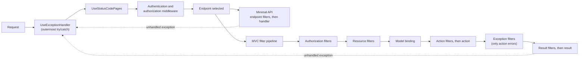
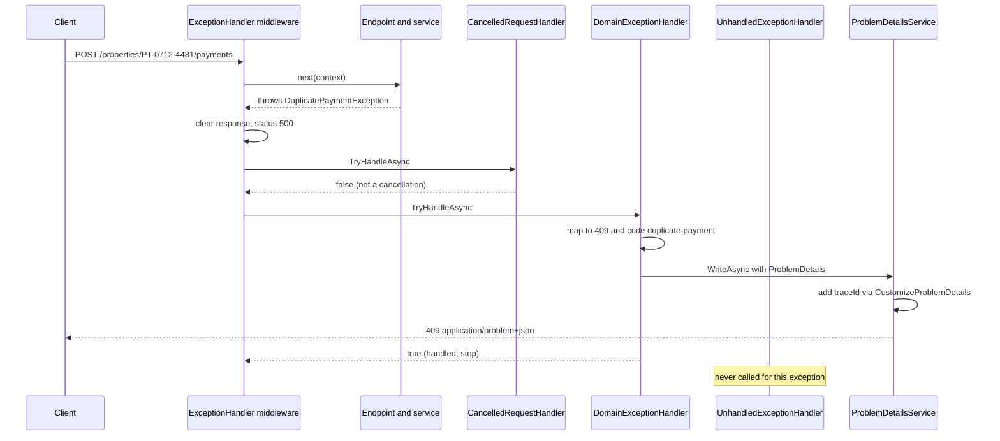

Every API fails. A property is not found, a payment is submitted twice, the bank gateway times out, a developer forgets a null check. What separates a professional API from a fragile one is not whether it fails, but *how*: one consistent error shape, the right status code, a trace id the support team can search for, and no stack traces shown to the public. This lesson shows where that error-handling code belongs and how to write it once.

## Learning objectives

By the end of this lesson you will be able to:

1. Explain the difference between middleware, MVC filters and minimal API endpoint filters, and choose the right one for a cross-cutting concern.
2. Describe the MVC filter pipeline order (authorization, resource, action, exception, result) and what each stage can see.
3. Build a global error pipeline with `UseExceptionHandler`, a chain of `IExceptionHandler` implementations and `AddProblemDetails`.
4. Return RFC 9457 Problem Details responses with a stable error code and a trace id.
5. Map domain exceptions to status codes (400, 404, 409, 422, 503) in one place, and keep 500 responses generic.
6. Handle the awkward cases: client disconnects, responses that have already started, and validation errors.
7. Decide when an exception is the wrong tool and a result value is better.

## Prerequisites

- [Kestrel, middleware, routing, controllers and minimal APIs](#/lesson/m03-kestrel-middleware-routing): you know middleware order and what an endpoint is.
- [REST API design and HTTP status codes](#/lesson/m03-rest-status-codes): you know what 400, 404, 409, 422 and 503 mean.
- [Exceptions and error handling](#/lesson/m01-exceptions): try/catch/finally and custom exception classes.

## Explain it like I'm a beginner

Think of a municipal corporation's citizen service centre where people pay property tax.

At the **entrance** there is a security desk. Everyone passes it, whether they came to pay tax, ask for a birth certificate, or just use the washroom. The guard checks bags and writes the time in a register. The guard knows nothing about tax. That is **middleware**: code every request passes through, regardless of what it is for.

Inside, the **property-tax counter** has its own routine. Before the clerk takes your payment, an assistant checks that the form is filled in (validation), and after the payment a supervisor stamps the receipt (adding a header). These steps happen only at this counter and know about tax forms. Those are **filters**: code that wraps a specific endpoint and knows about its arguments and results.

Now something goes wrong. Maybe your property id does not exist, or you already paid this half-year, or the bank's server is down. A badly run centre has each clerk improvise: one shouts, one writes on a scrap of paper, one shows you the internal ledger with other citizens' details. A well-run centre has an **enquiry desk** near the exit. Any clerk who hits a problem fills in a standard **problem slip**: a short title, what happened, a reference number, and what to do next ("bank server down, try after 30 minutes"). The citizen always gets the same kind of slip, and the reference number lets staff find the details later.

In ASP.NET Core:

- The enquiry desk is the **exception handler middleware** (`UseExceptionHandler`), placed early so that it sees everything that fails later.
- The clerks who know particular problems are **exception handlers** (`IExceptionHandler`), tried in order.
- The standard slip is a **Problem Details** response (`application/problem+json`), a format defined by an internet standard, RFC 9457.
- The reference number is the **trace id**.

## First-principles explanation

### Middleware: the outer pipeline

Middleware is a chain of delegates. Each one receives the `HttpContext`, may do work, calls `next`, and may do more work after `next` returns. It runs for **every** request that reaches it: API calls, static files, health checks, and requests for routes that do not exist.

Middleware sees raw HTTP: method, path, headers, body stream, and after `next` the status code. It does **not** know which controller action or which model-bound arguments are involved (it can see the selected endpoint's metadata after routing, but not the parsed request object).

Good uses: exception handling, request logging, correlation ids, CORS, compression, rate limiting, authentication, HTTPS redirection. These are concerns of the HTTP conversation, not of any one feature.

### MVC filters: the inner pipeline for controllers

Controllers run inside their own small pipeline called the **filter pipeline**. Filters run after routing has selected an action and they can see the `ActionContext`: the action descriptor, model state, bound arguments, and the result object before it is written.

The order is fixed:

| Stage | Interface | Runs | Typical use |
|---|---|---|---|
| Authorization filters | `IAuthorizationFilter` | First | Legacy custom authorization (prefer policies) |
| Resource filters | `IResourceFilter` | Before model binding and after everything | Short-circuit caching, disabling form value providers |
| *Model binding* | | | Request body and route values become C# arguments |
| Action filters | `IActionFilter` / `IAsyncActionFilter` | Around the action method | Validation, auditing, transactions per action |
| *Action method* | | | Your code |
| Exception filters | `IExceptionFilter` | Only if the action or action filters threw | Converting exceptions for MVC only |
| Result filters | `IResultFilter` | Around writing the result | Adding headers, wrapping responses |

Filters can be applied globally (`AddControllers(o => o.Filters.Add<AuditFilter>())`), per controller, or per action via attributes. Filters that need services are registered with `[ServiceFilter(typeof(AuditFilter))]` or `[TypeFilter]`, or added globally by type so DI constructs them.

A useful detail: `[ApiController]` already adds an automatic model-validation filter. If model binding produces errors, it returns a 400 `ValidationProblemDetails` before your action runs.

### Endpoint filters: the minimal API version

Minimal APIs do not have the MVC filter pipeline. Instead they have **endpoint filters** (`IEndpointFilter`, since .NET 7). An endpoint filter wraps the handler delegate:

```csharp
public sealed class StopwatchFilter : IEndpointFilter
{
    public async ValueTask<object?> InvokeAsync(EndpointFilterInvocationContext ctx, EndpointFilterDelegate next)
    {
        var start = Stopwatch.GetTimestamp();
        var result = await next(ctx);                         // call the handler (or the next filter)
        ctx.HttpContext.Response.Headers["Server-Timing"] = $"app;dur={Stopwatch.GetElapsedTime(start).TotalMilliseconds:F1}";
        return result;
    }
}
```

`ctx.Arguments` holds the handler's bound arguments in order, so a filter can validate a request object before the handler runs, and can return an `IResult` (such as a validation problem) to short-circuit. Filters are attached per endpoint or per route group with `.AddEndpointFilter<T>()`. Applying a filter to a `MapGroup("/api")` is the minimal API equivalent of a global MVC filter.

### Choosing the right place

A simple rule: **if it is about HTTP, use middleware; if it is about a feature's inputs or outputs, use a filter.**

| Concern | Best place | Reason |
|---|---|---|
| Global exception handling | Middleware (`UseExceptionHandler`) | Must catch errors from everything, including other middleware and filters |
| Request/response logging, correlation id | Middleware | Applies to every request, including 404s |
| Validating a specific request DTO | Endpoint filter or `[ApiController]` | Needs the bound argument |
| "Every write action in this controller runs in a transaction" | Action filter | Needs to know which actions, and wraps exactly the action |
| Adding a `Deprecation` header to v1 endpoints | Endpoint filter on the v1 group, or result filter | Scoped to some endpoints |
| Caching whole responses | Output caching middleware | Already built in |
| Converting exceptions to responses | `IExceptionHandler`, not exception filters | Exception filters do not see errors from middleware, result execution, or minimal APIs |

That last row matters. MVC **exception filters** catch only exceptions thrown by actions and action filters. They miss exceptions from model binding edge cases, result filters, middleware, and anything in a minimal API. Teams that rely on an exception filter as their "global" handler end up with two error formats. Use the exception handler middleware as the single global net, and keep exception filters for rare controller-specific cases.

### The global error pipeline

ASP.NET Core 8 and later give you four cooperating pieces:

1. **`app.UseExceptionHandler()`** middleware. Place it first (or right after forwarded headers), so that everything after it is inside its `try/catch`. When an exception escapes, it clears the response, sets status 500, and invokes the handlers below.
2. **`IExceptionHandler`** implementations, registered with `builder.Services.AddExceptionHandler<T>()`. They are tried **in registration order**. Each one returns `true` ("I handled it, stop") or `false` ("not mine, try the next"). This lets you write one small handler per category: client aborted, domain errors, everything else.
3. **`builder.Services.AddProblemDetails()`** registers `IProblemDetailsService`, which writes Problem Details JSON consistently. It also lets the exception handler and status-code pages produce Problem Details automatically. `CustomizeProblemDetails` is the hook for adding a `traceId` to every error.
4. **`app.UseStatusCodePages()`** turns empty error responses (a bare 404 from routing, a 401 from authentication) into Problem Details bodies, so clients never get an empty body for an error.

In Development, `WebApplication` shows the developer exception page automatically, with stack traces. In every other environment, the generic handler must hide them.

A version note: from ASP.NET Core 10, the exception handler middleware no longer writes its own error log entry when an `IExceptionHandler` reports the exception as handled (you can change this with `ExceptionHandlerOptions.SuppressDiagnosticsCallback`). Log inside your handlers, at the right level for each category, and you will get the same behaviour on every version.

### Problem Details: one error shape

RFC 9457 (which replaced RFC 7807) defines a JSON object with five standard members:

```json
{
  "type": "https://errors.ptax.example/duplicate-payment",
  "title": "Payment already recorded",
  "status": 409,
  "detail": "Property PT-0712-4481 already has a payment for 2026-27 H1 (receipt R-998812).",
  "instance": "/properties/PT-0712-4481/payments",
  "errorCode": "duplicate-payment",
  "traceId": "00-4bf92f3577b34da6a3ce929d0e0e4736-00f067aa0ba902b7-01"
}
```

- `type` is a URI identifying the *kind* of problem. It should be stable; clients may switch on it. It can point to a documentation page.
- `title` is a short, human-readable summary of the type. Same for every occurrence.
- `status` repeats the HTTP status code for convenience.
- `detail` explains *this* occurrence. Safe, specific, and never a stack trace.
- `instance` identifies this occurrence, commonly the request path.
- Extensions such as `errorCode` and `traceId` are allowed. A short machine code is easier for clients than parsing a URI.

Validation errors use the `ValidationProblemDetails` subtype, which adds an `errors` dictionary of field name to messages.

### Mapping domain exceptions to status codes

A **domain exception** is an exception that represents a business rule being broken, as opposed to a bug. Define a small hierarchy in your domain layer, with **no** reference to HTTP, and map it to status codes in **one** place at the edge:

| Domain situation | Exception | Status | Why |
|---|---|---|---|
| Property id does not exist | `PropertyNotFoundException` | 404 Not Found | The resource is absent |
| Amount paid does not match the demand | `PaymentAmountMismatchException` | 422 Unprocessable Content | Request is well-formed but violates a business rule |
| This half-year is already paid | `DuplicatePaymentException` | 409 Conflict | Conflicts with current state |
| Assessment is locked for revision | `AssessmentLockedException` | 409 Conflict | State prevents the action now |
| Bank gateway down | `PaymentGatewayUnavailableException` | 503 Service Unavailable + `Retry-After` | Temporary, client should retry later |
| Malformed input (bad JSON, missing field) | handled by binding or validation | 400 Bad Request | Client sent garbage |
| Anything else (`NullReferenceException`, SQL timeout you did not anticipate) | | 500 Internal Server Error, generic message | A bug or an unplanned failure |

Why keep HTTP out of the domain? Because the same `DuplicatePaymentException` might be thrown inside a background reconciliation job where there is no HTTP at all. The domain says *what* went wrong; the API edge decides *how to tell an HTTP client*.

Two safety rules for the mapping:

- **Domain messages are written for users**, so they can go into `detail`. **Unexpected exception messages are not**: a `NpgsqlException` message can contain table names or connection details. For 500s, always send a generic detail and the trace id; log the real exception.
- **Map by type, most specific first.** If `AssessmentLockedException` derives from `ConflictException`, check the subtype first or walk the type hierarchy.

### Exceptions or results?

Exceptions are for situations the caller cannot reasonably be expected to check for in advance, or that must unwind several layers. They are expensive compared to a return value (capturing a stack trace costs microseconds, which matters only on hot paths) and they hide control flow.

A simple rule many teams use:

- **Expected, frequent outcomes** ("search found nothing", "validation failed") are better as return values: `TypedResults.NotFound()`, a `Result<T>`, or `ValidationProblem`. See [Options pattern and Result pattern](#/lesson/m06-options-result).
- **Broken invariants deep in the domain** ("this half-year is already paid", detected inside an aggregate) are fine as domain exceptions mapped centrally.
- **Bugs and infrastructure failures** are exceptions you do not catch locally; the global handler turns them into 500 or 503.

Both styles can coexist. The global handler is the safety net; it does not oblige you to throw for everything. [Error handling and domain exceptions](#/lesson/m07-domain-exceptions) goes deeper.

### Awkward cases

**The client went away.** If a mobile user closes the app mid-request, `HttpContext.RequestAborted` is cancelled and your `await` throws `OperationCanceledException`. That is not a server error. Log it at Information or Debug, do not page anyone, and do not bother writing a body; nobody is listening. Many teams record status 499 (a convention from nginx meaning "client closed request") so dashboards can separate it from real 500s. See [Cancellation tokens and request cancellation](#/lesson/m03-cancellation).

**The response has already started.** Once headers are sent (for example, while streaming a large CSV export), the status code cannot change. `Response.HasStarted` is true, and an error handler that tries to set 500 will throw. The only options are to log and abort the connection; the client sees a truncated response. Design streaming endpoints so that validation happens before the first byte.

**Errors in the error handler.** If your handler itself throws, the middleware logs it and returns a bare 500. Keep handlers small, with no I/O beyond writing the response.

**Status codes without exceptions.** Routing's 404 and authentication's 401 do not throw. `UseStatusCodePages` gives them Problem Details bodies.

### Trade-offs

| Choice | You gain | You pay |
|---|---|---|
| One global exception handler | One error format, no try/catch in endpoints | Control flow via exceptions can be less obvious |
| Domain exception hierarchy | HTTP-free domain, central mapping | A mapping table to maintain; risk of a catch-all base class used for everything |
| Problem Details | Standard, tooling-friendly, extensible | Clients must be updated if you change `type` values |
| Endpoint or action filters | Reusable per-feature behaviour | Hidden behaviour; readers must know filters exist |
| Results instead of exceptions | Explicit, cheaper on hot paths | More plumbing in every layer |

## Visual explanation

### Middleware, endpoint filters and MVC filters



Solid arrows show the normal path. Middleware runs for every request; then the request goes either to a minimal API endpoint (with its endpoint filters) or into the MVC filter pipeline. MVC exception filters see only errors from the action and action filters, which is why the dotted arrows lead back to `UseExceptionHandler`: it is the one place that sees failures from everywhere. Placing it first is what makes it outermost.

### An exception's journey to a Problem Details response



The service throws a domain exception and knows nothing about HTTP. The middleware resets the response and asks each handler in registration order. The cancellation handler declines; the domain handler recognises the type, sets 409 and writes a Problem Details body through the shared service (which stamps the trace id), then returns `true`. The generic 500 handler never runs. For a `NullReferenceException`, the first two would decline and the third would write a generic 500.

## Step-by-step example

We build the error handling for a property-tax payment API. Citizens pay the half-yearly tax; the API validates the amount, records the payment and calls a bank gateway.

### Step 1 — see the default

With no error handling configured, an unhandled exception in Production returns an empty 500 response. In Development you see the developer exception page. Neither is useful to a client application.

### Step 2 — one global handler

Add `builder.Services.AddProblemDetails()` and `app.UseExceptionHandler()` as the first middleware. Now every unhandled exception produces a Problem Details 500. Better, but a duplicate payment is not a server error.

### Step 3 — domain exceptions

Create `DomainException` (abstract, with an `ErrorCode`) and five subclasses. The payment service throws them. Add a `DomainExceptionMap` that turns a domain exception into status, title and code, and a `DomainExceptionHandler` that uses it. Register it **before** the generic handler.

| Request | Thrown | Response |
|---|---|---|
| Pay ₹4,860 for PT-0712-4481, H1 2026-27 | none | 201 with receipt |
| Same request again | `DuplicatePaymentException` | 409 `duplicate-payment` |
| Pay ₹4,000 when demand is ₹4,860 | `PaymentAmountMismatchException` | 422 `amount-mismatch` |
| Pay for PT-9999-0000 | `PropertyNotFoundException` | 404 `property-not-found` |
| Gateway down | `PaymentGatewayUnavailableException` | 503 `gateway-unavailable`, `Retry-After: 30` |
| A bug | `NullReferenceException` | 500 generic, trace id only |

### Step 4 — validation before the handler

Add an endpoint filter `ValidationFilter<PayTaxRequest>` that runs the request's own checks (amount positive, half-year format `2026-27/H1`) and returns a 400 `ValidationProblemDetails` before the handler runs. Validation is an expected outcome, so it returns a result rather than throwing.

### Step 5 — cancellation and empty errors

Add `CancelledRequestHandler` first in the chain, so a client disconnect is logged at Information with status 499. Add `UseStatusCodePages()` so the 404 for an unknown route also has a Problem Details body.

## Production-style C# implementation

Layout:

```text
PropertyTax.Api/
  Program.cs
  Domain/DomainExceptions.cs
  Domain/PropertyTaxService.cs
  Errors/DomainExceptionMap.cs
  Errors/ExceptionHandlers.cs
  Filters/ValidationFilter.cs
  Contracts/PayTaxRequest.cs
```

```csharp file=Domain/DomainExceptions.cs
namespace PropertyTax.Domain;

/// <summary>A broken business rule. Knows nothing about HTTP. The message is safe to show to users.</summary>
public abstract class DomainException(string errorCode, string message) : Exception(message)
{
    public string ErrorCode { get; } = errorCode;
}

public sealed class PropertyNotFoundException(string propertyId)
    : DomainException("property-not-found", $"No property with id {propertyId}.");

public sealed class PaymentAmountMismatchException(decimal demanded, decimal paid)
    : DomainException("amount-mismatch", $"Demand is ₹{demanded:N0} but ₹{paid:N0} was submitted.");

public sealed class DuplicatePaymentException(string propertyId, string period, string receipt)
    : DomainException("duplicate-payment", $"Property {propertyId} already has a payment for {period} (receipt {receipt}).");

public sealed class AssessmentLockedException(string propertyId)
    : DomainException("assessment-locked", $"The assessment for {propertyId} is under revision. Payments reopen after the revision is published.");

public sealed class PaymentGatewayUnavailableException(TimeSpan retryAfter)
    : DomainException("gateway-unavailable", "The bank gateway is temporarily unavailable. Please try again shortly.")
{
    public TimeSpan RetryAfter { get; } = retryAfter;
}
```

```csharp file=Domain/PropertyTaxService.cs
using System.Collections.Concurrent;

namespace PropertyTax.Domain;

public sealed record Receipt(string ReceiptNo, string PropertyId, string Period, decimal Amount, DateTimeOffset PaidAt);

public interface IPropertyTaxService
{
    Task<Receipt> PayAsync(string propertyId, string period, decimal amount, CancellationToken ct);
}

/// <summary>In-memory stand-in for the real service (PostgreSQL plus a bank gateway client).</summary>
public sealed class PropertyTaxService(TimeProvider clock) : IPropertyTaxService
{
    private static readonly Dictionary<string, decimal> Demands = new()
    {
        ["PT-0712-4481"] = 4_860m,
        ["PT-0712-5002"] = 12_400m,
    };
    private static readonly HashSet<string> Locked = ["PT-0712-5002"];
    private readonly ConcurrentDictionary<(string, string), Receipt> _paid = new();
    private int _sequence = 998_800;

    public async Task<Receipt> PayAsync(string propertyId, string period, decimal amount, CancellationToken ct)
    {
        if (!Demands.TryGetValue(propertyId, out var demand)) throw new PropertyNotFoundException(propertyId);
        if (Locked.Contains(propertyId)) throw new AssessmentLockedException(propertyId);
        if (amount != demand) throw new PaymentAmountMismatchException(demand, amount);
        if (_paid.TryGetValue((propertyId, period), out var existing))
            throw new DuplicatePaymentException(propertyId, period, existing.ReceiptNo);

        await Task.Delay(50, ct);   // stands in for the bank gateway call; honours cancellation

        var receipt = new Receipt($"R-{Interlocked.Increment(ref _sequence)}", propertyId, period, amount, clock.GetUtcNow());
        if (!_paid.TryAdd((propertyId, period), receipt))
            throw new DuplicatePaymentException(propertyId, period, _paid[(propertyId, period)].ReceiptNo);
        return receipt;
    }
}
```

```csharp file=Errors/DomainExceptionMap.cs
using Microsoft.AspNetCore.Http;
using PropertyTax.Domain;

namespace PropertyTax.Errors;

public sealed record ErrorMapping(int Status, string Title);

/// <summary>The ONE place where domain exceptions meet HTTP. Most specific types first.</summary>
public static class DomainExceptionMap
{
    public const string TypeBaseUri = "https://errors.ptax.example/";

    public static ErrorMapping Map(DomainException ex) => ex switch
    {
        PropertyNotFoundException => new(StatusCodes.Status404NotFound, "Property not found"),
        PaymentAmountMismatchException => new(StatusCodes.Status422UnprocessableEntity, "Amount does not match demand"),
        DuplicatePaymentException => new(StatusCodes.Status409Conflict, "Payment already recorded"),
        AssessmentLockedException => new(StatusCodes.Status409Conflict, "Assessment locked"),
        PaymentGatewayUnavailableException => new(StatusCodes.Status503ServiceUnavailable, "Payment gateway unavailable"),
        _ => new(StatusCodes.Status400BadRequest, "Request violates a business rule"),
    };
}
```

```csharp file=Errors/ExceptionHandlers.cs
using System.Globalization;
using Microsoft.AspNetCore.Diagnostics;
using Microsoft.AspNetCore.Http;
using Microsoft.AspNetCore.Mvc;
using Microsoft.Extensions.Logging;
using PropertyTax.Domain;

namespace PropertyTax.Errors;

/// <summary>1st in the chain: the client disconnected. Not a server error, no body needed.</summary>
public sealed class CancelledRequestHandler(ILogger<CancelledRequestHandler> logger) : IExceptionHandler
{
    public const int ClientClosedRequest = 499;

    public ValueTask<bool> TryHandleAsync(HttpContext http, Exception exception, CancellationToken ct)
    {
        if (exception is not OperationCanceledException || !http.RequestAborted.IsCancellationRequested)
            return ValueTask.FromResult(false);

        logger.LogInformation("Request {Method} {Path} cancelled by client", http.Request.Method, http.Request.Path);
        http.Response.StatusCode = ClientClosedRequest;
        return ValueTask.FromResult(true);
    }
}

/// <summary>2nd: broken business rules become 4xx/503 Problem Details with a stable error code.</summary>
public sealed class DomainExceptionHandler(IProblemDetailsService problems, ILogger<DomainExceptionHandler> logger) : IExceptionHandler
{
    public async ValueTask<bool> TryHandleAsync(HttpContext http, Exception exception, CancellationToken ct)
    {
        if (exception is not DomainException domain || http.Response.HasStarted) return false;

        var map = DomainExceptionMap.Map(domain);
        logger.LogWarning("Domain rule {ErrorCode} on {Path}: {Message}", domain.ErrorCode, http.Request.Path, domain.Message);

        http.Response.StatusCode = map.Status;
        if (domain is PaymentGatewayUnavailableException g)
            http.Response.Headers.RetryAfter = ((int)g.RetryAfter.TotalSeconds).ToString(CultureInfo.InvariantCulture);

        var problem = new ProblemDetails
        {
            Type = DomainExceptionMap.TypeBaseUri + domain.ErrorCode,
            Title = map.Title,
            Status = map.Status,
            Detail = domain.Message,   // domain messages are written for users
        };
        problem.Extensions["errorCode"] = domain.ErrorCode;

        return await problems.TryWriteAsync(new ProblemDetailsContext { HttpContext = http, ProblemDetails = problem, Exception = exception });
    }
}

/// <summary>Last: anything unexpected. Log everything, reveal nothing.</summary>
public sealed class UnhandledExceptionHandler(IProblemDetailsService problems, ILogger<UnhandledExceptionHandler> logger) : IExceptionHandler
{
    public async ValueTask<bool> TryHandleAsync(HttpContext http, Exception exception, CancellationToken ct)
    {
        logger.LogError(exception, "Unhandled exception on {Method} {Path}", http.Request.Method, http.Request.Path);
        if (http.Response.HasStarted) return false;   // too late to change the status; the middleware aborts

        http.Response.StatusCode = StatusCodes.Status500InternalServerError;
        var problem = new ProblemDetails
        {
            Type = DomainExceptionMap.TypeBaseUri + "internal-error",
            Title = "An unexpected error occurred",
            Status = StatusCodes.Status500InternalServerError,
            Detail = "Please contact support with the trace id.",   // never exception.Message
        };
        problem.Extensions["errorCode"] = "internal-error";
        return await problems.TryWriteAsync(new ProblemDetailsContext { HttpContext = http, ProblemDetails = problem, Exception = exception });
    }
}
```

```csharp file=Contracts/PayTaxRequest.cs
using System.Text.RegularExpressions;
using PropertyTax.Filters;

namespace PropertyTax.Contracts;

public sealed partial record PayTaxRequest(string Period, decimal Amount) : IValidatable
{
    public IEnumerable<(string Field, string Error)> Validate()
    {
        if (Amount <= 0) yield return (nameof(Amount), "Amount must be greater than zero.");
        if (string.IsNullOrWhiteSpace(Period) || !PeriodFormat().IsMatch(Period))
            yield return (nameof(Period), "Period must look like 2026-27/H1 or 2026-27/H2.");
    }

    [GeneratedRegex(@"^\d{4}-\d{2}/H[12]$")]
    private static partial Regex PeriodFormat();
}
```

```csharp file=Filters/ValidationFilter.cs
using Microsoft.AspNetCore.Http;

namespace PropertyTax.Filters;

public interface IValidatable
{
    IEnumerable<(string Field, string Error)> Validate();
}

/// <summary>Endpoint filter: validates the first argument of type T and short-circuits with a 400 if invalid.</summary>
public sealed class ValidationFilter<T> : IEndpointFilter where T : IValidatable
{
    public async ValueTask<object?> InvokeAsync(EndpointFilterInvocationContext ctx, EndpointFilterDelegate next)
    {
        var arg = ctx.Arguments.OfType<T>().FirstOrDefault()
            ?? throw new InvalidOperationException($"{nameof(ValidationFilter<T>)} applied to an endpoint without a {typeof(T).Name} argument.");

        var errors = arg.Validate()
            .GroupBy(e => e.Field)
            .ToDictionary(g => g.Key, g => g.Select(e => e.Error).ToArray());

        if (errors.Count > 0) return TypedResults.ValidationProblem(errors);
        return await next(ctx);
    }
}
```

```csharp file=Program.cs
using System.Diagnostics;
using PropertyTax.Contracts;
using PropertyTax.Domain;
using PropertyTax.Errors;
using PropertyTax.Filters;

var builder = WebApplication.CreateBuilder(args);

builder.Services.AddSingleton(TimeProvider.System);
builder.Services.AddSingleton<IPropertyTaxService, PropertyTaxService>();

builder.Services.AddProblemDetails(o => o.CustomizeProblemDetails = ctx =>
{
    // Every error, from any source, carries the trace id and the path.
    ctx.ProblemDetails.Instance ??= ctx.HttpContext.Request.Path;
    ctx.ProblemDetails.Extensions["traceId"] = Activity.Current?.Id ?? ctx.HttpContext.TraceIdentifier;
});

// Tried in registration order. The catch-all goes last.
builder.Services.AddExceptionHandler<CancelledRequestHandler>();
builder.Services.AddExceptionHandler<DomainExceptionHandler>();
builder.Services.AddExceptionHandler<UnhandledExceptionHandler>();

var app = builder.Build();

app.UseExceptionHandler();      // outermost: sees every failure after it
app.UseStatusCodePages();       // bare 404/401/405 get Problem Details bodies

var api = app.MapGroup("/properties");

api.MapPost("/{propertyId}/payments", async (string propertyId, PayTaxRequest req, IPropertyTaxService svc, CancellationToken ct) =>
{
    var receipt = await svc.PayAsync(propertyId, req.Period, req.Amount, ct);
    return TypedResults.Created($"/properties/{propertyId}/payments/{receipt.ReceiptNo}", receipt);
})
.AddEndpointFilter<ValidationFilter<PayTaxRequest>>();

// Deliberate bug endpoint for trying the 500 path locally. Remove in real code.
if (app.Environment.IsDevelopment())
    app.MapGet("/boom", string () => throw new InvalidOperationException("Connection string Host=db-prod-01 rejected"));

app.Run();
```

Things to notice:

- The domain layer (`Domain/`) has no `using Microsoft.AspNetCore`. The same exceptions could be thrown from a background job.
- The handler chain is three small classes with one job each, ordered from most specific to least.
- The `/boom` endpoint's message contains a host name. The generic handler logs it but never sends it to the client. Only the trace id leaves the server.
- The endpoint has no try/catch at all. It reads like the happy path, because it *is* the happy path.

## Bad design vs good design

**Bad**: every endpoint catches everything and invents its own error shape.

```csharp
app.MapPost("/properties/{id}/payments", async (string id, PayTaxRequest req, IPropertyTaxService svc) =>
{
    try
    {
        return Results.Ok(await svc.PayAsync(id, req.Period, req.Amount, CancellationToken.None));
    }
    catch (Exception ex)
    {
        return Results.BadRequest(new { error = ex.ToString() });   // stack trace to the public, always 400
    }
});
```

Problems: a bank outage, a duplicate and a bug all become 400, so clients cannot tell "fix your request" from "try later"; `ex.ToString()` leaks the stack trace, file paths and possibly connection details; the error shape `{ error }` differs from the next endpoint's `{ message }`; cancellation is ignored; and every endpoint repeats the block.

**Also bad**: an MVC `ExceptionFilterAttribute` as the "global" handler in an app that also has minimal APIs and custom middleware. Exceptions outside controller actions bypass it and produce a different format.

**Good**: the implementation above. Endpoints contain only the happy path; the domain throws meaningful exceptions; a single ordered chain of handlers maps them; Problem Details everywhere; generic 500s with trace ids.

:::callout type=tip title="A simpler alternative for small services"
For a small internal API with no domain exception hierarchy, `AddProblemDetails()` plus `UseExceptionHandler()` and `UseStatusCodePages()` with **no** custom handlers already gives you consistent Problem Details for every error. Add domain handlers when you have business errors that deserve their own status codes.
:::

:::callout type=warning title="Do not use exceptions as a validation loop"
Throwing a `ValidationException` for every bad field in a 50-field form, thousands of times a minute, wastes CPU on stack traces and makes logs noisy. Validation is expected; return a `ValidationProblem` result.
:::

## Practical playground

This console program shows the mapping and the exact JSON a client would receive for several exceptions, without starting a server. Add a new domain exception (for example, `PropertyUnderLitigationException` mapped to 423 Locked) and see how little code it takes.

:::playground type=csharp title="From exception to Problem Details JSON"
```csharp file=Program.cs
using System;
using System.Collections.Generic;
using System.Text.Json;
using Microsoft.AspNetCore.Mvc;

public abstract class DomainException(string code, string message) : Exception(message)
{
    public string Code { get; } = code;
}
public sealed class PropertyNotFound(string id) : DomainException("property-not-found", $"No property with id {id}.");
public sealed class DuplicatePayment(string id) : DomainException("duplicate-payment", $"{id} is already paid for 2026-27/H1.");
public sealed class GatewayDown() : DomainException("gateway-unavailable", "Bank gateway unavailable, retry in 30 seconds.");

public static class Program
{
    static (int Status, string Title) Map(Exception ex) => ex switch
    {
        PropertyNotFound => (404, "Property not found"),
        DuplicatePayment => (409, "Payment already recorded"),
        GatewayDown => (503, "Payment gateway unavailable"),
        _ => (500, "An unexpected error occurred"),
    };

    static ProblemDetails ToProblem(Exception ex, string traceId)
    {
        var (status, title) = Map(ex);
        var code = ex is DomainException d ? d.Code : "internal-error";
        var problem = new ProblemDetails
        {
            Type = "https://errors.ptax.example/" + code,
            Title = title,
            Status = status,
            Detail = ex is DomainException ? ex.Message : "Please contact support with the trace id.",
        };
        problem.Extensions["errorCode"] = code;
        problem.Extensions["traceId"] = traceId;
        return problem;
    }

    public static void Main()
    {
        var samples = new List<Exception>
        {
            new PropertyNotFound("PT-9999-0000"),
            new DuplicatePayment("PT-0712-4481"),
            new GatewayDown(),
            new InvalidOperationException("Host=db-prod-01 password rejected"),   // must NOT leak
        };
        var json = new JsonSerializerOptions { WriteIndented = true, PropertyNamingPolicy = JsonNamingPolicy.CamelCase };
        var i = 0;
        foreach (var ex in samples)
        {
            var problem = ToProblem(ex, $"trace-{++i:000}");
            Console.WriteLine($"--- {ex.GetType().Name} -> HTTP {problem.Status}");
            Console.WriteLine(JsonSerializer.Serialize(problem, json));
        }
    }
}
```
:::

Look at the last sample: the internal message mentions a database host, but the JSON only says "contact support with the trace id". That one rule prevents a whole class of information leaks.

## Exercises

:::exercise id=m03-filters-exceptions-ex1 difficulty=beginner kind=code title="Map exceptions to status codes, most specific first"
Implement `StatusCodeMapper.Map`, which turns any exception into an `ErrorMapping(Status, Code, ExposeMessage)`. Mappings are registered by exception type; a lookup must find the most specific registered type by walking up the exception's base classes.
::requirements
- `Register<TException>(int status, string code, bool exposeMessage)` adds a mapping.
- `Map(Exception ex)` checks `ex.GetType()`, then its base type, and so on until `Exception`. The first registered type found wins.
- If nothing matches, return `(500, "internal-error", false)`.
- `ExposeMessage` tells the caller whether `ex.Message` may be shown to clients.
::acceptance
- An exact type match returns its mapping.
- A subclass with no mapping of its own uses its parent's mapping.
- A subclass with its own mapping overrides the parent.
- An unregistered exception returns 500 with `ExposeMessage = false`.
::hint
Store mappings in a `Dictionary<Type, ErrorMapping>`.
::hint
Walk the hierarchy with `for (var t = ex.GetType(); t is not null; t = t.BaseType)`.
::hint
Return as soon as `_map.TryGetValue(t, out var m)` succeeds; fall through to the default after the loop.
::hint
```csharp
for (var t = ex.GetType(); t is not null && t != typeof(object); t = t.BaseType)
    if (_map.TryGetValue(t, out var m)) return m;
return Default;
```
::starter
```csharp file=StatusCodeMapper.cs
using System;
using System.Collections.Generic;

public sealed record ErrorMapping(int Status, string Code, bool ExposeMessage);

public sealed class StatusCodeMapper
{
    public static readonly ErrorMapping Default = new(500, "internal-error", false);

    public StatusCodeMapper Register<TException>(int status, string code, bool exposeMessage) where TException : Exception
        => throw new NotImplementedException();

    public ErrorMapping Map(Exception ex) => throw new NotImplementedException();
}
```
::tests
```csharp file=StatusCodeMapperTests.cs
using System;
using Xunit;

public class ConflictException(string m) : Exception(m);
public sealed class DuplicatePaymentException(string m) : ConflictException(m);
public sealed class AssessmentLockedException(string m) : ConflictException(m);
public sealed class PropertyNotFoundException(string m) : Exception(m);

public class StatusCodeMapperTests
{
    private static StatusCodeMapper Mapper() => new StatusCodeMapper()
        .Register<ConflictException>(409, "conflict", true)
        .Register<AssessmentLockedException>(423, "assessment-locked", true)
        .Register<PropertyNotFoundException>(404, "property-not-found", true);

    [Fact]
    public void Exact_match()
        => Assert.Equal(new ErrorMapping(404, "property-not-found", true), Mapper().Map(new PropertyNotFoundException("x")));

    [Fact]
    public void Subclass_inherits_parent_mapping()
        => Assert.Equal(409, Mapper().Map(new DuplicatePaymentException("x")).Status);

    [Fact]
    public void Subclass_mapping_overrides_parent()
        => Assert.Equal(new ErrorMapping(423, "assessment-locked", true), Mapper().Map(new AssessmentLockedException("x")));

    [Fact]
    public void Unknown_exception_is_generic_500()
    {
        var m = Mapper().Map(new NullReferenceException("secret"));
        Assert.Equal(500, m.Status);
        Assert.False(m.ExposeMessage);
    }
}
```
::solution
Walking `BaseType` gives "most specific wins" for free, because the loop starts at the concrete type.

```csharp file=StatusCodeMapper.cs
using System;
using System.Collections.Generic;

public sealed record ErrorMapping(int Status, string Code, bool ExposeMessage);

public sealed class StatusCodeMapper
{
    public static readonly ErrorMapping Default = new(500, "internal-error", false);
    private readonly Dictionary<Type, ErrorMapping> _map = new();

    public StatusCodeMapper Register<TException>(int status, string code, bool exposeMessage) where TException : Exception
    {
        _map[typeof(TException)] = new ErrorMapping(status, code, exposeMessage);
        return this;
    }

    public ErrorMapping Map(Exception ex)
    {
        for (var t = ex.GetType(); t is not null && t != typeof(object); t = t.BaseType)
            if (_map.TryGetValue(t, out var m)) return m;
        return Default;
    }
}
```
::alternatives
A C# `switch` expression on the exception (as in the implementation section) is simpler and checked by the compiler for unreachable arms. A registry is better when modules register their own exceptions at startup, so the mapper does not need to reference every module.
::mistakes
- Checking `ex is ConflictException` before `ex is AssessmentLockedException` in a switch: the subtype arm becomes unreachable (the compiler warns for `switch` expressions, not for chains of `if`).
- Defaulting `ExposeMessage` to true, which leaks infrastructure messages.
:::

:::exercise id=m03-filters-exceptions-ex2 difficulty=beginner kind=written title="Middleware or filter?"
For each concern, choose middleware, an MVC action filter, a minimal API endpoint filter, or an `IExceptionHandler`, and give a one-sentence reason.

1. Add an `X-Correlation-Id` header to every response, including 404s.
2. Validate `CreateWorkOrderRequest` for one minimal API endpoint.
3. Wrap every `POST`, `PUT` and `DELETE` action in `WorkOrdersController` in a database transaction.
4. Turn `DuplicatePaymentException` into a 409, wherever it is thrown.
5. Add a `Deprecation: true` header to all endpoints under `/api/v1`.
6. Reject requests whose body is larger than 2 MB.
::acceptance
- Correlation id and body size limits are middleware (or server options), because they apply to all requests.
- Request validation is an endpoint filter (or `[ApiController]`'s automatic validation for controllers).
- Transactions per action use an action filter, scoped to the controller.
- Domain exception mapping is an `IExceptionHandler`, not an exception filter.
- The deprecation header is an endpoint filter on the `/api/v1` route group (or a result filter for controllers).
::hint
Ask: does it need to run for requests that never reach an endpoint?
::hint
Ask: does it need the bound C# arguments or the action's identity?
::hint
For exceptions, ask: can the exception come from somewhere other than a controller action?
::solution
1. **Middleware.** It must run for every request, including ones routing rejects with 404, and it is pure HTTP.
2. **Endpoint filter** (`ValidationFilter<CreateWorkOrderRequest>`). It needs the bound argument and applies to one endpoint.
3. **Action filter** on `WorkOrdersController` that begins a transaction before `next()` and commits if no exception and the result is a success. It needs to know which actions and wraps exactly the action. (Some teams prefer explicit unit-of-work calls in the service layer instead; that is easier to read and test.)
4. **`IExceptionHandler`**. The exception might come from a minimal API, a controller, or middleware; only the exception handler middleware sees all of them.
5. **Endpoint filter on the route group** `app.MapGroup("/api/v1").AddEndpointFilter<DeprecationHeaderFilter>()`. For controllers, a result filter or a convention.
6. **Server or middleware**: Kestrel's `MaxRequestBodySize` (globally or with `[RequestSizeLimit]` per endpoint). It must reject before the body is read and bound.
::mistakes
- Using an exception filter for item 4, so the same exception from a minimal API returns a 500.
- Putting the correlation id in an action filter, so 404s and middleware errors have no id, which are exactly the requests support needs to trace.
:::

:::exercise id=m03-filters-exceptions-ex3 difficulty=intermediate kind=code title="An IExceptionHandler for domain errors"
Implement `DomainProblemHandler`, an `IExceptionHandler` that turns domain exceptions into Problem Details through `IProblemDetailsService`.
::requirements
- Handle only exceptions deriving from `DomainException`; return `false` for anything else.
- Return `false` without writing if `Response.HasStarted` is true.
- Status: `NotFoundException` → 404, `ConflictException` → 409, `BusinessRuleException` → 422, `UnavailableException` → 503 plus a `Retry-After` header in whole seconds.
- Problem Details: `Type = "https://errors.ptax.example/" + ErrorCode`, `Title` = the status's reason phrase, `Status`, `Detail = ex.Message`, and extension `"errorCode"`.
- Set `HttpContext.Response.StatusCode` before writing.
::acceptance
- A `ConflictException` produces status 409 and a written Problem Details with the error code.
- An `UnavailableException` with 30 seconds sets `Retry-After: 30`.
- An `InvalidOperationException` returns `false` and writes nothing.
- A started response returns `false`.
::hint
`ReasonPhrases.GetReasonPhrase(status)` (namespace `Microsoft.AspNetCore.WebUtilities`) gives "Conflict", "Not Found" and so on.
::hint
Use a `switch` expression on the exception to compute the status.
::hint
Write with `await _problems.TryWriteAsync(new ProblemDetailsContext { HttpContext = http, ProblemDetails = problem, Exception = ex })` and return its result.
::hint
```csharp
if (exception is not DomainException d || http.Response.HasStarted) return false;
var status = d switch { NotFoundException => 404, ConflictException => 409, UnavailableException => 503, _ => 422 };
```
::starter
```csharp file=DomainProblemHandler.cs
using System;
using System.Threading;
using System.Threading.Tasks;
using Microsoft.AspNetCore.Diagnostics;
using Microsoft.AspNetCore.Http;
using Microsoft.AspNetCore.Mvc;

public abstract class DomainException(string errorCode, string message) : Exception(message)
{
    public string ErrorCode { get; } = errorCode;
}
public sealed class NotFoundException(string code, string message) : DomainException(code, message);
public sealed class ConflictException(string code, string message) : DomainException(code, message);
public sealed class BusinessRuleException(string code, string message) : DomainException(code, message);
public sealed class UnavailableException(string code, string message, TimeSpan retryAfter) : DomainException(code, message)
{
    public TimeSpan RetryAfter { get; } = retryAfter;
}

public sealed class DomainProblemHandler : IExceptionHandler
{
    private readonly IProblemDetailsService _problems;
    public DomainProblemHandler(IProblemDetailsService problems) => _problems = problems;

    public ValueTask<bool> TryHandleAsync(HttpContext httpContext, Exception exception, CancellationToken cancellationToken)
        => throw new NotImplementedException();
}
```
::tests
```csharp file=DomainProblemHandlerTests.cs
using System;
using System.Threading;
using System.Threading.Tasks;
using Microsoft.AspNetCore.Http;
using Microsoft.AspNetCore.Http.Features;
using Microsoft.AspNetCore.Mvc;
using Xunit;

public sealed class CapturingProblemService : IProblemDetailsService
{
    public ProblemDetails? Written;
    public ValueTask WriteAsync(ProblemDetailsContext context) { Written = context.ProblemDetails; return ValueTask.CompletedTask; }
    public ValueTask<bool> TryWriteAsync(ProblemDetailsContext context) { Written = context.ProblemDetails; return ValueTask.FromResult(true); }
}

public sealed class StartedResponseFeature : HttpResponseFeature
{
    public override bool HasStarted => true;
}

public class DomainProblemHandlerTests
{
    [Fact]
    public async Task Conflict_becomes_409_problem()
    {
        var svc = new CapturingProblemService();
        var http = new DefaultHttpContext();
        var handled = await new DomainProblemHandler(svc).TryHandleAsync(http,
            new ConflictException("duplicate-payment", "Already paid for 2026-27/H1."), CancellationToken.None);

        Assert.True(handled);
        Assert.Equal(409, http.Response.StatusCode);
        Assert.Equal(409, svc.Written!.Status);
        Assert.Equal("https://errors.ptax.example/duplicate-payment", svc.Written.Type);
        Assert.Equal("Conflict", svc.Written.Title);
        Assert.Equal("Already paid for 2026-27/H1.", svc.Written.Detail);
        Assert.Equal("duplicate-payment", svc.Written.Extensions["errorCode"]);
    }

    [Fact]
    public async Task Unavailable_sets_retry_after()
    {
        var http = new DefaultHttpContext();
        await new DomainProblemHandler(new CapturingProblemService()).TryHandleAsync(http,
            new UnavailableException("gateway-unavailable", "Bank down", TimeSpan.FromSeconds(30)), CancellationToken.None);
        Assert.Equal(503, http.Response.StatusCode);
        Assert.Equal("30", http.Response.Headers.RetryAfter.ToString());
    }

    [Fact]
    public async Task Rule_violation_is_422_and_not_found_is_404()
    {
        var svc = new CapturingProblemService();
        var a = new DefaultHttpContext();
        await new DomainProblemHandler(svc).TryHandleAsync(a, new BusinessRuleException("amount-mismatch", "x"), CancellationToken.None);
        Assert.Equal(422, a.Response.StatusCode);
        var b = new DefaultHttpContext();
        await new DomainProblemHandler(svc).TryHandleAsync(b, new NotFoundException("property-not-found", "x"), CancellationToken.None);
        Assert.Equal(404, b.Response.StatusCode);
    }

    [Fact]
    public async Task Non_domain_exception_is_not_handled()
    {
        var svc = new CapturingProblemService();
        var handled = await new DomainProblemHandler(svc).TryHandleAsync(new DefaultHttpContext(), new InvalidOperationException("db"), CancellationToken.None);
        Assert.False(handled);
        Assert.Null(svc.Written);
    }

    [Fact]
    public async Task Started_response_is_not_handled()
    {
        var http = new DefaultHttpContext();
        http.Features.Set<IHttpResponseFeature>(new StartedResponseFeature());
        var handled = await new DomainProblemHandler(new CapturingProblemService()).TryHandleAsync(http,
            new ConflictException("c", "m"), CancellationToken.None);
        Assert.False(handled);
    }
}
```
::solution
```csharp file=DomainProblemHandler.cs
using System;
using System.Globalization;
using System.Threading;
using System.Threading.Tasks;
using Microsoft.AspNetCore.Diagnostics;
using Microsoft.AspNetCore.Http;
using Microsoft.AspNetCore.Mvc;
using Microsoft.AspNetCore.WebUtilities;

public abstract class DomainException(string errorCode, string message) : Exception(message)
{
    public string ErrorCode { get; } = errorCode;
}
public sealed class NotFoundException(string code, string message) : DomainException(code, message);
public sealed class ConflictException(string code, string message) : DomainException(code, message);
public sealed class BusinessRuleException(string code, string message) : DomainException(code, message);
public sealed class UnavailableException(string code, string message, TimeSpan retryAfter) : DomainException(code, message)
{
    public TimeSpan RetryAfter { get; } = retryAfter;
}

public sealed class DomainProblemHandler : IExceptionHandler
{
    private readonly IProblemDetailsService _problems;
    public DomainProblemHandler(IProblemDetailsService problems) => _problems = problems;

    public async ValueTask<bool> TryHandleAsync(HttpContext httpContext, Exception exception, CancellationToken cancellationToken)
    {
        if (exception is not DomainException d || httpContext.Response.HasStarted) return false;

        var status = d switch
        {
            NotFoundException => StatusCodes.Status404NotFound,
            ConflictException => StatusCodes.Status409Conflict,
            UnavailableException => StatusCodes.Status503ServiceUnavailable,
            _ => StatusCodes.Status422UnprocessableEntity,
        };

        httpContext.Response.StatusCode = status;
        if (d is UnavailableException u)
            httpContext.Response.Headers.RetryAfter = ((int)u.RetryAfter.TotalSeconds).ToString(CultureInfo.InvariantCulture);

        var problem = new ProblemDetails
        {
            Type = "https://errors.ptax.example/" + d.ErrorCode,
            Title = ReasonPhrases.GetReasonPhrase(status),
            Status = status,
            Detail = d.Message,
        };
        problem.Extensions["errorCode"] = d.ErrorCode;

        return await _problems.TryWriteAsync(new ProblemDetailsContext { HttpContext = httpContext, ProblemDetails = problem, Exception = exception });
    }
}
```
::mistakes
- Forgetting to set `Response.StatusCode`; the exception handler middleware has already set 500, so the body says 409 while the status line says 500.
- Writing JSON directly with `WriteAsJsonAsync` instead of `IProblemDetailsService`, which bypasses `CustomizeProblemDetails` and loses the trace id.
- Returning `true` without writing anything, which sends an empty body with the status code.
::extensions
Register the handler in a real app after a `CancelledRequestHandler` and before a generic handler, and write an integration test with `WebApplicationFactory` asserting the full JSON body including `traceId`.
:::

:::exercise id=m03-filters-exceptions-ex4 difficulty=intermediate kind=code title="A validation endpoint filter"
Implement `ValidationFilter<T>`, a minimal API endpoint filter that validates the handler's `T` argument and short-circuits with a 400 validation problem.
::requirements
- Find the first argument in `context.Arguments` that is a `T`. If none exists, throw `InvalidOperationException` (the filter was applied to the wrong endpoint).
- Call `Validate()`; group errors by field into `Dictionary<string, string[]>`.
- If there are errors, return `TypedResults.ValidationProblem(errors)` **without** calling `next`.
- Otherwise return the result of `next(context)`.
::acceptance
- An invalid request returns a `ValidationProblem` whose `ProblemDetails.Errors` contains every failing field, with two messages for a field that fails twice.
- The handler (`next`) is not called for an invalid request and is called exactly once for a valid one.
- A missing argument throws `InvalidOperationException`.
::hint
`context.Arguments.OfType<T>().FirstOrDefault()` finds the argument.
::hint
`GroupBy(e => e.Field).ToDictionary(g => g.Key, g => g.Select(e => e.Error).ToArray())`.
::hint
In tests, `new DefaultEndpointFilterInvocationContext(httpContext, arg1, arg2)` builds a context, and `next` is a lambda returning a `ValueTask<object?>`.
::starter
```csharp file=ValidationFilter.cs
using System;
using System.Collections.Generic;
using System.Linq;
using System.Threading.Tasks;
using Microsoft.AspNetCore.Http;

public interface IValidatable
{
    IEnumerable<(string Field, string Error)> Validate();
}

public sealed record WorkOrderRequest(string RoadCode, decimal ChainageFromKm, decimal ChainageToKm) : IValidatable
{
    public IEnumerable<(string Field, string Error)> Validate()
    {
        if (string.IsNullOrWhiteSpace(RoadCode)) yield return (nameof(RoadCode), "Road code is required.");
        if (ChainageFromKm < 0) yield return (nameof(ChainageFromKm), "Chainage cannot be negative.");
        if (ChainageToKm <= ChainageFromKm) yield return (nameof(ChainageToKm), "End chainage must be after start chainage.");
        if (ChainageToKm - ChainageFromKm > 50) yield return (nameof(ChainageToKm), "A work order may cover at most 50 km.");
    }
}

public sealed class ValidationFilter<T> : IEndpointFilter where T : IValidatable
{
    public ValueTask<object?> InvokeAsync(EndpointFilterInvocationContext context, EndpointFilterDelegate next)
        => throw new NotImplementedException();
}
```
::tests
```csharp file=ValidationFilterTests.cs
using System;
using System.Threading.Tasks;
using Microsoft.AspNetCore.Http;
using Microsoft.AspNetCore.Http.HttpResults;
using Xunit;

public class ValidationFilterTests
{
    private int _calls;
    private ValueTask<object?> Next(EndpointFilterInvocationContext _) { _calls++; return ValueTask.FromResult<object?>("handler-ran"); }

    private static EndpointFilterInvocationContext Ctx(params object?[] args) => new DefaultEndpointFilterInvocationContext(new DefaultHttpContext(), args);

    [Fact]
    public async Task Valid_request_calls_handler_once()
    {
        var result = await new ValidationFilter<WorkOrderRequest>().InvokeAsync(Ctx("NH-48", new WorkOrderRequest("NH-48", 12.5m, 20m)), Next);
        Assert.Equal("handler-ran", result);
        Assert.Equal(1, _calls);
    }

    [Fact]
    public async Task Invalid_request_short_circuits_with_all_errors()
    {
        var result = await new ValidationFilter<WorkOrderRequest>().InvokeAsync(Ctx(new WorkOrderRequest("", 70m, 10m)), Next);
        var problem = Assert.IsType<ValidationProblem>(result);
        Assert.Equal(0, _calls);
        Assert.Equal(400, problem.StatusCode);
        Assert.True(problem.ProblemDetails.Errors.ContainsKey("RoadCode"));
        Assert.True(problem.ProblemDetails.Errors.ContainsKey("ChainageToKm"));
    }

    [Fact]
    public async Task Field_with_two_errors_keeps_both()
    {
        var result = await new ValidationFilter<WorkOrderRequest>().InvokeAsync(Ctx(new WorkOrderRequest("SH-17", -1m, 60m)), Next);
        var problem = Assert.IsType<ValidationProblem>(result);
        Assert.Equal(new[] { "Chainage cannot be negative." }, problem.ProblemDetails.Errors["ChainageFromKm"]);
        Assert.Equal(new[] { "A work order may cover at most 50 km." }, problem.ProblemDetails.Errors["ChainageToKm"]);
        var two = (ValidationProblem)(await new ValidationFilter<WorkOrderRequest>().InvokeAsync(Ctx(new WorkOrderRequest("SH-17", 60m, 5m)), Next))!;
        Assert.Single(two.ProblemDetails.Errors["ChainageToKm"]);
    }

    [Fact]
    public async Task Missing_argument_is_a_configuration_error()
    {
        await Assert.ThrowsAsync<InvalidOperationException>(async () =>
            await new ValidationFilter<WorkOrderRequest>().InvokeAsync(Ctx("just a string"), Next));
    }
}
```
::solution
```csharp file=ValidationFilter.cs
using System;
using System.Collections.Generic;
using System.Linq;
using System.Threading.Tasks;
using Microsoft.AspNetCore.Http;

public interface IValidatable
{
    IEnumerable<(string Field, string Error)> Validate();
}

public sealed record WorkOrderRequest(string RoadCode, decimal ChainageFromKm, decimal ChainageToKm) : IValidatable
{
    public IEnumerable<(string Field, string Error)> Validate()
    {
        if (string.IsNullOrWhiteSpace(RoadCode)) yield return (nameof(RoadCode), "Road code is required.");
        if (ChainageFromKm < 0) yield return (nameof(ChainageFromKm), "Chainage cannot be negative.");
        if (ChainageToKm <= ChainageFromKm) yield return (nameof(ChainageToKm), "End chainage must be after start chainage.");
        if (ChainageToKm - ChainageFromKm > 50) yield return (nameof(ChainageToKm), "A work order may cover at most 50 km.");
    }
}

public sealed class ValidationFilter<T> : IEndpointFilter where T : IValidatable
{
    public async ValueTask<object?> InvokeAsync(EndpointFilterInvocationContext context, EndpointFilterDelegate next)
    {
        var arg = context.Arguments.OfType<T>().FirstOrDefault()
            ?? throw new InvalidOperationException($"No {typeof(T).Name} argument on this endpoint.");

        var errors = arg.Validate()
            .GroupBy(e => e.Field)
            .ToDictionary(g => g.Key, g => g.Select(e => e.Error).ToArray());

        if (errors.Count > 0) return TypedResults.ValidationProblem(errors);
        return await next(context);
    }
}
```

Note in the third test that `(60, 5)` fails only "end after start" (the span is negative, not over 50 km), so `ChainageToKm` has one message there.
::alternatives
.NET 10 adds built-in validation for minimal APIs (`builder.Services.AddValidation()`) driven by data annotations on parameters and records. Use it for attribute-style rules; a filter like this one is still useful for rules that compare fields or call services. For controllers, `[ApiController]` already returns 400 automatically for model-state errors.
::mistakes
- Calling `next` and then validating, so the handler runs with bad data.
- Throwing a `ValidationException` from the filter instead of returning a result, which costs a stack trace and depends on a global handler.
:::

:::exercise id=m03-filters-exceptions-ex5 difficulty=advanced kind=code title="Write the global error middleware yourself"
To understand what `UseExceptionHandler` does, implement `ErrorMiddleware`, a conventional middleware class that catches exceptions from `next` and writes Problem Details JSON directly.
::requirements
- Constructor: `(RequestDelegate next, Func<Exception, (int Status, string Code)?> mapDomain)`. `mapDomain` returns null for non-domain exceptions.
- On `OperationCanceledException` while `context.RequestAborted` is cancelled: set status 499, write **no** body.
- If `context.Response.HasStarted`: rethrow the original exception (preserving its stack with `throw;`).
- Domain exception (mapDomain not null): status from the mapping, body with `type`, `title` (= code), `status`, `detail` (= exception message), `errorCode`, `traceId`.
- Anything else: status 500, `detail` = `"Please contact support with the trace id."`, `errorCode` = `"internal-error"`, `traceId`. Never the exception message.
- Content type `application/problem+json`. `traceId` = `context.TraceIdentifier`. Use camelCase JSON.
::acceptance
- A successful `next` leaves status and body untouched.
- A mapped domain exception writes the mapped status and the message.
- An unmapped exception writes 500 and does not contain the exception message anywhere in the body.
- A client abort writes 499 with an empty body.
- A started response rethrows.
::hint
Wrap `await _next(context)` in `try` and handle in `catch (Exception ex)`. Use exception filters (`catch (OperationCanceledException) when (...)`) for the abort case.
::hint
Before writing, clear any partial headers: `context.Response.Clear()` resets status and headers if the response has not started.
::hint
Build a `Dictionary<string, object?>` for the body and serialise with `JsonSerializer.SerializeAsync(context.Response.Body, body)`. Keys are already camelCase if you write them that way.
::hint
```csharp
catch (Exception) when (context.Response.HasStarted) { throw; }
catch (OperationCanceledException) when (context.RequestAborted.IsCancellationRequested) { context.Response.StatusCode = 499; }
catch (Exception ex) { await WriteProblemAsync(context, ex); }
```
::starter
```csharp file=ErrorMiddleware.cs
using System;
using System.Threading.Tasks;
using Microsoft.AspNetCore.Http;

public sealed class ErrorMiddleware
{
    private readonly RequestDelegate _next;
    private readonly Func<Exception, (int Status, string Code)?> _mapDomain;

    public ErrorMiddleware(RequestDelegate next, Func<Exception, (int Status, string Code)?> mapDomain)
    {
        _next = next;
        _mapDomain = mapDomain;
    }

    public Task InvokeAsync(HttpContext context) => throw new NotImplementedException();
}
```
::tests
```csharp file=ErrorMiddlewareTests.cs
using System;
using System.IO;
using System.Text;
using System.Text.Json;
using System.Threading;
using System.Threading.Tasks;
using Microsoft.AspNetCore.Http;
using Microsoft.AspNetCore.Http.Features;
using Xunit;

public sealed class DuplicatePaymentException(string m) : Exception(m);

public sealed class AbortableLifetime : IHttpRequestLifetimeFeature
{
    private readonly CancellationTokenSource _cts = new();
    public CancellationToken RequestAborted { get => _cts.Token; set { } }
    public void Abort() => _cts.Cancel();
}

public sealed class StartedFeature : HttpResponseFeature { public override bool HasStarted => true; }

public class ErrorMiddlewareTests
{
    private static (int, string)? Map(Exception ex) => ex is DuplicatePaymentException ? (409, "duplicate-payment") : null;

    private static async Task<(DefaultHttpContext Ctx, string Body)> Run(RequestDelegate next, Action<DefaultHttpContext>? setup = null)
    {
        var ctx = new DefaultHttpContext { TraceIdentifier = "trace-42" };
        ctx.Response.Body = new MemoryStream();
        setup?.Invoke(ctx);
        await new ErrorMiddleware(next, Map).InvokeAsync(ctx);
        ctx.Response.Body.Position = 0;
        return (ctx, await new StreamReader(ctx.Response.Body, Encoding.UTF8).ReadToEndAsync());
    }

    [Fact]
    public async Task Success_is_untouched()
    {
        var (ctx, body) = await Run(c => { c.Response.StatusCode = 201; return c.Response.WriteAsync("ok"); });
        Assert.Equal(201, ctx.Response.StatusCode);
        Assert.Equal("ok", body);
    }

    [Fact]
    public async Task Domain_exception_is_mapped()
    {
        var (ctx, body) = await Run(_ => throw new DuplicatePaymentException("Already paid for 2026-27/H1."));
        Assert.Equal(409, ctx.Response.StatusCode);
        Assert.StartsWith("application/problem+json", ctx.Response.ContentType);
        using var doc = JsonDocument.Parse(body);
        Assert.Equal("duplicate-payment", doc.RootElement.GetProperty("errorCode").GetString());
        Assert.Equal("Already paid for 2026-27/H1.", doc.RootElement.GetProperty("detail").GetString());
        Assert.Equal("trace-42", doc.RootElement.GetProperty("traceId").GetString());
        Assert.Equal(409, doc.RootElement.GetProperty("status").GetInt32());
    }

    [Fact]
    public async Task Unknown_exception_is_generic_500_without_message()
    {
        var (ctx, body) = await Run(_ => throw new InvalidOperationException("Host=db-prod-01 password rejected"));
        Assert.Equal(500, ctx.Response.StatusCode);
        Assert.DoesNotContain("db-prod-01", body);
        using var doc = JsonDocument.Parse(body);
        Assert.Equal("internal-error", doc.RootElement.GetProperty("errorCode").GetString());
    }

    [Fact]
    public async Task Client_abort_is_499_with_no_body()
    {
        var lifetime = new AbortableLifetime();
        var (ctx, body) = await Run(_ => { lifetime.Abort(); throw new OperationCanceledException(); },
            c => c.Features.Set<IHttpRequestLifetimeFeature>(lifetime));
        Assert.Equal(499, ctx.Response.StatusCode);
        Assert.Equal("", body);
    }

    [Fact]
    public async Task Started_response_rethrows()
    {
        var ctx = new DefaultHttpContext();
        ctx.Features.Set<IHttpResponseFeature>(new StartedFeature());
        var mw = new ErrorMiddleware(_ => throw new InvalidOperationException("mid-stream"), Map);
        var ex = await Assert.ThrowsAsync<InvalidOperationException>(() => mw.InvokeAsync(ctx));
        Assert.Equal("mid-stream", ex.Message);
    }
}
```
::solution
The order of the `catch` clauses is the design: "too late" first, then "nobody is listening", then "tell the client".

```csharp file=ErrorMiddleware.cs
using System;
using System.Collections.Generic;
using System.Text.Json;
using System.Threading.Tasks;
using Microsoft.AspNetCore.Http;

public sealed class ErrorMiddleware
{
    private readonly RequestDelegate _next;
    private readonly Func<Exception, (int Status, string Code)?> _mapDomain;

    public ErrorMiddleware(RequestDelegate next, Func<Exception, (int Status, string Code)?> mapDomain)
    {
        _next = next;
        _mapDomain = mapDomain;
    }

    public async Task InvokeAsync(HttpContext context)
    {
        try
        {
            await _next(context);
        }
        catch (Exception) when (context.Response.HasStarted)
        {
            throw;   // status line already sent; let the server abort the connection
        }
        catch (OperationCanceledException) when (context.RequestAborted.IsCancellationRequested)
        {
            context.Response.Clear();
            context.Response.StatusCode = 499;   // client closed request; nobody reads a body
        }
        catch (Exception ex)
        {
            await WriteProblemAsync(context, ex);
        }
    }

    private async Task WriteProblemAsync(HttpContext context, Exception ex)
    {
        var mapped = _mapDomain(ex);
        var status = mapped?.Status ?? StatusCodes.Status500InternalServerError;
        var code = mapped?.Code ?? "internal-error";

        context.Response.Clear();
        context.Response.StatusCode = status;
        context.Response.ContentType = "application/problem+json";

        var body = new Dictionary<string, object?>
        {
            ["type"] = "https://errors.ptax.example/" + code,
            ["title"] = code,
            ["status"] = status,
            ["detail"] = mapped is null ? "Please contact support with the trace id." : ex.Message,
            ["errorCode"] = code,
            ["traceId"] = context.TraceIdentifier,
        };
        await JsonSerializer.SerializeAsync(context.Response.Body, body);
    }
}
```
::alternatives
In production use `UseExceptionHandler` with `IExceptionHandler`s: it also re-executes with a cleared endpoint, integrates with `IProblemDetailsService`, emits diagnostics and metrics, and is maintained by the framework. Writing it yourself is a learning exercise and occasionally useful in a non-ASP.NET host.
::mistakes
- Using `throw ex;` instead of `throw;`, which resets the stack trace.
- Logging client aborts as errors, so a mobile network blip in a tier-2 city pages the on-call engineer.
- Forgetting `Response.Clear()`, so headers set by the failed endpoint (for example a `Location` header) leak into the error response.
::extensions
Add an `ILogger` and log at Information for 499, Warning for domain errors, Error for 500. Add a test with a fake logger asserting the levels.
:::

## Automated testing

Error handling is part of your API contract, so test it like one.

**Unit tests for each handler.** Exercises 3 and 5 show the approach: a `DefaultHttpContext`, a fake `IProblemDetailsService` or a `MemoryStream` body, and assertions on status, headers and body. They run in milliseconds.

**A mapping table test.** One parameterised test that throws each domain exception and asserts its status and code. When someone adds `PropertyUnderLitigationException` and forgets the mapping, the default arm (400 or 500) fails the test.

```csharp
[Theory]
[InlineData(typeof(PropertyNotFoundException), 404)]
[InlineData(typeof(DuplicatePaymentException), 409)]
[InlineData(typeof(PaymentGatewayUnavailableException), 503)]
public void Each_domain_exception_has_a_deliberate_status(Type type, int expected) { /* construct and map */ }
```

**Integration tests.** With `WebApplicationFactory<Program>`, call a test-only endpoint that throws each category and assert the full JSON contract: `application/problem+json`, `type`, `errorCode`, `traceId` present, and for 500s that the body does **not** contain the exception message. That last assertion is a security test; keep it forever.

**Filter tests.** Endpoint filters are plain classes: build a `DefaultEndpointFilterInvocationContext` and a lambda for `next` (exercise 4). MVC filters can be tested with `ActionExecutingContext`, though integration tests are often simpler.

Edge cases worth testing: an exception thrown after the response started (streaming endpoint), an exception thrown by another middleware placed after `UseExceptionHandler`, a 404 for an unknown route (status code pages), and a cancelled request.

## Real-world application

- **Public APIs.** Payment gateways and government data APIs publish a catalogue of error codes with documentation pages, which is exactly what `type` URIs are for. Clients branch on `errorCode`, never on `detail` text.
- **Support workflows.** A citizen calls the helpline with the trace id shown on the error screen; support pastes it into the log search and sees the full exception, request path and user id. This is why every error body carries `traceId`, and why [Logging and observability](#/lesson/m03-logging) logs with the same id.
- **Retries.** Mobile apps and other services retry on 503 with `Retry-After`, and never on 409 or 422. Correct status codes are what make automatic retries safe (see [Timeouts, retries and backoff with jitter](#/lesson/m10-timeouts-retries)).
- **Alerting.** Dashboards alert on the rate of 5xx responses. If duplicates and validation errors are reported as 500, alerts fire constantly and get ignored; if client aborts are 500, every network blip in a moving train pages someone. Correct mapping keeps alerts meaningful.
- **Compliance.** Security reviews and audits commonly check that error responses do not disclose stack traces, framework versions or internal host names.

## Interview questions

:::interview
::q beginner
What is the difference between middleware and a filter in ASP.NET Core?
::a
Middleware is part of the outer request pipeline and runs for every request that reaches it, seeing raw HTTP (path, headers, status) but not the bound arguments of an action. Filters run inside endpoint execution: MVC filters around controller actions (with access to action context, model state and results) and endpoint filters around minimal API handlers (with access to bound arguments). Use middleware for HTTP-wide concerns such as exception handling, logging and CORS; use filters for feature-specific concerns such as validating a DTO or wrapping certain actions in a transaction.
::q beginner
What is Problem Details and why use it?
::a
Problem Details (RFC 9457, previously RFC 7807) is a standard JSON format for HTTP API errors with `type`, `title`, `status`, `detail` and `instance`, plus optional extensions such as `errorCode` and `traceId`, served as `application/problem+json`. It gives every error one predictable shape, so clients can handle errors generically, tools understand them, and you avoid each endpoint inventing its own format. ASP.NET Core supports it through `AddProblemDetails`, `IProblemDetailsService`, `TypedResults.Problem` and `ValidationProblem`.
::q intermediate
How do you implement global exception handling in ASP.NET Core 8 or later?
::a
Register `AddProblemDetails()` and one or more `IExceptionHandler` implementations with `AddExceptionHandler<T>()`, then call `app.UseExceptionHandler()` as the first middleware. When an exception escapes, the middleware clears the response and calls the handlers in registration order until one returns `true`. Typically: a cancellation handler (client disconnected, status 499, no body), a domain handler (maps business exceptions to 404, 409, 422 or 503 with a stable error code), and a generic handler (logs, returns a 500 with a generic message and trace id). Add `UseStatusCodePages()` so non-exception errors also get Problem Details bodies.
::q intermediate
Why are MVC exception filters not a good global error handler?
::a
They only catch exceptions thrown by controller actions and action filters. Exceptions from middleware, result execution, minimal API endpoints, or anything outside MVC bypass them, so the app ends up with two error formats and some unhandled 500s. They are fine for controller-specific translation, but the exception handler middleware is the only place that sees every failure.
::q advanced
How would you design the mapping from domain exceptions to HTTP status codes in a layered application?
::a
Keep the domain layer free of HTTP: define a small hierarchy (`DomainException` with an `ErrorCode`, and subclasses such as `NotFound`, `Conflict`, `BusinessRule`, `Unavailable`), so the same exceptions work in background jobs. At the API edge, one mapping (a switch expression or a registry walked by type hierarchy, most specific first) translates to status, title and `type` URI, and an `IExceptionHandler` writes Problem Details. Domain messages are user-safe and go in `detail`; unexpected exceptions get a generic message. Test the mapping table so new exceptions cannot silently become 500. Also decide which outcomes should not be exceptions at all: frequent, expected results such as validation failures are better returned as values.
::q advanced
A streaming CSV export endpoint fails halfway through and clients receive a truncated file with status 200. What is going on and what can you do?
::a
Once the first bytes are written, headers and status are sent, so `Response.HasStarted` is true and no handler can change the status to 500. The exception handler middleware can only log and abort the connection. Mitigations: validate inputs and run the first query before writing anything; buffer small exports fully so errors can still produce a proper status; for large exports write to object storage asynchronously and return a link when ready; or append a trailer or a final checksum row so clients can detect truncation. Clients should also verify the expected row count or checksum.
:::

## Summary and revision

**Key takeaways**

- Middleware is for HTTP-wide concerns; MVC filters and endpoint filters are for feature-specific concerns that need arguments or results.
- MVC filter order: authorization, resource, model binding, action, exception, result. Exception filters see only action errors.
- Global error handling: `AddProblemDetails` + ordered `IExceptionHandler`s + `UseExceptionHandler()` first + `UseStatusCodePages()`.
- Problem Details (RFC 9457) gives one error shape: `type`, `title`, `status`, `detail`, `instance`, plus `errorCode` and `traceId`.
- Keep HTTP out of the domain; map domain exceptions to 404, 409, 422 and 503 at the edge in one place; 500s are generic.
- Client aborts are not server errors; started responses cannot change status; validation is a result, not an exception.

**Terminology**: middleware, MVC filter, action filter, resource filter, result filter, exception filter, endpoint filter, `IExceptionHandler`, Problem Details, `ValidationProblemDetails`, domain exception, error code, trace id, status code pages, 499 client closed request.

:::flashcards
Q: Which runs for every request, middleware or filters?
A: Middleware. Filters run only when an endpoint executes.
Q: In what order do MVC filters run?
A: Authorization, resource, (model binding), action, (action method), exception (on failure), result.
Q: What do minimal APIs use instead of MVC filters?
A: Endpoint filters (IEndpointFilter), added per endpoint or per route group with AddEndpointFilter.
Q: In what order are IExceptionHandler implementations called?
A: Registration order, until one returns true.
Q: Five standard Problem Details members?
A: type, title, status, detail, instance.
Q: Which status for "already paid this half-year" and which for "amount does not match demand"?
A: 409 Conflict for the duplicate (state conflict), 422 Unprocessable Content for the business-rule violation.
Q: What must a 500 response never contain?
A: The exception message or stack trace. Send a generic detail and the trace id; log the real exception.
Q: Why can't you set a 500 status after streaming has begun?
A: The status line and headers were already sent (Response.HasStarted is true); you can only log and abort.
:::

## Knowledge check

:::quiz pass=70
::q single
An app has controllers and minimal APIs. Errors from minimal APIs come back as empty 500s, while controller errors return a nice JSON body. What is the most likely cause?
- [ ] Minimal APIs cannot return JSON errors.
- [x] Error handling was implemented as an MVC exception filter, which minimal API endpoints never pass through.
- [ ] `UseStatusCodePages` is placed before `UseExceptionHandler`.
- [ ] Minimal APIs need `[ApiController]`.
> Exception filters belong to the MVC filter pipeline. Use `UseExceptionHandler` with `IExceptionHandler` for one global net.
::q single
Handlers are registered as `AddExceptionHandler<UnhandledExceptionHandler>()` then `AddExceptionHandler<DomainExceptionHandler>()`. The generic one always returns `true`. A `DuplicatePaymentException` is thrown. What does the client get?
- [ ] 409, because the domain handler is more specific.
- [x] 500, because the generic handler runs first and stops the chain.
- [ ] Both responses concatenated.
- [ ] 400, the default for domain exceptions.
> Handlers run in registration order. Put specific handlers first and the catch-all last.
::q single
A mobile user in a moving train loses signal mid-request. Your logs show `OperationCanceledException` at Error level and the 5xx alert fires. What is the best change?
- [ ] Catch and ignore all exceptions.
- [x] Add a first handler that treats `OperationCanceledException` with `RequestAborted` cancelled as a client abort (499, Information level, no body).
- [ ] Increase the request timeout.
- [ ] Return 503 so the client retries.
> A client disconnect is not a server failure. Classify it separately so 5xx alerts stay meaningful.
::q multi
Which belong in a Problem Details body for an unexpected `NpgsqlException` in Production? (Select all that apply.)
- [x] `status: 500`
- [x] A `traceId` extension
- [ ] The exception message, to help the client debug
- [x] A generic `detail` such as "Please contact support with the trace id."
- [ ] The SQL statement that failed
> Unexpected exception messages may include table names, hosts or SQL. Log them; send only the generic message and trace id.
::q single
You need to validate `CreateWorkOrderRequest` on one minimal API endpoint and return field errors before the handler runs. Where does this code belong?
- [ ] A middleware that reads and parses the body.
- [x] An endpoint filter that inspects the bound argument and returns a validation problem.
- [ ] An `IExceptionHandler` that catches `ArgumentException`.
- [ ] An MVC result filter.
> Endpoint filters see bound arguments and can short-circuit. Middleware would have to parse the body itself.
::q single
The domain layer throws `DuplicatePaymentException`. Where should the decision "this is HTTP 409" live?
- [ ] In the exception's constructor, as a `StatusCode` property.
- [x] In a mapping at the API edge, used by an exception handler.
- [ ] In every endpoint, with try/catch.
- [ ] In the database layer.
> Keeping HTTP out of the domain lets the same exception be used in background jobs; one edge mapping keeps codes consistent.
::q single
A streaming export writes 3 MB, then a database error occurs. What can the exception handler do?
- [ ] Change the status to 500 and write a Problem Details body.
- [ ] Redirect to an error page.
- [x] Only log and abort the connection, because the response has started.
- [ ] Retry the export automatically.
> After the first bytes, headers are sent. Validate before streaming, or generate large exports asynchronously.
:::

## Completion criteria

You have finished this lesson when you can:

- [ ] Score at least 70 % on the knowledge check.
- [ ] Complete exercises 1, 3 and 4; the downloaded projects' tests pass.
- [ ] Draw the middleware and filter pipeline from memory and mark where exception filters stop seeing errors.
- [ ] Set up `AddProblemDetails`, three ordered `IExceptionHandler`s and `UseExceptionHandler` in a new project without notes.
- [ ] Explain to a teammate why a 500 must never contain the exception message, and what a trace id is for.
