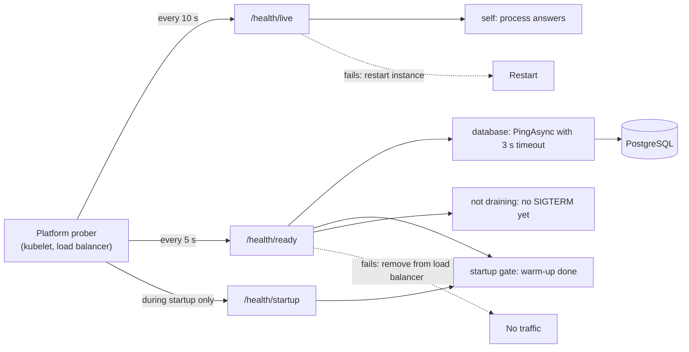
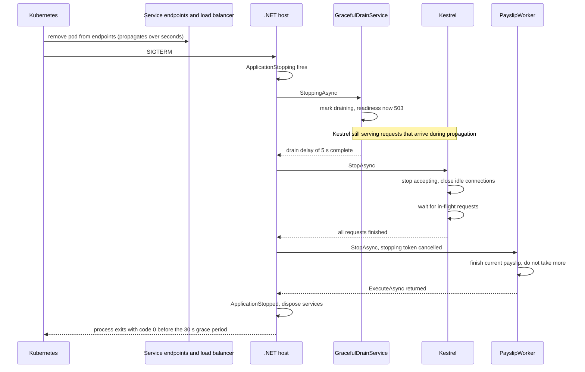

Every deployment of the employee API replaces running instances with new ones. If an old instance is killed while it is answering requests, users get connection errors. If a new instance receives traffic before it can reach PostgreSQL, users get 500s. If an instance hangs but its process is still alive, the load balancer keeps sending it requests that never finish. All three problems have the same cure: the service must tell the platform the truth about its state (health checks), and it must leave gracefully when asked (graceful shutdown). This is the last lesson of Module 3, so it ends with the module project: assembling the complete employee management API from [REST API design and HTTP status codes](#/lesson/m03-rest-status-codes), [API versioning, pagination, filtering and sorting](#/lesson/m03-api-shape) and [Caching in ASP.NET Core](#/lesson/m03-caching), with health checks, shutdown, authentication, validation, error handling, logging and tests.

## Learning objectives

By the end of this lesson you will be able to:

1. Explain the difference between liveness, readiness and startup health, and say what each must and must not check.
2. Implement custom `IHealthCheck` classes with timeouts, latency thresholds and correct failure statuses, and expose them on separate endpoints with tags.
3. Describe exactly what happens inside an ASP.NET Core process from SIGTERM to exit: `ApplicationStopping`, hosted-service lifecycle hooks, Kestrel draining, `ShutdownTimeout` and `ApplicationStopped`.
4. Size the drain delay, shutdown timeout and platform grace period so they fit together, using concrete numbers.
5. Make background workers stop cleanly without losing or duplicating work.
6. Build and test the module project: a complete employee management REST API with service and repository layers, PostgreSQL behind an interface, DI, validation, authentication, error handling, logging, health checks and graceful shutdown.

## Prerequisites

- [How an ASP.NET Core application starts](#/lesson/m03-startup): the host, `WebApplication` and the composition root.
- [Background services and hosted workers](#/lesson/m03-background-services): `BackgroundService`, `ExecuteAsync` and the stopping token.
- [REST API design and HTTP status codes](#/lesson/m03-rest-status-codes): the module project's controllers, service, repository and error handling, which the project exercise completes.

Helpful but optional: [Load balancing algorithms](#/lesson/m11-load-balancing) explains how balancers use health checks to pick backends, and [Kubernetes fundamentals and autoscaling](#/lesson/m15-kubernetes) covers pods and probes from the platform side.

## Explain it like I'm a beginner

Picture a toll plaza on an expressway with ten lanes. Above each lane is a light.

- A **green light** means "send cars here". That is **readiness**: the lane is open, the barrier works, the card reader is online.
- The **operator in the booth** being awake is **liveness**. If the operator has fainted, no amount of waiting helps; someone must replace them.
- When the plaza opens in the morning, a lane spends ten minutes booting its card reader. During that time the light stays red, and nobody calls an ambulance for the operator. That is **startup** health: "still getting ready, do not judge me yet".

Now the shift changes and lane 4 must close. A careless supervisor just shuts the barrier, and the three cars already in the lane are stuck (failed requests). A good supervisor does it in order:

1. Switch the light to red, so no new cars enter (readiness fails).
2. Wait a few seconds, because drivers already approaching may not have noticed the light change (drain delay).
3. Let the cars already in the lane pay and leave (finish in-flight requests).
4. If one driver is arguing for ten minutes, stop waiting after a fixed time (shutdown timeout).
5. Close the lane (the process exits).

That five-step routine is **graceful shutdown**. The signal that starts it, on Linux and in containers, is called **SIGTERM**: a polite "please stop". If you ignore it for too long, the platform sends **SIGKILL**, which is the barrier slamming shut with no warning.

## First-principles explanation

### Three questions a platform asks your service

Load balancers, Kubernetes, Azure App Service and Container Apps all ask variations of three questions:

| Question | Name | If the answer is "no" | Must check | Must NOT check |
|---|---|---|---|---|
| Is the process alive and not stuck? | **Liveness** | Restart the instance | The process can run code and answer HTTP | Databases, Redis, other services |
| Can it serve requests right now? | **Readiness** | Stop sending traffic (no restart) | Dependencies it needs, warm-up done, not shutting down | Optional dependencies it can work without |
| Has it finished starting? | **Startup** | Wait longer before asking the other two | One-time warm-up: migrations checked, caches primed | Anything that changes after startup |

The most important row is the first, and the most common mistake is breaking it. If liveness checks the database, a 30-second PostgreSQL failover makes *every* instance fail liveness at once, the platform restarts all of them, and they all come back to a database that is still unavailable. You have turned a short outage into a restart storm with cold caches. **Liveness checks only the process itself.** Readiness is where dependencies belong: if the database is unreachable, take the instance out of rotation, do not kill it.

### What "healthy" means in ASP.NET Core

The health checks framework (`Microsoft.Extensions.Diagnostics.HealthChecks`, part of the shared framework) has three statuses:

- **Healthy**: everything fine.
- **Degraded**: working, but something is off (the database answers in 900 ms instead of 5 ms, or an optional dependency is down). By default the endpoint still returns **200**, so traffic keeps flowing, but dashboards and alerts can see it.
- **Unhealthy**: cannot do its job. By default the endpoint returns **503**.

You register checks with `AddHealthChecks().AddCheck<T>(name, failureStatus, tags, timeout)` and map endpoints with `MapHealthChecks(path, options)`. The overall result is the **worst** individual result. `HealthCheckOptions.Predicate` chooses which checks an endpoint runs, which is how one application exposes `/health/live`, `/health/ready` and `/health/startup` from one set of registrations distinguished by **tags**.

Each check implements one method:

```csharp
Task<HealthCheckResult> CheckHealthAsync(HealthCheckContext context, CancellationToken cancellationToken);
```

Rules for writing good checks:

- **Be fast and cheap.** Probes run every few seconds on every instance. Ten instances probed every 5 s is 2 probes per second. Fine for `SELECT 1`; not fine for a query that scans a table.
- **Have a timeout.** A health check that hangs is worse than one that fails. Set a per-registration `timeout` (for example, 3 s, comfortably below the probe's own timeout) and honour the cancellation token.
- **Respect `context.Registration.FailureStatus`**. The registration decides whether a failure of this check means Unhealthy or only Degraded; your check should not hard-code it.
- **Do not leak details publicly.** The default response is the plain word `Healthy`. A detailed JSON writer is useful for operators, but host it on an internal port or behind authorisation; exception messages can reveal connection strings and versions.
- **Do not let health endpoints be blocked by your own middleware.** Authentication, rate limiting and HTTPS redirection should not stop the platform's probes. Mark the endpoints `AllowAnonymous()` and exempt them from rate limiting, or serve them on a separate port with `RequireHost("*:8081")`.

### Readiness during startup and shutdown

Readiness is not just "is the database up?". It is also false:

- **During warm-up**, until reference data is loaded or the cache primed. Sending traffic to a cold instance during a deployment at 9 a.m. is how a rolling update causes a latency spike.
- **During shutdown**, from the moment SIGTERM arrives. An instance that is about to stop should leave the pool *before* it stops accepting connections.

Both are implemented with a tiny singleton holding a flag (`StartupGate`, `DrainState`) and a check that reads it.

### What happens when the process is asked to stop

On Linux and in containers the platform sends **SIGTERM**. On Windows it is a console Ctrl+C, a service stop or IIS recycling. In all cases the .NET Generic Host translates the signal into the same sequence (shown in the sequence diagram below):

1. `IHostApplicationLifetime.ApplicationStopping` fires. Anything registered on it runs.
2. The host calls `StopAsync`, which is bounded by `HostOptions.ShutdownTimeout` (**30 seconds by default** since .NET 6; it was 5 s before). Everything below must finish within that budget.
3. Every `IHostedLifecycleService` gets `StoppingAsync`. This is the hook (added in .NET 8) where a drain delay fits, because Kestrel is still serving at this point.
4. Hosted services get `StopAsync` in reverse registration order. For the web server, that means Kestrel **stops accepting new connections**, closes idle keep-alive connections, and **waits for in-flight requests** to complete. For each `BackgroundService`, the stopping token is cancelled and the host waits for `ExecuteAsync` to return.
5. If the timeout expires first, Kestrel aborts remaining connections and the host stops waiting for workers.
6. `StoppedAsync` hooks run, `ApplicationStopped` fires, the DI container is disposed (closing connection pools), and `Main` returns.

The platform has its own clock running in parallel. **Kubernetes** waits `terminationGracePeriodSeconds` (default **30 s**) after starting termination, then sends SIGKILL. **`docker stop`** waits only **10 s** by default. If your `ShutdownTimeout` is longer than the platform's grace period, the timeout never matters: you get killed first.

### The endpoint-removal race

When Kubernetes terminates a pod, two things happen *at the same time*: the kubelet sends SIGTERM to the container, and the control plane removes the pod from the Service's endpoints, which then has to propagate to every node's proxy and to any external load balancer. Propagation takes from under a second to several seconds (an estimate; it varies by cluster and load balancer).

If the application stops accepting connections immediately on SIGTERM, every request routed to it during that propagation window is refused. The fix is to **keep serving for a few seconds after SIGTERM** while readiness reports Unhealthy, then let Kestrel stop. Two ways:

- A `preStop` hook that sleeps (for example 5 s) before SIGTERM is sent. Simple, but the container image must contain a `sleep` binary (minimal "chiseled" images do not), unless your Kubernetes version supports the built-in sleep action for `preStop`.
- A **drain delay inside the application**, implemented in `IHostedLifecycleService.StoppingAsync`. Works on any platform and in any image. This lesson implements this one.

### Fitting the timers together

Use concrete numbers and write them down. A sensible starting point (estimates; tune with your own measurements):

| Timer | Value | Why |
|---|---|---|
| Readiness probe period | 5 s, failure threshold 1 | Fast removal on shutdown |
| Drain delay (in app) | 5 s | Covers endpoint propagation |
| Longest normal request | ≤ 15 s | Reports and exports beyond that go to background jobs |
| `HostOptions.ShutdownTimeout` | 25 s | Drain delay 5 s + up to 20 s for in-flight requests and workers |
| `terminationGracePeriodSeconds` | 30 s | ShutdownTimeout + 5 s margin for disposal and logging |
| `docker stop -t` (local) | 30 s | The default 10 s would cut the drain short |

The invariant is: **drain delay + longest request < ShutdownTimeout < platform grace period**. If a request type can legitimately run for 2 minutes, either move it to a background job with a durable queue, or raise all three numbers together and accept slower deployments.

### Long-lived connections and background work

Kestrel waits for requests, but some requests never end on their own: Server-Sent Events, WebSockets and long polling. They will hold the shutdown open until the timeout and then be aborted. Link their loop to `IHostApplicationLifetime.ApplicationStopping` so they send a final "reconnect" message and finish early. Clients reconnect to another instance.

Background workers must treat the stopping token as "finish what you are holding, do not start anything new". Two rules:

- **Do not start new items after cancellation.** `ReadAllAsync(stoppingToken)` stops yielding when the token is cancelled.
- **Finish or hand back the current item.** Either complete it within a bounded time, or leave it unacknowledged in a durable queue so another instance retries it. Work held only in memory (an in-process `Channel<T>`) is lost on shutdown and on crashes; for anything that matters, the queue must be durable (PostgreSQL table, RabbitMQ, Azure Service Bus). See [Background processing and job queues](#/lesson/m11-background-processing).

Also note `HostOptions.BackgroundServiceExceptionBehavior` (default `StopHost` since .NET 6): an unhandled exception in a `BackgroundService` stops the whole application. Combined with liveness and restart policies that is usually right, but catch and log per-item failures so one bad payslip does not restart the API.

### Signals inside containers

The .NET host handles SIGTERM only if the `dotnet` process actually receives it. In a container that means the app must be **PID 1**, or be started by an init that forwards signals. Use the exec form in the Dockerfile:

```dockerfile
ENTRYPOINT ["dotnet", "EmployeeApi.dll"]     # exec form: dotnet is PID 1 and receives SIGTERM
# ENTRYPOINT dotnet EmployeeApi.dll          # shell form: /bin/sh is PID 1 and may not forward SIGTERM
```

With the shell form, the shell may swallow SIGTERM, the app never starts its graceful sequence, and after the grace period it is killed mid-request. This single line causes many "we have graceful shutdown code but deployments still drop requests" incidents.

## Visual explanation

### Probes, endpoints and checks



Each endpoint runs a different subset of checks, chosen by tags. Liveness touches nothing outside the process, so a database outage can never cause restarts. Readiness combines everything that decides whether *this* instance should receive traffic: the database, warm-up and shutdown state. Startup reuses the warm-up check so the platform does not judge liveness while the instance is still starting. The dotted arrows are the platform's reactions: a liveness failure restarts, a readiness failure only removes the instance from rotation until it recovers.

### From SIGTERM to exit



Read it top to bottom with the timers in mind. The first two arrows happen in parallel: endpoint removal and SIGTERM. The drain service runs before Kestrel stops, so requests that the load balancer still sends during propagation are served, and readiness already says "do not send more". Only after the delay does Kestrel stop accepting, finish in-flight requests and close. Background workers are stopped after the web server in this registration order, then the host disposes the DI container, which closes the database connection pool cleanly. The whole sequence must end before the platform's grace period, or the final arrow becomes a SIGKILL.

## Step-by-step example

We will add health checks and graceful shutdown to the employee API.

**Step 1: Decide what each probe means for this service.**

- Live: the process answers. Nothing else.
- Ready: PostgreSQL answers `SELECT 1` within 3 s (Degraded if slower than 500 ms), warm-up is complete, and the instance is not draining.
- Startup: warm-up is complete.

**Step 2: Write the database check** around the repository's `PingAsync` (already on `IEmployeeRepository` in the module project). Measure latency with `TimeProvider` so tests can control time.

**Step 3: Add a startup gate and a warm-up service.** The warm-up `BackgroundService` retries the database with backoff, then marks the gate ready.

**Step 4: Add a drain state and a lifecycle service.** On `StoppingAsync`, set draining (readiness fails) and wait 5 s.

**Step 5: Add middleware** that tracks in-flight requests (for logs) and, while draining, asks HTTP/1.1 keep-alive clients to reconnect with `Connection: close`, so their next request opens a new connection that the load balancer routes elsewhere.

**Step 6: Make the worker shutdown-aware.**

**Step 7: Map endpoints and configure timers.** `/health/live`, `/health/ready` (JSON writer, `no-store`), `/health/startup`. Set `ShutdownTimeout` to 25 s.

**Step 8: Configure the platform.**

```yaml
spec:
  terminationGracePeriodSeconds: 30
  containers:
    - name: employee-api
      image: registry.example/employee-api:1.8.0
      ports: [{ containerPort: 8080 }]
      startupProbe:
        httpGet: { path: /health/startup, port: 8080 }
        periodSeconds: 2
        failureThreshold: 60          # up to 120 s to warm up
      readinessProbe:
        httpGet: { path: /health/ready, port: 8080 }
        periodSeconds: 5
        timeoutSeconds: 4
        failureThreshold: 1
      livenessProbe:
        httpGet: { path: /health/live, port: 8080 }
        periodSeconds: 10
        timeoutSeconds: 2
        failureThreshold: 3           # restart after about 30 s of no answer
```

**Step 9: Test the sequence** by running locally, sending load (`bombardier`, `k6` or a loop of `curl`) and pressing Ctrl+C (SIGINT follows the same path). Watch the logs: draining, delay, in-flight count reaching zero, worker stopped, exit. Then do the same with `docker stop -t 30`.

## Production-style C# implementation

All `file=` blocks compile together as one ASP.NET Core 10 project. The employee types are trimmed copies so this lesson compiles on its own; the full API is assembled in the project exercise.

```text
EmployeeApi/
  Program.cs
  Employees/EmployeeCore.cs           trimmed domain, repository with PingAsync
  Health/DatabaseHealthCheck.cs       timeout, latency, failure status
  Health/StartupGate.cs               warm-up gate, check and warm-up service
  Health/DrainState.cs                draining flag, in-flight counter, readiness check
  Health/HealthJsonWriter.cs          operator-friendly JSON output
  Lifetime/GracefulDrainService.cs    IHostedLifecycleService drain delay
  Lifetime/DrainingMiddleware.cs      in-flight tracking, Connection: close while draining
  Workers/PayslipWorker.cs            shutdown-aware background worker
```

### Domain and repository

```csharp file=Employees/EmployeeCore.cs
using System.Collections.Concurrent;

namespace EmployeeApi.Employees;

/// <summary>Trimmed copy of the module project's domain class.</summary>
public sealed class Employee
{
    public Guid Id { get; init; } = Guid.NewGuid();
    public required string FullName { get; set; }
    public required string Department { get; set; }
    public int Version { get; set; } = 1;
}

public sealed record EmployeeResponse(Guid Id, string FullName, string Department, int Version);

public interface IEmployeeRepository
{
    Task<Employee?> GetAsync(Guid id, CancellationToken ct);

    /// <summary>Cheap connectivity probe. PostgreSQL version: SELECT 1 on a pooled connection.</summary>
    Task<bool> PingAsync(CancellationToken ct);
}

/// <summary>In-memory stand-in for PostgreSQL, with switches to simulate an outage or slow responses.</summary>
public sealed class InMemoryEmployeeRepository : IEmployeeRepository
{
    private readonly ConcurrentDictionary<Guid, Employee> _rows = new();

    public bool SimulateOutage { get; set; }
    public TimeSpan SimulatedLatency { get; set; } = TimeSpan.Zero;

    public void Add(Employee employee) => _rows[employee.Id] = employee;

    public Task<Employee?> GetAsync(Guid id, CancellationToken ct) =>
        Task.FromResult(_rows.TryGetValue(id, out var e) ? e : null);

    public async Task<bool> PingAsync(CancellationToken ct)
    {
        if (SimulateOutage) throw new InvalidOperationException("Database unreachable (simulated).");
        if (SimulatedLatency > TimeSpan.Zero) await Task.Delay(SimulatedLatency, ct);
        return true;
    }
}
```

### The database health check

```csharp file=Health/DatabaseHealthCheck.cs
using EmployeeApi.Employees;
using Microsoft.Extensions.Diagnostics.HealthChecks;
using Microsoft.Extensions.Options;

namespace EmployeeApi.Health;

public sealed class DatabaseHealthOptions
{
    /// <summary>Slower than this is Degraded (still serving, but visible on dashboards).</summary>
    public TimeSpan DegradedAfter { get; set; } = TimeSpan.FromMilliseconds(500);
}

/// <summary>
/// Readiness check for PostgreSQL. The registration supplies the timeout (cancellation token)
/// and the failure status. The check reports latency and never leaks connection details.
/// </summary>
public sealed class DatabaseHealthCheck(
    IEmployeeRepository repository,
    IOptions<DatabaseHealthOptions> options,
    TimeProvider clock,
    ILogger<DatabaseHealthCheck> logger) : IHealthCheck
{
    public async Task<HealthCheckResult> CheckHealthAsync(HealthCheckContext context, CancellationToken cancellationToken = default)
    {
        var started = clock.GetTimestamp();
        try
        {
            var ok = await repository.PingAsync(cancellationToken);
            var elapsed = clock.GetElapsedTime(started);
            var data = new Dictionary<string, object> { ["latencyMs"] = Math.Round(elapsed.TotalMilliseconds, 1) };

            if (!ok)
                return new HealthCheckResult(context.Registration.FailureStatus, "Database ping returned an unexpected result.", data: data);
            if (elapsed >= options.Value.DegradedAfter)
                return HealthCheckResult.Degraded($"Database responded slowly ({elapsed.TotalMilliseconds:F0} ms).", data: data);
            return HealthCheckResult.Healthy("Database reachable.", data);
        }
        catch (OperationCanceledException) when (cancellationToken.IsCancellationRequested)
        {
            return new HealthCheckResult(context.Registration.FailureStatus, "Database check timed out.");
        }
        catch (Exception ex)
        {
            logger.LogWarning(ex, "Database health check failed");
            // Pass the exception for logs and publishers; the public writer below does not print it.
            return new HealthCheckResult(context.Registration.FailureStatus, "Database unreachable.", ex);
        }
    }
}
```

### Startup gate and warm-up

```csharp file=Health/StartupGate.cs
using EmployeeApi.Employees;
using Microsoft.Extensions.Diagnostics.HealthChecks;

namespace EmployeeApi.Health;

/// <summary>Flips once, from "warming up" to "ready". Read by the startup and readiness checks.</summary>
public sealed class StartupGate
{
    private int _ready;
    public bool IsReady => Volatile.Read(ref _ready) == 1;
    public void MarkReady() => Interlocked.Exchange(ref _ready, 1);
}

public sealed class StartupHealthCheck(StartupGate gate) : IHealthCheck
{
    public Task<HealthCheckResult> CheckHealthAsync(HealthCheckContext context, CancellationToken cancellationToken = default) =>
        Task.FromResult(gate.IsReady
            ? HealthCheckResult.Healthy("Warm-up complete.")
            : new HealthCheckResult(context.Registration.FailureStatus, "Warming up."));
}

/// <summary>
/// Waits for the database with capped exponential backoff, then opens the gate.
/// Real services also load reference data or prime caches here.
/// </summary>
public sealed class WarmupService(StartupGate gate, IEmployeeRepository repository, ILogger<WarmupService> logger) : BackgroundService
{
    protected override async Task ExecuteAsync(CancellationToken stoppingToken)
    {
        for (var attempt = 1; !stoppingToken.IsCancellationRequested; attempt++)
        {
            try
            {
                if (await repository.PingAsync(stoppingToken))
                {
                    gate.MarkReady();
                    logger.LogInformation("Warm-up complete after {Attempts} attempt(s)", attempt);
                    return;
                }
            }
            catch (Exception ex) when (ex is not OperationCanceledException)
            {
                logger.LogWarning(ex, "Warm-up attempt {Attempt} failed", attempt);
            }
            var backoff = TimeSpan.FromSeconds(Math.Min(30, Math.Pow(2, attempt)));   // 2, 4, 8, 16, 30, 30...
            await Task.Delay(backoff, stoppingToken);
        }
    }
}
```

### Drain state and the readiness check that uses it

```csharp file=Health/DrainState.cs
using Microsoft.Extensions.Diagnostics.HealthChecks;

namespace EmployeeApi.Health;

public sealed class DrainOptions
{
    public const string SectionName = "Shutdown";

    /// <summary>How long to keep serving after SIGTERM so load balancers notice readiness has failed.</summary>
    public TimeSpan DrainDelay { get; set; } = TimeSpan.FromSeconds(5);
}

/// <summary>Process-wide shutdown state: a draining flag and a count of requests in flight.</summary>
public sealed class DrainState
{
    private int _draining;
    private long _inFlight;

    public bool IsDraining => Volatile.Read(ref _draining) == 1;
    public long InFlight => Interlocked.Read(ref _inFlight);

    /// <summary>Returns true only for the first caller, so the transition is logged once.</summary>
    public bool BeginDrain() => Interlocked.Exchange(ref _draining, 1) == 0;

    public void Enter() => Interlocked.Increment(ref _inFlight);
    public void Exit() => Interlocked.Decrement(ref _inFlight);
}

public sealed class NotDrainingHealthCheck(DrainState drain) : IHealthCheck
{
    public Task<HealthCheckResult> CheckHealthAsync(HealthCheckContext context, CancellationToken cancellationToken = default) =>
        Task.FromResult(drain.IsDraining
            ? HealthCheckResult.Unhealthy("Shutting down.")
            : HealthCheckResult.Healthy());
}
```

### An operator-friendly health response

```csharp file=Health/HealthJsonWriter.cs
using System.Text.Json;
using Microsoft.Extensions.Diagnostics.HealthChecks;

namespace EmployeeApi.Health;

/// <summary>Status, duration and description per check. Deliberately omits exception messages.</summary>
public static class HealthJsonWriter
{
    private static readonly JsonSerializerOptions Json = new(JsonSerializerDefaults.Web);

    public static Task WriteAsync(HttpContext context, HealthReport report)
    {
        context.Response.ContentType = "application/json; charset=utf-8";
        context.Response.Headers.CacheControl = "no-store";
        var body = new
        {
            status = report.Status.ToString(),
            totalMs = Math.Round(report.TotalDuration.TotalMilliseconds, 1),
            checks = report.Entries.Select(e => new
            {
                name = e.Key,
                status = e.Value.Status.ToString(),
                ms = Math.Round(e.Value.Duration.TotalMilliseconds, 1),
                description = e.Value.Description,
                data = e.Value.Data,
            }),
        };
        return context.Response.WriteAsync(JsonSerializer.Serialize(body, Json));
    }
}
```

### The drain delay and the middleware

```csharp file=Lifetime/GracefulDrainService.cs
using EmployeeApi.Health;
using Microsoft.Extensions.Options;

namespace EmployeeApi.Lifetime;

/// <summary>
/// Runs in StoppingAsync, before Kestrel stops: readiness starts failing, then we keep serving
/// for DrainDelay so requests already routed here (or in flight to the load balancer) still succeed.
/// </summary>
public sealed class GracefulDrainService(
    DrainState drain,
    IOptions<DrainOptions> options,
    IHostApplicationLifetime lifetime,
    ILogger<GracefulDrainService> logger) : IHostedLifecycleService
{
    public Task StartingAsync(CancellationToken cancellationToken)
    {
        lifetime.ApplicationStopping.Register(() =>
        {
            if (drain.BeginDrain()) logger.LogInformation("Stop requested: readiness now reports Unhealthy");
        });
        return Task.CompletedTask;
    }

    public Task StartAsync(CancellationToken cancellationToken) => Task.CompletedTask;
    public Task StartedAsync(CancellationToken cancellationToken) => Task.CompletedTask;

    public async Task StoppingAsync(CancellationToken cancellationToken)
    {
        drain.BeginDrain();
        var delay = options.Value.DrainDelay;
        logger.LogInformation("Draining for {DelaySeconds} s before the server stops accepting connections. In flight: {InFlight}",
            delay.TotalSeconds, drain.InFlight);
        try
        {
            await Task.Delay(delay, cancellationToken);   // token fires when HostOptions.ShutdownTimeout runs out
        }
        catch (OperationCanceledException)
        {
            logger.LogWarning("Drain delay cut short by the shutdown timeout");
        }
    }

    public Task StopAsync(CancellationToken cancellationToken) => Task.CompletedTask;

    public Task StoppedAsync(CancellationToken cancellationToken)
    {
        logger.LogInformation("Host stopped with {InFlight} request(s) still in flight", drain.InFlight);
        return Task.CompletedTask;
    }
}
```

```csharp file=Lifetime/DrainingMiddleware.cs
using EmployeeApi.Health;

namespace EmployeeApi.Lifetime;

/// <summary>
/// Counts in-flight requests and, while draining, tells HTTP/1.1 keep-alive clients to reconnect,
/// so their next request opens a new connection that the load balancer routes to a healthy instance.
/// (HTTP/2 has no Connection header. Kestrel sends GOAWAY to HTTP/2 clients when it stops.)
/// </summary>
public sealed class DrainingMiddleware(RequestDelegate next, DrainState drain)
{
    public async Task InvokeAsync(HttpContext context)
    {
        drain.Enter();
        try
        {
            if (drain.IsDraining && HttpProtocol.IsHttp11(context.Request.Protocol))
                context.Response.Headers.Connection = "close";
            await next(context);
        }
        finally
        {
            drain.Exit();
        }
    }
}
```

### A shutdown-aware worker

```csharp file=Workers/PayslipWorker.cs
using System.Threading.Channels;

namespace EmployeeApi.Workers;

/// <summary>
/// In-process queue for the demo. Anything that must survive a restart belongs in a durable queue
/// (a PostgreSQL jobs table, RabbitMQ, Azure Service Bus), because this channel is lost on shutdown.
/// </summary>
public sealed class PayslipQueue
{
    private readonly Channel<Guid> _channel = Channel.CreateBounded<Guid>(new BoundedChannelOptions(1_000)
    {
        FullMode = BoundedChannelFullMode.Wait,
    });

    public ChannelWriter<Guid> Writer => _channel.Writer;
    public ChannelReader<Guid> Reader => _channel.Reader;
}

public sealed class PayslipWorker(PayslipQueue queue, ILogger<PayslipWorker> logger) : BackgroundService
{
    private static readonly TimeSpan PerItemLimit = TimeSpan.FromSeconds(10);

    protected override async Task ExecuteAsync(CancellationToken stoppingToken)
    {
        try
        {
            // Stops yielding new items as soon as shutdown starts.
            await foreach (var employeeId in queue.Reader.ReadAllAsync(stoppingToken))
            {
                // The item in hand gets its own bounded budget, independent of the stopping token,
                // so a payslip is never abandoned halfway through because SIGTERM arrived.
                using var itemBudget = new CancellationTokenSource(PerItemLimit);
                try
                {
                    await GeneratePayslipAsync(employeeId, itemBudget.Token);
                }
                catch (Exception ex) when (ex is not OperationCanceledException)
                {
                    // One bad item must not stop the host (BackgroundServiceExceptionBehavior.StopHost).
                    logger.LogError(ex, "Payslip generation failed for {EmployeeId}", employeeId);
                }
            }
        }
        catch (OperationCanceledException) when (stoppingToken.IsCancellationRequested)
        {
            // Normal shutdown.
        }
        logger.LogInformation("Payslip worker stopped. {Remaining} job(s) left in the in-memory queue", queue.Reader.Count);
    }

    private async Task GeneratePayslipAsync(Guid employeeId, CancellationToken ct)
    {
        await Task.Delay(TimeSpan.FromMilliseconds(200), ct);   // stands in for rendering a PDF
        logger.LogInformation("Payslip generated for {EmployeeId}", employeeId);
    }
}
```

### Composition root

```csharp file=Program.cs
using EmployeeApi.Employees;
using EmployeeApi.Health;
using EmployeeApi.Lifetime;
using EmployeeApi.Workers;
using Microsoft.AspNetCore.Diagnostics.HealthChecks;
using Microsoft.Extensions.Diagnostics.HealthChecks;

var builder = WebApplication.CreateBuilder(args);

// Timers: drain delay (5 s) + in-flight work must fit inside ShutdownTimeout (25 s),
// which must fit inside the platform grace period (Kubernetes default 30 s).
builder.Services.Configure<HostOptions>(o => o.ShutdownTimeout = TimeSpan.FromSeconds(25));
builder.Services.Configure<DrainOptions>(builder.Configuration.GetSection(DrainOptions.SectionName));
builder.Services.Configure<DatabaseHealthOptions>(builder.Configuration.GetSection("Health:Database"));

builder.Services.AddProblemDetails();
builder.Services.AddSingleton(TimeProvider.System);
builder.Services.AddSingleton<InMemoryEmployeeRepository>();
builder.Services.AddSingleton<IEmployeeRepository>(sp => sp.GetRequiredService<InMemoryEmployeeRepository>());

builder.Services.AddSingleton<StartupGate>();
builder.Services.AddSingleton<DrainState>();
builder.Services.AddSingleton<PayslipQueue>();

// Hosted services stop in reverse order of registration.
builder.Services.AddHostedService<PayslipWorker>();
builder.Services.AddHostedService<WarmupService>();
builder.Services.AddHostedService<GracefulDrainService>();

builder.Services.AddHealthChecks()
    .AddCheck("self", () => HealthCheckResult.Healthy(), tags: ["live"])
    .AddCheck<StartupHealthCheck>("startup", tags: ["startup", "ready"])
    .AddCheck<NotDrainingHealthCheck>("not-draining", tags: ["ready"])
    .AddCheck<DatabaseHealthCheck>("database", failureStatus: HealthStatus.Unhealthy, tags: ["ready"], timeout: TimeSpan.FromSeconds(3));

var app = builder.Build();

app.UseMiddleware<DrainingMiddleware>();
app.UseExceptionHandler();

app.MapHealthChecks("/health/live", new HealthCheckOptions { Predicate = r => r.Tags.Contains("live") });
app.MapHealthChecks("/health/startup", new HealthCheckOptions { Predicate = r => r.Tags.Contains("startup") });
app.MapHealthChecks("/health/ready", new HealthCheckOptions
{
    Predicate = r => r.Tags.Contains("ready"),
    ResponseWriter = HealthJsonWriter.WriteAsync,   // detailed: serve on an internal port in production
});

app.MapGet("/api/employees/{id:guid}", async (Guid id, IEmployeeRepository repository, CancellationToken ct) =>
    await repository.GetAsync(id, ct) is { } e
        ? Results.Ok(new EmployeeResponse(e.Id, e.FullName, e.Department, e.Version))
        : Results.Problem(statusCode: StatusCodes.Status404NotFound, title: "Employee not found"));

app.MapPost("/api/payslips/{employeeId:guid}", async (Guid employeeId, PayslipQueue queue, DrainState drain,
    HttpResponse response, CancellationToken ct) =>
{
    if (drain.IsDraining)
    {
        // Do not accept new work we may not finish. The client retries and lands on another instance.
        response.Headers.RetryAfter = "2";
        return Results.Problem(statusCode: StatusCodes.Status503ServiceUnavailable, title: "Instance is shutting down");
    }
    await queue.Writer.WriteAsync(employeeId, ct);
    return Results.Accepted($"/api/payslips/{employeeId}");
});

app.Run();

public partial class Program { }
```

The production repository's `PingAsync` is a one-line query on the Npgsql data source (from the module project). Keep it on a **pooled** connection and with a short command timeout; opening a fresh physical connection per probe adds load to PostgreSQL for no benefit:

```csharp
public async Task<bool> PingAsync(CancellationToken ct)
{
    await using var cmd = dataSource.CreateCommand("SELECT 1");
    cmd.CommandTimeout = 2;                                 // seconds, below the health check's 3 s timeout
    return (await cmd.ExecuteScalarAsync(ct)) is 1;
}
```

If you prefer a ready-made check, the community `AspNetCore.HealthChecks.NpgSql` package provides `AddNpgSql(connectionString)`; it does the same thing.

## Bad design vs good design

**Bad**: health and shutdown as most first deployments have them.

```csharp
builder.Services.AddHealthChecks()
    .AddCheck("db", () => Db.CanConnect() ? HealthCheckResult.Healthy() : HealthCheckResult.Unhealthy())  // sync, no timeout
    .AddCheck("payments-api", () => Http.Get("https://payments.example/health").IsSuccess
        ? HealthCheckResult.Healthy() : HealthCheckResult.Unhealthy());

app.MapHealthChecks("/health", new HealthCheckOptions
{
    ResponseWriter = (ctx, report) => ctx.Response.WriteAsJsonAsync(report),     // serialises exceptions
});
// Kubernetes: livenessProbe AND readinessProbe both point at /health
// Dockerfile: ENTRYPOINT dotnet EmployeeApi.dll   (shell form)
```

What is wrong with it:

- **One endpoint for liveness and readiness**, which includes the database, so a database failover restarts every instance at once.
- **A downstream service in the health check** (`payments-api`). If the payment provider is slow, your whole employee API is marked unhealthy, and if they check *you* the same way, two services can take each other down in a loop. Downstream dependencies the API can partly work without are Degraded at most, and usually monitored separately.
- **Synchronous, untimed checks**. A hung connection attempt blocks the probe until the platform's probe timeout, and thread-pool threads are tied up on every instance.
- **The raw `HealthReport` is serialised**, including exception messages and stack traces, on an anonymous public endpoint.
- **Shell-form entrypoint**, so SIGTERM may never reach the app, and all the graceful-shutdown logic never runs.
- **No drain delay**, so every rolling deployment refuses requests during endpoint propagation.

**Good**: the implementation above. Separate live, ready and startup endpoints selected by tags; liveness checks only the process; each dependency check is async with a timeout and a failure status; details are written without exceptions and with `no-store`; draining fails readiness first, keeps serving for a measured delay, then lets Kestrel finish in-flight requests within a timeout that fits inside the platform grace period.

**When simpler is fine**: a single-instance internal app on one VM behind IIS with no load balancer has no one to drain traffic to. A plain `/health` endpoint for an uptime monitor and the default shutdown timeout are enough. Add the rest when you add a second instance.

:::callout type=tradeoff title="Should readiness fail when the database is down?"
If readiness fails on a database outage, the load balancer removes every instance and clients get immediate connection errors instead of 503s with Problem Details. Some teams prefer to stay "ready" and let the application return fast 503s with `Retry-After`, because the error message is better and caches can still serve some reads. Others prefer removal, because a fronting gateway can then serve a maintenance page. Both are defensible. Decide explicitly, and never put the database in liveness.
:::

:::callout type=warning title="Health endpoints are part of your attack surface"
Detailed health output tells an attacker which database you use, how slow it is and sometimes its host name. Keep the public endpoint terse (status only), put the detailed writer on an internal port with `RequireHost("*:8081")` or behind an authorisation policy, and exclude health paths from request logging to keep logs readable.
:::

## Practical playground

This simulation sends 200 requests per second to one instance, delivers SIGTERM at time zero, and stops routing new requests to it only after the load balancer update propagates (3 s here). It reports refused requests (arrived after Kestrel stopped accepting), aborted requests (still running at the shutdown timeout) and the exit time, for several drain delays. Change `lbUpdateMs`, `shutdownTimeoutMs` and the request-duration mix, and predict the numbers before running.

:::playground type=csharp title="Drain delay versus dropped requests"
```csharp file=Program.cs
using System;
using System.Collections.Generic;

public static class Program
{
    public static void Main()
    {
        Console.WriteLine("drain  refused  aborted  exit(ms)   [lbUpdate=3000 ms, shutdownTimeout=25000 ms, grace=30000 ms]");
        foreach (var drain in new[] { 0, 2_000, 5_000, 10_000 })
            Simulate(drainDelayMs: drain, lbUpdateMs: 3_000, shutdownTimeoutMs: 25_000, graceMs: 30_000);

        Console.WriteLine();
        Console.WriteLine("Same, but ShutdownTimeout (40 s) longer than the platform grace period (30 s):");
        Simulate(drainDelayMs: 5_000, lbUpdateMs: 3_000, shutdownTimeoutMs: 40_000, graceMs: 30_000);
    }

    private static void Simulate(int drainDelayMs, int lbUpdateMs, int shutdownTimeoutMs, int graceMs)
    {
        var rng = new Random(7);
        int refused = 0, aborted = 0;
        var lastFinish = drainDelayMs;
        var hardStop = Math.Min(shutdownTimeoutMs, graceMs);   // whichever comes first ends the process

        // One request every 5 ms (200/s), from 20 s before SIGTERM until the load balancer stops routing here.
        for (var arrival = -20_000; arrival < lbUpdateMs; arrival += 5)
        {
            var p = rng.NextDouble();
            var duration = p < 0.95 ? 50 + rng.Next(350)          // normal API calls
                         : p < 0.995 ? 2_000 + rng.Next(13_000)   // reports, up to 15 s
                         : 40_000;                                // an export that should be a background job
            var finish = arrival + duration;
            if (finish < 0) continue;                             // finished before SIGTERM: irrelevant

            if (arrival >= drainDelayMs) { refused++; continue; } // Kestrel no longer accepting
            if (finish > hardStop) { aborted++; continue; }       // cut off by timeout or SIGKILL
            lastFinish = Math.Max(lastFinish, finish);
        }

        var exit = aborted > 0 ? hardStop : lastFinish;
        var how = graceMs <= shutdownTimeoutMs && aborted > 0 ? " (SIGKILL)" : "";
        Console.WriteLine($"{drainDelayMs,5}  {refused,7}  {aborted,7}  {exit,8}{how}");
    }
}
```
:::

With no drain delay, every request that arrives during the 3-second propagation window is refused (about 600). A 5-second delay removes all of them. A 10-second delay removes them too but makes every deployment slower. The 40-second exports are aborted in every run, which is the simulation's way of saying they belong in a background job. In the last run, the platform's 30-second SIGKILL arrives before the 40-second shutdown timeout, so the timeout setting is meaningless.

## Exercises

:::exercise id=m03-health-shutdown-ex1 difficulty=beginner kind=written title="Which probe, which status?"
For the employee API running in Kubernetes behind a load balancer, decide for each condition whether it should affect **liveness**, **readiness**, **startup**, or **none**, and whether the status should be Healthy, Degraded or Unhealthy. One sentence of reasoning each.

1. PostgreSQL is unreachable.
2. PostgreSQL answers `SELECT 1` in 1.2 s instead of the usual 3 ms.
3. Redis (used only as a cache) is down; the API falls back to the database.
4. The process is deadlocked: the thread pool is exhausted and no request completes.
5. The instance has received SIGTERM.
6. The instance is still loading 50,000 department and site records into memory after start.
7. The SMS gateway used for leave notifications returns errors.
8. Free disk space on the container's temp volume is 2 %.
::acceptance
- No dependency appears in liveness.
- At least one condition is Degraded rather than Unhealthy, with a reason.
- Shutdown and warm-up are handled through readiness or startup, not liveness.
::hint
Ask for each: "Would restarting this instance fix it?" Only then does it belong in liveness.
::hint
Then ask: "Can this instance usefully serve requests right now?" If not, readiness fails.
::hint
Optional dependencies that have a fallback are Degraded at most. They are better watched by monitoring and alerts than by probes.
::solution
1. **Readiness, Unhealthy** (or stay ready and return fast 503s; see the trade-off callout). Never liveness: restarting does not fix the database.
2. **Readiness, Degraded.** It still works; Degraded keeps traffic flowing (200) but shows on dashboards and can alert.
3. **Readiness, Degraded** (or none). The API still functions via the fallback. Unhealthy here would remove every instance because of a cache.
4. **Liveness, Unhealthy.** Only a restart helps. The liveness endpoint stops answering in time, the probe times out, and after the failure threshold the platform restarts the instance. This is exactly what liveness exists for.
5. **Readiness, Unhealthy** from the first moment of shutdown, so the instance leaves the pool before it stops accepting connections.
6. **Startup, Unhealthy until done** (and readiness Unhealthy too). The startup probe stops liveness from killing a slow-starting instance.
7. **None** (alerting and metrics instead). Leave notifications can be retried from a queue; the API's main job is unaffected.
8. **Readiness, Degraded** with an alert, or liveness only if the app genuinely cannot run without temp space and a restart clears it. Usually this is a monitoring alert, not a probe.
::mistakes
- Putting the database in liveness "because the app is useless without it".
- Making optional dependencies Unhealthy, so a cache outage becomes a full outage.
- Handling shutdown by making liveness fail, which triggers a restart race instead of a clean exit.
:::

:::exercise id=m03-health-shutdown-ex2 difficulty=beginner kind=code title="Aggregate health and map it to HTTP"
Implement `HealthPolicy`, a small pure helper that combines individual check results and maps the result to an HTTP status code, mirroring what ASP.NET Core's health middleware does.
::requirements
- `Aggregate(statuses)` returns the worst status: Unhealthy is worse than Degraded, which is worse than Healthy. An empty list is Healthy.
- `ToHttpStatus(status, degradedIsAvailable)` returns 200 for Healthy, 503 for Unhealthy, and for Degraded returns 200 when `degradedIsAvailable` is true, else 503.
- `Select(checks, tag)` returns the names of checks carrying the tag (case-insensitive), in the original order.
::acceptance
- All tests pass.
- Uses the real `HealthStatus` enum from `Microsoft.Extensions.Diagnostics.HealthChecks`.
::hint
In the `HealthStatus` enum, Unhealthy = 0, Degraded = 1, Healthy = 2. The worst status is the minimum value.
::hint
`statuses.DefaultIfEmpty(HealthStatus.Healthy).Min()` handles the empty case in one line.
::hint
For `Select`, filter with `c.Tags.Contains(tag, StringComparer.OrdinalIgnoreCase)` and project the name.
::starter
```csharp file=HealthPolicy.cs
using System;
using System.Collections.Generic;
using Microsoft.Extensions.Diagnostics.HealthChecks;

public sealed record CheckInfo(string Name, IReadOnlyList<string> Tags);

public static class HealthPolicy
{
    public static HealthStatus Aggregate(IEnumerable<HealthStatus> statuses) => throw new NotImplementedException();

    public static int ToHttpStatus(HealthStatus status, bool degradedIsAvailable) => throw new NotImplementedException();

    public static IReadOnlyList<string> Select(IEnumerable<CheckInfo> checks, string tag) => throw new NotImplementedException();
}
```
::tests
```csharp file=HealthPolicyTests.cs
using System;
using System.Linq;
using Microsoft.Extensions.Diagnostics.HealthChecks;
using Xunit;

public class HealthPolicyTests
{
    [Fact]
    public void Empty_is_healthy() => Assert.Equal(HealthStatus.Healthy, HealthPolicy.Aggregate(Array.Empty<HealthStatus>()));

    [Fact]
    public void Worst_wins()
    {
        Assert.Equal(HealthStatus.Degraded, HealthPolicy.Aggregate(new[] { HealthStatus.Healthy, HealthStatus.Degraded, HealthStatus.Healthy }));
        Assert.Equal(HealthStatus.Unhealthy, HealthPolicy.Aggregate(new[] { HealthStatus.Degraded, HealthStatus.Unhealthy, HealthStatus.Healthy }));
    }

    [Theory]
    [InlineData(HealthStatus.Healthy, true, 200)]
    [InlineData(HealthStatus.Healthy, false, 200)]
    [InlineData(HealthStatus.Degraded, true, 200)]
    [InlineData(HealthStatus.Degraded, false, 503)]
    [InlineData(HealthStatus.Unhealthy, true, 503)]
    public void Maps_to_http(HealthStatus status, bool degradedOk, int expected) =>
        Assert.Equal(expected, HealthPolicy.ToHttpStatus(status, degradedOk));

    [Fact]
    public void Selects_by_tag_case_insensitively_in_order()
    {
        var checks = new[]
        {
            new CheckInfo("self", new[] { "live" }),
            new CheckInfo("database", new[] { "ready" }),
            new CheckInfo("startup", new[] { "startup", "Ready" }),
            new CheckInfo("not-draining", new[] { "ready" }),
        };
        Assert.Equal(new[] { "database", "startup", "not-draining" }, HealthPolicy.Select(checks, "READY").ToArray());
        Assert.Equal(new[] { "self" }, HealthPolicy.Select(checks, "live").ToArray());
        Assert.Empty(HealthPolicy.Select(checks, "nothing"));
    }
}
```
::solution
```csharp file=HealthPolicy.cs
using System;
using System.Collections.Generic;
using System.Linq;
using Microsoft.Extensions.Diagnostics.HealthChecks;

public sealed record CheckInfo(string Name, IReadOnlyList<string> Tags);

public static class HealthPolicy
{
    // Unhealthy = 0 < Degraded = 1 < Healthy = 2, so the worst status is the minimum.
    public static HealthStatus Aggregate(IEnumerable<HealthStatus> statuses) =>
        statuses.DefaultIfEmpty(HealthStatus.Healthy).Min();

    public static int ToHttpStatus(HealthStatus status, bool degradedIsAvailable) => status switch
    {
        HealthStatus.Healthy => 200,
        HealthStatus.Degraded => degradedIsAvailable ? 200 : 503,
        _ => 503,
    };

    public static IReadOnlyList<string> Select(IEnumerable<CheckInfo> checks, string tag) =>
        checks.Where(c => c.Tags.Contains(tag, StringComparer.OrdinalIgnoreCase)).Select(c => c.Name).ToList();
}
```

ASP.NET Core does the same: `HealthReport.Status` is the worst entry, `HealthCheckOptions.ResultStatusCodes` maps statuses to codes (Degraded to 200 by default), and `Predicate` selects checks, usually by tag.
::mistakes
- Treating Degraded as 503 by default, which removes instances from rotation for a slow-but-working dependency.
- Relying on enum order without a comment, or comparing names as strings.
- Case-sensitive tag matching, so a typo in one registration silently drops a check from readiness.
:::

:::exercise id=m03-health-shutdown-ex3 difficulty=intermediate kind=code title="A timed dependency health check"
Implement `TimedDependencyCheck`, a reusable `IHealthCheck` that runs a probe delegate with its own timeout, measures latency with an injected `TimeProvider`, and reports Healthy, Degraded or the registration's failure status.
::requirements
- Constructor: `(Func<CancellationToken, Task> probe, TimeSpan timeout, TimeSpan degradedAfter, TimeProvider clock)`.
- The probe is cancelled after `timeout` (combine with the incoming token). A timeout returns `context.Registration.FailureStatus` with a description containing "timed out".
- A probe exception returns the failure status, includes the exception in the result, and uses a description that does **not** contain the exception message (it may contain secrets).
- Success faster than `degradedAfter` is Healthy, otherwise Degraded.
- Every result except timeouts includes `latencyMs` in `Data`.
- If the *caller's* token is cancelled (not the timeout), let `OperationCanceledException` propagate.
::acceptance
- All tests pass.
::hint
`CancellationTokenSource.CreateLinkedTokenSource(cancellationToken)` then `cts.CancelAfter(timeout)` gives a token that fires on either.
::hint
Measure with `clock.GetTimestamp()` before and `clock.GetElapsedTime(start)` after. The tests use a clock whose timestamp advances only when the probe tells it to.
::hint
Distinguish the two cancellations with exception filters: `catch (OperationCanceledException) when (!cancellationToken.IsCancellationRequested)` is the timeout.
::hint
```csharp
using var cts = CancellationTokenSource.CreateLinkedTokenSource(cancellationToken);
cts.CancelAfter(_timeout);
var start = _clock.GetTimestamp();
try { await _probe(cts.Token); }
catch (OperationCanceledException) when (!cancellationToken.IsCancellationRequested) { return Timeout(context); }
catch (Exception ex) when (ex is not OperationCanceledException) { return Failed(context, ex, Elapsed(start)); }
```
::starter
```csharp file=TimedDependencyCheck.cs
using System;
using System.Threading;
using System.Threading.Tasks;
using Microsoft.Extensions.Diagnostics.HealthChecks;

public sealed class TimedDependencyCheck : IHealthCheck
{
    public TimedDependencyCheck(Func<CancellationToken, Task> probe, TimeSpan timeout, TimeSpan degradedAfter, TimeProvider clock) =>
        throw new NotImplementedException();

    public Task<HealthCheckResult> CheckHealthAsync(HealthCheckContext context, CancellationToken cancellationToken = default) =>
        throw new NotImplementedException();
}
```
::tests
```csharp file=TimedDependencyCheckTests.cs
using System;
using System.Threading;
using System.Threading.Tasks;
using Microsoft.Extensions.Diagnostics.HealthChecks;
using Xunit;

/// <summary>Timestamp advances only when told to; timers still use real time (base implementation).</summary>
public sealed class SteppingClock : TimeProvider
{
    private long _ticks;
    public override long TimestampFrequency => TimeSpan.TicksPerSecond;
    public override long GetTimestamp() => Interlocked.Read(ref _ticks);
    public void Advance(TimeSpan by) => Interlocked.Add(ref _ticks, by.Ticks);
}

public class TimedDependencyCheckTests
{
    private static HealthCheckContext Context(IHealthCheck check, HealthStatus failure = HealthStatus.Unhealthy) =>
        new() { Registration = new HealthCheckRegistration("dep", check, failure, null) };

    [Fact]
    public async Task Fast_success_is_healthy_with_latency()
    {
        var clock = new SteppingClock();
        var check = new TimedDependencyCheck(_ => { clock.Advance(TimeSpan.FromMilliseconds(12)); return Task.CompletedTask; },
            TimeSpan.FromSeconds(3), TimeSpan.FromMilliseconds(500), clock);
        var result = await check.CheckHealthAsync(Context(check));
        Assert.Equal(HealthStatus.Healthy, result.Status);
        Assert.Equal(12.0, Convert.ToDouble(result.Data["latencyMs"]), 1);
    }

    [Fact]
    public async Task Slow_success_is_degraded()
    {
        var clock = new SteppingClock();
        var check = new TimedDependencyCheck(_ => { clock.Advance(TimeSpan.FromMilliseconds(900)); return Task.CompletedTask; },
            TimeSpan.FromSeconds(3), TimeSpan.FromMilliseconds(500), clock);
        var result = await check.CheckHealthAsync(Context(check));
        Assert.Equal(HealthStatus.Degraded, result.Status);
        Assert.True(result.Data.ContainsKey("latencyMs"));
    }

    [Fact]
    public async Task Exception_uses_failure_status_and_hides_message()
    {
        var check = new TimedDependencyCheck(_ => throw new InvalidOperationException("Host=db-prod-7;Password=hunter2"),
            TimeSpan.FromSeconds(3), TimeSpan.FromMilliseconds(500), new SteppingClock());
        var result = await check.CheckHealthAsync(Context(check, HealthStatus.Degraded));
        Assert.Equal(HealthStatus.Degraded, result.Status);
        Assert.NotNull(result.Exception);
        Assert.DoesNotContain("hunter2", result.Description);
        Assert.True(result.Data.ContainsKey("latencyMs"));
    }

    [Fact]
    public async Task Hanging_probe_times_out()
    {
        var check = new TimedDependencyCheck(ct => Task.Delay(Timeout.Infinite, ct),
            TimeSpan.FromMilliseconds(100), TimeSpan.FromMilliseconds(50), TimeProvider.System);
        var result = await check.CheckHealthAsync(Context(check));
        Assert.Equal(HealthStatus.Unhealthy, result.Status);
        Assert.Contains("timed out", result.Description);
    }

    [Fact]
    public async Task Caller_cancellation_propagates()
    {
        using var cts = new CancellationTokenSource();
        cts.Cancel();
        var check = new TimedDependencyCheck(ct => Task.Delay(Timeout.Infinite, ct),
            TimeSpan.FromSeconds(5), TimeSpan.FromSeconds(1), TimeProvider.System);
        await Assert.ThrowsAnyAsync<OperationCanceledException>(() => check.CheckHealthAsync(Context(check), cts.Token));
    }
}
```
::solution
The two cancellation sources must be told apart: the check's own timeout is a health result ("the dependency is too slow"), while the caller's cancellation means "nobody wants the answer any more" and should propagate.

```csharp file=TimedDependencyCheck.cs
using System;
using System.Collections.Generic;
using System.Threading;
using System.Threading.Tasks;
using Microsoft.Extensions.Diagnostics.HealthChecks;

public sealed class TimedDependencyCheck : IHealthCheck
{
    private readonly Func<CancellationToken, Task> _probe;
    private readonly TimeSpan _timeout;
    private readonly TimeSpan _degradedAfter;
    private readonly TimeProvider _clock;

    public TimedDependencyCheck(Func<CancellationToken, Task> probe, TimeSpan timeout, TimeSpan degradedAfter, TimeProvider clock)
    {
        _probe = probe ?? throw new ArgumentNullException(nameof(probe));
        _timeout = timeout;
        _degradedAfter = degradedAfter;
        _clock = clock ?? throw new ArgumentNullException(nameof(clock));
    }

    public async Task<HealthCheckResult> CheckHealthAsync(HealthCheckContext context, CancellationToken cancellationToken = default)
    {
        using var cts = CancellationTokenSource.CreateLinkedTokenSource(cancellationToken);
        cts.CancelAfter(_timeout);
        var start = _clock.GetTimestamp();
        try
        {
            await _probe(cts.Token);
        }
        catch (OperationCanceledException) when (!cancellationToken.IsCancellationRequested)
        {
            return new HealthCheckResult(context.Registration.FailureStatus,
                $"Dependency check timed out after {_timeout.TotalMilliseconds:F0} ms.");
        }
        catch (Exception ex) when (ex is not OperationCanceledException)
        {
            return new HealthCheckResult(context.Registration.FailureStatus,
                $"Dependency check failed ({ex.GetType().Name}).", ex, Data(start));
        }

        var elapsed = _clock.GetElapsedTime(start);
        return elapsed >= _degradedAfter
            ? HealthCheckResult.Degraded($"Dependency slow ({elapsed.TotalMilliseconds:F0} ms).", data: Data(start))
            : HealthCheckResult.Healthy("Dependency reachable.", Data(start));
    }

    private IReadOnlyDictionary<string, object> Data(long start) =>
        new Dictionary<string, object> { ["latencyMs"] = Math.Round(_clock.GetElapsedTime(start).TotalMilliseconds, 1) };
}
```

Register it with a factory so each dependency gets its own probe: `AddCheck("database", new TimedDependencyCheck(ct => repo.PingAsync(ct), ...), tags: ["ready"])`, or with `AddTypeActivatedCheck` when the probe comes from DI.
::alternatives
Rely on the registration's own `timeout` parameter instead of an internal one: the framework then cancels the token and reports a generic timeout. An internal timeout gives you a better description and lets the check report Degraded on a slow-but-successful probe, which the framework cannot do for you.
::mistakes
- Putting `ex.Message` in the description: connection strings and host names end up on a public endpoint.
- Catching every `OperationCanceledException` as a timeout, which hides caller cancellation and wastes work.
- Measuring with `DateTime.Now`, which is untestable and jumps when the system clock is adjusted.
:::

:::exercise id=m03-health-shutdown-ex4 difficulty=intermediate kind=code title="Drain coordinator for in-flight work"
Implement `DrainCoordinator`, which admits work while open, refuses new work once draining starts, and lets shutdown wait (with a timeout) until all admitted work has finished.
::requirements
- `TryEnter()` returns an `IDisposable` lease while open, or `null` once draining has begun. Disposing a lease decrements the in-flight count. Disposing twice must not decrement twice.
- `BeginDrain()` switches to draining. Calling it more than once is harmless.
- `WaitForDrainAsync(timeout, ct)` returns `true` as soon as the in-flight count is zero (immediately if it already is), or `false` when `timeout` passes first.
- `InFlight` reports the current count. Everything must be thread-safe.
::acceptance
- All tests pass, including the concurrent test with 100 parallel workers.
::hint
Use `Interlocked` for the counter and a `TaskCompletionSource` that completes when the count reaches zero during draining.
::hint
There is a race between "count reaches zero" and "draining begins". Check for zero both in `BeginDrain` and in the lease's `Dispose`.
::hint
For the timeout, `Task.WhenAny(drained.Task, Task.Delay(timeout, ct))` and compare which one finished.
::hint
A lease class with an `int _disposed` field and `Interlocked.Exchange(ref _disposed, 1) == 0` makes double-dispose safe.
::starter
```csharp file=DrainCoordinator.cs
using System;
using System.Threading;
using System.Threading.Tasks;

public sealed class DrainCoordinator
{
    public long InFlight => throw new NotImplementedException();

    public IDisposable? TryEnter() => throw new NotImplementedException();

    public void BeginDrain() => throw new NotImplementedException();

    public Task<bool> WaitForDrainAsync(TimeSpan timeout, CancellationToken ct = default) => throw new NotImplementedException();
}
```
::tests
```csharp file=DrainCoordinatorTests.cs
using System;
using System.Linq;
using System.Threading;
using System.Threading.Tasks;
using Xunit;

public class DrainCoordinatorTests
{
    [Fact]
    public void Admits_while_open_and_refuses_after_drain()
    {
        var d = new DrainCoordinator();
        using (var lease = d.TryEnter())
        {
            Assert.NotNull(lease);
            Assert.Equal(1, d.InFlight);
        }
        Assert.Equal(0, d.InFlight);
        d.BeginDrain();
        Assert.Null(d.TryEnter());
    }

    [Fact]
    public void Double_dispose_counts_once()
    {
        var d = new DrainCoordinator();
        var a = d.TryEnter()!;
        var b = d.TryEnter()!;
        a.Dispose();
        a.Dispose();
        Assert.Equal(1, d.InFlight);
        b.Dispose();
    }

    [Fact]
    public async Task Wait_returns_immediately_when_idle()
    {
        var d = new DrainCoordinator();
        d.BeginDrain();
        Assert.True(await d.WaitForDrainAsync(TimeSpan.FromSeconds(5)));
    }

    [Fact]
    public async Task Wait_completes_when_last_lease_is_disposed()
    {
        var d = new DrainCoordinator();
        var lease = d.TryEnter()!;
        d.BeginDrain();
        var waiting = d.WaitForDrainAsync(TimeSpan.FromSeconds(5));
        Assert.False(waiting.IsCompleted);
        lease.Dispose();
        Assert.True(await waiting);
    }

    [Fact]
    public async Task Wait_times_out_when_work_is_stuck()
    {
        var d = new DrainCoordinator();
        _ = d.TryEnter();
        d.BeginDrain();
        Assert.False(await d.WaitForDrainAsync(TimeSpan.FromMilliseconds(100)));
        Assert.Equal(1, d.InFlight);
    }

    [Fact]
    public async Task Concurrent_work_drains_fully()
    {
        var d = new DrainCoordinator();
        var workers = Enumerable.Range(0, 100).Select(i => Task.Run(async () =>
        {
            using var lease = d.TryEnter();
            if (lease is null) return false;
            await Task.Delay(10 + i % 20);
            return true;
        })).ToArray();

        await Task.Delay(5);
        d.BeginDrain();
        Assert.True(await d.WaitForDrainAsync(TimeSpan.FromSeconds(5)));
        await Task.WhenAll(workers);
        Assert.Equal(0, d.InFlight);
        Assert.Null(d.TryEnter());
    }
}
```
::solution
The subtle part is the race: work can finish on another thread at the same moment draining begins. Both paths call `SignalIfDrained`, and `TrySetResult` makes completing the task idempotent. Admission increments first and re-checks the flag, so a lease is never handed out after draining has been observed.

```csharp file=DrainCoordinator.cs
using System;
using System.Threading;
using System.Threading.Tasks;

public sealed class DrainCoordinator
{
    private long _inFlight;
    private int _draining;
    private readonly TaskCompletionSource _drained = new(TaskCreationOptions.RunContinuationsAsynchronously);

    public long InFlight => Interlocked.Read(ref _inFlight);

    public IDisposable? TryEnter()
    {
        if (Volatile.Read(ref _draining) == 1) return null;
        Interlocked.Increment(ref _inFlight);
        if (Volatile.Read(ref _draining) == 1)
        {
            // Draining began between the check and the increment: back out.
            Leave();
            return null;
        }
        return new Lease(this);
    }

    public void BeginDrain()
    {
        Interlocked.Exchange(ref _draining, 1);
        SignalIfDrained();
    }

    public async Task<bool> WaitForDrainAsync(TimeSpan timeout, CancellationToken ct = default)
    {
        if (_drained.Task.IsCompleted) return true;
        using var delayCts = CancellationTokenSource.CreateLinkedTokenSource(ct);
        var delay = Task.Delay(timeout, delayCts.Token);
        var finished = await Task.WhenAny(_drained.Task, delay);
        delayCts.Cancel();
        return finished == _drained.Task;
    }

    private void Leave()
    {
        Interlocked.Decrement(ref _inFlight);
        SignalIfDrained();
    }

    private void SignalIfDrained()
    {
        if (Volatile.Read(ref _draining) == 1 && Interlocked.Read(ref _inFlight) == 0) _drained.TrySetResult();
    }

    private sealed class Lease(DrainCoordinator owner) : IDisposable
    {
        private int _disposed;
        public void Dispose()
        {
            if (Interlocked.Exchange(ref _disposed, 1) == 0) owner.Leave();
        }
    }
}
```

In ASP.NET Core, Kestrel already does this for HTTP requests. You need a coordinator like this for work Kestrel does not know about: long-polling loops, WebSocket sessions, or jobs a controller started with `Task.Run`.
::alternatives
`CountdownEvent` provides a similar wait-for-zero primitive, but it cannot be incremented after reaching zero and has no async wait. A `SemaphoreSlim` with a large initial count can model "acquire all permits to drain", which also blocks new entries.
::mistakes
- Checking the draining flag only before incrementing, so a lease slips through after `BeginDrain`.
- Completing the drained signal only from `Dispose`, so `WaitForDrainAsync` hangs when nothing was in flight.
- Using `TaskCompletionSource` without `RunContinuationsAsynchronously`, so the shutdown continuation runs inline on a request thread.
:::

:::exercise id=m03-health-shutdown-ex5 difficulty=advanced kind=code title="Module project: the complete employee management REST API"
This is Module 3's required practical project. Build a complete employee management REST API by implementing the stubs in `EmployeeImplementation.cs` and the composition root in `EmployeeApiApp.cs`. The domain types, DTOs, exceptions and interfaces in `EmployeeDomain.cs` are given. The design follows the reference implementation in [REST API design and HTTP status codes](#/lesson/m03-rest-status-codes); use it as your guide, but write the code yourself first.

The finished API must have:

- **Endpoints**: `GET /api/employees` (paged, filter by department), `GET /api/employees/{id}`, `POST /api/employees`, `PUT /api/employees/{id}` with `If-Match`, `DELETE /api/employees/{id}`.
- **Layers**: `EmployeesController` (HTTP only) → `IEmployeeService` (business rules) → `IEmployeeRepository` (storage).
- **PostgreSQL via the repository interface**: the in-memory implementation is compiled and tested here; the Npgsql and EF Core versions are written outside the checker (see the solution outline).
- **Dependency injection** with correct lifetimes, **validation** (DataAnnotations plus business rules), **API-key authentication**, **centralised error handling** with Problem Details, **structured logging**, **health checks** (`/health/live`, `/health/ready`) and a configured **shutdown timeout**.
- **Tests**: unit tests for the repository and service, composition tests for DI, health, authentication and error mapping (provided), plus integration tests with `WebApplicationFactory` that you write in a real test project.
::requirements
- `InMemoryEmployeeRepository`: thread-safe; returns copies (callers cannot mutate stored state); email lookup ignores case; `ListAsync` filters by department (case-insensitive), orders by `FullName` then `Id`, and pages; `UpdateAsync` succeeds only when the stored version equals `expectedVersion`, and then sets `Version = expectedVersion + 1` on both the stored row and the argument; `PingAsync` returns true.
- `EmployeeService`: page must be ≥ 1 and page size 1–100 (`DomainValidationException`); join date at most 90 days after "today" from the injected `TimeProvider`; unique email (`ConflictException`); emails stored trimmed and lower-case; `NotFoundException` for unknown ids; `PreconditionFailedException(currentVersion)` for stale versions; a resigned employee cannot be reactivated (`ConflictException`); log creates, updates and deletes with structured properties.
- `DatabaseHealthCheck`: Healthy when `PingAsync` returns true; otherwise, or on exception, `context.Registration.FailureStatus`, with the exception attached.
- `ApiKeyAuthenticationHandler`: reads the header named in `ApiKeyOptions.HeaderName`; no header gives `NoResult`; a configured key (constant-time comparison) gives a principal whose `Name` is the client name; any other key fails.
- `GlobalExceptionHandler`: `DomainValidationException` → 400 `ValidationProblemDetails` keyed by field; other `ApiException` → its status code; anything else → 500 with a generic message; always adds `traceId`.
- `EmployeesController`: `[ApiController]`, `[Authorize]`, route `api/employees`; `Create` returns `CreatedAtAction(nameof(GetById), ...)`; `Replace` parses `If-Match` (`"3"`, `3` or `W/"3"`) and throws `PreconditionRequiredException` when it is missing; `GetById`, `Create` and `Replace` set the `ETag` header.
- `EmployeeApiApp.Build(args)`: registers everything (repository singleton, service scoped, `TimeProvider.System`), Problem Details, the exception handler, API-key authentication and authorisation, controllers, health checks (`self` tagged `live`; `database` tagged `ready` with a 3 s timeout), `HostOptions.ShutdownTimeout` between 10 and 30 seconds; maps controllers and both health endpoints (anonymous); returns the built `WebApplication` without running it.
::acceptance
- All provided tests pass.
- No controller action contains business rules or returns a status code chosen by hand for a failure; failures are typed exceptions mapped in one handler.
- The service does not reference `HttpContext` or any ASP.NET Core type.
- You can explain how to swap the in-memory repository for PostgreSQL with one DI registration, and you have written at least three `WebApplicationFactory` integration tests in a real test project.
::hint
**Milestone 1: storage.** Start with `InMemoryEmployeeRepository` and make its contract tests pass. Use a `ConcurrentDictionary<Guid, Employee>`, clone on the way in and out, and take a lock around the compare-and-update in `UpdateAsync`. Nothing else can work until this does.
::hint
**Milestone 2: business rules.** Implement `EmployeeService` and run the service tests. Validate paging first, then existence, then version, then state rules, so callers get the most useful error. Read "today" as `DateOnly.FromDateTime(clock.GetUtcNow().UtcDateTime)`.
::hint
**Milestone 3: HTTP layer.** Write `EmployeesController` as a thin translator: call the service, set `ETag`, return `Ok`, `CreatedAtAction` or `NoContent`. Put the `If-Match` parsing in a small static method so it is easy to test. `[ApiController]` gives you automatic 400s for DataAnnotations failures.
::hint
**Milestone 4: cross-cutting concerns.** Implement `GlobalExceptionHandler` with a `switch` over exception types, writing through `IProblemDetailsService`. Implement the API-key handler with `CryptographicOperations.FixedTimeEquals` on UTF-8 bytes. Override `HandleChallengeAsync` to add `WWW-Authenticate`.
::hint
**Milestone 5: composition, health and shutdown.** In `Build`, register services in the order DI, HTTP, security, health; configure `HostOptions`; then `Build()`, add `UseExceptionHandler`, `UseStatusCodePages`, `UseAuthentication`, `UseAuthorization`, `MapControllers` and `MapHealthChecks(...).AllowAnonymous()`. The composition tests resolve services, run the readiness checks, and inspect mapped routes.
::hint
**Milestone 6: beyond the checker.** Create a real solution (`dotnet new sln`, `webapi`, `xunit`), copy your files in, add `Microsoft.AspNetCore.Mvc.Testing`, and write integration tests: 401 without a key, 201 with `Location` and `ETag`, 400 for an invalid body, 428 for a missing `If-Match`, 412 for a stale one, and 200 from `/health/ready`. Then add `PostgresEmployeeRepository` with Npgsql and run the repository contract tests against PostgreSQL in a container.
::starter
```csharp file=EmployeeDomain.cs
using System;
using System.Collections.Generic;
using System.ComponentModel.DataAnnotations;
using System.Threading;
using System.Threading.Tasks;

namespace EmployeeProject;

public enum EmploymentStatus { Active, OnLeave, Resigned }

public sealed class Employee
{
    public Guid Id { get; init; } = Guid.NewGuid();
    public required string FullName { get; set; }
    public required string Email { get; set; }
    public required string Department { get; set; }
    public decimal MonthlySalary { get; set; }
    public DateOnly JoinedOn { get; set; }
    public EmploymentStatus Status { get; set; } = EmploymentStatus.Active;
    public int Version { get; set; } = 1;
    public DateTimeOffset UpdatedAt { get; set; }
}

public sealed class CreateEmployeeRequest
{
    [Required, StringLength(120, MinimumLength = 2)] public required string FullName { get; init; }
    [Required, EmailAddress, StringLength(200)] public required string Email { get; init; }
    [Required, StringLength(60)] public required string Department { get; init; }
    [Range(1, 10_000_000)] public decimal MonthlySalary { get; init; }
    public DateOnly JoinedOn { get; init; }
}

public sealed class UpdateEmployeeRequest
{
    [Required, StringLength(120, MinimumLength = 2)] public required string FullName { get; init; }
    [Required, StringLength(60)] public required string Department { get; init; }
    [Range(1, 10_000_000)] public decimal MonthlySalary { get; init; }
    public EmploymentStatus Status { get; init; }
}

public sealed record EmployeeResponse(Guid Id, string FullName, string Email, string Department,
    decimal MonthlySalary, DateOnly JoinedOn, EmploymentStatus Status, int Version)
{
    public static EmployeeResponse From(Employee e) =>
        new(e.Id, e.FullName, e.Email, e.Department, e.MonthlySalary, e.JoinedOn, e.Status, e.Version);
}

public sealed record PagedResponse<T>(IReadOnlyList<T> Items, int Page, int PageSize, int TotalItems);

public sealed record EmployeeQuery(string? Department = null, int Page = 1, int PageSize = 20);

public abstract class ApiException(int statusCode, string title, string detail) : Exception(detail)
{
    public int StatusCode { get; } = statusCode;
    public string Title { get; } = title;
}

public sealed class NotFoundException(string resource, object key)
    : ApiException(404, "Resource not found", $"{resource} '{key}' was not found.");

public sealed class ConflictException(string detail) : ApiException(409, "Conflict", detail);

public sealed class PreconditionFailedException(int currentVersion)
    : ApiException(412, "Precondition failed", $"The resource has changed. Current version is {currentVersion}.")
{
    public int CurrentVersion { get; } = currentVersion;
}

public sealed class PreconditionRequiredException()
    : ApiException(428, "Precondition required", "Send the resource's current version in the If-Match header.");

public sealed class DomainValidationException(string field, string message) : ApiException(400, "Validation failed", message)
{
    public string Field { get; } = field;
}

public interface IEmployeeRepository
{
    Task<Employee?> GetAsync(Guid id, CancellationToken ct);
    Task<Employee?> GetByEmailAsync(string email, CancellationToken ct);
    Task<(IReadOnlyList<Employee> Items, int Total)> ListAsync(EmployeeQuery query, CancellationToken ct);
    Task AddAsync(Employee employee, CancellationToken ct);
    Task<bool> UpdateAsync(Employee employee, int expectedVersion, CancellationToken ct);
    Task<bool> DeleteAsync(Guid id, CancellationToken ct);
    Task<bool> PingAsync(CancellationToken ct);
}

public interface IEmployeeService
{
    Task<PagedResponse<EmployeeResponse>> ListAsync(EmployeeQuery query, CancellationToken ct);
    Task<EmployeeResponse> GetAsync(Guid id, CancellationToken ct);
    Task<EmployeeResponse> CreateAsync(CreateEmployeeRequest request, CancellationToken ct);
    Task<EmployeeResponse> UpdateAsync(Guid id, int expectedVersion, UpdateEmployeeRequest request, CancellationToken ct);
    Task DeleteAsync(Guid id, CancellationToken ct);
}

public sealed class ApiKeyOptions
{
    public const string SectionName = "Auth";
    public string HeaderName { get; set; } = "X-Api-Key";
    public Dictionary<string, string> Keys { get; set; } = new();   // key -> client name
}
```
```csharp file=EmployeeImplementation.cs
using System;
using System.Text.Encodings.Web;
using System.Threading;
using System.Threading.Tasks;
using Microsoft.AspNetCore.Authentication;
using Microsoft.AspNetCore.Authorization;
using Microsoft.AspNetCore.Diagnostics;
using Microsoft.AspNetCore.Http;
using Microsoft.AspNetCore.Mvc;
using Microsoft.Extensions.Diagnostics.HealthChecks;
using Microsoft.Extensions.Logging;
using Microsoft.Extensions.Options;

namespace EmployeeProject;

public sealed class InMemoryEmployeeRepository : IEmployeeRepository
{
    public Task<Employee?> GetAsync(Guid id, CancellationToken ct) => throw new NotImplementedException();
    public Task<Employee?> GetByEmailAsync(string email, CancellationToken ct) => throw new NotImplementedException();
    public Task<(IReadOnlyList<Employee> Items, int Total)> ListAsync(EmployeeQuery query, CancellationToken ct) => throw new NotImplementedException();
    public Task AddAsync(Employee employee, CancellationToken ct) => throw new NotImplementedException();
    public Task<bool> UpdateAsync(Employee employee, int expectedVersion, CancellationToken ct) => throw new NotImplementedException();
    public Task<bool> DeleteAsync(Guid id, CancellationToken ct) => throw new NotImplementedException();
    public Task<bool> PingAsync(CancellationToken ct) => throw new NotImplementedException();
}

public sealed class EmployeeService(IEmployeeRepository repository, TimeProvider clock, ILogger<EmployeeService> logger) : IEmployeeService
{
    public Task<PagedResponse<EmployeeResponse>> ListAsync(EmployeeQuery query, CancellationToken ct) => throw new NotImplementedException();
    public Task<EmployeeResponse> GetAsync(Guid id, CancellationToken ct) => throw new NotImplementedException();
    public Task<EmployeeResponse> CreateAsync(CreateEmployeeRequest request, CancellationToken ct) => throw new NotImplementedException();
    public Task<EmployeeResponse> UpdateAsync(Guid id, int expectedVersion, UpdateEmployeeRequest request, CancellationToken ct) => throw new NotImplementedException();
    public Task DeleteAsync(Guid id, CancellationToken ct) => throw new NotImplementedException();
}

public sealed class DatabaseHealthCheck(IEmployeeRepository repository) : IHealthCheck
{
    public Task<HealthCheckResult> CheckHealthAsync(HealthCheckContext context, CancellationToken cancellationToken = default) =>
        throw new NotImplementedException();
}

public sealed class ApiKeyAuthenticationHandler(
    IOptionsMonitor<AuthenticationSchemeOptions> options,
    IOptions<ApiKeyOptions> apiKeyOptions,
    ILoggerFactory loggerFactory,
    UrlEncoder encoder)
    : AuthenticationHandler<AuthenticationSchemeOptions>(options, loggerFactory, encoder)
{
    public const string SchemeName = "ApiKey";

    protected override Task<AuthenticateResult> HandleAuthenticateAsync() => throw new NotImplementedException();
}

public sealed class GlobalExceptionHandler(IProblemDetailsService problemDetails, ILogger<GlobalExceptionHandler> logger) : IExceptionHandler
{
    public ValueTask<bool> TryHandleAsync(HttpContext http, Exception exception, CancellationToken ct) => throw new NotImplementedException();
}

[ApiController]
[Route("api/employees")]
[Authorize]
public sealed class EmployeesController(IEmployeeService service) : ControllerBase
{
    [HttpGet]
    public Task<ActionResult<PagedResponse<EmployeeResponse>>> List([FromQuery] EmployeeQuery query, CancellationToken ct) =>
        throw new NotImplementedException();

    [HttpGet("{id:guid}")]
    public Task<ActionResult<EmployeeResponse>> GetById(Guid id, CancellationToken ct) => throw new NotImplementedException();

    [HttpPost]
    public Task<ActionResult<EmployeeResponse>> Create(CreateEmployeeRequest request, CancellationToken ct) =>
        throw new NotImplementedException();

    [HttpPut("{id:guid}")]
    public Task<ActionResult<EmployeeResponse>> Replace(Guid id, UpdateEmployeeRequest request,
        [FromHeader(Name = "If-Match")] string? ifMatch, CancellationToken ct) => throw new NotImplementedException();

    [HttpDelete("{id:guid}")]
    public Task<IActionResult> Delete(Guid id, CancellationToken ct) => throw new NotImplementedException();
}
```
```csharp file=EmployeeApiApp.cs
using System;
using Microsoft.AspNetCore.Builder;

namespace EmployeeProject;

/// <summary>Composition root, separated from Main so tests can build (but not run) the real application.</summary>
public static class EmployeeApiApp
{
    public static WebApplication Build(string[] args) => throw new NotImplementedException();
}
```
::tests
```csharp file=EmployeeProjectTests.cs
using System;
using System.Collections.Generic;
using System.IO;
using System.Linq;
using System.Threading;
using System.Threading.Tasks;
using EmployeeProject;
using Microsoft.AspNetCore.Authentication;
using Microsoft.AspNetCore.Builder;
using Microsoft.AspNetCore.Diagnostics;
using Microsoft.AspNetCore.Http;
using Microsoft.AspNetCore.Mvc;
using Microsoft.AspNetCore.Routing;
using Microsoft.Extensions.DependencyInjection;
using Microsoft.Extensions.Diagnostics.HealthChecks;
using Microsoft.Extensions.Hosting;
using Microsoft.Extensions.Logging.Abstractions;
using Microsoft.Extensions.Options;
using Xunit;

public sealed class FixedClock(DateTimeOffset now) : TimeProvider
{
    public override DateTimeOffset GetUtcNow() => now;
}

public sealed class BrokenRepository : IEmployeeRepository
{
    public Task<Employee?> GetAsync(Guid id, CancellationToken ct) => throw new TimeoutException();
    public Task<Employee?> GetByEmailAsync(string email, CancellationToken ct) => throw new TimeoutException();
    public Task<(IReadOnlyList<Employee> Items, int Total)> ListAsync(EmployeeQuery query, CancellationToken ct) => throw new TimeoutException();
    public Task AddAsync(Employee employee, CancellationToken ct) => throw new TimeoutException();
    public Task<bool> UpdateAsync(Employee employee, int expectedVersion, CancellationToken ct) => throw new TimeoutException();
    public Task<bool> DeleteAsync(Guid id, CancellationToken ct) => throw new TimeoutException();
    public Task<bool> PingAsync(CancellationToken ct) => throw new TimeoutException("db down");
}

internal static class Data
{
    public static Employee Emp(string name, string email, string dept) => new()
    {
        FullName = name, Email = email, Department = dept, MonthlySalary = 50_000m, JoinedOn = new DateOnly(2026, 1, 5),
    };

    public static CreateEmployeeRequest Create(string email = "priya@rodic.example", DateOnly? joined = null) => new()
    {
        FullName = "Priya Nair", Email = email, Department = "Design", MonthlySalary = 85_000m,
        JoinedOn = joined ?? new DateOnly(2026, 10, 1),
    };

    public static UpdateEmployeeRequest Update(EmploymentStatus status = EmploymentStatus.Active) => new()
    {
        FullName = "Priya N.", Department = "Design", MonthlySalary = 90_000m, Status = status,
    };
}

public class RepositoryContractTests
{
    private readonly InMemoryEmployeeRepository _repo = new();
    private static readonly CancellationToken Ct = CancellationToken.None;

    [Fact]
    public async Task Returns_copies_not_shared_instances()
    {
        var e = Data.Emp("Arjun Mehta", "arjun@rodic.example", "Finance");
        await _repo.AddAsync(e, Ct);
        var first = await _repo.GetAsync(e.Id, Ct);
        first!.Department = "Hacked";
        Assert.Equal("Finance", (await _repo.GetAsync(e.Id, Ct))!.Department);
    }

    [Fact]
    public async Task Email_lookup_ignores_case()
    {
        await _repo.AddAsync(Data.Emp("Sara Khan", "sara@rodic.example", "Legal"), Ct);
        Assert.NotNull(await _repo.GetByEmailAsync("SARA@Rodic.Example", Ct));
        Assert.Null(await _repo.GetByEmailAsync("nobody@rodic.example", Ct));
    }

    [Fact]
    public async Task Update_requires_matching_version()
    {
        var e = Data.Emp("Kavya Iyer", "kavya@rodic.example", "Finance");
        await _repo.AddAsync(e, Ct);
        var copy = (await _repo.GetAsync(e.Id, Ct))!;
        copy.MonthlySalary = 60_000m;
        Assert.True(await _repo.UpdateAsync(copy, 1, Ct));
        Assert.Equal(2, copy.Version);
        Assert.Equal(2, (await _repo.GetAsync(e.Id, Ct))!.Version);
        Assert.False(await _repo.UpdateAsync(copy, 1, Ct));
    }

    [Fact]
    public async Task Delete_removes_once()
    {
        var e = Data.Emp("Rohit Verma", "rohit@rodic.example", "Ops");
        await _repo.AddAsync(e, Ct);
        Assert.True(await _repo.DeleteAsync(e.Id, Ct));
        Assert.False(await _repo.DeleteAsync(e.Id, Ct));
        Assert.Null(await _repo.GetAsync(e.Id, Ct));
    }

    [Fact]
    public async Task List_filters_orders_and_pages()
    {
        foreach (var n in new[] { "Esha", "Bala", "Dev", "Asha", "Chetan" })
            await _repo.AddAsync(Data.Emp(n, $"{n.ToLowerInvariant()}@rodic.example", "Finance"), Ct);
        await _repo.AddAsync(Data.Emp("Zoya", "zoya@rodic.example", "Legal"), Ct);

        var (items, total) = await _repo.ListAsync(new EmployeeQuery("finance", Page: 2, PageSize: 2), Ct);
        Assert.Equal(5, total);
        Assert.Equal(new[] { "Chetan", "Dev" }, items.Select(i => i.FullName).ToArray());
    }

    [Fact]
    public async Task Ping_is_true() => Assert.True(await _repo.PingAsync(Ct));
}

public class EmployeeServiceTests
{
    private readonly InMemoryEmployeeRepository _repo = new();
    private readonly EmployeeService _svc;
    private static readonly CancellationToken Ct = CancellationToken.None;

    public EmployeeServiceTests() =>
        _svc = new EmployeeService(_repo, new FixedClock(new DateTimeOffset(2026, 10, 20, 9, 0, 0, TimeSpan.Zero)), NullLogger<EmployeeService>.Instance);

    [Fact]
    public async Task Create_normalises_email_and_starts_at_version_1()
    {
        var created = await _svc.CreateAsync(Data.Create("  Priya@Rodic.Example "), Ct);
        Assert.Equal("priya@rodic.example", created.Email);
        Assert.Equal(1, created.Version);
        Assert.Equal(created.Id, (await _svc.GetAsync(created.Id, Ct)).Id);
    }

    [Fact]
    public async Task Duplicate_email_is_conflict()
    {
        await _svc.CreateAsync(Data.Create(), Ct);
        await Assert.ThrowsAsync<ConflictException>(() => _svc.CreateAsync(Data.Create("PRIYA@rodic.example"), Ct));
    }

    [Fact]
    public async Task Join_date_too_far_ahead_is_rejected() =>
        await Assert.ThrowsAsync<DomainValidationException>(() => _svc.CreateAsync(Data.Create(joined: new DateOnly(2027, 2, 1)), Ct));

    [Fact]
    public async Task Stale_version_is_precondition_failed()
    {
        var created = await _svc.CreateAsync(Data.Create(), Ct);
        var updated = await _svc.UpdateAsync(created.Id, 1, Data.Update(), Ct);
        Assert.Equal(2, updated.Version);
        var ex = await Assert.ThrowsAsync<PreconditionFailedException>(() => _svc.UpdateAsync(created.Id, 1, Data.Update(), Ct));
        Assert.Equal(2, ex.CurrentVersion);
    }

    [Fact]
    public async Task Resigned_cannot_be_reactivated()
    {
        var created = await _svc.CreateAsync(Data.Create(), Ct);
        await _svc.UpdateAsync(created.Id, 1, Data.Update(EmploymentStatus.Resigned), Ct);
        await Assert.ThrowsAsync<ConflictException>(() => _svc.UpdateAsync(created.Id, 2, Data.Update(EmploymentStatus.Active), Ct));
    }

    [Theory]
    [InlineData(0, 20)]
    [InlineData(1, 0)]
    [InlineData(1, 101)]
    public async Task Bad_paging_is_rejected(int page, int size) =>
        await Assert.ThrowsAsync<DomainValidationException>(() => _svc.ListAsync(new EmployeeQuery(null, page, size), Ct));

    [Fact]
    public async Task Unknown_id_is_not_found()
    {
        await Assert.ThrowsAsync<NotFoundException>(() => _svc.GetAsync(Guid.NewGuid(), Ct));
        await Assert.ThrowsAsync<NotFoundException>(() => _svc.DeleteAsync(Guid.NewGuid(), Ct));
    }
}

public class HealthCheckTests
{
    private static HealthCheckContext Context(IHealthCheck check, HealthStatus failure) =>
        new() { Registration = new HealthCheckRegistration("database", check, failure, null) };

    [Fact]
    public async Task Healthy_when_ping_succeeds()
    {
        var check = new DatabaseHealthCheck(new InMemoryEmployeeRepository());
        Assert.Equal(HealthStatus.Healthy, (await check.CheckHealthAsync(Context(check, HealthStatus.Unhealthy))).Status);
    }

    [Fact]
    public async Task Failure_uses_registration_status_and_keeps_exception()
    {
        var check = new DatabaseHealthCheck(new BrokenRepository());
        var result = await check.CheckHealthAsync(Context(check, HealthStatus.Degraded));
        Assert.Equal(HealthStatus.Degraded, result.Status);
        Assert.IsType<TimeoutException>(result.Exception);
    }
}

public class CompositionTests
{
    private static WebApplication App() => EmployeeApiApp.Build(new[] { "--Auth:Keys:test-key=tests" });

    [Fact]
    public void Services_resolve_with_expected_lifetimes()
    {
        var app = App();
        Assert.Same(app.Services.GetRequiredService<IEmployeeRepository>(), app.Services.GetRequiredService<IEmployeeRepository>());
        using var scope = app.Services.CreateScope();
        Assert.IsType<EmployeeService>(scope.ServiceProvider.GetRequiredService<IEmployeeService>());
    }

    [Fact]
    public async Task Readiness_includes_database_and_liveness_does_not()
    {
        var health = App().Services.GetRequiredService<HealthCheckService>();
        var ready = await health.CheckHealthAsync(r => r.Tags.Contains("ready"));
        var live = await health.CheckHealthAsync(r => r.Tags.Contains("live"));
        Assert.Equal(HealthStatus.Healthy, ready.Status);
        Assert.Contains("database", ready.Entries.Keys);
        Assert.DoesNotContain("database", live.Entries.Keys);
        Assert.NotEmpty(live.Entries);
    }

    [Fact]
    public void Routes_are_mapped()
    {
        var app = App();
        var patterns = ((IEndpointRouteBuilder)app).DataSources.SelectMany(s => s.Endpoints)
            .OfType<RouteEndpoint>().Select(e => e.RoutePattern.RawText ?? "").ToList();
        Assert.Contains(patterns, p => p.Contains("api/employees"));
        Assert.Contains("/health/live", patterns);
        Assert.Contains("/health/ready", patterns);
    }

    [Fact]
    public void Shutdown_timeout_fits_platform_grace_period()
    {
        var timeout = App().Services.GetRequiredService<IOptions<HostOptions>>().Value.ShutdownTimeout;
        Assert.InRange(timeout, TimeSpan.FromSeconds(10), TimeSpan.FromSeconds(30));
    }

    private static async Task<AuthenticateResult> Authenticate(string? key)
    {
        var app = App();
        var handler = ActivatorUtilities.CreateInstance<ApiKeyAuthenticationHandler>(app.Services);
        var http = new DefaultHttpContext { RequestServices = app.Services };
        if (key is not null) http.Request.Headers["X-Api-Key"] = key;
        await handler.InitializeAsync(new AuthenticationScheme(ApiKeyAuthenticationHandler.SchemeName, null, typeof(ApiKeyAuthenticationHandler)), http);
        return await handler.AuthenticateAsync();
    }

    [Fact]
    public async Task Configured_key_authenticates_as_client()
    {
        var result = await Authenticate("test-key");
        Assert.True(result.Succeeded);
        Assert.Equal("tests", result.Principal!.Identity!.Name);
    }

    [Fact]
    public async Task Wrong_key_fails_and_missing_key_is_no_result()
    {
        Assert.NotNull((await Authenticate("wrong-key")).Failure);
        Assert.True((await Authenticate(null)).None);
    }

    private static async Task<(int Status, string Body)> Handle(Exception ex)
    {
        var app = App();
        var handler = app.Services.GetServices<IExceptionHandler>().Single();
        var http = new DefaultHttpContext { RequestServices = app.Services };
        http.Request.Path = "/api/employees";
        http.Response.Body = new MemoryStream();
        Assert.True(await handler.TryHandleAsync(http, ex, CancellationToken.None));
        http.Response.Body.Position = 0;
        return (http.Response.StatusCode, await new StreamReader(http.Response.Body).ReadToEndAsync());
    }

    [Fact]
    public async Task Exceptions_map_to_problem_details()
    {
        var conflict = await Handle(new ConflictException("duplicate email"));
        Assert.Equal(409, conflict.Status);
        Assert.Contains("traceId", conflict.Body);

        var validation = await Handle(new DomainValidationException("PageSize", "PageSize must be between 1 and 100."));
        Assert.Equal(400, validation.Status);
        Assert.Contains("PageSize", validation.Body);

        var bug = await Handle(new NullReferenceException("secret internals"));
        Assert.Equal(500, bug.Status);
        Assert.DoesNotContain("secret internals", bug.Body);
    }

    [Fact]
    public async Task Controller_is_a_thin_translator()
    {
        var service = new EmployeeService(new InMemoryEmployeeRepository(), TimeProvider.System, NullLogger<EmployeeService>.Instance);
        var controller = new EmployeesController(service) { ControllerContext = new ControllerContext { HttpContext = new DefaultHttpContext() } };

        var result = await controller.Create(Data.Create(joined: DateOnly.FromDateTime(DateTime.UtcNow)), CancellationToken.None);
        var created = Assert.IsType<CreatedAtActionResult>(result.Result);
        Assert.Equal(201, created.StatusCode);
        Assert.Equal("GetById", created.ActionName);
        Assert.Equal("\"1\"", controller.Response.Headers.ETag.ToString());

        var id = ((EmployeeResponse)created.Value!).Id;
        await Assert.ThrowsAsync<PreconditionRequiredException>(() => controller.Replace(id, Data.Update(), null, CancellationToken.None));
        var replaced = await controller.Replace(id, Data.Update(), "W/\"1\"", CancellationToken.None);
        Assert.Equal(2, Assert.IsType<OkObjectResult>(replaced.Result).Value is EmployeeResponse r ? r.Version : 0);
    }
}
```
::solution
### Solution outline

The project is the module's reference implementation, assembled and hardened. Work through it in the milestone order: storage, rules, HTTP, cross-cutting concerns, composition, then the parts outside the checker.

| Concern | Where | Key decision |
|---|---|---|
| Endpoints | `EmployeesController` | Thin translator; status codes for failures come from the exception handler |
| Business rules | `EmployeeService` | Typed exceptions, no ASP.NET Core types, `TimeProvider` for "today" |
| Storage | `IEmployeeRepository` | In-memory (tests, local) and PostgreSQL (production) behind one interface |
| Concurrency | Repository `UpdateAsync` | Optimistic: version compare-and-set, ETag and `If-Match` at the edge |
| Validation | DTO attributes + service | Shape in DataAnnotations (automatic 400), rules in the service |
| Security | `ApiKeyAuthenticationHandler` | Constant-time key comparison, `[Authorize]` on the controller, anonymous health endpoints |
| Errors | `GlobalExceptionHandler` | One mapping table, Problem Details with `traceId`, no internals in 500s |
| Logging | Service and handler | Structured properties (`{EmployeeId}`), warnings for 4xx, errors for 5xx |
| Health | `DatabaseHealthCheck` + tags | Liveness has no dependencies; readiness has the database with a 3 s timeout |
| Shutdown | `HostOptions` | 25 s timeout; add the drain service from this lesson for multi-instance deployments |

### The implementation (compiled and tested)

```csharp file=EmployeeImplementation.cs
using System;
using System.Collections.Concurrent;
using System.Collections.Generic;
using System.Linq;
using System.Security.Claims;
using System.Security.Cryptography;
using System.Text;
using System.Text.Encodings.Web;
using System.Threading;
using System.Threading.Tasks;
using Microsoft.AspNetCore.Authentication;
using Microsoft.AspNetCore.Authorization;
using Microsoft.AspNetCore.Diagnostics;
using Microsoft.AspNetCore.Http;
using Microsoft.AspNetCore.Mvc;
using Microsoft.Extensions.Diagnostics.HealthChecks;
using Microsoft.Extensions.Logging;
using Microsoft.Extensions.Options;

namespace EmployeeProject;

public sealed class InMemoryEmployeeRepository : IEmployeeRepository
{
    private readonly ConcurrentDictionary<Guid, Employee> _store = new();
    private readonly Lock _writeLock = new();

    public Task<Employee?> GetAsync(Guid id, CancellationToken ct) =>
        Task.FromResult(_store.TryGetValue(id, out var e) ? Clone(e) : null);

    public Task<Employee?> GetByEmailAsync(string email, CancellationToken ct) =>
        Task.FromResult(_store.Values.FirstOrDefault(e => string.Equals(e.Email, email.Trim(), StringComparison.OrdinalIgnoreCase)) is { } found
            ? Clone(found) : null);

    public Task<(IReadOnlyList<Employee> Items, int Total)> ListAsync(EmployeeQuery query, CancellationToken ct)
    {
        IEnumerable<Employee> all = _store.Values;
        if (!string.IsNullOrWhiteSpace(query.Department))
            all = all.Where(e => string.Equals(e.Department, query.Department, StringComparison.OrdinalIgnoreCase));
        var sorted = all.OrderBy(e => e.FullName, StringComparer.Ordinal).ThenBy(e => e.Id).ToList();
        IReadOnlyList<Employee> page = sorted.Skip((query.Page - 1) * query.PageSize).Take(query.PageSize).Select(Clone).ToList();
        return Task.FromResult((page, sorted.Count));
    }

    public Task AddAsync(Employee employee, CancellationToken ct)
    {
        if (!_store.TryAdd(employee.Id, Clone(employee)))
            throw new InvalidOperationException($"Employee {employee.Id} already exists.");
        return Task.CompletedTask;
    }

    public Task<bool> UpdateAsync(Employee employee, int expectedVersion, CancellationToken ct)
    {
        lock (_writeLock)
        {
            if (!_store.TryGetValue(employee.Id, out var current) || current.Version != expectedVersion)
                return Task.FromResult(false);
            var next = Clone(employee);
            next.Version = expectedVersion + 1;
            _store[employee.Id] = next;
            employee.Version = next.Version;
            return Task.FromResult(true);
        }
    }

    public Task<bool> DeleteAsync(Guid id, CancellationToken ct) => Task.FromResult(_store.TryRemove(id, out _));

    public Task<bool> PingAsync(CancellationToken ct) => Task.FromResult(true);

    private static Employee Clone(Employee e) => new()
    {
        Id = e.Id, FullName = e.FullName, Email = e.Email, Department = e.Department, MonthlySalary = e.MonthlySalary,
        JoinedOn = e.JoinedOn, Status = e.Status, Version = e.Version, UpdatedAt = e.UpdatedAt,
    };
}

public sealed class EmployeeService(IEmployeeRepository repository, TimeProvider clock, ILogger<EmployeeService> logger) : IEmployeeService
{
    private const int MaxPageSize = 100;

    public async Task<PagedResponse<EmployeeResponse>> ListAsync(EmployeeQuery query, CancellationToken ct)
    {
        if (query.Page < 1) throw new DomainValidationException(nameof(query.Page), "Page must be 1 or greater.");
        if (query.PageSize is < 1 or > MaxPageSize)
            throw new DomainValidationException(nameof(query.PageSize), $"PageSize must be between 1 and {MaxPageSize}.");
        var (items, total) = await repository.ListAsync(query, ct);
        return new PagedResponse<EmployeeResponse>(items.Select(EmployeeResponse.From).ToList(), query.Page, query.PageSize, total);
    }

    public async Task<EmployeeResponse> GetAsync(Guid id, CancellationToken ct) =>
        EmployeeResponse.From(await repository.GetAsync(id, ct) ?? throw new NotFoundException("Employee", id));

    public async Task<EmployeeResponse> CreateAsync(CreateEmployeeRequest request, CancellationToken ct)
    {
        var today = DateOnly.FromDateTime(clock.GetUtcNow().UtcDateTime);
        if (request.JoinedOn > today.AddDays(90))
            throw new DomainValidationException(nameof(request.JoinedOn), "Join date cannot be more than 90 days in the future.");

        var email = request.Email.Trim().ToLowerInvariant();
        if (await repository.GetByEmailAsync(email, ct) is not null)
            throw new ConflictException($"An employee with email '{email}' already exists.");

        var employee = new Employee
        {
            FullName = request.FullName.Trim(), Email = email, Department = request.Department.Trim(),
            MonthlySalary = request.MonthlySalary, JoinedOn = request.JoinedOn, UpdatedAt = clock.GetUtcNow(),
        };
        await repository.AddAsync(employee, ct);
        logger.LogInformation("Created employee {EmployeeId} in {Department}", employee.Id, employee.Department);
        return EmployeeResponse.From(employee);
    }

    public async Task<EmployeeResponse> UpdateAsync(Guid id, int expectedVersion, UpdateEmployeeRequest request, CancellationToken ct)
    {
        var employee = await repository.GetAsync(id, ct) ?? throw new NotFoundException("Employee", id);
        if (employee.Version != expectedVersion) throw new PreconditionFailedException(employee.Version);
        if (employee.Status == EmploymentStatus.Resigned && request.Status != EmploymentStatus.Resigned)
            throw new ConflictException("A resigned employee cannot be reactivated. Create a new record instead.");

        employee.FullName = request.FullName.Trim();
        employee.Department = request.Department.Trim();
        employee.MonthlySalary = request.MonthlySalary;
        employee.Status = request.Status;
        employee.UpdatedAt = clock.GetUtcNow();

        if (!await repository.UpdateAsync(employee, expectedVersion, ct))
        {
            var fresh = await repository.GetAsync(id, ct);
            throw new PreconditionFailedException(fresh?.Version ?? expectedVersion + 1);
        }
        logger.LogInformation("Updated employee {EmployeeId} to version {Version}", employee.Id, employee.Version);
        return EmployeeResponse.From(employee);
    }

    public async Task DeleteAsync(Guid id, CancellationToken ct)
    {
        if (!await repository.DeleteAsync(id, ct)) throw new NotFoundException("Employee", id);
        logger.LogInformation("Deleted employee {EmployeeId}", id);
    }
}

public sealed class DatabaseHealthCheck(IEmployeeRepository repository) : IHealthCheck
{
    public async Task<HealthCheckResult> CheckHealthAsync(HealthCheckContext context, CancellationToken cancellationToken = default)
    {
        try
        {
            return await repository.PingAsync(cancellationToken)
                ? HealthCheckResult.Healthy("Database reachable.")
                : new HealthCheckResult(context.Registration.FailureStatus, "Database ping failed.");
        }
        catch (Exception ex) when (ex is not OperationCanceledException || !cancellationToken.IsCancellationRequested)
        {
            return new HealthCheckResult(context.Registration.FailureStatus, "Database unreachable.", ex);
        }
    }
}

public sealed class ApiKeyAuthenticationHandler(
    IOptionsMonitor<AuthenticationSchemeOptions> options,
    IOptions<ApiKeyOptions> apiKeyOptions,
    ILoggerFactory loggerFactory,
    UrlEncoder encoder)
    : AuthenticationHandler<AuthenticationSchemeOptions>(options, loggerFactory, encoder)
{
    public const string SchemeName = "ApiKey";
    private readonly ApiKeyOptions _keys = apiKeyOptions.Value;

    protected override Task<AuthenticateResult> HandleAuthenticateAsync()
    {
        if (!Request.Headers.TryGetValue(_keys.HeaderName, out var values) || string.IsNullOrEmpty(values.ToString()))
            return Task.FromResult(AuthenticateResult.NoResult());

        var presented = Encoding.UTF8.GetBytes(values.ToString());
        foreach (var (key, clientName) in _keys.Keys)
        {
            var expected = Encoding.UTF8.GetBytes(key);
            if (expected.Length == presented.Length && CryptographicOperations.FixedTimeEquals(expected, presented))
            {
                var identity = new ClaimsIdentity([new Claim(ClaimTypes.Name, clientName)], Scheme.Name);
                return Task.FromResult(AuthenticateResult.Success(new AuthenticationTicket(new ClaimsPrincipal(identity), Scheme.Name)));
            }
        }
        return Task.FromResult(AuthenticateResult.Fail("Invalid API key."));
    }

    protected override Task HandleChallengeAsync(AuthenticationProperties properties)
    {
        Response.StatusCode = StatusCodes.Status401Unauthorized;
        Response.Headers.WWWAuthenticate = $"{SchemeName} header=\"{_keys.HeaderName}\"";
        return Task.CompletedTask;
    }
}

public sealed class GlobalExceptionHandler(IProblemDetailsService problemDetails, ILogger<GlobalExceptionHandler> logger) : IExceptionHandler
{
    public async ValueTask<bool> TryHandleAsync(HttpContext http, Exception exception, CancellationToken ct)
    {
        ProblemDetails problem = exception switch
        {
            DomainValidationException v => new ValidationProblemDetails(new Dictionary<string, string[]> { [v.Field] = [v.Message] })
            {
                Status = 400, Title = v.Title,
            },
            ApiException api => new ProblemDetails { Status = api.StatusCode, Title = api.Title, Detail = api.Message },
            _ => new ProblemDetails { Status = 500, Title = "An unexpected error occurred", Detail = "Quote the traceId when reporting this." },
        };

        if (exception is PreconditionFailedException pf) http.Response.Headers.ETag = $"\"{pf.CurrentVersion}\"";
        if (problem.Status == 500) logger.LogError(exception, "Unhandled exception for {Method} {Path}", http.Request.Method, http.Request.Path);
        else logger.LogWarning("Request failed with {Status}: {Detail}", problem.Status, problem.Detail);

        problem.Instance = http.Request.Path;
        problem.Extensions["traceId"] = http.TraceIdentifier;
        http.Response.StatusCode = problem.Status ?? 500;
        return await problemDetails.TryWriteAsync(new ProblemDetailsContext { HttpContext = http, ProblemDetails = problem, Exception = exception });
    }
}

[ApiController]
[Route("api/employees")]
[Authorize]
public sealed class EmployeesController(IEmployeeService service) : ControllerBase
{
    [HttpGet]
    public async Task<ActionResult<PagedResponse<EmployeeResponse>>> List([FromQuery] EmployeeQuery query, CancellationToken ct) =>
        Ok(await service.ListAsync(query, ct));

    [HttpGet("{id:guid}")]
    public async Task<ActionResult<EmployeeResponse>> GetById(Guid id, CancellationToken ct)
    {
        var employee = await service.GetAsync(id, ct);
        Response.Headers.ETag = $"\"{employee.Version}\"";
        return Ok(employee);
    }

    [HttpPost]
    public async Task<ActionResult<EmployeeResponse>> Create(CreateEmployeeRequest request, CancellationToken ct)
    {
        var created = await service.CreateAsync(request, ct);
        Response.Headers.ETag = $"\"{created.Version}\"";
        return CreatedAtAction(nameof(GetById), new { id = created.Id }, created);
    }

    [HttpPut("{id:guid}")]
    public async Task<ActionResult<EmployeeResponse>> Replace(Guid id, UpdateEmployeeRequest request,
        [FromHeader(Name = "If-Match")] string? ifMatch, CancellationToken ct)
    {
        var updated = await service.UpdateAsync(id, ParseIfMatch(ifMatch), request, ct);
        Response.Headers.ETag = $"\"{updated.Version}\"";
        return Ok(updated);
    }

    [HttpDelete("{id:guid}")]
    public async Task<IActionResult> Delete(Guid id, CancellationToken ct)
    {
        await service.DeleteAsync(id, ct);
        return NoContent();
    }

    internal static int ParseIfMatch(string? header)
    {
        if (string.IsNullOrWhiteSpace(header)) throw new PreconditionRequiredException();
        var value = header.Trim();
        if (value.StartsWith("W/", StringComparison.Ordinal)) value = value[2..];
        return int.TryParse(value.Trim('"'), out var version)
            ? version
            : throw new DomainValidationException("If-Match", "If-Match must be a version number ETag.");
    }
}
```

```csharp file=EmployeeApiApp.cs
using System;
using System.Text.Json.Serialization;
using Microsoft.AspNetCore.Authentication;
using Microsoft.AspNetCore.Builder;
using Microsoft.AspNetCore.Diagnostics.HealthChecks;
using Microsoft.Extensions.DependencyInjection;
using Microsoft.Extensions.Diagnostics.HealthChecks;
using Microsoft.Extensions.Hosting;

namespace EmployeeProject;

public static class EmployeeApiApp
{
    public static WebApplication Build(string[] args)
    {
        var builder = WebApplication.CreateBuilder(args);

        // HTTP layer
        builder.Services.AddControllers()
            .AddJsonOptions(o => o.JsonSerializerOptions.Converters.Add(new JsonStringEnumConverter()));
        builder.Services.AddProblemDetails(o => o.CustomizeProblemDetails = ctx =>
            ctx.ProblemDetails.Extensions.TryAdd("traceId", ctx.HttpContext.TraceIdentifier));
        builder.Services.AddExceptionHandler<GlobalExceptionHandler>();

        // Security
        builder.Services.Configure<ApiKeyOptions>(builder.Configuration.GetSection(ApiKeyOptions.SectionName));
        builder.Services.AddAuthentication(ApiKeyAuthenticationHandler.SchemeName)
            .AddScheme<AuthenticationSchemeOptions, ApiKeyAuthenticationHandler>(ApiKeyAuthenticationHandler.SchemeName, null);
        builder.Services.AddAuthorization();

        // Application and infrastructure
        builder.Services.AddSingleton(TimeProvider.System);
        builder.Services.AddSingleton<IEmployeeRepository, InMemoryEmployeeRepository>();   // PostgresEmployeeRepository in production
        builder.Services.AddScoped<IEmployeeService, EmployeeService>();

        // Health and shutdown
        builder.Services.AddHealthChecks()
            .AddCheck("self", () => HealthCheckResult.Healthy(), tags: ["live"])
            .AddCheck<DatabaseHealthCheck>("database", failureStatus: HealthStatus.Unhealthy, tags: ["ready"], timeout: TimeSpan.FromSeconds(3));
        builder.Services.Configure<HostOptions>(o => o.ShutdownTimeout = TimeSpan.FromSeconds(25));

        var app = builder.Build();

        app.UseExceptionHandler();
        app.UseStatusCodePages();
        app.UseAuthentication();
        app.UseAuthorization();

        app.MapControllers();
        app.MapHealthChecks("/health/live", new HealthCheckOptions { Predicate = r => r.Tags.Contains("live") }).AllowAnonymous();
        app.MapHealthChecks("/health/ready", new HealthCheckOptions { Predicate = r => r.Tags.Contains("ready") }).AllowAnonymous();

        return app;
    }
}
```

The executable's entry point is then two lines: `EmployeeApiApp.Build(args).Run();` in `Program.cs`, plus `public partial class Program { }` so `WebApplicationFactory<Program>` can find it.

### PostgreSQL repository (outside the checker)

Npgsql version, the same as the module's reference implementation, with the pieces this project adds:

```csharp
public sealed class PostgresEmployeeRepository(NpgsqlDataSource db) : IEmployeeRepository
{
    public async Task<(IReadOnlyList<Employee> Items, int Total)> ListAsync(EmployeeQuery q, CancellationToken ct)
    {
        await using var cmd = db.CreateCommand("""
            SELECT id, full_name, email, department, monthly_salary, joined_on, status, version, updated_at,
                   COUNT(*) OVER () AS total
            FROM employees
            WHERE ($1::text IS NULL OR lower(department) = lower($1))
            ORDER BY full_name, id
            LIMIT $2 OFFSET $3
            """);
        cmd.Parameters.AddWithValue((object?)q.Department ?? DBNull.Value);
        cmd.Parameters.AddWithValue(q.PageSize);
        cmd.Parameters.AddWithValue((q.Page - 1) * q.PageSize);
        var items = new List<Employee>(); var total = 0;
        await using var r = await cmd.ExecuteReaderAsync(ct);
        while (await r.ReadAsync(ct)) { items.Add(Map(r)); total = (int)r.GetInt64(9); }
        return (items, total);
    }

    public async Task<bool> UpdateAsync(Employee e, int expectedVersion, CancellationToken ct)
    {
        await using var cmd = db.CreateCommand("""
            UPDATE employees SET full_name = $2, department = $3, monthly_salary = $4, status = $5,
                   version = version + 1, updated_at = $6
            WHERE id = $1 AND version = $7
            """);
        // ... parameters ...
        var ok = await cmd.ExecuteNonQueryAsync(ct) == 1;
        if (ok) e.Version = expectedVersion + 1;
        return ok;
    }

    public async Task AddAsync(Employee e, CancellationToken ct)
    {
        try { /* INSERT ... */ }
        catch (PostgresException ex) when (ex.SqlState == PostgresErrorCodes.UniqueViolation)
        { throw new ConflictException($"An employee with email '{e.Email}' already exists."); }
    }

    public async Task<bool> PingAsync(CancellationToken ct)
    {
        await using var cmd = db.CreateCommand("SELECT 1");
        cmd.CommandTimeout = 2;
        return await cmd.ExecuteScalarAsync(ct) is 1;
    }
    // GetAsync, GetByEmailAsync (WHERE lower(email) = lower($1)), DeleteAsync and Map as in the module project.
}

// Program.cs: two lines change, nothing above the interface does.
// builder.Services.AddNpgsqlDataSource(builder.Configuration.GetConnectionString("Employees")!);
// builder.Services.AddSingleton<IEmployeeRepository, PostgresEmployeeRepository>();
```

EF Core version (package `Npgsql.EntityFrameworkCore.PostgreSQL`); register the repository as **scoped** because `DbContext` is scoped:

```csharp
public sealed class EfEmployeeRepository(EmployeeDbContext db) : IEmployeeRepository
{
    public Task<Employee?> GetAsync(Guid id, CancellationToken ct) =>
        db.Employees.AsNoTracking().FirstOrDefaultAsync(e => e.Id == id, ct);

    public async Task<bool> UpdateAsync(Employee e, int expectedVersion, CancellationToken ct)
    {
        var rows = await db.Employees.Where(x => x.Id == e.Id && x.Version == expectedVersion)
            .ExecuteUpdateAsync(s => s
                .SetProperty(x => x.FullName, e.FullName).SetProperty(x => x.Department, e.Department)
                .SetProperty(x => x.MonthlySalary, e.MonthlySalary).SetProperty(x => x.Status, e.Status)
                .SetProperty(x => x.Version, expectedVersion + 1).SetProperty(x => x.UpdatedAt, e.UpdatedAt), ct);
        if (rows == 1) e.Version = expectedVersion + 1;
        return rows == 1;
    }

    public Task<bool> PingAsync(CancellationToken ct) => db.Database.CanConnectAsync(ct);
    // ...
}
// builder.Services.AddDbContext<EmployeeDbContext>(o => o.UseNpgsql(cs));
// builder.Services.AddScoped<IEmployeeRepository, EfEmployeeRepository>();
```

Changing the repository from singleton to scoped is safe here because the service is already scoped; a singleton service holding a scoped repository would be a captive dependency (see [Singleton, scoped and transient services](#/lesson/m03-service-lifetimes)).

### Integration tests with `WebApplicationFactory` (outside the checker)

In a real test project referencing `Microsoft.AspNetCore.Mvc.Testing`, boot the real composition root and exercise it over HTTP:

```csharp
public class EmployeeApiTests(WebApplicationFactory<Program> factory) : IClassFixture<WebApplicationFactory<Program>>
{
    private HttpClient Client(string? key = "test-key")
    {
        var client = factory.WithWebHostBuilder(b => b.UseSetting("Auth:Keys:test-key", "tests")).CreateClient();
        if (key is not null) client.DefaultRequestHeaders.Add("X-Api-Key", key);
        return client;
    }

    [Fact] public async Task No_key_is_401() =>
        Assert.Equal(HttpStatusCode.Unauthorized, (await Client(key: null).GetAsync("/api/employees")).StatusCode);

    [Fact] public async Task Health_endpoints_are_anonymous() =>
        Assert.Equal(HttpStatusCode.OK, (await Client(key: null).GetAsync("/health/ready")).StatusCode);

    [Fact]
    public async Task Create_then_stale_update_is_412()
    {
        var client = Client();
        var created = await client.PostAsJsonAsync("/api/employees",
            new { fullName = "Arjun Mehta", email = "arjun@rodic.example", department = "Finance", monthlySalary = 72000, joinedOn = "2026-10-01" });
        Assert.Equal(HttpStatusCode.Created, created.StatusCode);
        var location = created.Headers.Location!;

        var put = new HttpRequestMessage(HttpMethod.Put, location)
        { Content = JsonContent.Create(new { fullName = "Arjun M.", department = "Finance", monthlySalary = 75000, status = "Active" }) };
        put.Headers.IfMatch.Add(new EntityTagHeaderValue("\"1\""));
        Assert.Equal(HttpStatusCode.OK, (await client.SendAsync(put)).StatusCode);

        var stale = new HttpRequestMessage(HttpMethod.Put, location)
        { Content = JsonContent.Create(new { fullName = "Arjun X.", department = "Finance", monthlySalary = 1, status = "Active" }) };
        stale.Headers.IfMatch.Add(new EntityTagHeaderValue("\"1\""));
        var response = await client.SendAsync(stale);
        Assert.Equal(HttpStatusCode.PreconditionFailed, response.StatusCode);
        Assert.Equal("\"2\"", response.Headers.ETag!.Tag);
    }

    [Fact]
    public async Task Readiness_fails_when_database_is_down()
    {
        var client = factory.WithWebHostBuilder(b => b.ConfigureTestServices(s =>
            s.AddSingleton<IEmployeeRepository, BrokenRepository>())).CreateClient();
        Assert.Equal(HttpStatusCode.ServiceUnavailable, (await client.GetAsync("/health/ready")).StatusCode);
        Assert.Equal(HttpStatusCode.OK, (await client.GetAsync("/health/live")).StatusCode);
    }
}
```

The last test is the one that proves the most important health rule: a database outage fails readiness and leaves liveness alone. Finally, run the repository contract tests (the `RepositoryContractTests` above, made abstract over a factory method) against `PostgresEmployeeRepository` using a PostgreSQL 17 container. When both implementations pass the same contract, the one-line DI swap is safe.
::alternatives
Minimal APIs instead of a controller (`MapGroup("/api/employees").RequireAuthorization()` with `TypedResults`) give the same behaviour with less ceremony; the module's REST lesson shows both. JWT bearer authentication (`AddJwtBearer`) replaces the API-key handler for user-facing deployments. A `Result<T>` return type can replace typed exceptions; then the controller (or an endpoint filter) maps results to Problem Details instead of the exception handler.
::mistakes
- Putting the uniqueness check only in the service. Two concurrent creates both pass it; the database unique index is the real guard, and the repository must translate its violation into `ConflictException`.
- Registering an EF Core repository as a singleton, capturing a scoped `DbContext`.
- Requiring authentication on health endpoints, so the platform's probes get 401 and every instance is removed.
- Leaking exception messages in 500 responses or health output.
- Testing only through HTTP: every rule becomes slow to test. Keep most tests at the service level and a few end-to-end.
::extensions
- Add the keyset pagination, filtering and versioned v2 contract from [API versioning, pagination, filtering and sorting](#/lesson/m03-api-shape).
- Add `HybridCache` reads and invalidation from [Caching in ASP.NET Core](#/lesson/m03-caching), and a test that an update is visible immediately.
- Add the drain service, startup gate and draining middleware from this lesson, and verify with `docker stop -t 30` under load that no request fails during shutdown.
- Add OpenAPI documentation with response types for every status code ([API documentation with OpenAPI](#/lesson/m03-openapi)).
:::

## Automated testing

Health and shutdown behaviour is easy to break silently: someone adds a dependency check to the wrong tag, or a worker stops honouring its token. Test both at three levels. The snippets use xUnit packages and `Microsoft.AspNetCore.Mvc.Testing`, so they are shown without `file=`.

### Unit tests: checks in isolation

```csharp
public class DatabaseHealthCheckTests
{
    [Fact]
    public async Task Slow_database_is_degraded()
    {
        var repo = new InMemoryEmployeeRepository();
        var clock = new FakeTimeProvider();                       // Microsoft.Extensions.TimeProvider.Testing
        var check = new DatabaseHealthCheck(new SlowPing(repo, clock, TimeSpan.FromMilliseconds(800)),
            Options.Create(new DatabaseHealthOptions()), clock, NullLogger<DatabaseHealthCheck>.Instance);

        var result = await check.CheckHealthAsync(new HealthCheckContext
        { Registration = new HealthCheckRegistration("database", check, HealthStatus.Unhealthy, ["ready"]) });

        Assert.Equal(HealthStatus.Degraded, result.Status);
        Assert.Equal(800.0, (double)result.Data["latencyMs"]);
    }
}
```

`SlowPing` is a small decorator over the repository that advances the fake clock inside `PingAsync`, so the test runs instantly while the check measures 800 ms.

### Integration tests: the probe contract

```csharp
public class HealthEndpointTests(WebApplicationFactory<Program> factory) : IClassFixture<WebApplicationFactory<Program>>
{
    [Fact]
    public async Task Database_outage_fails_ready_but_not_live()
    {
        var app = factory.WithWebHostBuilder(b => b.ConfigureTestServices(s => { }));
        app.Services.GetRequiredService<InMemoryEmployeeRepository>().SimulateOutage = true;
        var client = app.CreateClient();

        Assert.Equal(HttpStatusCode.ServiceUnavailable, (await client.GetAsync("/health/ready")).StatusCode);
        Assert.Equal(HttpStatusCode.OK, (await client.GetAsync("/health/live")).StatusCode);
    }

    [Fact]
    public async Task Readiness_fails_as_soon_as_the_host_is_stopping()
    {
        var client = factory.CreateClient();
        Assert.Equal(HttpStatusCode.OK, (await client.GetAsync("/health/ready")).StatusCode);

        factory.Services.GetRequiredService<IHostApplicationLifetime>().StopApplication();
        Assert.Equal(HttpStatusCode.ServiceUnavailable, (await client.GetAsync("/health/ready")).StatusCode);
    }
}
```

The second test relies on the `ApplicationStopping` registration in `GracefulDrainService.StartingAsync`: `StopApplication()` fires the token synchronously, so readiness flips before the test server shuts down.

### Shutdown tests: the whole sequence

Unit tests cannot prove that SIGTERM reaches the process or that the timers fit. Add an automated smoke test to the deployment pipeline: start the container, send steady load (for example with k6 at 100 requests per second), run `docker stop -t 30`, and assert zero failed requests and an exit code of 0 within the grace period. Run the same check during a Kubernetes rolling update in staging. The playground above is a model of what that test measures.

## Real-world application

- **Rolling deployments in Kubernetes, Azure Container Apps and App Service** all depend on readiness to decide when a new instance receives traffic and on graceful shutdown to retire the old one. Teams that skip either see a burst of 502/503 errors on every deploy and often blame the platform.
- **Payment and booking systems** treat shutdown as a correctness issue, not just availability: a request that debited an account must finish and record its result, which is why their workers use durable queues and idempotent handlers so that interrupted work can be retried safely.
- **Infrastructure project platforms** that sync data from field devices at many sites often run long-lived connections (SSE or WebSockets for live dashboards). Linking those loops to `ApplicationStopping` lets clients reconnect to another instance instead of waiting for a timeout.
- **Government portals on result or filing days** scale out and in rapidly. Startup probes with realistic warm-up (cache priming) keep new instances out of rotation until they can actually handle peak traffic.
- **Load balancers and API gateways** (cloud load balancers, NGINX, YARP) use their own active health checks against the readiness endpoint. Matching their interval and failure threshold to the drain delay is what makes removal happen before the instance stops.

## Interview questions

:::interview
::q beginner
What is the difference between a liveness probe and a readiness probe?
::a
Liveness answers "is the process alive and not stuck?"; if it fails, the platform restarts the instance. Readiness answers "can this instance serve traffic right now?"; if it fails, the platform stops routing requests to it but does not restart it. Liveness should check only the process itself, never external dependencies, because a database outage would otherwise restart every instance at once. Readiness checks required dependencies, warm-up completion and whether the instance is shutting down.
::q beginner
What does SIGTERM mean for an ASP.NET Core application, and what happens if it is ignored?
::a
SIGTERM is the polite request to stop, sent by Kubernetes, Docker and most process managers. The .NET Generic Host handles it by firing `ApplicationStopping`, stopping hosted services and letting Kestrel finish in-flight requests within `HostOptions.ShutdownTimeout`. If the app ignores it, typically because the container's PID 1 is a shell that does not forward signals, the platform waits for its grace period (30 s in Kubernetes by default, 10 s for `docker stop`) and then sends SIGKILL, which ends the process immediately and drops any in-flight requests.
::q intermediate
Why do rolling deployments in Kubernetes drop requests even when the application handles SIGTERM, and how do you fix it?
::a
When a pod terminates, SIGTERM and the removal of the pod from Service endpoints happen in parallel. Endpoint removal takes time to propagate to kube-proxy and external load balancers, so requests keep arriving for a few seconds after SIGTERM. If the app stops accepting connections immediately, those requests are refused. The fix is to keep serving for a short drain delay (for example 5 s) after SIGTERM while readiness reports Unhealthy, then let Kestrel stop. Implement it with a `preStop` sleep or in the app with `IHostedLifecycleService.StoppingAsync`, and make sure drain delay plus the longest request fits inside `ShutdownTimeout`, which fits inside `terminationGracePeriodSeconds`.
::q intermediate
How would you write a health check for PostgreSQL in ASP.NET Core, and what mistakes would you avoid?
::a
Implement `IHealthCheck` (or use the community Npgsql check) that runs `SELECT 1` on a pooled connection with a short command timeout, honours the cancellation token, measures latency and returns Degraded above a threshold. Register it with tag `ready`, a timeout of a few seconds and an explicit failure status. Avoid: putting it in liveness; running expensive queries; opening a new physical connection per probe; returning exception messages in a public response; and synchronous code that blocks thread-pool threads. Expose detailed output only on an internal port or behind authorisation.
::q advanced
Design the shutdown behaviour for a service that serves HTTP, holds 2,000 Server-Sent Event connections and runs a background worker consuming a RabbitMQ queue. Give numbers.
::a
On SIGTERM: readiness fails immediately; the service keeps serving for a 5 s drain delay so endpoint removal propagates. During that delay it also signals SSE handlers through `ApplicationStopping` to send a final "reconnect" event and complete, spreading reconnections over a few seconds with jitter so other instances are not hit by 2,000 simultaneous reconnects. Then Kestrel stops accepting and waits for normal requests, which are designed to finish within 15 s. The worker stops fetching new messages when its stopping token fires, finishes or abandons the message in hand within a bounded time, and only acknowledges after successful processing, so an unfinished message is redelivered to another consumer; handlers are idempotent because redelivery can duplicate. `ShutdownTimeout` is 25 s, the Kubernetes grace period 30 s, and the container runs `dotnet` as PID 1 with an exec-form entrypoint. A pipeline smoke test runs a rolling update under load and asserts zero failed requests and no lost messages.
::q advanced
Your readiness endpoint checks PostgreSQL, Redis and a downstream pricing service. During a pricing-service incident, all 12 instances of your API were removed from the load balancer and the whole site went down. What went wrong and how would you redesign the checks?
::a
Readiness treated an optional downstream dependency as essential, so its failure removed every instance simultaneously and converted a partial degradation into a total outage. This is a cascading failure through health checks. Redesign: readiness includes only what this instance cannot serve without (PostgreSQL, perhaps), and only if removal is better than serving fast errors; Redis, used as a cache with a fallback, and the pricing service are reported as Degraded on a separate diagnostics endpoint and watched by alerts, not probes. The pricing call itself gets a timeout, a circuit breaker and a fallback (cached prices or a clear error on just that feature). I would also check that all instances do not depend on the same failing check in a way that removes all of them at once, and add a game day that simulates a downstream outage to prove the site stays up.
:::

## Summary and revision

**Key takeaways**

- Liveness: is the process alive? Restart if not. Check nothing outside the process.
- Readiness: should this instance get traffic now? Check required dependencies, warm-up and shutdown state. Startup: shield slow starters from liveness.
- Health checks are fast, async, timed, tagged and honest about Degraded versus Unhealthy. Details go to operators, not the public.
- On SIGTERM: fail readiness, keep serving for a drain delay, stop accepting, finish in-flight work, stop workers, dispose, exit, all inside `ShutdownTimeout`, which must be shorter than the platform grace period.
- Endpoint removal and SIGTERM race each other; the drain delay covers the gap.
- Background workers stop taking new work, finish or hand back the current item, and rely on durable queues for anything that must not be lost.
- In containers, use the exec-form entrypoint so the app actually receives SIGTERM.
- The module project combines layers, PostgreSQL behind an interface, validation, authentication, error handling, logging, health and shutdown, tested at unit, composition and integration level.

**Terminology**: liveness, readiness, startup probe, Healthy/Degraded/Unhealthy, health check tag, failure status, SIGTERM, SIGKILL, grace period, drain delay, `ApplicationStopping`, `IHostedLifecycleService`, `ShutdownTimeout`, PID 1, exec form, composition root.

:::flashcards
Q: What should a liveness check verify?
A: Only that the process is alive and responsive. Never external dependencies, or a dependency outage restarts every instance.
Q: What HTTP status does ASP.NET Core return for Degraded by default?
A: 200, so traffic keeps flowing. Unhealthy returns 503. Change it with HealthCheckOptions.ResultStatusCodes.
Q: What is the default HostOptions.ShutdownTimeout in modern .NET?
A: 30 seconds (since .NET 6; it was 5 seconds before).
Q: Kubernetes default terminationGracePeriodSeconds and docker stop default?
A: 30 seconds for Kubernetes, 10 seconds for docker stop. After that, SIGKILL.
Q: Why add a drain delay after SIGTERM?
A: Endpoint removal propagates in parallel with SIGTERM. Serving for a few more seconds (with readiness failing) avoids refusing requests that are still being routed to the instance.
Q: Where does a drain delay fit in the .NET host lifecycle?
A: IHostedLifecycleService.StoppingAsync, which runs after ApplicationStopping and before Kestrel's StopAsync.
Q: Why does the Dockerfile entrypoint form matter for shutdown?
A: Exec form makes dotnet PID 1 so it receives SIGTERM. Shell form may leave /bin/sh as PID 1, which may not forward the signal.
Q: How do health checks get grouped into live, ready and startup endpoints?
A: Register checks with tags and map each endpoint with a HealthCheckOptions.Predicate that filters by tag.
Q: What must a BackgroundService do when its stopping token fires?
A: Stop taking new work, finish or hand back the current item within a bounded time, and return from ExecuteAsync.
:::

## Knowledge check

:::quiz pass=70
::q single
During a 40-second PostgreSQL failover, every instance of the API restarted and came back with cold caches. Which configuration most likely caused it?
- [ ] Readiness checked PostgreSQL.
- [x] Liveness checked PostgreSQL.
- [ ] The shutdown timeout was 25 seconds.
- [ ] The startup probe was too slow.
> A dependency in liveness turns a dependency outage into a restart storm. Readiness would only have removed instances from rotation.
::q single
A Kubernetes rolling update drops about 2 % of requests for a few seconds each time an old pod terminates, even though the app handles SIGTERM. What is the best fix?
- [ ] Increase `terminationGracePeriodSeconds` to 120.
- [ ] Make liveness fail on SIGTERM.
- [x] Fail readiness and keep serving for a short drain delay before Kestrel stops accepting connections.
- [ ] Disable keep-alive connections.
> The drops happen in the gap between SIGTERM and endpoint removal propagating. A drain delay covers that gap. A longer grace period alone does not, because the app still stops accepting immediately.
::q multi
Which statements about ASP.NET Core health checks are true? (Select all that apply.)
- [x] The overall status is the worst status among the checks that ran.
- [x] Tags and `HealthCheckOptions.Predicate` let one app expose different checks on `/health/live` and `/health/ready`.
- [ ] Degraded returns 503 by default.
- [x] A registration's `failureStatus` decides what a failing check reports.
> Degraded returns 200 by default so that slow-but-working instances keep receiving traffic.
::q single
`ShutdownTimeout` is 60 s, Kubernetes `terminationGracePeriodSeconds` is 30 s, and a report request takes 45 s. What happens to that request during a deployment?
- [ ] It completes, because ShutdownTimeout is 60 s.
- [x] It is killed by SIGKILL at 30 s, because the platform's grace period ends first.
- [ ] Kestrel moves it to another instance.
- [ ] It is retried automatically.
> The platform's clock wins. Keep ShutdownTimeout below the grace period, and move long work to background jobs.
::q single
A `BackgroundService` reads jobs from an in-process `Channel<T>`. What happens to queued jobs when the instance shuts down?
- [ ] They are moved to another instance automatically.
- [ ] Kestrel waits for them as in-flight requests.
- [x] Any job not yet processed is lost, so important work needs a durable queue.
- [ ] They are persisted to disk by the host.
> In-memory queues vanish with the process. Use a database table or message broker for work that must survive restarts and crashes.
::q single
Which Dockerfile line lets the .NET host receive SIGTERM directly?
- [ ] `ENTRYPOINT dotnet EmployeeApi.dll`
- [x] `ENTRYPOINT ["dotnet", "EmployeeApi.dll"]`
- [ ] `CMD /bin/sh -c "dotnet EmployeeApi.dll"`
- [ ] `RUN dotnet EmployeeApi.dll`
> Exec form makes dotnet PID 1. The shell forms put a shell in front, which may not forward signals.
::q single
In the module project, why are `/health/live` and `/health/ready` mapped with `AllowAnonymous()` while the controller has `[Authorize]`?
- [ ] Health endpoints are faster without authentication.
- [x] Platform probes do not send API keys, so requiring authentication would make every probe fail with 401 and remove all instances.
- [ ] Anonymous endpoints are cached by the output cache.
- [ ] Authorization does not work with health checks.
> Probes must reach the health endpoints. Protect detailed output by serving it on an internal port or keeping public responses terse.
:::

## Completion criteria

You have finished this lesson, and Module 3, when you can:

- [ ] Score at least 70 % on the knowledge check.
- [ ] Complete exercises 2, 3 and 4 with all tests passing.
- [ ] Complete the module project (exercise 5) with all provided tests passing, then build it as a real solution with at least three passing `WebApplicationFactory` integration tests.
- [ ] Write down the timer budget for one of your services (probe periods, drain delay, longest request, ShutdownTimeout, grace period) and show that it fits.
- [ ] Run the API under load, stop it gracefully with `docker stop -t 30` or Ctrl+C, and show from the logs that no request failed.
