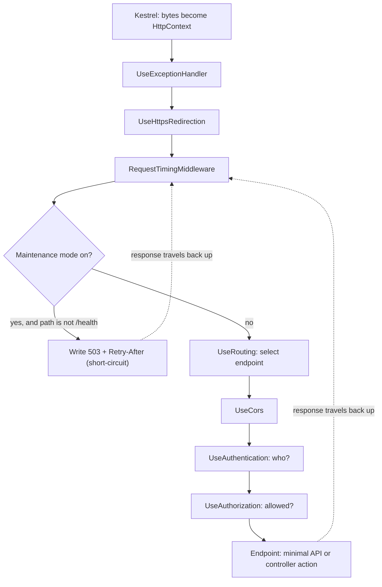
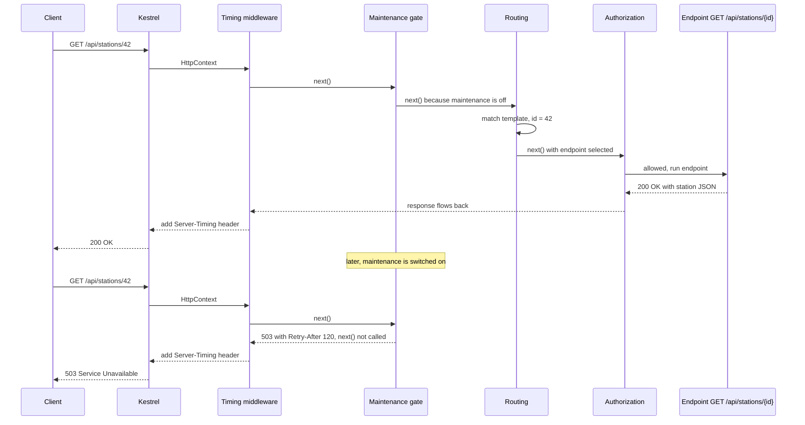

In [How an ASP.NET Core application starts](#/lesson/m03-startup) you saw that `Program.cs` has two phases, and in [HTTP request and response lifecycle](#/lesson/m03-request-lifecycle) you followed one request from the client to PostgreSQL and back. This lesson zooms into the three framework stages in the middle of that journey: **Kestrel** (the web server), the **middleware pipeline** (the checkpoints) and **routing** (the dispatcher), and then the two ways to write the code at the end of the line: **controllers** and **minimal APIs**. Our running example is an API for a network of EV charging stations in Bengaluru, Pune and Hyderabad.

## Learning objectives

By the end of this lesson you will be able to:

1. Explain what Kestrel does, which limits it enforces, and when it sits behind a reverse proxy or IIS.
2. Write middleware in three styles (inline `app.Use`, a convention-based class, and `IMiddleware`) and explain how the pipeline is composed.
3. Put the standard middleware in the correct order and predict exactly what breaks when the order is wrong.
4. Read and write route templates with parameters, constraints, optional segments and catch-alls, and predict which endpoint wins when several match.
5. Build the same API as a minimal API and as a controller, and choose between them with clear reasons.
6. Use route groups, endpoint filters and typed results to keep minimal APIs organised as they grow.
7. Test middleware and filters without starting a web server.

## Prerequisites

- [How an ASP.NET Core application starts](#/lesson/m03-startup): you know that `Use*` and `Map*` calls happen after `Build()`.
- [HTTP request and response lifecycle](#/lesson/m03-request-lifecycle): you know what an `HttpContext` is and that a response passes back through the middleware in reverse.
- Basic C#: lambdas (`x => x * 2`), `async`/`await` and interfaces.

Dependency injection appears in passing (endpoint parameters filled by the container). It is covered properly in the next lesson, [Dependency injection](#/lesson/m03-dependency-injection).

## Explain it like I'm a beginner

Think of a large railway station such as Pune Junction.

- **Kestrel is the station entrance.** People (bytes on a network connection) arrive in a crowd. The entrance staff organise them into an orderly queue and give each passenger a ticket folder (the `HttpContext`) that will travel with them. The entrance also enforces basic rules: no luggage over 30 kg (request body size limit), no one without a proper ticket format (malformed HTTP is rejected with 400).
- **Middleware is the series of checkpoints** between the entrance and the platforms: the security scanner, the ticket checker, the CCTV that logs the time you passed. Every passenger goes through them **in the same order**. Each checkpoint can wave you on, add a stamp to your folder, or stop you completely ("Platform 3 is closed for maintenance, come back in 2 hours"). On the way out, you pass the same checkpoints in reverse, and the CCTV can note how long your visit took.
- **Routing is the enquiry board** that reads your ticket ("Train 12127 to Mumbai") and decides which platform you go to. It reads the ticket early, so the ticket checker already knows which train you are heading for and can say "first class only".
- **The endpoint is the train.** It is where the real work happens. You can build that train in two styles: a **controller** (a big, organised rake of coaches with conventions for everything) or a **minimal API** (a single, light coach for one route). Both run on the same tracks.

Two things to remember from this picture: the order of checkpoints is a design decision with real consequences, and the enquiry board decides *where* you go before the last checkpoints decide *whether* you may go.

## First-principles explanation

### Kestrel: the server inside your process

Kestrel is the cross-platform HTTP server that ships with ASP.NET Core. When you call `app.Run()`, the host starts Kestrel, which opens sockets on the configured addresses (for example `http://0.0.0.0:8080`) and starts accepting connections. For each request it parses the request line and headers, creates an `HttpContext`, and calls the first middleware with it.

What Kestrel gives you:

- **HTTP/1.1, HTTP/2 and HTTP/3** (HTTP/3 needs QUIC support on the OS). HTTP/2 lets one TCP connection carry many requests at once, which matters for browsers and gRPC.
- **TLS** with certificates from configuration or the certificate store.
- **Limits** that protect you from abusive or broken clients. The defaults are sensible, and you should know them: maximum request body 30,000,000 bytes (about 28.6 MB), total request headers 32 KB, and a keep-alive timeout of 130 seconds. A client that sends a 50 MB upload to an endpoint gets 413 (Payload Too Large) before your code runs.

You configure it in code or in configuration:

```csharp
builder.WebHost.ConfigureKestrel(k =>
{
    k.Limits.MaxRequestBodySize = 1 * 1024 * 1024; // 1 MB is plenty for a JSON booking API
    k.AddServerHeader = false;                      // do not advertise "Server: Kestrel"
});
```

```json
{
  "Kestrel": {
    "Endpoints": {
      "Http": { "Url": "http://0.0.0.0:8080" }
    }
  }
}
```

**Kestrel at the edge or behind a proxy?** Kestrel is fast and safe enough to face the internet directly, but in most production setups something sits in front of it:

- A **reverse proxy** or load balancer (Nginx, YARP, Azure Application Gateway, AWS ALB) terminates TLS, spreads traffic across several app instances, and forwards plain HTTP to Kestrel. Your app then sees the proxy's IP address, so you add `UseForwardedHeaders` early in the pipeline to restore the client's IP and scheme from `X-Forwarded-For` and `X-Forwarded-Proto`. Only trust these headers from known proxies, or any client can pretend to be any IP.
- **IIS on Windows.** With the ASP.NET Core Module, the default is **in-process hosting**: the app runs inside the IIS worker process and uses the IIS HTTP server instead of Kestrel. In **out-of-process** mode, IIS forwards requests to Kestrel running in a separate process. Either way, your middleware and endpoints are identical; only the server underneath changes. That is the point of the `IServer` abstraction.
- **Containers and Kubernetes.** Kestrel listens on a port such as 8080 (the default port in the official .NET 8+ container images), and an ingress controller sits in front.

The key idea: the server's only job is to turn network bytes into `HttpContext` objects and write responses back. Everything about *what to do with* a request lives in the pipeline.

### Middleware: what it really is

A middleware is a function that receives the `HttpContext` and a reference to **the next** function in the chain. In C# terms, the chain is built from `RequestDelegate`, which is simply:

```csharp
public delegate Task RequestDelegate(HttpContext context);
```

Each middleware is a *function that takes the next `RequestDelegate` and returns a new `RequestDelegate`* that wraps it. `app.Use(...)` adds such a wrapper to a list. When the app starts, the framework composes the list **from the last item to the first**, so the first middleware you registered ends up as the outermost wrapper. The result is one big `RequestDelegate`, the whole pipeline, which Kestrel calls for every request.

This is why the picture of an onion (or Russian dolls) is accurate. The first middleware sees the request first and the response last. This structure is the classic **Chain of Responsibility** pattern: each handler decides whether to handle the request itself or pass it on.

A middleware can do four things:

1. **Work before** calling `next` (read headers, start a stopwatch, check a key).
2. **Call `next`** to pass the request down the chain.
3. **Work after** `next` returns (log the status code, stop the stopwatch).
4. **Short-circuit**: *not* call `next`, and write a response itself. Nothing further down runs, including your endpoint.

### Three ways to write middleware

**Inline** with `app.Use`. Good for tiny, app-specific logic:

```csharp
app.Use(async (context, next) =>
{
    context.Response.Headers["X-Station-Network"] = "EvCharge";
    await next(context);
});
```

**Convention-based class.** A class with a constructor taking `RequestDelegate next` and a public `InvokeAsync(HttpContext)` method, added with `app.UseMiddleware<T>()`. The class is created **once** when the pipeline is built, so it behaves like a singleton. Services with a shorter lifetime (scoped, such as a database context) must be taken as extra parameters of `InvokeAsync`, not in the constructor; you will see why in [Singleton, scoped and transient services](#/lesson/m03-service-lifetimes).

**Factory-based `IMiddleware`.** The class implements `IMiddleware` and is registered in the container (`AddTransient<MyMiddleware>()`). The framework resolves it **per request**, so constructor injection of scoped services is safe. Slightly more ceremony, much less surprise.

Rule of thumb: convention-based for stateless, high-traffic middleware; `IMiddleware` when you need scoped dependencies; inline only for a few lines.

### Terminal middleware and branching

`app.Run(context => ...)` adds a **terminal** middleware: it never calls `next`. Anything registered after it is unreachable. `app.Map("/legacy", branch => ...)` splits the pipeline: requests whose path starts with `/legacy` go down a separate branch with its own middleware. `app.UseWhen(predicate, branch => ...)` runs extra middleware for matching requests and then *rejoins* the main pipeline. In modern apps you rarely need these, because endpoint routing (below) does the job more cleanly, but you will meet them in older code.

### The order that matters

Here is the recommended order for a typical JSON API in .NET 10, with the reason for each position:

| # | Middleware | Why here |
|---|---|---|
| 1 | `UseForwardedHeaders` (behind a proxy) | Everything after it must see the real client IP and scheme. |
| 2 | `UseExceptionHandler` | Outermost wrapper of your logic so it can catch exceptions from everything below it and return a `ProblemDetails` 500. |
| 3 | `UseHsts` (non-Development), `UseHttpsRedirection` | Redirect plain HTTP before doing any work. |
| 4 | Request logging / timing (custom) | Near the top, so the timing covers almost the whole request. |
| 5 | `UseRouting` | Selects the endpoint. Optional to write: if you omit it, the framework adds it at the start. Write it explicitly when middleware before the endpoint needs to know the selected endpoint. |
| 6 | `UseCors` | After routing (it reads endpoint CORS metadata) and before authorization, so browser pre-flight `OPTIONS` requests, which carry no credentials, are answered before any policy can reject them. Microsoft's documented order places it before authentication too. |
| 7 | `UseAuthentication` | Works out *who* the caller is and fills `context.User`. |
| 8 | `UseAuthorization` | Decides *whether* that user may call the selected endpoint, using its `[Authorize]` metadata. Must be after authentication and after routing. |
| 9 | `UseRateLimiter`, `UseOutputCache` | These need the endpoint metadata and usually the user identity. |
| 10 | Endpoints (`MapGet`, `MapControllers`) | The end of the line. |

What breaks when the order is wrong is concrete and predictable:

- **Exception handler too low.** An exception thrown by your timing middleware or authentication is not caught; the client gets an empty 500 and your nice `ProblemDetails` contract is broken.
- **Authorization before authentication.** `context.User` is still anonymous when authorization runs, so every protected endpoint returns 401 even with a valid token.
- **Authorization before routing.** The authorization middleware has no endpoint to inspect, so `[Authorize]` on endpoints is ignored for that check. Since .NET 6 the framework adds routing early when you do not call `UseRouting`, but if you call it explicitly you must place it correctly.
- **CORS after authorization.** Browser pre-flight requests carry no credentials. If authorization runs first and the endpoint (or a fallback policy) requires a signed-in user, the pre-flight gets 401 without CORS headers, and the browser blocks the real call. The error appears in the browser console as a CORS failure, which sends developers looking in the wrong place.
- **Timing at the bottom.** It measures only the endpoint and misses the authentication cost.

### Routing: from URL to endpoint

An **endpoint** is a unit of executable request handling: a delegate plus **metadata** (its route template, HTTP methods, `[Authorize]`, CORS policy, OpenAPI tags, and so on). Routing has two halves:

1. **Matching** (`UseRouting`): compare the request's path and method with all registered route templates, pick the best one, extract route values (`id = 42`), and store the chosen endpoint on the `HttpContext` (`context.GetEndpoint()`).
2. **Execution** (the end of the pipeline): run the chosen endpoint's delegate.

The gap between the two is deliberate. Middleware in between (CORS, authorization, rate limiting) can read the endpoint's metadata and decide based on *what is about to run*.

**Route templates** describe the URL shape:

| Template | Matches | Does not match |
|---|---|---|
| `/api/stations` | `/api/stations`, `/API/Stations` (case-insensitive) | `/api/stations/7` |
| `/api/stations/{id}` | `/api/stations/7`, `/api/stations/abc` | `/api/stations` |
| `/api/stations/{id:int}` | `/api/stations/7` | `/api/stations/abc` |
| `/api/stations/{id:int:min(1)}` | `/api/stations/7` | `/api/stations/0` |
| `/api/stations/{city}/{area?}` | `/api/stations/pune`, `/api/stations/pune/hinjewadi` | `/api/stations` |
| `/files/{**path}` | `/files/a/b/c.pdf` (catch-all, `path = "a/b/c.pdf"`) | `/other` |

Common constraints: `int`, `long`, `guid`, `bool`, `datetime`, `decimal`, `alpha`, `minlength(n)`, `maxlength(n)`, `range(a,b)`, `regex(...)`. Constraints help routing *choose*; they are **not** input validation. A constraint failure gives 404 (the URL simply does not exist), while invalid input to an existing resource should give 400 with details.

**Which endpoint wins?** When several templates match the same URL, routing ranks them by **precedence**, segment by segment from left to right: a literal segment (`near`) beats a parameter with a constraint (`{id:int}`), which beats a plain parameter (`{slug}`), which beats a catch-all (`{**rest}`). So with all three of these registered, `/api/stations/near` goes to the literal, `/api/stations/42` goes to `{id:int}`, and `/api/stations/koramangala` goes to `{slug}`. If two endpoints have exactly the same precedence and both match, routing throws `AmbiguousMatchException` at request time, which is a bug to fix, not a feature.

**404 versus 405.** If no template matches the path, no endpoint is selected and the request falls off the end of the pipeline: **404**. If the path matches but not for this HTTP method (a `DELETE` on a route that only has `GET`), routing selects a special endpoint that returns **405 Method Not Allowed** with an `Allow` header.

**Link generation.** Routing also works backwards: given an endpoint name and route values, `LinkGenerator` or `CreatedAtRoute` builds the URL. This keeps URLs in one place; changing the template does not break every `Location` header in the app.

### Two ways to write endpoints

**Minimal APIs** map a route straight to a lambda or a static method:

```csharp
app.MapGet("/api/stations/{id:int}", (int id, IStationDirectory stations) =>
    stations.Find(id) is { } s ? Results.Ok(s) : Results.NotFound());
```

Parameters are bound by convention: `id` matches the route value, `IStationDirectory` is a registered service so it comes from the container, a complex type on a `POST` comes from the JSON body, and simple types not in the route come from the query string. You can be explicit with `[FromRoute]`, `[FromQuery]`, `[FromHeader]`, `[FromBody]` and `[FromServices]`.

**Controllers** group related actions in a class that derives from `ControllerBase`:

```csharp
[ApiController]
[Route("api/[controller]")]
public sealed class BookingsController(IBookingService bookings) : ControllerBase
{
    [HttpGet("{id:guid}")]
    public ActionResult<BookingConfirmation> GetById(Guid id) =>
        bookings.Find(id) is { } b ? b : NotFound();
}
```

You register controllers with `builder.Services.AddControllers()` and map them with `app.MapControllers()`. The `[ApiController]` attribute switches on API-friendly behaviour: automatic 400 responses with `ValidationProblemDetails` when model validation fails, inference of `[FromBody]` for complex parameters, and required attribute routing.

How they compare:

| Concern | Minimal APIs | Controllers |
|---|---|---|
| Ceremony | One line per endpoint | Class, attributes, base class |
| Organisation at scale | Route groups and extension methods (you design it) | Built-in convention: one class per resource |
| Model validation | Built in from .NET 10 via `AddValidation()`, or an endpoint filter | Automatic with `[ApiController]` and data annotations |
| Cross-cutting hooks | Endpoint filters (`IEndpointFilter`) | Action, result, exception and resource filters |
| Return types | `TypedResults` / `Results<T1, T2>` give OpenAPI the exact shapes | `ActionResult<T>`, `[ProducesResponseType]` |
| Native AOT and startup time | Supported (with the request delegate generator) | Not supported for Native AOT |
| Team familiarity | Newer, fewer conventions | Familiar to most .NET developers since 2016 |

Microsoft's current guidance recommends minimal APIs for new projects, and controllers remain fully supported. In practice: a small service, a microservice with ten endpoints, or anything heading for Native AOT is a natural fit for minimal APIs. A large API with many resources, a team that already knows MVC well, or code that relies on MVC features such as rich model binding, `IModelBinder`, or OData is a good fit for controllers. **Both can live in the same app**, sharing the same pipeline, the same routing and the same services, which is exactly what our production example does.

### Endpoint filters and route groups

As a minimal API grows, two tools stop `Program.cs` from becoming a wall of lambdas:

- **Route groups** (`app.MapGroup("/api/stations")`) share a URL prefix and metadata such as `RequireAuthorization()`, tags or filters across many endpoints.
- **Endpoint filters** (`IEndpointFilter`) run around one endpoint (or a group) after parameter binding, with access to the bound arguments. They are the minimal-API equivalent of MVC action filters: validation, auditing, idempotency checks. Unlike middleware, a filter knows the endpoint's typed arguments; unlike code in the handler, it can be reused.

Middleware versus filter is a common question. Use middleware when the concern applies to *all* requests and only needs the raw `HttpContext` (timing, correlation ids, maintenance mode). Use a filter when the concern applies to *specific* endpoints and needs the bound arguments (validate a `BookingRequest`).

### Trade-offs

| You gain | You pay |
|---|---|
| A pipeline where each concern is one small component | Order is invisible in the type system: a wrong order compiles and fails at runtime |
| Routing that separates "where" from "whether" | Two-step matching and execution confuses newcomers (an endpoint can be selected and still never run) |
| Minimal APIs with almost no ceremony | You must invent your own structure as the API grows |
| Controllers with strong conventions | More boilerplate, no Native AOT, two filter systems to learn if you mix |

## Visual explanation

### The pipeline as nested wrappers



Read the solid arrows top to bottom: that is the request going in. The dotted arrows are the response coming back out through the same wrappers in reverse. Two details are worth pausing on. First, the maintenance gate short-circuits: when it writes a 503, routing, authentication and the endpoint never run, but the timing middleware above it still sees the response and records the duration, because it wraps the gate. Second, the exception handler is at the very top, so an exception from *any* box below it, including the timing middleware itself, becomes a clean error response.

### Two requests, one pipeline



The first request travels all the way to the endpoint and back. The second is stopped by the maintenance gate: routing, authorization and the endpoint are never called, which is exactly what short-circuiting means. Notice that the timing middleware participates in both requests, which is why it belongs near the top. If you moved the gate *above* the timing middleware, maintenance responses would vanish from your latency metrics.

## Step-by-step example

We will grow the charging-station API one concept at a time.

### Step 1 — one endpoint, no middleware

```csharp
var builder = WebApplication.CreateBuilder(args);
var app = builder.Build();
app.MapGet("/api/stations/{id:int}", (int id) => new { id, name = "Koramangala 5th Block", freeConnectors = 3 });
app.Run();
```

`GET /api/stations/7` returns JSON. `GET /api/stations/abc` returns 404 because the `int` constraint fails. `POST /api/stations/7` returns 405. You have written zero middleware, yet routing, binding and JSON serialization already work.

### Step 2 — add a timing middleware inline

```csharp
app.Use(async (context, next) =>
{
    var start = System.Diagnostics.Stopwatch.GetTimestamp();
    await next(context);
    var ms = System.Diagnostics.Stopwatch.GetElapsedTime(start).TotalMilliseconds;
    app.Logger.LogInformation("{Path} took {Ms:0.0} ms", context.Request.Path, ms);
});
```

Place it **before** `MapGet`. Run it and you will see a log line per request. Try adding a response header *after* `await next(context)`: it throws or is ignored, because the endpoint has already started writing the body and headers are locked. The fix, shown in the production code, is `Response.OnStarting`.

### Step 3 — move it into a class and add a short-circuit

Inline lambdas are hard to test. We move timing into `RequestTimingMiddleware` and add a `MaintenanceModeMiddleware` that returns 503 during planned maintenance (for example, while charger firmware is updated across the Pune network between 2 and 3 a.m.), while still allowing `/health` so the load balancer does not mark every instance dead.

### Step 4 — grow the endpoints

Station lookups stay as minimal APIs in a route group (`/api/stations`). Bookings, which have create, read and cancel actions, validation and more rules, go into a `BookingsController`. Both are mapped in the same app. This mixed setup is common in real codebases that started with MVC and add minimal APIs for new, small features.

### Step 5 — put the pipeline in order

Finally, we assemble `Program.cs` in the order from the table above and check each line against the question "what must have happened before this runs?"

## Production-style C# implementation

Project layout:

```text
EvCharge.Api/
  Program.cs
  Middleware/RequestTimingMiddleware.cs
  Middleware/MaintenanceModeMiddleware.cs
  Stations/ChargingStation.cs
  Stations/InMemoryStationDirectory.cs
  Stations/StationEndpoints.cs
  Bookings/BookingModels.cs
  Bookings/InMemoryBookingService.cs
  Bookings/BookingsController.cs
```

```csharp file=Middleware/RequestTimingMiddleware.cs
using System.Diagnostics;
using Microsoft.AspNetCore.Http;
using Microsoft.Extensions.Logging;

namespace EvCharge.Middleware;

/// <summary>
/// Convention-based middleware: created once, so it only takes singleton-safe dependencies.
/// Measures the time from entering the pipeline to the end of the response.
/// </summary>
public sealed class RequestTimingMiddleware(RequestDelegate next, ILogger<RequestTimingMiddleware> logger)
{
    public async Task InvokeAsync(HttpContext context)
    {
        var start = Stopwatch.GetTimestamp();

        // Headers lock as soon as the body starts, so register the header before calling next.
        context.Response.OnStarting(() =>
        {
            var elapsed = Stopwatch.GetElapsedTime(start).TotalMilliseconds;
            context.Response.Headers["Server-Timing"] = $"app;dur={elapsed:0.0}";
            return Task.CompletedTask;
        });

        try
        {
            await next(context);
        }
        finally
        {
            var elapsed = Stopwatch.GetElapsedTime(start).TotalMilliseconds;
            var endpoint = context.GetEndpoint()?.DisplayName ?? "(no endpoint)";
            logger.LogInformation("{Method} {Path} returned {Status} via {Endpoint} in {Elapsed:0.0} ms",
                context.Request.Method, context.Request.Path, context.Response.StatusCode, endpoint, elapsed);
        }
    }
}
```

```csharp file=Middleware/MaintenanceModeMiddleware.cs
using Microsoft.AspNetCore.Http;
using Microsoft.Extensions.Options;

namespace EvCharge.Middleware;

public sealed class MaintenanceOptions
{
    public const string SectionName = "Maintenance";
    public bool Enabled { get; set; }
    public int RetryAfterSeconds { get; set; } = 120;
    public string[] AllowedPathPrefixes { get; set; } = ["/health"];
}

/// <summary>
/// Factory-based middleware (IMiddleware): resolved from the container per request,
/// so it can read IOptionsMonitor and react to configuration changes without a restart.
/// </summary>
public sealed class MaintenanceModeMiddleware(IOptionsMonitor<MaintenanceOptions> options) : IMiddleware
{
    public async Task InvokeAsync(HttpContext context, RequestDelegate next)
    {
        var o = options.CurrentValue;
        if (!o.Enabled || o.AllowedPathPrefixes.Any(p => context.Request.Path.StartsWithSegments(p)))
        {
            await next(context);
            return;
        }

        // Short-circuit: nothing below this middleware runs.
        context.Response.StatusCode = StatusCodes.Status503ServiceUnavailable;
        context.Response.Headers.RetryAfter = o.RetryAfterSeconds.ToString();
        await context.Response.WriteAsJsonAsync(new
        {
            title = "Charging network under maintenance",
            status = 503,
            retryAfterSeconds = o.RetryAfterSeconds
        });
    }
}
```

```csharp file=Stations/ChargingStation.cs
namespace EvCharge.Stations;

public sealed record ChargingStation(int Id, string Name, string City, int FreeConnectors, decimal RatePerKwh);

public interface IStationDirectory
{
    ChargingStation? Find(int id);
    IReadOnlyList<ChargingStation> InCity(string city);
}
```

```csharp file=Stations/InMemoryStationDirectory.cs
namespace EvCharge.Stations;

/// <summary>Read-only seed data. A real app would read PostgreSQL through a repository.</summary>
public sealed class InMemoryStationDirectory : IStationDirectory
{
    private readonly ChargingStation[] _stations =
    [
        new(1, "Koramangala 5th Block", "Bengaluru", 3, 18.50m),
        new(2, "Whitefield ITPL Gate 2", "Bengaluru", 0, 19.00m),
        new(3, "Hinjewadi Phase 1", "Pune", 5, 17.75m),
        new(4, "HITEC City Metro", "Hyderabad", 2, 18.00m),
    ];

    public ChargingStation? Find(int id) => _stations.FirstOrDefault(s => s.Id == id);

    public IReadOnlyList<ChargingStation> InCity(string city) =>
        _stations.Where(s => string.Equals(s.City, city, StringComparison.OrdinalIgnoreCase)).ToArray();
}
```

```csharp file=Stations/StationEndpoints.cs
using Microsoft.AspNetCore.Builder;
using Microsoft.AspNetCore.Http;
using Microsoft.AspNetCore.Http.HttpResults;
using Microsoft.AspNetCore.Routing;

namespace EvCharge.Stations;

/// <summary>Minimal API endpoints for stations, organised as a route group in an extension method.</summary>
public static class StationEndpoints
{
    public static RouteGroupBuilder MapStationEndpoints(this IEndpointRouteBuilder routes)
    {
        var group = routes.MapGroup("/api/stations");

        // Literal segment: wins over {id:int} for /api/stations/available
        group.MapGet("/available", (string city, IStationDirectory stations) =>
            TypedResults.Ok(stations.InCity(city).Where(s => s.FreeConnectors > 0).ToArray()));

        group.MapGet("/{id:int:min(1)}", GetById).WithName("GetStation");

        group.MapGet("/", (string? city, IStationDirectory stations) =>
            TypedResults.Ok(stations.InCity(city ?? "Bengaluru")));

        return group;
    }

    // Results<A, B> documents both outcomes for OpenAPI and is checked by the compiler.
    public static Results<Ok<ChargingStation>, NotFound> GetById(int id, IStationDirectory stations) =>
        stations.Find(id) is { } station ? TypedResults.Ok(station) : TypedResults.NotFound();
}
```

```csharp file=Bookings/BookingModels.cs
using System.ComponentModel.DataAnnotations;

namespace EvCharge.Bookings;

public sealed class BookingRequest
{
    [Range(1, int.MaxValue)]
    public int StationId { get; set; }

    [Range(1, 150)]
    public decimal Kwh { get; set; }

    [Required, RegularExpression(@"^[A-Z]{2}\d{2}[A-Z]{1,2}\d{4}$", ErrorMessage = "Use a registration such as KA01AB1234.")]
    public string VehicleNumber { get; set; } = "";
}

public sealed record BookingConfirmation(Guid BookingId, int StationId, string VehicleNumber, decimal Kwh, decimal EstimatedCost);

public interface IBookingService
{
    BookingConfirmation? Create(BookingRequest request);
    BookingConfirmation? Find(Guid id);
    bool Cancel(Guid id);
}
```

```csharp file=Bookings/InMemoryBookingService.cs
using System.Collections.Concurrent;
using EvCharge.Stations;

namespace EvCharge.Bookings;

/// <summary>Singleton, so state is in a thread-safe dictionary. Replace with a repository over PostgreSQL.</summary>
public sealed class InMemoryBookingService(IStationDirectory stations) : IBookingService
{
    private readonly ConcurrentDictionary<Guid, BookingConfirmation> _bookings = new();

    public BookingConfirmation? Create(BookingRequest request)
    {
        var station = stations.Find(request.StationId);
        if (station is null || station.FreeConnectors == 0) return null;

        var confirmation = new BookingConfirmation(
            Guid.NewGuid(), station.Id, request.VehicleNumber, request.Kwh,
            Math.Round(request.Kwh * station.RatePerKwh, 2));
        _bookings[confirmation.BookingId] = confirmation;
        return confirmation;
    }

    public BookingConfirmation? Find(Guid id) => _bookings.GetValueOrDefault(id);

    public bool Cancel(Guid id) => _bookings.TryRemove(id, out _);
}
```

```csharp file=Bookings/BookingsController.cs
using Microsoft.AspNetCore.Mvc;

namespace EvCharge.Bookings;

/// <summary>Controller style: one class per resource, attribute routing, automatic 400 from [ApiController].</summary>
[ApiController]
[Route("api/[controller]")]
public sealed class BookingsController(IBookingService bookings) : ControllerBase
{
    [HttpPost]
    [ProducesResponseType<BookingConfirmation>(StatusCodes.Status201Created)]
    [ProducesResponseType(StatusCodes.Status409Conflict)]
    public ActionResult<BookingConfirmation> Create(BookingRequest request)
    {
        // No "if (!ModelState.IsValid)" needed: [ApiController] already returned 400 for invalid input.
        var confirmation = bookings.Create(request);
        if (confirmation is null)
            return Problem(statusCode: StatusCodes.Status409Conflict, title: "Station unknown or no free connector");

        return CreatedAtAction(nameof(GetById), new { id = confirmation.BookingId }, confirmation);
    }

    [HttpGet("{id:guid}")]
    public ActionResult<BookingConfirmation> GetById(Guid id) =>
        bookings.Find(id) is { } booking ? booking : NotFound();

    [HttpDelete("{id:guid}")]
    public IActionResult Cancel(Guid id) => bookings.Cancel(id) ? NoContent() : NotFound();
}
```

```csharp file=Program.cs
using EvCharge.Bookings;
using EvCharge.Middleware;
using EvCharge.Stations;

var builder = WebApplication.CreateBuilder(args);

// ---------- Phase 1: services ----------
builder.WebHost.ConfigureKestrel(k =>
{
    k.Limits.MaxRequestBodySize = 1 * 1024 * 1024;
    k.AddServerHeader = false;
});

builder.Services.AddControllers();
builder.Services.AddProblemDetails();
builder.Services.AddAuthentication();
builder.Services.AddAuthorization();
builder.Services.AddCors(o => o.AddPolicy("web-app", p =>
    p.WithOrigins("https://app.evcharge.example").AllowAnyHeader().AllowAnyMethod()));

builder.Services.Configure<MaintenanceOptions>(builder.Configuration.GetSection(MaintenanceOptions.SectionName));
builder.Services.AddTransient<MaintenanceModeMiddleware>();   // IMiddleware must be registered
builder.Services.AddSingleton<IStationDirectory, InMemoryStationDirectory>();
builder.Services.AddSingleton<IBookingService, InMemoryBookingService>();

var app = builder.Build();

// ---------- Phase 2: pipeline, in order ----------
app.UseExceptionHandler();                       // 1. outermost: turns exceptions into ProblemDetails
if (!app.Environment.IsDevelopment()) app.UseHsts();
app.UseHttpsRedirection();                       // 2. redirect before doing work
app.UseMiddleware<RequestTimingMiddleware>();    // 3. measures everything below
app.UseMiddleware<MaintenanceModeMiddleware>();  // 4. may short-circuit with 503
app.UseRouting();                                // 5. select endpoint
app.UseCors("web-app");                          // 6. pre-flight answered before auth
app.UseAuthentication();                         // 7. who
app.UseAuthorization();                          // 8. allowed

// ---------- Endpoints ----------
app.MapGet("/health", () => TypedResults.Ok("healthy"));
app.MapStationEndpoints();                       // minimal APIs
app.MapControllers();                            // controllers, same pipeline

app.Run();

public partial class Program;                    // lets WebApplicationFactory<Program> find the entry point in tests
```

Things to notice:

- `RequestTimingMiddleware` uses `OnStarting` for the header and `finally` for the log, so it records slow requests *and* failed ones.
- `MaintenanceModeMiddleware` is `IMiddleware`, so it is registered with `AddTransient` and created per request. It reads `IOptionsMonitor`, so an operator can flip `Maintenance:Enabled` in configuration and the change applies without a restart (configuration reload is covered in [Configuration, environment variables and secrets](#/lesson/m03-configuration)).
- `StartsWithSegments("/health")` matches `/health` and `/health/ready` but **not** `/healthy`. A plain `StartsWith` string check would let `/healthy-looking-path` through.
- The `/available` literal route coexists with `/{id:int:min(1)}` without ambiguity, thanks to precedence.

## Bad design vs good design

**Bad**: a pipeline written in the order things came to mind, with logic in the wrong layer.

```csharp
var app = builder.Build();
app.UseAuthorization();                        // before authentication and routing
app.UseAuthentication();
app.MapControllers();
app.Use(async (ctx, next) =>                   // after the endpoints: only runs for unmatched requests
{
    if (ctx.Request.Path.Value!.StartsWith("/health") == false && maintenance)  // "/healthy" slips through
    { ctx.Response.StatusCode = 503; return; }
    await next(ctx);
});
app.UseExceptionHandler("/error");             // too low to catch anything above it
app.MapGet("/api/stations/{id}", (string id) =>
{
    if (!int.TryParse(id, out var n)) return Results.BadRequest();   // route constraint would do this
    if (ctx_user_is_not_admin) return Results.Forbid();              // authorization inside the handler
    return Results.Ok(LoadFromDb(n));
});
```

The problems: authorization runs before the user is known, so protected endpoints always fail; the maintenance check sits after `MapControllers` and only sees requests that no endpoint matched; the exception handler is too low to protect anything; the string-prefix check lets `/healthy` bypass maintenance; and the endpoint mixes routing, authorization and data access.

**Good**: the production code above. Each concern sits at the position the table justifies, the gate uses segment-aware matching, the route constraint rejects non-numeric ids, authorization is declared as metadata (`RequireAuthorization()` or `[Authorize]`) and enforced by middleware, and endpoints only translate HTTP to service calls.

:::callout type=tip title="A simpler alternative"
For an internal tool with three endpoints and no authentication, the pipeline can be just `app.MapGet(...)` lines and `app.Run()`. Add middleware when you have a cross-cutting need, not because a template had it. Every middleware is code that runs on every request.
:::

:::callout type=mistake title="Writing to the response after next() has started it"
Once the endpoint has written the first byte of the body, status code and headers are sent. Setting `context.Response.StatusCode` or a header after `await next(context)` then throws `InvalidOperationException` or is silently lost. Use `Response.OnStarting` for headers, and check `Response.HasStarted` before trying to change an error response.
:::

:::callout type=tradeoff title="Controllers or minimal APIs?"
Do not rewrite a working controller-based API just to be modern. Pick per project, or per feature area in a mixed app, using the comparison table. Consistency inside one area matters more than which style you chose.
:::

## Practical playground

This program builds a **real** ASP.NET Core pipeline with `ApplicationBuilder` and invokes it with a `DefaultHttpContext`, with no server and no network. Each middleware writes to a log on the way in and out. Run it, then try: moving the maintenance gate above the timing middleware, switching `maintenance` to `false`, or adding a second `app.Run` and seeing that it is never reached.

:::playground type=csharp title="See the onion: middleware order and short-circuits"
```csharp file=Program.cs
using System;
using System.Collections.Generic;
using System.Threading.Tasks;
using Microsoft.AspNetCore.Builder;
using Microsoft.AspNetCore.Http;
using Microsoft.Extensions.DependencyInjection;

public static class Program
{
    public static async Task Main()
    {
        var maintenance = true;   // try false
        var services = new ServiceCollection().BuildServiceProvider();
        var app = new ApplicationBuilder(services);
        var log = new List<string>();

        app.Use(async (ctx, next) => { log.Add("timing: in"); await next(ctx); log.Add($"timing: out ({ctx.Response.StatusCode})"); });
        app.Use(async (ctx, next) =>
        {
            if (maintenance && !ctx.Request.Path.StartsWithSegments("/health"))
            {
                log.Add("maintenance: short-circuit 503");
                ctx.Response.StatusCode = 503;
                return;                                   // next is NOT called
            }
            log.Add("maintenance: pass");
            await next(ctx);
        });
        app.Use(async (ctx, next) => { log.Add("auth: in"); await next(ctx); log.Add("auth: out"); });
        app.Run(ctx => { log.Add($"endpoint: {ctx.Request.Path}"); ctx.Response.StatusCode = 200; return Task.CompletedTask; });

        RequestDelegate pipeline = app.Build();

        foreach (var path in new[] { "/api/stations/42", "/health/ready", "/healthy" })
        {
            log.Clear();
            var ctx = new DefaultHttpContext();
            ctx.Request.Path = path;
            await pipeline(ctx);
            Console.WriteLine($"{path} -> {ctx.Response.StatusCode}");
            foreach (var line in log) Console.WriteLine("   " + line);
        }
    }
}
```
:::

With `maintenance = true` you should see `/api/stations/42` stopped at the gate (no `auth` or `endpoint` lines, but `timing: out (503)` still appears), `/health/ready` reaching the endpoint, and `/healthy` blocked, because `StartsWithSegments` compares whole path segments.

## Exercises

:::exercise id=m03-kestrel-middleware-routing-ex1 difficulty=beginner kind=code title="Compose a pipeline by hand"
ASP.NET Core composes middleware by wrapping each component around the next. Implement `MiniPipeline`, a framework-free version of that idea, so you understand why the first registered middleware runs first on the way in and last on the way out.
::requirements
- `Use(component)` stores a component of type `Func<MiniDelegate, MiniDelegate>` and returns the same `MiniPipeline` so calls can be chained.
- `Build(terminal)` returns one `MiniDelegate` in which the first registered component is the outermost wrapper and `terminal` is the innermost.
- With no components, `Build(terminal)` returns a delegate that just runs `terminal`.
::acceptance
- Two logging components A and B around an endpoint produce the log `A in, B in, endpoint, B out, A out`.
- A component that does not call `next` stops everything after it, including the terminal.
- `Use` returns the same instance.
::hint
Think of Russian dolls. To end up with A outside B outside the endpoint, which doll do you pick up first when assembling them?
::hint
Start with `var app = terminal;` and wrap it. You must wrap with the **last** registered component first.
::hint
Loop over the list backwards: `for (var i = _components.Count - 1; i >= 0; i--) app = _components[i](app);`
::hint
```csharp
public MiniDelegate Build(MiniDelegate terminal)
{
    var app = terminal;
    // iterate backwards, wrapping
    return app;
}
```
::starter
```csharp file=MiniPipeline.cs
using System;
using System.Collections.Generic;
using System.Threading.Tasks;

public sealed class MiniContext
{
    public string Path { get; init; } = "/";
    public int StatusCode { get; set; } = 200;
    public List<string> Log { get; } = new();
}

public delegate Task MiniDelegate(MiniContext context);

public sealed class MiniPipeline
{
    private readonly List<Func<MiniDelegate, MiniDelegate>> _components = new();

    public MiniPipeline Use(Func<MiniDelegate, MiniDelegate> component) => throw new NotImplementedException();

    public MiniDelegate Build(MiniDelegate terminal) => throw new NotImplementedException();
}
```
::tests
```csharp file=MiniPipelineTests.cs
using System;
using System.Threading.Tasks;
using Xunit;

public class MiniPipelineTests
{
    private static Func<MiniDelegate, MiniDelegate> Logger(string name) => next => async ctx =>
    {
        ctx.Log.Add($"{name} in");
        await next(ctx);
        ctx.Log.Add($"{name} out");
    };

    private static readonly MiniDelegate Endpoint = ctx => { ctx.Log.Add("endpoint"); return Task.CompletedTask; };

    [Fact]
    public async Task First_registered_is_outermost()
    {
        var app = new MiniPipeline().Use(Logger("A")).Use(Logger("B")).Build(Endpoint);
        var ctx = new MiniContext();
        await app(ctx);
        Assert.Equal(new[] { "A in", "B in", "endpoint", "B out", "A out" }, ctx.Log);
    }

    [Fact]
    public async Task Short_circuit_skips_the_rest()
    {
        var app = new MiniPipeline()
            .Use(Logger("A"))
            .Use(next => ctx => { ctx.StatusCode = 503; ctx.Log.Add("gate"); return Task.CompletedTask; })
            .Use(Logger("C"))
            .Build(Endpoint);
        var ctx = new MiniContext();
        await app(ctx);
        Assert.Equal(503, ctx.StatusCode);
        Assert.Equal(new[] { "A in", "gate", "A out" }, ctx.Log);
    }

    [Fact]
    public async Task Empty_pipeline_runs_terminal()
    {
        var ctx = new MiniContext();
        await new MiniPipeline().Build(Endpoint)(ctx);
        Assert.Equal(new[] { "endpoint" }, ctx.Log);
    }

    [Fact]
    public void Use_returns_same_instance()
    {
        var p = new MiniPipeline();
        Assert.Same(p, p.Use(Logger("A")));
    }
}
```
::solution
Wrapping from the last component to the first makes the first component the outermost. This is the same algorithm `ApplicationBuilder.Build()` uses.

```csharp file=MiniPipeline.cs
using System;
using System.Collections.Generic;
using System.Threading.Tasks;

public sealed class MiniContext
{
    public string Path { get; init; } = "/";
    public int StatusCode { get; set; } = 200;
    public List<string> Log { get; } = new();
}

public delegate Task MiniDelegate(MiniContext context);

public sealed class MiniPipeline
{
    private readonly List<Func<MiniDelegate, MiniDelegate>> _components = new();

    public MiniPipeline Use(Func<MiniDelegate, MiniDelegate> component)
    {
        _components.Add(component);
        return this;
    }

    public MiniDelegate Build(MiniDelegate terminal)
    {
        var app = terminal;
        for (var i = _components.Count - 1; i >= 0; i--)
            app = _components[i](app);
        return app;
    }
}
```
::alternatives
`_components.AsEnumerable().Reverse().Aggregate(terminal, (next, c) => c(next))` is the same algorithm in LINQ. It reads elegantly but hides the "backwards" insight, which is the point of the exercise.
::mistakes
- Iterating forwards, which makes the *last* registered component the outermost and reverses the whole pipeline.
- Calling the components during `Use` instead of during `Build`, so the `next` they capture is wrong.
::extensions
Add `Run(MiniDelegate terminal)` that marks the pipeline as terminated, and make `Use` after `Run` throw, mirroring how components after `app.Run` are unreachable.
:::

:::exercise id=m03-kestrel-middleware-routing-ex2 difficulty=beginner kind=written title="Diagnose a pipeline from its symptoms"
A teammate's `Program.cs` for a GST invoice API registers a fallback authorization policy that requires an authenticated user, and then builds this pipeline, in this order: `UseAuthentication()`, `UseAuthorization()`, `UseExceptionHandler()`, `UseRouting()`, `UseCors("portal")`, `MapControllers()`. Users report three symptoms: (1) every call from the React portal fails with a CORS error in the browser console, (2) an exception thrown by the authentication handler returns an empty 500 instead of a ProblemDetails body, (3) a signed-in clerk without the `Accountant` role can call `[Authorize(Roles = "Accountant")]` actions.

Explain the cause of each symptom and write the corrected order.
::acceptance
- Identifies that the exception handler must be first, above everything it should protect.
- Explains that CORS must come after routing and before authentication so pre-flight requests succeed.
- Explains that authentication must come before authorization, both after routing and before endpoints.
- Gives a corrected order with endpoints last.
::hint
For each middleware, ask: "what must already have happened when this runs?"
::hint
Authorization reads the selected endpoint's metadata (`[Authorize(Roles = ...)]`). Has an endpoint been selected yet when `UseAuthorization` runs in this order?
::hint
A browser pre-flight `OPTIONS` request has no `Authorization` header. Which middleware rejects it if it runs first?
::hint
Corrected skeleton: exception handler, HTTPS, routing, CORS, authentication, authorization, endpoints.
::solution
1. **CORS error**: authorization runs before CORS. The browser's pre-flight `OPTIONS` request has no credentials, so the fallback policy rejects it with 401 before `UseCors` can answer it. The response has no CORS headers, so the browser blocks the real call and reports a CORS failure. Fix: `UseCors` after `UseRouting` and before `UseAuthentication` and `UseAuthorization`.
2. **Empty 500**: `UseExceptionHandler` is registered after `UseAuthentication`, so authentication is *outside* the handler's wrapper. Exceptions it throws never reach the handler. Fix: exception handler first.
3. **Role check ignored**: `UseAuthorization` runs before `UseRouting`, so no endpoint has been selected and there is no `[Authorize(Roles = "Accountant")]` metadata to evaluate. Only the fallback policy (any signed-in user) is applied, so the clerk gets through. Fix: routing, then authentication, then authorization, then endpoints.

Corrected:

```csharp
app.UseExceptionHandler();
app.UseHttpsRedirection();
app.UseRouting();
app.UseCors("portal");
app.UseAuthentication();
app.UseAuthorization();
app.MapControllers();
```
::mistakes
- Fixing only the visible symptom (CORS) by allowing all origins, which opens a security hole and leaves the other two bugs.
- Assuming registration order of middleware is cosmetic because the code compiles.
:::

:::exercise id=m03-kestrel-middleware-routing-ex3 difficulty=intermediate kind=code title="A maintenance gate middleware"
Write a convention-based middleware that returns 503 during planned maintenance but lets health checks and allowed paths through. Test it with `DefaultHttpContext`, without starting a server.
::requirements
- Constructor: `MaintenanceGate(RequestDelegate next, MaintenanceSettings settings)`.
- When `settings.Enabled` is false, always call `next`.
- When enabled, call `next` only if the path starts with one of `settings.AllowedPathPrefixes` **by whole segments** (`/health` allows `/health` and `/health/ready`, not `/healthy`).
- Otherwise set status 503, set the `Retry-After` header to `settings.RetryAfterSeconds`, write the text `Down for maintenance` and do **not** call `next`.
::acceptance
- Disabled gate: `next` is called, status unchanged.
- Enabled gate on `/api/stations/1`: 503, `Retry-After: 120`, body `Down for maintenance`, `next` not called.
- Enabled gate on `/health/ready`: `next` called.
- Enabled gate on `/healthy`: blocked.
::hint
`PathString` has a method that compares whole segments. Look at what `context.Request.Path` offers.
::hint
`context.Request.Path.StartsWithSegments("/health")` is the segment-aware check.
::hint
Write the body with `await context.Response.WriteAsync("Down for maintenance");` after setting the status and header. Order matters: headers before body.
::hint
```csharp
if (!_settings.Enabled || _settings.AllowedPathPrefixes.Any(p => context.Request.Path.StartsWithSegments(p)))
{
    await _next(context);
    return;
}
```
::starter
```csharp file=MaintenanceGate.cs
using System;
using System.Collections.Generic;
using System.Linq;
using System.Threading.Tasks;
using Microsoft.AspNetCore.Http;

public sealed class MaintenanceSettings
{
    public bool Enabled { get; set; }
    public int RetryAfterSeconds { get; set; } = 120;
    public List<string> AllowedPathPrefixes { get; set; } = new() { "/health" };
}

public sealed class MaintenanceGate
{
    private readonly RequestDelegate _next;
    private readonly MaintenanceSettings _settings;

    public MaintenanceGate(RequestDelegate next, MaintenanceSettings settings)
    {
        _next = next;
        _settings = settings;
    }

    public Task InvokeAsync(HttpContext context) => throw new NotImplementedException();
}
```
::tests
```csharp file=MaintenanceGateTests.cs
using System.IO;
using System.Threading.Tasks;
using Microsoft.AspNetCore.Http;
using Xunit;

public class MaintenanceGateTests
{
    private static (MaintenanceGate gate, System.Func<bool> nextCalled) Create(bool enabled)
    {
        var called = false;
        RequestDelegate next = _ => { called = true; return Task.CompletedTask; };
        var gate = new MaintenanceGate(next, new MaintenanceSettings { Enabled = enabled, RetryAfterSeconds = 120 });
        return (gate, () => called);
    }

    private static DefaultHttpContext Context(string path)
    {
        var ctx = new DefaultHttpContext();
        ctx.Request.Path = path;
        ctx.Response.Body = new MemoryStream();
        return ctx;
    }

    private static string Body(HttpContext ctx)
    {
        ctx.Response.Body.Position = 0;
        return new StreamReader(ctx.Response.Body).ReadToEnd();
    }

    [Fact]
    public async Task Disabled_passes_through()
    {
        var (gate, nextCalled) = Create(enabled: false);
        var ctx = Context("/api/stations/1");
        await gate.InvokeAsync(ctx);
        Assert.True(nextCalled());
        Assert.Equal(200, ctx.Response.StatusCode);
    }

    [Fact]
    public async Task Enabled_blocks_api_calls()
    {
        var (gate, nextCalled) = Create(enabled: true);
        var ctx = Context("/api/stations/1");
        await gate.InvokeAsync(ctx);
        Assert.False(nextCalled());
        Assert.Equal(503, ctx.Response.StatusCode);
        Assert.Equal("120", ctx.Response.Headers["Retry-After"].ToString());
        Assert.Equal("Down for maintenance", Body(ctx));
    }

    [Fact]
    public async Task Health_subpath_is_allowed()
    {
        var (gate, nextCalled) = Create(enabled: true);
        await gate.InvokeAsync(Context("/health/ready"));
        Assert.True(nextCalled());
    }

    [Fact]
    public async Task Lookalike_path_is_blocked()
    {
        var (gate, nextCalled) = Create(enabled: true);
        var ctx = Context("/healthy");
        await gate.InvokeAsync(ctx);
        Assert.False(nextCalled());
        Assert.Equal(503, ctx.Response.StatusCode);
    }
}
```
::solution
The gate is a textbook short-circuit: decide, then either delegate or respond. Segment-aware matching closes the `/healthy` loophole.

```csharp file=MaintenanceGate.cs
using System;
using System.Collections.Generic;
using System.Linq;
using System.Threading.Tasks;
using Microsoft.AspNetCore.Http;

public sealed class MaintenanceSettings
{
    public bool Enabled { get; set; }
    public int RetryAfterSeconds { get; set; } = 120;
    public List<string> AllowedPathPrefixes { get; set; } = new() { "/health" };
}

public sealed class MaintenanceGate
{
    private readonly RequestDelegate _next;
    private readonly MaintenanceSettings _settings;

    public MaintenanceGate(RequestDelegate next, MaintenanceSettings settings)
    {
        _next = next;
        _settings = settings;
    }

    public async Task InvokeAsync(HttpContext context)
    {
        if (!_settings.Enabled ||
            _settings.AllowedPathPrefixes.Any(p => context.Request.Path.StartsWithSegments(p)))
        {
            await _next(context);
            return;
        }

        context.Response.StatusCode = StatusCodes.Status503ServiceUnavailable;
        context.Response.Headers["Retry-After"] = _settings.RetryAfterSeconds.ToString();
        context.Response.ContentType = "text/plain";
        await context.Response.WriteAsync("Down for maintenance");
    }
}
```
::alternatives
Implement `IMiddleware` and inject `IOptionsMonitor<MaintenanceSettings>` (as the production code does) so the flag can change at runtime. Or skip middleware entirely and put the gate in the load balancer, which can serve a static maintenance page even when every app instance is stopped.
::mistakes
- Using `Path.Value.StartsWith("/health")`, which lets `/healthy` and `/healthcheck-bypass` through.
- Writing the body before setting `Retry-After`; once the body starts, headers are locked.
- Calling `next` and *then* setting 503, which runs the endpoint during maintenance.
::extensions
Allow a header `X-Maintenance-Bypass` with a secret value so the operations team can smoke-test the API during the window.
:::

:::exercise id=m03-kestrel-middleware-routing-ex4 difficulty=intermediate kind=code title="Route precedence, 404 and 405"
Build `TinyRouter`, a simplified router that matches paths against templates with literals, `{name}` and `{name:int}` segments, chooses the most specific match, and distinguishes "not found" from "method not allowed".
::requirements
- `Add(method, template)` registers a route. Templates start with `/`.
- Segments are compared case-insensitively for literals. `{name}` matches any non-empty segment. `{name:int}` matches only segments that parse as `int`. Segment counts must be equal.
- When several templates match the path, choose by precedence, comparing segment by segment from the left: literal (best) > `{x:int}` > `{x}`.
- If some template matches the path but none for the request method, return `MethodNotAllowed`. If no template matches the path, return `NotFound`.
- On a match, return the template and captured route values (name without constraint, e.g. `id`).
::acceptance
- With `/api/stations/{id:int}`, `/api/stations/available` and `/api/stations/{slug}` registered for GET: `/api/stations/available` picks the literal, `/api/stations/42` picks `{id:int}` with `id = 42`, `/api/stations/koramangala` picks `{slug}`.
- `/API/Stations/Available` still matches the literal.
- `DELETE /api/stations/42` returns `MethodNotAllowed`.
- `GET /api/unknown` returns `NotFound`.
::hint
Split both path and template on `/` with `StringSplitOptions.RemoveEmptyEntries`. Then compare position by position.
::hint
Give each template segment a score: literal = 3, constrained parameter = 2, plain parameter = 1. Keep the score list for each matching template.
::hint
Pick the best candidate by comparing score lists lexicographically (first position where they differ decides). Track separately whether *any* template matched the path regardless of method.
::hint
```csharp
foreach (var route in _routes)
{
    if (!TryMatch(route.Template, pathSegments, out var values, out var scores)) continue;
    pathMatched = true;
    if (!route.Method.Equals(method, StringComparison.OrdinalIgnoreCase)) continue;
    if (best is null || Compare(scores, bestScores) > 0) { best = ...; }
}
```
::starter
```csharp file=TinyRouter.cs
using System;
using System.Collections.Generic;

public enum MatchOutcome { Matched, NotFound, MethodNotAllowed }

public sealed record MatchResult(MatchOutcome Outcome, string? Template, IReadOnlyDictionary<string, string> Values);

public sealed class TinyRouter
{
    private readonly List<(string Method, string Template)> _routes = new();

    public void Add(string method, string template) => _routes.Add((method, template));

    public MatchResult Match(string method, string path) => throw new NotImplementedException();
}
```
::tests
```csharp file=TinyRouterTests.cs
using Xunit;

public class TinyRouterTests
{
    private static TinyRouter Router()
    {
        var r = new TinyRouter();
        r.Add("GET", "/api/stations/{id:int}");
        r.Add("GET", "/api/stations/available");
        r.Add("GET", "/api/stations/{slug}");
        r.Add("GET", "/api/stations");
        return r;
    }

    [Fact]
    public void Literal_beats_parameters()
    {
        var m = Router().Match("GET", "/api/stations/available");
        Assert.Equal(MatchOutcome.Matched, m.Outcome);
        Assert.Equal("/api/stations/available", m.Template);
    }

    [Fact]
    public void Int_constraint_beats_plain_parameter()
    {
        var m = Router().Match("GET", "/api/stations/42");
        Assert.Equal("/api/stations/{id:int}", m.Template);
        Assert.Equal("42", m.Values["id"]);
    }

    [Fact]
    public void Plain_parameter_catches_the_rest()
    {
        var m = Router().Match("GET", "/api/stations/koramangala");
        Assert.Equal("/api/stations/{slug}", m.Template);
        Assert.Equal("koramangala", m.Values["slug"]);
    }

    [Fact]
    public void Literals_are_case_insensitive()
    {
        Assert.Equal("/api/stations/available", Router().Match("GET", "/API/Stations/Available").Template);
    }

    [Fact]
    public void Wrong_method_is_405()
    {
        Assert.Equal(MatchOutcome.MethodNotAllowed, Router().Match("DELETE", "/api/stations/42").Outcome);
    }

    [Fact]
    public void Unknown_path_is_404()
    {
        var m = Router().Match("GET", "/api/unknown");
        Assert.Equal(MatchOutcome.NotFound, m.Outcome);
        Assert.Null(m.Template);
    }

    [Fact]
    public void Segment_count_must_match()
    {
        Assert.Equal("/api/stations", Router().Match("GET", "/api/stations").Template);
        Assert.Equal(MatchOutcome.NotFound, Router().Match("GET", "/api/stations/1/connectors").Outcome);
    }
}
```
::solution
Matching and ranking are separate steps, just as in ASP.NET Core: first find every template that fits, then rank the candidates by precedence.

```csharp file=TinyRouter.cs
using System;
using System.Collections.Generic;

public enum MatchOutcome { Matched, NotFound, MethodNotAllowed }

public sealed record MatchResult(MatchOutcome Outcome, string? Template, IReadOnlyDictionary<string, string> Values);

public sealed class TinyRouter
{
    private readonly List<(string Method, string Template)> _routes = new();
    private static readonly IReadOnlyDictionary<string, string> Empty = new Dictionary<string, string>();

    public void Add(string method, string template) => _routes.Add((method, template));

    public MatchResult Match(string method, string path)
    {
        var pathSegments = path.Split('/', StringSplitOptions.RemoveEmptyEntries);
        var pathMatched = false;
        string? bestTemplate = null;
        int[]? bestScores = null;
        Dictionary<string, string>? bestValues = null;

        foreach (var (routeMethod, template) in _routes)
        {
            if (!TryMatch(template, pathSegments, out var values, out var scores)) continue;
            pathMatched = true;
            if (!routeMethod.Equals(method, StringComparison.OrdinalIgnoreCase)) continue;
            if (bestScores is null || Compare(scores, bestScores) > 0)
            {
                bestTemplate = template;
                bestScores = scores;
                bestValues = values;
            }
        }

        if (bestTemplate is not null) return new MatchResult(MatchOutcome.Matched, bestTemplate, bestValues!);
        return new MatchResult(pathMatched ? MatchOutcome.MethodNotAllowed : MatchOutcome.NotFound, null, Empty);
    }

    private static bool TryMatch(string template, string[] path, out Dictionary<string, string> values, out int[] scores)
    {
        var segments = template.Split('/', StringSplitOptions.RemoveEmptyEntries);
        values = new Dictionary<string, string>(StringComparer.OrdinalIgnoreCase);
        scores = new int[segments.Length];
        if (segments.Length != path.Length) return false;

        for (var i = 0; i < segments.Length; i++)
        {
            var seg = segments[i];
            if (seg.StartsWith('{') && seg.EndsWith('}'))
            {
                var inner = seg[1..^1];
                var colon = inner.IndexOf(':');
                var name = colon >= 0 ? inner[..colon] : inner;
                var constraint = colon >= 0 ? inner[(colon + 1)..] : null;
                if (constraint == "int")
                {
                    if (!int.TryParse(path[i], out _)) return false;
                    scores[i] = 2;
                }
                else scores[i] = 1;
                values[name] = path[i];
            }
            else
            {
                if (!seg.Equals(path[i], StringComparison.OrdinalIgnoreCase)) return false;
                scores[i] = 3;
            }
        }
        return true;
    }

    private static int Compare(int[] a, int[] b)
    {
        for (var i = 0; i < Math.Min(a.Length, b.Length); i++)
            if (a[i] != b[i]) return a[i].CompareTo(b[i]);
        return a.Length.CompareTo(b.Length);
    }
}
```

The real router precomputes a decision tree (a DFA) at startup instead of looping over every route per request, which is why it stays fast with thousands of endpoints. The ranking rule is the same idea.
::alternatives
Sort routes once by precedence at `Add` time and return the first match. That is faster per request but must still check every route to decide between 404 and 405.
::mistakes
- Returning the first template that matches in registration order, so `/api/stations/{slug}` registered first swallows `/available`.
- Treating "path matched with the wrong method" as 404, which hides a client bug that a 405 with an `Allow` header would reveal.
- Comparing literals case-sensitively; ASP.NET Core route literals are case-insensitive.
::extensions
Add a catch-all `{**rest}` segment with the lowest precedence, and an `Allow` list on `MethodNotAllowed` results.
:::

:::exercise id=m03-kestrel-middleware-routing-ex5 difficulty=advanced kind=code title="An endpoint filter that validates bookings"
In a minimal API, validation that needs the bound argument belongs in an endpoint filter, not middleware. Implement `BookingValidationFilter` as an `IEndpointFilter` that validates a `BookingRequest` argument and returns a 400 `ValidationProblem` with every error, or calls the next filter when the request is valid.
::requirements
- Find the first argument of type `BookingRequest` in `context.Arguments`. If there is none, throw `InvalidOperationException` (the filter was attached to the wrong endpoint).
- Rules: `StationId` must be positive (key `StationId`), `Kwh` between 1 and 150 inclusive (key `Kwh`), `StartsAt` at least 5 minutes after "now" from the injected `TimeProvider` (key `StartsAt`).
- Collect all errors into a `Dictionary<string, string[]>` and return `TypedResults.ValidationProblem(errors)`.
- If valid, return the result of `await next(context)` unchanged.
::acceptance
- Valid request: the next delegate's result is returned and the next delegate is called once.
- A request with `StationId = 0` and `Kwh = 500` returns a 400 result whose errors contain both keys, and `next` is not called.
- `StartsAt` 2 minutes from now is rejected, 10 minutes from now is accepted.
- An endpoint without a `BookingRequest` argument causes `InvalidOperationException`.
::hint
`context.Arguments` is an `IList<object?>`. Use `OfType<BookingRequest>().FirstOrDefault()`.
::hint
Inject `TimeProvider` through the constructor and use `clock.GetUtcNow()`, never `DateTimeOffset.UtcNow`, so tests control time.
::hint
`TypedResults.ValidationProblem(errors)` returns a `ValidationProblem` result with status 400. Return it as the filter's `object?` result.
::hint
```csharp
var errors = new Dictionary<string, string[]>();
if (req.StationId <= 0) errors["StationId"] = new[] { "Must be a positive station id." };
// more rules
if (errors.Count > 0) return TypedResults.ValidationProblem(errors);
return await next(context);
```
::hint
Attach it with `group.MapPost("/bookings", handler).AddEndpointFilter<BookingValidationFilter>();`. The filter runs after binding, so the argument is already a typed object.
::starter
```csharp file=BookingValidationFilter.cs
using System;
using System.Collections.Generic;
using System.Linq;
using System.Threading.Tasks;
using Microsoft.AspNetCore.Http;

public sealed class BookingRequest
{
    public int StationId { get; set; }
    public decimal Kwh { get; set; }
    public DateTimeOffset StartsAt { get; set; }
}

public sealed class BookingValidationFilter : IEndpointFilter
{
    private readonly TimeProvider _clock;
    public BookingValidationFilter(TimeProvider clock) => _clock = clock;

    public ValueTask<object?> InvokeAsync(EndpointFilterInvocationContext context, EndpointFilterDelegate next)
        => throw new NotImplementedException();
}
```
::tests
```csharp file=BookingValidationFilterTests.cs
using System;
using System.Threading.Tasks;
using Microsoft.AspNetCore.Http;
using Microsoft.AspNetCore.Http.HttpResults;
using Xunit;

public class BookingValidationFilterTests
{
    private sealed class FixedClock : TimeProvider
    {
        private readonly DateTimeOffset _now;
        public FixedClock(DateTimeOffset now) => _now = now;
        public override DateTimeOffset GetUtcNow() => _now;
    }

    private static readonly DateTimeOffset Now = new(2026, 3, 1, 8, 0, 0, TimeSpan.Zero);

    private static async Task<(object? result, int nextCalls)> Run(params object?[] args)
    {
        var calls = 0;
        EndpointFilterDelegate next = _ => { calls++; return ValueTask.FromResult<object?>("created"); };
        var filter = new BookingValidationFilter(new FixedClock(Now));
        var ctx = new DefaultEndpointFilterInvocationContext(new DefaultHttpContext(), args);
        var result = await filter.InvokeAsync(ctx, next);
        return (result, calls);
    }

    private static BookingRequest Valid() => new() { StationId = 3, Kwh = 30, StartsAt = Now.AddMinutes(10) };

    [Fact]
    public async Task Valid_request_reaches_handler()
    {
        var (result, calls) = await Run(Valid());
        Assert.Equal("created", result);
        Assert.Equal(1, calls);
    }

    [Fact]
    public async Task All_errors_are_reported()
    {
        var req = Valid();
        req.StationId = 0;
        req.Kwh = 500;
        var (result, calls) = await Run(req);
        var problem = Assert.IsType<ValidationProblem>(result);
        Assert.Equal(400, problem.StatusCode);
        Assert.True(problem.ProblemDetails.Errors.ContainsKey("StationId"));
        Assert.True(problem.ProblemDetails.Errors.ContainsKey("Kwh"));
        Assert.Equal(0, calls);
    }

    [Fact]
    public async Task Start_too_soon_is_rejected()
    {
        var req = Valid();
        req.StartsAt = Now.AddMinutes(2);
        var (result, _) = await Run(req);
        var problem = Assert.IsType<ValidationProblem>(result);
        Assert.True(problem.ProblemDetails.Errors.ContainsKey("StartsAt"));
    }

    [Fact]
    public async Task Other_arguments_are_ignored()
    {
        var (result, calls) = await Run("KA01AB1234", Valid());
        Assert.Equal("created", result);
        Assert.Equal(1, calls);
    }

    [Fact]
    public async Task Missing_argument_is_a_configuration_error()
    {
        await Assert.ThrowsAsync<InvalidOperationException>(async () => await Run("no booking here"));
    }
}
```
::solution
The filter runs after parameter binding, so it works with a typed `BookingRequest`. It collects every error so the client can fix them all at once.

```csharp file=BookingValidationFilter.cs
using System;
using System.Collections.Generic;
using System.Linq;
using System.Threading.Tasks;
using Microsoft.AspNetCore.Http;

public sealed class BookingRequest
{
    public int StationId { get; set; }
    public decimal Kwh { get; set; }
    public DateTimeOffset StartsAt { get; set; }
}

public sealed class BookingValidationFilter : IEndpointFilter
{
    private static readonly TimeSpan MinimumLeadTime = TimeSpan.FromMinutes(5);
    private readonly TimeProvider _clock;
    public BookingValidationFilter(TimeProvider clock) => _clock = clock;

    public async ValueTask<object?> InvokeAsync(EndpointFilterInvocationContext context, EndpointFilterDelegate next)
    {
        var request = context.Arguments.OfType<BookingRequest>().FirstOrDefault()
            ?? throw new InvalidOperationException(
                $"{nameof(BookingValidationFilter)} requires a {nameof(BookingRequest)} argument.");

        var errors = new Dictionary<string, string[]>();
        if (request.StationId <= 0)
            errors[nameof(request.StationId)] = new[] { "Must be a positive station id." };
        if (request.Kwh < 1 || request.Kwh > 150)
            errors[nameof(request.Kwh)] = new[] { "Must be between 1 and 150 kWh." };
        if (request.StartsAt < _clock.GetUtcNow() + MinimumLeadTime)
            errors[nameof(request.StartsAt)] = new[] { "Must be at least 5 minutes from now." };

        if (errors.Count > 0)
            return TypedResults.ValidationProblem(errors);

        return await next(context);
    }
}
```

Wiring in `Program.cs`:

```csharp
builder.Services.AddSingleton(TimeProvider.System);
app.MapPost("/api/bookings", (BookingRequest req, IBookingService svc) => TypedResults.Ok(svc.Create(req)))
   .AddEndpointFilter<BookingValidationFilter>();
```
::alternatives
In .NET 10 you can call `builder.Services.AddValidation()` and put data annotations on `BookingRequest`; the framework then validates minimal API arguments automatically. Rules that need services (the clock, a database lookup) still fit better in a filter or the service layer. In a controller, the same logic would be an action filter or a FluentValidation validator.
::mistakes
- Doing this in middleware, which would have to read and parse the body stream itself and then rewind it for the endpoint.
- Returning on the first error instead of collecting all of them.
- Using `DateTimeOffset.UtcNow` directly, which makes the "too soon" rule untestable.
::extensions
Make the filter generic, `ValidationFilter<T>`, that resolves an `IValidator<T>` interface from `context.HttpContext.RequestServices`, and use it on a route group.
:::

## Automated testing

Middleware and endpoints are just code, and you can test them at three levels.

**1. Unit-test middleware with `DefaultHttpContext`.** Create the middleware with a fake `next` delegate (a lambda that records it was called), invoke it with a `DefaultHttpContext`, and assert status, headers and body. Exercise 3 shows the pattern. Set `Response.Body` to a `MemoryStream` if you need to read what was written. Tests run in microseconds.

**2. Unit-test endpoint logic as methods.** Static handler methods such as `StationEndpoints.GetById` take plain arguments and return typed results, so you can call them directly:

```csharp
[Fact]
public void Unknown_station_returns_404()
{
    var result = StationEndpoints.GetById(999, new InMemoryStationDirectory());
    Assert.IsType<NotFound>(result.Result);
}
```

`Results<Ok<T>, NotFound>` exposes the actual result through `.Result`, which is a strong argument for typed results over the untyped `IResult`.

**3. Integration-test the whole pipeline with `WebApplicationFactory<Program>`** (package `Microsoft.AspNetCore.Mvc.Testing`). It boots your real `Program.cs` in memory with a `TestServer` and gives you an `HttpClient`. This is where you prove the *order* is right: "a request during maintenance returns 503 and still has a `Server-Timing` header", "an unauthenticated request to a protected endpoint returns 401, not 500", "a `DELETE` on a GET-only route returns 405". The `public partial class Program;` line at the end of `Program.cs` exists so the test project can reference the entry point.

```csharp
public class PipelineTests(WebApplicationFactory<Program> factory) : IClassFixture<WebApplicationFactory<Program>>
{
    [Fact]
    public async Task Maintenance_returns_503_with_timing()
    {
        var client = factory.WithWebHostBuilder(b => b.UseSetting("Maintenance:Enabled", "true")).CreateClient();
        var response = await client.GetAsync("/api/stations/1");
        Assert.Equal(HttpStatusCode.ServiceUnavailable, response.StatusCode);
        Assert.True(response.Headers.Contains("Server-Timing"));
    }
}
```

Edge cases worth a test: trailing slashes (`/api/stations/1/` matches the same route), URL-encoded segments (`%20`), very long paths, `HEAD` requests on `GET` endpoints, and a request body over the Kestrel limit (expect 413).

## Real-world application

- **API gateways and BFFs.** A backend-for-frontend built on ASP.NET Core with YARP is essentially a carefully ordered pipeline: authentication, rate limiting, header rewriting, then a catch-all route that forwards to internal services.
- **Government portals behind IIS.** Many public-sector .NET apps in India run on Windows Server with IIS in-process hosting. Kestrel is not used at all in that mode, yet the middleware and routing code is identical, which makes moving to Linux containers later much easier.
- **Payment and UPI callback endpoints.** Payment providers call your webhook endpoints. A dedicated middleware or endpoint filter verifies the provider's signature on every callback before routing reaches the handler, and it must sit after `UseRouting` if it only applies to `/webhooks/*` endpoints via metadata.
- **Maintenance windows.** Utilities and transport operators often schedule firmware or database maintenance overnight. A configuration-driven gate like ours lets operations switch an entire API into maintenance without a deployment, while health checks keep the load balancer happy.
- **Mixed codebases.** Large, older APIs often keep their controllers and add minimal APIs for new, small endpoints such as health, feature flags or webhook receivers. Both share one pipeline, so cross-cutting concerns do not need to be written twice.

## Interview questions

:::interview
::q beginner
What is middleware in ASP.NET Core, and what can a middleware component do?
::a
Middleware is a component in the request pipeline that receives the `HttpContext` and a delegate to the next component. It can run code before calling `next`, call `next` to pass the request on, run code after `next` returns (on the response's way out), or short-circuit by writing a response without calling `next`. Components are composed in registration order, so the first one registered is the outermost and sees the request first and the response last. It is an implementation of the Chain of Responsibility pattern.
::q beginner
What is the difference between a 404 and a 405 produced by routing?
::a
404 means no route template matched the path, so no endpoint was selected and the request fell off the end of the pipeline. 405 means a template matched the path but not for this HTTP method, for example a `DELETE` on a route that only defines `GET`. Routing then selects a special endpoint that returns 405 with an `Allow` header listing the supported methods. A route constraint failure, such as `abc` for `{id:int}`, is a 404 because that URL does not exist.
::q intermediate
Why must `UseAuthorization` come after `UseRouting` and `UseAuthentication`?
::a
Authorization needs two things: who the user is, which `UseAuthentication` puts in `context.User`, and which endpoint is about to run, because the policy is endpoint metadata such as `[Authorize(Policy = "Admin")]`, which `UseRouting` selects. If authorization runs first, the user is anonymous and protected endpoints return 401. If it runs before routing, there is no endpoint metadata to evaluate. Endpoint execution is deliberately separated from endpoint selection so middleware in between can make decisions like this.
::q intermediate
When would you choose minimal APIs over controllers, and can you use both?
::a
Minimal APIs suit small services, microservices, simple CRUD and anything targeting Native AOT or fast startup: little ceremony, typed results, endpoint filters and route groups. Controllers suit large APIs with many resources, teams fluent in MVC, and features like `[ApiController]` automatic validation, custom model binders or OData. Microsoft recommends minimal APIs for new projects but controllers remain fully supported. Both can coexist in one app with one pipeline, one routing system and one container, so a mixed approach is common and fine as long as each area is consistent.
::q advanced
A convention-based middleware takes a `DbContext` in its constructor. What goes wrong and how do you fix it?
::a
Convention-based middleware is constructed once when the pipeline is built and then reused for every request, so it is effectively a singleton. A scoped `DbContext` injected into its constructor is captured for the lifetime of the app: it is shared across concurrent requests (DbContext is not thread-safe), keeps tracking entities forever, and holds a connection. In Development, scope validation throws at startup because a scoped service is resolved from the root provider. Fixes: take the `DbContext` as a parameter of `InvokeAsync(HttpContext, AppDbContext db)`, which the framework resolves per request from `RequestServices`, or implement `IMiddleware` and register the middleware as scoped or transient so it is created per request.
::q advanced
How would you diagnose a request that returns 200 in an integration test but 401 in production behind a load balancer?
::a
Compare what differs between the two pipelines. Likely causes: the production load balancer terminates TLS and forwards HTTP, so `UseHttpsRedirection` or cookie policies see `http` and behave differently, or the JWT issuer/audience check fails because the forwarded host differs; `UseForwardedHeaders` is missing or placed too low, or its `KnownProxies`/`KnownNetworks` do not include the balancer. I would log `context.Request.Scheme`, `Host`, `RemoteIpAddress` and `context.GetEndpoint()?.DisplayName` in an early middleware, check the authentication handler's failure reason in debug logs, and reproduce with the same headers the balancer sends. The fix is usually forwarded-headers configuration placed first in the pipeline, plus correct authentication options.
:::

## Summary and revision

**Key takeaways**

- Kestrel turns bytes into an `HttpContext`, enforces limits (30 MB body, 32 KB headers by default) and is often behind a reverse proxy or replaced by the IIS HTTP server in in-process hosting. Your pipeline does not change.
- Middleware is a chain of `RequestDelegate` wrappers. The first registered is the outermost. A component can work before and after `next`, or short-circuit.
- Order is a design decision: exception handler, HTTPS, timing, routing, CORS, authentication, authorization, endpoints.
- Routing selects an endpoint early and executes it late, so middleware in between can read endpoint metadata. Precedence: literal > constrained parameter > parameter > catch-all.
- Minimal APIs and controllers are two ways to write endpoints on the same pipeline. Choose per project or area, and use route groups, typed results and endpoint filters to keep minimal APIs organised.
- Test middleware with `DefaultHttpContext`, handlers as plain methods, and the whole pipeline with `WebApplicationFactory`.

**Terminology**: Kestrel, `IServer`, reverse proxy, in-process hosting, `RequestDelegate`, middleware, short-circuit, terminal middleware, endpoint, endpoint metadata, route template, route constraint, precedence, `[ApiController]`, `TypedResults`, route group, endpoint filter.

:::flashcards
Q: In what order does the response pass through middleware?
A: The reverse of the request order. The first registered middleware sees the request first and the response last.
Q: What does it mean for middleware to short-circuit?
A: It writes a response and does not call `next`, so nothing further down the pipeline (including the endpoint) runs.
Q: Why is endpoint selection (UseRouting) separate from endpoint execution?
A: So middleware in between, such as CORS, authorization and rate limiting, can read the selected endpoint's metadata before it runs.
Q: Which wins for /api/stations/42: {id:int}, {slug} or available?
A: `{id:int}`. Precedence is literal > constrained parameter > plain parameter > catch-all, and `available` does not match `42`.
Q: What is the default Kestrel maximum request body size?
A: 30,000,000 bytes (about 28.6 MB). Larger bodies get 413 before your code runs.
Q: Convention-based middleware vs IMiddleware: what is the lifetime difference?
A: Convention-based is created once (effectively singleton). `IMiddleware` is resolved from the container per request, so it can take scoped services in its constructor.
Q: Why use Response.OnStarting to add a header?
A: Headers are sent with the first byte of the body. After that they are locked, so you register a callback that runs just before the response starts.
Q: When do you use an endpoint filter instead of middleware?
A: When the concern applies to specific endpoints and needs the bound, typed arguments, such as validating a request DTO.
:::

## Knowledge check

:::quiz pass=70
::q single
Your API, which requires a signed-in user on every endpoint, returns a CORS error in the browser for every call from the web portal, but Postman calls succeed. The pipeline is `UseRouting`, `UseAuthentication`, `UseAuthorization`, `UseCors`. What is the most likely fix?
- [ ] Allow all origins in the CORS policy.
- [x] Move `UseCors` before `UseAuthentication` and `UseAuthorization` so pre-flight requests are answered before any policy rejects them.
- [ ] Move `UseCors` before `UseRouting`.
- [ ] Remove `UseAuthorization`.
> Browsers send a credential-less pre-flight `OPTIONS` request. With CORS after authorization, the pre-flight gets 401 without CORS headers. Postman does not send pre-flights, which is why it works there.
::q single
An exception thrown inside `RequestTimingMiddleware` produces an empty 500 instead of a ProblemDetails body. Where is `UseExceptionHandler` most likely registered?
- [ ] Before `RequestTimingMiddleware`.
- [x] After `RequestTimingMiddleware`.
- [ ] It does not matter, the exception handler catches everything.
- [ ] Inside `MapControllers`.
> The handler only catches exceptions from components it wraps, which are those registered after it. It must be at the top.
::q single
Routes `/api/stations/{slug}`, `/api/stations/{id:int}` and `/api/stations/available` are all registered for GET. Which handles `GET /api/stations/available`?
- [ ] `{slug}`, because it was registered first.
- [ ] `{id:int}`.
- [x] The `available` literal.
- [ ] None, routing throws `AmbiguousMatchException`.
> Literal segments have the highest precedence. Registration order does not decide between templates of different precedence.
::q single
`GET /api/stations/abc` hits a route `/api/stations/{id:int}` and nothing else. What does the client get?
- [ ] 400 Bad Request, because `abc` is not an int.
- [x] 404 Not Found, because the constraint fails and no endpoint matches.
- [ ] 405 Method Not Allowed.
- [ ] 500, because model binding fails.
> Constraints help routing choose. A failed constraint means the URL does not match any endpoint. Use validation, not constraints, when you want a 400 with an explanation.
::q multi
Which of these belong in middleware rather than an endpoint filter? (Select all that apply.)
- [x] Adding a correlation id header to every response.
- [x] Returning 503 for all API paths during a maintenance window.
- [ ] Checking that a `BookingRequest.Kwh` is between 1 and 150.
- [x] Measuring total request duration.
> Middleware suits concerns for all requests that only need `HttpContext`. Validating a specific typed argument belongs in a filter, where the argument is already bound.
::q single
A middleware class takes a scoped `IBookingRepository` in its constructor and is added with `app.UseMiddleware<T>()`. In Development the app fails at startup. Why?
- [ ] Middleware cannot use dependency injection.
- [x] Convention-based middleware is created once from the root provider, so resolving a scoped service there violates scope validation.
- [ ] The repository must be registered as transient.
- [ ] `UseMiddleware` only accepts `IMiddleware` types.
> Take scoped services as `InvokeAsync` parameters or implement `IMiddleware` so the middleware is resolved per request.
::q single
Your team is starting a new 12-endpoint notification microservice that will be deployed as a Native AOT container. Which endpoint style fits best?
- [x] Minimal APIs with route groups and typed results.
- [ ] Controllers with `[ApiController]`.
- [ ] Razor Pages.
- [ ] A custom `IServer` implementation.
> Minimal APIs are small, support Native AOT and keep a 12-endpoint service compact. Controllers are not supported for Native AOT.
::q single
After `await next(context)` returns, a middleware tries to set `context.Response.Headers["X-Elapsed"]`, but the header never reaches the client. Why?
- [ ] Custom headers must start with `X-App-`.
- [ ] Kestrel strips unknown headers.
- [x] The endpoint already started writing the body, so headers were sent and are now locked.
- [ ] Headers can only be set in controllers.
> Register the header in `Response.OnStarting` before calling `next`, as `RequestTimingMiddleware` does.
:::

## Completion criteria

You have finished this lesson when you can:

- [ ] Score at least 70 % on the knowledge check.
- [ ] Complete exercises 1, 3 and 5 with all tests passing.
- [ ] Write a `Program.cs` pipeline for a JSON API from memory, in the correct order, and justify each position.
- [ ] Predict, for any three route templates, which one handles a given URL, and when the answer is 404 or 405.
- [ ] Explain to a colleague when you would pick minimal APIs and when controllers, in under two minutes.
