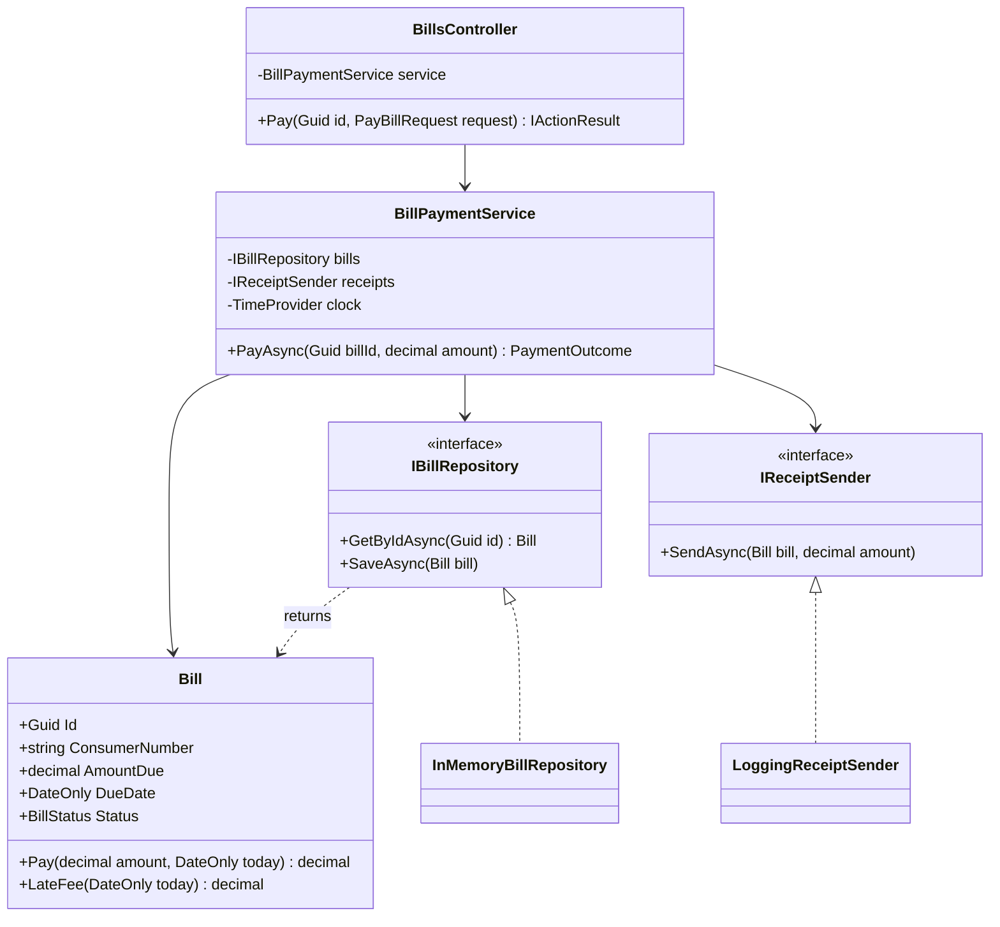
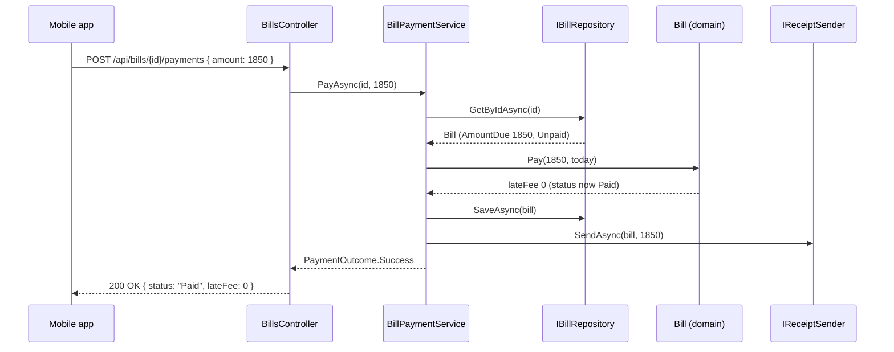
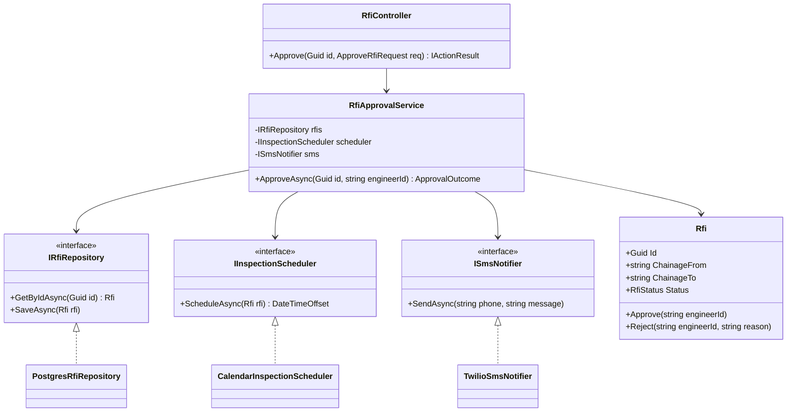

Open almost any ASP.NET Core codebase and you will find the same four kinds of class: something that answers HTTP (a controller or minimal-API endpoint), something that runs the business process (a service), something that talks to the database (a repository), and the plain objects that hold the business data and rules (the domain model). This lesson is about what each one should and should not do, and about the one rule that keeps them from collapsing into a tangle: dependencies point inward.

## Learning objectives

By the end of this lesson you will be able to:

1. State, in one sentence each, what a controller, a service, a repository and a domain model are responsible for.
2. Explain the dependency direction rule and say why the domain model must not reference ASP.NET Core or the database.
3. Build a small feature (paying an electricity bill) as four cooperating layers in C#, wired with dependency injection.
4. Put a business rule in the right layer and defend the choice.
5. Unit-test a service with a hand-rolled fake repository, without a database.
6. Recognise an "anemic" domain model and a "fat" controller, and fix both.
7. Decide when a repository or a separate service layer is unnecessary ceremony.

## Prerequisites

- [Layered architecture](#/lesson/m02-layered): the big-picture idea of presentation, business and data layers.
- [Dependency injection](#/lesson/m03-dependency-injection): every layer here receives its collaborators through the constructor.
- [Kestrel, middleware, routing, controllers and minimal APIs](#/lesson/m03-kestrel-middleware-routing): how a request reaches a controller action.

You do not need Entity Framework Core for this lesson. We use an in-memory repository so that everything compiles and runs anywhere.

## Explain it like I'm a beginner

Think of a bank branch in Jaipur.

- The **counter clerk** greets you, checks that your form is filled in, and hands it to the right person. The clerk does not decide whether your loan is approved. That is the **controller**: it receives the HTTP request, checks the shape of the input, and passes it on.
- The **branch officer** knows the bank's rules: "a bill can be paid only once", "a payment can't exceed the amount due", "after payment, send a receipt". The officer coordinates the work. That is the **service** (application service).
- The **records room** stores and fetches files. Ask for "bill number 4471" and it comes back. It does not care why you want it. That is the **repository**.
- The **file itself** (the bill) carries the facts and the rules about itself: amount due, due date, whether it is already paid. In code this is the **domain model**: `Bill`, `Customer`, `Payment`.

Why split it this way? Imagine the clerk also approved loans and also fetched files. Replacing that one person would stop the branch. Training a new one would take months. And if the records room moved to a new building, every clerk would need retraining. Splitting responsibilities means each part can change, be tested, and be replaced on its own.

One rule makes the split work: **information flows from the outside in, and knowledge of the outside never leaks inward.** The bill file does not know what a counter looks like. The branch officer does not know whether the customer came by phone or in person. In code: the domain model does not know about HTTP or SQL; the service does not know about controllers; only the controller knows about HTTP.

## First-principles explanation

### The four layers and their single question

Each layer answers one question. If a line of code answers a different question, it is in the wrong layer.

| Layer | Question it answers | Typical types | Must not know about |
|---|---|---|---|
| Presentation (controller / endpoint) | "How does this request become a method call, and the result become a response?" | `BillsController`, `MapPost(...)`, request/response DTOs | Business rules, SQL |
| Application (service) | "What steps make up this use case, in what order, in one transaction?" | `BillPaymentService` | HTTP status codes, `HttpContext`, SQL |
| Domain (model) | "What is true about a bill, and what may change it?" | `Bill`, `Money`, `BillStatus`, domain exceptions | Everything outside itself: no EF Core, no ASP.NET Core, no logging framework |
| Infrastructure (repository and other adapters) | "How do we store, fetch or send this?" | `PostgresBillRepository`, `SmsReceiptSender` | The reasons behind the business rules |

The word "layer" is a logical grouping. All four can live in one project with four folders. Many well-run systems do exactly that. The point is which class may call which, not how many `.csproj` files you have.

### Dependency direction

Draw the layers as rings. The domain is the centre. The rule is simple: **a class may only depend on classes in the same ring or a ring closer to the centre.** Controllers call services. Services call the domain and call repository *interfaces*. The domain calls nothing.

Where does the concrete repository go, given it must call PostgreSQL and the service must call the repository? The service depends on an **interface** `IBillRepository` that lives next to the service (or in the domain). The concrete `PostgresBillRepository` implements it from the outer ring. At startup, DI binds the interface to the implementation. This is the Dependency Inversion Principle ([DIP](#/lesson/m04-dip)) applied: the inner ring owns the contract, the outer ring fulfils it.

Why be strict about it? Three concrete gains:

1. **Testability.** `BillPaymentService` can be tested with a 15-line fake repository. No database, no containers. A typical service test runs in under a millisecond; an integration test through PostgreSQL takes 50–200 ms and needs infrastructure. You will write many more of the first kind.
2. **Replaceability.** Moving from an in-memory store to PostgreSQL, or from REST to gRPC, changes one outer ring. The domain and service are untouched.
3. **Understandability.** A new teammate can read `Bill.cs` and learn every rule about bills in one place, with no `[HttpPost]` or `DbSet` noise.

### What each layer looks like when done well

**Controller.** Thin. Deserialise, validate shape, call one service method, translate the outcome to an HTTP response. A good rule of thumb is that an action method is 5–15 lines and has no `if` about business state. If you see `if (bill.Status == Paid)` in a controller, that rule has escaped from the domain.

**Service.** Orchestrates a use case: load what is needed, ask the domain to do the work, persist, trigger side effects (send a receipt, publish an event). It owns the **transaction boundary**: everything in `PayBillAsync` succeeds or fails together. It returns a result the controller can map, not an `IActionResult`.

**Domain model.** Objects with data *and* behaviour. `bill.Pay(amount, now)` checks the invariants and changes state. The model protects itself: setters are private, state changes go through methods, invalid states are impossible to construct. The opposite, a class with only public getters and setters and all logic in services, is the **anemic domain model** anti-pattern. It works for simple CRUD, but as rules grow they get duplicated across services.

**Repository.** A collection-like interface for one kind of domain object: `GetByIdAsync`, `AddAsync`, `SaveAsync`, perhaps a few named queries such as `FindOverdueAsync(DateOnly asOf)`. It returns domain objects, not database rows. It does not contain business decisions. If a repository method is called `PayBillAndSendReceiptAsync`, it has stolen the service's job.

### What goes wrong without the split

- **Fat controllers.** One 300-line action that validates, queries, decides, saves and formats. Nothing is reusable from a background job or a second endpoint, and the only way to test it is through HTTP.
- **Anemic domain + service sprawl.** Every rule is in some service. When "a paid bill cannot be edited" is enforced in `BillEditService` but forgotten in `BulkImportService`, you get paid bills with changed amounts.
- **Leaky repositories.** The service passes `IQueryable` around, or the repository returns EF Core entities with lazy-loading proxies, and suddenly the controller triggers 40 SQL queries while serialising JSON (the N+1 problem, see [N+1 queries](#/lesson/m09-n-plus-one)).

### When layers are too many

Layering has a cost: more files, more mapping, more indirection to follow. Signs you have over-layered:

- A service method that is one line: `return await _repo.GetByIdAsync(id);`. Pass-through layers add nothing but a place for bugs to hide.
- A repository interface with one implementation that is just a thin wrapper over EF Core's `DbContext`, which is already a repository and unit of work (see [Repository and Unit of Work](#/lesson/m06-repository-uow)).
- A "manager" calls a "service" that calls a "handler" that calls a "repository" and nobody can say what the difference is.

For a small internal tool with 10 CRUD endpoints and no real rules, a minimal API endpoint that uses `DbContext` directly is honest and fine. Add a service when a use case has more than one step or a rule worth testing. Add a repository interface when you need to swap the store or when the queries are complex enough to deserve their own tests. Grow the structure as the rules grow; do not start with five projects for three tables.

:::callout type=tradeoff title="Layers versus vertical slices"
Layered folders (`Controllers/`, `Services/`, `Repositories/`) group by *kind of class*. Vertical slices group by *feature* (`Bills/PayBill/`). The responsibilities in this lesson are the same in both styles; only the folder structure differs. Slices reduce the "open six folders to change one feature" problem. See [Vertical Slice Architecture](#/lesson/m02-vertical-slice) for the comparison.
:::

## Visual explanation

### Class diagram — the layers and the dependency direction



How to read it: every solid arrow points from an outer layer toward an inner one. `BillsController` knows the service; the service knows two interfaces and the `Bill` model; `Bill` knows nothing. The two concrete infrastructure classes at the bottom point *up* to the interfaces they implement (dotted lines), which is the inversion that lets the service stay ignorant of storage and SMS.

### Sequence diagram — paying a bill



The controller does one thing with the request and one thing with the result. The service drives the sequence. The business decision ("is this payment allowed, and is there a late fee?") happens inside `Bill.Pay`, not in the service and not in the controller. If the bill were already paid, `Bill.Pay` would throw a domain exception, the service would return `PaymentOutcome.AlreadyPaid`, and the controller would turn that into a `409 Conflict`.

## Step-by-step example

We will build "pay an electricity bill" for a state power utility's customer app. Rules:

- A bill is identified by a consumer number and a billing month. Amount due is in rupees.
- A bill can be paid once. Paying a paid bill is an error.
- Paying after the due date adds a late fee of 1.5 % of the amount due, rounded to the nearest rupee.
- The amount paid must equal amount due plus late fee. No partial payments in this version.
- After a successful payment, send a receipt (SMS in production; a log line here).

### Step 1 — the domain model owns the rules

Start in the centre. `Bill` has private setters and a `Pay` method that enforces the rules. The late-fee formula lives on the bill because it depends only on bill data.

### Step 2 — the repository interface, defined by the service's needs

The service needs two operations: fetch a bill by id and save it. So the interface has two methods. We do not add `GetAll`, `Delete` or `Query` because nobody needs them yet.

### Step 3 — the service orchestrates

`PayAsync` loads the bill, asks it to pay, saves, sends the receipt, and returns a small outcome type. It catches the domain exceptions it knows how to map and lets anything unexpected propagate (a bug should surface as a 500, not be swallowed).

### Step 4 — the controller translates

The controller turns the outcome into `200`, `404` or `409`. It never looks at `Bill.Status` itself.

### Step 5 — wiring

`Program.cs` registers the service, the in-memory repository and the receipt sender. In production you would swap `InMemoryBillRepository` for an EF Core or Dapper implementation with one registration line.

## Production-style C# implementation

Folder layout (one project, four folders, dependencies point inward):

```text
PowerPay.Api/
  Program.cs
  Domain/Bill.cs
  Domain/BillExceptions.cs
  Application/IBillRepository.cs
  Application/IReceiptSender.cs
  Application/BillPaymentService.cs
  Infrastructure/InMemoryBillRepository.cs
  Infrastructure/LoggingReceiptSender.cs
  Api/BillsController.cs
```

```csharp file=Domain/BillExceptions.cs
namespace PowerPay.Domain;

/// <summary>Base type for rule violations in the bills domain. Deliberately knows nothing about HTTP.</summary>
public abstract class BillDomainException(string message) : Exception(message);

public sealed class BillAlreadyPaidException(Guid billId)
    : BillDomainException($"Bill {billId} has already been paid.");

public sealed class PaymentAmountMismatchException(decimal expected, decimal actual)
    : BillDomainException($"Expected payment of {expected:0.00} but received {actual:0.00}.")
{
    public decimal Expected { get; } = expected;
    public decimal Actual { get; } = actual;
}
```

```csharp file=Domain/Bill.cs
namespace PowerPay.Domain;

public enum BillStatus { Unpaid, Paid }

/// <summary>An electricity bill. Holds its own rules: single payment, late fee after the due date.</summary>
public sealed class Bill
{
    public const decimal LateFeePercent = 1.5m;

    public Guid Id { get; }
    public string ConsumerNumber { get; }
    public DateOnly BillingMonth { get; }
    public decimal AmountDue { get; }
    public DateOnly DueDate { get; }
    public BillStatus Status { get; private set; } = BillStatus.Unpaid;
    public DateOnly? PaidOn { get; private set; }
    public decimal LateFeeCharged { get; private set; }

    public Bill(Guid id, string consumerNumber, DateOnly billingMonth, decimal amountDue, DateOnly dueDate)
    {
        if (string.IsNullOrWhiteSpace(consumerNumber)) throw new ArgumentException("Consumer number is required.", nameof(consumerNumber));
        if (amountDue <= 0) throw new ArgumentOutOfRangeException(nameof(amountDue), "Amount due must be positive.");
        Id = id;
        ConsumerNumber = consumerNumber;
        BillingMonth = billingMonth;
        AmountDue = amountDue;
        DueDate = dueDate;
    }

    /// <summary>1.5 % of the amount due, rounded to the nearest rupee, if paid after the due date; otherwise 0.</summary>
    public decimal LateFee(DateOnly today) =>
        today > DueDate ? Math.Round(AmountDue * LateFeePercent / 100m, 0, MidpointRounding.AwayFromZero) : 0m;

    /// <summary>Total that must be paid today: amount due plus any late fee.</summary>
    public decimal AmountPayable(DateOnly today) => AmountDue + LateFee(today);

    /// <summary>Marks the bill paid. Returns the late fee charged.</summary>
    public decimal Pay(decimal amount, DateOnly today)
    {
        if (Status == BillStatus.Paid) throw new BillAlreadyPaidException(Id);
        var payable = AmountPayable(today);
        if (amount != payable) throw new PaymentAmountMismatchException(payable, amount);

        LateFeeCharged = payable - AmountDue;
        PaidOn = today;
        Status = BillStatus.Paid;
        return LateFeeCharged;
    }
}
```

```csharp file=Application/IBillRepository.cs
using PowerPay.Domain;

namespace PowerPay.Application;

/// <summary>Only what the use cases need. Grows when a use case needs more, not before.</summary>
public interface IBillRepository
{
    Task<Bill?> GetByIdAsync(Guid id, CancellationToken ct = default);
    Task SaveAsync(Bill bill, CancellationToken ct = default);
}
```

```csharp file=Application/IReceiptSender.cs
using PowerPay.Domain;

namespace PowerPay.Application;

public interface IReceiptSender
{
    Task SendAsync(Bill bill, decimal amountPaid, CancellationToken ct = default);
}
```

```csharp file=Application/BillPaymentService.cs
using Microsoft.Extensions.Logging;
using PowerPay.Domain;

namespace PowerPay.Application;

public enum PaymentStatus { Success, NotFound, AlreadyPaid, AmountMismatch }

/// <summary>What happened, in business terms. The controller decides which HTTP code each one becomes.</summary>
public sealed record PaymentOutcome(PaymentStatus Status, decimal? LateFee = null, decimal? ExpectedAmount = null)
{
    public static PaymentOutcome Success(decimal lateFee) => new(PaymentStatus.Success, lateFee);
    public static readonly PaymentOutcome NotFound = new(PaymentStatus.NotFound);
    public static readonly PaymentOutcome AlreadyPaid = new(PaymentStatus.AlreadyPaid);
    public static PaymentOutcome Mismatch(decimal expected) => new(PaymentStatus.AmountMismatch, ExpectedAmount: expected);
}

public sealed class BillPaymentService(
    IBillRepository bills,
    IReceiptSender receipts,
    TimeProvider clock,
    ILogger<BillPaymentService> logger)
{
    public async Task<PaymentOutcome> PayAsync(Guid billId, decimal amount, CancellationToken ct = default)
    {
        var bill = await bills.GetByIdAsync(billId, ct);
        if (bill is null) return PaymentOutcome.NotFound;

        var today = DateOnly.FromDateTime(clock.GetUtcNow().UtcDateTime);
        decimal lateFee;
        try
        {
            lateFee = bill.Pay(amount, today);
        }
        catch (BillAlreadyPaidException)
        {
            return PaymentOutcome.AlreadyPaid;
        }
        catch (PaymentAmountMismatchException ex)
        {
            return PaymentOutcome.Mismatch(ex.Expected);
        }

        await bills.SaveAsync(bill, ct);
        await receipts.SendAsync(bill, amount, ct);
        logger.LogInformation("Bill {BillId} for consumer {Consumer} paid {Amount} with late fee {LateFee}",
            bill.Id, bill.ConsumerNumber, amount, lateFee);
        return PaymentOutcome.Success(lateFee);
    }
}
```

```csharp file=Infrastructure/InMemoryBillRepository.cs
using System.Collections.Concurrent;
using PowerPay.Application;
using PowerPay.Domain;

namespace PowerPay.Infrastructure;

/// <summary>Development store. A PostgreSQL implementation replaces this with one DI line.</summary>
public sealed class InMemoryBillRepository : IBillRepository
{
    private readonly ConcurrentDictionary<Guid, Bill> _store = new();

    public InMemoryBillRepository()
    {
        var sample = new Bill(Guid.Parse("11111111-1111-1111-1111-111111111111"), "DL-4471-0092",
            new DateOnly(2026, 9, 1), 1850m, new DateOnly(2026, 10, 10));
        _store[sample.Id] = sample;
    }

    public Task<Bill?> GetByIdAsync(Guid id, CancellationToken ct = default) =>
        Task.FromResult(_store.TryGetValue(id, out var bill) ? bill : null);

    public Task SaveAsync(Bill bill, CancellationToken ct = default)
    {
        _store[bill.Id] = bill;
        return Task.CompletedTask;
    }
}
```

```csharp file=Infrastructure/LoggingReceiptSender.cs
using Microsoft.Extensions.Logging;
using PowerPay.Application;
using PowerPay.Domain;

namespace PowerPay.Infrastructure;

public sealed class LoggingReceiptSender(ILogger<LoggingReceiptSender> logger) : IReceiptSender
{
    public Task SendAsync(Bill bill, decimal amountPaid, CancellationToken ct = default)
    {
        logger.LogInformation("Receipt: consumer {Consumer} paid {Amount} for {Month:yyyy-MM}",
            bill.ConsumerNumber, amountPaid, bill.BillingMonth);
        return Task.CompletedTask;
    }
}
```

```csharp file=Api/BillsController.cs
using Microsoft.AspNetCore.Mvc;
using PowerPay.Application;

namespace PowerPay.Api;

public sealed record PayBillRequest(decimal Amount);
public sealed record PayBillResponse(string Status, decimal LateFee);

[ApiController]
[Route("api/bills")]
public sealed class BillsController(BillPaymentService payments) : ControllerBase
{
    [HttpPost("{id:guid}/payments")]
    public async Task<IActionResult> Pay(Guid id, [FromBody] PayBillRequest request, CancellationToken ct)
    {
        if (request.Amount <= 0) return BadRequest(new { error = "Amount must be positive." });

        var outcome = await payments.PayAsync(id, request.Amount, ct);
        return outcome.Status switch
        {
            PaymentStatus.Success => Ok(new PayBillResponse("Paid", outcome.LateFee ?? 0m)),
            PaymentStatus.NotFound => NotFound(),
            PaymentStatus.AlreadyPaid => Conflict(new { error = "This bill has already been paid." }),
            PaymentStatus.AmountMismatch => UnprocessableEntity(new { error = "Amount does not match.", expected = outcome.ExpectedAmount }),
            _ => StatusCode(StatusCodes.Status500InternalServerError)
        };
    }
}
```

```csharp file=Program.cs
using PowerPay.Application;
using PowerPay.Infrastructure;

var builder = WebApplication.CreateBuilder(args);

builder.Services.AddControllers();
builder.Services.AddSingleton(TimeProvider.System);
builder.Services.AddSingleton<IBillRepository, InMemoryBillRepository>();   // swap for PostgresBillRepository (scoped) later
builder.Services.AddSingleton<IReceiptSender, LoggingReceiptSender>();
builder.Services.AddScoped<BillPaymentService>();

var app = builder.Build();
app.MapControllers();
app.Run();
```

Notes on the choices:

- **The service returns an outcome, not an `IActionResult`.** That keeps the service usable from a background job or a gRPC endpoint. The mapping to HTTP is the controller's single job.
- **Domain exceptions are caught in the service, not the controller.** The service knows which exceptions are expected business outcomes. Unknown exceptions pass through to the global handler ([Filters, middleware and exception handling](#/lesson/m03-filters-exceptions)).
- **`TimeProvider` is injected.** "Today" is an input to the late-fee rule, so tests can set it. The domain method takes `DateOnly today` as a parameter rather than reading a clock, which keeps `Bill` free of any dependency.
- **Lifetimes.** The in-memory repository is a singleton because it *is* the store. A PostgreSQL repository holding a `DbContext` would be scoped, and the service is scoped so it can hold it safely (see [Singleton, scoped and transient services](#/lesson/m03-service-lifetimes)).

## Bad design vs good design

**Bad**: everything in the controller.

```csharp
[HttpPost("{id}/pay")]
public async Task<IActionResult> Pay(Guid id, decimal amount)
{
    var bill = await _db.Bills.FindAsync(id);
    if (bill == null) return NotFound();
    if (bill.Status == "PAID") return Conflict();
    var fee = DateTime.Now > bill.DueDate ? Math.Round(bill.AmountDue * 0.015m) : 0;
    if (amount != bill.AmountDue + fee) return UnprocessableEntity();
    bill.Status = "PAID"; bill.PaidOn = DateTime.Now; bill.LateFee = fee;
    await _db.SaveChangesAsync();
    await _sms.SendAsync(bill.Phone, $"Paid {amount}");
    return Ok(new { fee });
}
```

What is wrong, concretely:

- The late-fee rule is here. The bulk-payment import job will re-implement it, slightly differently, and the two will drift.
- `DateTime.Now` is read in the controller. Tests cannot control it, and the server's time zone decides whether a payment at 00:30 IST is late.
- `Status` is a string. `"PAID"`, `"Paid"` and `"paid"` are all possible, and nothing stops a developer setting `Status = "Pending"` from anywhere.
- To test any rule you must spin up the web host and a database.

**Good**: the implementation above. The rules sit on `Bill`, the orchestration sits in the service, and the controller is 12 lines of translation. Adding "partial payments" later means changing `Bill.Pay` and its tests; the controller probably does not change at all.

**Also bad, in the other direction**: a `BillRepository` with 40 methods (`GetUnpaidForConsumer`, `GetUnpaidForConsumerOrderedByDate`, `GetUnpaidForConsumerOrderedByDateWithFees`...), an `IBillService` interface with exactly one implementation that nobody will ever swap, and a `BillManager` that calls `BillService` that calls `BillRepository`, each adding a `try/catch` that rethrows. This is layering as ritual. Every layer should earn its place by owning a decision or hiding a dependency.

:::callout type=mistake title="Interfaces for everything"
Putting an interface in front of `BillPaymentService` because "we might need to mock it" is usually unnecessary. The controller test can use the real service with a fake repository; that tests more and costs less. Add interfaces where there is a real second implementation (fake or production) or a real boundary (storage, network, time).
:::

## Practical playground

The code below is the domain model plus a tiny service with an in-memory repository, runnable as a console program. Run it, then change `today` to a date after the due date and watch the late fee appear. Then try paying the same bill twice.

:::playground type=csharp title="Bill payment layers"
```csharp file=Program.cs
using System;
using System.Collections.Generic;
using System.Threading.Tasks;

public enum BillStatus { Unpaid, Paid }

public sealed class Bill
{
    public Guid Id { get; } = Guid.NewGuid();
    public decimal AmountDue { get; }
    public DateOnly DueDate { get; }
    public BillStatus Status { get; private set; }
    public Bill(decimal amountDue, DateOnly dueDate) { AmountDue = amountDue; DueDate = dueDate; }

    public decimal LateFee(DateOnly today) => today > DueDate ? Math.Round(AmountDue * 0.015m, 0, MidpointRounding.AwayFromZero) : 0m;

    public decimal Pay(decimal amount, DateOnly today)
    {
        if (Status == BillStatus.Paid) throw new InvalidOperationException("Already paid.");
        var payable = AmountDue + LateFee(today);
        if (amount != payable) throw new InvalidOperationException($"Expected {payable}, got {amount}.");
        Status = BillStatus.Paid;
        return payable - AmountDue;
    }
}

public interface IBillRepository { Task<Bill?> GetAsync(Guid id); Task SaveAsync(Bill bill); }

public sealed class InMemoryBillRepository : IBillRepository
{
    private readonly Dictionary<Guid, Bill> _bills = new();
    public void Seed(Bill bill) => _bills[bill.Id] = bill;
    public Task<Bill?> GetAsync(Guid id) => Task.FromResult(_bills.TryGetValue(id, out var b) ? b : null);
    public Task SaveAsync(Bill bill) { _bills[bill.Id] = bill; return Task.CompletedTask; }
}

public sealed class BillPaymentService
{
    private readonly IBillRepository _repo;
    public BillPaymentService(IBillRepository repo) => _repo = repo;

    public async Task<string> PayAsync(Guid id, decimal amount, DateOnly today)
    {
        var bill = await _repo.GetAsync(id);
        if (bill is null) return "NotFound";
        try
        {
            var fee = bill.Pay(amount, today);
            await _repo.SaveAsync(bill);
            return $"Paid (late fee {fee})";
        }
        catch (InvalidOperationException ex) { return $"Rejected: {ex.Message}"; }
    }
}

public static class Program
{
    public static async Task Main()
    {
        var repo = new InMemoryBillRepository();
        var bill = new Bill(1850m, new DateOnly(2026, 10, 10));
        repo.Seed(bill);
        var service = new BillPaymentService(repo);

        var today = new DateOnly(2026, 10, 8);   // change to 2026-10-15 to see the late fee
        Console.WriteLine(await service.PayAsync(bill.Id, 1850m, today));
        Console.WriteLine(await service.PayAsync(bill.Id, 1850m, today));   // second attempt
    }
}
```
:::

## Exercises

:::exercise id=m03-layers-ex1 difficulty=beginner kind=code title="Put the late-fee rule in the domain"
`Bill.Pay` and `Bill.LateFee` are stubs. Implement them so the bill protects its own rules: single payment, late fee of 1.5 % rounded to the nearest rupee after the due date, exact amount required.
::requirements
- `LateFee(today)` returns 0 on or before the due date, otherwise `Math.Round(AmountDue * 0.015m, 0, MidpointRounding.AwayFromZero)`.
- `Pay(amount, today)` throws `InvalidOperationException` if already paid, `ArgumentException` if the amount is not exactly amount due plus late fee, and otherwise sets `Status` to `Paid` and returns the late fee.
::acceptance
- Paying ₹1,850 on the due date for a ₹1,850 bill succeeds with fee 0.
- Paying 5 days late requires ₹1,878 (₹1,850 + ₹28); ₹1,850 is rejected.
- Paying twice throws `InvalidOperationException`.
::hint
Which checks must run first? Think about what should happen if someone pays the wrong amount on an already-paid bill.
::hint
Compute `payable = AmountDue + LateFee(today)` once and compare against it.
::hint
The rounding call is `Math.Round(value, 0, MidpointRounding.AwayFromZero)`; 1850 × 0.015 = 27.75, which rounds to 28.
::hint
```csharp
if (Status == BillStatus.Paid) throw new InvalidOperationException("Already paid.");
var payable = AmountDue + LateFee(today);
if (amount != payable) throw new ArgumentException($"Expected {payable}.", nameof(amount));
```
::starter
```csharp file=Bill.cs
using System;

public enum BillStatus { Unpaid, Paid }

public sealed class Bill
{
    public Guid Id { get; } = Guid.NewGuid();
    public decimal AmountDue { get; }
    public DateOnly DueDate { get; }
    public BillStatus Status { get; private set; } = BillStatus.Unpaid;
    public decimal LateFeeCharged { get; private set; }

    public Bill(decimal amountDue, DateOnly dueDate)
    {
        if (amountDue <= 0) throw new ArgumentOutOfRangeException(nameof(amountDue));
        AmountDue = amountDue;
        DueDate = dueDate;
    }

    public decimal LateFee(DateOnly today) => throw new NotImplementedException();

    public decimal Pay(decimal amount, DateOnly today) => throw new NotImplementedException();
}
```
::tests
```csharp file=BillTests.cs
using System;
using Xunit;

public class BillTests
{
    private static readonly DateOnly Due = new(2026, 10, 10);

    [Fact]
    public void No_fee_on_due_date()
    {
        var bill = new Bill(1850m, Due);
        Assert.Equal(0m, bill.LateFee(Due));
        Assert.Equal(0m, bill.Pay(1850m, Due));
        Assert.Equal(BillStatus.Paid, bill.Status);
    }

    [Fact]
    public void Late_fee_is_rounded_to_rupee()
    {
        var bill = new Bill(1850m, Due);
        Assert.Equal(28m, bill.LateFee(Due.AddDays(5)));
    }

    [Fact]
    public void Late_payment_requires_fee()
    {
        var bill = new Bill(1850m, Due);
        Assert.Throws<ArgumentException>(() => bill.Pay(1850m, Due.AddDays(5)));
        Assert.Equal(28m, bill.Pay(1878m, Due.AddDays(5)));
        Assert.Equal(28m, bill.LateFeeCharged);
    }

    [Fact]
    public void Cannot_pay_twice()
    {
        var bill = new Bill(500m, Due);
        bill.Pay(500m, Due);
        Assert.Throws<InvalidOperationException>(() => bill.Pay(500m, Due));
    }
}
```
::solution
The checks run in order: state first, then amount. Only after both pass does the state change, so a failed call leaves the bill untouched.

```csharp file=Bill.cs
using System;

public enum BillStatus { Unpaid, Paid }

public sealed class Bill
{
    public Guid Id { get; } = Guid.NewGuid();
    public decimal AmountDue { get; }
    public DateOnly DueDate { get; }
    public BillStatus Status { get; private set; } = BillStatus.Unpaid;
    public decimal LateFeeCharged { get; private set; }

    public Bill(decimal amountDue, DateOnly dueDate)
    {
        if (amountDue <= 0) throw new ArgumentOutOfRangeException(nameof(amountDue));
        AmountDue = amountDue;
        DueDate = dueDate;
    }

    public decimal LateFee(DateOnly today) =>
        today > DueDate ? Math.Round(AmountDue * 0.015m, 0, MidpointRounding.AwayFromZero) : 0m;

    public decimal Pay(decimal amount, DateOnly today)
    {
        if (Status == BillStatus.Paid) throw new InvalidOperationException("Already paid.");
        var payable = AmountDue + LateFee(today);
        if (amount != payable) throw new ArgumentException($"Expected {payable}, got {amount}.", nameof(amount));
        LateFeeCharged = payable - AmountDue;
        Status = BillStatus.Paid;
        return LateFeeCharged;
    }
}
```

Because the rule lives on `Bill`, every caller (API, import job, admin screen) gets the same behaviour for free.
::mistakes
- Using `today >= DueDate` so that paying *on* the due date is charged a fee.
- Using `Math.Round(x)` with no mode; banker's rounding would turn 27.5 into 28 but 28.5 into 28, which customers will dispute.
- Setting `Status = Paid` before the amount check, which leaves a bill marked paid after a rejected payment.
:::

:::exercise id=m03-layers-ex2 difficulty=beginner kind=written title="Sort the responsibilities"
Below are ten statements from a design meeting about a hospital pharmacy stock system. For each one, name the layer it belongs to (controller, service, domain model, repository) and give a one-line reason.

1. "Return 404 when the medicine code is unknown."
2. "Stock cannot go below zero."
3. "Load the medicine by code from PostgreSQL."
4. "When stock is issued, also write an audit entry and publish a `StockIssued` event."
5. "Expired batches cannot be issued."
6. "Parse the `Authorization` header."
7. "Find all batches expiring in the next 30 days."
8. "A `Batch` has a batch number, expiry date and quantity."
9. "Issuing stock and writing the audit entry must happen in one transaction."
10. "Convert the `IssueStockRequest` JSON into a method call."
::acceptance
- All ten statements are assigned.
- Statements 2, 5 and 8 are assigned to the domain model.
- Statements 4 and 9 are assigned to the service, with the transaction reason stated.
::hint
Ask the layer's "single question" from the table in the first-principles section.
::hint
Anything that mentions HTTP, JSON or headers is presentation. Anything that mentions SQL or "load from" is repository.
::hint
A rule about what is *true* about a thing is domain. A rule about *what steps happen together* is service.
::solution
1. Controller: HTTP status codes are presentation concerns.
2. Domain model (`Batch.Issue` throws if quantity would go negative): an invariant about the object itself.
3. Repository: fetching from storage.
4. Service: coordinating multiple side effects is a use case step list.
5. Domain model: a rule about a batch's own state (`IsExpired(today)`).
6. Controller (or more precisely the authentication middleware before it): HTTP header handling.
7. Repository: a named query, `FindExpiringAsync(DateOnly before)`. The *decision* to look 30 days ahead is a service or configuration concern, but the query itself is data access.
8. Domain model: the shape of the thing.
9. Service: it owns the transaction boundary.
10. Controller (model binding): translating the wire format.
::mistakes
- Putting "stock cannot go below zero" in the service. Then a second service that also issues stock can forget it.
- Putting the 30-day query logic in the controller as a LINQ expression over a `DbSet`.
:::

:::exercise id=m03-layers-ex3 difficulty=intermediate kind=code title="Implement an application service with a fake repository"
Implement `StockIssueService.IssueAsync`. It loads a `Batch`, asks the domain to issue the quantity, saves, records an audit line, and returns an outcome. The tests use a hand-rolled fake repository and a fake audit log. No database.
::requirements
- Return `IssueResult.NotFound` when the batch does not exist.
- Return `IssueResult.Expired` when `batch.IsExpired(today)`; do not change stock.
- Return `IssueResult.InsufficientStock` when the quantity exceeds what is on hand; do not change stock.
- On success: `batch.Issue(quantity)`, save through the repository, call `audit.RecordAsync` once, return `IssueResult.Success`.
::acceptance
- All four outcomes are covered by the provided tests.
- The audit log is written exactly once on success and never on failure.
- The service never calls `DateTime.Now` or `DateTime.Today`; it uses the injected `TimeProvider`.
::hint
The domain model already throws for insufficient stock. The service's job is to translate that into an outcome, not to re-check the number.
::hint
Order of checks: null → expired → issue (which may throw) → save → audit.
::hint
Get today with `DateOnly.FromDateTime(clock.GetUtcNow().UtcDateTime)`.
::hint
```csharp
try { batch.Issue(quantity); }
catch (InvalidOperationException) { return IssueResult.InsufficientStock; }
await repo.SaveAsync(batch, ct);
await audit.RecordAsync($"Issued {quantity} of {batch.BatchNumber}", ct);
return IssueResult.Success;
```
::starter
```csharp file=StockIssueService.cs
using System;
using System.Threading;
using System.Threading.Tasks;

public sealed class Batch
{
    public string BatchNumber { get; }
    public DateOnly Expiry { get; }
    public int Quantity { get; private set; }

    public Batch(string batchNumber, DateOnly expiry, int quantity)
    {
        BatchNumber = batchNumber;
        Expiry = expiry;
        Quantity = quantity;
    }

    public bool IsExpired(DateOnly today) => today > Expiry;

    public void Issue(int quantity)
    {
        if (quantity <= 0) throw new ArgumentOutOfRangeException(nameof(quantity));
        if (quantity > Quantity) throw new InvalidOperationException("Insufficient stock.");
        Quantity -= quantity;
    }
}

public interface IBatchRepository
{
    Task<Batch?> GetAsync(string batchNumber, CancellationToken ct = default);
    Task SaveAsync(Batch batch, CancellationToken ct = default);
}

public interface IAuditLog
{
    Task RecordAsync(string message, CancellationToken ct = default);
}

public enum IssueResult { Success, NotFound, Expired, InsufficientStock }

public sealed class StockIssueService
{
    private readonly IBatchRepository _repo;
    private readonly IAuditLog _audit;
    private readonly TimeProvider _clock;

    public StockIssueService(IBatchRepository repo, IAuditLog audit, TimeProvider clock)
    {
        _repo = repo;
        _audit = audit;
        _clock = clock;
    }

    public Task<IssueResult> IssueAsync(string batchNumber, int quantity, CancellationToken ct = default) =>
        throw new NotImplementedException();
}
```
::tests
```csharp file=StockIssueServiceTests.cs
using System;
using System.Collections.Generic;
using System.Threading;
using System.Threading.Tasks;
using Xunit;

public class StockIssueServiceTests
{
    private sealed class FakeRepo : IBatchRepository
    {
        public readonly Dictionary<string, Batch> Items = new();
        public int Saves;
        public Task<Batch?> GetAsync(string n, CancellationToken ct = default) => Task.FromResult(Items.TryGetValue(n, out var b) ? b : null);
        public Task SaveAsync(Batch b, CancellationToken ct = default) { Saves++; Items[b.BatchNumber] = b; return Task.CompletedTask; }
    }

    private sealed class FakeAudit : IAuditLog
    {
        public readonly List<string> Lines = new();
        public Task RecordAsync(string m, CancellationToken ct = default) { Lines.Add(m); return Task.CompletedTask; }
    }

    private sealed class FixedClock : TimeProvider
    {
        private readonly DateTimeOffset _now;
        public FixedClock(DateTimeOffset now) => _now = now;
        public override DateTimeOffset GetUtcNow() => _now;
    }

    private static readonly DateTimeOffset Today = new(2026, 10, 19, 9, 0, 0, TimeSpan.Zero);

    private static (StockIssueService svc, FakeRepo repo, FakeAudit audit) Build(params Batch[] batches)
    {
        var repo = new FakeRepo();
        foreach (var b in batches) repo.Items[b.BatchNumber] = b;
        var audit = new FakeAudit();
        return (new StockIssueService(repo, audit, new FixedClock(Today)), repo, audit);
    }

    [Fact]
    public async Task Unknown_batch_is_not_found()
    {
        var (svc, _, audit) = Build();
        Assert.Equal(IssueResult.NotFound, await svc.IssueAsync("B-404", 1));
        Assert.Empty(audit.Lines);
    }

    [Fact]
    public async Task Expired_batch_is_rejected_without_changing_stock()
    {
        var batch = new Batch("B-1", new DateOnly(2026, 9, 30), 50);
        var (svc, repo, audit) = Build(batch);
        Assert.Equal(IssueResult.Expired, await svc.IssueAsync("B-1", 10));
        Assert.Equal(50, batch.Quantity);
        Assert.Equal(0, repo.Saves);
        Assert.Empty(audit.Lines);
    }

    [Fact]
    public async Task Too_much_is_insufficient_stock()
    {
        var batch = new Batch("B-2", new DateOnly(2027, 1, 31), 5);
        var (svc, repo, audit) = Build(batch);
        Assert.Equal(IssueResult.InsufficientStock, await svc.IssueAsync("B-2", 6));
        Assert.Equal(5, batch.Quantity);
        Assert.Equal(0, repo.Saves);
        Assert.Empty(audit.Lines);
    }

    [Fact]
    public async Task Success_saves_and_audits_once()
    {
        var batch = new Batch("B-3", new DateOnly(2027, 1, 31), 20);
        var (svc, repo, audit) = Build(batch);
        Assert.Equal(IssueResult.Success, await svc.IssueAsync("B-3", 8));
        Assert.Equal(12, batch.Quantity);
        Assert.Equal(1, repo.Saves);
        Assert.Single(audit.Lines);
        Assert.Contains("B-3", audit.Lines[0]);
    }
}
```
::solution
The service is a short script: load, check the one rule that needs the clock, delegate the stock rule to the domain, persist, audit.

```csharp file=StockIssueService.cs
using System;
using System.Threading;
using System.Threading.Tasks;

public sealed class Batch
{
    public string BatchNumber { get; }
    public DateOnly Expiry { get; }
    public int Quantity { get; private set; }

    public Batch(string batchNumber, DateOnly expiry, int quantity)
    {
        BatchNumber = batchNumber;
        Expiry = expiry;
        Quantity = quantity;
    }

    public bool IsExpired(DateOnly today) => today > Expiry;

    public void Issue(int quantity)
    {
        if (quantity <= 0) throw new ArgumentOutOfRangeException(nameof(quantity));
        if (quantity > Quantity) throw new InvalidOperationException("Insufficient stock.");
        Quantity -= quantity;
    }
}

public interface IBatchRepository
{
    Task<Batch?> GetAsync(string batchNumber, CancellationToken ct = default);
    Task SaveAsync(Batch batch, CancellationToken ct = default);
}

public interface IAuditLog
{
    Task RecordAsync(string message, CancellationToken ct = default);
}

public enum IssueResult { Success, NotFound, Expired, InsufficientStock }

public sealed class StockIssueService
{
    private readonly IBatchRepository _repo;
    private readonly IAuditLog _audit;
    private readonly TimeProvider _clock;

    public StockIssueService(IBatchRepository repo, IAuditLog audit, TimeProvider clock)
    {
        _repo = repo;
        _audit = audit;
        _clock = clock;
    }

    public async Task<IssueResult> IssueAsync(string batchNumber, int quantity, CancellationToken ct = default)
    {
        var batch = await _repo.GetAsync(batchNumber, ct);
        if (batch is null) return IssueResult.NotFound;

        var today = DateOnly.FromDateTime(_clock.GetUtcNow().UtcDateTime);
        if (batch.IsExpired(today)) return IssueResult.Expired;

        try
        {
            batch.Issue(quantity);
        }
        catch (InvalidOperationException)
        {
            return IssueResult.InsufficientStock;
        }

        await _repo.SaveAsync(batch, ct);
        await _audit.RecordAsync($"Issued {quantity} from batch {batch.BatchNumber}", ct);
        return IssueResult.Success;
    }
}
```

Notice how little the test setup costs: three small fakes, no mocking library. That is the practical payoff of depending on interfaces owned by the application layer.
::alternatives
Instead of catching the domain exception, `Batch` could expose `bool CanIssue(int qty)` and the service could check first. That avoids exceptions for expected outcomes but means two calls that could disagree if the batch changes in between. In a single-threaded request both are fine; the exception form keeps the rule in one place.
::mistakes
- Re-implementing `quantity > batch.Quantity` in the service "to be safe". Now the rule is in two places.
- Writing the audit line before saving. If the save fails, the audit lies.
- Using `DateTime.Today`, which is the server's local date and bypasses the injected clock.
:::

:::exercise id=m03-layers-ex4 difficulty=intermediate kind=design title="Draw the dependency graph for a RFI approval feature"
A highway project management platform needs a "Request for Inspection" (RFI) feature: a contractor raises an RFI for a chainage segment; a site engineer approves or rejects it; approved RFIs schedule an inspection and notify the contractor by SMS. Design the classes across the four layers and show the dependency direction. Include at least one interface owned by the application layer and implemented by infrastructure.
::acceptance
- `Rfi` (domain) holds the state machine `Raised → Approved | Rejected` and throws on invalid transitions.
- An application service coordinates approval, scheduling and notification.
- `IRfiRepository` and `ISmsNotifier` are interfaces in the application layer, implemented in infrastructure.
- No arrow points from domain to any other layer.
::hint
Start from the domain: what facts and rules does an RFI itself own?
::hint
List the steps of "approve RFI" in order. Each external step (store, SMS, scheduling) gets an interface.
::hint
Draw the Mermaid class diagram with the controller at the top and the domain at the bottom; check every solid arrow points downward.
::solution


`Rfi.Approve` throws `InvalidRfiTransitionException` unless the status is `Raised`. The service calls `rfi.Approve`, saves, then schedules and notifies. Scheduling and SMS happen *after* the save; if the SMS fails, the approval still stands and a retry job can resend. That ordering decision is a service concern, which is why the service, not the domain, owns it.
::mistakes
- Making `Rfi` call `ISmsNotifier` directly. The domain now depends on infrastructure and cannot be unit-tested without a fake notifier.
- Putting the state check in the controller (`if (rfi.Status != Raised) return Conflict()`), so the mobile sync endpoint forgets it.
:::

:::exercise id=m03-layers-ex5 difficulty=advanced kind=written title="Decide how many layers two systems need"
You are asked to design two systems. For each, say which layers you would create on day one, which you would skip, and what signal would make you add a skipped layer later.

**System A**: an internal tool for the HR team of a 200-person company to record employee laptop assignments. Three tables, six endpoints, one developer, no integrations, expected lifetime 3 years.

**System B**: a toll-plaza transaction platform for a state highway authority. Rules for vehicle classes, exemptions, monthly passes and penalty calculations change by government notification every few months. Two external integrations (FASTag clearing house, SMS). Four developers, expected lifetime 10+ years, audited yearly.
::acceptance
- System A ends up with fewer layers than System B, with reasons tied to the rules and the team, not to fashion.
- For System B, the domain model is identified as the place where tariff rules live, with a stated reason.
- At least two concrete "add this layer when..." signals are given.
::hint
Count the business rules, not the tables.
::hint
For System A, what would a `LaptopAssignmentService` do that a minimal API endpoint with `DbContext` cannot?
::hint
For System B, think about what the audit team will ask to see, and what changes every few months.
::solution
**System A.** Minimal API endpoints that use `DbContext` directly, plus request/response records. No repository interface: `DbContext` already abstracts the database and the only realistic second implementation is EF Core's in-memory or SQLite provider for tests. No separate service layer: each endpoint is one query or one save. Keep a `Domain/` folder for the `Assignment` entity so that if a rule appears ("an employee may hold at most two devices") it has a home. Signals to add a service: an endpoint grows past about 20 lines of logic, or a second caller (a nightly report, an import) needs the same steps. Signal to add a repository interface: the queries become complex enough to test on their own, or a second store appears.

**System B.** All four layers from day one, and probably a separate `Domain` project with no package references so the compiler enforces the dependency rule. Tariff and penalty rules live in the domain (`TollTariff`, `VehicleClass`, `ExemptionPolicy`) because they change on a schedule the team does not control, they must be unit-tested exhaustively, and the auditor will want to read them in one place. Application services own the transaction boundaries (`RecordTransaction`, `SettleWithClearingHouse`). Infrastructure wraps FASTag and SMS behind interfaces so the clearing house's sandbox can be swapped in for testing and so an outage can be simulated. Even here, resist a fifth layer: no `Manager` on top of `Service`. Signal that you have gone too far: a layer that only forwards calls.

The general principle: layers are justified by rules that need isolation, integrations that need swapping, and people who need boundaries. System A has none of the three in quantity; System B has all three.
::mistakes
- Choosing the same structure for both "for consistency". Consistency across unrelated systems is worth less than fit.
- Treating EF Core's `DbContext` as something that must always be hidden behind a repository.
:::

## Automated testing

Each layer gets its own kind of test, and the shape of the layers decides how cheap each one is.

**Domain tests** are pure: construct a `Bill`, call `Pay`, assert. They need no fakes and run in microseconds. Write many. Exercise 1 is an example.

**Service tests** use hand-rolled fakes for the interfaces the service depends on. The fake repository is a dictionary; the fake receipt sender records calls. Exercise 3 shows the pattern. These tests check orchestration: the order of steps, which outcome is returned, that side effects happen exactly once.

```csharp
public class BillPaymentServiceTests
{
    private sealed class FakeBills : IBillRepository
    {
        public readonly Dictionary<Guid, Bill> Items = new();
        public Task<Bill?> GetByIdAsync(Guid id, CancellationToken ct = default) => Task.FromResult(Items.GetValueOrDefault(id));
        public Task SaveAsync(Bill bill, CancellationToken ct = default) { Items[bill.Id] = bill; return Task.CompletedTask; }
    }

    private sealed class FakeReceipts : IReceiptSender
    {
        public int Sent;
        public Task SendAsync(Bill bill, decimal amount, CancellationToken ct = default) { Sent++; return Task.CompletedTask; }
    }

    [Fact]
    public async Task Already_paid_bill_returns_conflict_outcome_and_sends_nothing()
    {
        var bill = new Bill(Guid.NewGuid(), "DL-1", new DateOnly(2026, 9, 1), 1000m, new DateOnly(2026, 10, 10));
        bill.Pay(1000m, new DateOnly(2026, 10, 1));
        var bills = new FakeBills(); bills.Items[bill.Id] = bill;
        var receipts = new FakeReceipts();
        var svc = new BillPaymentService(bills, receipts, TimeProvider.System, NullLogger<BillPaymentService>.Instance);

        var outcome = await svc.PayAsync(bill.Id, 1000m);

        Assert.Equal(PaymentStatus.AlreadyPaid, outcome.Status);
        Assert.Equal(0, receipts.Sent);
    }
}
```

**Controller tests** are rarely worth unit-testing in isolation because the controller has almost no logic. Instead write a few **integration tests** with `WebApplicationFactory<Program>`: send a real HTTP request, assert the status code and body. Replace the repository with the in-memory one through `ConfigureTestServices`. Keep these few (one per status code path) because each one takes tens of milliseconds and needs the whole host.

**Repository tests** against a real PostgreSQL (in a container) are integration tests too. Test the queries, especially the named ones like `FindOverdueAsync`, because SQL is where subtle bugs hide (`>` versus `>=` on dates, time zones).

The ratio in a healthy codebase is roughly many domain tests, a good number of service tests, a handful of integration tests per feature.

## Real-world application

- **ASP.NET Core templates and Microsoft's reference apps** (such as the eShop samples) use exactly this split, sometimes with the application and domain in separate projects so that the compiler enforces the dependency rule.
- **Payment and banking APIs** keep money rules (limits, fees, rounding) in domain types like `Money` and `Account` because regulators ask to see the rule, not the SQL.
- **Government and infrastructure project platforms**, such as progress-tracking systems for highway programmes, typically have rules that change by circular: how progress percentage is computed per contract type, which approvals are needed for a variation. Keeping those in the domain layer means a notification changes one class and its tests, not six controllers.
- **Any system that grows a second front end** (mobile app, partner API, admin portal, scheduled job) gets its payback from the service layer: the use case is written once and called from four places.

The counter-example is just as real: thousands of small internal tools run happily as minimal APIs over `DbContext` with no service or repository layer, and adding them would have been waste.

## Interview questions

:::interview
::q beginner
What is the job of a controller in ASP.NET Core, and what should it never contain?
::a
A controller translates between HTTP and the application: it binds and validates the request shape, calls one application service method, and maps the outcome to a status code and response body. It should not contain business rules (such as "a paid bill cannot be edited"), data access (`DbContext` queries), or side effects (sending SMS). Those belong to the domain, the repository and the service respectively. A good controller action is roughly 5–15 lines.
::q beginner
What is a repository, and what does it return?
::a
A repository is a collection-like abstraction over storage for one kind of domain object: `GetByIdAsync`, `AddAsync`, `SaveAsync`, and a few named queries. It returns domain objects, not database rows or DTOs. It hides *how* things are stored so the service can be tested with an in-memory fake and the store can be swapped.
::q intermediate
Explain the dependency direction rule and how an interface makes it possible for a service to use a database without depending on it.
::a
Outer layers depend on inner layers, never the reverse: controller → service → domain, with the domain depending on nothing. The service needs persistence but must not reference PostgreSQL. So the service (or domain) declares an interface, `IBillRepository`, describing what it needs. The infrastructure layer, on the outside, implements it with `PostgresBillRepository`. DI binds the two at startup. The source-code dependency points inward (infrastructure references the interface), while the runtime call goes outward. This is the Dependency Inversion Principle.
::q intermediate
What is an anemic domain model and why is it a problem?
::a
A domain model whose classes are only data containers (public getters and setters, no methods), with all rules living in services. It is a problem because rules that belong to an object end up duplicated across every service that touches it, and nothing stops any code from putting the object into an invalid state. The fix is to move rules onto the object (`bill.Pay(...)`), make setters private, and let services orchestrate rather than decide. For pure CRUD with no rules, anemic models are acceptable; the problem appears as rules accumulate.
::q advanced
When would you deliberately not create a repository interface over EF Core, and when would you?
::a
`DbContext` already implements the repository and unit-of-work patterns, so wrapping it in `IGenericRepository<T>` with the same CRUD methods adds indirection without a decision behind it. For most applications, inject `DbContext` into services, or use EF Core's in-memory or SQLite providers for tests. Create a repository interface when the queries are complex enough to deserve their own tests and names (`FindOverdueAsync`), when the domain must not reference EF Core (separate domain project, DDD aggregates), when there is a real second store (a cache, a legacy system), or when the team wants to test services without any database provider. The decision should be made per aggregate, not globally.
::q advanced
A controller action catches `DbUpdateConcurrencyException`, retries three times, and on failure returns 409. What is wrong with this design and how would you restructure it?
::a
Retry policy and concurrency handling are application concerns that will be needed by every caller of that use case, not just HTTP. Putting them in the controller means the background job that performs the same operation gets none of it. Move the retry into the service (or a decorator around it), have the service return a `Conflict` outcome after exhausting retries, and let the controller map that to 409. The controller also now depends on an EF Core exception type, which leaks the infrastructure layer into presentation; the service should translate it into a storage-neutral outcome or exception.
:::

## Summary and revision

**Key takeaways**

- Controller: HTTP in, HTTP out, nothing else. Service: the steps of one use case and its transaction boundary. Domain model: the facts and rules about a thing, protected by methods. Repository: fetch and store domain objects, no decisions.
- Dependencies point inward. The domain references nothing. Interfaces owned by the inner layer let outer infrastructure plug in.
- A service returns business outcomes; the controller turns them into status codes.
- Fakes for the interfaces make service tests cheap and fast. Keep integration tests few.
- Layers earn their place by owning a decision or hiding a dependency. A pass-through layer is cost without benefit. Grow structure with the rules.

**Terminology**: application service, domain model, anemic domain model, repository, dependency direction, dependency inversion, transaction boundary, fat controller, pass-through layer.

:::flashcards
Q: What is the one-sentence job of a controller?
A: Translate an HTTP request into a service call and the service's outcome into an HTTP response, with no business logic.
Q: Which layer owns the transaction boundary?
A: The application service: all steps of one use case succeed or fail together.
Q: Where does the rule "a bill can be paid only once" belong?
A: In the domain model (`Bill.Pay` throws if already paid), so every caller gets it.
Q: What is the dependency direction rule?
A: Outer layers depend on inner layers; the domain depends on nothing. Infrastructure implements interfaces owned by the inner layers.
Q: What is an anemic domain model?
A: Classes that are only data containers, with all rules in services, so rules get duplicated and invalid states are possible.
Q: Should a service return IActionResult?
A: No. It returns a business outcome (record or enum); the controller maps it to HTTP so the service stays reusable from jobs and other protocols.
Q: Name two signals that you have too many layers.
A: A method that only forwards a call to the next layer, and a repository interface that merely mirrors DbContext with one implementation.
Q: Why inject TimeProvider instead of calling DateTime.Now in a service?
A: So tests can control "today" and the result does not depend on the server's clock or time zone.
:::

## Knowledge check

:::quiz pass=70
::q single
A controller action contains `if (invoice.Status == InvoiceStatus.Paid) return Conflict();`. What is the most likely design problem?
- [ ] Controllers must not return 409.
- [x] A business rule about invoice state is living in the presentation layer, so other callers of the same use case may not enforce it.
- [ ] The status should be a string.
- [ ] Nothing; this is the correct place for it.
> Rules about what is allowed given an object's state belong in the domain model (or at least the service). The controller should map an outcome to 409, not decide it.
::q single
Which dependency is a violation of the dependency direction rule?
- [ ] `BillsController` depends on `BillPaymentService`.
- [ ] `BillPaymentService` depends on `IBillRepository`.
- [x] `Bill` (domain) depends on `Microsoft.EntityFrameworkCore.DbContext`.
- [ ] `PostgresBillRepository` depends on `IBillRepository`.
> The domain is the innermost ring and must not reference infrastructure. The other three all point inward or implement an inner interface.
::q multi
Which of these belong in an application service? (Select all that apply.)
- [x] Loading the entities a use case needs and saving them afterwards.
- [x] Deciding the order of steps: validate, change state, persist, notify.
- [ ] Choosing between 404 and 409 for the HTTP response.
- [ ] Writing the SQL for the `FindOverdue` query.
- [x] Catching known domain exceptions and turning them into outcomes.
> HTTP codes are the controller's job and SQL is the repository's. Orchestration, persistence calls and translating domain exceptions into outcomes are service work.
::q single
A team wraps `DbContext` in `IRepository<T>` with `Add`, `Update`, `Delete`, `GetById`, `GetAll`, and every service uses it. There is one implementation. What is the honest assessment?
- [ ] This is required for testability.
- [x] It mirrors what `DbContext` already provides and adds indirection without a decision; use `DbContext` directly or create purpose-specific repositories per aggregate.
- [ ] It should be replaced by stored procedures.
- [ ] It is wrong because repositories must be static.
> A generic repository over an ORM that is already a repository is the classic over-layering case. Specific repositories with named queries can still be worth it.
::q single
Why does `BillPaymentService.PayAsync` return a `PaymentOutcome` rather than throwing for "already paid"?
- [ ] Exceptions are not allowed in services.
- [x] "Already paid" is an expected business result that the controller must map to a response; returning it as data keeps the service protocol-neutral and the control flow explicit.
- [ ] Because `Bill.Pay` cannot throw.
- [ ] To improve performance by 100×.
> The domain throws to protect its invariant; the service translates the known exception into an outcome; the controller maps the outcome to HTTP. Unknown exceptions still propagate.
::q single
An internal tool has three tables, five endpoints and no business rules beyond "fields are required". What structure is appropriate?
- [ ] Four projects (Api, Application, Domain, Infrastructure) with a repository interface per table.
- [x] Minimal API endpoints over `DbContext` with request/response records, adding a service when a use case grows multi-step.
- [ ] A microservice per table.
- [ ] One static class with all the logic.
> Layers cost files and indirection. With no rules to isolate and no integrations to swap, the simplest honest structure wins; grow it when a signal appears.
::q single
In the sequence diagram, where is the late fee calculated?
- [ ] In `BillsController`, so the response can include it.
- [ ] In `InMemoryBillRepository`, when saving.
- [x] In `Bill.Pay`, because it depends only on bill data and the date passed in.
- [ ] In `LoggingReceiptSender`.
> The rule depends on the bill's own data (amount, due date) plus an input (today), so it belongs on the domain object. The service supplies "today" from the injected clock.
:::

## Completion criteria

You have finished this lesson when you can:

- [ ] Score at least 70 % on the knowledge check.
- [ ] Complete exercises 1 and 3 with all tests passing in your downloaded project.
- [ ] Complete exercise 2 and check your answers against the solution.
- [ ] Draw, from memory, the four layers with arrows showing the dependency direction, and say in one sentence why the domain references nothing.
- [ ] Give one example of a system where you would skip the repository and service layers, and one where you would not.
