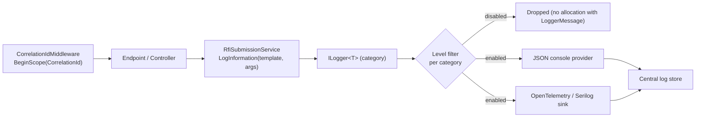
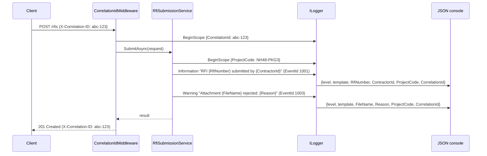

A log is the story your application tells about itself after the fact. When a payment fails at 2 a.m., nobody can attach a debugger. The only evidence is what the code chose to write down. This lesson is about making that evidence useful: cheap to write, easy to search, and safe to keep.

## Learning objectives

By the end of this lesson you will be able to:

1. Explain what a log entry is made of (template, properties, level, category, event id, scope) and why each part exists.
2. Write structured log messages with `ILogger<T>` that search tools can filter by field, not by text.
3. Choose the correct level (Trace to Critical) for a given event and configure per-category minimum levels.
4. Use scopes to attach a correlation id, tenant id or order id to every line written during a request.
5. Use the `[LoggerMessage]` source generator to make hot-path logging allocation-free.
6. Describe how Serilog fits in (sinks, enrichers, message templates) and when to add it.
7. State a short "never log this" list and enforce it with redaction helpers and tests.

## Prerequisites

- [Dependency injection](#/lesson/m03-dependency-injection): `ILogger<T>` arrives through the constructor.
- [Kestrel, middleware and routing](#/lesson/m03-kestrel-middleware-routing): we write a small middleware.
- [Configuration](#/lesson/m03-configuration): log levels are set in `appsettings.json`.

## Explain it like I'm a beginner

Imagine a toll plaza on the Delhi–Jaipur highway. Every lane keeps a register: time, vehicle number, lane, amount, whether the FASTag read succeeded. Nobody reads the register during the day. But when a driver complains that they were charged twice, or when the operator notices revenue dropped on Tuesday, someone opens it and looks.

A well-kept register has three qualities:

1. **Every entry has the same columns.** You can run your finger down the "lane" column and find all entries for lane 4. If each attendant wrote free sentences ("a white car came at about 3"), you could not.
2. **Each entry says how serious it is.** "FASTag read failed, charged manually" is a note. "Barrier stuck open, vehicles passing free" is an alarm that someone must act on now.
3. **It does not record what it must not.** The register does not copy down the driver's bank card number. If the register is stolen, nobody's money is at risk.

Application logging is exactly this register. The columns are **structured properties**, the seriousness is the **log level**, and the third rule is **data hygiene (PII and secret redaction)**. A line like `"Payment 8af3 for order 1022 failed: insufficient balance"` is a sentence. A line with properties `{PaymentId: "8af3", OrderId: 1022, Reason: "InsufficientBalance"}` is a row you can query: "show me every `InsufficientBalance` in the last hour, grouped by merchant".

## First-principles explanation

### What a log entry really is

In .NET a single call such as

```csharp
logger.LogWarning(PaymentEvents.Declined, "Payment {PaymentId} for order {OrderId} declined: {Reason}", paymentId, orderId, reason);
```

produces an entry with these parts:

| Part | Here | Why it exists |
|---|---|---|
| **Category** | `Shop.Payments.PaymentService` (from `ILogger<PaymentService>`) | Lets you turn one class or namespace up or down without touching the others |
| **Level** | Warning | Filtering and alerting. Errors page someone; Information does not |
| **Event id** | `PaymentEvents.Declined` (say, 2003) | A stable number for "this kind of thing happened", independent of message wording |
| **Message template** | `Payment {PaymentId} for order {OrderId} declined: {Reason}` | Human-readable, but also a key: every declined payment shares the same template |
| **Properties** | `PaymentId=8af3, OrderId=1022, Reason=InsufficientBalance` | Named values a search tool can index |
| **Scope properties** | `CorrelationId`, `TenantId` (set earlier by middleware) | Context that applies to *every* line in the request, so you do not repeat it |
| **Exception** | optional | Stack trace, kept separate from the message |
| **Timestamp** | added by the provider | Ordering and latency analysis |

The key insight is that the template and the values travel **separately** to the logging provider. The console provider might render them as one string. A JSON provider or Serilog sends them as separate JSON fields. This is why you write `{OrderId}` as a placeholder and **never** use string interpolation (`$"... {orderId} ..."`) in a log call: interpolation bakes the value into the text before the logger sees it, and the "column" is lost.

### Levels, and how to pick one

| Level | Use for | Typical production setting |
|---|---|---|
| Trace | Variable dumps, per-iteration detail | Off |
| Debug | Branch decisions, cache hits/misses | Off (on when investigating) |
| Information | Business events: order placed, payment captured, job finished | On |
| Warning | Something unexpected but handled: retry succeeded, fallback used, 4xx responses | On |
| Error | An operation failed and someone may need to act: 5xx, failed job | On, alerted |
| Critical | The process cannot continue: cannot bind port, cannot reach the database on start | On, paged |

A practical test: **who reads it, and when?** Debug is for the developer with the problem open now. Information is for a support engineer a week later. Warning and above are for whoever is on call tonight. If a message would wake someone up needlessly, it is not an Error.

Levels are also a cost control. A service handling 500 requests per second that writes 20 Debug lines per request would produce 10,000 lines per second, roughly 864 million lines a day. Nobody reads that, and you pay to store it. With Debug off, the same service might write 2–3 Information lines per request: a hundredfold reduction.

### Scopes: context without repetition

A scope is a dictionary of properties that is attached to every log entry written while the scope is open. You open it with `logger.BeginScope(...)` and close it by disposing the return value. Scopes stack: a request-level scope (`CorrelationId`) and an inner scope (`OrderId`) both apply to the lines inside.

```csharp
using (logger.BeginScope(new Dictionary<string, object> { ["OrderId"] = order.Id }))
{
    logger.LogInformation("Reserving stock");          // carries OrderId
    logger.LogInformation("Charging {Amount}", total);  // carries OrderId and Amount
}
```

Scopes use `AsyncLocal<T>` under the hood, so they follow an `await` across threads. Providers must opt in (`IncludeScopes = true` for the console/JSON console providers). Without that flag, scopes are silently ignored, which is a common "my correlation id never shows up" bug.

### Performance: what logging costs

Each `LogInformation("... {A} {B}", a, b)` call allocates an `object[]` for the arguments and boxes value types, even if the level is disabled. On a hot path that is measurable. Two tools fix it:

- **`logger.IsEnabled(LogLevel.Debug)`** before building anything expensive.
- **The `[LoggerMessage]` source generator** (.NET 6+): you declare a `static partial void` method with the template and parameters, and the compiler generates a strongly typed method that checks `IsEnabled`, avoids boxing, and caches the template. This is the recommended style for libraries and busy services.

### Where logs go: providers, and Serilog

`Microsoft.Extensions.Logging` is the **API** (what you call). **Providers** are the destinations: Console, JSON console, Debug, EventLog, Application Insights, OpenTelemetry. You can plug in several at once.

**Serilog** is a popular third-party logging library that plugs in as a provider (`UseSerilog()`) and brings:

- **Sinks**: destinations such as rolling files, Seq, Elasticsearch, Azure Monitor, Grafana Loki.
- **Enrichers**: add machine name, thread id, environment or anything from the request to every event.
- **Message templates** with the same `{Property}` syntax, plus `{@Order}` to serialise an object as structured data instead of calling `ToString()`.
- **Filtering and sub-loggers**: route audit events to one file and everything else to another.

Your application code does not change: you still inject `ILogger<T>`. Serilog replaces the plumbing, not the API. Choose it (or the OpenTelemetry exporter) when you need rich sinks and enrichment; the built-in JSON console provider is enough when a container platform already ships stdout to a central store.

### What never goes in a log

This list is short and non-negotiable:

- **Secrets**: passwords, API keys, connection strings, JWTs, session cookies, OTPs.
- **Payment data**: full card numbers (PCI DSS allows at most the first 6 and last 4 digits), CVV ever, full bank account numbers.
- **Government identifiers**: Aadhaar, PAN, passport numbers, in full.
- **Health or biometric data.**
- **Full request and response bodies** by default: they contain all of the above. ASP.NET Core's HTTP logging middleware exists for this, and it has field-by-field controls for exactly this reason.

The reason is simple: logs are copied to many places (developer laptops, search clusters, backups, third-party tools) with weaker access control than your database. A log store is the easiest place for an attacker to find a credential. The Data Protection and Digital Personal Data Protection frameworks in various countries treat logs as personal data stores too.

Instead, log **identifiers** (order id, customer id, masked phone like `+91******7843`) and **categories** (`Reason: InsufficientBalance`) that let you find the record in the system of record, where access is audited.

### Trade-offs

| You gain | You pay |
|---|---|
| Searchable, filterable evidence | Discipline: templates, not interpolation; consistent property names |
| Per-category control without redeploy | Noise if levels are wrong; cost if Debug leaks into production |
| Correlation across services with scopes | Providers must be configured to include scopes |
| Safe logs through redaction | Some debugging becomes harder: you see ids, not raw data |

## Visual explanation

### Where a log line comes from



Reading left to right: middleware opens a scope so the correlation id is attached to everything downstream. The service writes a template plus arguments. The logger looks up the category's minimum level; if the entry is below it, it is dropped before any string is built. Otherwise every registered provider gets the same structured entry and renders it its own way.

### A request with scopes



Both log lines carry `CorrelationId` and `ProjectCode` without the service repeating them. The client receives the correlation id back in a header, so a support ticket can quote it and an engineer can pull every line for that request in one query.

## Step-by-step example

We will build logging for an RFI (Request for Inspection) submission service used on a highway construction project. A contractor submits an RFI with attachments; the service validates it, stores it and notifies the engineer.

### Step 1 — the version everyone writes first

```csharp
Console.WriteLine($"RFI {rfi.Number} submitted by {rfi.ContractorEmail} with {rfi.Attachments.Count} files at {DateTime.Now}");
```

Problems: it goes to stdout with no level, no category, no way to turn it off; the email is personal data; `DateTime.Now` is local time on whichever server ran it; and the text cannot be filtered by contractor.

### Step 2 — ILogger with a template

```csharp
logger.LogInformation("RFI {RfiNumber} submitted by {ContractorId} with {AttachmentCount} attachments",
    rfi.Number, rfi.ContractorId, rfi.Attachments.Count);
```

Now there is a level, a category (`RfiSubmissionService`), named properties, and an id instead of an email. The provider adds the timestamp in UTC.

### Step 3 — a scope for the request

A middleware reads `X-Correlation-ID` (or creates one), opens a scope, and echoes the header back. Every line in the request carries the id, including lines from framework code such as EF Core or `HttpClient`.

### Step 4 — generated log methods

Replace the `LogInformation` call with a `[LoggerMessage]`-generated method. The call site becomes `Log.RfiSubmitted(logger, rfi.Number, rfi.ContractorId, count)`, the template lives in one place, and nothing is allocated when Information is disabled.

### Step 5 — redaction and tests

Add a `Redactor` with `MaskPhone`, `MaskEmail` and `MaskCard`. Add a unit test that uses a capturing fake logger and asserts that no log entry contains an `@` or a 16-digit run. The full code follows.

## Production-style C# implementation

Project layout:

```text
Rfi.Api/
  Program.cs
  Logging/CorrelationIdMiddleware.cs
  Logging/Redactor.cs
  Logging/RfiLog.cs
  Rfi/RfiModels.cs
  Rfi/RfiSubmissionService.cs
Rfi.Tests/
  RfiSubmissionServiceTests.cs
```

```csharp file=Rfi/RfiModels.cs
namespace Rfi.Api.Rfi;

public sealed record Attachment(string FileName, long SizeBytes);

public sealed record RfiRequest(
    string ProjectCode,
    string ContractorId,
    string ContractorPhone,
    string Chainage,
    IReadOnlyList<Attachment> Attachments);

public sealed record RfiResult(string RfiNumber, int AcceptedAttachments, IReadOnlyList<string> RejectedAttachments);

public interface IRfiStore
{
    Task<string> SaveAsync(RfiRequest request, IReadOnlyList<Attachment> accepted, CancellationToken ct);
}

public sealed class InMemoryRfiStore : IRfiStore
{
    private int _seq;
    public Task<string> SaveAsync(RfiRequest request, IReadOnlyList<Attachment> accepted, CancellationToken ct)
    {
        var n = Interlocked.Increment(ref _seq);
        return Task.FromResult($"{request.ProjectCode}-RFI-{n:D4}");
    }
}
```

```csharp file=Logging/Redactor.cs
using System.Text.RegularExpressions;

namespace Rfi.Api.Logging;

/// <summary>Helpers that turn personal data into log-safe identifiers.
/// Rule: a log line should let you FIND the record, not READ it.</summary>
public static partial class Redactor
{
    [GeneratedRegex(@"\d")]
    private static partial Regex Digit();

    /// <summary>+91 98765 43210 -> +91******3210. Keeps country code and last 4 digits.</summary>
    public static string MaskPhone(string? phone)
    {
        if (string.IsNullOrWhiteSpace(phone)) return "(none)";
        var digits = Digit().Matches(phone).Select(m => m.Value[0]).ToArray();
        if (digits.Length < 4) return "****";
        var last4 = new string(digits[^4..]);
        var prefix = phone.TrimStart().StartsWith('+') && digits.Length > 10 ? "+" + new string(digits[..(digits.Length - 10)]) : "";
        return $"{prefix}******{last4}";
    }

    /// <summary>ajit.kumar@example.com -> a***@example.com. Domain stays visible for support.</summary>
    public static string MaskEmail(string? email)
    {
        if (string.IsNullOrWhiteSpace(email) || !email.Contains('@')) return "(invalid)";
        var at = email.IndexOf('@');
        return $"{email[0]}***{email[at..]}";
    }

    /// <summary>Card numbers: PCI DSS allows at most first 6 + last 4. We show only the last 4.</summary>
    public static string MaskCard(string? pan)
    {
        if (string.IsNullOrWhiteSpace(pan)) return "(none)";
        var digits = Digit().Matches(pan).Select(m => m.Value[0]).ToArray();
        return digits.Length < 12 ? "****" : $"**** **** **** {new string(digits[^4..])}";
    }
}
```

```csharp file=Logging/RfiLog.cs
using Microsoft.Extensions.Logging;

namespace Rfi.Api.Logging;

/// <summary>Compile-time generated log methods. One place owns every template and event id,
/// and calls are allocation-free when the level is disabled.</summary>
public static partial class RfiLog
{
    public static class Events
    {
        public const int Submitted = 1001;
        public const int Validating = 1002;
        public const int AttachmentRejected = 1003;
        public const int StoreFailed = 1004;
    }

    [LoggerMessage(EventId = Events.Validating, Level = LogLevel.Debug,
        Message = "Validating RFI for {ProjectCode} at chainage {Chainage} with {AttachmentCount} attachments")]
    public static partial void Validating(ILogger logger, string projectCode, string chainage, int attachmentCount);

    [LoggerMessage(EventId = Events.AttachmentRejected, Level = LogLevel.Warning,
        Message = "Attachment {FileName} rejected: {Reason}")]
    public static partial void AttachmentRejected(ILogger logger, string fileName, string reason);

    [LoggerMessage(EventId = Events.Submitted, Level = LogLevel.Information,
        Message = "RFI {RfiNumber} submitted by {ContractorId} ({ContractorPhone}) with {AcceptedCount} attachments in {ElapsedMs} ms")]
    public static partial void Submitted(ILogger logger, string rfiNumber, string contractorId, string contractorPhone, int acceptedCount, long elapsedMs);

    [LoggerMessage(EventId = Events.StoreFailed, Level = LogLevel.Error,
        Message = "Failed to store RFI for {ProjectCode} from {ContractorId}")]
    public static partial void StoreFailed(ILogger logger, Exception ex, string projectCode, string contractorId);
}
```

```csharp file=Rfi/RfiSubmissionService.cs
using System.Diagnostics;
using Microsoft.Extensions.Logging;
using Rfi.Api.Logging;

namespace Rfi.Api.Rfi;

public sealed class RfiSubmissionService(IRfiStore store, ILogger<RfiSubmissionService> logger, TimeProvider clock)
{
    private const long MaxAttachmentBytes = 25L * 1024 * 1024;   // 25 MB
    private static readonly HashSet<string> AllowedExtensions = new(StringComparer.OrdinalIgnoreCase) { ".pdf", ".jpg", ".jpeg", ".png", ".dwg" };

    public async Task<RfiResult> SubmitAsync(RfiRequest request, CancellationToken ct)
    {
        ArgumentNullException.ThrowIfNull(request);

        // Everything logged inside this block carries ProjectCode and ContractorId automatically.
        using var scope = logger.BeginScope(new Dictionary<string, object>
        {
            ["ProjectCode"] = request.ProjectCode,
            ["ContractorId"] = request.ContractorId,
        });

        var started = clock.GetTimestamp();
        RfiLog.Validating(logger, request.ProjectCode, request.Chainage, request.Attachments.Count);

        var accepted = new List<Attachment>();
        var rejected = new List<string>();
        foreach (var a in request.Attachments)
        {
            var reason = Validate(a);
            if (reason is null) accepted.Add(a);
            else
            {
                rejected.Add(a.FileName);
                RfiLog.AttachmentRejected(logger, a.FileName, reason);
            }
        }

        string number;
        try
        {
            number = await store.SaveAsync(request, accepted, ct);
        }
        catch (Exception ex) when (ex is not OperationCanceledException)
        {
            // Log once, at the level that matches the impact, with the exception object (not ex.Message).
            RfiLog.StoreFailed(logger, ex, request.ProjectCode, request.ContractorId);
            throw;
        }

        var elapsedMs = (long)clock.GetElapsedTime(started).TotalMilliseconds;
        RfiLog.Submitted(logger, number, request.ContractorId, Redactor.MaskPhone(request.ContractorPhone), accepted.Count, elapsedMs);
        return new RfiResult(number, accepted.Count, rejected);
    }

    private static string? Validate(Attachment a)
    {
        if (a.SizeBytes > MaxAttachmentBytes) return "TooLarge";
        if (!AllowedExtensions.Contains(Path.GetExtension(a.FileName))) return "UnsupportedType";
        return null;
    }
}
```

```csharp file=Logging/CorrelationIdMiddleware.cs
using Microsoft.AspNetCore.Http;
using Microsoft.Extensions.Logging;

namespace Rfi.Api.Logging;

/// <summary>Reads X-Correlation-ID or creates one, puts it in a log scope for the whole request,
/// and echoes it in the response so support tickets can quote it.</summary>
public sealed class CorrelationIdMiddleware(RequestDelegate next, ILogger<CorrelationIdMiddleware> logger)
{
    public const string HeaderName = "X-Correlation-ID";

    public async Task InvokeAsync(HttpContext context)
    {
        var incoming = context.Request.Headers[HeaderName].FirstOrDefault();
        // Never trust an arbitrarily long header value into your logs: cap and sanitise.
        var correlationId = !string.IsNullOrWhiteSpace(incoming) && incoming.Length <= 64 && incoming.All(c => char.IsLetterOrDigit(c) || IsSeparator(c))
            ? incoming
            : Guid.NewGuid().ToString("N");

        context.Response.Headers[HeaderName] = correlationId;
        context.TraceIdentifier = correlationId;

        using (logger.BeginScope(new Dictionary<string, object> { ["CorrelationId"] = correlationId }))
        {
            await next(context);
        }
    }

    private static bool IsSeparator(char c) => c is '-' or '_' or '.';
}

public static class CorrelationIdMiddlewareExtensions
{
    public static IApplicationBuilder UseCorrelationId(this IApplicationBuilder app) => app.UseMiddleware<CorrelationIdMiddleware>();
}
```

```csharp file=Program.cs
using Rfi.Api.Logging;
using Rfi.Api.Rfi;

var builder = WebApplication.CreateBuilder(args);

// Providers: structured JSON to stdout (a container platform ships it onward), scopes included.
builder.Logging.ClearProviders();
builder.Logging.AddJsonConsole(o =>
{
    o.IncludeScopes = true;                 // without this, CorrelationId never appears
    o.UseUtcTimestamp = true;
    o.TimestampFormat = "yyyy-MM-ddTHH:mm:ss.fffZ";
});

builder.Services.AddSingleton(TimeProvider.System);
builder.Services.AddSingleton<IRfiStore, InMemoryRfiStore>();
builder.Services.AddSingleton<RfiSubmissionService>();

var app = builder.Build();

app.UseCorrelationId();

app.MapPost("/rfis", async (RfiRequest request, RfiSubmissionService service, CancellationToken ct) =>
{
    var result = await service.SubmitAsync(request, ct);
    return Results.Created($"/rfis/{result.RfiNumber}", result);
});

app.Run();
```

And the matching `appsettings.json`, where the level per category lives. `Default` applies to everything; more specific prefixes win:

```json
{
  "Logging": {
    "LogLevel": {
      "Default": "Information",
      "Microsoft.AspNetCore": "Warning",
      "Microsoft.AspNetCore.Hosting.Diagnostics": "Information",
      "Rfi.Api.Rfi": "Debug"
    }
  }
}
```

Why these choices:

- `ClearProviders()` then one JSON provider keeps every line machine-readable. Mixed plain-text and JSON output breaks downstream parsers.
- Framework noise (`Microsoft.AspNetCore` at Warning) hides per-request chatter but `Hosting.Diagnostics` at Information still gives one "request finished in N ms with status S" line per request.
- The service category runs at Debug in this file; in `appsettings.Production.json` you would set it to Information. Changing a level is a configuration change, not a deployment.
- The middleware caps and sanitises the incoming header. Logs are a classic injection target: a header containing newlines can forge fake log entries in plain-text sinks.

### Serilog, for comparison

The same application with Serilog (snippet only; the package is not available in the checker):

```csharp
// dotnet add package Serilog.AspNetCore
builder.Host.UseSerilog((ctx, services, cfg) => cfg
    .ReadFrom.Configuration(ctx.Configuration)
    .Enrich.FromLogContext()
    .Enrich.WithMachineName()
    .WriteTo.Console(new Serilog.Formatting.Compact.CompactJsonFormatter())
    .WriteTo.File("logs/rfi-.json", rollingInterval: RollingInterval.Day, retainedFileCountLimit: 14));

app.UseSerilogRequestLogging();   // one summary line per request, replaces the noisy framework lines
```

`RfiSubmissionService` is untouched: it still takes `ILogger<RfiSubmissionService>`. That is the whole point of logging to an abstraction.

## Bad design vs good design

**Bad**

```csharp
catch (Exception ex)
{
    _logger.LogError("Error: " + ex.Message);                       // loses the stack trace and type
    _logger.LogInformation($"User {user.Email} failed with card {card.Number}");  // PII + PCI data, interpolated
    _logger.LogError("Retrying");                                   // not an error; a retry is a warning at most
    throw new Exception(ex.Message);                                // and re-wraps, destroying the original
}
```

Problems, one per line:

1. `ex.Message` alone throws away the exception type, inner exceptions and stack trace. Pass the exception object as the first argument.
2. Interpolation destroys structure; the email and card number should never be logged at all.
3. A retry that succeeds is not an error. Wrong levels train the on-call engineer to ignore Error, which is the worst possible outcome.
4. Logging *and* rethrowing with a new exception means the same failure is logged again upstream, often three or four times. Log at the boundary that handles it (see [Filters, middleware and exception handling](#/lesson/m03-filters-exceptions)), and use `throw;` to preserve the stack.

**Good**

```csharp
catch (PaymentGatewayException ex) when (ex.IsTransient)
{
    PaymentLog.GatewayRetry(logger, ex, attempt, paymentId);   // Warning, structured, exception attached
    throw;
}
```

One line, correct level, structured properties, exception preserved, no personal data.

:::callout type=warning title="Interpolation is the most common logging bug"
`logger.LogInformation($"Order {id} placed")` compiles and even looks fine in the console. But the provider receives the template `"Order 1022 placed"` with no properties. Every order produces a *different* template, so you cannot group, count or filter by order id. Analyzer rule CA2254 flags this; keep it enabled.
:::

:::callout type=tradeoff title="When simple is enough"
A small internal tool run by three people does not need Serilog, Seq and a dashboard. The built-in console provider at Information with `IncludeScopes = true` and a correlation-id middleware covers 90 % of debugging needs. Add a central store when more than one instance runs, or when you need to search across days.
:::

## Practical playground

The playground wires a real `ILoggerFactory` with the console provider, includes scopes, and shows the difference between an interpolated message and a templated one. Change the minimum level to `Debug` and run again to see the filtered lines appear.

:::playground type=csharp title="Structured logging with scopes"
```csharp file=Program.cs
using System;
using System.Collections.Generic;
using Microsoft.Extensions.Logging;

public static class Program
{
    public static void Main()
    {
        using var factory = LoggerFactory.Create(b => b
            .SetMinimumLevel(LogLevel.Information)      // try LogLevel.Debug
            .AddSimpleConsole(o => { o.IncludeScopes = true; o.SingleLine = true; }));

        var logger = factory.CreateLogger("Shop.Checkout");

        using (logger.BeginScope(new Dictionary<string, object> { ["CorrelationId"] = "req-7f3a" }))
        {
            var orderId = 1022;
            var total = 1499.00m;

            logger.LogDebug("Cart loaded with {LineCount} lines", 3);              // hidden at Information
            logger.LogInformation("Order {OrderId} placed for {Total:F2}", orderId, total);
            logger.LogInformation($"Order {orderId} placed (interpolated - avoid)");  // same text, no properties
            logger.LogWarning("Payment for {OrderId} needed {Attempts} attempts", orderId, 2);
        }

        Console.WriteLine("Done. Compare the two 'Order placed' lines: only the first one carried properties to the provider.");
    }
}
```
:::

## Exercises

:::exercise id=m03-logging-ex1 difficulty=beginner kind=code title="Pick the level for a finished request"
Write `RequestLogLevelPolicy.For(statusCode, elapsedMs)` that decides the level of the "request finished" line.
::requirements
- 5xx responses are `Error`.
- 4xx responses are `Warning`, except 404 which is `Information` (bots probe missing URLs all day).
- Any response slower than 2,000 ms is at least `Warning`, even if it succeeded.
- Everything else is `Information`.
::acceptance
- `For(500, 10)` is Error; `For(404, 10)` is Information; `For(422, 10)` is Warning.
- `For(200, 2500)` is Warning; `For(200, 150)` is Information.
- `For(503, 3000)` is Error (never downgrade a 5xx).
::hint
Decide the level from the status code first, then raise it for slowness. Never lower it.
::hint
A `switch` expression on ranges reads well: `>= 500 => LogLevel.Error, 404 => ..., >= 400 => ...`.
::hint
"At least Warning" means: `if (elapsedMs > 2000 && level < LogLevel.Warning) level = LogLevel.Warning;`. `LogLevel` is an enum with Trace=0 … Critical=5, so comparison works.
::hint
```csharp
var level = statusCode switch { >= 500 => LogLevel.Error, 404 => LogLevel.Information, >= 400 => LogLevel.Warning, _ => LogLevel.Information };
```
::starter
```csharp file=RequestLogLevelPolicy.cs
using System;
using Microsoft.Extensions.Logging;

public static class RequestLogLevelPolicy
{
    public const int SlowThresholdMs = 2000;

    public static LogLevel For(int statusCode, long elapsedMs)
    {
        throw new NotImplementedException();
    }
}
```
::tests
```csharp file=RequestLogLevelPolicyTests.cs
using Microsoft.Extensions.Logging;
using Xunit;

public class RequestLogLevelPolicyTests
{
    [Theory]
    [InlineData(500, 10, LogLevel.Error)]
    [InlineData(503, 3000, LogLevel.Error)]
    [InlineData(404, 10, LogLevel.Information)]
    [InlineData(422, 10, LogLevel.Warning)]
    [InlineData(401, 10, LogLevel.Warning)]
    [InlineData(200, 150, LogLevel.Information)]
    [InlineData(200, 2500, LogLevel.Warning)]
    [InlineData(404, 2500, LogLevel.Warning)]
    [InlineData(201, 2000, LogLevel.Information)]
    public void Picks_expected_level(int status, long elapsed, LogLevel expected) =>
        Assert.Equal(expected, RequestLogLevelPolicy.For(status, elapsed));
}
```
::solution
Compute from the status code, then apply the slowness floor.

```csharp file=RequestLogLevelPolicy.cs
using System;
using Microsoft.Extensions.Logging;

public static class RequestLogLevelPolicy
{
    public const int SlowThresholdMs = 2000;

    public static LogLevel For(int statusCode, long elapsedMs)
    {
        var level = statusCode switch
        {
            >= 500 => LogLevel.Error,
            404 => LogLevel.Information,
            >= 400 => LogLevel.Warning,
            _ => LogLevel.Information,
        };
        if (elapsedMs > SlowThresholdMs && level < LogLevel.Warning) level = LogLevel.Warning;
        return level;
    }
}
```

Why 404 is Information: on a public API, most 404s are scanners. If they were Warnings they would drown the real ones.
::mistakes
- Treating 2,000 ms exactly as slow (the requirement says "slower than").
- Downgrading a 5xx to Warning because it was fast.
- Forgetting that 404 is still a 4xx and must be handled before the `>= 400` arm.
:::

:::exercise id=m03-logging-ex2 difficulty=beginner kind=code title="Mask a PAN card number"
Implement `Redaction.MaskPan(pan)` for Indian PAN numbers (format `ABCDE1234F`: 5 letters, 4 digits, 1 letter). Show only the last 4 characters.
::acceptance
- `MaskPan("ABCDE1234F")` returns `"******234F"`.
- Input is trimmed and upper-cased before masking; `" abcde1234f "` gives the same result.
- Anything that is not exactly 10 alphanumeric characters after trimming returns `"(invalid)"`.
- Null or empty returns `"(none)"`.
::hint
Handle the two special cases (null/empty, wrong shape) first with early returns.
::hint
Use `pan.Trim().ToUpperInvariant()` then check `Length == 10` and `All(char.IsLetterOrDigit)`.
::hint
Range indexing: `clean[^4..]` gives the last four characters.
::starter
```csharp file=Redaction.cs
using System;
using System.Linq;

public static class Redaction
{
    public static string MaskPan(string? pan)
    {
        throw new NotImplementedException();
    }
}
```
::tests
```csharp file=RedactionTests.cs
using Xunit;

public class RedactionTests
{
    [Fact] public void Masks_all_but_last_four() => Assert.Equal("******234F", Redaction.MaskPan("ABCDE1234F"));
    [Fact] public void Normalises_case_and_whitespace() => Assert.Equal("******234F", Redaction.MaskPan(" abcde1234f "));
    [Fact] public void Rejects_wrong_length() => Assert.Equal("(invalid)", Redaction.MaskPan("ABCDE123"));
    [Fact] public void Rejects_symbols() => Assert.Equal("(invalid)", Redaction.MaskPan("ABCDE-234F"));
    [Fact] public void Null_is_none() => Assert.Equal("(none)", Redaction.MaskPan(null));
    [Fact] public void Empty_is_none() => Assert.Equal("(none)", Redaction.MaskPan("   "));
}
```
::solution
```csharp file=Redaction.cs
using System;
using System.Linq;

public static class Redaction
{
    public static string MaskPan(string? pan)
    {
        if (string.IsNullOrWhiteSpace(pan)) return "(none)";
        var clean = pan.Trim().ToUpperInvariant();
        if (clean.Length != 10 || !clean.All(char.IsLetterOrDigit)) return "(invalid)";
        return $"******{clean[^4..]}";
    }
}
```

The masked value still lets a support engineer confirm "yes, that is the PAN ending 234F" against the system of record, without the log store becoming a copy of the identity database.
::mistakes
- Returning `"(invalid)"` for whitespace-only input instead of `"(none)"`.
- Masking before trimming, so `" ABCDE1234F"` is rejected.
:::

:::exercise id=m03-logging-ex3 difficulty=intermediate kind=code title="Timed operation with a threshold"
Implement `OperationTimer.RunAsync` which runs a `Func<Task<T>>`, measures it, and logs one line: `Information` when it finished under the threshold, `Warning` when it was slow, `Error` (with the exception) when it threw. The starter includes a `CapturingLogger` fake that records every entry.
::requirements
- The message template is `"{Operation} finished in {ElapsedMs} ms"` for success and `"{Operation} failed after {ElapsedMs} ms"` on exception.
- Use the injected `TimeProvider` for timing (`GetTimestamp` / `GetElapsedTime`) so tests can control the clock.
- Exceptions are rethrown after logging; the timer must not swallow them.
::acceptance
- A fast operation logs exactly one Information entry whose `Operation` property equals the name passed in.
- An operation that took longer than the threshold logs Warning.
- A throwing operation logs Error with the exception attached, and the exception propagates to the caller.
::hint
Record `clock.GetTimestamp()` before, run the work in a `try`, compute `clock.GetElapsedTime(start)` in both the success path and the `catch`.
::hint
`logger.Log(level, eventId, exception, template, args)` lets you pick the level at runtime with one call instead of three `if` branches.
::hint
The fake's `Entries` expose `Level`, `Exception` and `Properties` (parsed from the state's key/value pairs). Your template placeholders must be named exactly `Operation` and `ElapsedMs`.
::hint
```csharp
var start = clock.GetTimestamp();
try { var result = await work(); Log(LogLevel.Information or Warning, null, "...finished...", name, ms); return result; }
catch (Exception ex) { Log(LogLevel.Error, ex, "...failed...", name, ms); throw; }
```
::starter
```csharp file=OperationTimer.cs
using System;
using System.Collections.Generic;
using System.Linq;
using System.Threading.Tasks;
using Microsoft.Extensions.Logging;

public sealed class OperationTimer(ILogger logger, TimeProvider clock, TimeSpan slowThreshold)
{
    public async Task<T> RunAsync<T>(string operation, Func<Task<T>> work)
    {
        throw new NotImplementedException();
    }
}

/// <summary>Test double: records every log call with its parsed properties.</summary>
public sealed class CapturingLogger : ILogger
{
    public sealed record Entry(LogLevel Level, EventId EventId, string Message, Exception? Exception, IReadOnlyDictionary<string, object?> Properties);
    public List<Entry> Entries { get; } = new();

    public IDisposable? BeginScope<TState>(TState state) where TState : notnull => null;
    public bool IsEnabled(LogLevel logLevel) => true;

    public void Log<TState>(LogLevel logLevel, EventId eventId, TState state, Exception? exception, Func<TState, Exception?, string> formatter)
    {
        var props = new Dictionary<string, object?>();
        if (state is IEnumerable<KeyValuePair<string, object?>> pairs)
            foreach (var p in pairs) props[p.Key] = p.Value;
        Entries.Add(new Entry(logLevel, eventId, formatter(state, exception), exception, props));
    }
}

/// <summary>Test double: a clock you move by hand.</summary>
public sealed class ManualClock : TimeProvider
{
    private long _ticks = 1_000_000;
    public override long GetTimestamp() => _ticks;
    public override long TimestampFrequency => TimeSpan.TicksPerSecond;
    public void Advance(TimeSpan by) => _ticks += by.Ticks;
}
```
::tests
```csharp file=OperationTimerTests.cs
using System;
using System.Threading.Tasks;
using Microsoft.Extensions.Logging;
using Xunit;

public class OperationTimerTests
{
    private readonly CapturingLogger _log = new();
    private readonly ManualClock _clock = new();

    private OperationTimer Timer() => new(_log, _clock, TimeSpan.FromMilliseconds(500));

    [Fact]
    public async Task Fast_operation_logs_information()
    {
        var result = await Timer().RunAsync("LoadInvoice", () => { _clock.Advance(TimeSpan.FromMilliseconds(120)); return Task.FromResult(42); });
        Assert.Equal(42, result);
        var e = Assert.Single(_log.Entries);
        Assert.Equal(LogLevel.Information, e.Level);
        Assert.Equal("LoadInvoice", e.Properties["Operation"]);
        Assert.Equal(120L, Convert.ToInt64(e.Properties["ElapsedMs"]));
        Assert.Contains("finished", e.Message);
    }

    [Fact]
    public async Task Slow_operation_logs_warning()
    {
        await Timer().RunAsync("LoadInvoice", () => { _clock.Advance(TimeSpan.FromMilliseconds(900)); return Task.FromResult(1); });
        var e = Assert.Single(_log.Entries);
        Assert.Equal(LogLevel.Warning, e.Level);
    }

    [Fact]
    public async Task Failure_logs_error_with_exception_and_rethrows()
    {
        var ex = await Assert.ThrowsAsync<InvalidOperationException>(() =>
            Timer().RunAsync<int>("LoadInvoice", () => { _clock.Advance(TimeSpan.FromMilliseconds(10)); throw new InvalidOperationException("boom"); }));
        Assert.Equal("boom", ex.Message);
        var e = Assert.Single(_log.Entries);
        Assert.Equal(LogLevel.Error, e.Level);
        Assert.Same(ex, e.Exception);
        Assert.Contains("failed", e.Message);
    }
}
```
::solution
```csharp file=OperationTimer.cs
using System;
using System.Collections.Generic;
using System.Linq;
using System.Threading.Tasks;
using Microsoft.Extensions.Logging;

public sealed class OperationTimer(ILogger logger, TimeProvider clock, TimeSpan slowThreshold)
{
    private static readonly EventId Finished = new(2001, "OperationFinished");
    private static readonly EventId Failed = new(2002, "OperationFailed");

    public async Task<T> RunAsync<T>(string operation, Func<Task<T>> work)
    {
        var start = clock.GetTimestamp();
        try
        {
            var result = await work();
            var elapsed = clock.GetElapsedTime(start);
            var level = elapsed > slowThreshold ? LogLevel.Warning : LogLevel.Information;
            logger.Log(level, Finished, "{Operation} finished in {ElapsedMs} ms", operation, (long)elapsed.TotalMilliseconds);
            return result;
        }
        catch (Exception ex)
        {
            var elapsed = clock.GetElapsedTime(start);
            logger.Log(LogLevel.Error, Failed, ex, "{Operation} failed after {ElapsedMs} ms", operation, (long)elapsed.TotalMilliseconds);
            throw;
        }
    }
}

public sealed class CapturingLogger : ILogger
{
    public sealed record Entry(LogLevel Level, EventId EventId, string Message, Exception? Exception, IReadOnlyDictionary<string, object?> Properties);
    public List<Entry> Entries { get; } = new();

    public IDisposable? BeginScope<TState>(TState state) where TState : notnull => null;
    public bool IsEnabled(LogLevel logLevel) => true;

    public void Log<TState>(LogLevel logLevel, EventId eventId, TState state, Exception? exception, Func<TState, Exception?, string> formatter)
    {
        var props = new Dictionary<string, object?>();
        if (state is IEnumerable<KeyValuePair<string, object?>> pairs)
            foreach (var p in pairs) props[p.Key] = p.Value;
        Entries.Add(new Entry(logLevel, eventId, formatter(state, exception), exception, props));
    }
}

public sealed class ManualClock : TimeProvider
{
    private long _ticks = 1_000_000;
    public override long GetTimestamp() => _ticks;
    public override long TimestampFrequency => TimeSpan.TicksPerSecond;
    public void Advance(TimeSpan by) => _ticks += by.Ticks;
}
```

The important detail is `throw;` with no argument: it rethrows the same exception object with its stack trace intact. `throw ex;` would reset the stack to this line. Also note we pass the exception object to the logger, not `ex.Message`.
::alternatives
In production you would generate these two methods with `[LoggerMessage]`. The dynamic-level version shown here exists because the level is only known at runtime; the generator supports that too by omitting `Level` in the attribute and taking a `LogLevel` parameter.
::mistakes
- Using `Stopwatch.StartNew()` instead of the injected clock, which makes the slow-path test flaky or impossible.
- Catching the exception, logging, and returning `default` — the caller then has no idea anything failed.
- Naming the placeholder `{Name}` while the tests (and dashboards) expect `{Operation}`. Property names are part of your contract with whoever queries the logs.
:::

:::exercise id=m03-logging-ex4 difficulty=intermediate kind=written title="Write the logging policy for a UPI collection service"
A service initiates UPI collect requests for electricity bills: it receives a bill id and the customer's UPI id (VPA, like `name@bank`), calls the payment gateway, and records the result. Write a one-page logging policy for it.
::requirements
Cover: which events are logged and at what level; the exact property names (so dashboards stay stable); what is redacted and how; which scopes exist; retention; and what triggers an alert.
::acceptance
- At least 6 named events with level and event id range.
- The VPA and the customer's phone are never logged in full; the policy says how they are masked.
- Scopes include a correlation id that is propagated to the gateway call.
- An explicit statement of what is *not* logged (request bodies, gateway credentials, OTPs).
- Retention and alerting rules with numbers (days, thresholds).
::hint
Walk the request lifecycle: received, validated, gateway called, gateway responded, recorded, notified. Each step is a candidate event.
::hint
For each event ask: who will read this and when? That gives the level.
::hint
The gateway returns a reason code. Log the code, not the human text (text changes; codes are stable and groupable).
::hint
Retention: operational logs 14–30 days; audit events (money moved) much longer, in a separate, access-controlled store, often required by regulators.
::solution
A model answer in outline:

**Scopes**: `CorrelationId` (from middleware, forwarded as a header to the gateway), `BillId`, `MerchantId`.

**Events** (range 3000–3099):

| Id | Event | Level | Properties |
|---|---|---|---|
| 3001 | CollectRequested | Information | BillId, AmountPaise, MaskedVpa |
| 3002 | ValidationFailed | Warning | BillId, Reason |
| 3003 | GatewayCalled | Debug | BillId, GatewayRequestId |
| 3004 | GatewayResponded | Information | BillId, GatewayRequestId, StatusCode, ReasonCode, LatencyMs |
| 3005 | GatewayTimeout | Warning | BillId, GatewayRequestId, TimeoutMs, Attempt |
| 3006 | CollectFailed | Error | BillId, ReasonCode (exception attached) |
| 3007 | CollectRecorded | Information | BillId, TransactionId, AmountPaise |
| 3008 | DuplicateCollect | Warning | BillId, ExistingTransactionId |

**Redaction**: VPA as `n***@bank` (first character plus domain); phone as `+91******7843`; gateway API key never logged, including in exception messages (wrap the client so the key is not part of the URL).

**Not logged**: raw request or response bodies; gateway credentials; OTPs; full names.

**Retention**: operational logs 30 days in the central store; 3007 (money recorded) also written to an audit table kept 7 years, with access logged.

**Alerts**: 3006 rate > 2 % of 3001 over 5 minutes pages on-call; 3005 count > 50 in 5 minutes warns in chat; any 3001 without a matching 3004 or 3006 within 2 minutes is a stuck request and produces a daily report.
::mistakes
- Logging the full VPA "because support needs it". Support looks it up by BillId in the system of record.
- One event id for every gateway outcome. Separate ids make dashboards trivial.
- Putting the audit trail only in logs. Logs are operational and get rotated; audit needs a durable store.
:::

:::exercise id=m03-logging-ex5 difficulty=advanced kind=code title="Sampling logger decorator"
A health-check endpoint is hit 10 times a second by three load balancers. Its Information lines are useless noise but you do not want to silence the category completely. Build `SamplingLogger`, a decorator over `ILogger` that lets through only every Nth entry for a given event id at Information or below, while passing Warning and above untouched.
::requirements
- Constructor: `SamplingLogger(ILogger inner, EventId sampledEvent, int keepEvery)`.
- Entries whose `EventId.Id` matches `sampledEvent` **and** whose level is Information or lower are counted; the 1st, (N+1)th, (2N+1)th … are forwarded, the rest dropped.
- All other entries are forwarded unchanged (same level, state, exception and formatter).
- `IsEnabled` and `BeginScope` delegate to the inner logger.
- Thread-safe counting (`Interlocked`).
::acceptance
- With `keepEvery = 10`, 25 Information entries with the sampled id forward exactly 3 (numbers 1, 11, 21).
- A Warning with the sampled id is always forwarded.
- An Information entry with a different id is always forwarded.
- The forwarded entry keeps its original formatter output.
::hint
This is the Decorator pattern applied to `ILogger`: hold the inner logger, implement the three members, and add behaviour to `Log<TState>`.
::hint
The counter must be per decorator instance, incremented atomically: `var n = Interlocked.Increment(ref _count);` then forward when `(n - 1) % keepEvery == 0`.
::hint
The sampling condition is `eventId.Id == sampledEvent.Id && logLevel <= LogLevel.Information`. Everything else: `inner.Log(logLevel, eventId, state, exception, formatter)`.
::hint
```csharp
public void Log<TState>(LogLevel level, EventId id, TState state, Exception? ex, Func<TState, Exception?, string> f)
{
    if (id.Id == _sampled.Id && level <= LogLevel.Information)
    {
        var n = Interlocked.Increment(ref _count);
        if ((n - 1) % _keepEvery != 0) return;
    }
    _inner.Log(level, id, state, ex, f);
}
```
::starter
```csharp file=SamplingLogger.cs
using System;
using System.Collections.Generic;
using System.Threading;
using Microsoft.Extensions.Logging;

public sealed class SamplingLogger : ILogger
{
    public SamplingLogger(ILogger inner, EventId sampledEvent, int keepEvery)
    {
        throw new NotImplementedException();
    }

    public IDisposable? BeginScope<TState>(TState state) where TState : notnull => throw new NotImplementedException();
    public bool IsEnabled(LogLevel logLevel) => throw new NotImplementedException();
    public void Log<TState>(LogLevel logLevel, EventId eventId, TState state, Exception? exception, Func<TState, Exception?, string> formatter)
        => throw new NotImplementedException();
}

public sealed class RecordingLogger : ILogger
{
    public List<(LogLevel Level, EventId EventId, string Message)> Entries { get; } = new();
    public IDisposable? BeginScope<TState>(TState state) where TState : notnull => null;
    public bool IsEnabled(LogLevel logLevel) => logLevel >= LogLevel.Debug;
    public void Log<TState>(LogLevel logLevel, EventId eventId, TState state, Exception? exception, Func<TState, Exception?, string> formatter)
        => Entries.Add((logLevel, eventId, formatter(state, exception)));
}
```
::tests
```csharp file=SamplingLoggerTests.cs
using System.Linq;
using Microsoft.Extensions.Logging;
using Xunit;

public class SamplingLoggerTests
{
    private static readonly EventId Health = new(7001, "HealthProbe");
    private static readonly EventId Other = new(7002, "Other");

    [Fact]
    public void Keeps_every_nth_information_entry()
    {
        var inner = new RecordingLogger();
        var logger = new SamplingLogger(inner, Health, 10);
        for (var i = 1; i <= 25; i++) logger.LogInformation(Health, "probe {N}", i);
        Assert.Equal(3, inner.Entries.Count);
        Assert.Equal(new[] { "probe 1", "probe 11", "probe 21" }, inner.Entries.Select(e => e.Message).ToArray());
    }

    [Fact]
    public void Warnings_with_sampled_id_always_pass()
    {
        var inner = new RecordingLogger();
        var logger = new SamplingLogger(inner, Health, 10);
        for (var i = 0; i < 5; i++) logger.LogWarning(Health, "slow probe");
        Assert.Equal(5, inner.Entries.Count);
        Assert.All(inner.Entries, e => Assert.Equal(LogLevel.Warning, e.Level));
    }

    [Fact]
    public void Other_event_ids_are_not_sampled()
    {
        var inner = new RecordingLogger();
        var logger = new SamplingLogger(inner, Health, 10);
        for (var i = 0; i < 7; i++) logger.LogInformation(Other, "order placed");
        Assert.Equal(7, inner.Entries.Count);
    }

    [Fact]
    public void IsEnabled_delegates()
    {
        var logger = new SamplingLogger(new RecordingLogger(), Health, 10);
        Assert.False(logger.IsEnabled(LogLevel.Trace));
        Assert.True(logger.IsEnabled(LogLevel.Information));
    }
}
```
::solution
```csharp file=SamplingLogger.cs
using System;
using System.Collections.Generic;
using System.Threading;
using Microsoft.Extensions.Logging;

public sealed class SamplingLogger : ILogger
{
    private readonly ILogger _inner;
    private readonly EventId _sampled;
    private readonly int _keepEvery;
    private long _count;

    public SamplingLogger(ILogger inner, EventId sampledEvent, int keepEvery)
    {
        ArgumentNullException.ThrowIfNull(inner);
        ArgumentOutOfRangeException.ThrowIfLessThan(keepEvery, 1);
        _inner = inner;
        _sampled = sampledEvent;
        _keepEvery = keepEvery;
    }

    public IDisposable? BeginScope<TState>(TState state) where TState : notnull => _inner.BeginScope(state);
    public bool IsEnabled(LogLevel logLevel) => _inner.IsEnabled(logLevel);

    public void Log<TState>(LogLevel logLevel, EventId eventId, TState state, Exception? exception, Func<TState, Exception?, string> formatter)
    {
        if (eventId.Id == _sampled.Id && logLevel <= LogLevel.Information)
        {
            var n = Interlocked.Increment(ref _count);
            if ((n - 1) % _keepEvery != 0) return;
        }
        _inner.Log(logLevel, eventId, state, exception, formatter);
    }
}

public sealed class RecordingLogger : ILogger
{
    public List<(LogLevel Level, EventId EventId, string Message)> Entries { get; } = new();
    public IDisposable? BeginScope<TState>(TState state) where TState : notnull => null;
    public bool IsEnabled(LogLevel logLevel) => logLevel >= LogLevel.Debug;
    public void Log<TState>(LogLevel logLevel, EventId eventId, TState state, Exception? exception, Func<TState, Exception?, string> formatter)
        => Entries.Add((logLevel, eventId, formatter(state, exception)));
}
```

In a real application you would wrap this in an `ILoggerProvider` so the whole pipeline gets it, or, more simply, set the health-check category to Warning in configuration and skip the code entirely. The exercise is about understanding the `ILogger` surface: three members, and `Log<TState>` carries everything.
::alternatives
Serilog has `Filter.ByExcluding(...)` and sampling sinks; OpenTelemetry supports log sampling at the collector. Prefer configuration over code when the platform offers it.
::mistakes
- Counting *all* entries, so a Warning advances the counter and changes which Information lines survive.
- Using `_count++` without `Interlocked`; two threads can both see the same value.
- Forwarding a *rendered string* (`formatter(state, exception)`) instead of the original state, which destroys the structured properties for downstream providers.
:::

## Automated testing

Logging is testable, and worth testing in three specific places.

**1. Redaction helpers are pure functions.** Table tests, as in exercise 2. Add a property-style test: for a batch of generated phone numbers, the output never contains more than 4 consecutive original digits.

**2. "This service never logs PII."** Use a capturing logger (like `CapturingLogger` in exercise 3) and assert on what reached it:

```csharp
[Fact]
public async Task Submission_logs_never_contain_the_raw_phone()
{
    var log = new CapturingLogger();
    var svc = new RfiSubmissionService(new InMemoryRfiStore(), new TypedLogger<RfiSubmissionService>(log), TimeProvider.System);
    var request = new RfiRequest("NH48-PKG3", "CTR-17", "+91 98765 43210", "km 112+400", new[] { new Attachment("site.jpg", 2_000_000) });

    await svc.SubmitAsync(request, CancellationToken.None);

    Assert.All(log.Entries, e => Assert.DoesNotContain("98765", e.Message));
    var submitted = Assert.Single(log.Entries, e => e.EventId.Id == RfiLog.Events.Submitted);
    Assert.Equal("******3210", submitted.Properties["ContractorPhone"]?.ToString()?[^10..]);
}
```

`TypedLogger<T>` is a two-line adapter that implements `ILogger<T>` by delegating to a plain `ILogger`. `Microsoft.Extensions.Logging.Testing` also ships a `FakeLogger<T>` with a `Collector` you can query; use it in real projects instead of hand-rolling.

**3. Levels and event ids are part of the contract.** A dashboard filters on `EventId == 1003`. If someone renumbers it, the dashboard silently shows zero. A test that asserts `AttachmentRejected` produces event 1003 at Warning is cheap insurance.

What *not* to test: the exact rendered text. Wording changes; properties and ids should not.

## Real-world application

- **Correlation across services.** A payment flow touches the API, a payment service, a gateway client and a notification worker. One correlation id in a scope, forwarded as a header and as a message property, lets you type it into the log search and read the whole story in order. [Distributed request correlation](#/lesson/m10-correlation) covers W3C `traceparent`, which ASP.NET Core supports natively through `Activity`.
- **Cost control.** Teams commonly find that over half their logging bill comes from a handful of noisy categories (health probes, per-row Debug lines left on, framework request logs duplicated by a reverse proxy). Per-category levels and sampling are the fix.
- **Incident response.** A 2 a.m. page with "Error: object reference not set" and no properties leads to a 90-minute investigation. The same error with `{OrderId, TenantId, Step}` leads to a 5-minute one. The investment is made at write time.
- **Compliance.** Under PCI DSS and personal-data regulations, logs are in scope. A redaction layer plus a test that asserts on log contents is the engineering answer to the auditor's question "how do you know?".
- **Observability beyond logs.** Logs answer "what happened in this request". Metrics answer "how often" and traces answer "where did the time go". [Logs, metrics, traces and OpenTelemetry](#/lesson/m14-observability) joins the three.

## Interview questions

:::interview
::q beginner
What is structured logging and why is string interpolation in a log call a problem?
::a
Structured logging keeps the message template and the property values separate, so a provider can store `OrderId=1022` as a field rather than as text inside a sentence. That makes logs filterable and groupable. `$"Order {id} placed"` builds the string first, so the logger receives a different template for every order and no properties. Use `"Order {OrderId} placed", id` instead.
::q beginner
What do log levels mean, and give an example of each for an e-commerce checkout.
::a
Trace: per-line variable dumps. Debug: "cache miss for cart 77". Information: "order 1022 placed, total 1499". Warning: "payment gateway timeout, retry 2 succeeded". Error: "order 1022 payment failed after 3 attempts". Critical: "cannot connect to the database at startup". Levels drive filtering (what is stored) and alerting (who gets paged).
::q intermediate
How do you attach a correlation id to every log line in a request without passing it through every method?
::a
Open a logging scope in middleware: `using (logger.BeginScope(new Dictionary<string, object> { ["CorrelationId"] = id })) await next(context);`. Scopes are stored in an `AsyncLocal`, so they flow across `await` and apply to every logger, including framework ones. The provider must have `IncludeScopes = true`. Echo the id back in a response header so support can quote it, and forward it to downstream HTTP calls.
::q intermediate
What does the `[LoggerMessage]` source generator do and when is it worth using?
::a
It generates a strongly typed static log method from an attribute: it checks `IsEnabled` first, avoids boxing and `object[]` allocations, caches the template, and keeps template plus event id in one place. Use it for libraries and hot paths (per-request or per-message logging), and generally as the default style in new services. Plain `LogInformation` is fine for one-off startup messages.
::q advanced
A regulator asks how you ensure no card numbers reach your logs. What is your engineering answer?
::a
Layers: (1) never log raw request/response bodies; use HTTP logging with explicit field allow-lists if bodies are needed; (2) a `Redactor` used at every call site that logs customer data, producing `**** 1234` forms; (3) unit tests with a capturing logger asserting that no entry contains a 13–19 digit run; (4) a log-pipeline scrubber (Serilog destructuring policy or collector processor) as a last line of defence; (5) access control and retention on the log store, because logs are personal-data stores too. Also, exception messages from third-party SDKs can include URLs with keys; wrap those clients.
::q advanced
Your logging bill tripled after a release. How do you find and fix the cause?
::a
Group log volume by category and event id in the store; usually a few categories dominate. Typical causes: a Debug level left on for a namespace in production config, a new per-item log inside a loop, health probes at Information from several load balancers, or duplicated request logging from both the app and a proxy. Fixes: per-category levels in `appsettings.Production.json` (no redeploy), move per-item lines to Debug or aggregate to one summary line per batch, sample high-frequency events, and give the health endpoint its own category set to Warning. Then add a budget alert on daily log volume so the next regression is caught in a day, not a month.
:::

## Summary and revision

**Key takeaways**

- A log entry is category + level + event id + template + properties + scope + optional exception. Keep template and values separate; never interpolate.
- Levels decide what is stored and who is woken up. Information for business events, Warning for handled surprises, Error for failures someone must act on.
- Scopes carry request context (correlation id, tenant) to every line; providers must include scopes.
- `[LoggerMessage]` makes logging allocation-free and centralises templates and event ids.
- Serilog and OpenTelemetry replace the plumbing (sinks, enrichers) without changing `ILogger<T>` call sites.
- Never log secrets, card numbers, government ids or full bodies. Log identifiers and reason codes; redact the rest; test it.

**Terminology**: category, log level, event id, message template, structured property, scope, provider, sink, enricher, redaction, correlation id.

:::flashcards
Q: Why write `"Order {OrderId}"` instead of `$"Order {orderId}"` in a log call?
A: The template and value stay separate, so the provider stores OrderId as a searchable field; interpolation bakes the value into text and loses the property.
Q: What does a logging scope do?
A: Attaches a set of properties (e.g. CorrelationId) to every log entry written while it is open; it flows across await via AsyncLocal.
Q: Which console provider option is needed for scopes to appear?
A: IncludeScopes = true.
Q: What is the difference between Warning and Error?
A: Warning is unexpected but handled (retry succeeded, fallback used); Error is a failed operation that may need human action.
Q: What does the [LoggerMessage] source generator give you?
A: Allocation-free, strongly typed log methods with the IsEnabled check, template and event id defined once.
Q: Name four things that must never appear in logs.
A: Secrets/tokens, full card numbers or CVV, government ids (Aadhaar, PAN), raw request/response bodies.
Q: How does Serilog relate to ILogger?
A: Serilog is a provider implementation with sinks and enrichers; application code still injects and calls ILogger<T>.
Q: How do you change the log level of one namespace in production?
A: Set "Logging:LogLevel:<Namespace>" in configuration (appsettings or environment variable); no redeploy needed.
:::

## Knowledge check

:::quiz pass=70
::q single
A dashboard needs to count declined payments per merchant per hour. Which log call makes that possible?
- [ ] `logger.LogWarning($"Payment declined for merchant {merchantId}")`
- [x] `logger.LogWarning(PaymentEvents.Declined, "Payment declined for {MerchantId}: {Reason}", merchantId, reason)`
- [ ] `Console.WriteLine("declined " + merchantId)`
- [ ] `logger.LogWarning("Payment declined")`
> Only the templated call delivers MerchantId and Reason as separate properties the store can group by. The event id lets the dashboard select exactly this event regardless of wording.
::q single
Your correlation-id middleware opens a scope, but the id never appears in the console output. Most likely cause?
- [ ] Scopes do not work across `await`.
- [x] The console provider has `IncludeScopes` set to false (the default).
- [ ] `BeginScope` must be called on `ILogger<Program>` specifically.
- [ ] Scopes only work with Serilog.
> Scopes flow across await through AsyncLocal and work with any logger category. Providers must opt in to render them.
::q single
A payment gateway call times out, the code retries, and the second attempt succeeds. What level should the timeout be logged at?
- [ ] Error
- [x] Warning
- [ ] Critical
- [ ] Information
> The operation succeeded overall. Warning records the unexpected-but-handled event; Error would be noise that erodes trust in the Error level.
::q multi
Which of these may be logged in a payment service? (Select all that apply.)
- [x] The order id and merchant id
- [ ] The full 16-digit card number
- [x] The last 4 digits of the card
- [ ] The customer's OTP
- [x] The gateway's reason code
> Identifiers and reason codes let you find the record and group failures. Full card numbers, CVV and OTPs are never logged.
::q single
What is the main benefit of the `[LoggerMessage]` source generator on a hot path?
- [ ] It writes logs faster to disk.
- [x] It avoids allocations and boxing when the level is disabled, and keeps templates and event ids in one place.
- [ ] It automatically redacts personal data.
- [ ] It removes the need for log levels.
> The generated method checks IsEnabled before building anything and uses typed parameters instead of an object[].
::q single
In a `catch` block you want the stack trace, exception type and inner exceptions in the log. Which call is right?
- [ ] `logger.LogError(ex.Message)`
- [ ] `logger.LogError("Failed: " + ex)`
- [x] `logger.LogError(ex, "Failed to store RFI {ProjectCode}", code)`
- [ ] `logger.LogError(ex.StackTrace)`
> Passing the exception object as the first argument keeps it structured; providers render type, message, stack and inner exceptions. String concatenation loses structure and ex.Message alone loses almost everything.
::q single
Production logs are too expensive. Which change needs no redeploy?
- [x] Setting `Logging:LogLevel:MyApp.Noisy` to Warning via configuration or an environment variable.
- [ ] Deleting the log calls from the noisy class.
- [ ] Replacing ILogger with Console.WriteLine.
- [ ] Switching from JSON to plain text.
> Per-category minimum levels are read from configuration at runtime. Code changes need a release; format changes do not reduce volume meaningfully.
:::

## Completion criteria

You have finished this lesson when you can:

- [ ] Score at least 70 % on the knowledge check.
- [ ] Complete exercises 1, 2 and 3; `dotnet test` on the downloaded projects passes.
- [ ] Complete exercise 4 or 5 and compare your answer with the solution.
- [ ] Show, in a project of your own, a correlation id appearing on every log line of one request.
- [ ] Recite the "never log this" list without looking.
