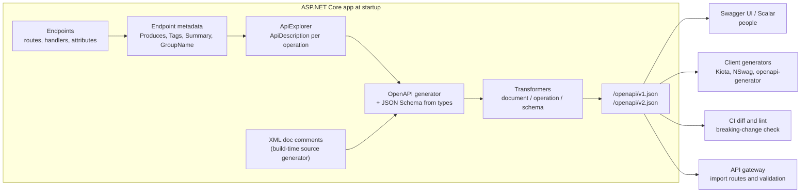
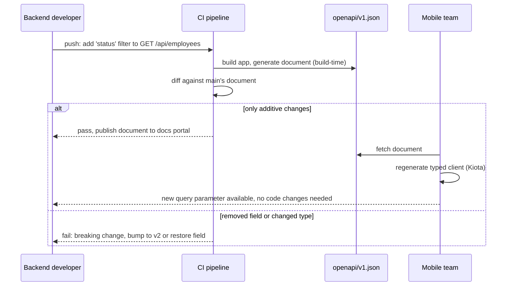

In the previous lesson you built an employee API that returns the right status codes. Now imagine handing it to the mobile team in another city. They need to know every path, every field, every status code and what an error body looks like. You could write a Word document. It would be wrong within a week. OpenAPI makes the running application produce that document, always matching the code, and lets other tools read it: interactive UIs, client-code generators, contract tests and API gateways.

## Learning objectives

By the end of this lesson you will be able to:

1. Explain what an OpenAPI document is, what is inside it, and who consumes it.
2. Turn on document generation in ASP.NET Core 10 with `AddOpenApi` and `MapOpenApi`, and know what it reads from your endpoints.
3. Enrich the document with summaries, descriptions, response types, XML doc comments and examples.
4. Browse and try the API in Swagger UI or Scalar, and know which one to pick.
5. Customise the document with transformers (security schemes, servers, shared error schemas).
6. Publish separate documents per API version and keep them from mixing.
7. Use the document in CI to catch breaking changes and to generate typed clients.

## Prerequisites

- [REST API design and HTTP status codes](#/lesson/m03-rest-status-codes): the employee API we document here, including Problem Details.
- [Kestrel, middleware, routing, controllers and minimal APIs](#/lesson/m03-kestrel-middleware-routing): endpoint metadata is where OpenAPI gets its facts.

Helpful but optional: [API versioning, pagination, filtering and sorting](#/lesson/m03-api-shape) for the versioning half of this lesson.

## Explain it like I'm a beginner

Think of the menu card at a restaurant. You do not need to visit the kitchen to know what you can order, what each dish contains, and what it costs. The menu is a **contract** between the kitchen and the customer. If the kitchen changes a dish, the menu must change too, or customers get surprises.

An **OpenAPI document** is the menu card for your API. It is a JSON (or YAML) file that lists:

- every path and method (`GET /api/employees/{id}`),
- what goes in (path parameters, query parameters, headers, the request body and its fields),
- what comes out for each status code (200 with an employee, 404 with a problem body),
- how to authenticate (an `X-Api-Key` header),
- and human-readable descriptions for all of it.

The old name for this format is **Swagger**; the specification was renamed OpenAPI in 2016, and "Swagger" now refers to a set of tools (Swagger UI, Swashbuckle) that work with it. People still use the names interchangeably.

Why generate it instead of writing it? Because a hand-written menu drifts. In ASP.NET Core the document is generated from the same endpoint definitions that handle requests. Add a parameter to a route and it appears in the document on the next build; forget to annotate a 404 and a linter can fail the build. The document becomes **the single source of truth** that three groups read:

1. **People**: through an interactive page (Swagger UI, Scalar) where they can click "Try it".
2. **Code generators**: which turn the document into a typed C#, TypeScript or Kotlin client in seconds.
3. **Machines in the pipeline**: API gateways import it for routing and validation; CI compares yesterday's document with today's to catch breaking changes.

## First-principles explanation

### What is in an OpenAPI document

An OpenAPI 3.1 document has five parts worth knowing:

| Part | What it holds | Example from the employee API |
|---|---|---|
| `info` | Title, version, description, contact | "Employee API", "1.0.0" |
| `servers` | Base URLs | `https://api.example.com`, `http://localhost:5000` |
| `paths` | One entry per route, each with operations (get, post…) | `/api/employees/{id}` with `get`, `put`, `delete` |
| `components` | Reusable schemas, security schemes, parameters, responses | `EmployeeResponse`, `ProblemDetails`, `ApiKey` |
| `security` | Which schemes apply by default | `[ { "ApiKey": [] } ]` |

Each **operation** has an `operationId` (a unique name clients use as the method name), `summary`, `description`, `tags` (for grouping), `parameters`, `requestBody` and `responses` keyed by status code. Each response names a media type and a **schema**, which is JSON Schema describing the body. Schemas are usually `$ref`s into `components/schemas`, so `EmployeeResponse` is defined once and referenced from five operations.

A skeleton for one operation looks like this:

```json
{
  "paths": {
    "/api/employees/{id}": {
      "get": {
        "tags": ["Employees"],
        "summary": "Get one employee",
        "operationId": "GetEmployee",
        "parameters": [{ "name": "id", "in": "path", "required": true, "schema": { "type": "string", "format": "uuid" } }],
        "responses": {
          "200": { "description": "OK", "content": { "application/json": { "schema": { "$ref": "#/components/schemas/EmployeeResponse" } } } },
          "404": { "description": "Not Found", "content": { "application/problem+json": { "schema": { "$ref": "#/components/schemas/ProblemDetails" } } } }
        },
        "security": [{ "ApiKey": [] }]
      }
    }
  }
}
```

### Where ASP.NET Core gets the facts

The generator does not read your source code. It reads **endpoint metadata**: the objects attached to each endpoint at startup. When you write `app.MapGet("/api/employees/{id:guid}", handler).Produces<EmployeeResponse>()`, routing stores the route pattern, the HTTP method, the handler's parameter types and a `ProducesResponseTypeMetadata` object. Controllers contribute the same facts through attributes (`[HttpGet("{id:guid}")]`, `[ProducesResponseType<EmployeeResponse>(200)]`).

A component called **ApiExplorer** (`Microsoft.AspNetCore.Mvc.ApiExplorer`) walks all endpoints and produces a neutral `ApiDescription` for each. The OpenAPI generator (`Microsoft.AspNetCore.OpenApi`) converts `ApiDescription`s plus the .NET type information into the document, using `System.Text.Json`'s schema support to turn `EmployeeResponse` into JSON Schema. Then any **transformers** you registered get to modify the document, operation or schema. The finished document is cached and served at `/openapi/v1.json`.

The practical consequence: **anything the generator does not know, it cannot document.** If an endpoint throws `NotFoundException` and the global handler turns it into 404, the generator has no idea unless you declare `.ProducesProblem(404)` or `[ProducesResponseType(404)]`. Declaring responses is part of writing the endpoint.

### Built-in generation in .NET 9 and 10

Until .NET 8, templates used the third-party Swashbuckle package. From .NET 9 the templates use the Microsoft package `Microsoft.AspNetCore.OpenApi`, which has two calls:

```csharp
builder.Services.AddOpenApi();   // registers the generator and a document named "v1"
// ...
app.MapOpenApi();                // serves GET /openapi/v1.json (and /openapi/v1.yaml in .NET 10)
```

What .NET 10 adds on top of .NET 9, in brief: OpenAPI 3.1 output by default (3.0 remains selectable), YAML output, XML documentation comments flowing into the document through a build-time source generator, response descriptions on `[ProducesResponseType]`, better schema generation for records and nullable types, and `IOpenApiDocumentProvider` for generating the document at build or startup without a request. The older `.WithOpenApi(...)` endpoint extension is being phased out in favour of transformers.

The package does **not** ship a UI. That is deliberate: the document is the product, and you choose a viewer.

### Viewers: Swagger UI versus Scalar

Both read the document from `/openapi/v1.json` and render a page where you can expand operations, see schemas and send real requests.

| | Swagger UI (`Swashbuckle.AspNetCore.SwaggerUI`) | Scalar (`Scalar.AspNetCore`) |
|---|---|---|
| Looks | Classic, dense, familiar to most developers | Modern three-column layout, dark mode, search |
| Try-it | Yes | Yes, with generated snippets for curl, C#, JS, Python… |
| Auth helpers | API key, Basic, OAuth flows | Same, with persisted credentials |
| Weight | Small, battle-tested since 2011 | Newer, actively developed |
| Pick when | Your consumers already know it; corporate standard | You want nicer onboarding docs and code snippets |

Neither should be exposed on a public production host without thought. A viewer reveals every operation, which is fine for a public API and risky for an internal one. Common practice: enable it in Development and Staging, and in Production only behind authentication or on an internal hostname.

### Descriptions, comments and examples

Good documentation is more than types. Three layers add meaning:

1. **Endpoint metadata**: `.WithSummary("Get one employee")`, `.WithDescription("Returns 404 if the id is unknown.")`, `.WithTags("Employees")`, `.WithName("GetEmployee")` (becomes `operationId`). Attribute forms: `[EndpointSummary]`, `[EndpointDescription]`, `[Tags]`, `[EndpointName]`.
2. **XML documentation comments** on handler methods and DTO properties: `/// <summary>`, `/// <remarks>`, `/// <param>`, `/// <response code="404">`, `/// <example>`. In .NET 10, set `<GenerateDocumentationFile>true</GenerateDocumentationFile>` in the project file and the OpenAPI package's source generator copies them into the document at build time, including comments from referenced projects whose XML files are available.
3. **Schema descriptions and examples** via `[Description("...")]` (`System.ComponentModel`) and `[DefaultValue]` on properties, plus validation attributes (`[Range]`, `[StringLength]`, `[Required]`) which become `minimum`, `maxLength`, `required` in the schema.

Examples deserve a special note. A document with a realistic example body (`"fullName": "Priya Nair"`, `"monthlySalary": 85000`) is read ten times more than one without, because consumers copy the example into their first request. Put them in `<example>` tags or add them with a schema transformer.

### Transformers

A transformer is a function that gets the generated document (or one operation, or one schema) and can change it. Three kinds:

- **Document transformer**: set `info`, add `servers`, register security schemes, add a shared `ProblemDetails` response to every operation.
- **Operation transformer**: runs per operation; add the `X-Api-Key` requirement to every operation that has `[Authorize]`, add a standard `429` response, rename `operationId`s.
- **Schema transformer**: runs per schema; add examples for `DateOnly`, mark monetary decimals with `format: decimal`, hide internal properties.

Transformers are classes implementing `IOpenApiDocumentTransformer`, `IOpenApiOperationTransformer` or `IOpenApiSchemaTransformer`, or lambdas, and they can take DI services. They run in registration order after generation. Their job is cross-cutting documentation policy; per-endpoint facts still belong on the endpoint.

### Versioned documents

When `/api/v1/employees` and `/api/v2/employees` differ, consumers need two documents, not one document with both mixed together. The built-in generator supports **named documents**: `AddOpenApi("v1")` and `AddOpenApi("v2")` produce `/openapi/v1.json` and `/openapi/v2.json`. Which endpoints land in which document is decided by the document's `ShouldInclude` predicate, which by default includes an endpoint whose **group name** matches the document name (and endpoints with no group name). You set the group name per endpoint or group with `.WithGroupName("v2")`, or `[ApiExplorerSettings(GroupName = "v2")]` on a controller. The `Asp.Versioning` packages integrate with the same mechanism when you version by URL segment, header or query string.

### When OpenAPI is the wrong tool

- **gRPC services** describe themselves with `.proto` files; do not bolt OpenAPI on top unless you expose a JSON transcoding layer.
- **Event-driven interfaces** (messages on RabbitMQ or Kafka) use AsyncAPI, a sibling format, because there are no paths and methods.
- **A single internal endpoint with one consumer in the same repo** does not need a published document. Enable it anyway in Development because it costs nothing and helps debugging, but do not spend a day on transformers.

## Visual explanation

### From endpoint to document to consumers



Read left to right. Everything starts with endpoint definitions; the generator never sees your service or repository classes. Metadata is collected into neutral descriptions, enriched with XML comments at build time, turned into a document, then transformers apply team-wide policy. The same document feeds four kinds of consumer, which is why one small annotation on an endpoint pays back many times.

### A consumer's day, driven by the document



The document is produced at build time, not by hand, so the diff is trustworthy. Additive changes (new optional query parameter, new response field) flow to consumers automatically through regenerated clients. Breaking changes are caught before merge, which is where the version-per-document strategy comes from: v1 stays frozen, v2 gets the new shape.

## Step-by-step example

We take the employee API from the previous lesson and document it in five steps.

### Step 1 — turn it on

Add the package and two lines:

```bash
dotnet add package Microsoft.AspNetCore.OpenApi
```

```csharp
builder.Services.AddOpenApi();
// ...
if (app.Environment.IsDevelopment()) app.MapOpenApi();
```

Run the app and open `http://localhost:5000/openapi/v1.json`. You already have a document, with every route and every DTO schema. It just has no descriptions, and the 404s are missing.

### Step 2 — declare what each operation returns

For every endpoint, add `Produces`/`ProducesProblem` (minimal APIs) or `[ProducesResponseType]` (controllers), including the failure codes from the status-code lesson. This is the single most valuable step: the generator cannot infer exceptions mapped to codes.

### Step 3 — add summaries, descriptions and XML comments

Set `<GenerateDocumentationFile>true</GenerateDocumentationFile>` in the `.csproj`, then write `///` comments on handlers and DTO properties. Add `.WithSummary`/`.WithName` on minimal endpoints so each operation has a readable title and a stable `operationId`.

### Step 4 — add a viewer

```bash
dotnet add package Scalar.AspNetCore        # or Swashbuckle.AspNetCore.SwaggerUI
```

```csharp
if (app.Environment.IsDevelopment())
{
    app.MapOpenApi();
    app.MapScalarApiReference();   // served at /scalar by default
}
```

Open `/scalar`, authenticate with the API key, click "Send" on `GET /api/employees`.

### Step 5 — policy through transformers, and versions

Add a document transformer that registers the `ApiKey` security scheme and applies it to all operations, plus `info` and `servers`. Add a second document for `v2` when the first breaking change arrives. The implementation section shows all of this, with the parts that compile against the shared framework as `file=` blocks and the package-dependent parts as snippets.

## Production-style C# implementation

The compiled part of this section is a small, self-describing API: endpoints with full metadata, DTOs with documentation attributes, and a `ContractCatalog` service that reads the **same endpoint metadata the OpenAPI generator reads** and exposes it at `/docs/contract`. Building that catalog yourself is the fastest way to understand what the generator sees. The package-specific wiring (`AddOpenApi`, transformers, Scalar, Swagger UI, build-time generation) follows as snippets, because `Microsoft.AspNetCore.OpenApi` is a NuGet package and not part of the shared framework the offline checker uses.

```text
EmployeeDocs.Api/
  Program.cs
  Contracts/EmployeeDtos.cs
  Endpoints/EmployeeEndpoints.cs          v1 and v2 groups with metadata
  Docs/ContractCatalog.cs                 reads endpoint metadata
  Docs/OpenApiSetup.cs                    (snippet) AddOpenApi, transformers, viewers
```

### DTOs with documentation

```csharp file=Contracts/EmployeeDtos.cs
using System.ComponentModel;
using System.ComponentModel.DataAnnotations;

namespace EmployeeDocs.Api.Contracts;

/// <summary>Input for creating an employee.</summary>
public sealed class CreateEmployeeRequest
{
    /// <summary>Full legal name as it appears on payroll.</summary>
    /// <example>Priya Nair</example>
    [Required, StringLength(120, MinimumLength = 2)]
    [Description("Full legal name as it appears on payroll.")]
    public required string FullName { get; init; }

    /// <summary>Work email. Must be unique across the company.</summary>
    /// <example>priya.nair@example.com</example>
    [Required, EmailAddress]
    [Description("Work email; unique across the company.")]
    public required string Email { get; init; }

    /// <summary>Department code, for example Design or Finance.</summary>
    /// <example>Design</example>
    [Required, StringLength(60)]
    public required string Department { get; init; }

    /// <summary>Gross monthly salary in INR.</summary>
    /// <example>85000</example>
    [Range(1, 10_000_000)]
    [Description("Gross monthly salary in INR.")]
    public decimal MonthlySalary { get; init; }

    /// <summary>First working day.</summary>
    /// <example>2026-11-01</example>
    public DateOnly JoinedOn { get; init; }
}

/// <summary>An employee as returned by the API (v1 shape).</summary>
public sealed record EmployeeResponse(
    [property: Description("Stable identifier.")] Guid Id,
    string FullName,
    string Email,
    string Department,
    [property: Description("Gross monthly salary in INR.")] decimal MonthlySalary,
    DateOnly JoinedOn,
    [property: Description("Optimistic-concurrency version; also sent as the ETag header.")] int Version);

/// <summary>v2 splits the name and nests pay, which is a breaking change, hence a new document.</summary>
public sealed record EmployeeResponseV2(
    Guid Id,
    string FirstName,
    string LastName,
    string Email,
    string Department,
    PayDetails Pay,
    DateOnly JoinedOn,
    int Version);

/// <summary>Salary details in v2.</summary>
public sealed record PayDetails(
    [property: Description("Gross monthly salary.")] decimal Monthly,
    [property: Description("ISO 4217 currency code.")] string Currency);

/// <summary>Paged list wrapper.</summary>
public sealed record PagedResponse<T>(IReadOnlyList<T> Items, int Page, int PageSize, int TotalItems);
```

`[Description]` is read directly by the generator into `description` on the schema property. The `///` comments reach the document through the .NET 10 XML-comment source generator when `GenerateDocumentationFile` is on. Keeping both is harmless; many teams use only XML comments.

### Endpoints with complete metadata, in two versions

```csharp file=Endpoints/EmployeeEndpoints.cs
using System.Collections.Concurrent;
using EmployeeDocs.Api.Contracts;
using Microsoft.AspNetCore.Builder;
using Microsoft.AspNetCore.Http;
using Microsoft.AspNetCore.Http.HttpResults;
using Microsoft.AspNetCore.Routing;

namespace EmployeeDocs.Api.Endpoints;

/// <summary>Tiny in-memory store so the endpoints are runnable. The real project uses IEmployeeRepository.</summary>
public sealed class EmployeeStore
{
    private readonly ConcurrentDictionary<Guid, EmployeeResponse> _items = new();

    public EmployeeStore()
    {
        var seed = new EmployeeResponse(Guid.Parse("11111111-1111-1111-1111-111111111111"), "Priya Nair",
            "priya.nair@example.com", "Design", 85_000m, new DateOnly(2026, 11, 1), 1);
        _items[seed.Id] = seed;
    }

    public IReadOnlyList<EmployeeResponse> All(string? department) =>
        _items.Values.Where(e => department is null || e.Department.Equals(department, StringComparison.OrdinalIgnoreCase))
              .OrderBy(e => e.FullName).ToList();

    public EmployeeResponse? Get(Guid id) => _items.GetValueOrDefault(id);

    public EmployeeResponse Add(CreateEmployeeRequest r)
    {
        var e = new EmployeeResponse(Guid.NewGuid(), r.FullName, r.Email, r.Department, r.MonthlySalary, r.JoinedOn, 1);
        _items[e.Id] = e;
        return e;
    }

    public static EmployeeResponseV2 ToV2(EmployeeResponse e)
    {
        var parts = e.FullName.Split(' ', 2, StringSplitOptions.TrimEntries);
        return new EmployeeResponseV2(e.Id, parts[0], parts.Length > 1 ? parts[1] : string.Empty, e.Email, e.Department,
            new PayDetails(e.MonthlySalary, "INR"), e.JoinedOn, e.Version);
    }
}

public static class EmployeeEndpoints
{
    public static IEndpointRouteBuilder MapEmployeeEndpoints(this IEndpointRouteBuilder app)
    {
        // ---- v1: group name "v1" puts these operations into /openapi/v1.json ----
        var v1 = app.MapGroup("/api/v1/employees")
            .WithTags("Employees")
            .WithGroupName("v1")
            .RequireAuthorization();

        v1.MapGet("/", (string? department, EmployeeStore store) =>
                TypedResults.Ok(new PagedResponse<EmployeeResponse>(store.All(department), 1, 100, store.All(department).Count)))
            .WithName("ListEmployees")
            .WithSummary("List employees")
            .WithDescription("Returns employees ordered by name. Filter with the optional department query parameter.")
            .Produces<PagedResponse<EmployeeResponse>>(StatusCodes.Status200OK)
            .ProducesProblem(StatusCodes.Status401Unauthorized);

        v1.MapGet("/{id:guid}", Results<Ok<EmployeeResponse>, NotFound> (Guid id, EmployeeStore store) =>
                store.Get(id) is { } e ? TypedResults.Ok(e) : TypedResults.NotFound())
            .WithName("GetEmployee")
            .WithSummary("Get one employee")
            .WithDescription("Returns 404 when the id is unknown. The ETag header carries the version for If-Match.")
            .ProducesProblem(StatusCodes.Status404NotFound);

        v1.MapPost("/", Created<EmployeeResponse> (CreateEmployeeRequest request, EmployeeStore store) =>
                {
                    var created = store.Add(request);
                    return TypedResults.Created($"/api/v1/employees/{created.Id}", created);
                })
            .WithName("CreateEmployee")
            .WithSummary("Create an employee")
            .WithDescription("Email must be unique; a duplicate returns 409.")
            .Accepts<CreateEmployeeRequest>("application/json")
            .ProducesValidationProblem()
            .ProducesProblem(StatusCodes.Status409Conflict);

        // ---- v2: breaking response shape, so it gets its own document ----
        var v2 = app.MapGroup("/api/v2/employees")
            .WithTags("Employees")
            .WithGroupName("v2")
            .RequireAuthorization();

        v2.MapGet("/{id:guid}", Results<Ok<EmployeeResponseV2>, NotFound> (Guid id, EmployeeStore store) =>
                store.Get(id) is { } e ? TypedResults.Ok(EmployeeStore.ToV2(e)) : TypedResults.NotFound())
            .WithName("GetEmployeeV2")
            .WithSummary("Get one employee (v2 shape)")
            .WithDescription("v2 splits FullName into FirstName and LastName and nests pay details.")
            .ProducesProblem(StatusCodes.Status404NotFound);

        // Operational endpoint that must not appear in any document.
        app.MapGet("/internal/ping", () => TypedResults.Text("pong")).ExcludeFromDescription();

        return app;
    }
}
```

Three details to notice. `TypedResults` with a declared return type such as `Results<Ok<EmployeeResponse>, NotFound>` lets the generator infer the 200 and 404 **without** extra attributes; `ProducesProblem(404)` is still added so the 404 is documented with the `ProblemDetails` schema and `application/problem+json`. `WithName` becomes `operationId`, which code generators turn into method names (`client.Employees.GetEmployee(id)`), so choose them as carefully as public method names. `ExcludeFromDescription` hides endpoints that must not be advertised.

### A contract catalog built from endpoint metadata

This service does, in forty lines, what the generator does in thousands: it enumerates endpoints and reads their metadata. Hitting `/docs/contract` shows you exactly which facts are present and which are missing, which is the first thing to check when the OpenAPI output looks wrong.

```csharp file=Docs/ContractCatalog.cs
using Microsoft.AspNetCore.Http.Metadata;
using Microsoft.AspNetCore.Routing;

namespace EmployeeDocs.Api.Docs;

public sealed record ResponseContract(int StatusCode, string? Type, IReadOnlyList<string> ContentTypes);

public sealed record OperationContract(
    string Method, string Route, string? OperationId, string? Summary, string? Description,
    IReadOnlyList<string> Tags, string? GroupName, IReadOnlyList<ResponseContract> Responses)
{
    public bool HasSummary => !string.IsNullOrWhiteSpace(Summary);
    public bool DocumentsAnyClientError => Responses.Any(r => r.StatusCode is >= 400 and < 500);
}

/// <summary>Reads the same endpoint metadata the OpenAPI generator reads, for one named document.</summary>
public sealed class ContractCatalog(EndpointDataSource endpoints)
{
    public IReadOnlyList<OperationContract> Describe(string? documentName = null)
    {
        var result = new List<OperationContract>();
        foreach (var endpoint in endpoints.Endpoints.OfType<RouteEndpoint>())
        {
            var md = endpoint.Metadata;
            if (md.GetMetadata<IExcludeFromDescriptionMetadata>()?.ExcludeFromDescription == true) continue;

            var group = md.GetMetadata<IEndpointGroupNameMetadata>()?.EndpointGroupName;
            // Same rule as the generator's default ShouldInclude: no group, or the matching group.
            if (documentName is not null && group is not null && group != documentName) continue;

            var methods = md.GetMetadata<IHttpMethodMetadata>()?.HttpMethods ?? ["ANY"];
            var responses = md.GetOrderedMetadata<IProducesResponseTypeMetadata>()
                .Select(r => new ResponseContract(r.StatusCode, r.Type?.Name, r.ContentTypes.ToList()))
                .OrderBy(r => r.StatusCode).ToList();

            foreach (var method in methods)
                result.Add(new OperationContract(
                    method,
                    "/" + (endpoint.RoutePattern.RawText ?? string.Empty).TrimStart('/'),
                    md.GetMetadata<IEndpointNameMetadata>()?.EndpointName,
                    md.GetMetadata<IEndpointSummaryMetadata>()?.Summary,
                    md.GetMetadata<IEndpointDescriptionMetadata>()?.Description,
                    md.GetMetadata<ITagsMetadata>()?.Tags.ToList() ?? [],
                    group,
                    responses));
        }
        return result.OrderBy(o => o.Route).ThenBy(o => o.Method).ToList();
    }

    /// <summary>Documentation lint: operations missing a summary or any 4xx response.</summary>
    public IReadOnlyList<string> Lint(string? documentName = null) =>
        Describe(documentName)
            .Where(o => !o.HasSummary || !o.DocumentsAnyClientError)
            .Select(o => $"{o.Method} {o.Route}: " +
                         (o.HasSummary ? "" : "missing summary; ") +
                         (o.DocumentsAnyClientError ? "" : "no 4xx response documented"))
            .ToList();
}
```

### Composition root

```csharp file=Program.cs
using EmployeeDocs.Api.Docs;
using EmployeeDocs.Api.Endpoints;
using Microsoft.AspNetCore.Authentication;

var builder = WebApplication.CreateBuilder(args);

builder.Services.AddProblemDetails();
builder.Services.AddValidation();
builder.Services.AddAuthentication("ApiKey")
    .AddScheme<AuthenticationSchemeOptions, DemoApiKeyHandler>("ApiKey", null);
builder.Services.AddAuthorization();
builder.Services.AddSingleton<EmployeeStore>();
builder.Services.AddSingleton<ContractCatalog>();

// With the Microsoft.AspNetCore.OpenApi package you would add here:
//   builder.Services.AddOpenApi("v1", o => o.AddDocumentTransformer<ApiKeySecurityTransformer>());
//   builder.Services.AddOpenApi("v2", o => o.AddDocumentTransformer<ApiKeySecurityTransformer>());

var app = builder.Build();

app.UseExceptionHandler();
app.UseStatusCodePages();
app.UseAuthentication();
app.UseAuthorization();

app.MapEmployeeEndpoints();

// Our own view of the metadata, per document. Development only, like the OpenAPI endpoint itself.
if (app.Environment.IsDevelopment())
{
    app.MapGet("/docs/contract/{documentName}", (string documentName, ContractCatalog catalog) =>
        TypedResults.Ok(catalog.Describe(documentName))).ExcludeFromDescription();
    app.MapGet("/docs/lint", (ContractCatalog catalog) => TypedResults.Ok(catalog.Lint())).ExcludeFromDescription();

    //   app.MapOpenApi();                 // /openapi/v1.json, /openapi/v2.json
    //   app.MapScalarApiReference();      // /scalar
}

app.Run();

/// <summary>Development-only API key handler: accepts the key "dev-key-123". The module project has the real one.</summary>
public sealed class DemoApiKeyHandler(
    Microsoft.Extensions.Options.IOptionsMonitor<AuthenticationSchemeOptions> options,
    ILoggerFactory logger,
    System.Text.Encodings.Web.UrlEncoder encoder)
    : AuthenticationHandler<AuthenticationSchemeOptions>(options, logger, encoder)
{
    protected override Task<AuthenticateResult> HandleAuthenticateAsync()
    {
        if (!Request.Headers.TryGetValue("X-Api-Key", out var key)) return Task.FromResult(AuthenticateResult.NoResult());
        if (key != "dev-key-123") return Task.FromResult(AuthenticateResult.Fail("Invalid API key."));
        var identity = new System.Security.Claims.ClaimsIdentity([new System.Security.Claims.Claim("name", "dev")], Scheme.Name);
        return Task.FromResult(AuthenticateResult.Success(
            new AuthenticationTicket(new System.Security.Claims.ClaimsPrincipal(identity), Scheme.Name)));
    }
}

public partial class Program { }
```

### OpenAPI wiring with the package (snippets)

Project file additions:

```xml
<PropertyGroup>
  <GenerateDocumentationFile>true</GenerateDocumentationFile>   <!-- XML comments into the document (.NET 10) -->
  <NoWarn>$(NoWarn);CS1591</NoWarn>                              <!-- do not warn about undocumented members -->
</PropertyGroup>
<ItemGroup>
  <PackageReference Include="Microsoft.AspNetCore.OpenApi" Version="10.*" />
  <PackageReference Include="Scalar.AspNetCore" Version="2.*" />
  <!-- or: <PackageReference Include="Swashbuckle.AspNetCore.SwaggerUI" Version="9.*" /> -->
</ItemGroup>
```

Two named documents, a security-scheme transformer, and a standard-error operation transformer:

```csharp
using Microsoft.AspNetCore.OpenApi;
using Microsoft.OpenApi;

namespace EmployeeDocs.Api.Docs;

/// <summary>Document policy: title, servers, and the ApiKey security scheme applied to every operation.</summary>
public sealed class ApiKeySecurityTransformer : IOpenApiDocumentTransformer
{
    public Task TransformAsync(OpenApiDocument document, OpenApiDocumentTransformerContext context, CancellationToken ct)
    {
        document.Info.Title = "Employee API";
        document.Info.Version = context.DocumentName;                 // "v1" or "v2"
        document.Info.Description = "Employee records for HR systems. Errors use RFC 9457 Problem Details.";
        document.Servers = [new OpenApiServer { Url = "https://api.example.com" }, new OpenApiServer { Url = "http://localhost:5000" }];

        document.Components ??= new OpenApiComponents();
        document.Components.SecuritySchemes ??= new Dictionary<string, IOpenApiSecurityScheme>();
        document.Components.SecuritySchemes["ApiKey"] = new OpenApiSecurityScheme
        {
            Type = SecuritySchemeType.ApiKey, In = ParameterLocation.Header, Name = "X-Api-Key",
            Description = "Shared API key issued per client application.",
        };

        var requirement = new OpenApiSecurityRequirement { [new OpenApiSecuritySchemeReference("ApiKey", document)] = [] };
        foreach (var operation in document.Paths.Values.SelectMany(p => p.Operations.Values))
            (operation.Security ??= []).Add(requirement);
        return Task.CompletedTask;
    }
}

/// <summary>Every operation can return 429 and 500 with Problem Details; say so once here, not on each endpoint.</summary>
public sealed class StandardErrorsTransformer : IOpenApiOperationTransformer
{
    public Task TransformAsync(OpenApiOperation operation, OpenApiOperationTransformerContext context, CancellationToken ct)
    {
        operation.Responses ??= new OpenApiResponses();
        operation.Responses.TryAdd("429", new OpenApiResponse { Description = "Too many requests. Honour Retry-After." });
        operation.Responses.TryAdd("500", new OpenApiResponse { Description = "Unexpected error. Quote the traceId when reporting." });
        return Task.CompletedTask;
    }
}

// Program.cs
builder.Services.AddOpenApi("v1", options =>
{
    options.AddDocumentTransformer<ApiKeySecurityTransformer>();
    options.AddOperationTransformer<StandardErrorsTransformer>();
    options.AddSchemaTransformer((schema, context, ct) =>
    {
        if (context.JsonTypeInfo.Type == typeof(decimal)) schema.Format = "decimal";   // money is not a float
        return Task.CompletedTask;
    });
});
builder.Services.AddOpenApi("v2", options => options.AddDocumentTransformer<ApiKeySecurityTransformer>());

// ...
if (app.Environment.IsDevelopment())
{
    app.MapOpenApi();                                 // /openapi/v1.json, /openapi/v2.json (+ .yaml)
    app.MapScalarApiReference(o => o.AddDocument("v1", "Employee API v1").AddDocument("v2", "Employee API v2"));
    // Swagger UI alternative:
    // app.UseSwaggerUI(o => { o.SwaggerEndpoint("/openapi/v1.json", "v1"); o.SwaggerEndpoint("/openapi/v2.json", "v2"); });
}
```

The exact object model (`Microsoft.OpenApi` 2.x in .NET 10) differs slightly from the 1.x model used by .NET 9: security requirements use `OpenApiSecuritySchemeReference`, and several collections became interfaces. Check the package version you are on; the shape of the solution is the same.

Controllers use the attribute forms and reach the same document:

```csharp
[ApiController, Route("api/v1/employees"), Tags("Employees"), ApiExplorerSettings(GroupName = "v1")]
public sealed class EmployeesController : ControllerBase
{
    /// <summary>Get one employee.</summary>
    /// <remarks>Returns 404 when the id is unknown. The ETag header carries the version for If-Match.</remarks>
    /// <param name="id">Employee id.</param>
    /// <response code="200">The employee.</response>
    /// <response code="404">No employee with that id.</response>
    [HttpGet("{id:guid}", Name = "GetEmployee")]
    [ProducesResponseType<EmployeeResponse>(StatusCodes.Status200OK, Description = "The employee.")]
    [ProducesResponseType<ProblemDetails>(StatusCodes.Status404NotFound, "application/problem+json")]
    public ActionResult<EmployeeResponse> GetById(Guid id) => /* ... */ throw new NotImplementedException();
}
```

Build-time generation for CI, so the pipeline can diff documents without running the app:

```xml
<PackageReference Include="Microsoft.Extensions.ApiDescription.Server" Version="10.*">
  <PrivateAssets>all</PrivateAssets>
</PackageReference>
<PropertyGroup>
  <OpenApiDocumentsDirectory>$(MSBuildProjectDirectory)/openapi</OpenApiDocumentsDirectory>
  <OpenApiGenerateDocumentsOptions>--document-name v1 --document-name v2</OpenApiGenerateDocumentsOptions>
</PropertyGroup>
```

With that, `dotnet build` writes `openapi/EmployeeDocs.Api_v1.json` and `_v2.json`. Commit them. In CI, run a diff tool (for example `oasdiff breaking old.json new.json`) and fail the build on breaking changes to a published version.

## Bad design vs good design

**Bad**: the document exists but says nothing.

```csharp
// Every operation looks like this in the generated document:
app.MapGet("/api/getEmp/{id}", (string id, Db db) => db.Find(id));
// operationId: null (tools invent "GetApiGetEmpById"), summary: none,
// parameters: id as string (it is a Guid), responses: 200 "object" only, 404 missing, auth missing.
```

Consumers of this document get a generated client with a method named by the tool, a parameter typed `string`, an untyped response, and no idea that 404 happens. They will read your source code or call you, which defeats the purpose.

**Good**: the endpoints in the implementation section. Stable `operationId`s, typed route constraints (`{id:guid}`), every success and failure response declared with its schema, summaries that say what varies ("filter with department"), descriptions that explain non-obvious behaviour (ETag, 409 on duplicate), security applied through one transformer, and internal endpoints excluded.

**When "bad" is acceptable**: a spike or an internal tool with a single consumer that is you. Even then, `{id:guid}` and `Produces<T>` cost seconds and make Scalar useful for manual testing.

:::callout type=mistake title="Documenting the exception handler by hand, everywhere"
Teams often paste `[ProducesResponseType(500)]`, `[ProducesResponseType(401)]` and `[ProducesResponseType(429)]` on every action. That is cross-cutting policy; put it in one operation transformer. Per-endpoint declarations are for responses that are specific to that endpoint (404 on get-by-id, 409 on create).
:::

:::callout type=warning title="The document is public information"
Whatever appears in the document is visible to everyone who can reach the viewer. Do not expose internal admin endpoints in a public document; use `ExcludeFromDescription` or a separate `internal` document served only on the private network. And never put real secrets in examples.
:::

## Practical playground

The program below is a miniature of the generator: it turns a list of operation descriptions into a minimal OpenAPI-shaped JSON document. Add an operation, run it, and see how `paths` and `components` are built. Then try adding a lint rule that fails when a `GET` on a route with `{id}` lacks a 404.

:::playground type=csharp title="Mini OpenAPI generator"
```csharp file=Program.cs
using System;
using System.Collections.Generic;
using System.Linq;
using System.Text.Json;
using System.Text.Json.Nodes;

public sealed record Op(string Method, string Route, string Id, string Summary, Dictionary<int, string?> Responses);

public static class MiniGenerator
{
    public static JsonObject Build(string title, string version, IEnumerable<Op> ops)
    {
        var paths = new JsonObject();
        var schemas = new JsonObject();
        foreach (var op in ops)
        {
            var responses = new JsonObject();
            foreach (var (code, schema) in op.Responses.OrderBy(r => r.Key))
            {
                var response = new JsonObject { ["description"] = ReasonPhrase(code) };
                if (schema is not null)
                {
                    schemas[schema] ??= new JsonObject { ["type"] = "object" };
                    response["content"] = new JsonObject
                    {
                        [code >= 400 ? "application/problem+json" : "application/json"] =
                            new JsonObject { ["schema"] = new JsonObject { ["$ref"] = $"#/components/schemas/{schema}" } },
                    };
                }
                responses[code.ToString()] = response;
            }
            var operation = new JsonObject { ["operationId"] = op.Id, ["summary"] = op.Summary, ["responses"] = responses };
            if (paths[op.Route] is not JsonObject pathItem) paths[op.Route] = pathItem = new JsonObject();
            pathItem[op.Method.ToLowerInvariant()] = operation;
        }
        return new JsonObject
        {
            ["openapi"] = "3.1.0",
            ["info"] = new JsonObject { ["title"] = title, ["version"] = version },
            ["paths"] = paths,
            ["components"] = new JsonObject { ["schemas"] = schemas },
        };
    }

    public static string ReasonPhrase(int code) => code switch
    {
        200 => "OK", 201 => "Created", 204 => "No Content", 400 => "Bad Request", 404 => "Not Found", 409 => "Conflict", _ => "Response",
    };
}

public static class Program
{
    public static void Main()
    {
        var ops = new List<Op>
        {
            new("GET", "/api/employees", "ListEmployees", "List employees", new() { [200] = "PagedEmployeeResponse" }),
            new("GET", "/api/employees/{id}", "GetEmployee", "Get one employee", new() { [200] = "EmployeeResponse", [404] = "ProblemDetails" }),
            new("POST", "/api/employees", "CreateEmployee", "Create an employee", new() { [201] = "EmployeeResponse", [400] = "ValidationProblemDetails", [409] = "ProblemDetails" }),
        };
        var doc = MiniGenerator.Build("Employee API", "v1", ops);
        Console.WriteLine(doc.ToJsonString(new JsonSerializerOptions { WriteIndented = true }));

        var missing404 = ops.Where(o => o.Method == "GET" && o.Route.Contains("{") && !o.Responses.ContainsKey(404)).ToList();
        Console.WriteLine(missing404.Count == 0 ? "Lint: all GET-by-id operations document 404." : $"Lint: {missing404.Count} operation(s) missing 404.");
    }
}
```
:::

## Exercises

:::exercise id=m03-openapi-ex1 difficulty=beginner kind=code title="Lint the contract"
Implement `ContractLinter.Lint` so that a team can fail the build when the generated contract is incomplete. The input is a list of `Operation` records like the ones `ContractCatalog` produces.
::requirements
- Report `"missing summary"` when `Summary` is null or whitespace.
- Report `"missing operationId"` when `OperationId` is null or whitespace.
- Report `"GET by id without 404"` for a `GET` whose route contains `{` and whose responses lack 404.
- Report `"POST without 201"` for a `POST` whose responses lack 201 (and lack 202, which is also acceptable for POST).
- Report `"no success response"` when no response is in the 2xx range.
- Each finding is a string `"{METHOD} {route}: {problem}"`; findings for one operation are listed in the order above.
::acceptance
- All tests pass.
- A fully documented operation produces no findings.
::hint
Loop over operations; for each, check the rules in order and add a string per failing rule.
::hint
`route.Contains('{')` is a good-enough "has a path parameter" test for this exercise.
::hint
`responses.Any(c => c is >= 200 and < 300)` detects a success response.
::hint
```csharp
if (op.Method == "POST" && !op.Responses.Contains(201) && !op.Responses.Contains(202))
    findings.Add($"{op.Method} {op.Route}: POST without 201");
```
::starter
```csharp file=ContractLinter.cs
using System;
using System.Collections.Generic;
using System.Linq;

public sealed record Operation(string Method, string Route, string? OperationId, string? Summary, IReadOnlyList<int> Responses);

public static class ContractLinter
{
    public static IReadOnlyList<string> Lint(IEnumerable<Operation> operations) => throw new NotImplementedException();
}
```
::tests
```csharp file=ContractLinterTests.cs
using System.Collections.Generic;
using System.Linq;
using Xunit;

public class ContractLinterTests
{
    private static Operation Good() => new("GET", "/api/employees/{id}", "GetEmployee", "Get one employee", new[] { 200, 404 });

    [Fact]
    public void Fully_documented_operation_has_no_findings() =>
        Assert.Empty(ContractLinter.Lint(new[] { Good() }));

    [Fact]
    public void Missing_summary_and_id_are_reported_in_order()
    {
        var op = new Operation("GET", "/api/employees", null, "  ", new[] { 200 });
        var findings = ContractLinter.Lint(new[] { op });
        Assert.Equal(new[] { "GET /api/employees: missing summary", "GET /api/employees: missing operationId" }, findings);
    }

    [Fact]
    public void Get_by_id_without_404_is_reported()
    {
        var op = new Operation("GET", "/api/employees/{id}", "GetEmployee", "Get", new[] { 200 });
        Assert.Contains("GET /api/employees/{id}: GET by id without 404", ContractLinter.Lint(new[] { op }));
    }

    [Fact]
    public void Collection_get_does_not_need_404()
    {
        var op = new Operation("GET", "/api/employees", "List", "List", new[] { 200 });
        Assert.DoesNotContain(ContractLinter.Lint(new[] { op }), f => f.Contains("404"));
    }

    [Fact]
    public void Post_without_201_or_202_is_reported_but_202_is_fine()
    {
        var bad = new Operation("POST", "/api/employees", "Create", "Create", new[] { 200 });
        var ok = new Operation("POST", "/api/payroll-runs", "Start", "Start", new[] { 202 });
        Assert.Contains("POST /api/employees: POST without 201", ContractLinter.Lint(new[] { bad }));
        Assert.Empty(ContractLinter.Lint(new[] { ok }));
    }

    [Fact]
    public void No_success_response_is_reported()
    {
        var op = new Operation("DELETE", "/api/employees/{id}", "Delete", "Delete", new[] { 404 });
        Assert.Contains("DELETE /api/employees/{id}: no success response", ContractLinter.Lint(new[] { op }));
    }
}
```
::solution
```csharp file=ContractLinter.cs
using System;
using System.Collections.Generic;
using System.Linq;

public sealed record Operation(string Method, string Route, string? OperationId, string? Summary, IReadOnlyList<int> Responses);

public static class ContractLinter
{
    public static IReadOnlyList<string> Lint(IEnumerable<Operation> operations)
    {
        var findings = new List<string>();
        foreach (var op in operations)
        {
            var prefix = $"{op.Method} {op.Route}: ";
            if (string.IsNullOrWhiteSpace(op.Summary)) findings.Add(prefix + "missing summary");
            if (string.IsNullOrWhiteSpace(op.OperationId)) findings.Add(prefix + "missing operationId");
            if (op.Method == "GET" && op.Route.Contains('{') && !op.Responses.Contains(404))
                findings.Add(prefix + "GET by id without 404");
            if (op.Method == "POST" && !op.Responses.Contains(201) && !op.Responses.Contains(202))
                findings.Add(prefix + "POST without 201");
            if (!op.Responses.Any(c => c is >= 200 and < 300)) findings.Add(prefix + "no success response");
        }
        return findings;
    }
}
```

In the real project you would feed `ContractCatalog.Describe()` into this linter from an integration test, so a missing annotation fails `dotnet test` rather than being discovered by the mobile team.
::mistakes
- Treating `""` as a present summary; use `IsNullOrWhiteSpace`.
- Flagging collection `GET`s for a missing 404; only routes with path parameters identify one resource.
- Forgetting that 202 is a legitimate POST success for long-running work.
:::

:::exercise id=m03-openapi-ex2 difficulty=beginner kind=written title="Write the documentation for four operations"
Write the `summary`, `description` and `operationId` for these employee API operations, and list the responses each must declare with their schema names. Assume Problem Details for all errors and API-key authentication.

1. `GET /api/v1/employees?department=&page=&pageSize=`
2. `PUT /api/v1/employees/{id}` with `If-Match`
3. `DELETE /api/v1/employees/{id}`
4. `POST /api/v1/employees/{id}/resignation` with a body `{ lastWorkingDay, reason }`
::acceptance
- Summaries are under 8 words and start with a verb.
- Descriptions state the behaviour a consumer cannot guess from the types (ordering, limits, concurrency, side effects).
- Every failure code from the status-code lesson that applies is listed.
::hint
A summary is the title in the viewer's sidebar; a description is the paragraph when they click.
::hint
For `PUT`, the consumer needs to know about `If-Match`, 412 and 428, and whether the whole object is replaced.
::hint
For the resignation action, describe what changes (status becomes Resigned, record stays readable) and what happens on a second call.
::solution
1. **ListEmployees** — summary: "List employees". Description: "Returns employees ordered by full name. `department` filters case-insensitively. `page` starts at 1; `pageSize` defaults to 20 and is capped at 100 (larger values return 400)." Responses: 200 `PagedResponse<EmployeeResponse>`, 400 `ValidationProblemDetails`, 401 `ProblemDetails`.
2. **ReplaceEmployee** — summary: "Replace an employee". Description: "Replaces all editable fields. Send the version from the last `ETag` in `If-Match`; a stale version returns 412 with the current `ETag`, and a missing header returns 428. Email cannot be changed here. A resigned employee cannot be reactivated (409)." Responses: 200 `EmployeeResponse`, 400 `ValidationProblemDetails`, 401, 404, 409, 412, 428 `ProblemDetails`.
3. **DeleteEmployee** — summary: "Delete an employee". Description: "Permanently removes the record. Payroll history referencing the employee is retained by id. Idempotent: deleting an already-deleted id returns 404." Responses: 204 (no body), 401, 404 `ProblemDetails`.
4. **ResignEmployee** — summary: "Record a resignation". Description: "Sets status to Resigned and stores the last working day. The record remains readable. `lastWorkingDay` must be today or later. A second call for an already-resigned employee returns 409." Responses: 200 `EmployeeResponse` (or 201 if the resignation is its own resource), 400 `ValidationProblemDetails`, 401, 404, 409 `ProblemDetails`.
::mistakes
- Summaries that repeat the route ("GET employees by id").
- Descriptions that restate the types ("id is a GUID") instead of behaviour.
- Forgetting 401 because "it is obvious"; the generated client needs it to know the auth header is mandatory.
:::

:::exercise id=m03-openapi-ex3 difficulty=intermediate kind=code title="Detect breaking schema changes"
Your CI pipeline compares yesterday's and today's `EmployeeResponse` schema. Implement `SchemaDiff.Compare` so it classifies each change as breaking or safe for existing clients.
::requirements
- A removed property is **breaking**.
- A property whose type changes is **breaking**.
- A property that becomes required (was optional) is **breaking** for request schemas and safe for response schemas; this exercise treats all schemas as responses, so it is **safe**... except that a new *required* property on a response is safe and a newly *required* property on a request is breaking. Implement the parameter `isRequestSchema` to decide.
- An added optional property is **safe**.
- An added required property is **breaking** when `isRequestSchema` is true, otherwise **safe**.
- Return changes ordered by property name.
::acceptance
- All tests pass.
- `HasBreakingChanges` is true if any change is breaking.
::hint
Model a schema as a dictionary of property name to `(Type, Required)`. Walk the union of property names from both versions.
::hint
Decide each case with pattern matching on "in old? in new? types equal? required changed?".
::hint
```csharp
foreach (var name in oldProps.Keys.Union(newProps.Keys).OrderBy(n => n, StringComparer.Ordinal))
{
    var inOld = oldProps.TryGetValue(name, out var o);
    var inNew = newProps.TryGetValue(name, out var n);
    // ...
}
```
::starter
```csharp file=SchemaDiff.cs
using System;
using System.Collections.Generic;
using System.Linq;

public sealed record PropertySpec(string Type, bool Required);

public sealed record SchemaChange(string Property, string Kind, bool IsBreaking);

public sealed record DiffResult(IReadOnlyList<SchemaChange> Changes)
{
    public bool HasBreakingChanges => Changes.Any(c => c.IsBreaking);
}

public static class SchemaDiff
{
    /// <summary>Kinds: "removed", "added", "type-changed", "became-required", "became-optional".</summary>
    public static DiffResult Compare(IReadOnlyDictionary<string, PropertySpec> oldSchema,
                                     IReadOnlyDictionary<string, PropertySpec> newSchema,
                                     bool isRequestSchema) => throw new NotImplementedException();
}
```
::tests
```csharp file=SchemaDiffTests.cs
using System.Collections.Generic;
using System.Linq;
using Xunit;

public class SchemaDiffTests
{
    private static Dictionary<string, PropertySpec> V1() => new()
    {
        ["id"] = new("string", true), ["fullName"] = new("string", true), ["monthlySalary"] = new("number", true), ["nickname"] = new("string", false),
    };

    [Fact]
    public void Identical_schemas_have_no_changes() =>
        Assert.Empty(SchemaDiff.Compare(V1(), V1(), isRequestSchema: false).Changes);

    [Fact]
    public void Removed_property_is_breaking()
    {
        var v2 = V1(); v2.Remove("fullName");
        var diff = SchemaDiff.Compare(V1(), v2, false);
        var change = Assert.Single(diff.Changes);
        Assert.Equal(("fullName", "removed", true), (change.Property, change.Kind, change.IsBreaking));
    }

    [Fact]
    public void Type_change_is_breaking()
    {
        var v2 = V1(); v2["monthlySalary"] = new("string", true);
        var diff = SchemaDiff.Compare(V1(), v2, false);
        Assert.Contains(diff.Changes, c => c.Property == "monthlySalary" && c.Kind == "type-changed" && c.IsBreaking);
    }

    [Fact]
    public void Added_optional_property_is_safe_everywhere()
    {
        var v2 = V1(); v2["department"] = new("string", false);
        Assert.False(SchemaDiff.Compare(V1(), v2, false).HasBreakingChanges);
        Assert.False(SchemaDiff.Compare(V1(), v2, true).HasBreakingChanges);
    }

    [Fact]
    public void Added_required_property_breaks_requests_only()
    {
        var v2 = V1(); v2["department"] = new("string", true);
        Assert.False(SchemaDiff.Compare(V1(), v2, isRequestSchema: false).HasBreakingChanges);
        Assert.True(SchemaDiff.Compare(V1(), v2, isRequestSchema: true).HasBreakingChanges);
    }

    [Fact]
    public void Optional_becoming_required_breaks_requests_only()
    {
        var v2 = V1(); v2["nickname"] = new("string", true);
        var response = SchemaDiff.Compare(V1(), v2, false);
        var request = SchemaDiff.Compare(V1(), v2, true);
        Assert.Equal("became-required", Assert.Single(response.Changes).Kind);
        Assert.False(response.HasBreakingChanges);
        Assert.True(request.HasBreakingChanges);
    }

    [Fact]
    public void Changes_are_ordered_by_property_name()
    {
        var v2 = V1(); v2.Remove("nickname"); v2.Remove("fullName");
        var names = SchemaDiff.Compare(V1(), v2, false).Changes.Select(c => c.Property).ToList();
        Assert.Equal(new[] { "fullName", "nickname" }, names);
    }
}
```
::solution
The asymmetry between request and response schemas is the heart of this exercise. A client that *sends* a request breaks when you demand a new field it does not know; a client that *reads* a response is unaffected by a new field it ignores.

```csharp file=SchemaDiff.cs
using System;
using System.Collections.Generic;
using System.Linq;

public sealed record PropertySpec(string Type, bool Required);

public sealed record SchemaChange(string Property, string Kind, bool IsBreaking);

public sealed record DiffResult(IReadOnlyList<SchemaChange> Changes)
{
    public bool HasBreakingChanges => Changes.Any(c => c.IsBreaking);
}

public static class SchemaDiff
{
    public static DiffResult Compare(IReadOnlyDictionary<string, PropertySpec> oldSchema,
                                     IReadOnlyDictionary<string, PropertySpec> newSchema,
                                     bool isRequestSchema)
    {
        var changes = new List<SchemaChange>();
        foreach (var name in oldSchema.Keys.Union(newSchema.Keys).OrderBy(n => n, StringComparer.Ordinal))
        {
            var inOld = oldSchema.TryGetValue(name, out var o);
            var inNew = newSchema.TryGetValue(name, out var n);

            if (inOld && !inNew) { changes.Add(new(name, "removed", true)); continue; }
            if (!inOld && inNew) { changes.Add(new(name, "added", n!.Required && isRequestSchema)); continue; }

            if (o!.Type != n!.Type) { changes.Add(new(name, "type-changed", true)); continue; }
            if (!o.Required && n.Required) changes.Add(new(name, "became-required", isRequestSchema));
            else if (o.Required && !n.Required) changes.Add(new(name, "became-optional", !isRequestSchema));
        }
        return new DiffResult(changes);
    }
}
```

Note the last rule: a response property that becomes optional is breaking for readers (they may now receive null), while a request property that becomes optional is a relaxation and safe. Real tools such as `oasdiff` encode dozens of such rules; this exercise captures the principle.
::mistakes
- Treating every change as breaking, which trains the team to ignore the check.
- Forgetting that the same schema can be used in both a request and a response; the generator shares `components/schemas`, so a change can be safe in one place and breaking in another.
:::

:::exercise id=m03-openapi-ex4 difficulty=intermediate kind=written title="Plan the documentation pipeline"
You lead a team of six building the employee API for three consumers: an internal HR web app, a vendor's payroll system, and a mobile app built by another company. Design the OpenAPI setup: which documents exist, how they are produced, where the viewer is exposed, what transformers you need, and how CI protects consumers.
::acceptance
- Names the documents and who reads each one.
- Says where XML comments, per-endpoint metadata and transformers each belong.
- Describes build-time generation and the breaking-change gate.
- States the production exposure rule for the viewer.
::hint
Start from the consumers: a vendor and an external mobile team need a stable, versioned, public-safe document; the HR app may use an internal document that includes admin operations.
::hint
Think about what is "policy" (security scheme, standard errors, servers) versus "fact about one endpoint" (404 on get-by-id).
::hint
A checked-in document plus a diff in CI is the breaking-change gate. Versions are how you ship a breaking change anyway.
::solution
**Documents.** `v1` (public, frozen, used by the vendor and the mobile team), `v2` (public, current, same consumers once they migrate), and `internal` (admin and reporting endpoints, group name `internal`, served only on the office network). Internal endpoints are excluded from `v1`/`v2` by group name, and anything purely operational (`/health`, `/internal/ping`) is `ExcludeFromDescription`.

**Where facts live.** Per-endpoint: route constraints, `WithName`, `WithSummary`, `WithDescription`, `Produces` for success and endpoint-specific failures (404, 409, 412, 428). DTOs: XML `<summary>` and `<example>` on every property, validation attributes for schema constraints, with `GenerateDocumentationFile` on. Transformers: document transformer for `info`, `servers` and the `ApiKey` (later OAuth2) scheme; operation transformer adding 401, 429 and 500 with Problem Details to every operation; schema transformer marking `decimal` as `format: decimal`.

**Production.** `MapOpenApi` and the viewer (Scalar, with documents v1 and v2) are enabled in Development and Staging. In Production the documents are also served, because partners need them, but behind the same API-key authentication as the API; the viewer is on `docs.example.com`, not on the API host, and the `internal` document is never served from the public host.

**Pipeline.** `Microsoft.Extensions.ApiDescription.Server` writes the documents at build time into `openapi/`, committed to the repo. CI step 1 regenerates and fails if the committed files are stale. Step 2 runs an integration test that feeds `ContractCatalog.Describe("v1")` through the linter from exercise 1. Step 3 runs `oasdiff breaking` against the `main` branch for `v1` and `v2`; any breaking change fails unless the PR is labelled `new-major-version`, in which case a new document name must have been added. Step 4 publishes the documents to the docs portal and triggers client regeneration (Kiota for the HR app's TypeScript client).

**Versioning rule.** Additive changes go into the current version. The first breaking change creates `v3` as a new group and leaves `v2` untouched; `v1` is retired six months after `v3` ships, announced in the document's `info.description` and with a `Sunset` header.
::mistakes
- One document for everything, including admin operations, exposed publicly.
- Documenting standard errors on every endpoint by hand instead of once in a transformer.
- No build-time artefact, so breaking changes are discovered by consumers.
:::

:::exercise id=m03-openapi-ex5 difficulty=advanced kind=code title="Convert ASP.NET Core route templates to OpenAPI paths"
The generator must turn `/api/employees/{id:guid}` into the OpenAPI path `/api/employees/{id}` and a parameter `id` of type `string` with format `uuid`. Implement `RouteTemplateConverter.Convert`.
::requirements
- Strip constraints from path segments: `{id:guid}` → `{id}`; `{page:int:min(1)}` → `{page}`.
- Optional parameters `{slug?}` become `{slug}` and are marked `Required = false` (OpenAPI requires path parameters to be required, so also set `Note = "optional in route; document as separate path"`). Keep it simple: strip the `?` and set `Required=false`.
- Catch-all `{*path}` or `{**path}` becomes `{path}` with `Type = "string"` and `Note = "catch-all"`.
- Map constraints to schema: `int`, `long` → `integer`; `guid` → `string`/`uuid`; `bool` → `boolean`; `datetime` → `string`/`date-time`; `decimal`, `double`, `float` → `number`; none or `alpha`, `length(...)`, `min(...)`, `regex(...)` → `string`.
- A segment can mix literal text and a parameter: `/files/report-{year:int}.pdf` → `/files/report-{year}.pdf` with parameter `year`.
- Parameters are returned in order of appearance.
::acceptance
- All tests pass.
- Routes without parameters return the same path and no parameters.
::hint
Scan the template character by character; when you see `{`, read until the matching `}`.
::hint
Inside the braces, split on `:`; the first part is the name (strip leading `*`s and trailing `?`), the rest are constraints.
::hint
Only the first constraint that names a type matters for the schema; `min(1)` and `length(2,5)` do not change the type.
::hint
```csharp
var inner = template[(i + 1)..close];
var parts = inner.Split(':');
var rawName = parts[0];
var catchAll = rawName.StartsWith('*');
var optional = rawName.EndsWith('?');
var name = rawName.TrimStart('*').TrimEnd('?');
```
::starter
```csharp file=RouteTemplateConverter.cs
using System;
using System.Collections.Generic;
using System.Linq;
using System.Text;

public sealed record PathParameter(string Name, string Type, string? Format, bool Required, string? Note);

public sealed record ConvertedRoute(string Path, IReadOnlyList<PathParameter> Parameters);

public static class RouteTemplateConverter
{
    public static ConvertedRoute Convert(string template) => throw new NotImplementedException();
}
```
::tests
```csharp file=RouteTemplateConverterTests.cs
using System.Linq;
using Xunit;

public class RouteTemplateConverterTests
{
    [Fact]
    public void Plain_route_is_unchanged()
    {
        var r = RouteTemplateConverter.Convert("/api/employees");
        Assert.Equal("/api/employees", r.Path);
        Assert.Empty(r.Parameters);
    }

    [Fact]
    public void Guid_constraint_becomes_string_uuid()
    {
        var r = RouteTemplateConverter.Convert("/api/employees/{id:guid}");
        Assert.Equal("/api/employees/{id}", r.Path);
        var p = Assert.Single(r.Parameters);
        Assert.Equal(("id", "string", "uuid", true), (p.Name, p.Type, p.Format, p.Required));
    }

    [Fact]
    public void Multiple_constraints_use_the_type_constraint()
    {
        var r = RouteTemplateConverter.Convert("/api/reports/{year:int:min(2000)}/{month:int}");
        Assert.Equal("/api/reports/{year}/{month}", r.Path);
        Assert.Equal(new[] { "year", "month" }, r.Parameters.Select(p => p.Name).ToArray());
        Assert.All(r.Parameters, p => Assert.Equal("integer", p.Type));
    }

    [Fact]
    public void Optional_parameter_is_not_required()
    {
        var r = RouteTemplateConverter.Convert("/api/employees/{id:guid}/{view?}");
        Assert.Equal("/api/employees/{id}/{view}", r.Path);
        Assert.False(r.Parameters[1].Required);
        Assert.Equal("string", r.Parameters[1].Type);
    }

    [Fact]
    public void Catch_all_is_string_with_note()
    {
        var r = RouteTemplateConverter.Convert("/files/{**path}");
        Assert.Equal("/files/{path}", r.Path);
        var p = Assert.Single(r.Parameters);
        Assert.Equal("catch-all", p.Note);
        Assert.Equal("string", p.Type);
    }

    [Fact]
    public void Mixed_literal_and_parameter_segment()
    {
        var r = RouteTemplateConverter.Convert("/files/report-{year:int}.pdf");
        Assert.Equal("/files/report-{year}.pdf", r.Path);
        Assert.Equal("integer", Assert.Single(r.Parameters).Type);
    }

    [Theory]
    [InlineData("bool", "boolean", null)]
    [InlineData("datetime", "string", "date-time")]
    [InlineData("decimal", "number", null)]
    [InlineData("long", "integer", null)]
    [InlineData("alpha", "string", null)]
    public void Constraint_type_mapping(string constraint, string type, string? format)
    {
        var p = RouteTemplateConverter.Convert($"/x/{{v:{constraint}}}").Parameters.Single();
        Assert.Equal(type, p.Type);
        Assert.Equal(format, p.Format);
    }
}
```
::solution
```csharp file=RouteTemplateConverter.cs
using System;
using System.Collections.Generic;
using System.Linq;
using System.Text;

public sealed record PathParameter(string Name, string Type, string? Format, bool Required, string? Note);

public sealed record ConvertedRoute(string Path, IReadOnlyList<PathParameter> Parameters);

public static class RouteTemplateConverter
{
    public static ConvertedRoute Convert(string template)
    {
        ArgumentNullException.ThrowIfNull(template);
        var path = new StringBuilder();
        var parameters = new List<PathParameter>();

        for (var i = 0; i < template.Length; i++)
        {
            if (template[i] != '{') { path.Append(template[i]); continue; }

            var close = template.IndexOf('}', i + 1);
            if (close < 0) throw new FormatException($"Unclosed '{{' in route template '{template}'.");

            var parts = template[(i + 1)..close].Split(':');
            var rawName = parts[0];
            var catchAll = rawName.StartsWith('*');
            var optional = rawName.EndsWith('?');
            var name = rawName.TrimStart('*').TrimEnd('?');

            var (type, format) = parts.Skip(1).Select(MapConstraint).FirstOrDefault(m => m.Type is not null, ("string", null));
            parameters.Add(new PathParameter(name, type!, format, Required: !optional, Note: catchAll ? "catch-all" : null));

            path.Append('{').Append(name).Append('}');
            i = close;
        }
        return new ConvertedRoute(path.ToString(), parameters);
    }

    /// <summary>Returns (null, null) for constraints that do not change the type, such as min(1) or regex(...).</summary>
    private static (string? Type, string? Format) MapConstraint(string constraint)
    {
        var name = constraint.Split('(')[0].Trim().ToLowerInvariant();
        return name switch
        {
            "int" or "long" => ("integer", null),
            "guid" => ("string", "uuid"),
            "bool" => ("boolean", null),
            "datetime" => ("string", "date-time"),
            "decimal" or "double" or "float" => ("number", null),
            "alpha" => ("string", null),
            _ => (null, null),
        };
    }
}
```

This is a simplified version of what `Microsoft.AspNetCore.Routing`'s template parser and the OpenAPI generator do together. Two real-world wrinkles were left out: a template can contain `{{` to escape a literal brace, and optional path parameters are typically expanded into two OpenAPI paths (`/x` and `/x/{view}`), because the specification does not allow optional path parameters.
::mistakes
- Splitting on `:` and treating `min(1)` as a type.
- Dropping the literal text around a parameter in a mixed segment.
- Returning parameters in alphabetical order; clients expect route order.
:::

## Automated testing

Documentation that is not tested drifts just like a Word document. Three cheap tests keep it honest.

**1. The document exists and parses.** An integration test with `WebApplicationFactory<Program>` fetches `/openapi/v1.json`, asserts 200, and parses it with `System.Text.Json`. Also assert that the v2 document does not contain v1-only paths and vice versa.

```csharp
public class OpenApiDocumentTests(WebApplicationFactory<Program> factory) : IClassFixture<WebApplicationFactory<Program>>
{
    [Theory]
    [InlineData("v1", "/api/v1/employees/{id}", "/api/v2/employees/{id}")]
    [InlineData("v2", "/api/v2/employees/{id}", "/api/v1/employees/{id}")]
    public async Task Each_document_contains_only_its_version(string doc, string mustHave, string mustNotHave)
    {
        var client = factory.WithWebHostBuilder(b => b.UseEnvironment("Development")).CreateClient();
        using var json = JsonDocument.Parse(await client.GetStringAsync($"/openapi/{doc}.json"));
        var paths = json.RootElement.GetProperty("paths");
        Assert.True(paths.TryGetProperty(mustHave, out _));
        Assert.False(paths.TryGetProperty(mustNotHave, out _));
        Assert.True(json.RootElement.GetProperty("components").GetProperty("securitySchemes").TryGetProperty("ApiKey", out _));
    }
}
```

**2. The contract is complete.** Resolve `ContractCatalog` from the factory's services and run it through the linter from exercise 1; assert no findings for `v1` and `v2`.

```csharp
[Fact]
public void Every_public_operation_is_documented()
{
    using var scope = factory.Services.CreateScope();
    var catalog = scope.ServiceProvider.GetRequiredService<ContractCatalog>();
    var findings = ContractLinter.Lint(catalog.Describe("v1").Concat(catalog.Describe("v2"))
        .Select(o => new Operation(o.Method, o.Route, o.OperationId, o.Summary, o.Responses.Select(r => r.StatusCode).ToList())));
    Assert.Empty(findings);
}
```

**3. The committed document is current.** In CI, regenerate with `dotnet build` (build-time generation) and run `git diff --exit-code openapi/`. If someone changed an endpoint without committing the new document, the build fails with a clear message.

Unit-test the transformers directly as well: construct an `OpenApiDocument` with two operations, run `ApiKeySecurityTransformer.TransformAsync`, and assert the security requirement appears on both. Transformers are plain classes, so no web host is needed.

## Real-world application

- **Partner integrations**: payment providers, logistics APIs and government portals publish OpenAPI documents so thousands of integrators can generate clients instead of hand-writing HTTP calls. If you have used a payments SDK, it was probably generated from such a document.
- **API gateways**: Azure API Management, Kong and AWS API Gateway import OpenAPI to configure routes, validate requests against schemas before they reach your service, and render developer portals. See [Azure API Management](#/lesson/m15-apim).
- **Microsoft's own tooling**: Kiota generates typed clients for C#, TypeScript, Java, Go and more from an OpenAPI document; Visual Studio's "Add Service Reference" and `dotnet-openapi` do the same for .NET.
- **Infrastructure platforms**: a project-monitoring system exposing progress, inspection and drone-survey endpoints to several contractors benefits from one versioned document per external audience, with internal reporting endpoints kept in a separate internal document.
- **Testing**: tools such as Schemathesis read the document and fuzz every operation with generated inputs, catching 500s that your hand-written tests missed.

## Interview questions

:::interview
::q beginner
What is an OpenAPI document, and why generate it from code rather than write it by hand?
::a
It is a machine-readable description (JSON or YAML) of an HTTP API: paths, operations, parameters, request and response schemas, status codes, security schemes and descriptions. Generating it from the running application's endpoint metadata keeps it in sync with the code automatically; a hand-written document drifts within days. The generated document then feeds interactive viewers (Swagger UI, Scalar), client-code generators, API gateways and CI checks.
::q beginner
Where does ASP.NET Core get the information to build the document, and what can it not know on its own?
::a
From endpoint metadata: the route template and constraints, HTTP method, handler parameter and return types, `Produces`/`[ProducesResponseType]`, `WithName`, `WithSummary`, `WithTags`, `WithGroupName`, plus XML doc comments (via the .NET 10 source generator) and `[Description]` attributes on types. It cannot know about status codes produced indirectly, for example a 404 thrown as an exception and mapped by `IExceptionHandler`, unless you declare them on the endpoint or add them in a transformer.
::q intermediate
How would you add an API-key security requirement to every operation without touching each endpoint?
::a
With a document transformer (`IOpenApiDocumentTransformer`) registered in `AddOpenApi(options => options.AddDocumentTransformer<T>())`. It adds an `ApiKey` security scheme (`type: apiKey, in: header, name: X-Api-Key`) to `components.securitySchemes` and appends a security requirement referencing it to each operation in `document.Paths`. Standard error responses (401, 429, 500) are added the same way with an operation transformer. Per-endpoint declarations stay for responses specific to that endpoint.
::q intermediate
You have `/api/v1/employees` and `/api/v2/employees` with different response shapes. How do you produce two OpenAPI documents, and how does an endpoint end up in the right one?
::a
Register two named documents, `AddOpenApi("v1")` and `AddOpenApi("v2")`, served by `MapOpenApi` at `/openapi/v1.json` and `/openapi/v2.json`. Each document includes endpoints whose group name matches its name (plus endpoints with no group name), via the default `ShouldInclude`. Set the group name with `.WithGroupName("v2")` on a `MapGroup` or endpoint, or `[ApiExplorerSettings(GroupName = "v2")]` on a controller. `Asp.Versioning` can supply the group names automatically when versioning by URL, header or query.
::q advanced
Design a CI gate that prevents breaking API changes from reaching consumers, using OpenAPI.
::a
Generate the documents at build time with `Microsoft.Extensions.ApiDescription.Server` and commit them. In CI: regenerate and fail if the committed files differ (stale docs); run a lint test that feeds endpoint metadata through rules (every operation has an `operationId`, summary, 2xx and relevant 4xx); run a semantic diff (`oasdiff breaking`, or a custom comparer like the schema-diff exercise) between the PR's documents and `main`'s, classifying removed properties, type changes and new required request fields as breaking, and additive changes as safe; fail on breaking changes to any published version unless the PR introduces a new version document. Publish the resulting documents to a portal and trigger client regeneration so consumers pick up additive changes without manual work.
::q advanced
A colleague argues the viewer should be enabled in production because partners need the docs. What is your position?
::a
Separate the document from the viewer and from the environment. Partners need the *document* for the public versions; serve `/openapi/v1.json` and `/openapi/v2.json` in production behind the same authentication as the API, or publish the build-time artefact to a docs portal on a separate host. Internal or admin operations go in a separate `internal` document (by group name) that is never served from the public host, and operational endpoints use `ExcludeFromDescription`. The interactive viewer is low-risk once the document is correctly scoped, but hosting it on the API host adds attack surface and static files for no benefit; put it on the docs host. Review examples so they contain no real identifiers or secrets.
:::

## Summary and revision

**Key takeaways**

- An OpenAPI document is the machine-readable contract of your HTTP API: paths, operations, schemas, responses, security. Generate it; never hand-write it.
- In .NET 9 and 10, `AddOpenApi()` plus `MapOpenApi()` from `Microsoft.AspNetCore.OpenApi` produce `/openapi/v1.json` (and YAML in .NET 10). No UI is included; add Scalar or Swagger UI.
- The generator reads endpoint metadata. Declare every response (`Produces`, `ProducesProblem`, `[ProducesResponseType]`), name operations (`WithName`), and use typed route constraints.
- XML comments (with `GenerateDocumentationFile`) and `[Description]` make the document readable; `<example>` tags make it usable.
- Transformers apply cross-cutting policy: security schemes, servers, standard errors, schema formats.
- Versioned documents are named documents whose contents are selected by endpoint group name.
- Build-time generation plus a diff in CI turns the document into a breaking-change gate.

**Terminology**: OpenAPI, Swagger, operationId, schema, `$ref`, components, security scheme, transformer, ApiExplorer, group name, named document, build-time generation, breaking change.

:::flashcards
Q: What two calls enable OpenAPI generation in ASP.NET Core 9/10?
A: builder.Services.AddOpenApi() and app.MapOpenApi(), from the Microsoft.AspNetCore.OpenApi package; the document is served at /openapi/v1.json.
Q: Does the Microsoft OpenAPI package include a UI?
A: No. Add Scalar.AspNetCore (MapScalarApiReference) or Swashbuckle.AspNetCore.SwaggerUI (UseSwaggerUI pointing at /openapi/v1.json).
Q: Why does the generated document lack a 404 for your get-by-id endpoint?
A: The 404 comes from an exception mapped by a handler, which the generator cannot see. Declare it with ProducesProblem(404) or [ProducesResponseType].
Q: What does WithName("GetEmployee") become in the document?
A: The operationId, which client generators use as the method name.
Q: How do XML doc comments reach the OpenAPI document in .NET 10?
A: Set GenerateDocumentationFile to true; the OpenAPI package's source generator copies summary, remarks, param, response and example tags at build time.
Q: What is a document transformer for?
A: Cross-cutting changes to the whole document: info, servers, security schemes, applying a security requirement to all operations.
Q: How does an endpoint end up in /openapi/v2.json and not v1?
A: Give it group name "v2" (WithGroupName or ApiExplorerSettings); the default ShouldInclude matches group name to document name.
Q: How do you hide an endpoint from all documents?
A: .ExcludeFromDescription() on the endpoint, or [ApiExplorerSettings(IgnoreApi = true)] on a controller.
Q: Which change to a response schema is safe for existing clients?
A: Adding a property. Removing one or changing its type is breaking.
:::

## Knowledge check

:::quiz pass=70
::q single
Your `GET /api/v1/employees/{id}` endpoint returns 404 through the global exception handler, but the OpenAPI document shows only a 200. What is the most direct fix?
- [ ] Catch the exception in the endpoint and return `Results.NotFound()` instead.
- [x] Declare the response on the endpoint with `.ProducesProblem(404)` or `[ProducesResponseType(404)]`.
- [ ] Add a `try/catch` in `Program.cs`.
- [ ] Switch to Swashbuckle, which detects exceptions.
> The generator reads metadata, not control flow. Declaring the response is the designed mechanism. No generator detects exception-to-status mapping.
::q single
Which statement about the `Microsoft.AspNetCore.OpenApi` package in .NET 10 is correct?
- [ ] It serves Swagger UI at `/swagger` by default.
- [x] It generates the document (served at `/openapi/{name}.json`) and leaves the viewer to a separate package such as Scalar or Swagger UI.
- [ ] It only works with controllers, not minimal APIs.
- [ ] It requires hand-written YAML files.
> The package is generation-only. Viewers are separate packages you add in Development.
::q multi
Which belong in a transformer rather than on individual endpoints? (Select all that apply.)
- [x] Adding the `X-Api-Key` security scheme and requirement to all operations.
- [ ] Declaring that `GET /api/employees/{id}` can return 404.
- [x] Adding a standard 429 response to every operation.
- [x] Setting `info.title` and `servers`.
- [ ] Declaring that `POST /api/employees` returns 409 on duplicate email.
> Cross-cutting policy goes in transformers; facts specific to one endpoint stay on that endpoint so they are visible next to the code.
::q single
You add a required property `department` to `CreateEmployeeRequest`. For existing clients, this change is:
- [ ] Safe, because adding fields is always safe.
- [x] Breaking, because clients that do not send the new required field now receive 400.
- [ ] Safe if you also add it to the response.
- [ ] Breaking only for GET requests.
> Adding a *required* field to a *request* schema breaks senders. Adding a field to a response is safe for readers.
::q single
How do you keep `/api/v2/...` operations out of the `v1` OpenAPI document?
- [ ] Put them in a different controller file.
- [x] Give the v2 endpoints group name `v2` (for example `.WithGroupName("v2")`) and register `AddOpenApi("v1")` and `AddOpenApi("v2")`.
- [ ] Use a different HTTP port.
- [ ] Prefix the operationId with `v2_`.
> Named documents select endpoints by group name through the default `ShouldInclude` predicate.
::q single
Where should an operation like `GET /internal/ping` appear?
- [ ] In every document, for completeness.
- [ ] Only in the v1 document.
- [x] In no public document; mark it `ExcludeFromDescription` or put it in a separate internal document.
- [ ] In the `components` section.
> Operational and admin endpoints are not part of the consumer contract and should not be advertised publicly.
::q single
What does `GenerateDocumentationFile` enable for OpenAPI in .NET 10?
- [ ] Automatic versioning of the document.
- [x] XML `///` comments on handlers and DTO properties flow into summaries, descriptions and examples via a build-time source generator.
- [ ] Generation of a Swagger UI page.
- [ ] Validation of request bodies.
> The XML documentation file is the input the OpenAPI source generator reads at build time.
:::

## Completion criteria

You have finished this lesson when you can:

- [ ] Score at least 70 % on the knowledge check.
- [ ] Complete exercises 1 and 3 with all tests passing in your downloaded project.
- [ ] Complete exercise 2 or 4 and compare your answers with the solutions.
- [ ] Add `Microsoft.AspNetCore.OpenApi` and Scalar to the module project from the previous lesson, open `/scalar`, authenticate with the API key, and send a request from the browser.
- [ ] Explain in one minute what the generator can and cannot infer from your endpoints.
