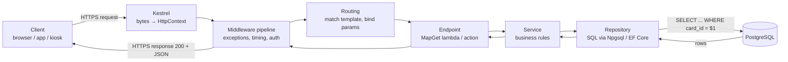
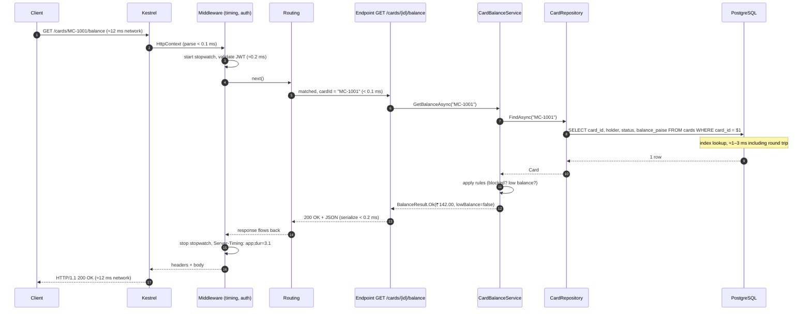

When you open your city's metro app, tap "Check balance" on your linked travel card and see "Balance ₹142" a moment later, a chain of about ten hand-offs has happened between your phone and a database row. The same chain runs for every API call your apps will ever serve. This lesson walks through it once, slowly, with numbers, so that later lessons on middleware, dependency injection and databases have a map to hang on.

## Learning objectives

By the end of this lesson you will be able to:

1. Name the stages a request passes through, in order, from the client's network stack to PostgreSQL and back.
2. Explain what Kestrel does with raw bytes and what an `HttpContext` is.
3. Describe how the middleware pipeline, routing and the endpoint relate, and where "your code" starts.
4. Place the service and repository layers in the flow and explain why they exist.
5. Estimate, in milliseconds, where time goes in a typical request and identify the slowest hop.
6. Add a middleware that measures server time and exposes it to the client with the `Server-Timing` header.
7. Trace a slow or failing request to the right stage using logs and timings.

## Prerequisites

- [How an ASP.NET Core application starts](#/lesson/m03-startup): you know the two phases of `Program.cs` and that `app.Run()` starts Kestrel.
- [Client-server architecture](#/lesson/m02-client-server): request/response basics.
- [Layered architecture](#/lesson/m02-layered): presentation, business and data layers.

You do not need to know middleware or DI in depth; this lesson shows where they sit, and the next lessons explain how they work.

## Explain it like I'm a beginner

Imagine ordering a dosa at a busy canteen with a token system.

1. **You** (the client) walk to the counter and say "one masala dosa" (the HTTP request).
2. **The cashier** (Kestrel, the web server) hears you, writes a token with the order, and hands it to the kitchen. The cashier does not cook; the cashier's job is to turn noisy speech into a clean, structured slip.
3. **The slip passes a few checkpoints** (middleware): is the canteen open? Is this a staff member with a discount card? Should we note the time for the daily report?
4. **A dispatcher** (routing) reads "masala dosa" and decides which station cooks it: the dosa station, not the chaat station.
5. **The cook at that station** (the endpoint, your code) starts the dish.
6. The cook asks **the recipe keeper** (the service layer) how this dish is made: how much batter, which chutneys.
7. The recipe keeper sends **a runner to the store room** (the repository) to fetch potatoes and batter.
8. **The store room** (PostgreSQL) has the ingredients on shelves, indexed so the runner finds them in seconds.
9. The dish travels back the same way: cook → checkpoints (one notes "served in 4 minutes") → cashier → you (the HTTP response).

Two things make this analogy useful. First, each role does **one** job, and you can replace any role without retraining the others: a new cashier does not change the recipes. Second, almost all the waiting happens at **one** place, the store room. The cashier takes a second; the runner's trip takes minutes. In web apps, the database call is usually that trip.

## First-principles explanation

We will follow one request: `GET https://api.metro.example/cards/MC-1001/balance`.

### Stage 0 — before any byte reaches your app

The client (a browser, a mobile app, a recharge kiosk) has to find the server and open a secure connection:

- **DNS**: translate `api.metro.example` into an IP address. Often cached; a cold lookup is typically 10–50 ms (estimate).
- **TCP handshake**: three packets between client and server. One round trip. Delhi to a Mumbai data centre is roughly 20–30 ms round trip; Delhi to Singapore roughly 60–80 ms (estimates for typical fibre paths).
- **TLS handshake**: negotiating encryption. One more round trip with TLS 1.3, two with TLS 1.2.
- **Sending the request**: a `GET` with headers is a few hundred bytes, under one packet.

None of this is your code, yet for a user on a 4G connection it is often **half of the perceived latency**. Browsers and HTTP clients keep connections alive and reuse them (keep-alive, HTTP/2 multiplexing), so the second request on the same connection skips all of it.

### Stage 1 — Kestrel: bytes become an `HttpContext`

Kestrel is the cross-platform web server built into ASP.NET Core. It is started by the host during `app.Run()`. For each connection it:

1. Reads bytes from the socket.
2. Parses the HTTP request line (`GET /cards/MC-1001/balance HTTP/1.1`), the headers and, if present, the body. Kestrel supports HTTP/1.1, HTTP/2 and HTTP/3.
3. Creates an **`HttpContext`**: one object per request that holds everything about it. `context.Request` (method, path, query, headers, body stream), `context.Response` (status code, headers, body stream, initially empty), `context.User` (filled later by authentication), `context.RequestServices` (a per-request service scope; see [Service lifetimes](#/lesson/m03-service-lifetimes)), and `context.Items` (a scratch dictionary for this request only).
4. Hands the `HttpContext` to the first middleware.

Parsing is very fast, microseconds for a small request. Kestrel is not where your time goes, but it is where your request is *born*; every later stage works on the same `HttpContext`.

In many deployments a **reverse proxy** (Nginx, YARP, an Azure Application Gateway, an AWS ALB) sits in front of Kestrel, terminating TLS and forwarding plain HTTP. Then Kestrel sees the proxy's IP, not the client's, which is why `UseForwardedHeaders` exists.

### Stage 2 — the middleware pipeline

A **middleware** is a small component that sees every request on its way in and every response on its way out. They are chained in the order you add them in `Program.cs`. Each one can do work, call the next one, do more work after the next one returns, or stop the chain (**short-circuit**) and write a response itself.

Typical order for an API:

1. Exception handler (catches anything thrown downstream and produces a clean error response).
2. HTTPS redirection / HSTS.
3. Request logging and timing.
4. Routing (decides which endpoint will run, but does not run it yet).
5. CORS.
6. Authentication (who are you?), then authorization (are you allowed?).
7. Endpoint execution (your code).

Because each middleware wraps the next, the response passes back through them in **reverse** order. A timing middleware placed near the top therefore measures almost everything. The details of writing middleware and the exact ordering rules are in [Kestrel, middleware, routing](#/lesson/m03-kestrel-middleware-routing); here we only need to know that the pipeline exists and that it is where cross-cutting concerns live.

Cost: each middleware is a method call plus a little work, typically microseconds. Ten middleware add well under a millisecond in total. Authentication that validates a JWT signature is the heaviest common one, on the order of tens of microseconds to a fraction of a millisecond.

### Stage 3 — routing: which code handles this?

Routing matches the request method and path against the **route templates** you declared with `MapGet`, `MapPost`, or controller attributes. `GET /cards/{cardId}/balance` matches our URL and extracts `cardId = "MC-1001"`.

Two subtle points:

- Routing *selects* the endpoint in `UseRouting` and stores it on the `HttpContext`. Authorization middleware then reads the endpoint's metadata (`[Authorize]`) to decide. Only at the end does `UseEndpoints` (implicit when you call `app.Map...`) *execute* it. Selection and execution are separate so that middleware in between can make decisions based on *what is about to run*.
- If no template matches, the pipeline reaches the end with no endpoint, and the framework writes **404**. If the path matches but the method does not (`DELETE /cards/MC-1001/balance`), you get **405 Method Not Allowed**.

Routing uses a precomputed tree (a DFA) and is microseconds per request even with hundreds of routes.

### Stage 4 — the endpoint: your code begins

The endpoint is the lambda or controller action. The framework:

1. **Binds parameters**: `cardId` from the route, query strings, headers, and the JSON body (deserialized with `System.Text.Json`) into your method's parameters.
2. **Resolves services** from `context.RequestServices`: the `CardBalanceService` parameter is created by the DI container ([Dependency injection](#/lesson/m03-dependency-injection)).
3. **Calls your method**.
4. **Converts the return value** into a response: an object becomes JSON with status 200; `Results.NotFound()` becomes 404.

Deserializing a small JSON body and serializing a small result each cost microseconds to a few hundred microseconds. Large payloads (thousands of rows) can cost milliseconds and dominate; paginate.

### Stage 5 — the service: business rules

The endpoint should be thin. It translates HTTP into a method call and the result back into HTTP. The **service** (sometimes "application service" or "use case") holds the rules: a blocked card has no readable balance; balances below ₹20 trigger a "top up soon" flag. Putting rules here means the same rules apply whether the caller is an HTTP endpoint, a background job or a test. [Controllers, services, repositories and domain models](#/lesson/m03-layers) covers the division of labour in depth.

Pure in-memory logic: microseconds.

### Stage 6 — the repository: talk to storage

The **repository** hides *how* data is stored. `ICardRepository.FindAsync(cardId)` might run SQL against PostgreSQL today and read a cache tomorrow; the service does not care. In .NET the repository typically uses EF Core (`DbContext`) or Dapper/Npgsql directly.

What the repository does per call: get a connection from the **connection pool** (opening a brand-new PostgreSQL connection takes several milliseconds and a TLS handshake, so pools keep them open and hand them out in microseconds), send the parameterised SQL, read the result rows, map them to C# objects, return the connection to the pool.

### Stage 7 — PostgreSQL: the actual work

The database:

1. Receives the query over its wire protocol (one network round trip to the database host: ~0.2–1 ms in the same data centre, 20+ ms across regions — a strong reason to keep app and database close).
2. Parses and plans it (cached for prepared statements).
3. Executes: with an index on `cards.card_id`, finding one row is a few index-page reads, usually from memory (shared buffers or OS cache). Sub-millisecond. Without the index it scans the whole table: a 10-million-row `cards` table might take hundreds of milliseconds, and that one missing index becomes the whole user-visible delay.
4. Returns the rows.

A single indexed lookup end to end (round trip + execution + driver overhead) is typically 1–3 ms in the same data centre (estimate). This is where to look first when something is slow.

### Stage 8 — the way back

The rows become a `Card` object (repository), the service applies rules and returns a `BalanceResult`, the endpoint turns it into `200 OK` with a JSON body, and the response travels back **up** the middleware chain: the timing middleware records the elapsed time and adds a header, the exception handler does nothing because nothing failed, Kestrel writes status line, headers and body to the socket. The client reads the bytes and shows "₹142".

Kestrel streams the body; once the first byte of the body is written, **headers are locked** (`Response.HasStarted == true`). This is why middleware that wants to add a header after the endpoint runs must register a callback with `Response.OnStarting`, which fires just before the first write.

### Where the time goes

A realistic breakdown for our indexed lookup, same-region client, warm connection (all values are estimates for illustration, not benchmarks):

| Stage | Typical time | Who owns it |
|---|---|---|
| Client → server network (one way) | 10–15 ms | Network / where you deploy |
| Kestrel parse, `HttpContext` creation | < 0.1 ms | Framework |
| Middleware (10 components, incl. JWT validation) | 0.1–0.5 ms | Your configuration |
| Routing + parameter binding | < 0.1 ms | Framework |
| Service logic | < 0.1 ms | Your code |
| Repository + PostgreSQL round trip (indexed) | 1–3 ms | Your SQL, indexes, pool |
| Serialization + Kestrel write | < 0.2 ms | Framework |
| Server → client network | 10–15 ms | Network |
| **Total seen by client** | **≈ 25–35 ms** | |

Two conclusions beginners find surprising. First, the server often spends only 2–4 ms of a 30 ms request doing anything; the rest is distance. Second, within the server, the database is 80–90 % of the time. Optimising middleware before indexes is working on the wrong 1 %.

### Failure modes along the path

- **Connection refused / timeout** before Kestrel: the app is not running, the port is wrong, a firewall. No log line in your app at all; look at the orchestrator.
- **4xx straight from Kestrel**: `400` for malformed HTTP, `431 Request Header Fields Too Large` when headers exceed `MaxRequestHeadersTotalSize` (32 KB by default), `413 Content Too Large` when the body exceeds `MaxRequestBodySize` (30,000,000 bytes, about 28.6 MB, by default). Your endpoint never runs, so your own logs may show nothing.
- **401 / 403**: authentication or authorization middleware short-circuited. Your endpoint never ran.
- **404**: no route matched. Check the template, the HTTP method, and whether `MapControllers` was called.
- **500**: an exception reached the exception handler. Check the log; the correlation id in the response helps find it.
- **Slow**: a missing index, a cold connection pool, an N+1 query loop, or a chatty remote call inside the service.

## Visual explanation

### The layers a request crosses



Read it left to right for the request and right to left for the response. The three boxes in the middle (middleware, routing, endpoint) are the framework's territory with your configuration; service and repository are your code; the database is a separate process, possibly on a separate machine. Every arrow is a potential failure point and a potential delay, but the two arrows touching PostgreSQL are the ones that cross a network and usually cost the most.

### Sequence with timings



Each numbered arrow is a hand-off. Arrows 1 and 17 are the network legs the client pays for. Arrows 8 and 9 are the database leg where the server spends most of its own time. Everything else together is well under a millisecond. When you read a slow trace in production, your first question should be: "what are the equivalents of arrows 8 and 9 in this request, and how many of them are there?" An endpoint that loops over 50 cards and calls `FindAsync` 50 times does arrows 8 and 9 fifty times, turning 3 ms into 150 ms. That is the N+1 problem.

## Step-by-step example

Let's build the balance endpoint and watch each stage appear.

### Step 1 — the endpoint alone

```csharp
app.MapGet("/cards/{cardId}/balance", (string cardId) => new { cardId, balance = 142.00m });
```

Stages 1–4 and 8 already exist: Kestrel, the default pipeline, routing, parameter binding, serialization. Call it and you get JSON. No database yet; every card has ₹142.

### Step 2 — introduce the repository

```csharp
public interface ICardRepository
{
    Task<Card?> FindAsync(string cardId, CancellationToken ct);
}
```

An in-memory implementation lets us run and test without PostgreSQL. The production implementation uses Npgsql (shown later as a snippet). The endpoint does not know which one it got.

### Step 3 — introduce the service

The service owns the rules: unknown card → not found; blocked card → a specific error; otherwise return the balance with a `LowBalance` flag below ₹20. The endpoint maps each outcome to an HTTP status: 404, 409 (conflict: the card exists but cannot be used), 200.

### Step 4 — measure

A `ServerTimingMiddleware` starts a stopwatch when the request enters and, just before the response headers are sent, writes `Server-Timing: app;dur=3.1`. Browsers show this header in the Network tab; load testers can read it. Now you can see server time separately from network time, which is the first step in any latency investigation.

## Production-style C# implementation

Project layout:

```text
Metro.Api/
  Program.cs
  Cards/Card.cs
  Cards/ICardRepository.cs
  Cards/InMemoryCardRepository.cs
  Cards/CardBalanceService.cs
  Middleware/ServerTimingMiddleware.cs
```

```csharp file=Cards/Card.cs
namespace Metro.Cards;

public enum CardStatus { Active, Blocked }

/// <summary>Money is stored in paise (integer) to avoid floating-point rounding. ₹142.00 = 14200 paise.</summary>
public sealed record Card(string CardId, string Holder, CardStatus Status, long BalancePaise);

public enum BalanceOutcome { Ok, NotFound, Blocked }

public sealed record BalanceResult(BalanceOutcome Outcome, string CardId, decimal BalanceRupees, bool LowBalance)
{
    public static BalanceResult NotFound(string cardId) => new(BalanceOutcome.NotFound, cardId, 0m, false);
    public static BalanceResult Blocked(string cardId) => new(BalanceOutcome.Blocked, cardId, 0m, false);
}
```

```csharp file=Cards/ICardRepository.cs
namespace Metro.Cards;

/// <summary>Stage 6: hides how cards are stored. The service never sees SQL.</summary>
public interface ICardRepository
{
    Task<Card?> FindAsync(string cardId, CancellationToken ct);
}
```

```csharp file=Cards/InMemoryCardRepository.cs
using System.Collections.Concurrent;

namespace Metro.Cards;

/// <summary>Stand-in for PostgreSQL in development and tests. Same interface, no network.</summary>
public sealed class InMemoryCardRepository : ICardRepository
{
    private readonly ConcurrentDictionary<string, Card> _cards = new(StringComparer.OrdinalIgnoreCase)
    {
        ["MC-1001"] = new Card("MC-1001", "Asha Verma", CardStatus.Active, 14200),
        ["MC-1002"] = new Card("MC-1002", "Rahul Nair", CardStatus.Active, 1500),
        ["MC-1003"] = new Card("MC-1003", "Blocked Card", CardStatus.Blocked, 50000),
    };

    public Task<Card?> FindAsync(string cardId, CancellationToken ct)
        => Task.FromResult(_cards.TryGetValue(cardId, out var card) ? card : null);
}
```

```csharp file=Cards/CardBalanceService.cs
using Microsoft.Extensions.Logging;

namespace Metro.Cards;

/// <summary>Stage 5: business rules. No HTTP types here, so the same class serves endpoints, jobs and tests.</summary>
public sealed class CardBalanceService(ICardRepository cards, ILogger<CardBalanceService> logger)
{
    public const long LowBalanceThresholdPaise = 2000; // ₹20

    public async Task<BalanceResult> GetBalanceAsync(string cardId, CancellationToken ct)
    {
        var card = await cards.FindAsync(cardId, ct);
        if (card is null)
        {
            logger.LogInformation("Balance lookup for unknown card {CardId}", cardId);
            return BalanceResult.NotFound(cardId);
        }
        if (card.Status == CardStatus.Blocked)
            return BalanceResult.Blocked(card.CardId);

        return new BalanceResult(
            BalanceOutcome.Ok,
            card.CardId,
            card.BalancePaise / 100m,
            card.BalancePaise < LowBalanceThresholdPaise);
    }
}
```

```csharp file=Middleware/ServerTimingMiddleware.cs
using System.Diagnostics;
using System.Globalization;
using Microsoft.AspNetCore.Http;

namespace Metro.Middleware;

/// <summary>Stage 2: measures server-side time and reports it in the Server-Timing header.</summary>
public sealed class ServerTimingMiddleware(RequestDelegate next)
{
    public async Task InvokeAsync(HttpContext context)
    {
        var start = Stopwatch.GetTimestamp();

        // Headers lock when the first body byte is written. OnStarting runs just before that moment,
        // so the header reflects everything up to the start of the response.
        context.Response.OnStarting(() =>
        {
            var ms = Stopwatch.GetElapsedTime(start).TotalMilliseconds;
            context.Response.Headers.Append("Server-Timing",
                string.Create(CultureInfo.InvariantCulture, $"app;dur={ms:F1}"));
            return Task.CompletedTask;
        });

        await next(context);
    }
}

public static class ServerTimingExtensions
{
    public static IApplicationBuilder UseServerTiming(this IApplicationBuilder app)
        => app.UseMiddleware<ServerTimingMiddleware>();
}
```

```csharp file=Program.cs
using Metro.Cards;
using Metro.Middleware;

var builder = WebApplication.CreateBuilder(args);

// Phase 1: what exists.
builder.Services.AddSingleton<ICardRepository, InMemoryCardRepository>(); // swap for NpgsqlCardRepository in production
builder.Services.AddScoped<CardBalanceService>();
builder.Services.AddProblemDetails();   // RFC 9457 error bodies for exceptions and empty error responses

var app = builder.Build();

// Phase 2: what happens to a request, in order.
app.UseExceptionHandler();              // catches anything thrown downstream; writes a 500 ProblemDetails, no stack trace
app.UseServerTiming();

// Stage 3 + 4: route template, parameter binding, service resolution, result conversion.
app.MapGet("/cards/{cardId}/balance", async (string cardId, CardBalanceService service, CancellationToken ct) =>
{
    var result = await service.GetBalanceAsync(cardId, ct);
    return result.Outcome switch
    {
        BalanceOutcome.NotFound => Results.Problem(title: $"Card {cardId} not found", statusCode: StatusCodes.Status404NotFound),
        BalanceOutcome.Blocked => Results.Problem(title: $"Card {cardId} is blocked", statusCode: StatusCodes.Status409Conflict),
        _ => Results.Ok(new { cardId = result.CardId, balance = result.BalanceRupees, lowBalance = result.LowBalance }),
    };
});

app.Run();
```

### The PostgreSQL repository

The production repository replaces the in-memory one with one registration line. It is shown as a snippet because it needs the `Npgsql` and `Npgsql.DependencyInjection` packages:

```csharp
public sealed class NpgsqlCardRepository(NpgsqlDataSource dataSource) : ICardRepository
{
    public async Task<Card?> FindAsync(string cardId, CancellationToken ct)
    {
        // The data source owns the connection pool: OpenConnectionAsync hands out an already-open connection.
        await using var conn = await dataSource.OpenConnectionAsync(ct);
        await using var cmd = new NpgsqlCommand(
            "SELECT card_id, holder, status, balance_paise FROM cards WHERE card_id = $1", conn);
        cmd.Parameters.AddWithValue(cardId);               // parameterised: no SQL injection, plan reuse

        await using var reader = await cmd.ExecuteReaderAsync(ct);
        if (!await reader.ReadAsync(ct)) return null;
        return new Card(
            reader.GetString(0),
            reader.GetString(1),
            reader.GetString(2) == "blocked" ? CardStatus.Blocked : CardStatus.Active,
            reader.GetInt64(3));
    }
}

// Program.cs
builder.Services.AddNpgsqlDataSource(builder.Configuration.GetConnectionString("Metro")!);
builder.Services.AddSingleton<ICardRepository, NpgsqlCardRepository>();
```

And the index that makes stage 7 take 1 ms instead of 500 ms:

```sql
CREATE TABLE cards (
    card_id       text PRIMARY KEY,        -- primary key creates a unique B-tree index
    holder        text NOT NULL,
    status        text NOT NULL CHECK (status IN ('active', 'blocked')),
    balance_paise bigint NOT NULL CHECK (balance_paise >= 0)
);
-- EXPLAIN ANALYZE SELECT ... WHERE card_id = 'MC-1001';  → "Index Scan using cards_pkey", execution time well under 1 ms
```

## Bad design vs good design

**Bad**: everything in the endpoint.

```csharp
app.MapGet("/cards/{id}/balance", async (string id) =>
{
    using var conn = new NpgsqlConnection("Host=db;Username=app;Password=secret;Database=metro"); // new connection each time, secret in code
    await conn.OpenAsync();                                     // several ms: no pool reuse via a data source
    using var cmd = new NpgsqlCommand("SELECT * FROM cards WHERE card_id = '" + id + "'", conn); // SQL injection
    using var r = await cmd.ExecuteReaderAsync();
    if (!r.Read()) return Results.NotFound();
    if (r.GetString(2) == "blocked") return Results.Conflict();
    return Results.Ok(new { balance = r.GetInt64(3) / 100.0 });  // double for money; no cancellation; no timing
});
```

It "works" on a laptop. In production: a card id of `' OR 1=1 --` dumps the table; the connection string password is in source control; `double` turns ₹0.10 into 0.1000000000000000055; the business rule "blocked card" is unreachable from a background job; and nobody can measure where time goes.

**Good**: the layered version above. Each stage has one job. The endpoint maps outcomes to HTTP; the service owns the rules; the repository owns SQL and parameterisation; the middleware owns measurement; the connection pool owns connections.

:::callout type=tradeoff title="When fewer layers are fine"
For a 3-endpoint internal tool with one developer, a service *and* a repository *and* an interface for each is ceremony. Keep the endpoint thin and put the rules in one service class that talks to the database directly. Add the repository interface when you need a second storage implementation or when tests become painful without it. Layers are a cost you pay for change you expect.
:::

:::callout type=warning title="Headers after the body has started"
Setting `Response.Headers` after the endpoint has written the body throws `InvalidOperationException: Headers are read-only, response has already started`. Always use `Response.OnStarting` for headers that depend on downstream work, or set them before calling `next`.
:::

## Practical playground

This console program simulates the pipeline without a web server: a list of steps, each wrapping the next, with a stopwatch. Add a step that short-circuits (does not call `next`) and watch which later steps never run. Then move the timing step to the end of the list and see what it stops measuring.

:::playground type=csharp title="A pipeline simulator with timings"
```csharp file=Program.cs
using System;
using System.Collections.Generic;
using System.Diagnostics;
using System.Threading.Tasks;

public sealed class Ctx
{
    public string Path = "";
    public int Status = 200;
    public string Body = "";
    public List<string> Log = new();
}

public delegate Task Step(Ctx ctx, Func<Task> next);

public static class Program
{
    public static async Task Main()
    {
        var steps = new List<Step>
        {
            Timing,
            Auth,
            Routing,
        };

        var ctx = new Ctx { Path = "/cards/MC-1001/balance" };
        await Run(steps, 0, ctx);
        Console.WriteLine($"{ctx.Status} {ctx.Body}");
        foreach (var line in ctx.Log) Console.WriteLine("  " + line);
    }

    // Each step receives "next", which runs the remaining steps. Not calling next = short-circuit.
    static Task Run(List<Step> steps, int i, Ctx ctx)
        => i == steps.Count ? Task.CompletedTask : steps[i](ctx, () => Run(steps, i + 1, ctx));

    static async Task Timing(Ctx ctx, Func<Task> next)
    {
        var sw = Stopwatch.StartNew();
        await next();
        ctx.Log.Add($"Timing: {sw.Elapsed.TotalMilliseconds:F2} ms total");
    }

    static async Task Auth(Ctx ctx, Func<Task> next)
    {
        bool hasToken = true;              // flip to false and see the short-circuit
        if (!hasToken) { ctx.Status = 401; ctx.Body = "no token"; ctx.Log.Add("Auth: rejected"); return; }
        ctx.Log.Add("Auth: ok");
        await next();
    }

    static async Task Routing(Ctx ctx, Func<Task> next)
    {
        if (ctx.Path.StartsWith("/cards/"))
        {
            await Task.Delay(2);           // pretend this is the PostgreSQL round trip
            ctx.Body = "{\"balance\":142.00}";
            ctx.Log.Add("Endpoint: balance lookup");
        }
        else { ctx.Status = 404; ctx.Log.Add("Routing: no match"); }
        await next();
    }
}
```
:::

## Exercises

:::exercise id=m03-request-lifecycle-ex1 difficulty=beginner kind=code title="Record every request in a log sink"
Implement `RequestLogMiddleware`. After the rest of the pipeline has run, it must record one `RequestLogEntry` (method, path, status code, elapsed milliseconds) into the injected `IRequestLogSink`.
::requirements
- Call `next(context)` exactly once.
- Record *after* `next` returns, so the status code is the final one.
- `ElapsedMs` must be `>= 0`.
::acceptance
- One entry per request with the correct method, path and status.
- The downstream delegate is invoked.
- An exception from downstream still propagates (no swallowing), but you may record the entry in a `finally`.
::hint
The middleware constructor receives `RequestDelegate next`; `InvokeAsync(HttpContext context, IRequestLogSink sink)` can receive the sink as a method parameter (the framework injects it per request).
::hint
`Stopwatch.GetTimestamp()` before, `Stopwatch.GetElapsedTime(start)` after.
::hint
Read `context.Request.Method`, `context.Request.Path`, `context.Response.StatusCode` after `await next(context)`.
::hint
```csharp
var start = Stopwatch.GetTimestamp();
try { await _next(context); }
finally { sink.Record(new RequestLogEntry(context.Request.Method, context.Request.Path, context.Response.StatusCode, Stopwatch.GetElapsedTime(start).TotalMilliseconds)); }
```
::starter
```csharp file=RequestLogMiddleware.cs
using System;
using System.Collections.Generic;
using System.Diagnostics;
using System.Threading.Tasks;
using Microsoft.AspNetCore.Http;

public sealed record RequestLogEntry(string Method, string Path, int StatusCode, double ElapsedMs);

public interface IRequestLogSink
{
    void Record(RequestLogEntry entry);
}

public sealed class ListRequestLogSink : IRequestLogSink
{
    public List<RequestLogEntry> Entries { get; } = new();
    public void Record(RequestLogEntry entry) => Entries.Add(entry);
}

public sealed class RequestLogMiddleware
{
    private readonly RequestDelegate _next;
    public RequestLogMiddleware(RequestDelegate next) => _next = next;

    public Task InvokeAsync(HttpContext context, IRequestLogSink sink)
    {
        throw new NotImplementedException();
    }
}
```
::tests
```csharp file=RequestLogMiddlewareTests.cs
using System;
using System.Threading.Tasks;
using Microsoft.AspNetCore.Http;
using Xunit;

public class RequestLogMiddlewareTests
{
    private static DefaultHttpContext Ctx(string method, string path)
    {
        var ctx = new DefaultHttpContext();
        ctx.Request.Method = method;
        ctx.Request.Path = path;
        return ctx;
    }

    [Fact]
    public async Task Records_method_path_and_final_status()
    {
        var sink = new ListRequestLogSink();
        var called = false;
        var mw = new RequestLogMiddleware(ctx => { called = true; ctx.Response.StatusCode = 404; return Task.CompletedTask; });

        await mw.InvokeAsync(Ctx("GET", "/cards/MC-9999/balance"), sink);

        Assert.True(called);
        var e = Assert.Single(sink.Entries);
        Assert.Equal("GET", e.Method);
        Assert.Equal("/cards/MC-9999/balance", e.Path);
        Assert.Equal(404, e.StatusCode);
        Assert.True(e.ElapsedMs >= 0);
    }

    [Fact]
    public async Task Exception_propagates_but_is_still_recorded()
    {
        var sink = new ListRequestLogSink();
        var mw = new RequestLogMiddleware(_ => throw new InvalidOperationException("db down"));

        await Assert.ThrowsAsync<InvalidOperationException>(() => mw.InvokeAsync(Ctx("GET", "/cards/MC-1/balance"), sink));
        Assert.Single(sink.Entries);
    }
}
```
::solution
```csharp file=RequestLogMiddleware.cs
using System;
using System.Collections.Generic;
using System.Diagnostics;
using System.Threading.Tasks;
using Microsoft.AspNetCore.Http;

public sealed record RequestLogEntry(string Method, string Path, int StatusCode, double ElapsedMs);

public interface IRequestLogSink
{
    void Record(RequestLogEntry entry);
}

public sealed class ListRequestLogSink : IRequestLogSink
{
    public List<RequestLogEntry> Entries { get; } = new();
    public void Record(RequestLogEntry entry) => Entries.Add(entry);
}

public sealed class RequestLogMiddleware
{
    private readonly RequestDelegate _next;
    public RequestLogMiddleware(RequestDelegate next) => _next = next;

    public async Task InvokeAsync(HttpContext context, IRequestLogSink sink)
    {
        var start = Stopwatch.GetTimestamp();
        try
        {
            await _next(context);
        }
        finally
        {
            sink.Record(new RequestLogEntry(
                context.Request.Method,
                context.Request.Path.Value ?? "/",
                context.Response.StatusCode,
                Stopwatch.GetElapsedTime(start).TotalMilliseconds));
        }
    }
}
```

The `finally` is what makes the second test pass: the exception still travels up to the exception handler, and the request is logged with whatever status code was set at the moment of the throw. Placement decides what that is. If this middleware sits *inside* (after) `UseExceptionHandler`, it records 200, because the handler sets 500 only later, on the way out. If it sits *outside* (before) the handler, it records the final 500 the client actually received. Production request loggers usually sit outside for that reason, or set 500 explicitly in a `catch` before rethrowing.
::mistakes
- Recording before `await _next(context)`: the status code is still the default 200.
- Catching the exception and returning normally, which hides the failure from the exception handler.
- Reading `context.Request.Path` as a `PathString` and forgetting `.Value`.
:::

:::exercise id=m03-request-lifecycle-ex2 difficulty=beginner kind=written title="Put the stages in order and name the owner"
Below, shuffled, are the stages of `POST /cards/MC-1002/topup` with body `{ "amountRupees": 200 }`. Put them in the order they happen and, for each, say whether it is owned by the client, the network, the framework, your code or the database.

- The JSON body is deserialized into a `TopUpRequest` parameter.
- `UPDATE cards SET balance_paise = balance_paise + 20000 WHERE card_id = $1` executes.
- Kestrel parses the request line and headers into an `HttpContext`.
- The TLS handshake completes.
- Authorization middleware checks the endpoint's `[Authorize]` metadata.
- `CardTopUpService.TopUpAsync` checks that the amount is between ₹10 and ₹2,000.
- The route template `/cards/{cardId}/topup` is matched.
- The repository takes a pooled connection.
- The `TopUpResult` is serialized to JSON and the status set to 200.
- The timing middleware's `OnStarting` callback writes `Server-Timing`.
::acceptance
- Correct order: TLS → Kestrel parse → routing match → authorization → body binding → service rule → pooled connection → UPDATE → serialize → OnStarting header.
- Routing placed before authorization (authorization needs the selected endpoint).
- Body binding placed after routing/authorization and before the service.
- Each stage assigned a plausible owner.
::hint
Two things must be known before authorization can run: who the user is and *which endpoint* is about to run. Which stage provides the second?
::hint
The body is only read when the endpoint is executed, not during routing.
::hint
`OnStarting` fires when the first byte of the response is about to be written, which is after serialization begins.
::solution
1. TLS handshake — network/client.
2. Kestrel parses into `HttpContext` — framework.
3. Route template matched — framework (routing).
4. Authorization checks endpoint metadata — framework, your configuration.
5. JSON body bound to `TopUpRequest` — framework (endpoint execution begins).
6. Service validates ₹10–₹2,000 — your code.
7. Repository takes a pooled connection — your code + driver.
8. `UPDATE` executes — database.
9. Result serialized, status 200 — framework.
10. `OnStarting` writes `Server-Timing` — your middleware, triggered by the framework as the response starts.

Owner matters because it tells you where to look when the stage misbehaves: a 403 is configuration, a 400 "invalid amount" is your service, a slow step 8 is an index or a lock.
::mistakes
- Placing authorization before routing. In endpoint routing the endpoint must be selected first so its metadata is available.
- Thinking the body is parsed by Kestrel. Kestrel exposes a body *stream*; deserialization happens at the endpoint.
:::

:::exercise id=m03-request-lifecycle-ex3 difficulty=intermediate kind=code title="Service rules for top-up"
Implement `CardTopUpService.TopUpAsync`. The rules: unknown card → `NotFound`; blocked card → `Blocked`; amount outside ₹10–₹2,000 → `InvalidAmount`; otherwise add the amount (converted to paise) via the repository and return `Ok` with the new balance in rupees.
::requirements
- Rupees to paise: multiply by 100 and round to a `long`.
- Check the card first, so a blocked card reports `Blocked` even when the amount is also bad. Order: find card → blocked? → amount valid? → update.
- Use the repository's `UpdateBalanceAsync` and return the new balance it reports.
::acceptance
- Unknown card returns `TopUpOutcome.NotFound` and the repository update is not called.
- Blocked card returns `Blocked`.
- ₹5 and ₹2,500 return `InvalidAmount`; ₹10 and ₹2,000 are accepted.
- ₹200 on a card with 1,500 paise yields a new balance of ₹215.00.
::hint
Start by calling `FindAsync`; everything else depends on whether a card came back.
::hint
`(long)Math.Round(amountRupees * 100m)` converts to paise.
::hint
Return `new TopUpResult(TopUpOutcome.Ok, cardId, newPaise / 100m)` where `newPaise` is what `UpdateBalanceAsync` returned.
::starter
```csharp file=CardTopUpService.cs
using System;
using System.Collections.Generic;
using System.Threading;
using System.Threading.Tasks;

public enum CardStatus { Active, Blocked }
public sealed record Card(string CardId, CardStatus Status, long BalancePaise);

public interface ICardRepository
{
    Task<Card?> FindAsync(string cardId, CancellationToken ct);
    /// <summary>Adds delta paise atomically and returns the new balance in paise.</summary>
    Task<long> UpdateBalanceAsync(string cardId, long deltaPaise, CancellationToken ct);
}

public enum TopUpOutcome { Ok, NotFound, Blocked, InvalidAmount }
public sealed record TopUpResult(TopUpOutcome Outcome, string CardId, decimal NewBalanceRupees);

public sealed class CardTopUpService
{
    public const decimal MinRupees = 10m;
    public const decimal MaxRupees = 2000m;
    private readonly ICardRepository _cards;
    public CardTopUpService(ICardRepository cards) => _cards = cards;

    public Task<TopUpResult> TopUpAsync(string cardId, decimal amountRupees, CancellationToken ct)
    {
        throw new NotImplementedException();
    }
}
```
::tests
```csharp file=CardTopUpServiceTests.cs
using System.Collections.Generic;
using System.Threading;
using System.Threading.Tasks;
using Xunit;

public class CardTopUpServiceTests
{
    private sealed class FakeRepo : ICardRepository
    {
        public Dictionary<string, Card> Cards = new();
        public int Updates;
        public Task<Card?> FindAsync(string id, CancellationToken ct) => Task.FromResult(Cards.TryGetValue(id, out var c) ? c : null);
        public Task<long> UpdateBalanceAsync(string id, long delta, CancellationToken ct)
        {
            Updates++;
            var c = Cards[id];
            Cards[id] = c with { BalancePaise = c.BalancePaise + delta };
            return Task.FromResult(Cards[id].BalancePaise);
        }
    }

    private static FakeRepo Repo() => new()
    {
        Cards =
        {
            ["MC-1002"] = new Card("MC-1002", CardStatus.Active, 1500),
            ["MC-1003"] = new Card("MC-1003", CardStatus.Blocked, 50000),
        }
    };

    [Fact]
    public async Task Unknown_card_is_not_found_and_not_updated()
    {
        var repo = Repo();
        var r = await new CardTopUpService(repo).TopUpAsync("MC-0000", 100m, CancellationToken.None);
        Assert.Equal(TopUpOutcome.NotFound, r.Outcome);
        Assert.Equal(0, repo.Updates);
    }

    [Fact]
    public async Task Blocked_card_is_reported_even_with_bad_amount()
    {
        var r = await new CardTopUpService(Repo()).TopUpAsync("MC-1003", 5m, CancellationToken.None);
        Assert.Equal(TopUpOutcome.Blocked, r.Outcome);
    }

    [Theory]
    [InlineData(5, false)]
    [InlineData(10, true)]
    [InlineData(2000, true)]
    [InlineData(2500, false)]
    public async Task Amount_bounds_are_inclusive(int rupees, bool accepted)
    {
        var r = await new CardTopUpService(Repo()).TopUpAsync("MC-1002", rupees, CancellationToken.None);
        Assert.Equal(accepted ? TopUpOutcome.Ok : TopUpOutcome.InvalidAmount, r.Outcome);
    }

    [Fact]
    public async Task Adds_paise_and_returns_rupees()
    {
        var r = await new CardTopUpService(Repo()).TopUpAsync("MC-1002", 200m, CancellationToken.None);
        Assert.Equal(TopUpOutcome.Ok, r.Outcome);
        Assert.Equal(215.00m, r.NewBalanceRupees);
    }
}
```
::solution
```csharp file=CardTopUpService.cs
using System;
using System.Collections.Generic;
using System.Threading;
using System.Threading.Tasks;

public enum CardStatus { Active, Blocked }
public sealed record Card(string CardId, CardStatus Status, long BalancePaise);

public interface ICardRepository
{
    Task<Card?> FindAsync(string cardId, CancellationToken ct);
    Task<long> UpdateBalanceAsync(string cardId, long deltaPaise, CancellationToken ct);
}

public enum TopUpOutcome { Ok, NotFound, Blocked, InvalidAmount }
public sealed record TopUpResult(TopUpOutcome Outcome, string CardId, decimal NewBalanceRupees);

public sealed class CardTopUpService
{
    public const decimal MinRupees = 10m;
    public const decimal MaxRupees = 2000m;
    private readonly ICardRepository _cards;
    public CardTopUpService(ICardRepository cards) => _cards = cards;

    public async Task<TopUpResult> TopUpAsync(string cardId, decimal amountRupees, CancellationToken ct)
    {
        var card = await _cards.FindAsync(cardId, ct);
        if (card is null) return new TopUpResult(TopUpOutcome.NotFound, cardId, 0m);
        if (card.Status == CardStatus.Blocked) return new TopUpResult(TopUpOutcome.Blocked, cardId, card.BalancePaise / 100m);
        if (amountRupees < MinRupees || amountRupees > MaxRupees)
            return new TopUpResult(TopUpOutcome.InvalidAmount, cardId, card.BalancePaise / 100m);

        var deltaPaise = (long)Math.Round(amountRupees * 100m, MidpointRounding.AwayFromZero);
        var newPaise = await _cards.UpdateBalanceAsync(cardId, deltaPaise, ct);
        return new TopUpResult(TopUpOutcome.Ok, cardId, newPaise / 100m);
    }
}
```

The endpoint then maps outcomes to HTTP: `NotFound → 404`, `Blocked → 409`, `InvalidAmount → 400`, `Ok → 200`. The service never mentions HTTP, so a nightly reconciliation job can call it too.
::alternatives
Throwing exceptions for each failure (`CardNotFoundException`) is common but makes the "unhappy path" slower and harder to test. A result object with an outcome enum keeps control flow explicit. See [Exceptions and error handling](#/lesson/m01-exceptions) for the trade-offs.
::mistakes
- Using `double` for rupees. `200.0 * 100` is fine, but `0.1 + 0.2` is not; money should be `decimal` or integer paise.
- Reading the balance back with a second `FindAsync` instead of using the value the atomic update returned, which can race with a concurrent top-up.
:::

:::exercise id=m03-request-lifecycle-ex4 difficulty=intermediate kind=sql title="The query behind the repository"
The repository for a ledger-based design does not store a balance column; it computes the balance from a `card_transactions` table where `kind` is `'topup'` (adds) or `'fare'` (subtracts). Write the query that returns the current balance in paise for card `MC-1001`.
::requirements
- Output columns: `card_id`, `balance_paise`.
- Exactly one row, for `MC-1001` only.
- Top-ups add `amount_paise`; fares subtract it.
::acceptance
- Returns `MC-1001` with `balance_paise = 14200` for the seeded data.
- Uses an aggregate over the transactions, not a hard-coded number.
::hint
`SUM(CASE WHEN kind = 'topup' THEN amount_paise ELSE -amount_paise END)`.
::hint
Filter with `WHERE card_id = 'MC-1001'` and `GROUP BY card_id`.
::hint
Think about which index would make this fast for a card with 5,000 transactions: `(card_id, occurred_at)`.
::setup
```sql
CREATE TABLE cards (
    card_id text PRIMARY KEY,
    holder  text NOT NULL,
    status  text NOT NULL
);
CREATE TABLE card_transactions (
    id           bigserial PRIMARY KEY,
    card_id      text NOT NULL REFERENCES cards(card_id),
    kind         text NOT NULL CHECK (kind IN ('topup', 'fare')),
    amount_paise bigint NOT NULL CHECK (amount_paise > 0),
    occurred_at  timestamptz NOT NULL
);
CREATE INDEX ix_card_transactions_card ON card_transactions (card_id, occurred_at);

INSERT INTO cards VALUES ('MC-1001', 'Asha Verma', 'active'), ('MC-1002', 'Rahul Nair', 'active');
INSERT INTO card_transactions (card_id, kind, amount_paise, occurred_at) VALUES
 ('MC-1001', 'topup', 20000, '2026-10-01 08:00+05:30'),
 ('MC-1001', 'fare',   3000, '2026-10-01 09:10+05:30'),
 ('MC-1001', 'fare',   2800, '2026-10-02 18:40+05:30'),
 ('MC-1002', 'topup',  5000, '2026-10-01 07:30+05:30'),
 ('MC-1002', 'fare',   3500, '2026-10-01 07:45+05:30');
```
::check
```sql
SELECT card_id,
       SUM(CASE WHEN kind = 'topup' THEN amount_paise ELSE -amount_paise END) AS balance_paise
FROM card_transactions
WHERE card_id = 'MC-1001'
GROUP BY card_id;
```
::solution
```sql
SELECT card_id,
       SUM(CASE WHEN kind = 'topup' THEN amount_paise ELSE -amount_paise END) AS balance_paise
FROM card_transactions
WHERE card_id = 'MC-1001'
GROUP BY card_id;
```

20000 − 3000 − 2800 = 14200 paise = ₹142.00. With the `(card_id, occurred_at)` index, PostgreSQL reads only this card's rows (an index range scan), so the cost grows with *this card's* transactions, not the whole table. A ledger is the honest design for money (every change is a row you can audit); the trade-off is that the balance is a computation, so busy systems cache it in a `balance_paise` column updated in the same transaction.
::mistakes
- Forgetting `GROUP BY`, which errors in PostgreSQL when mixing an aggregate with a plain column.
- Summing with `+` for fares, giving ₹258 instead of ₹142.
:::

:::exercise id=m03-request-lifecycle-ex5 difficulty=advanced kind=code title="Correlation id across the whole request"
When a user reports "my top-up failed at 6:42 pm", you need to find *that* request in the logs. Implement `CorrelationIdMiddleware`: reuse the incoming `X-Correlation-ID` header if present and non-empty, otherwise generate one; store it in `HttpContext.Items["CorrelationId"]`; set it on the response **before** calling the next middleware so it is present even if downstream throws, and re-apply it in `Response.OnStarting` so it survives an exception handler that clears the response.
::requirements
- Generated ids: `Guid.NewGuid().ToString("N")` (32 hex chars).
- The response header must be present even when downstream throws; the exception must still propagate.
- `UseExceptionHandler` calls `Response.Clear()` (status, headers and body) before writing its error response. Register an `OnStarting` callback that sets the header again, so the error response carries it too.
- Expose the id via `HttpContext.Items["CorrelationId"]` so loggers and services can read it.
::acceptance
- Incoming header `abc-123` → response header `abc-123` and `Items["CorrelationId"] == "abc-123"`.
- No incoming header → response header is a 32-character string.
- Downstream throws → the header is set and the exception is observed by the caller.
::hint
Read `context.Request.Headers["X-Correlation-ID"]` and check `StringValues.IsNullOrEmpty`.
::hint
Set the response header *before* `await _next(context)`. Headers are writable until the response starts, and nothing has started yet at this point.
::hint
`context.Items["CorrelationId"] = id;` then `context.Response.Headers["X-Correlation-ID"] = id;`.
::hint
```csharp
var incoming = context.Request.Headers[HeaderName].ToString();
var id = string.IsNullOrWhiteSpace(incoming) ? Guid.NewGuid().ToString("N") : incoming;
```
::hint
For the error path, add `context.Response.OnStarting(() => { context.Response.Headers[HeaderName] = id; return Task.CompletedTask; });` before calling `_next`.
::starter
```csharp file=CorrelationIdMiddleware.cs
using System;
using System.Threading.Tasks;
using Microsoft.AspNetCore.Http;

public sealed class CorrelationIdMiddleware
{
    public const string HeaderName = "X-Correlation-ID";
    public const string ItemKey = "CorrelationId";
    private readonly RequestDelegate _next;
    public CorrelationIdMiddleware(RequestDelegate next) => _next = next;

    public Task InvokeAsync(HttpContext context)
    {
        throw new NotImplementedException();
    }
}
```
::tests
```csharp file=CorrelationIdMiddlewareTests.cs
using System;
using System.Threading.Tasks;
using Microsoft.AspNetCore.Http;
using Xunit;

public class CorrelationIdMiddlewareTests
{
    [Fact]
    public async Task Reuses_incoming_header()
    {
        var ctx = new DefaultHttpContext();
        ctx.Request.Headers[CorrelationIdMiddleware.HeaderName] = "abc-123";
        var mw = new CorrelationIdMiddleware(_ => Task.CompletedTask);

        await mw.InvokeAsync(ctx);

        Assert.Equal("abc-123", ctx.Response.Headers[CorrelationIdMiddleware.HeaderName].ToString());
        Assert.Equal("abc-123", ctx.Items[CorrelationIdMiddleware.ItemKey]);
    }

    [Fact]
    public async Task Generates_when_missing()
    {
        var ctx = new DefaultHttpContext();
        var mw = new CorrelationIdMiddleware(_ => Task.CompletedTask);

        await mw.InvokeAsync(ctx);

        var id = ctx.Response.Headers[CorrelationIdMiddleware.HeaderName].ToString();
        Assert.Equal(32, id.Length);
        Assert.Equal(id, ctx.Items[CorrelationIdMiddleware.ItemKey]);
    }

    [Fact]
    public async Task Header_is_present_even_if_downstream_throws()
    {
        var ctx = new DefaultHttpContext();
        var mw = new CorrelationIdMiddleware(_ => throw new InvalidOperationException("boom"));

        await Assert.ThrowsAsync<InvalidOperationException>(() => mw.InvokeAsync(ctx));
        Assert.False(string.IsNullOrEmpty(ctx.Response.Headers[CorrelationIdMiddleware.HeaderName].ToString()));
    }
}
```
::solution
```csharp file=CorrelationIdMiddleware.cs
using System;
using System.Threading.Tasks;
using Microsoft.AspNetCore.Http;

public sealed class CorrelationIdMiddleware
{
    public const string HeaderName = "X-Correlation-ID";
    public const string ItemKey = "CorrelationId";
    private readonly RequestDelegate _next;
    public CorrelationIdMiddleware(RequestDelegate next) => _next = next;

    public Task InvokeAsync(HttpContext context)
    {
        var incoming = context.Request.Headers[HeaderName].ToString();
        var id = string.IsNullOrWhiteSpace(incoming) ? Guid.NewGuid().ToString("N") : incoming.Trim();

        context.Items[ItemKey] = id;
        context.Response.Headers[HeaderName] = id;   // before next: headers are still writable

        // An exception handler further down calls Response.Clear(), which wipes headers.
        // OnStarting runs just before the (error or normal) response is sent, so the id is put back.
        context.Response.OnStarting(() =>
        {
            context.Response.Headers[HeaderName] = id;
            return Task.CompletedTask;
        });

        return _next(context);
    }
}
```

In production, also push the id into the logging scope (`logger.BeginScope(new Dictionary<string, object> { ["CorrelationId"] = id })`) so every log line in this request carries it. Place this middleware **first**, before even the exception handler, so the exception handler's logs can read the id from `Items`; the `OnStarting` callback is what makes the error *response* carry it. (A `DefaultHttpContext` in a unit test never fires `OnStarting`, which is why the header is also set directly.) With distributed tracing (OpenTelemetry) the W3C `traceparent` header plays the same role across services, and `Activity.Current?.TraceId` is often used as the correlation id.
::mistakes
- Setting the header after `await _next(context)`, which throws if the body has started and is missing when downstream throws.
- Setting it only once before `next` and assuming error responses keep it: `UseExceptionHandler` clears response headers before writing the error.
- Trusting an unbounded incoming header. In production cap its length (e.g. 64 chars) to avoid log injection.
:::

## Automated testing

Each stage can be tested at the right level:

- **Middleware**: construct it with a fake `RequestDelegate` and a `DefaultHttpContext`, as in exercises 1 and 5. No server needed; tests run in microseconds.
- **Service**: pass a hand-written fake repository (exercise 3). This is where most of your tests should live, because this is where most of the rules live.
- **Repository**: integration tests against a real PostgreSQL (Testcontainers spins one up in Docker), because the point of a repository is SQL correctness and no fake can prove that.
- **The whole pipeline**: `WebApplicationFactory<Program>` from `Microsoft.AspNetCore.Mvc.Testing` boots your actual `Program.cs` in memory and gives you an `HttpClient`. One or two of these per endpoint prove routing, binding, status codes and serialization together:

```csharp
public class BalanceEndpointTests(WebApplicationFactory<Program> factory) : IClassFixture<WebApplicationFactory<Program>>
{
    [Fact]
    public async Task Known_card_returns_200_with_server_timing()
    {
        var client = factory.CreateClient();
        var response = await client.GetAsync("/cards/MC-1001/balance");
        Assert.Equal(HttpStatusCode.OK, response.StatusCode);
        Assert.True(response.Headers.Contains("Server-Timing"));
    }

    [Fact]
    public async Task Unknown_card_returns_404()
        => Assert.Equal(HttpStatusCode.NotFound, (await factory.CreateClient().GetAsync("/cards/NOPE/balance")).StatusCode);
}
```

Edge cases: a card id with URL-encoded characters (`MC%2F1001`), a blocked card (409), cancellation when the client disconnects (the `CancellationToken` parameter is cancelled; your repository should pass it to the driver), and a repository that throws (the exception handler must return clean JSON, not a stack trace).

## Real-world application

- **Payment gateways**: a UPI collect request passes the same chain, with the "repository" being a call to the bank's switch. Correlation ids (there called transaction reference numbers) are mandatory because disputes are resolved by tracing one request across several organisations.
- **Government portals**: a grievance lookup by acknowledgement number is exactly `GET /grievances/{id}`. The slow stage is typically a join across several tables; `Server-Timing` quickly shows whether a complaint about slowness is network (users on 2G in rural areas) or server.
- **Observability**: OpenTelemetry instruments every stage in this lesson automatically for ASP.NET Core and Npgsql, producing a trace that looks remarkably like the sequence diagram above, with real durations. Once you have read this lesson, a trace waterfall needs no further explanation.
- **Reverse proxies and CDNs**: Cloudflare, Akamai or an Nginx layer add stages *before* Kestrel. They can cache `GET` responses entirely, meaning the request never reaches your app. That is why caching headers matter.
- **Serverless**: on Azure Functions or AWS Lambda the "Kestrel" stage is replaced by the platform's host, but middleware-like filters, binding, your service and the database remain. The cold start (loading your code) adds hundreds of milliseconds before stage 1 even begins.

## Interview questions

:::interview
::q beginner
Walk me through what happens when a client calls `GET /cards/MC-1001/balance` on an ASP.NET Core API.
::a
DNS, TCP and TLS set up the connection. Kestrel reads the bytes, parses the request line and headers, and creates an `HttpContext`. The context passes through the middleware pipeline in registration order (exception handling, timing, authentication, authorization). Routing matches the template `/cards/{cardId}/balance` and selects the endpoint; the endpoint binds `cardId`, resolves `CardBalanceService` from DI, and calls it. The service asks the repository, which runs a parameterised `SELECT` on PostgreSQL through a pooled connection. The row becomes a `Card`, the service applies rules, the endpoint returns a result that the framework serializes to JSON with status 200. The response travels back through the middleware in reverse and Kestrel writes it to the socket.
::q beginner
What is an `HttpContext`, and who creates it?
::a
One object per request that carries everything about it: the request (method, path, headers, body stream), the response being built (status, headers, body stream), the authenticated user, per-request services (`RequestServices`), and an `Items` dictionary for passing data between middleware. Kestrel (or whichever server hosts the app) creates it after parsing the raw HTTP and hands it to the first middleware. Every later stage, including your endpoint, works on the same instance.
::q intermediate
Why is routing a separate middleware from endpoint execution?
::a
Because middleware between them needs to know *which* endpoint is about to run. Authorization reads the selected endpoint's `[Authorize]` metadata; CORS reads its CORS policy; rate limiting reads its limiter. `UseRouting` selects and stores the endpoint on the context; the terminal endpoint middleware executes it. If selection and execution were one step, those middleware would have to duplicate the route matching.
::q intermediate
Where does the time usually go in a typical database-backed request, and how would you prove it?
::a
Within the server, the database round trip and query execution dominate, often 80–90 % of server time; middleware, routing and serialization are usually well under a millisecond combined. Network latency between client and server often exceeds all server time put together. To prove it: add a `Server-Timing` header or OpenTelemetry tracing to separate server time from network, log repository durations, and use `EXPLAIN (ANALYZE, BUFFERS)` on the slow query to see whether it uses an index or scans the table.
::q advanced
A request that normally takes 30 ms sometimes takes 3 seconds. Only some users are affected. How do you investigate?
::a
Correlate first: pull the slow requests by correlation id and look for what they share: a tenant, a card with many transactions, a time window, a particular server instance. Then split the time: `Server-Timing` or traces tell you whether the 3 s is server-side. Common causes with intermittent patterns: connection pool exhaustion (every request waits for a connection; check pool wait metrics and raise the pool size or fix leaks), lock contention in PostgreSQL (`pg_stat_activity` shows `wait_event`), a query plan that is fine for small cards and terrible for one card with 100,000 transactions (plan flips; check `EXPLAIN` with that card id), GC pauses under memory pressure, or thread-pool starvation from blocking calls (`.Result`). Fix the cause you found rather than adding a cache in front of a lock.
::q advanced
How would you design the pipeline so that error responses still include the correlation id and the server timing?
::a
Order matters, and so does one detail of the exception handler: when it catches an exception it calls `Response.Clear()`, which wipes the status, the headers and any buffered body, then writes a ProblemDetails response. So a header set directly before `next` is lost on the error path. Put the correlation id middleware first: it stores the id in `HttpContext.Items` before anything can fail and sets the header in a `Response.OnStarting` callback. Put the exception handler second so it catches everything downstream. `OnStarting` callbacks are not removed by `Clear()`, so they fire when the error response starts, and both the correlation id and the `Server-Timing` header (also written in `OnStarting`) appear on successful and failed requests alike. If the response had already started streaming when the exception happened, the handler cannot replace it at all; it can only log and abort the connection. Finally, the exception handler should log with the correlation id from `HttpContext.Items` so the log line and the response the user saw can be matched.
:::

## Summary and revision

**Key takeaways**

- Order of stages: client network → Kestrel (bytes → `HttpContext`) → middleware (in order) → routing (select) → endpoint (bind, resolve, run) → service (rules) → repository (SQL) → PostgreSQL → back up through middleware (reverse) → Kestrel writes → client.
- The `HttpContext` is created once by Kestrel and shared by every stage.
- Routing selects the endpoint before authorization so that endpoint metadata can drive decisions; the endpoint executes last.
- The database leg is usually most of the server's time; the network is usually most of the client's time. Measure before optimising.
- Headers lock when the body starts; use `Response.OnStarting` or set headers before calling `next`.
- Keep the endpoint thin, the service HTTP-free, and the repository the only place that knows SQL.

**Terminology**: Kestrel, `HttpContext`, middleware, short-circuit, routing, endpoint, parameter binding, service layer, repository, connection pool, `Server-Timing`, correlation id, N+1.

:::flashcards
Q: What does Kestrel do with an incoming request?
A: Reads bytes from the socket, parses the HTTP request line/headers/body, builds an HttpContext and hands it to the first middleware.
Q: In what order does a response pass back through middleware?
A: Reverse of the request order — each middleware wraps the next.
Q: Why does routing run before authorization?
A: Authorization needs the selected endpoint's metadata (e.g. [Authorize]) to decide; routing selects, the terminal middleware executes.
Q: Which stage usually takes the most server time in a database-backed request?
A: The repository/PostgreSQL round trip and query — typically 1–3 ms for an indexed lookup versus microseconds for middleware and routing (estimates).
Q: When do response headers become read-only?
A: When the first byte of the body is written (Response.HasStarted). Use OnStarting or set headers before calling next.
Q: What status do you get when the path matches a route but the HTTP method does not?
A: 405 Method Not Allowed (404 when no path matches at all).
Q: What is the N+1 problem in terms of the sequence diagram?
A: Repeating the repository → database arrows once per item in a loop, turning one 3 ms trip into N of them.
Q: What is Server-Timing for?
A: Reporting server-side durations in a response header so clients and tools can separate server time from network time.
:::

## Knowledge check

:::quiz pass=70
::q single
A user in Jaipur reports that `GET /cards/{id}/balance` takes 400 ms, but `Server-Timing` shows `app;dur=3.2`. Where is the time going?
- [ ] The middleware pipeline.
- [ ] Serialization of the JSON response.
- [x] Outside the server: network latency, DNS or TLS, or a proxy/CDN in front of the app.
- [ ] PostgreSQL.
> The server spent 3.2 ms. The remaining ~397 ms happened before the request reached Kestrel or after it left.
::q single
A middleware sets `context.Response.Headers["X-Cache"] = "MISS"` after `await next(context)` and the app throws `Headers are read-only, response has already started`. What is the correct fix?
- [ ] Move the middleware to the end of the pipeline.
- [x] Register the header in `context.Response.OnStarting(...)` or set it before calling `next`.
- [ ] Catch and ignore the exception.
- [ ] Use `context.Request.Headers` instead.
> Once the endpoint writes the body, headers are locked. `OnStarting` fires just before the first write.
::q single
Which stage deserializes a JSON request body into a C# parameter?
- [ ] Kestrel.
- [ ] Routing.
- [x] Endpoint execution (parameter binding), after routing has selected the endpoint.
- [ ] The repository.
> Kestrel exposes the body as a stream. Binding reads and deserializes it when the endpoint runs.
::q multi
Which of the following typically cost *less than a millisecond* per request on the server? (Select all that apply.)
- [x] Kestrel parsing a small request.
- [x] Route matching against 200 templates.
- [ ] An un-indexed lookup on a 10-million-row table.
- [x] Serializing a 2 KB JSON response.
- [ ] A cold PostgreSQL connection open with TLS.
> Parsing, routing and small serialization are microsecond work. Table scans and new connections are millisecond-to-second work.
::q single
`DELETE /cards/MC-1001/balance` is sent, but only `GET` is mapped for that template. What does the client receive?
- [ ] 404 Not Found.
- [x] 405 Method Not Allowed.
- [ ] 400 Bad Request.
- [ ] 500 Internal Server Error.
> The path matched an endpoint but no endpoint for that method exists; endpoint routing answers 405.
::q single
The service layer calls `FindAsync` inside a loop over 40 card ids. What is the likely effect and name of the problem?
- [ ] Nothing; the connection pool makes repeated calls free.
- [x] Around 40 database round trips instead of 1, multiplying latency — the N+1 problem.
- [ ] A deadlock in PostgreSQL.
- [ ] A 405 response.
> Each call repeats the repository → PostgreSQL leg. Fetch all 40 in one `WHERE card_id = ANY($1)` query.
::q single
Where should business rules like "a blocked card cannot be topped up" live so they apply to both the API and a nightly job?
- [ ] In the endpoint lambda.
- [x] In the service layer, free of HTTP types.
- [ ] In a middleware.
- [ ] In the JSON serializer settings.
> The service is callable from any entry point. Endpoints translate HTTP; middleware handles cross-cutting concerns.
:::

## Completion criteria

You have finished this lesson when you can:

- [ ] Score at least 70 % on the knowledge check.
- [ ] Complete exercises 1 and 3; `dotnet test` on the downloaded projects passes.
- [ ] Draw the sequence diagram from memory with at least eight participants and mark where most server time goes.
- [ ] Given a 404, 405, 401 and 500, say which stage produced each and what to check first.
